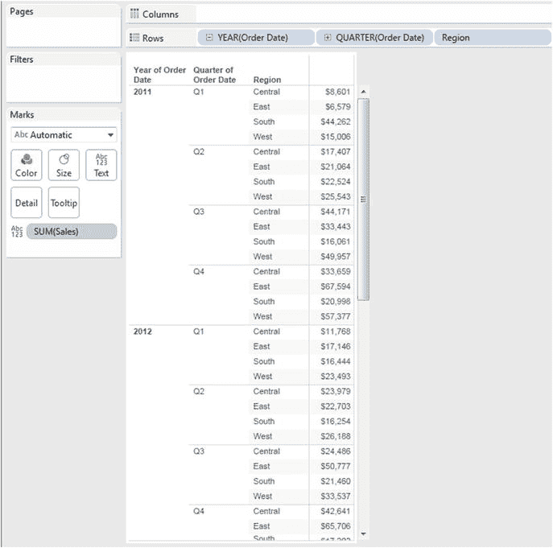
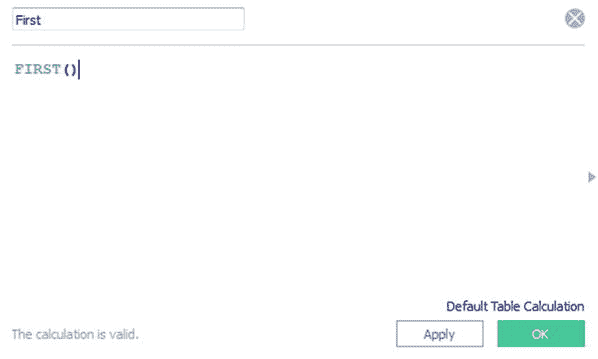
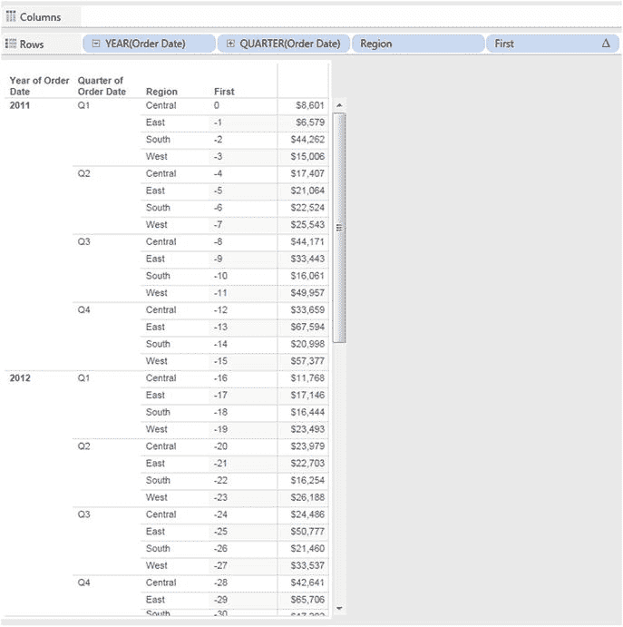
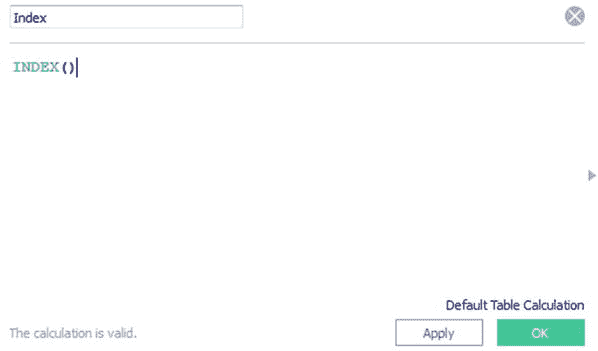
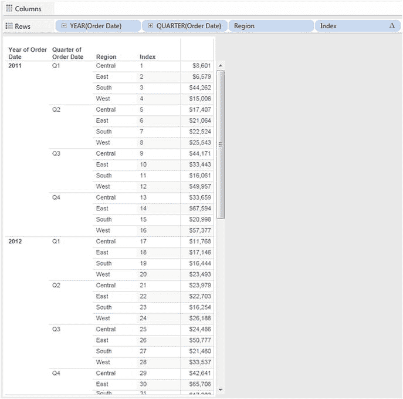

# 表计算函数

表计算是应用于整个表的计算。基本上，表计算应用于在某个聚合级别从数据库返回的值。

让我们探索几个表计算函数。

## `First()`、`Index()`

### `First()`

此函数返回从当前行到分区中第一行的行数。

### `Index()`

此函数返回分区中当前行的索引，不涉及任何关于值的排序。索引值从 1 开始。

### 演示表计算的步骤

请执行以下步骤。

#### 步骤 1

构建一个如图 6-69 所示的视图。



图 6-69. 视图显示每个“区域”按“季度”划分的“销售额”

#### 步骤 2

创建一个名为`First`的计算字段，如图 6-70 所示。



图 6-70. 正在创建的计算字段“First”

#### 步骤 3

将计算字段`First`拖到“行”功能区上（如图 6-71 所示）。



图 6-71. 计算字段“First”放置到“行”功能区上

#### 步骤 4

创建一个名为`Index`的计算字段，如图 6-72 所示。



图 6-72. 正在创建的计算字段“Index”

#### 步骤 5

将计算字段`Index`拖到“行”功能区上（如图 6-73 所示）。



图 6-73. 计算字段“Index”放置到“行”功能区上

## 要点

*   Tableau 支持多种函数，如数字、字符串、逻辑和日期函数等。

*   Tableau 还支持用户函数、类型转换等。

*   Tableau 使用以下公式计算属性：

```
IF MIN([dimension]) = MAX([dimension]) THEN MIN([dimension]) ELSE "*" END
```

## 后续步骤

在下一章中，我们将学习统计学。我们将介绍以下内容：

*   统计学基础

*   五数概括

*   箱线图

*   Tableau 中的统计工具

*   预测