# 10. 仪表盘与故事

> “通过记住三个基本原则：克制、精简、强调，你可以实现有效图表、图形和表格设计的简洁性。” ——加尔·雷诺兹，国际知名沟通顾问、畅销书作者，其获奖作品包括[《演说之禅》](http://www.amazon.com/gp/product/0321811984?ie=UTF8&tag=garrreynoldsc-20&linkCode=xm2&camp=1789&creativeASIN=0321811984)和[《演说之禅设计》](http://www.amazon.com/gp/product/0321668790?ie=UTF8&tag=garrreynoldsc-20&linkCode=xm2&camp=1789&creativeASIN=0321668790)

第 9 章向我们介绍了高级可视化技术，例如瀑布图、凹凸图和子弹图。本章将帮助我们理解如何创建交互式仪表盘并编织故事。我们将探讨以下内容：

- 创建和组织仪表盘
- 仪表盘操作
- 创建故事

## 10.1 为什么使用仪表板？

仪表板可以帮助用户在单个空间中展示多个工作表。除此之外，还可以提供辅助信息，同时比较和监控多种数据。

# 10.2 什么是仪表板？

仪表板是一种可视化显示，它呈现实现一个或多个目标所需的最重要信息，并能完整地适配在单个计算机屏幕上，以便一目了然地进行查看、监控和管理。

换句话说，我们可以说仪表板是一种用户界面，它以易于阅读的方式组织和呈现信息。它在一个屏幕上整合并排列数字、指标，有时还包括绩效记分卡。

您可以在工作簿底部看到类似于工作表标签的仪表板标签。您可以将工作簿中的视图添加到仪表板中。您还可以将网页、图像和文本区域添加到仪表板。仪表板允许您对视图进行格式设置、编辑、下钻和编辑轴。当您将视图添加到仪表板时，它会自动连接到相应的工作表。当您修改工作表时，仪表板会自动更新，反之亦然。

# 10.3 创建仪表板

可以将一个或多个视图/工作表拖入仪表板。您还可以为仪表板添加交互性，并执行更多操作。

## 10.3.1 打开仪表板工作表

您可以像创建新工作表一样创建仪表板。创建新的仪表板工作表后，您可以向仪表板添加一个或多个视图和对象。

### 10.3.1.1 创建仪表板的步骤

让我们探索创建仪表板的步骤。

#### 10.3.1.1.1 第 1 步

选择 `仪表板` ➤ `新建仪表板`（如图 10-1 所示）。

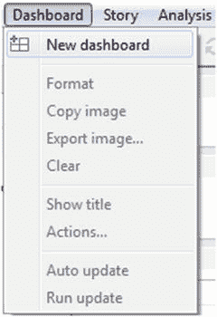

图 10-1. “新建仪表板”选项

#### 10.3.1.1.2 第 2 步

将创建一个新的仪表板工作表（如图 10-2 所示）。

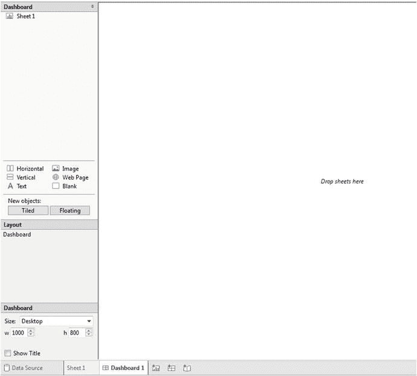

图 10-2. 一个仪表板工作表

#### 10.3.1.1.3 第 3 步

或者，您可以单击工作簿底部的“新建仪表板”标签（如图 10-3 所示）。

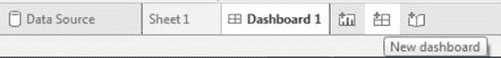

图 10-3. “新建仪表板”标签

## 10.3.2 向仪表板添加视图

您可以将一个或多个视图/工作表拖放到仪表板中。

### 10.3.2.1 向仪表板添加视图/工作表的步骤

执行以下步骤，向仪表板添加视图。

#### 10.3.2.1.1 第 1 步

点击“仪表板 1”打开仪表板（如图 10-4 所示）。

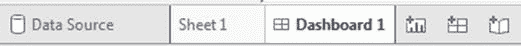

图 10-4. “仪表板 1”工作表

#### 10.3.2.1.2 第 2 步

您将在工作簿左侧看到一个仪表板窗口（如图 10-5 所示）。当前工作簿中的所有工作表都会显示出来。如果您创建一个新工作表，该工作表会自动添加到仪表板窗口中。此功能可帮助您查看工作簿中可用的所有工作表。

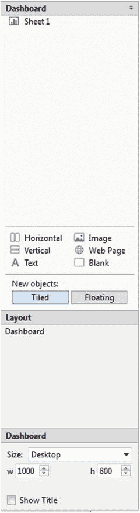

图 10-5. 仪表板窗口

#### 10.3.2.1.3 第 3 步

创建一个如图 10-6 所示的视图；将工作表重命名为“年度销售额”。

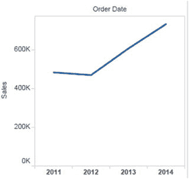

图 10-6. “年度销售额”工作表

#### 10.3.2.1.4 第 4 步

您会注意到仪表板窗口中出现了新的工作表“年度销售额”（如图 10-7 所示）。

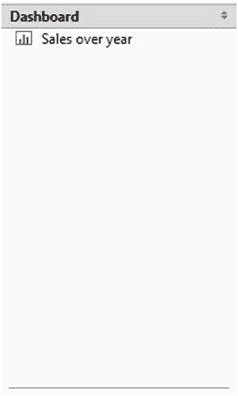

图 10-7. 仪表板窗口中的“年度销售额”工作表

#### 10.3.2.1.5 第 5 步

将仪表板重命名为“销售详情”（如图 10-8 所示）。

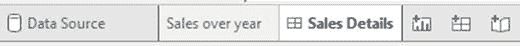

图 10-8. “销售详情”仪表板

#### 10.3.2.1.6 第 6 步

要将视图添加到仪表板，请单击该视图并将其拖拽到右侧的仪表板工作表中（如图 10-9 所示）。

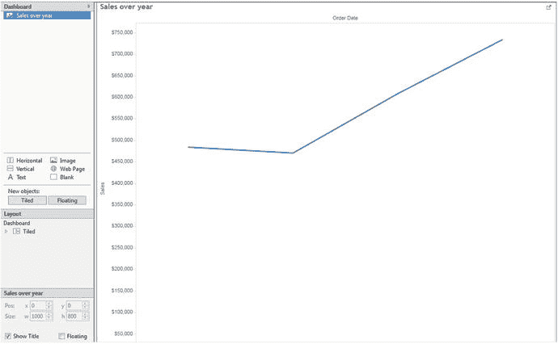

图 10-9. 包含“年度销售额”视图的仪表板工作表

我们已成功将视图“年度销售额”添加到仪表板。接下来探讨如何为仪表板添加交互性。

## 10.3.3 为仪表板添加交互性

如果数据源很复杂，则难以查看、监控和管理视图。为此，您可以创建一个交互式仪表板来限制仪表板上显示的数据。让我们创建一个交互式仪表板来显示客户详情。我们将使用维度“类别”、“子类别”和“区域”。

要创建交互式仪表板，请执行以下步骤：
- 创建概览工作表
- 创建详细信息工作表
- 创建一个仪表板

### 10.3.3.1 创建概览工作表

创建一个概览工作表。

#### 10.3.3.1.1 第 1 步

创建一个名为“每个区域各子类别的销售额”的视图，如图 10-10 所示。

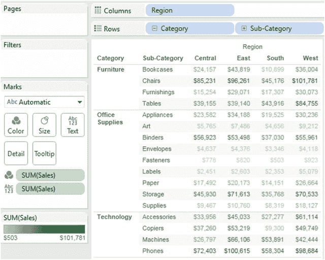

图 10-10. 每个“区域”按“类别”和“子类别”划分的“销售额”

#### 10.3.3.1.2 第 2 步

在“显示我”窗口中选择热图，将上述视图转换为热图（如图 10-11 所示）。

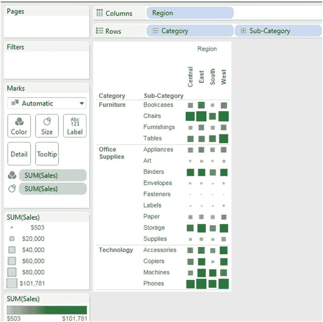

图 10-11. 图 10-10 中所示工作表的热图视图

### 10.3.3.2 创建包含更多详细信息的工作表

创建详细信息工作表的步骤。

#### 10.3.3.2.1 第 1 步

创建一个名为“客户详情”的视图，如图 10-12 所示。

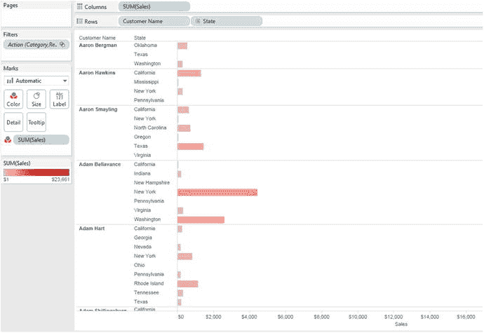

图 10-12. 显示度量“销售额”并附有维度“客户名称”和“州”提供的详细信息的视图

#### 10.3.3.2.2 第 2 步

根据“销售额”字段，对维度“客户名称”进行降序排序（如图 10-13 所示）。

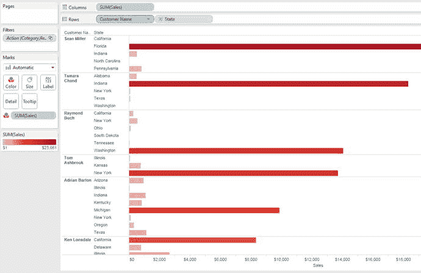

图 10-13. 按“销售额”降序排列的“客户名称”

### 10.3.3.3 创建仪表板

请按照下述步骤创建一个仪表板。

#### 10.3.3.3.1 步骤 1

创建一个名为`“Customer Level Detail - Sales Info”`（客户级别详细信息 - 销售信息）的仪表板（如图 10-14 所示）。

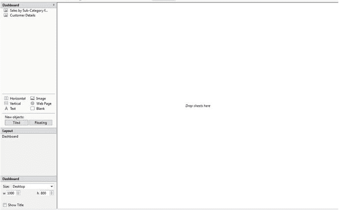

图 10-14. `“Customer Level Detail - Sales Info”`（客户级别详细信息 - 销售信息）仪表板

#### 10.3.3.3.2 步骤 2

单击`“Sales by Sub-Category for each Region”`（各区域按子类别划分的销售额）视图，并将其拖拽至右侧的仪表板工作表上（如图 10-15 所示）。

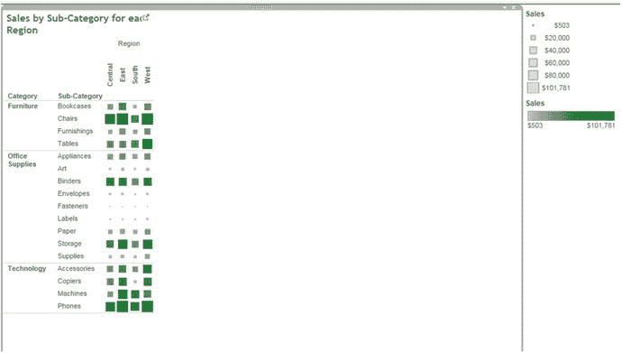

图 10-15. 放置在仪表板工作表上的`“Sales by Sub-Category for each Region”`（各区域按子类别划分的销售额）视图

#### 10.3.3.3.3 步骤 3

将`“大小图例”`和`“颜色图例”`拖放至仪表板工作表的底部（如图 10-16 所示）。

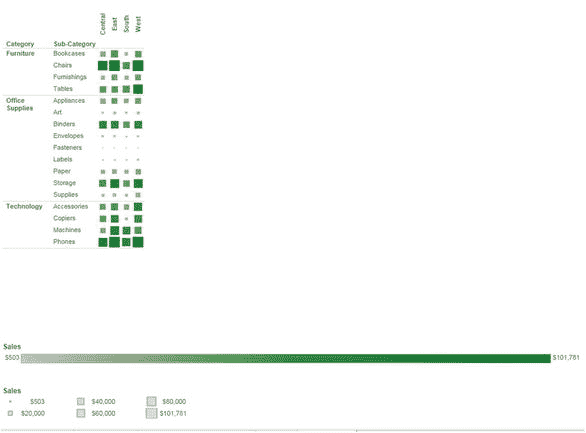

图 10-16. 放置在仪表板工作表底部的`“大小图例”`和`“颜色图例”`

#### 10.3.3.3.4 步骤 4

右键单击仪表板工作表，选择`“适应”` ➤ `“整个视图”`（如图 10-17 所示）。输出结果请参见图 10-18。

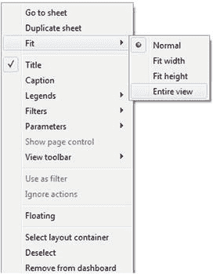

图 10-17. 选择`“整个视图”`的选项

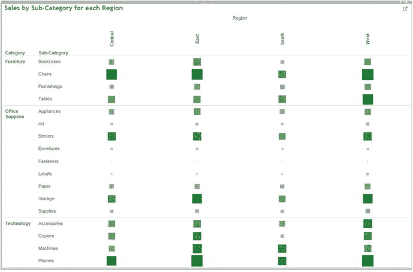

图 10-18. 在`“整个视图”`模式下显示的`“Sales by Sub-Category for each Region”`（各区域按子类别划分的销售额）

#### 10.3.3.3.5 步骤 5

单击`“Customer Details”`（客户详细信息）视图，并将其拖拽至右侧的仪表板工作表上（如图 10-19 所示）。

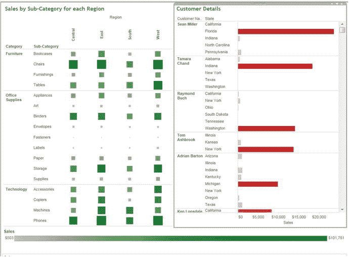

图 10-19. 放置在仪表板工作表上的`“Customer Details”`（客户详细信息）视图

#### 10.3.3.3.6 步骤 6

# 10.3.3.3.7 步骤 7

选择`“Sales by Sub-Category for each Region”`（各区域按子类别划分的销售额）视图，并选择`“用作筛选器”`选项（如图 10-20 所示）。

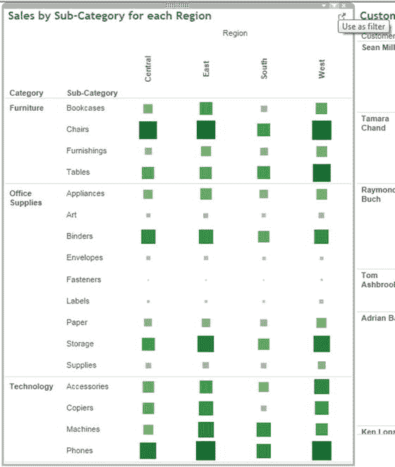

**图 10-20.** `“用作筛选器”`选项

根据所做的选择（`“子类别”`和`“区域”`），将显示相关的客户详细信息（如图 10-21 和 10-22 所示）。

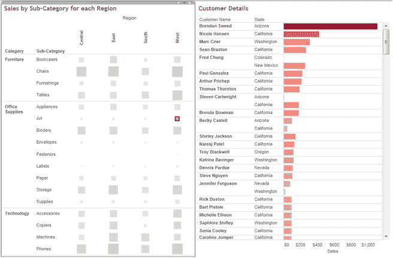

**图 10-22.** 子类别 - `“Art”`和区域 - `“West Region”`的客户详细信息

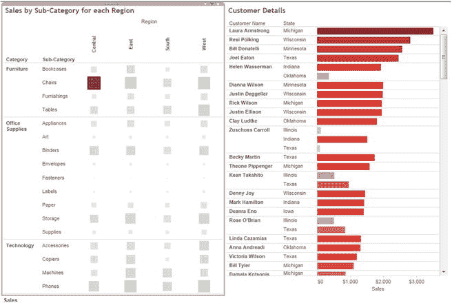

**图 10-21.** 子类别 - `“Chairs”`和区域 - `“Central Region”`的客户详细信息

在下一节中，我们将讨论如何为视图添加辅助信息。

### 10.3.4 向仪表板添加对象

仪表板对象是仪表板中的一个区域。它有助于提供视图中未包含的辅助信息。仪表板对象是多功能的，你可以使用它们来反映图形设计的整体主题。

例如，你可以使用`“文本”`区域来添加关于视图的详细信息。你可以在仪表板窗格中看到这些仪表板对象（如图 10-23 所示）。

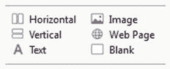

**图 10-23.** 仪表板窗格中的仪表板对象

下面我们来讨论如何将仪表板对象添加到仪表板工作表中。

#### 10.3.4.1 添加仪表板对象的步骤

按照以下步骤将仪表板对象添加到仪表板工作表中。

##### 10.3.4.1.1 步骤 1

将仪表板窗格下的仪表板对象`“文本”`拖拽至仪表板工作表上。

##### 10.3.4.1.2 步骤 2

将弹出一个`“编辑文本”`对话框。请按图 10-24 所示输入文本。

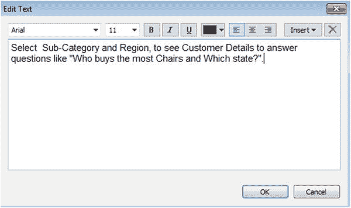

**图 10-24.** `“编辑文本”`对话框

##### 10.3.4.1.3 步骤 3

可以在仪表板中看到`“文本”`对象（如图 10-25 所示）。

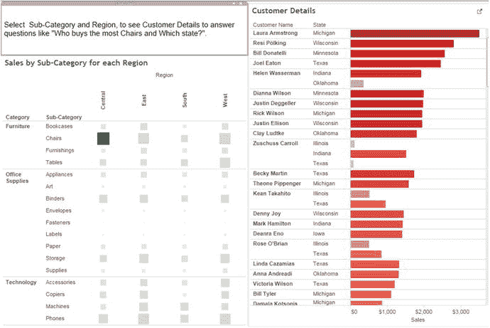

**图 10-25.** 显示`“文本”`对象以为视图提供辅助信息的仪表板

以下是可添加到视图中的仪表板对象列表。每个对象用于不同的目的。

* `图像`：图像对象允许你添加徽标、品牌元素和描述性信息。
* `空白`：空白对象允许你在仪表板中添加一个空白区域。这些对象可用于控制空间。空白容器是透明的，因此你使用的背景颜色会透过来。
* `网页`：网页对象允许你添加来自互联网的有用超链接和动态内容以支持你的视图。

在下一节中，我们将解释如何从仪表板中删除一个工作表。

### 10.3.5 从仪表板中删除视图或对象

有多种方法可以从仪表板中删除视图或对象。

#### 10.3.5.1 通过拖拽删除视图或对象

##### 10.3.5.1.1 步骤 1

选择要从仪表板中删除的视图（`“Sales by Sub-Category for each Region”`（各区域按子类别划分的销售额））（如图 10-26 所示）。

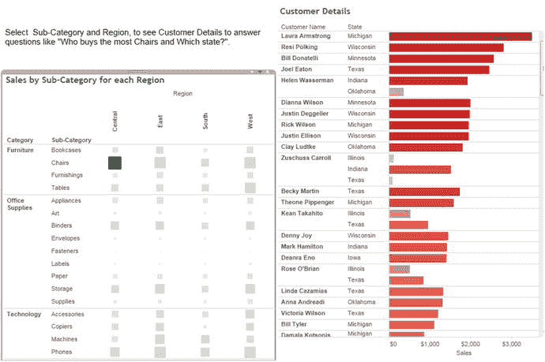

**图 10-26.** 选中的视图`“Sales by Sub-Category for each Region”`（各区域按子类别划分的销售额）

##### 10.3.5.1.2 步骤 2

单击视图顶部的移动手柄，将其拖离至仪表板窗格。

#### 10.3.5.2 使用仪表板窗口删除视图

##### 10.3.5.2.1 步骤 1

右键单击要删除的视图，选择`“从仪表板移除”`（如图 10-27 所示）。

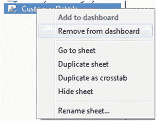

**图 10-27.** 用于从仪表板中删除视图的`“从仪表板移除”`选项

#### 10.3.5.3 使用仪表板视图删除视图或对象

##### 10.3.5.3.1 步骤 1

选择要从仪表板中删除的视图或对象。

##### 10.3.5.3.2 步骤 2

单击仪表板视图菜单，然后选择`“从仪表板移除”`选项，如图 10-28 所示。

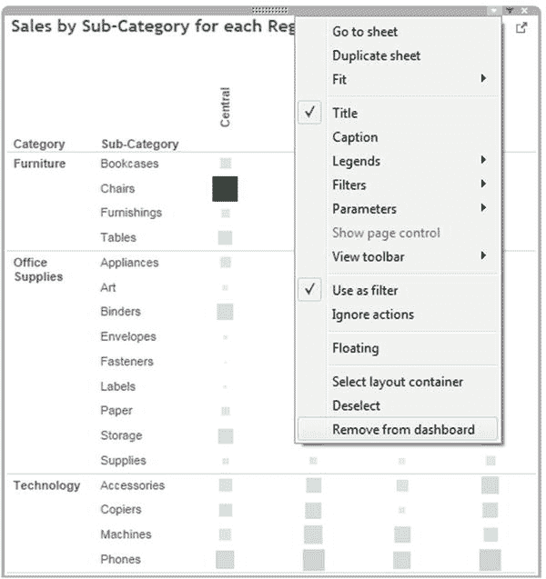

**图 10-28.** 显示`“从仪表板移除”`选项的仪表板视图菜单

### 10.3.6 组织仪表板

你可以通过多种方式组织仪表板，以便讲述一个故事或突出/强调信息。

Tableau 提供了两种布局类型：

* `平铺`
* `浮动`

#### 10.3.6.1 平铺布局

默认情况下，仪表板使用`平铺`布局。在平铺布局中，所有视图和对象都排列在单个图层上，如图 10-29 所示。

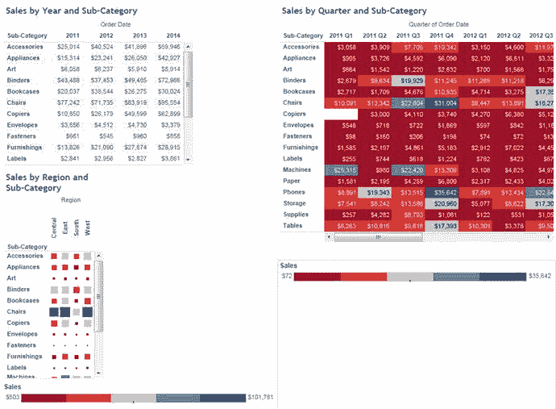

**图 10-29.** 平铺布局

#### 10.3.6.2 浮动布局

在浮动布局中，视图或对象可以层叠在其他对象之上。要更改默认布局，请点击仪表板窗格中间的“浮动”按钮，如图 10-30 所示。

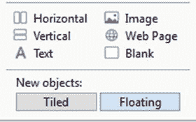

图 10-30. “浮动”布局按钮

当您将仪表板布局设置为“浮动”时，新的工作表或对象将以浮动方式添加（如图 10-31 所示）。“各州销售额”视图层叠在“按区域和子类别划分的销售额”视图之上。

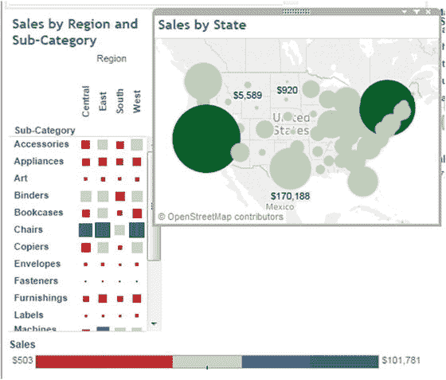

图 10-31. 浮动的“各州销售额”视图

要在布局之间切换，请选择该视图。选择仪表板窗格底部的“浮动”选项，如图 10-32 所示。

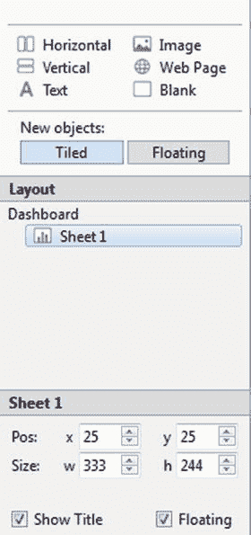

图 10-32. 浮动选项

视图布局将更改为“浮动”布局，如图 10-33 所示。

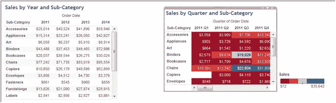

图 10-33. 从平铺布局转换为浮动布局的视图

您可以使用仪表板窗格底部的`Pos`字段（如图 10-34 所示）为浮动布局指定位置。您也可以使用`Size`字段指定浮动视图的尺寸，如图 10-34 所示。

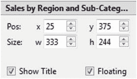

图 10-34. “Pos”和“Size”字段

#### 10.3.6.3 布局容器

`Layout container`是一种对象类型，有助于在仪表板上组织工作表和其他对象。布局容器在仪表板工作表中创建一个区域，在该区域中，视图或对象会根据仪表板中的其他视图或对象自动调整其大小和位置。

##### 10.3.6.3.1 添加布局容器

您可以在仪表板窗格上看到布局容器，如图 10-35 所示。

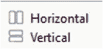

图 10-35. 布局容器

添加`Layout Containers`的步骤：

##### 10.3.6.3.2 步骤 1

将仪表板窗格下方的布局容器拖到仪表板中（如图 10-36、10-37 所示）。

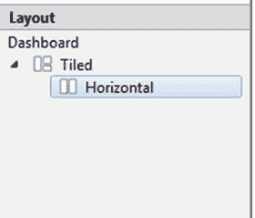

图 10-37. 显示`Horizontal Container`的布局窗口

图 10-36. 布局容器

##### 10.3.6.3.3 步骤 2

您可以在仪表板窗格下方的布局窗口中看到 `Horizontal` 布局容器（如图 10-37 所示）。

#### 10.3.6.3.4 步骤 3

将仪表板窗格下方的 `Running Total Shipping Costs` 和 `Shipping Cost` 视图拖到水平容器中（如图 10-38 所示）。

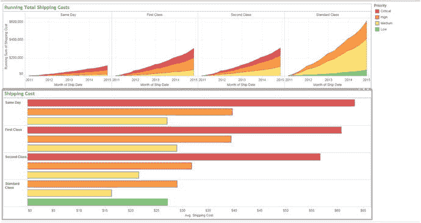

图 10-38. 放置于水平布局容器中的视图：`Running Total Shipping Costs` 和 `Shipping Cost`

#### 10.3.6.3.5 步骤 4

点击筛选器右上角的插入符，调出 `Running Total Shipping Costs` 视图的仪表板菜单（如图 10-39 所示）。从菜单中选择 `Filters` ➤ `Ship Mode`。

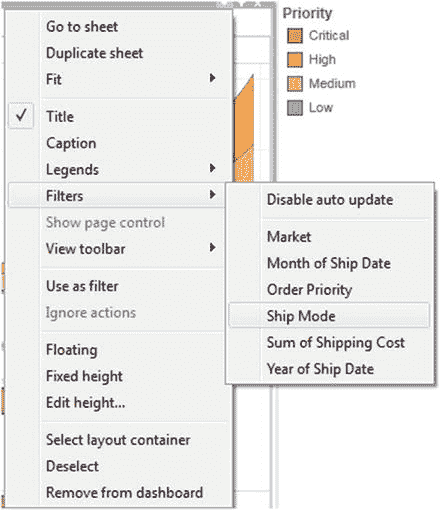

图 10-39. 显示 `Filters ➤ Ship Mode` 的菜单

#### 10.3.6.3.6 步骤 5

观察布局右侧的 `Filters`（如图 10-40 所示）。

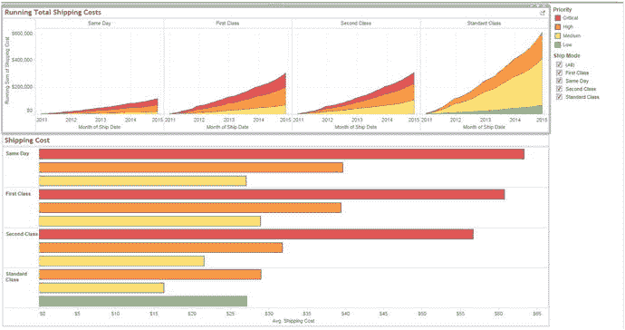

图 10-40. 视图中的 `Ship Mode` 筛选器

#### 10.3.6.3.7 步骤 6

当您取消选择某些 `Ship Mode` 值时，`Shipping Cost` 视图会折叠，`Running Total Shipping Costs` 视图会自动填充该空间（如图 10-41 所示）。

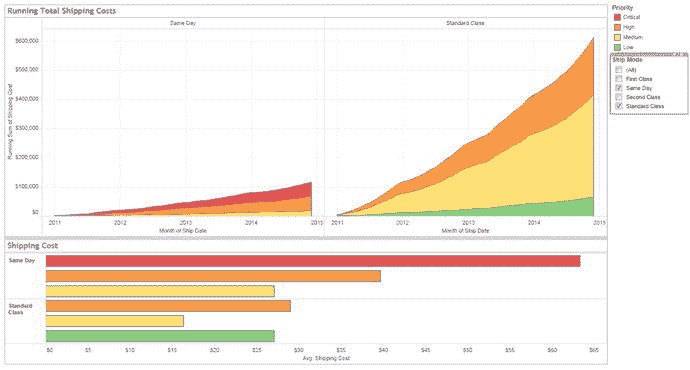

图 10-41. 当我们取消选择任意或部分 `Ship Mode` 时，`Running Total Shipping Costs` 视图会自动填充 `Shipping Cost` 视图的空间

布局容器有助于您高效地控制仪表板。

要将布局容器添加为浮动，请选择 `Floating` 按钮，如图 10-42 所示。

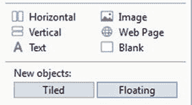

图 10-42. `Floating` 按钮

接下来，将仪表板窗格下方的 `Horizontal` 容器拖到仪表板工作表中（如图 10-43 所示）。

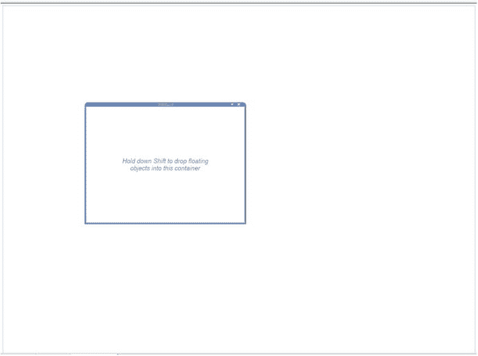

图 10-43. 一个浮动的水平容器

您可以将浮动布局移动到仪表板中的任意位置。

要设置容器格式，请点击标题获取下拉菜单，然后选择 `Format container...`（如图 10-44 所示）。

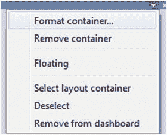

图 10-44. `Format container...` 选项

此时会出现“设置容器格式”对话框（如图 10-45 所示）。为您的容器选择底纹颜色。

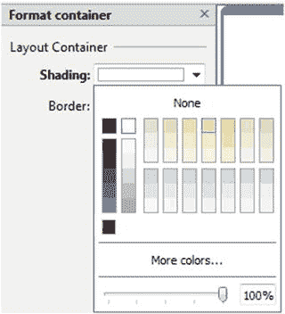

图 10-45. `Format container` 对话框

#### 10.3.6.3.8 设置仪表板大小

您可以使用仪表板窗格底部的仪表板窗口来指定仪表板的大小（如图 10-46 所示）。默认大小为 `Desktop`。您可以使用下拉菜单选择新的大小（如图 10-47 所示）。

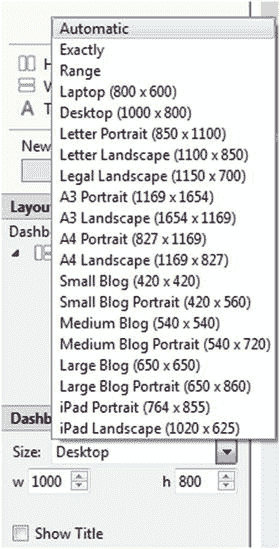

图 10-47. `Dashboard Size` 的各种选项

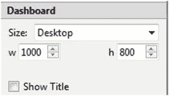

图 10-46. 显示 `Desktop` 作为大小选项的仪表板窗口

#### 10.3.6.3.9 重新排列仪表板视图和对象

您可以使用所选视图、对象、筛选器或图例顶部的移动手柄来重新排列视图对象、筛选器和图例。

#### 10.3.6.3.10 显示或隐藏工作表的部分内容

显示或隐藏工作表的部分内容的步骤：

#### 10.3.6.3.11 步骤 1

选择一个视图或对象。

#### 10.3.6.3.12 步骤 2

点击视图或对象右上角的下拉菜单（如图 10-48 所示）。选择要显示或隐藏的项目。

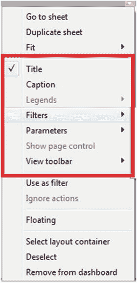

图 10-48. `Show / Hide` 项目

## 10.4 仪表板操作

Tableau 允许您使用操作向仪表板添加交互性。借助操作，您可以使用一个视图中的数据来筛选另一个视图中的数据、链接外部网页、高亮显示特定结果。

操作有三种类型：

- **筛选操作**：筛选操作由源工作表定义，这些工作表在触发操作时将一或多个维度值作为筛选器传递到目标工作表。
- **高亮操作**：高亮操作允许您通过为特定标记着色并使所有其他标记变暗来集中关注感兴趣的标记。
- **URL 操作**：URL 操作允许您基于操作动态生成 URL，并将其在仪表板中的 Web 对象内、新的浏览器窗口或选项卡中打开。

### 10.4.1 筛选操作

让我们讨论如何创建筛选操作。

首先，创建一个控制视图以在另一个视图中筛选数据。

#### 10.4.1.1 执行筛选操作的步骤

请遵循以下步骤来添加筛选操作：

##### 10.4.1.1.1 步骤 1

将数据窗格下维度区域中的维度 `Sub-Category` 拖拽到行架（如图 10-49 所示）。

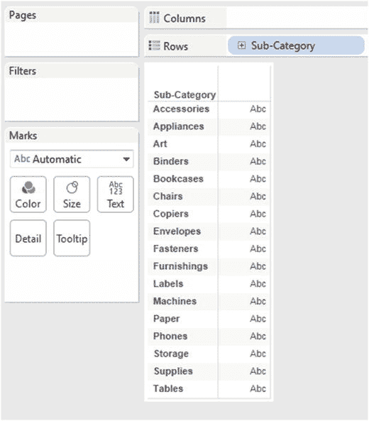

图 10-49. 维度 `Sub-Category` 被放置在行架上

##### 10.4.1.1.2 步骤 2

将数据窗格下维度区域中的维度 `Sub-Category` 拖拽到标记卡上的 `Text`（如图 10-50 所示）。

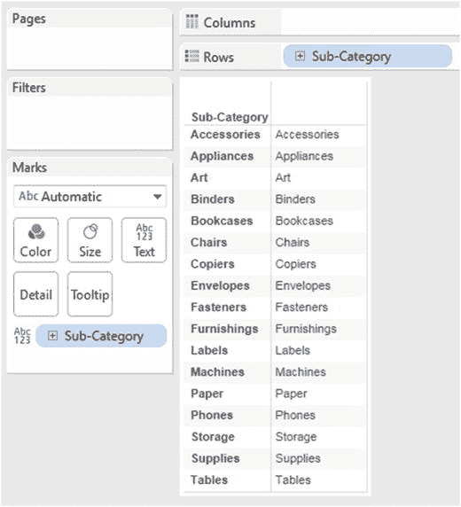

图 10-50. 维度 `Sub-Category` 被放置在标记卡上的 `Text` 中

##### 10.4.1.1.3 步骤 3

右键点击 `Sub-Category`，取消勾选 `Show header` 选项（如图 10-51 所示）以移除表头。

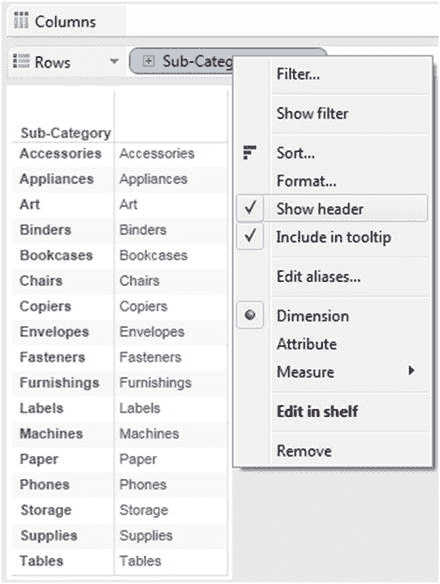

图 10-51. `Show header` 选项

##### 10.4.1.1.4 步骤 4

你可以看到不带表头的 `Sub-Category` 字段（如图 10-52 所示）。

图 10-52. 显示不带表头的 `Sub-Category` 字段的视图

##### 10.4.1.1.5 步骤 5

右键点击 `Sub-Category`，选择 `Format...` 选项来格式化 `Sub-Category`（如图 10-53 所示）。

图 10-53. `Format...` 选项

##### 10.4.1.1.6 步骤 6

`Format Sub-Category` 对话框打开（如图 10-54 所示）。选择“窗格”选项卡，然后选择“字体” ➤ “下划线”。

图 10-54. `Format Sub-Category` 对话框

##### 10.4.1.1.7 步骤 7

右键点击空白区域，选择 `Title` 为视图添加标题（如图 10-55 所示）。

图 10-55. `Title` 选项

##### 10.4.1.1.8 步骤 8

`Edit Title` 对话框打开，输入视图所需的标题（如图 10-56 所示）。

图 10-56. `Edit Title` 对话框

## 10.4.1.1.9 步骤 9
将数据窗格下维度区域中的维度 `Category` 拖拽到行架（如图 10-57 所示）。

图 10-57. 控制视图

让我们创建一个 `Sales vs Profit` 视图和一个 `Sales Map` 视图。

## 10.4.1.1.10 步骤 10
创建一个 `Sales vs Profit` 视图（如图 10-58 所示）。对“区域 - 西部”应用筛选器。

图 10-58. 销售额与利润视图

## 10.4.1.1.11 步骤 11
创建销售地图视图（如图 10-59 所示）。对 `区域 - 西部` 应用筛选器。

图 10-59. 销售地图视图

创建一个仪表板。

## 10.4.1.1.12 步骤 12
如图 10-60 所示创建一个仪表板。

图 10-60. 包含 `控制视图`、`销售地图` 和 `销售额与利润` 视图的仪表板

## 10.4.1.1.13 步骤 13
选择控制视图，点击下拉箭头调出菜单，选择 `Use as Filter`（如图 10-61 所示）。

图 10-61. 显示已选择 `Use as filter` 的菜单

## 10.4.1.1.14 步骤 14
当你选择一个特定的 `Sub-Category` 值时，仪表板中的其他视图会自动更新（如图 10-62 所示）。

图 10-62. 带有`筛选器`操作的仪表板

## 10.4.2 高亮操作
创建高亮操作的步骤。

### 10.4.2.1 创建高亮操作的步骤
#### 10.4.2.1.1 步骤 1
考虑如图 10-63 所示的仪表板。

图 10-63. 显示`控制视图`、`销售地图`和`销售额与利润`视图的仪表板

#### 10.4.2.1.2 步骤 2
转到仪表板菜单并选择 `Actions ...`（如图 10-64 所示）。

图 10-64. 显示`Actions...`项的仪表板菜单

#### 10.4.2.1.3 步骤 3
点击 Actions 时，`Action [Dashboard with filter Action]` 对话框打开。点击 `Add Action`，选择 `Highlight...` 操作（如图 10-65 所示）。

图 10-65. 显示不同操作的 `Actions [Dashboard with filter Action]` 对话框

#### 10.4.2.1.4 步骤 4
点击高亮操作时，`Edit highlight action` 对话框打开。选择 `Control View` 作为 `Source Sheets`，`Sales Vs Profit` 作为 `Target Sheets`，并将 `Run action on` 设置为 `Select`（如图 10-66 所示）。

图 10-66. `Edit highlight action` 对话框

筛选器操作可以设置为在以下三种操作中的任何一种发生时触发：

- `悬停 (Hover)`：用户将鼠标光标移动到标记上。
- `选择 (Select)`：用户点击一个标记，或通过点击并拖动矩形框选多个标记。
- `菜单 (Menu)`：用户在工具提示上为操作选择菜单选项。

#### 10.4.2.1.5 步骤 5
当用户选择一个特定的 `Sub-Category` 值时，该子类别的详细信息会在销售额与利润视图中高亮显示（如图 10-67 所示）。

图 10-67. 在`销售额与利润`视图中高亮显示的子类别 `Binders`

### 10.4.2.2 URL 操作
向仪表板添加 URL 操作以指定外部链接的步骤。

#### 10.4.2.2.1 步骤 1
如图 10-68 所示选择 URL 操作。

图 10-68. Actions [dashboard with filter action] - URL 操作

#### 10.4.2.2.2 步骤 2
点击 URL 操作时，`Edit URL Action` 对话框打开，如图 10-69 所示。从 `Source Sheets` 中选择控制视图，输入链接到特定网页所需的 URL。

图 10-69. `Edit URL Action` 对话框

#### 10.4.2.2.3 步骤 3
当你选择一个特定的 `Sub-Category` 值时，你可以看到 URL 操作链接，如图 10-70 所示，该链接连接到 `URL Action`（该操作指向 Tableau 文档）。

图 10-70. `Sub-Category` 的 `URL Action`

## 10.5 创建故事
故事是一种工作表，可以包含一系列工作表或仪表板，用于传达特定信息。你可以创建故事来说明事实之间的联系，提供上下文，并讲述引人入胜的案例。

# 什么是故事？

故事是一个工作表或按顺序排列的工作表集合。故事中的每个单独工作表称为一个故事点。

在 Tableau 中，故事不仅仅是静态工作表的集合。你可以让故事点保持与基础数据的连接，以反映数据变化。

你可以通过不同方式使用故事：

- 用于协作分析：你可以组合序列工作表以执行假设分析。
- 用作演示工具：你可以使用故事向观众展示视图或仪表板的历史记录。

## 如何创建故事

### 创建故事的步骤

#### 第 1 步

单击`新故事`选项卡（如图 10-71 所示）。

图 10-71. `新故事`选项卡

#### 第 2 步

此时故事工作表打开（如图 10-72 所示）。

图 10-72. 显示的`故事工作表`

#### 第 3 步

你可以从仪表板和工作表窗格的左下角为你的故事选择`大小`，如图 10-73 所示。

图 10-73. `故事大小`选项

#### 第 4 步

单击故事标题以编辑故事标题，如图 10-74 所示。

图 10-74. 故事`编辑标题`对话框

#### 第 5 步

将`各销售区域的销售额与利润`视图从仪表板和工作表窗格拖动到视图中心（如图 10-75 所示）。

图 10-75. 视图中心的各销售区域销售额与利润视图

#### 第 6 步

单击`添加说明文字`以总结故事点，如图 10-76 所示。

图 10-76. 故事点的说明文字

#### 第 7 步

单击`新建空白点`以添加另一个故事点，如图 10-77 所示。

图 10-77. 用于添加另一个故事点的`新建空白点`

#### 第 8 步

此时工作表打开，如图 10-78 所示。

图 10-78. 带说明文字的`新故事工作表`

#### 第 9 步

添加工作表及说明文字，如图 10-79 所示。

图 10-79. `各类别销售额`故事点

#### 第 10 步

你可以继续添加故事点，直到故事完成为止。

这些工作表保持与原始工作表的连接。如果你对原始工作表做了任何更改，你的更改将自动更新到故事点中。但是，你在故事点中所做的更改不会自动更新原始工作表。

## 描述

### 为`故事点`添加描述的步骤

请遵循以下步骤：

#### 第 1 步

要为故事点添加描述，请双击仪表板和工作表下方左下角的描述（如图 10-80 所示）。

图 10-80. `描述`选项

#### 第 2 步

此时将打开`编辑描述`对话框，如图 10-81 所示。

图 10-81. `编辑描述`窗口

#### 第 3 步

你可以将描述拖放到工作表中的任意位置，如图 10-82 所示。

图 10-82. 描述`各分类利润`

要演示故事，请使用工具栏上的演示模式按钮。

## 记住要点

- 仪表板是达成一个或多个目标所需的最重要信息的可视化展示，它完全适合单个电脑屏幕，以便可以一目了然地监视。
- 你可以使用操作向仪表板添加交互性。
- 故事是一个可以包含一系列工作表或仪表板以传达特定信息的工作表。你可以创建故事来讲述事实如何关联、提供背景信息，并提出令人信服的论据。

## 后续步骤

在下一章中，我们将学习 Tableau 与 R 的集成，并了解以下内容：

- 函数（例如 `SCRIPT_INT()`、`SCRIPT_REAL()`、`SCRIPT_BOOL()`、`SCRIPT_STR()`）
- 数据挖掘
- 关联分析
- K 均值聚类

