# 11. Tableau 与 R 的集成

上一章向我们介绍了 Tableau 中的仪表板。我们学习了如何创建交互式仪表板以及如何使用数据讲述故事。本章将向我们介绍 Tableau 与 R 的集成。

R 是一个开源统计分析工具。`Tableau Desktop` 可以通过计算字段连接到 `R`，并利用 `R` 函数、库和包所提供的优势。这些计算会动态调用 `R` 引擎，并通过 `Rserve` 包将值传递给 `R`，然后将计算结果返回给 `Tableau`。这种 `R` 与 `Tableau` 的集成结合了 `R` 的统计分析能力和 `Tableau` 的拖放式可视化功能。

## 实现此集成的步骤

- 启动 `R` 和 `Rserve` 包：
```
> install.packages("Rserve")
> library(Rserve)
> Rserve()
```

- 启动 `Tableau`。

- 连接到 `Rserve`：帮助 ➤ 设置和性能 ➤ 管理 `R` 连接... 参考图 11-1 和图 11-2。

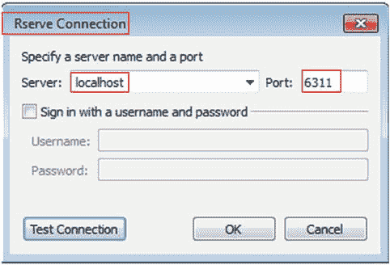

图 11-2. 设置`Rserve`连接

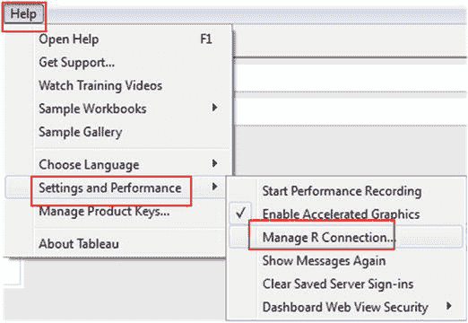

图 11-1. 管理 `R` 连接

- 将数据读入 `Tableau`。

- 创建计算字段以调用 `R` 功能。

- 使用维度、度量和计算字段创建图表和仪表板。

有四个新的内置函数用于调用特定的 `R` 模型和函数：
- `SCRIPT_REAL` - 返回实数
- `SCRIPT_STR` - 返回字符串
- `SCRIPT_INT` - 返回整数
- `SCRIPT_BOOL` - 返回布尔值

这些函数的参数包括 `R` 语言脚本和 `R` 函数调用。

### SCRIPT_STR 函数

`SCRIPT_STR()` 从给定的 `R` 表达式返回字符串结果。`R` 表达式直接传递给正在运行的 `Rserve` 实例。在 `R` 表达式中使用 `.arg#` 来引用参数。

语法：`SCRIPT_STR(string, expression, ...)`

### 11.1.1.1 演示 1

目标：从“客户名称”中提取名字，并将其显示在工作表/视图中。

输入：`Sample – Superstore.xls`

预期输出：参见图 11-3。

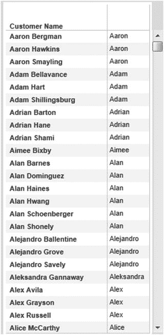

图 11-3. `SCRIPT_STR` 函数 - 演示 1 - 预期输出

#### 11.1.1.1.1 使用 `SCRIPT_STR()` 从“客户名称”中提取名字的步骤

执行以下步骤，从维度“客户名称”中检索名字。

#### 11.1.1.1.2 步骤 1

通过执行以下操作在 `R` 中启动 `Rserve` 服务：
* `Library(Rserve)`
* `Rserve()`

#### 11.1.1.1.3 步骤 2

创建一个计算字段“CustFirstName”（如图 11-4 所示）。

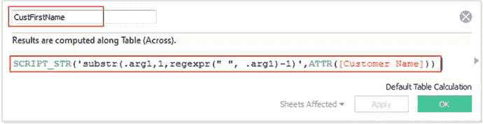

图 11-4. 创建了调用 `SCRIPT_STR` 函数的计算字段“CustFirstName”

`SCRIPT_STR` 函数调用 `R` 中的 `substr` 函数，以“客户名称”作为参数 1，并从“客户名称”中提取字符，从字符位置 1 开始，直到首次出现空格为止。

`substr()` 函数用于从字符串中检索或替换子字符串。该函数的语法如下：
`substr(x, start, stop)` 其中
- `x` – 一个字符串，
- `start` – 开始提取字符的索引位置，
- `stop` – 要返回的字符数

`Tableau` 中的 `ATTR()` 函数，如果组中所有行仅包含单一值，则返回给定表达式的值；否则，它返回一个星号（`*`）。空值将被忽略。

#### 11.1.1.1.4 步骤 3

从数据窗格下的维度区域拖动维度“客户名称”，并将其放置在行架上（如图 11-5 所示）。

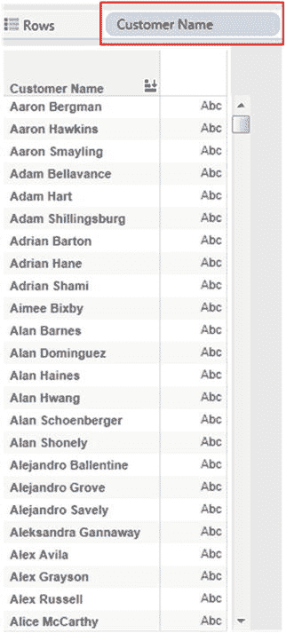

图 11-5. 维度“客户名称”放置在行架上

#### 11.1.1.1.5 步骤 4

从数据窗格下的度量区域拖动计算字段“CustFirstName”，并将其放置在标记卡上的“标签”上（如图 11-6 所示）。

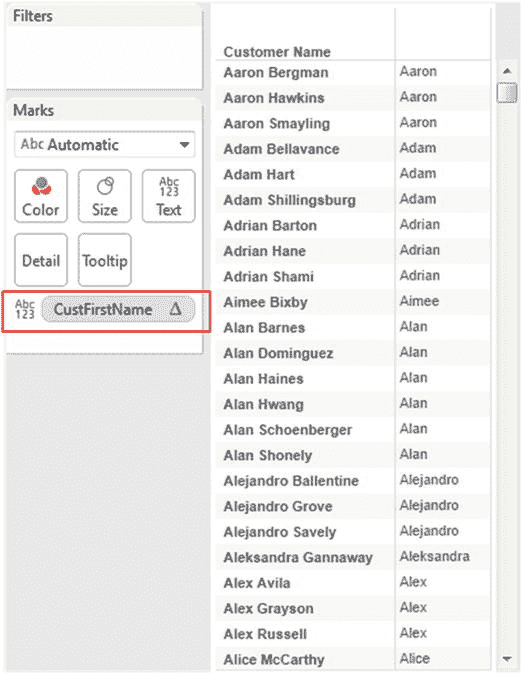

图 11-6. 计算字段“CustFirstName”放置在标记卡上的“标签”上

### 11.1.2 `SCRIPT_BOOL` 函数

`SCRIPT_BOOL()` 从给定的 `R` 表达式返回布尔结果。`R` 表达式直接传递到正在运行的 `Rserve` 实例。在 `R` 表达式中使用 `.arg#` 来引用参数。

语法：`SCRIPT_BOOL(string, expression, …)`

#### 11.1.2.1 演示 2

目标：显示华盛顿州所有城市的“销售额”。

输入：`Sample – Superstore.xls`

预期输出：如图 11-7 所示。

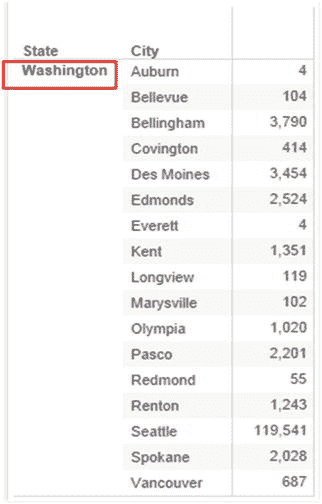

图 11-7. `SCRIPT_BOOL` 函数 - 演示 2 - 预期输出

##### 11.1.2.1.1 使用 `SCRIPT_BOOL()` 显示“华盛顿”州所有城市“销售额”的步骤

执行以下步骤以检索华盛顿州所有城市的列表。

##### 11.1.2.1.2 步骤 1

将来自 `Sample – Superstore.xls` 的数据读入 `Tableau`（如图 11-8 所示）。

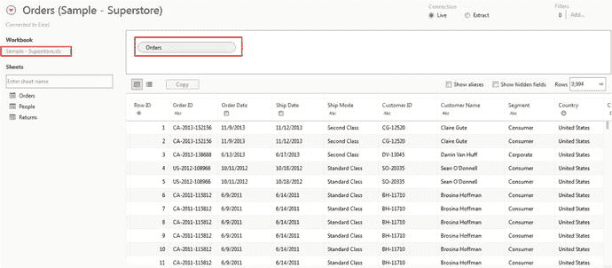

图 11-8. 来自 `Sample - Superstore.xls` 的数据被读入 `Tableau`

##### 11.1.2.1.3 步骤 2

从数据窗格下的维度区域拖动维度“州”和“城市”，并将其放置在行架上（如图 11-9 所示）。

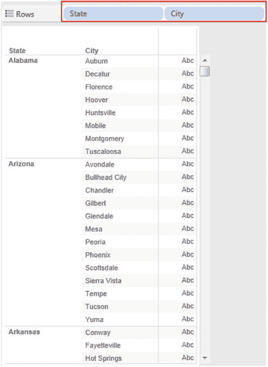

图 11-9. 维度“州”和“城市”放置在行架上

从数据窗格下的度量区域拖动度量“销售额”，并将其放置在标记卡上的“标签”上（如图 11-10 所示）。

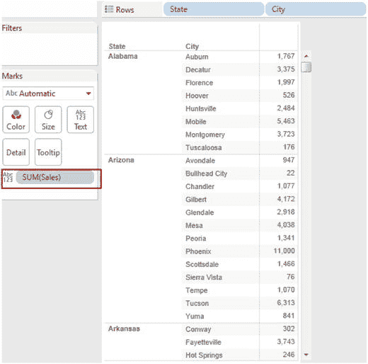

图 11-10. 度量“销售额”放置在标记卡上的“标签”上

##### 11.1.2.1.4 步骤 3

按如下方式在 `R` 中启动 `Rserve` 服务：

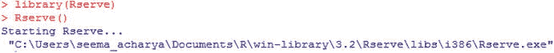

创建一个计算字段“StateWashington”，如图 11-11 所示。

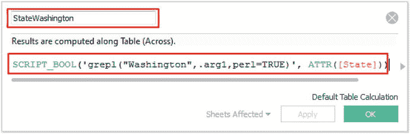

图 11-11. 正在创建的计算字段“StateWashington”，它调用了 `SCRIPT_BOOL` 函数

`SCRIPT_BOOL` 函数调用 `R` 中的 `grepl` 函数，该函数评估“州”属性，如果“州”属性的值为“Washington”，则返回 `TRUE`。

如果字符串包含该模式，`grepl` 函数返回 `TRUE`，否则返回 `FALSE`。如果参数恰好是字符串向量，则该函数返回一个逻辑向量（如果匹配则为 `TRUE`，否则为 `FALSE`）。该函数的语法：
`grepl(pattern, x, ignore.case = FALSE, perl = FALSE, fixed = FALSE, useBytes = FALSE)`
- `pattern`：正则表达式，或当 `fixed=TRUE` 时为字符串
- `x`：字符串，字符向量
- `ignore.case`：是否区分大小写
- `perl`：逻辑值。是否应使用与 Perl 兼容的正则表达式？
- `fixed`：逻辑值。如果为 `TRUE`，则 `pattern` 是一个要按原样匹配的字符串。会覆盖所有冲突的参数
- `useBytes`：逻辑值。如果为 `TRUE`，则逐字节执行匹配，而不是逐字符执行

##### 11.1.2.1.5 步骤 4

将计算字段`StateWashington`拖动到筛选器架上，并将其设置为`True`（如图 11-12 所示）。

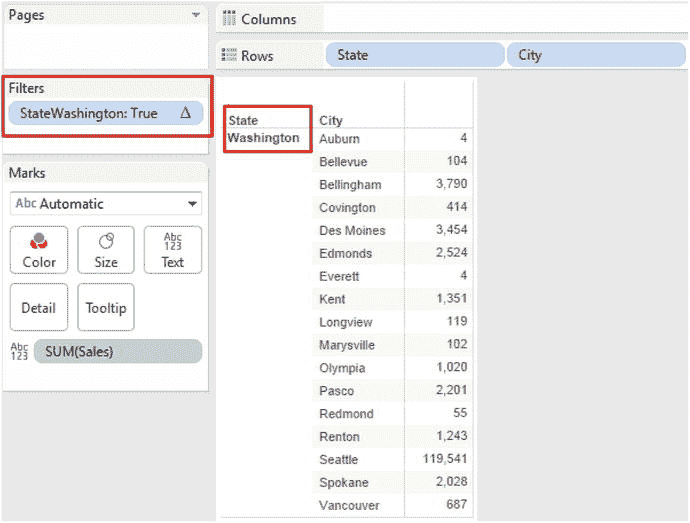
图 11-12. 计算字段`StateWashington`放置在筛选器架上并设置为`True`

最终输出如图 11-13 所示。

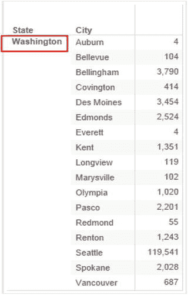
图 11-13. `SCRIPT_BOOL` 函数 - 演示 2 - 最终输出

### 11.1.3 `SCRIPT_REAL` 函数

`SCRIPT_REAL()` 从给定的 R 表达式返回数值结果。R 表达式直接传递到正在运行的 `Rserve` 实例。在 R 表达式中使用 `.arg#` 来引用参数。

语法：`SCRIPT_REAL(string, expression, …)`

#### 11.1.3.1 演示 3

目标：计算 Excel、R 和 Tableau 中两个数据集之间的相关系数。

输入：`Correlation.xlsx`

预期输出：如图 11-14 所示。

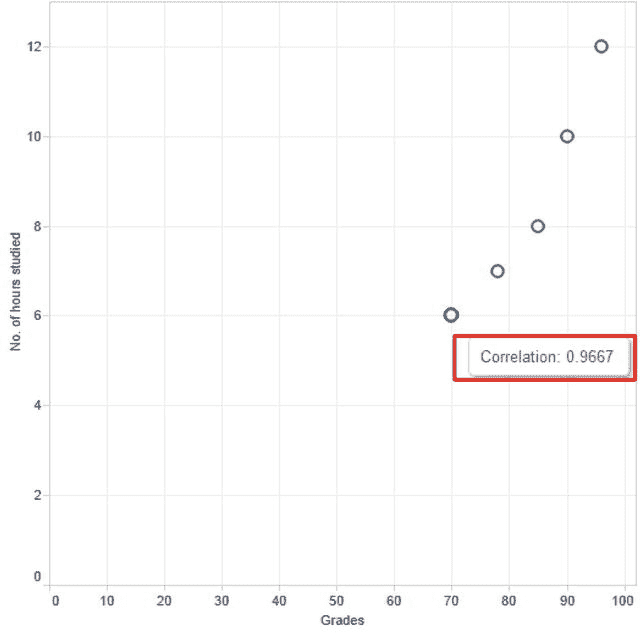
图 11-14. `SCRIPT_REAL` 函数 - 演示 3 - 预期输出

##### 11.1.3.1.1 在 Excel、R 和 Tableau 中确定两个数据集之间相关系数的步骤

执行以下步骤以确定 Excel、R 和 Tableau 中两个数据集之间的相关系数。

让我们考虑以下数据集（如图 11-15 所示）。

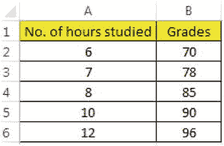
图 11-15. 演示 3 中使用的数据集

在 Excel 中，计算相关系数的公式是 `CORREL(array 1, array 2)`（如图 11-16 所示）。

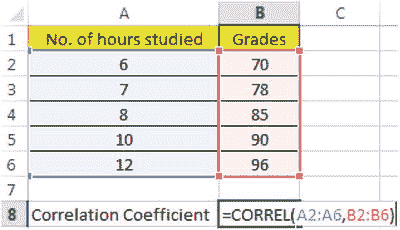
图 11-16. 计算相关系数的公式

Excel 中的输出（如图 11-17 所示）：

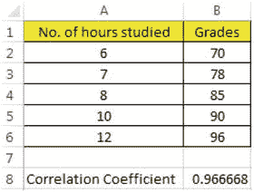
图 11-17. 在 Excel 中计算的相关系数

在 R 中确定相关系数：

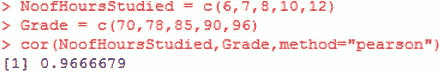

在 Tableau 中确定相关系数：

相关性是一种统计度量，用于指示两个或多个变量共同变化的程度。当变量的值同增同减时，为正相关；当一个变量的值增加而另一个变量的值减少时，为负相关。

相关性不指定因果关系。

#### 11.1.3.1.2 在 Tableau 中计算相关系数的步骤

##### 步骤 1

将 `Correlation.xlsx` 中的数据读取到 Tableau 中（如图 11-18 所示）。

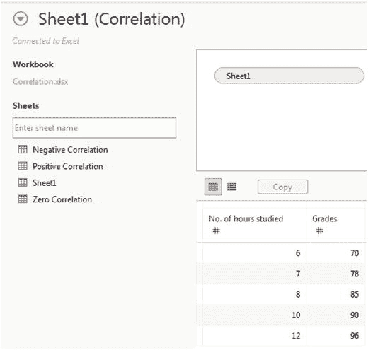
图 11-18. 将来自 `Correlation.xlsx` 的数据读取到 Tableau 中

##### 步骤 2

将度量 `Grades` 和 `No. of hours studied` 从数据窗格下的度量区域分别拖动到列 shelves 和行 shelves 上（如图 11-19 所示）。

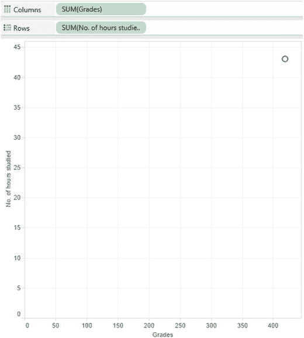
图 11-19. 度量 `Grade` 和 `No. of hours studied` 之间的散点图

##### 步骤 3

执行以下步骤启动 Rserve：

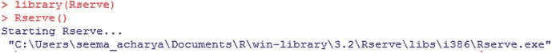

创建一个名为 `Correlation` 的计算字段，如图 11-20 所示。

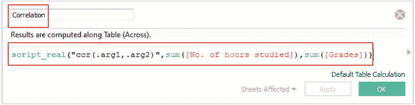
图 11-20. 正在创建的计算字段 `Correlation`

函数 `SCRIPT_REAL` 调用 R 中的 `cor` 函数，以确定作为参数（`.arg1` 和 `.arg2`）传递的度量 `No. of hours studied` 和 `Grades` 之间的相关系数。

R 中的 `cor()` 函数返回相关系数。该函数的语法如下：

```
cor(x, use=, method= )
```

其中 `x` 是一个矩阵或数据框，`use` 指定如何处理缺失数据（选项包括 `all.obs`（假设无缺失数据 – 缺失数据将产生错误）、`complete.obs`（按列表删除）和 `pairwise.complete.obs`（按成对删除）），`method` 指定相关类型（选项包括 `pearson`、`spearman` 或 `kendall`）。

将计算字段 `Correlation` 拖动到标记卡上的 `Detail` 中（如图 11-21 所示）。

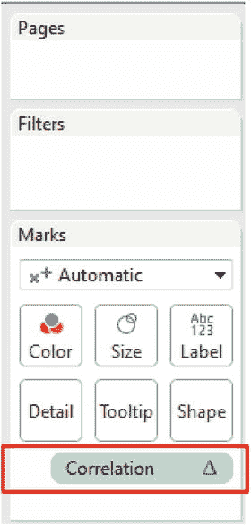
图 11-21. 计算字段 `Correlation` 被放置在标记卡的 `Detail` 上

##### 步骤 4

按如下方式取消对度量的聚合：

`分析` ➤ `聚合度量`；取消勾选 `聚合度量`。

如果取消聚合数据，Tableau 将为数据源中每一行的数据值显示一个单独的标记。取消聚合数据时需谨慎，因为这可能导致性能显著下降，尤其是在数据源非常庞大时。

设置工具提示以显示相关系数，如图 11-22 所示。

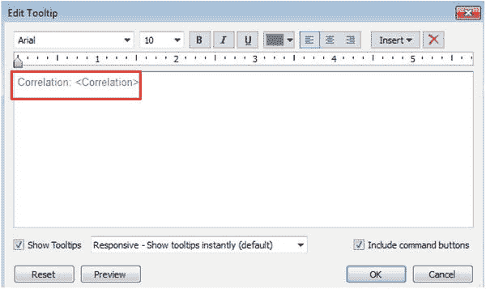
图 11-22. 编辑工具提示以显示 `Correlation`

最终输出（如图 11-23 所示）：

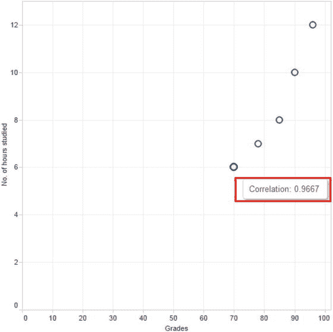
图 11-23. `SCRIPT_REAL` 函数 - 演示 3 - 最终输出

### 11.1.4 `SCRIPT_INT` 函数

`SCRIPT_INT()` 从给定的 R 表达式返回一个整数结果。R 表达式被直接传递到正在运行的 `Rserve` 实例。在 R 表达式中使用 `.arg#` 来引用参数。

语法：`SCRIPT_INT(string, expression, ...)`

**`什么是 k-means 聚类？`**

k-means 聚类意味着形成 k 个组/簇。维基百科将其解释为：“k-means 聚类旨在将 n 个观测值 [划分](https://en.wikipedia.org/wiki/Partition_of_a_set#Partition%20of%20a%20set) 为 k 个簇，其中每个观测值属于具有最近 [均值](https://en.wikipedia.org/wiki/Mean#Mean) 的簇，该均值作为该簇的 [原型](https://en.wikipedia.org/wiki/Prototype#Prototype)”。

K-means 聚类是最简单的无监督学习算法。它之所以是无监督的，是因为只需指定簇的数量。K-means 在没有关于观测值属于哪个簇的任何信息的情况下，自行“学习”簇。

从原始数据开始 ➤ 将其传递通过聚类算法 ➤ 获取数据的簇

K-means 聚类的工作原理如下：

1.  选择 K 个质心。簇质心是簇的中心。
2.  将每个数据点分配给它最近的质心。
3.  将质心重新计算为簇中所有数据点的平均值（即，质心是 p 长度的均值向量，其中 p 是变量的数量）。
4.  将数据点分配给它最近的质心。

K-means 聚类持续执行步骤 3 和 4，直到无法重新分配观测值或达到最大迭代次数（R 默认使用 10 次）。

#### 11.1.4.1 演示 4

**目标：** 将 `Cars.xlsx` 中的给定数据分成三个簇。

**输入：** `Cars.xlsx`。数据集如图 11-24 所示：

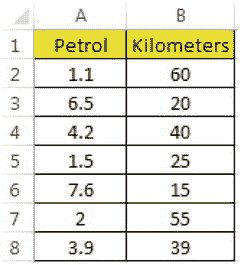
图 11-24. 用于 k-means 聚类演示的数据集

**预期输出：** 如图 11-25 所示。

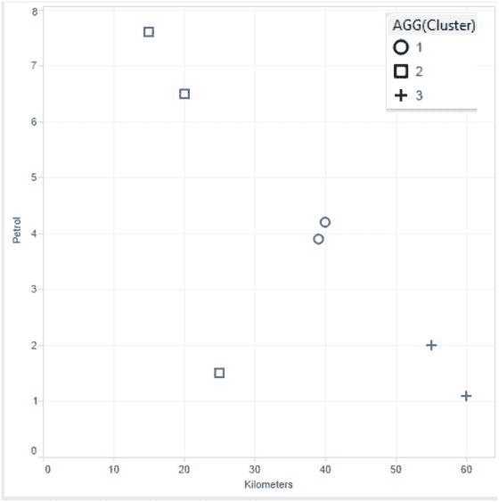

图 11-25. `SCRIPT_INT` 函数 - K-means 聚类 - 预期输出

#### 创建簇的步骤

##### 步骤 1

将 `Cars.xlsx` 中的数据读取到 Tableau 中（如图 11-26 所示）。

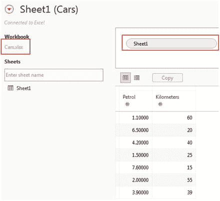

图 11-26. 将来自 `Cars.xlsx` 的数据读取到 Tableau 中

##### 步骤 2

创建一个名为 `Cluster` 的计算字段，如图 11-27 所示。

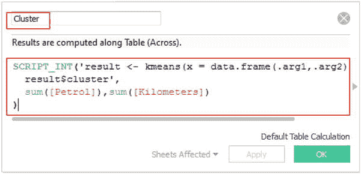

图 11-27. 正在创建的计算字段 `Cluster`

`SCRIPT_INT` 函数调用 R 中的 `kmeans` 函数，并将维度 `Petrol` 和 `Kilometers` 作为参数传递给它。R 中的 `kmeans` 函数返回数据簇。

R 中 `kmeans()` 函数的语法：

```
kmeans(x, centers, iter.max=10)
```

其中：

- `x` 是一个数据框或矩阵。所有值必须是数值型。
- `centers` 是 K 均值的 K。例如，`centers = 5` 将创建 5 个簇。
- `iter.max` 是算法重复簇分配和移动质心的次数。

##### 步骤 3

转到 `分析` 菜单选项，取消勾选 `聚合度量`。取消聚合度量很重要（如图 11-28 所示）。

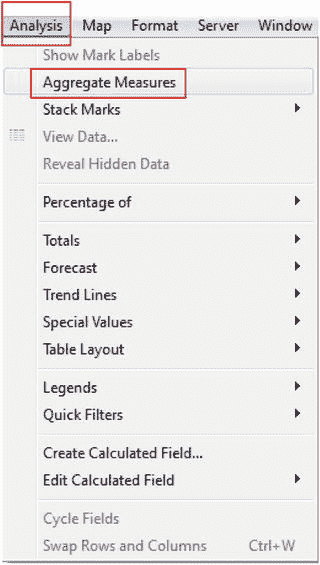

图 11-28. 取消聚合度量

##### 步骤 4

将度量 `Kilometers` 从数据窗格下的度量区域拖动并放置到列 shelves 上（如图 11-29 所示）。

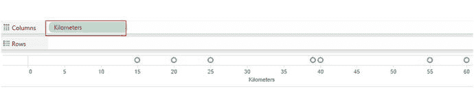

图 11-29. 将度量 `Kilometers` 放置在列 Shelves 上

##### 步骤 5

将度量 `Petrol` 从数据窗格下的度量区域拖动并放置到行 shelves 上（如图 11-30 所示）。

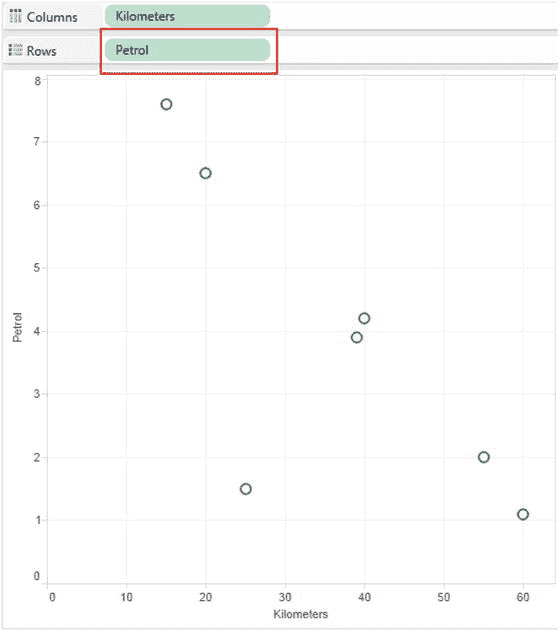

图 11-30. 将度量 `Petrol` 放置在行 shelves 上

##### 步骤 6

将计算字段 `Cluster` 拖动到标记卡上的 `Shape` 中（如图 11-31 所示）。

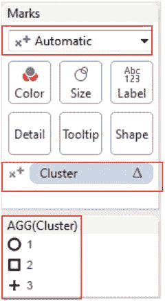

图 11-31. 计算字段 `Cluster` 被放置在标记卡的 `Shape` 上

将计算字段 `Cluster` 放置在标记卡的 `Shape` 上之后的最终输出（如图 11-32 所示）。

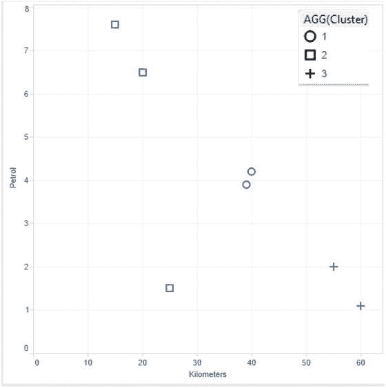

图 11-32. `SCRIPT_INT` 函数 - K-means 聚类 - 预期输出

**结论：** 数据已被分成三个簇。

### 购物篮分析

购物篮分析有助于发现顾客经常一起购买的商品组合。这是一种基于以下理论的建模技术：如果你购买了某组商品，你就更有可能（或更不可能）购买另一组商品。

例如，购买面粉和糖的顾客更有可能同时购买鸡蛋，以凑齐烘焙蛋糕的基本原料。这种分析使零售商能够将经常一起购买的商品摆放在一起，从而提升顾客的购物体验。此外，这种分析还有助于零售商进行定向营销（向购买某商品的顾客发送邮件，提供另一款顾客经常选购商品的优惠）。购物篮分析有助于实现以下目标：

- 交叉销售
- 追加销售
- 促销活动
- 忠诚度计划
- 店铺设计
- 折扣方案

让我们看看购物篮分析的其他应用领域：

尽管购物篮分析让人联想到购物车和超市顾客的画面，但重要的是要认识到它还有许多其他应用：

- 信用卡购买分析。
- 电话通话模式分析。
- 识别欺诈性医疗保险索赔。（考虑违反常规规则的案例）。
- 电信服务购买分析。

目标：确定共同创造最高销售额的产品。

输入："Sample – Superstore.xls"。将使用该工作表中的“Orders”两次来执行自连接。

预期输出：如图 11-33 所示。

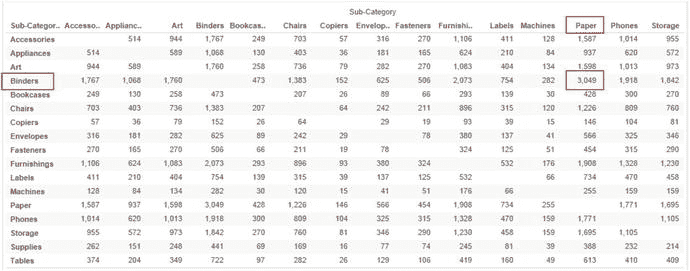

图 11-33. 购物篮分析 - 预期输出

#### 执行购物篮分析的步骤

执行以下步骤以确定共同创造最高销售额的产品。

##### 步骤 1

将“Sample – Superstore.xls”中“Orders”工作表的数据读入 Tableau（如图 11-34 所示）。

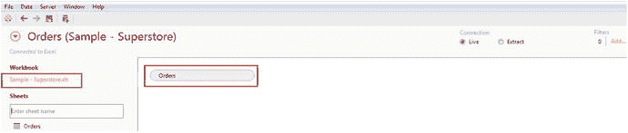

图 11-34. 从“Sample - Superstore.xls”的“Orders”工作表读入 Tableau 的数据

##### 步骤 2

第二次将“Orders”工作表拖到“将工作表拖放到此处”。“内连接”对话框将弹出（如图 11-35 所示）。

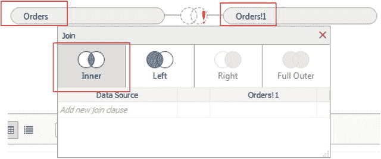

图 11-35. “内连接”对话框

填写“内连接”的条件（如图 11-36 所示）。

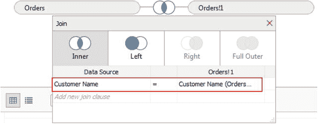

图 11-36. 设置“内连接”的条件

转到“Sheet1”。

##### 步骤 3

从“Orders$”工作表中将维度“子类别”拖到列功能区上（如图 11-37 所示）。

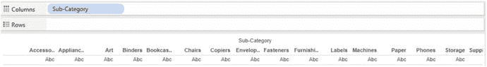

图 11-37. 来自“Orders$”工作表的维度“子类别”放置在列功能区上

从“Orders$1”工作表中将维度“子类别”拖到行功能区上（如图 11-38 所示）。

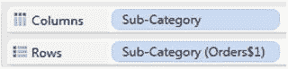

图 11-38. 来自“Orders$1”工作表的维度“子类别”放置在行功能区上

##### 步骤 4

从“Orders$”中将维度“客户名称”拖到标记卡的“标签”上（如图 11-39 所示）。

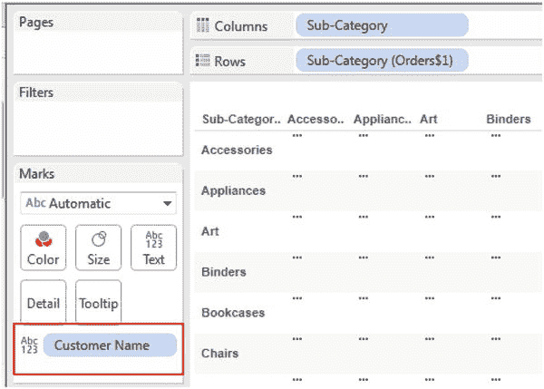

图 11-39. 来自“Orders$”工作表的维度“客户名称”放置在标记卡的“标签”上

将标记卡上“标签”中的维度“客户名称”的聚合方式更改为“计数”（如图 11-40 所示）。

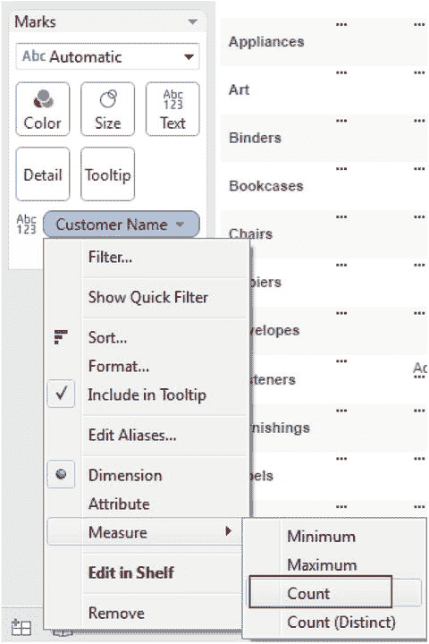

图 11-40. 维度“客户名称”的聚合方式更改为“计数”

将聚合方式设置为“计数”后的输出结果（如图 11-41 所示）。

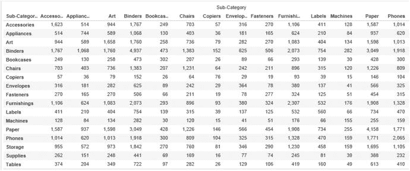

图 11-41. 将“客户名称”的聚合方式更改为“计数”后的输出结果

##### 步骤 5

删除重复项。为删除重复项，创建一个计算字段“Duplicates”（如图 11-42 所示）。

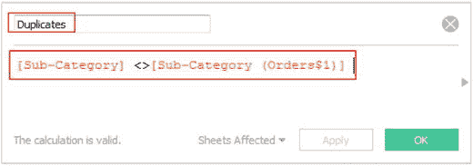

图 11-42. 正在创建计算字段“Duplicates”

##### 步骤 6

将计算字段“Duplicates”拖到筛选器功能区，并将其设置为“True”（如图 11-43 所示）。

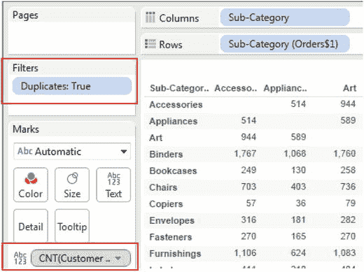

图 11-43. 计算字段“Duplicates”放置在筛选器功能区上

删除重复项后（其中 `Orders$` 工作表中的子类别等于 `Orders$1` 工作表中的子类别）的最终输出结果（如图 11-44 所示）。

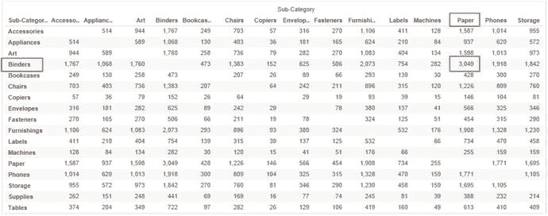

图 11-44。购物篮分析 - 最终输出结果

结论：子类别“装订机”和“纸张”创造了最高销售额。

## 11.2 要点提示

-   Tableau Online 和 Tableau Public 不支持 R。
-   数据无法直接从 Tableau 导出到 R。
-   无法从 R 将数据集导入 Tableau。
-   在 R 中创建的可视化无法导入 Tableau；但是，可以在 Tableau 仪表板中使用 R 可视化的图像文件或指向 R 可视化的 URL。

# 索引

## A
- `ABS(number)` 函数
- 操作，仪表板筛选器操作 控制视图维度“子类别” 编辑标题对话框 格式选项 格式子类别对话框 销售额地图视图 销售额与利润视图 显示标题选项 子类别字段（无标题） 子类别值 标题选项 用作筛选器 突出显示操作 操作 [包含筛选器操作的仪表板] 对话框 操作项 控制视图，销售额地图和销售额与利润视图 编辑突出显示操作对话框 子类别值 URL 操作 编辑 URL 操作对话框 筛选器操作 子类别
- 聚合函数
- `ATTR(expression)` 函数

## B
- 条形图 书签文件 复制工作表，仪表板创建 粘贴工作表 子弹图 创建 预期输出 按阶段推进的设定目标进度 实际值 分布带 预期输出 最终输出 计划培训交付
- 凹凸图 要执行的活动 创建 订单日期 RankRegion 预期输出 `index` 函数 解释 用途

## C
- 缓存
- 计算筛选器
- 级联筛选器
- `CASE` 函数
- Cassandra NoSQL 数据库 Cassandra CQL Shell 数据源页面 DataStax Community Edition ODBC 驱动程序选项 其他数据库 (ODBC) Simba Cassandra OBDC DSN Simba Cassandra ODBC 驱动程序 DSN 设置 系统 DSN 测试结果窗口
- `CEILING(number)` 函数
- 图表形式 描述性统计知识 云聚合 良知 客户体验 默认聚合 Excel 工作表 频次 记录数 视觉显示
- Cloudera Hadoop
- 计算集
- 计算排序
- 字符串函数，连接
- 常量集 创建集选项 筛选器[在/不在随机子类别中] 在/不在（随机子类别） 随机子类别 在集中显示成员选项 “在/不在”成员的总销售额 视图，销售额和子类别
- `Contains()` 函数
- 上下文筛选器
- 连续日期 转换，离散日期 创建 定义 标记卡 最大销售额 度量，销售额 订单日期
- 自定义 SQL 编辑自定义 SQL 查询 编辑自定义 SQL 语句 成绩表 MySQL 数据源 新建自定义 SQL 学生数据库 学生表 查看数据窗口

## D, E
- 仪表板操作 (参见操作，仪表板)
- 仪表板：添加对象 空白对象 编辑文本对话框 图像对象 文本对象 网页对象 添加视图 仪表板 1 仪表板窗口 销售详情仪表板 销售额随时间变化视图 销售额随时间变化工作表 和故事 (参见故事创建, 仪表板创建 新建仪表板选项 新建仪表板选项卡 新建仪表板工作表 描述 交互性 (参见交互式仪表板) 布局容器 (参见布局容器，仪表板) 组织 浮动布局 平铺布局 移除视图/对象 仪表板视图 仪表板窗口 按子类别、地区的销售额
- 数据混合 CoffeeChain 查询 自定义选项 编辑关系选项 市场 市场、地区 映射 订单 地区 关系对话框 “销售额”按“市场”视图 Sample-Coffee chain 访问 Sample-Superstore 数据源 Sample-Superstore Excel 数据源
- 数据提取 聚合数据，可见维度 数据网格，加利福尼亚详情 数据源 提取数据对话框 提取选项 筛选器条件 筛选器[州]对话框 另存为提取文件
- 数据层
- 数据源筛选器
- 数据可视化 企业期望 图形描述 历史 市场领先的数据可视化工具 负%变化 在线调查 数据可视化的力量 可视化的力量 目的 示例 – 超市数据子集 示例 – 访客数据集 Tableau 工具 使用
- `DATEADD()` 函数
- `DATEDIFF()` 函数
- 日期函数 `DATEADD()`, `DATEDIFF()`, `DATENAME`
- `DATENAME` 函数
- Desktop 架构 数据连接器 数据层 内存数据 n 层客户端服务器架构 Tableau Desktop 架构
- 离散日期 连续 桶 定义 离散桶 下拉菜单 标记卡 最大销售额 度量 销售额 订单日期 销售额数据，降序排列 `Sort[Month of Order Date]` 对话框
- 分布带
- 双轴 条形图 颜色 数据 预期输出 最终输出 粒度，订单日期到月份 线 棒棒糖图 条形图颜色 预期输出 最终输出 输出 读取数据 销售额 细分 州 订单日期 利润 利润轴，销售额轴 利润到线 销售额 销售额，行功能区 示例 - Superstore.xls 第二个度量，销售额 排序，子类别 子类别 同步，次轴到主轴 表计算

## F
- 筛选 计算 级联 条件 上下文 仪表板 数据源 描述 维度 常规选项卡 类别和颜色 编辑筛选器选项 家具和技术 订单日期 选项 定量 快速 顶部选项卡 通配符选项卡
- 浮动布局，仪表板 浮动布局按钮 浮动选项 位置和大小字段 按州销售额视图 视图布局
- `FLOOR(number)` 函数

## G
- 甘特条
- 甘特图 对齐 美国工程师 分配 计算字段 颜色 列 数据窗格 演示 2 维度区域 下拉菜单 持续时间 编辑标签 省略号 结束日期 确切日期 甘特条 `GanttChartAssignment.xlsx` `GanttChart.xlsx` 水平轴 标签对话框 资源 行功能区 大小 任务依赖关系 技术架构师
- 组 创建 类别和州 数据窗格 数据源 维度 组成员 组员 CA & California 弹出菜单，组成员 图标 选择 CA 和 California `State(group)` 子类别维度 定义 编辑和 移除现有成员 重命名

## H
- 热图 创建 分形和树图 地理边界 步骤 `Birthdays.xls` 计算字段 颜色 数据窗格 示例 1 维度 离散 编辑颜色 Excel 工作表 标记类型 `MonthNames` 二维表示 工作表/视图
- 层次结构
- 突出显示表 准确性 颜色 示例 2 预期输出 销售额 步骤分析 单元格边框 颜色 列功能区 最暗阴影 数据窗格 维度 编辑颜色 合计 标签 标记卡 标记类型 订单日期 行功能区 销售额 方块 子类别 工作表 工作表单元格 子类别 文本表
- 直方图 条形图 频率分布图 步骤 年龄段 `BinSize` 计算字段 列功能区 对话框 记录数 奥运数据集 输出 分数子集 `TestResultsSample` `TestResultsSample.tde` 工作表/视图

## I
- `IF ELSE` 函数
- `IF ELSEIF` 函数
- `IIF()` 函数
- 独立轴 混合轴 混合度量，预期输出 颜色，标记卡 预期输出 筛选器功能区 适合，整个视图 标签，标记卡 标记类型，条形 度量名称和值 度量名称，颜色 度量名称，标签 度量值，行功能区 订单日期，列功能区 销售额和利润 Sample - Superstore.xls 混合度量 最终输出 计算字段 性能 组合轴图 活动 铜牌 铜牌、银牌和金牌 度量更改序列，度量值 选择颜色 国家，行功能区 数据集 编辑颜色 预期输出 筛选数据 度量名称，颜色 度量 度量值，标签 度量值，标记卡 数字格式 重新排序 排序，国家 特殊值，度量 铜牌 堆叠标记 标记类型，线 度量 度量名称和值 记录数 销售额和利润 斜率图，预期输出 `Slope Graph.xls` 单位 放置在详细信息上 单位 放置在标签上 可视化
- `Index` 函数
- 交互式仪表板 创建 客户详情 客户级详情 - 销售信息 仪表板 整个视图 筛选器选项 按子类别、每个地区的销售额 大小图例和颜色图例 子类别和地区 详细工作表 客户详情 客户名称，降序排列 概览工作表 热图视图 按子类别、每个地区的销售额

## J, K
- 连接 字段，数据窗格 内连接 左连接 右连接 类型

## L
- 布局容器，仪表板 仪表板大小 筛选器，运输模式” 浮动按钮 格式容器选项 水平 水平容器 重新排列仪表板视图和对象 累计运费和运输成本 运输模式筛选器 运输模式值，运输成本视图 显示/隐藏部件，工作表
- `Left()` 和 `Find()` 函数
- `Len()` 函数
- 详细级别 (LOD) 类别 客户名称 示例 1 示例 3 表达式 地区 销售额和利润 州 步骤 聚合 金额 列合计 Ctrl 键 `Customer_Average_Amount` 客户名称 数据窗格 示例 2 维度 `Exclude_Region_Sales` `Exclude_State_Sales` 筛选器对话框 最终输出 `Fixed_Region_Sales` `Fixed_State_Sales` `LOD.xls` 度量值 地区 行功能区 销售额 按州销售额 Sample – Superstore.xls 显示列合计 州 所有总计 使用视图/工作表 视图/工作表
- 折线图 示例 步骤 列功能区 数据窗格 示例 预测 折线图 订单日期 利润 行功能区 销售额 视图/工作表 直线段
- 逻辑函数 `CASE`, `IF ELSE`, `IF ELSEIF`, `IIF()` 函数

## M
- 手动排序 拖放 工具栏
- 市场购物篮分析
- `MAX(number, number)` 函数

- **度量名称和值** 内置 Tableau 字段 容器 数据集 数据源 维度 筛选器功能区 标签，标记卡 利润和销售额 快速筛选器 地区，列功能区 行功能区 `Sample - Superstore.xls` 要求 工作表/视图 `订单日期`，列功能区 利润和细分 快速筛选器 行功能区 `Sample - Superstore.xls` 细分和颜色，标记卡 单轴和双轴 单值列表

- **元数据网格**

- `MIN(number, number)` 函数

- MongoDB NoSQL 数据库 客户端连接 测试结果 数据源页面 MongoDB 安装目录路径 ODBC 驱动程序 其他数据库 (ODBC) 服务器 Simba MongoDB ODBC 驱动程序 DSN 设置 Simba MongoDB ODBC DSN 系统 DSN

- 移动平均 资产动量 示例 1 最终输出 步骤 添加表计算 数据窗格 默认位置 对话框 `订单日期` 主轴 `销售额` 次轴 特殊值 任务 视觉提示 技术分析 交易策略 类型

- MS SQL Server 连接详情 连接窗口 数据源页面 员工 (测试) 表 安装程序 MySQL 命令行客户端 MySQL 命令提示符 MySQL 驱动程序 服务器连接 Tableau Desktop 测试数据库

## N, O

- 嵌套排序 清除排序和子类别 组合字段 地区和子类别 显示标题选项 排序字段对话框 子类别和销售额 视图，子类别和地区

- 数字函数 `ABS(number)`、`CEILING(number)` 和 `FLOOR(number)`、`MAX(number, number)` 和 `MIN(number, number)`

## P

- 参数 创建 维度 “子类别” 显示参数控件 TOP N TOP N 子类别

- 百分位数 类别 示例 1 总体 步骤 `CGPA Percentile.xlsx` 序号 表计算

- `PieChart.tbm` 文件

- 饼图 替代方案 角度和大小 类别 情况 颜色 数据可视化 3D 效果 特点 光泽颜色 百分比 手机 政治经济学家 定量信息 半径效果 原因 步骤 角度 客户细分 数据窗格 标签 标记卡 百分比 利润 参考线 `销售额` 切片 表计算 工作表/视图 子类别 非专业受众 视觉维度

- 概率

- 盈利能力，占总计百分比 示例 1 步骤 应用按钮 类别 控件键 数据窗格 对话框 维度区域 `订单日期` 利润/亏损 行功能区 `Sample – Superstore.xls` 细分 `Sum (Sales)`

## Q

- 定量筛选器

- 快速筛选器

## R

- R 描述 管理 R 连接 市场购物篮分析 模型和函数 Rserve 连接 `SCRIPT_BOOL()`、`SCRIPT_INT()`、`SCRIPT_REAL()`、`SCRIPT_STR()`

- RAM

- 排名计算 示例 1 步骤 添加表计算 类别 示例 1 对话框 下拉按钮 编辑表计算 标签 `销售额` 子类别 `Sum (Sales)` 工作表 /视图 类型 `RDataFile`、`RDataSet`

- R 接口

- `销售额`累计 示例 1 步骤 计算 数据窗格 示例 对话框 维度 标签 度量名称 度量值 `订单日期` 累计和 示例 – `Superstore.xls` 小计 表计算对话框 任务 验证

## S

- Sample - Superstore

- 散点图 笛卡尔平面 系数 负相关 数值变量 正相关

- 集 计算 常量 (参见常量集) 定义 vs. 组

- 斜率图

- 排序 计算 描述 手动 嵌套 (参见嵌套排序)

- 堆叠条形图 计算字段 类别 列功能区 常量线 对话框 李克特量表 度量名称 负轴 NeutralNegative 测量 NeutralPositive 评级 排序 排序顺序 `Stacked Bar.xlsx` 强烈不同意 调查问题 X 轴

- 统计文件

- 统计 `AverageScore` 箱线图 商业相关实际场景 `CountDScore` 定义 描述性 最终输出 预测 连续月 描述 选项 `订单日期` 精确度 `销售额`预测区间 `Sample-Superstore` 数据源 显示预测 显示估计值，较浅阴影 须 推断 魔法数字 班级年龄 平均 均值 中位数 众数 数学 `MaxScore` 均值/算术平均 度量名称，列功能区 度量名称，筛选器功能区 度量值，标签 中位数 `MedianScore` `MinScore` 众数 国家篮球队 参数 绘制箱须图 总体 测验 参考线 平均线 带 常量线 分布 样本 种子数据 数据集 左偏 右偏 数据分布 数据集 四分位距 极差 平方差 标准差 方差和标准差 `StatsData.xlsx` `StdDevScore` 科目名称 `SumScore` 对称 趋势线 分析窗格 `AVG(Discount)` 描述 趋势模型 制造商 运输模式 `VarScore`

- 故事创建，仪表板 添加描述 标题 新建空白点 新建故事工作表，标题 新建故事选项卡 按类别销售额 故事点 销售额与利润按销售额视图 故事编辑标题对话框 故事工作表 显示 故事大小选项

- 字符串函数 连接 `Contains()` 函数 `Left()` 和 `Find()` 函数 `Len()` 函数

- `Student_Grade`

## T

- Tableau 类别 数据连接页面 数据源 文件–打开选项 打开对话框 `Sample Superstore` Gartner 的魔力象限 一瞥 产品线 自助分析 Tableau 书签 Tableau Online Tableau Public Tableau Reader Tableau Server `.tds` `.tdsx` `.twb` `.twbx` 版本 可视化和/或仪表板 任务

- Tableau 数据提取 创建打包工作簿 数据安全 数据源连接页面 数据源页面 提取或添加其他筛选器 筛选器条件 筛选器 完整提取 增量提取 大型文本文件/Excel 文件 实时数据连接 优化 其他文件选项 性能 可移植性 发布到 Tableau Public 另存为提取对话框 `.tde` 文件 使用提取 隐含值

- Tableau 数据源 (`tds`) 文件

- Tableau 环境 关闭按钮 连接到 `RData` 文件 连接页面 连接到 MS Access 连接到服务器 仪表板和工作表面板 数据源图标 数据源页面 画布 连接部分 网格 左窗格 元数据网格 打开 `Sample - Superstore` 订单表 处理请求窗口 连接类型 视图 发现页面 字段，数据窗格 `MS SQL Server 2014 Management Studio` 固定选项 Tableau 起始页 要打开的文本文件 视觉提示和图标 工作簿和工作表 工作区

- Tableau 打包数据源 (`.tdsx`) 文件

- Tableau 打包工作簿 (`.twbx`)

- Tableau 工作簿 (`.twb`)

- 表计算函数 `First()`、`Index()`

- 表计算 年度利润 维度 分区与寻址 三角形标记

- TedEx 视频

- Teradata

- 平铺布局，仪表板

- 培训师反馈数据集

- 树图 类别 类别数据 数据集 层次数据 动机 参考 步骤 类别 数据窗格 维度 `产品名称` `销售额` 子类别 可视化 子分支 子类别 可视化

## U

- 联合操作 内连接 新建联合选项 结果 联合窗口

## V

- Vertica

## W, X

- 瀑布图 要执行的活动 项目员工人数 账户活动 要执行的活动 Excel 中的数据 甘特条 员工人数 员工人数 行合计 累计 阶梯颜色 男式 T 恤库存 Excel 文件中的数据 数据成员 默认属性 预期输出 甘特条 手动排序 行合计 累计，计算 阶梯颜色 单位 库存数量 用途

## Y

- 年同比 (YOY) 公司财务表现 示例 1 步骤 添加表计算 计算字段 颜色 Ctrl 键 示例 1 维度 筛选器功能区 标签 标记类型 度量名称 度量值 1 空 `订单日期` 输出 百分比差异 快速表计算 行功能区 `销售额` `Sample – Superstore.xls` 特殊值 阶梯颜色 表计算 `YearOverYearGrowth`、`YearToDisplay`

## Z

- 零相关 列功能区 示例，维度 步骤 类别 列功能区 维度区域 线选项 标记卡 `销售额` 度量 细分和形状 变量