# 7.5 统计学中的几个术语

`总体`：由具有某种共同特征的人或事物构成的任何集合都可称为总体。例如，我们要研究某六年级一个班级学生的反馈，而该班有 50 名学生，那么就需要研究这 50 名学生的所有反馈。

`样本`：样本是总体中的一个子集。例如，我们需要研究一个班级学生的反馈。班级人数为 50 人；我们将学生分为高绩效、中等绩效和低绩效三个组别。然后研究每个组中至少五名学生的反馈（即总共 15 名学生）。

当我们测量总体中的某个量时，它被称为`参数`。当我们测量样本中的某个量时，它被称为`统计量`。总体对应于参数，正如样本对应于统计量。

例如，在印度浦那市随机挑选的 350 人中，有 250 人的姓氏是“Sen”。描述性统计的一个例子是以下陈述：
“这些人中有 80%的姓氏是‘Sen’。”

再例如，在过去的 3 个周日，托马斯分别卖出了 5 辆、4 辆和 3 辆新车。描述性统计的一个例子是以下陈述：
“托马斯在过去 3 个周日平均每周卖出 4 辆新车。”

这两个都是描述性陈述，因为它们都可以根据所提供的信息得到验证。

例如，在印度浦那市随机挑选的 350 人中，有 250 人的姓氏是“Sen”。推断性统计的一个例子是以下陈述：
“所有居住在印度的人中，有 80%的姓氏是‘Sen’。”

我们并没有关于所有印度居民的信息，只知道那 250 名浦那居民的信息。我们利用这些信息进行归纳，进而推广到所有印度居民。判断该陈述非描述性的最简单方法是尝试根据所提供的信息对其进行验证。

例如，在过去的 3 个周日，托马斯分别卖出了 5 辆、4 辆和 3 辆新车。以下是推断性统计的例子：
“托马斯周日卖出的汽车从未超过 5 辆。”
尽管这个陈述对过去 3 个周日成立，但我们并不知道它对所有周日都成立。

“托马斯最近卖的车少了，因为人们已经识破了他的把戏。”
所提供的信息中没有任何内容能证明这个陈述是正确的。

推断性统计的主要用途是利用来自样本的信息来推断总体的某些特征。

## 7.6 我们为什么使用推断性统计？

我们使用推断性统计来从样本中归纳出一般性结论，而使用描述性统计来描述我们的样本。

## 7.7 我们为什么使用描述性统计？

描述性统计是以让受众能够理解的方式描述数据，而无需分享实际的数据集。如果我们不分享实际的数据集，那我们会分享什么呢？可以是数据的摘要信息，例如一组数据的均值、中位数和众数。

让我们通过一个场景来理解这一点。

约翰是一名运输经理。他正在考虑引入办公交通工具，接送员工上下班。他记录员工通勤的里程数。以下是他收集的数据。

`10 7 5 9 6 3 3 8 9 10 10`

### 7.7.1 这里的集中趋势度量是什么？

#### 7.7.1.1 均值或算术平均数

算术平均数的计算方法是将所有数字相加，然后除以数据集中的数字总数。

```
10 + 7 + 5 + 9 + 6 + 3 + 3 + 8 + 9 + 10 + 10 / 11 = 80 / 11 = 7.27
```

#### 7.7.1.2 中位数

中位数就是中间值。

按升序排列数字：`3 3 5 6 7 8 9 9 10 10 10`

中位数值位于第 6 位。第 6 位的数字是 8。

#### 7.7.1.3 众数

众数是数据集中出现频率最高的数字。

给定数据集：`3 3 5 6 7 8 9 9 10 10 10`

数字 10 在数据集中出现了三次，比数据集中任何其他数字出现的次数都多。

因此，该数据集的众数为 10。

众数在印刷业中有应用。例如，印刷更多最受欢迎的书籍很重要，因为如果不同书籍印刷数量相同，会导致一些书籍短缺而另一些书籍过剩。

同样，众数在制造业中也有应用。例如，生产更多最受欢迎的鞋子很重要，因为如果不同鞋子生产数量相同，会导致一些鞋子短缺而另一些鞋子过剩。

#### 7.7.1.4 几个练习示例

1. 以下是国家篮球队队员的投篮得分（见表 7-1）。

    表 7-1. 国家篮球队

    | 球员姓名 | 投篮得分 |
    | --- | --- |
    | 阿德里安 | 3 |
    | 杰夫 | 6 |
    | 克里斯 | 6 |
    | 埃德温 | 2 |
    | 大卫 | 1 |
    | 托马斯 | 7 |

    算术平均数：`4.166`
    中位数：`4.5`
    众数：`6`

2. 对六年级学生进行了一次课堂测验。班上有九名学生。以下是他们百分制的成绩：

    以下是一组九项成绩：`45 55 66 54 75 82 91 79 98`

    中位数：`75`
    算术平均数：`71.66`
    众数：无

3. 在数学课上，索汉参加了六次小测验。他的成绩分别是`90, 92, 91, 89, 84`和`82`。他这几次测验的平均分是多少？

    答案：

    ```
    (90 + 92 + 91 + 89 + 84 + 82) / 6 = 528 / 6 = 88
    ```

    他的平均分是`88`。

4. 吉特参加了六次小测验，到目前为止的平均分是`85`。如果他在余下的四次测验中每次都得了满分`100`，他的新平均分将是多少？

    ##### 7.7.1.4.1 第 1 步

    六次测验平均分`85`。
    `6 * 85 = 510`

    ##### 7.7.1.4.2 第 2 步

    四次测验满分`100`。
    `4 * 100 = 400`

    ##### 7.7.1.4.3 第 3 步

    新平均分 = 总分 / 测验总次数
    新平均分 = `910 / 10`
    新平均分 = `91`

5. 在代数课的前三次小测验中，罗翰的平均分是`84`。他下一次测验需要得多少分才能使总平均分达到`87`？

    ##### 7.7.1.4.4 第 1 步

    三次测验平均分`84`。
    `3 * 84 = 252`

    ##### 7.7.1.4.5 第 2 步

    假设他下一次测验得了`x`分。
    那么`252 + x`就是他在下一次测验后的总分。

    ##### 7.7.1.4.6 第 3 步

    为了使平均分达到`87`，他需要
    `252 + x = 4 * 87`
    `252 + x = 348`
    因此 `x = 348 – 252 = 96`

6. 在几何课的前两次小测验中，温迪的平均分是`75`。她下一次测验需要得多少分才能使总平均分达到`82`？

    ##### 7.7.1.4.7 第 1 步

    两次测验平均分`75`。
    `2 * 75 = 150`

    ##### 7.7.1.4.8 第 2 步

    假设她下一次测验得了`x`分。
    那么`150 + x`就是她在下一次测验后的总分。

    ##### 7.7.1.4.9 第 3 步

    为了使平均分达到`82`，她需要
    `150 + x = 3 * 82`
    `150 + x = 246`
    因此 `x = 246 – 150 = 96`

## 7.8 五数概括法

五数概括法包括以下内容：

- 最小值
- 最大值
- 中位数
- 第一四分位数
- 第三四分位数

### 7.8.1 均值

参考表 7-2。

表 7-2. 班级年龄

| 年龄 | 19 | 20 | 21 |
| --- | --- | --- | --- |
| 频数 | 1 | 3 | 1 |

班级平均年龄：`20`

均值是 `Σx / n`，其中 `x` 代表数据值，`n` 代表数据值的总数。班级年龄的直方图如图 7-1 所示。

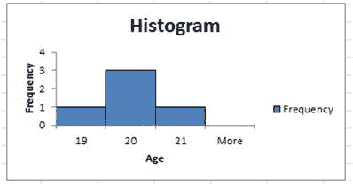
图 7-1. 班级年龄

### 7.8.2 中位数

数据值：19 20 20 20 21

中位数始终位于中间。它是中间的值，即 20。

另一个示例：

数据值：19 20 20 20 21 21 100 102

中位数：`(20+21)/2 = 20.5`

需要注意的要点：

- 如果数据有奇数个值，中位数就是中间的那个数。如果你有`n`个数字，中间的数字位于第`(n + 1) / 2`个位置。
- 如果数据有偶数个值，可以通过将中间的两个数相加并除以 2 来得到中位数。你可以通过计算`(n + 1) / 2`找到中点。中间的两个数字分别位于该点的两侧。

#### 7.8.2.1 数据中心 - 中位数

请参考表 7-3。

表 7-3. 数据中心 - 中位数数据集

| 值 | 1 | 2 | 3 | 4 | 5 | 6 | 7 | 8 |
| --- | --- | --- | --- | --- | --- | --- | --- | --- |
| 频数 | 4 | 6 | 4 | 4 | 3 | 2 | 1 | 1 |

共有 25 个数字，如果将它们全部排列起来，中位数位于中间位置，即第 13 个数字。中位数是 3。数据向右偏斜，这会将均值拉高。因此，均值高于中位数（如图 7-2 所示）。

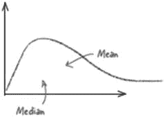
图 7-2. 均值高于中位数

请参考表 7-4。

表 7-4. 数据中心 - 中位数数据集

# 7.8 众数

| 值 | 1 | 4 | 6 | 8 | 9 | 10 | 11 | 12 |
|---|---|---|---|---|---|---|---|---|
| 频数 | 1 | 1 | 2 | 3 | 4 | 4 | 5 | 5 |

此处的中位数是 10。数据向左偏斜，因此均值被向左拉。所以，均值低于中位数（如图 7-3 所示）。

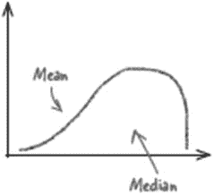
图 7-3. 均值低于中位数

### 7.8.3 众数

众数必须存在于数据集中。它是唯一适用于分类数据的平均值。请参考表 7-5。

**表 7-5. 众数数据集**

| 值 | 1 | 2 | 3 | 31 | 32 | 33 |
|---|---|---|---|---|---|---|
| 频数 | 3 | 4 | 2 | 2 | 4 | 3 |

请参考图 7-4。

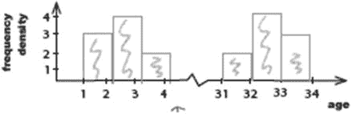
图 7-4. 频率密度

### 7.8.4 何时使用哪种平均值？

请参考表 7-6。

**表 7-6. 何时使用哪种平均值？**

| 平均值 | 适用情况 |
|---|---|
| 均值 | 当数据相当对称时 |
| 中位数 | 当数据因异常值而偏斜时 |
| 众数 | 当数据呈现两个或更多集群时 |
|  | 在处理分类数据时 |

## 7.9 数据的离散程度

数据的离散程度包括以下内容：
- 极差
- 四分位距
- 方差
- 标准差

### 7.9.1 极差

极差是一种衡量一组数值分散程度的方式。它由上限减去下限得到，其中上限是最大值，下限是最小值。

7 8 9 9 10 10 11 12 13
极差 = 上限 - 下限 = 13 – 7 = 6

因此，这组数据的极差是 6。

极差的主要问题在于它仅描述了数据的宽度。由于极差是使用数据中最极端的值计算得出的，因此无法判断数据的实际分布情况以及是否包含异常值。

### 7.9.2 四分位距

四分位距 = 上四分位数 – 下四分位数

四分位数是将数据分成四等份的值。最低的四分位数称为下四分位数，最高的四分位数称为上四分位数。中间的四分位数是中位数。

**寻找下四分位数的位置**
计算 `n ÷ 4`。（如果不是整数，则四舍五入）

**寻找上四分位数的位置**
计算 `3n ÷ 4`。（如果不是整数，则四舍五入）

**示例：**
数据值：3 3 6 7 7 10 10 10 11 13 30
中位数 = 10
下四分位数 = 6
上四分位数 = 11

四分位距 = 上四分位数 – 下四分位数 = 11 - 6 = 5

### 7.9.3 方差与标准差

方差定义为“与均值之差的平方的平均值”。

**计算方差的步骤：**
1. 确定数字的均值。
2. 对于每个数字，减去均值并对差值进行平方（平方差）。
3. 计算这些平方差的平均值。

请参考表 7-7。

1. 确定数字的均值：`(600 + 470 + 170 + 430 + 300) / 5 = 394`
2. 对于每个数字，减去均值并对差值进行平方（平方差），请参考表 7-8。

**表 7-8. 平方差**

| 值 | 差值 |
|---|---|
| 600 – 394 | 206 |
| 470 – 394 | 76 |
| 170 – 394 | -224 |
| 430 – 394 | 36 |
| 300 – 394 | -94 |

3. 计算这些平方差的平均值 = `(42436 + 5776 + 50176 + 1296 + 8836) / 5 = (108520) / 5 = 21704`。方差是 21704。

**表 7-7. 数据集**

| 600 |
|---|
| 470 |
| 170 |
| 430 |
| 300 |

### 7.9.4 标准差

标准差就是方差的平方根。

方差 21704 的平方根是 147。

标准差是 147。

标准差是统计学中衡量离散程度的指标。“离散程度”就是指数据的分散程度。具体来说，它显示了数据围绕均值或平均值的分散程度。

在上述示例中，数据是针对一个总体（我们考虑的那五名学生的成绩就是我们感兴趣的全部学生）。

然而，如果数据是一个样本（从更大的总体中选取的一部分），那么计算方法会有所不同！

当你有 `N` 个数据值时：
- 对于总体：计算方差时除以 `N`（就像我们做的那样）
- 对于样本：计算方差时除以 `N-1`

根据上述内容，如果数据被视为总体，标准差为 147。但是，如果数据被视为样本，标准差为 164。

四分位数是将数据分成四个相等组的三个值（下四分位数、中位数和上四分位数）之一。百分位数是将数据分成 100 个相等组的 99 个值之一。下四分位数对应第 25 个百分位数。中位数对应第 50 个百分位数。上四分位数对应第 75 个百分位数。

### 7.9.5 作业 1

**目标：** 一位园丁从两家不同的公司各买了 10 包种子。每包含有 20 粒种子，他记录了每包种子长出的植物数量。请参考表 7-9。

- 找出每家公司种子的均值、中位数和众数。
- “众数”表明哪家公司最好？
- “均值”表明哪家公司最好？
- 找出每家公司种子的极差。

**表 7-9. 种子数据集**

| 公司 | 包号 | 每包长出的植物数量 |
|---|---|---|
| A 公司 | 1 | 20 |
| | 2 | 5 |
| | 3 | 20 |
| | 4 | 20 |
| | 5 | 20 |
| | 6 | 6 |
| | 7 | 20 |
| | 8 | 20 |
| | 9 | 20 |
| | 10 | 8 |
| B 公司 | 1 | 17 |
| | 2 | 18 |
| | 3 | 15 |
| | 4 | 16 |
| | 5 | 18 |
| | 6 | 18 |
| | 7 | 17 |
| | 8 | 15 |
| | 9 | 17 |
| | 10 | 18 |

### 7.9.6 作业 2

**目标：** 五名学生（学号从 1 到 5）在三门科目“BI 导论”、“统计学”和“分析学导论”中的成绩如下。计算每门科目的以下统计量：

- 总和
- 均值
- 中位数
- 计数（参加该科目考试的学生人数）
- 标准差
- 方差
- 最小值
- 最大值

数据集如下：请参考表 7-10。

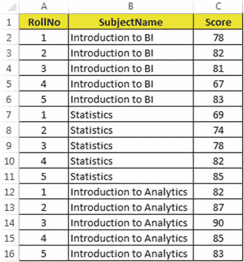
**表 7-10. `StatsData.xlsx`**

### 7.9.6.1 解决方案

#### 7.9.6.1.1 步骤 1

从 `StatsData.xlsx` 中将数据读入 `Tableau`（如图 7-5 所示）。

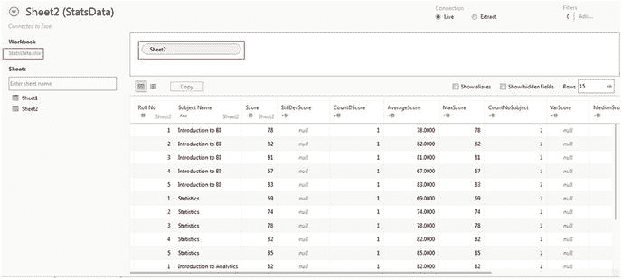
图 7-5. 从 `StatsData.xlsx` 读入 `Tableau` 的数据

#### 7.9.6.1.2 步骤 2

创建以下计算字段：

- `SumScore` 如图 7-6 所示。
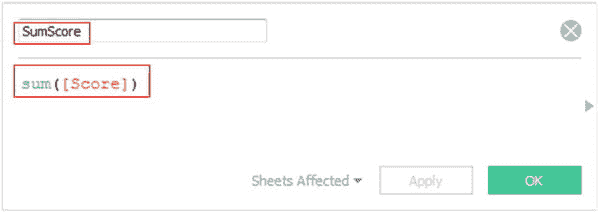
图 7-6. 正在创建的计算字段 `SumScore`

- `AverageScore` 如图 7-7 所示。
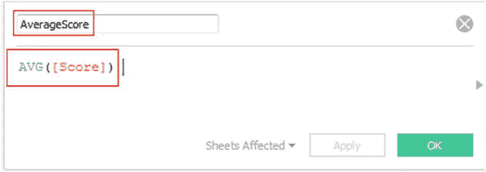
图 7-7. 正在创建的计算字段 `AverageScore`

- `MedianScore` 如图 7-8 所示。
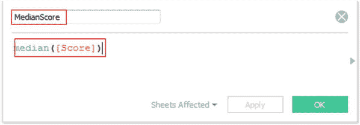
图 7-8. 正在创建的计算字段 `MedianScore`

- `CountDScore` 如图 7-9 所示。
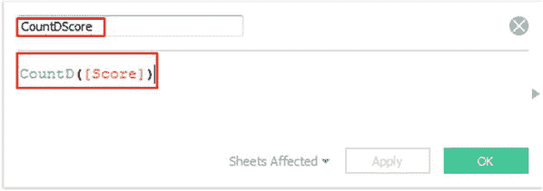
图 7-9. 正在创建的计算字段 `CountDScore`

- `StdDevScore` 如图 7-10 所示。
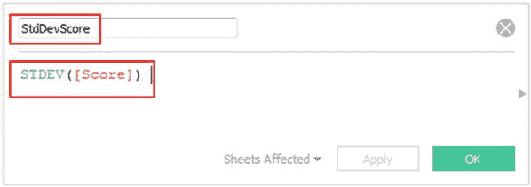
图 7-10. 正在创建的计算字段 `StdDevScore`

- `VarScore` 如图 7-11 所示。
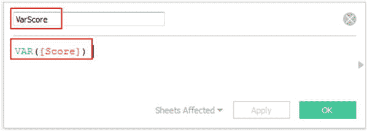
图 7-11. 正在创建的计算字段 `VarScore`

- `MinScore` 如图 7-12 所示。

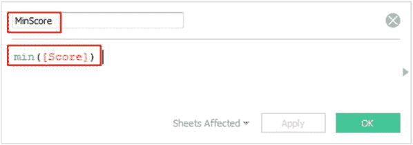

图 7-12. 正在创建的计算字段 `MinScore`

`MaxScore` 如图 7-13 所示。

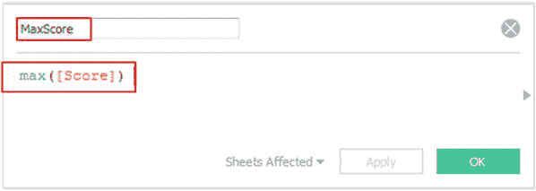

图 7-13. 正在创建的计算字段 `MaxScore`

#### 7.9.6.1.3 步骤 3

将维度 `Subject Name` 从数据窗格下的维度区域拖曳到行功能区（如图 7-14 所示）。

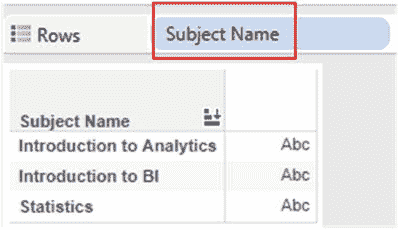

图 7-14. 将维度 `Subject Name` 放置在行功能区上

#### 7.9.6.1.4 步骤 4

将维度 `Measure Names` 从数据窗格下的维度区域拖曳到列功能区（如图 7-15 所示）。

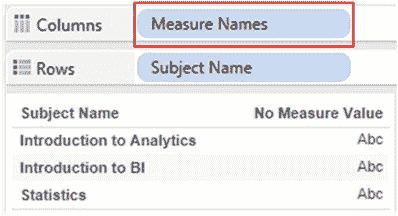

图 7-15. 将维度 `Measure Names` 放置在列功能区上

#### 7.9.6.1.5 步骤 5

将维度 `Measure Names` 从数据窗格下的维度区域拖曳到筛选器功能区（如图 7-16 所示）。

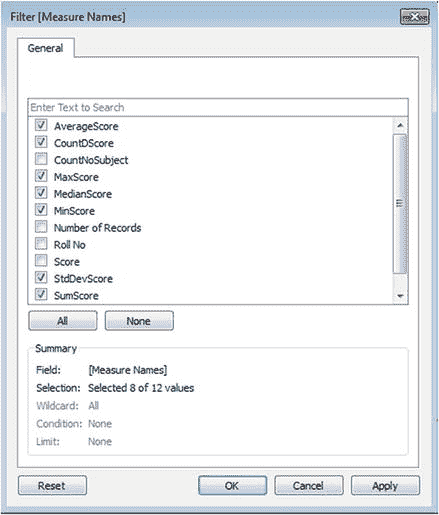

图 7-16. 将维度 `Measure Names` 放置在筛选器功能区上

选择要在视图/工作表中显示的值。

#### 7.9.6.1.6 步骤 6

将度量 `Measure Values` 从数据窗格下的度量区域拖曳到标记卡上的 `Label` 上（如图 7-17 所示）。

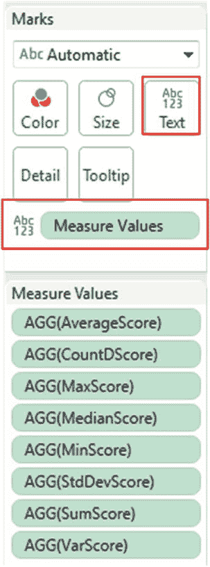

图 7-17. 将度量 `Measure Values` 放置在标记卡的 `Label` 上

最终输出：如图 7-18 所示。

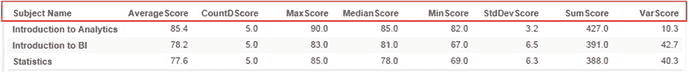

图 7-18. 最终输出

## 7.10 箱形图

箱形图也称为盒须图。它由探索性数据分析之父约翰·图基于 1977 年发明。

箱形图的目的：有效展示五个神奇数字或统计度量。请参见图 7-19。

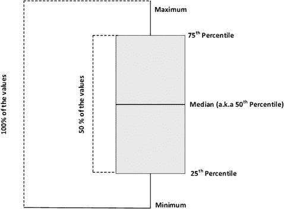

图 7-19. 箱形图

- 最小值或低值
- 下四分位数或第 25 百分位数
- 中位数或第 50 百分位数
- 上四分位数或第 75 百分位数
- 最大值或高值

箱形图

- 可以垂直或水平绘制。
- 常与直方图结合使用。

箱形图的优点：

- 提供了关于数据对称性和偏斜性的合理概念（如图 7-20、7-21 和 7-22 所示）。
  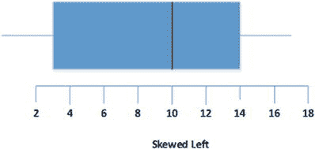
  图 7-22. 左偏

  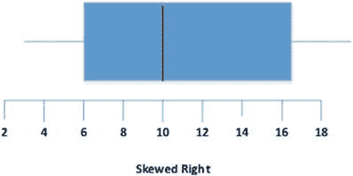
  图 7-21. 右偏

  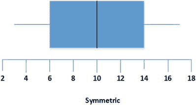
  图 7-20. 对称

- 显示异常值。
- 便于数据集之间的轻松比较

### 7.10.1 在 Tableau 中绘制盒须图

六年级的十七名学生参加了一次关于“数据可视化”的小测验，他们的得分范围是 0 到 5。以下是数据集：请参见图 7-23。

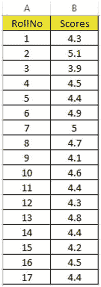

图 7-23. `BoxPlot.xlsx`

让我们在 Tableau 中绘制一个盒须图。

上述数据集被读取到 Excel 工作表 `BoxPlot.xlsx` 中。

#### 7.10.1.1 创建盒须图的步骤

请遵循以下步骤。

##### 7.10.1.1.1 步骤 1

将 Excel 工作表 `BoxPlot.xlsx` 中的数据导入 Tableau（如图 7-24 所示）。

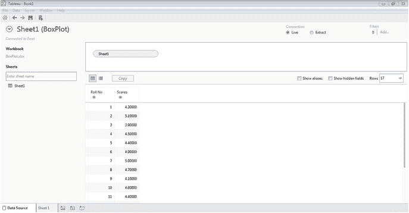

图 7-24. 从 `BoxPlot.xlsx` 读入数据

##### 7.10.1.1.2 步骤 2

选择维度 `RollNo` 和度量 `Scores`。从“显示我”中选择“盒须图”（如图 7-25 所示）。

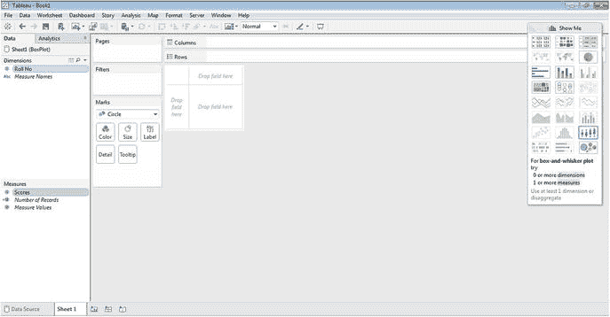

图 7-25. 选择维度 `Roll No`、度量 `Scores` 和“盒须图”

##### 7.10.1.1.3 步骤 3

绘制出的箱形图如图 7-26 所示。

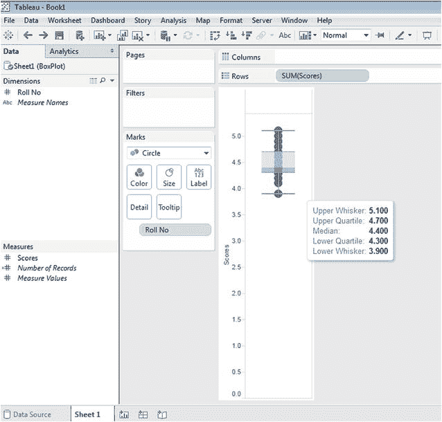

图 7-26. 箱形图

## 7.11 Tableau 中的统计工具

让我们讨论如何在 Tableau 中使用内置的统计工具。

### 7.11.1 参考线

参考线可以帮助您在轴上标记特定值或区域。例如，您正在分析产品的销售额。在此场景中，您可以添加参考线来指示每个产品相对于平均销售额的表现。

#### 7.11.1.1 添加参考线：平均线

##### 7.11.1.1.1 步骤 1

将数据从 `Sample - Superstore.xls` 读入 Tableau。

##### 7.11.1.1.2 步骤 2

构建一个如图 7-27 所示的视图。

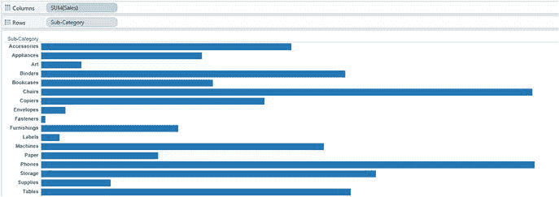

图 7-27. 显示按`子类别`划分的`销售额`的视图

##### 7.11.1.1.3 步骤 3

选择销售额轴，右键单击它并选择“添加参考线”（如图 7-28 所示）。


图 7-28. “添加参考线”选项

##### 7.11.1.1.4 步骤 4

出现“添加参考线、区间或框”对话框。选择参考类型为 `Line`，作用域为 `Entire Table`（为整个表格的所有窗格添加一条参考线），并按下图所示选择线选项以显示所有产品的`平均`销售额值（如图 7-29 所示）。

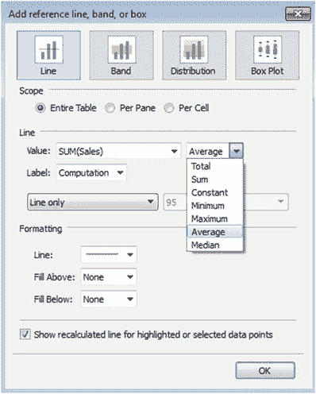

图 7-29. 选择`平均参考线`

##### 7.11.1.1.5 步骤 5

您可以在视图中看到作为参考线的平均销售额值（如图 7-30 所示）。

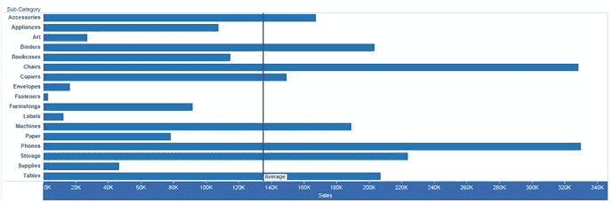

图 7-30. 显示`销售额`的`平均参考线`的视图

### 7.11.1.2 添加参考线：常量线

#### 7.11.1.2.1 步骤 1

从 `Sample - Superstore.xlsx` 中将数据读取到 Tableau 中。

#### 7.11.1.2.2 步骤 2

构建如下图 7-31 所示的视图。

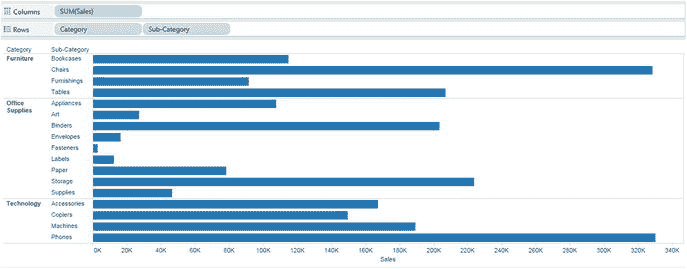

图 7-31. 显示每个“类别”下“子类别”的“销售额”的视图

#### 7.11.1.2.3 步骤 3

选择 `Sales` 轴，右键单击并选择“添加参考线”（如图 7-32 所示）。

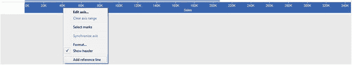

图 7-32. “添加参考线”选项

#### 7.11.1.2.4 步骤 4

弹出“添加参考线、区间或框”对话框。选择参考类型为“线”，作用范围为“每个窗格”（在每个窗格基础上添加一条参考线），并按下图所示设置线条选项，以显示所有产品的“常量”销售额值（如图 7-33 所示）。

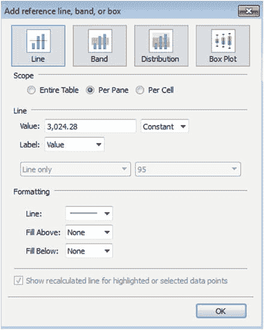

图 7-33. 选择“常量”线

#### 7.11.1.2.5 步骤 5
您可以在视图中看到作为参考线的“常量”销售额值（如图 7-34 所示）。

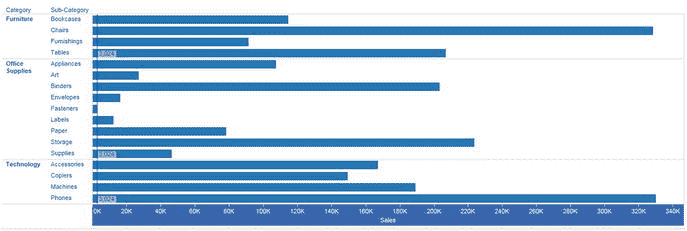
图 7-34. 显示“销售额”的“常量”线的视图

### 7.11.1.3 参考线、区间和框的类型
**线**：在轴上的常量值或计算值处添加一条线（参见图 7-35）。

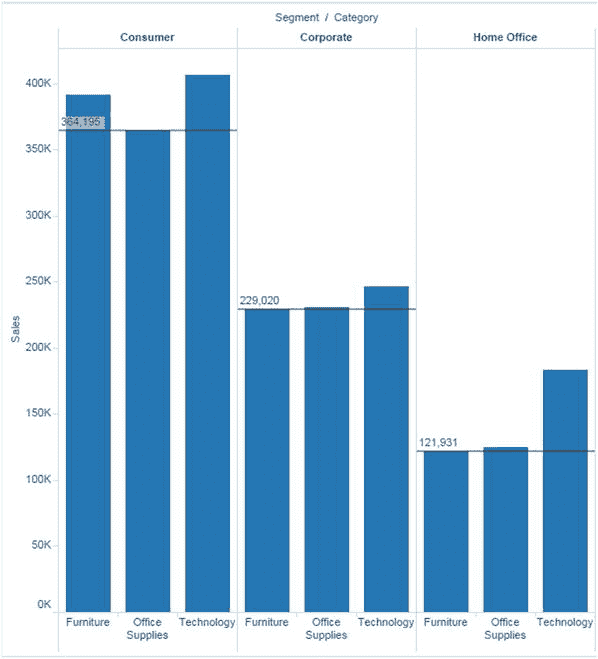
图 7-35. 参考线

**区间**：区间在视图中标记之间轴上的两个常量值或计算值之间的区域添加阴影。参见图 7-36 和图 7-37。

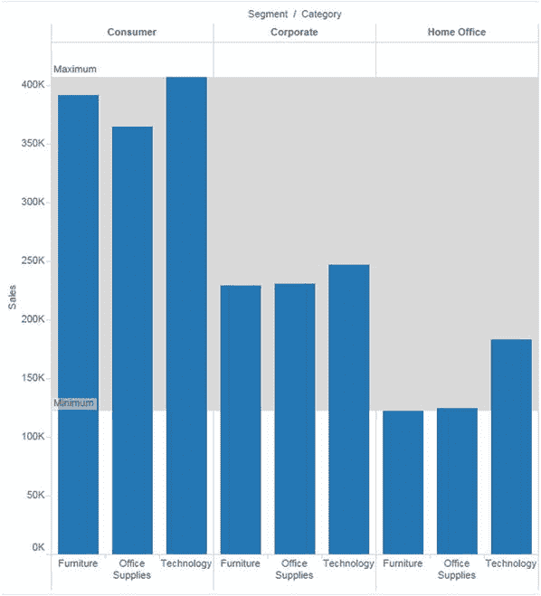
图 7-37. “区间”类型

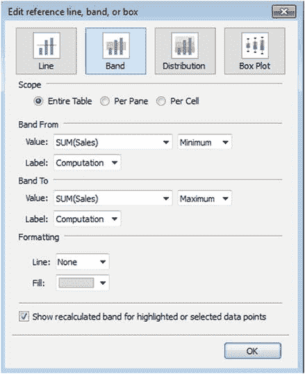
图 7-36. “区间”选项

**分布**：分布添加渐变阴影，以指示轴上值的分布情况。分布可以通过百分比、百分位数、分位数或标准差来定义。参见图 7-38 和图 7-39。

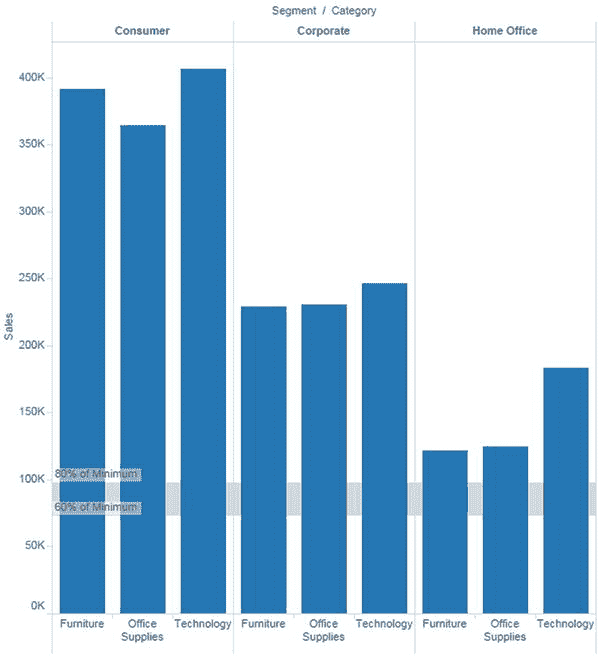
图 7-39. “分布”类型

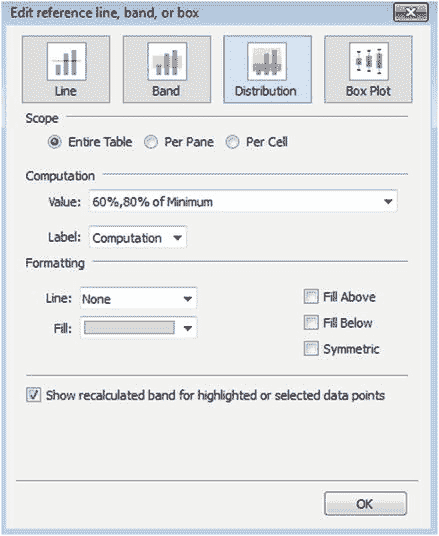
图 7-38. “分布”类型的选项

## 7.12 趋势线
`趋势线`允许您逐步构建交互式的行为模型。借助`趋势线`，您可以回答诸如“利润是否可以通过销售额预测”之类的问题。

### 7.12.1 用`趋势线`回答问题
让我们从一个问题开始：
**目标**：是什么导致了超市的高折扣率？

#### 7.12.1.1 绘制`趋势线`以回答问题的步骤
按照以下步骤来回答这个问题。

##### 7.12.1.1.1 步骤 1
构建如下图 7-40 所示的视图。

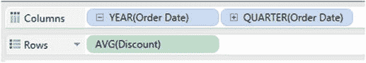
图 7-40. 维度`订单日期`放置在列架上；层次结构设置为“季度”，度量`AVG(折扣)`放置在行架上

##### 7.12.1.1.2 步骤 2
首先，我们将从“装运模式”变量开始测试。假设是少数几种“装运模式”的折扣率可能很高。将维度“装运模式”从数据窗格下的维度区域拖到行架上（如图 7-41 所示）。

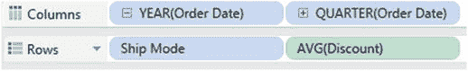
图 7-41. 维度“装运模式”放置在行架上

##### 7.12.1.1.3 步骤 3
转到分析窗格，双击“趋势线”（如图 7-42 所示）以显示`趋势线`（如图 7-43 所示）。

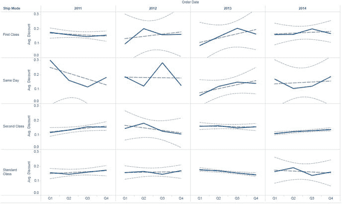
图 7-43. 显示“装运模式”`趋势线`的视图

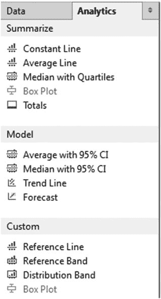
图 7-42. 显示“趋势线”的分析窗格

##### 7.12.1.1.4 步骤 4
右键单击任意`趋势线`。

##### 7.12.1.1.5 步骤 5
选择“描述趋势模型...”（如图 7-44 所示）来描述`趋势模型`（如图 7-45 所示）。

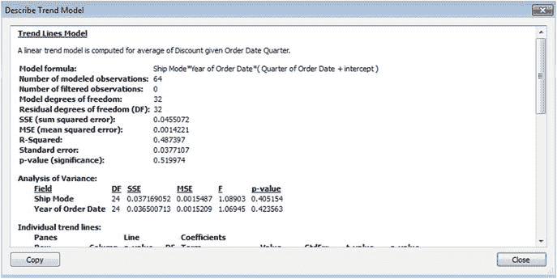
图 7-45. 显示“装运模式”的 p 值的“描述`趋势模型`”

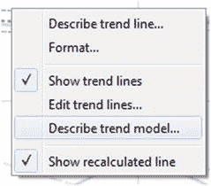
图 7-44. 描述`趋势模型`

`趋势线`模型的描述显示，“装运模式”的 p 值为 0.40，不显著。因此，我们不能用“装运模式”来预测折扣率。

##### 7.12.1.1.6 步骤 6
接下来，让我们考虑维度“制造商”。有些制造商偶尔会提供大幅折扣。从行架上移除“装运模式”，并将“制造商”拖到行架上（如图 7-46 所示）。

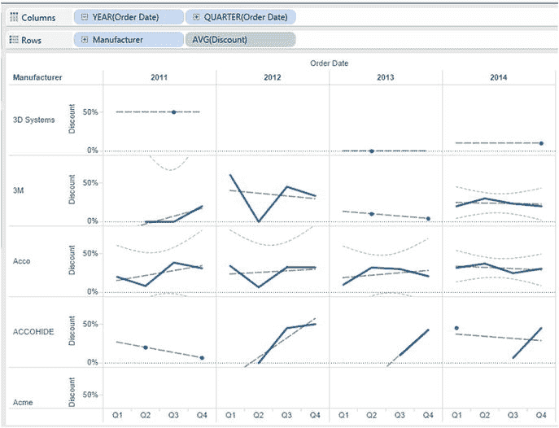
图 7-46. 维度“制造商”放置在行架上

##### 7.12.1.1.7 步骤 7
打开描述的`趋势模型`。参见图 7-47。

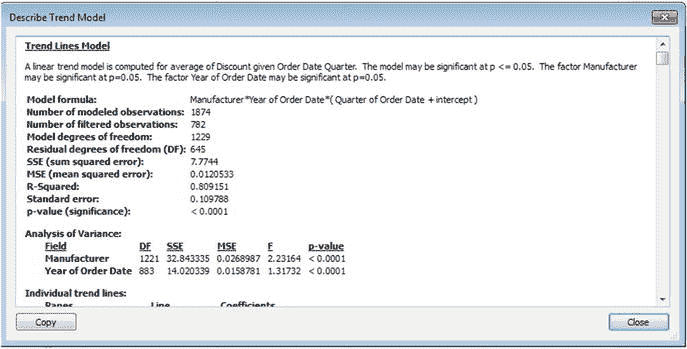
图 7-47. 显示“制造商”的 p 值的“描述`趋势模型`”

`趋势线`模型的描述显示，“制造商”的 p 值为 0.0001，是显著的。因此，我们可以用“制造商”来预测折扣率。

在统计学中，p 值表示结果的重要性。
- p 值小（通常 ≤ 0.05）表明模型是显著的。
- p 值大（> 0.05）表明模型不显著。
- 非常接近临界值（0.05）的 p 值被认为是临界的。

## 7.13 `预测`
`预测`有助于您根据历史值估算度量的未来值。Tableau 以较浅的颜色阴影显示估算值。

`预测`中使用的技术是指数平滑法，它着眼于过去的趋势以帮助预测未来的结果。要创建`预测`，您至少需要一个维度和一个度量。

### 7.13.1 演示 1
**目标**：预测一段时间内的销售额。

### 7.13.1.1 创建`预测`的步骤
请遵循以下步骤。

##### 步骤 1
连接到`Sample-Superstore.xls`数据源。

##### 步骤 2
将“数据”窗格中“维度”区域下的维度`Order Date`拖至“列”功能区。将“数据”窗格中“度量”区域下的度量`Sales`拖至“行”功能区（如图 7-48 所示）。

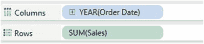
**图 7-48.** 维度`Order Date`置于“列”功能区，度量`Sales`置于“行”功能区。

##### 步骤 3
将`Order Date`的层次结构设置为连续月份（如图 7-49 所示）。

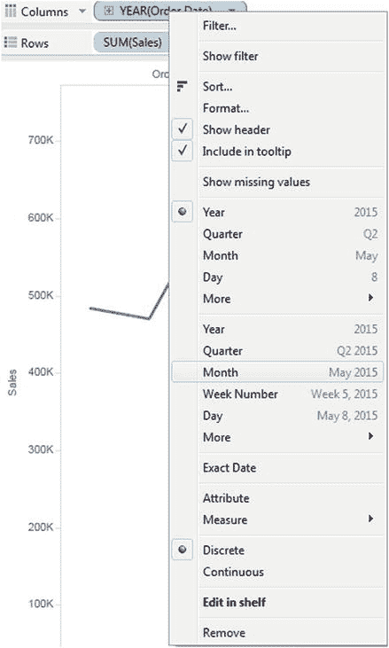
**图 7-49.** 选择“连续月份”。

##### 步骤 4
转至“分析”菜单，选择`预测` ➤ `显示预测`（如图 7-50 所示）。

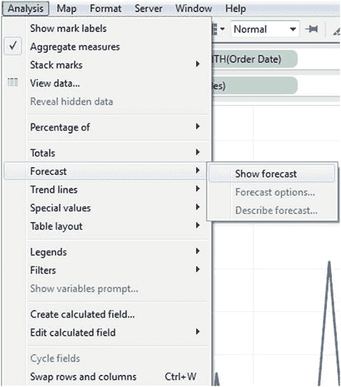
**图 7-50.** `显示预测`选项。

##### 步骤 5
您可以看到以较浅色调显示的估计值。您还可以在“标记”卡下方看到`预测指示符`。`预测`的`预测区间`置信水平为 95%（如图 7-51 所示）。


**图 7-51.** 以较浅色调显示估计值的视图。

##### 步骤 6
要配置`预测区间`，请选择`分析` ➤ `预测` ➤ `预测选项`（如图 7-52 所示）。


**图 7-52.** `预测选项…`菜单。

##### 步骤 7
出现`预测选项`对话框。选择`99%`作为`预测区间`。模型已确定，在`预测`期间，`Sales`的值有 99% 的可能性落在阴影区域内。其他可用值为 90%、95% 和 99%（如图 7-53 所示）。


**图 7-53.** `预测选项` – `预测区间`。

##### 步骤 8
`预测区间`的显示取决于您为`预测`选择的标记。请参阅表 7-11。
**表 7-11.** `预测区间`标记类型与显示。

| 预测标记类型 | 使用的`预测区间`显示方式 |
| :--- | :--- |
| 线 | 带状 |
| 形状、正方形、圆形、条形或饼图 | 须线 |

###### 步骤 9
将标记类型更改为圆形。Tableau 以较浅色调（`圆形`）显示`预测`数据，`预测区间`以`须线`形式显示（如图 7-54 所示）。


**`图 7-54.`** 以 `须线` 形式显示预测区间的视图。

### 步骤 10

您可以通过添加 `精度` 等附加信息来增强预测。右键单击该度量，选择 `预测结果` ➤ `精度`（如图 7-55, 7-56 所示）。


**`图 7-56.`** 显示 `Sales 的精度` 的视图。


**`图 7-55.`** 将 `预测结果` 选择为 `精度`。

### 步骤 11

要查看预测摘要和统计模型的详细信息，请转至 `分析` ➤ `预测` ➤ `描述预测`（如图 7-57, 7-58 所示）。


**`图 7-58.`** `描述预测` 对话框。


**`图 7-57.`** `描述预测…` 选项。

## 7.14 要点备忘

- 统计学可定义为收集大量事实（或真实世界观察结果）并对其进行分析以总结收集结果并得出推论的科学。
- 统计学使我们能够以有意义的方式展示、描述或呈现数据，从而可能从数据中发现模式。
- 五数概括法包括最小值、最大值、中位数、第一四分位数和第三四分位数。
- 参考线有助于在轴上标记特定值或区域。
- 趋势线使我们能够构建增量的交互式行为模型。
- 预测有助于我们结合历史值来估计度量的未来值。

## 7.15 下一步

在下一章中，我们将学习 Tableau 中的以下图表形式：

- 条形图
- 饼图
- 折线图
- 散点图
- 直方图
- 热图
- 树图
- 突出显示表
- 甘特图
