# 8. 图表形式

> “信号总是指向某物。从这个意义上说，信号不是一种事物，而是一种关系。当数据在问题与答案之间架起一座桥梁时，它便成为了关于重要事物的有用知识。这种联系就是信号。” — [斯蒂芬·弗](https://www.goodreads.com/author/show/192831.Stephen_Few)，感知边缘创始人，摘自其著作 *[《信号：理解喧嚣世界中的关键》](https://www.goodreads.com/work/quotes/45158439)*。

第 7 章向我们介绍了描述性统计的基础知识。我们了解了度量可以聚合的各种形式，例如 `SUM`、`AVERAGE`、`MEDIAN`、`MIN`、`MAX`、`COUNT`、`STANDARD DEVIATION`、`VARIANCE` 等。该章还向我们介绍了 Tableau 中的“分析”窗格。我们学习了通过箱线图引入的五个神奇数字。我们能够使用常量线、趋势线、预测等来执行分析。

在本章中，我们将精进对图表形式的知识，例如饼图、甘特图、折线图、堆叠条形图、直方图和词云。

## 8.1 饼图

1901 年，苏格兰工程师兼政治经济学家威廉·普莱费尔发明了饼图。

### 8.1.1 什么是饼图？

饼图是一种被分割成若干扇区的圆形图表。扇区基于百分比来说明比例。这些扇区必须互斥，不能重叠。数据不仅应总和为一个有意义的整体，而且值应分类，以确保不会被重复计数。

### 8.1.2 何时使用饼图？

应在以下情况下使用饼图：

-   用于展示部分与整体的关系。
-   用于展示本可以用小型表格表示的数据。
-   当数据可用类别为六个或更少时。
-   当数据集非常小且无需显示随时间的变化趋势时。
-   当数据是名义或有序数据时。名义类别中的数据是根据描述性或定性信息（如居住国家、工作地点等）进行分类的。有序类别中的数据是可以排序的（例如，可以要求参与者提供评分，如优秀、非常好、好、差、非常差等，来衡量学习计划的有效性）。

### 8.1.3 如何解读饼图？

阅读饼图时需考虑两个特征：

-   扇区覆盖的角度（相较于整个圆）。
-   扇区的面积。

### 8.1.4 优点

饼图的一些优点如下所述：

-   如果饼图上仅表示少量类别，则易于阅读。
-   即使是不熟悉的受众也易于理解。饼图在视觉上比其他类型的图表更简单，并且由于在商业和媒体中的广泛使用，它们很容易被理解。
-   在报告或演示中使用时，不需要太多解释。


### 8.1.5 缺点

-   饼图的主要用途在于进行相对比较。但由于难以辨别扇区形成的角度，这一目的往往难以达成。
-   如果需要在饼图上表示的数据（即类别）过多，则不适合使用饼图。
-   不易于揭示精确数值。

饼图无法揭示关键的假设、原因、影响或模式。

### 8.1.6 使用饼图的五个技巧

如果你仍然决定饼图是实现目标的可视化方案，那么在你将饼图放入演示文稿之前，请参考以下五个技巧：

-   包含六个以上扇区的饼图会显得过于杂乱，从而失去视觉冲击力。
-   将扇区按从大到小排序。不要让观众费力去分辨比例大小。
-   不要试图通过添加阴影或 3D 透视等效果来增强饼图的视觉吸引力。这些效果实际上会增加理解数据的难度。
-   确保所有数据加起来等于 100%。
-   为饼图的每个扇区标注名称或数值。有相当大比例的人群是色盲，因此如果没有标签，图表对他们来说毫无意义。

### 8.1.7 批评者的观点

爱德华·塔夫特在其著作《定量信息的视觉显示》中指出：

> “表格几乎总比愚蠢的饼图要好；唯一比饼图更糟的设计是多个饼图，因为这样会要求观众在图表内部和图表之间那些空间混乱的数值之间进行比较……鉴于其信息密度低，且未能沿视觉维度对数字进行排序，饼图永远不应被使用。”

### 8.1.8 饼图的替代方案

饼图的一个替代方案是简单的条形图。为什么？因为比较单一维度（即长度）更容易。我们更擅长比较长度（条形图），而不是比较角度（饼图）。

### 8.1.9 还有什么会雪上加霜？

-   使用饼图展示定量信息
-   光泽颜色
-   3D 效果
-   半径效果

下面是一些本应避免使用饼图的示例。

#### 8.1.9.1 示例 1

请参阅图 8-1。

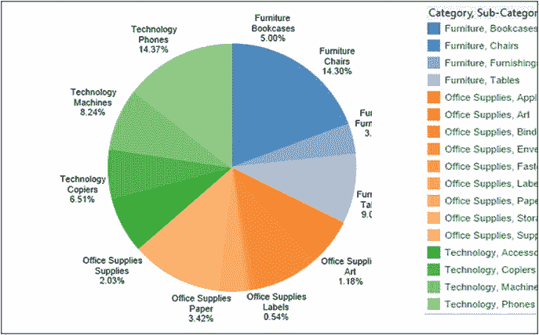

**图 8-1.** 一个饼图，用于展示每个“子类别”和“类别”中“销售额”的百分比。

数据涵盖三个类别：

-   技术
-   家具
-   办公用品

每个类别进一步细分为子类别。技术类包括复印机、机器和电话等子类别。家具类包括书架、椅子和陈设品等子类别。办公用品类包括纸张、标签和器具等子类别。

扇区的角度和大小由相应子类别和类别的销售额决定。

显而易见，由于以下原因，很难解读该饼图：

-   扇区过多，妨碍了轻松理解。
-   难以读取扇区的角度。
-   难以读取扇区的大小。

请考虑使用条形图展示相同的数据（如图 8-2 所示）：

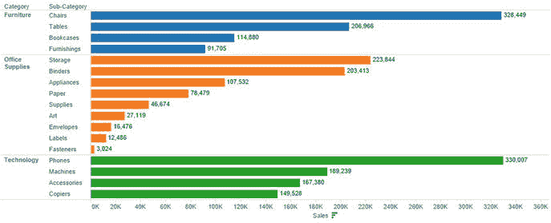

**图 8-2.** 条形图，展示与图 8.1 相同的数据。

这样读起来容易得多。关于相应“类别”中哪个“子类别”的“销售额”最高（“家具”中的“椅子”、“办公用品”中的“存储”、“技术”中的“电话”），完全没有混淆之处。

#### 8.1.9.2 示例 2

我们有美国多个城市的销售数据，例如科罗拉多斯普林斯、费城、圣地亚哥和旧金山。我们想确定销售额排名前三的城市。扇区的角度和大小由相应城市的销售额决定。请参阅图 8-3。

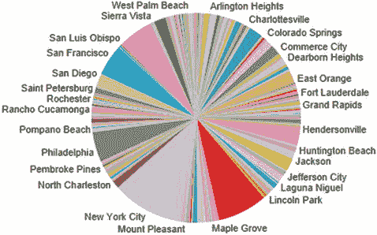

**图 8-3.** 一个饼图，用于展示在美国几个城市实现的“销售额”。

显而易见，由于以下原因，很难解读该饼图：

-   扇区过多，妨碍了轻松理解。
-   难以读取扇区的角度。
-   难以读取扇区的大小。

请考虑使用条形图展示相同的数据（如图 8-4 所示）：

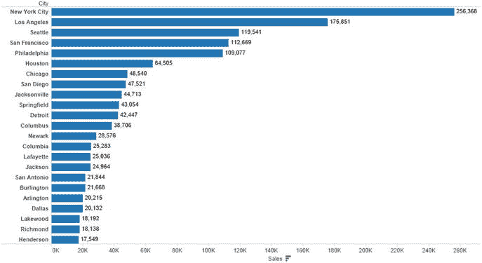

**图 8-4.** 条形图，展示与图 8-3 相同的数据。

从图 8-4 中可以清晰辨别出销售额排名前三的城市（纽约市、洛杉矶和西雅图）。我们不需要为条形使用不同颜色，因为一个区分因素就足够了。条形的长度就达到了目的。


#### 8.1.9.3 演示 1

**目标：** 以图形方式演示“客户细分”的“销售额”百分比。

**输入：** `Sample - Superstore.xls`

##### 8.1.9.3.1 创建饼图的步骤

##### 8.1.9.3.2 步骤 1

在标记卡中选择`饼图`。请注意，`角度`作为另一个特征被添加到标记卡中（如图 8-5 所示）。

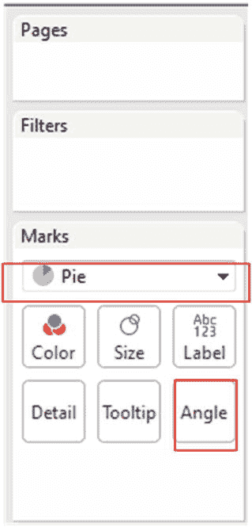

**图 8-5.** 在标记卡中选择饼图

##### 8.1.9.3.3 步骤 2

将维度`客户细分`从数据窗格下的维度区域拖拽到标记卡上的`颜色`处（如图 8-6 所示）。

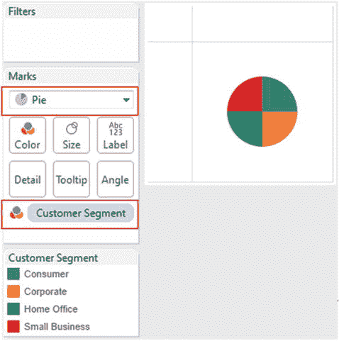

**图 8-6.** 在标记卡上将`客户细分`放置到`颜色`上

我们有四个细分市场的数据，分别是`消费者`、`公司`、`家庭办公`和`小型企业`。因此，饼图被分成四块，每个细分市场一块。请注意，所有块的大小相同。原因是到目前为止，我们还没有在标记卡的`大小`或`角度`特征上添加任何度量。

##### 8.1.9.3.4 步骤 3

让块的大小由每个`客户细分`产生的`销售额`决定。将度量`销售额`从数据窗格下的度量区域拖拽到标记卡上的`大小`处（如图 8-7 所示）。

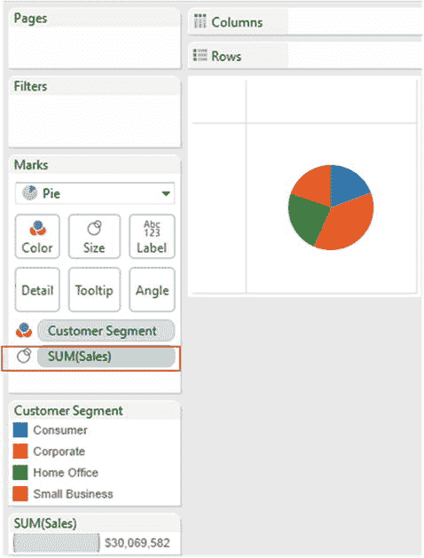

**图 8-7.** 在标记卡上将度量`销售额`放置到`大小`上

请注意块大小的变化。现在块的大小取决于每个`客户细分`的`销售额`。

##### 8.1.9.3.5 步骤 4

将度量`利润`从数据窗格下的度量区域拖拽到标记卡上的`角度`处（如图 8-8 所示）。现在块的角度根据每个`客户细分`的`利润`来确定。

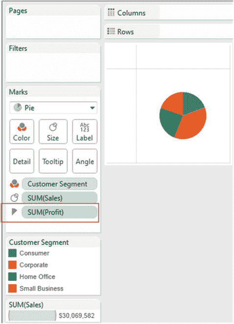

**图 8-8.** 在标记卡上将度量`利润`放置到`角度`上

##### 8.1.9.3.6 步骤 5

将度量`销售额`从数据窗格下的度量区域拖拽到标记卡上的`标签`处（如图 8-9 所示）。

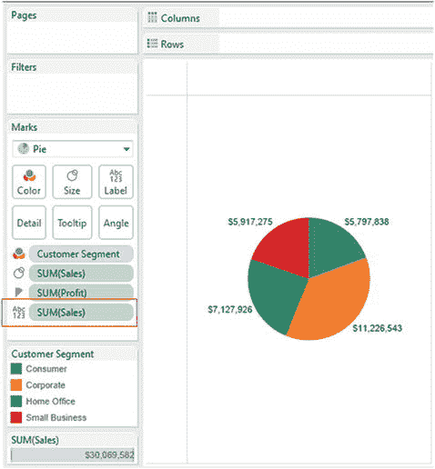

**图 8-9.** 在标记卡上将度量`销售额`放置到`标签`上

##### 8.1.9.3.7 步骤 6

让我们将销售额数字转换为百分比。右键单击`标签`上的度量`销售额`，调出下拉菜单。选择`快速表计算`（如图 8-10 所示）。

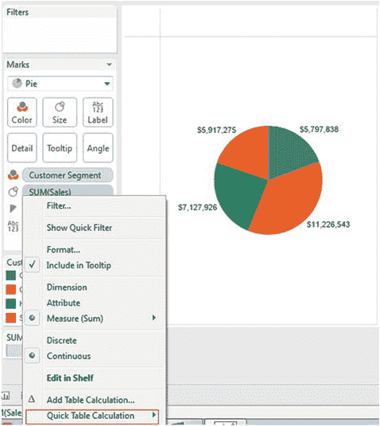

**图 8-10.** 在标记卡上将`表计算`添加到`标签`上的度量`销售额`

选择`快速表计算`会弹出一组选项。选择`合计百分比`（如图 8-11 所示）。

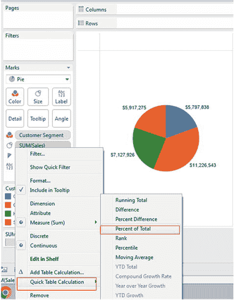

**图 8-11.** `快速表计算`中的`合计百分比`选项

工作表/视图中饼图上显示的标签将更改为反映占总计的百分比（如图 8-12 所示）。

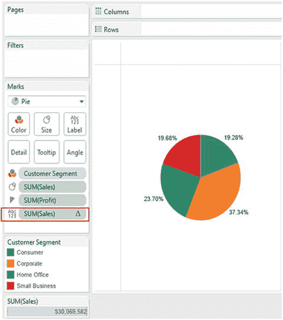

**图 8-12.** 以标签形式显示的`合计百分比`

如果你把饼图中每块的百分比加起来，总和应该等于 100%。让我们验证一下。

`(19.68 + 19.28 + 37.34 + 23.70) = 100`

##### 8.1.9.3.8 参考文献

一篇名为《无卑微的馅饼：统计图表的起源与使用》的论文，作者是多伦多大学心理学教授伊恩·斯彭斯，发表于 2005 年的*《教育与行为统计杂志》*。

---

## 8.2 树图

树图用于展示层级数据。层级数据也被称为树状结构数据。它表现为一组嵌套的矩形。矩形的大小和顺序由某个度量决定。最大的矩形位于左上角，最小的矩形位于右下角。如果矩形是嵌套的，则在较大矩形内部，较小的矩形保持相同的排序方式。

这一概念由[本·施奈德曼教授](https://en.wikipedia.org/wiki/Ben_Shneiderman#Ben%20Shneiderman)于 20 世纪 90 年代初在[马里兰大学人机交互实验室](https://en.wikipedia.org/wiki/University_of_Maryland_Human_%E2%80%93_Computer_Interaction_Lab#University%20of%20Maryland%20Human%20%E2%80%93%20Computer%20Interaction%20Lab)提出。

树图的原始动机是显示硬盘的内容。`SequoiaView` 是一款基于树图原理的磁盘浏览工具。面积表示文件大小，文件类型决定颜色。

`SmartMoney` 是第一个广泛用于非层级数据展示的树图实现。

### 8.2.1 优点

*   树图可以在有意义且组织良好的显示中展示数百到数千个项目。这种显示便于快速发现模式和异常。
*   从设计上讲，它们有效地利用了空间。
*   有助于展示“部分与整体”的关系。

#### 8.2.2.1 演示 1

设想一下……

我们是一家零售店，销售多个类别的商品。每个类别又进一步细分为多个子类别。如果我们要一次性呈现所有数据，应该使用树图。每个类别构成树的一个分支。每个类别由一个矩形表示。然后，每个类别矩形内会平铺多个代表子分支的小矩形。子分支则由子类别构成。


#### 8.2.2.2 示例

数据集中的数据分为三个类别。

- 家具
- 办公用品
- 技术

每个类别进一步细分为若干子类别，如图 8-13 所示。

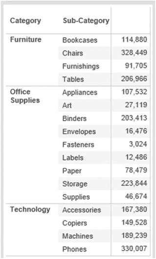

图 8-13. 数据的类别和子类别

上述数据集包含 17 个子类别的数据，这些子类别汇总为三个类别。然而，未来可能还会出现更多子类别的数据。我们需要一种图表形式，能够一次性查看所有数据。树状图正好满足了我们的需求！（参见图 8-14）。

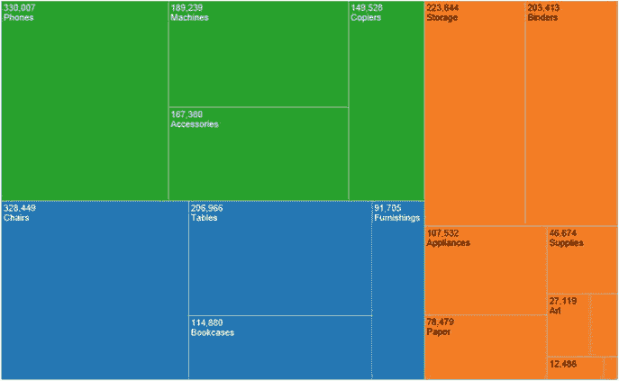

图 8-14. 展示数据类别和子类别的树状图

如何得到上述可视化效果？

绘制树状图需要以下内容：

- 一个或多个维度
- 一个或两个度量

通常，使用一个定量度量来提供大小，再用另一个（或同一个）度量来提供颜色。如果使用度量来提供颜色，并且该度量从零开始，则坚持使用单一颜色。然而，如果度量可能取负值，例如度量`Profit`，则可以使用两种颜色，并启用`Stepped Color`（分步颜色）选项。

上述树状图通过一个维度（`Category`）来着色。

##### 8.2.2.2.1 创建树状图的步骤

##### 8.2.2.2.2 第 1 步

将数据窗格下维度区域的`Category`维度拖放至标记卡上的`Color`（如图 8-15 所示）。

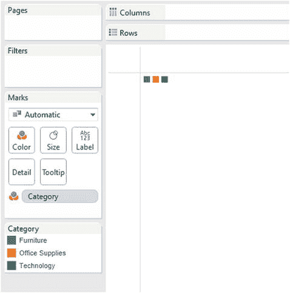

图 8-15. 将维度`Category`置于标记卡的`Color`上

工作表中三个矩形清晰显示数据分为三个类别。

##### 8.2.2.2.3 第 2 步

将数据窗格下度量区域的`Sales`度量拖放至标记卡上的`Size`。矩形的大小基于每个`Category`的销售额（如图 8-16 所示）。

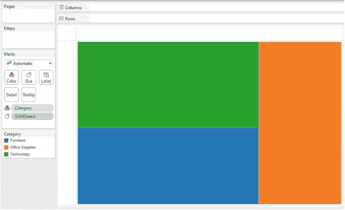

图 8-16. 将度量`Sales`置于标记卡的`Size`上

##### 8.2.2.2.4 第 3 步

将数据窗格下度量区域的`Sales`度量拖放至标记卡上的`Label`（如图 8-17 所示）。

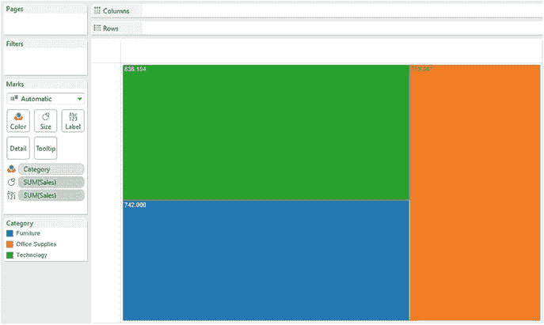

图 8-17. 将度量`Sales`置于标记卡的`Label`上

##### 8.2.2.2.5 第 4 步

将数据窗格下维度区域的`Sub-Category`维度拖放至标记卡上的`Label`（如图 8-18 所示）。

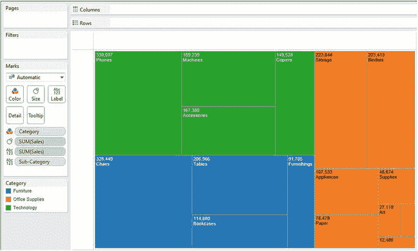

图 8-18. 将维度`Sub-Category`置于标记卡的`Label`上

##### 8.2.2.2.6 第 5 步

我们可以通过将数据窗格下维度区域的`Product Name`维度添加到标记卡的`Label`上，进一步为上述可视化添加更多细节（如图 8-19 所示）。

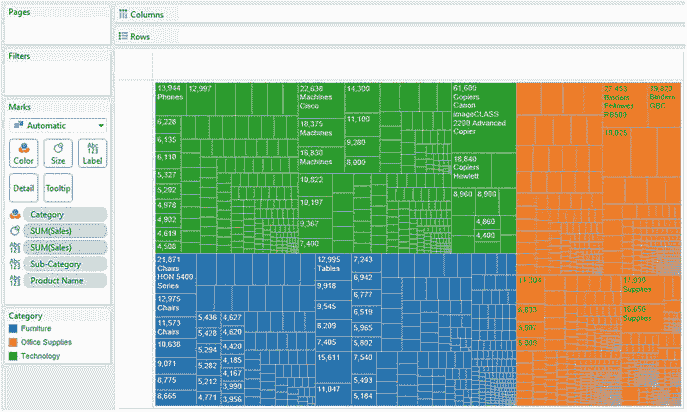

图 8-19. 将维度`Product Name`置于标记卡的`Label`上

## 8.3 热图

热图是数据的二维表示形式。热图使用颜色来显示数值。

### 8.3.1 为什么要使用热图？

- 它们有助于轻松理解复杂的数据集。
- 它们与分形图和树状图不同，后者在颜色使用上与热图相似；但热图在处理层级结构方面表现更佳。

术语`heat map`最初由软件设计师 Cormac Kinney 于 1991 年提出。它首次被用于描述一种显示实时金融市场信息的二维展示。

热图经常与等值区域图混淆。然而，等值区域图受地理边界约束，用于显示某个感兴趣变量的比例。而热图则没有此类限制。

### 8.3.2 如何创建热图？

使用的数据集：该数据列出了每年的每一天，并包含 1973 年至 1999 年间美国每天出生婴儿数量的排名。

数据来源：NYTimes.com, Amitabh Chandra, Harvard University

数据集中的字段：

- `Rank`
- `Month`
- `Day`

数据集中的一个数据子集（如图 8-20 所示）。该数据集共有 366 条记录。

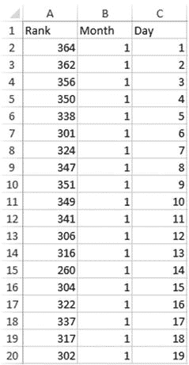

图 8-20. 数据集中的一个数据子集


好的，作为高级文档工程师和翻译员，我将遵循您的注意事项和示例，将给定的英文文本翻译成中文。


#### 创建热图的步骤

**第 1 步**

将 Excel 表格 `"Most Common Birthdays.xls"` 连接到 Tableau（如图 8-21 所示）。

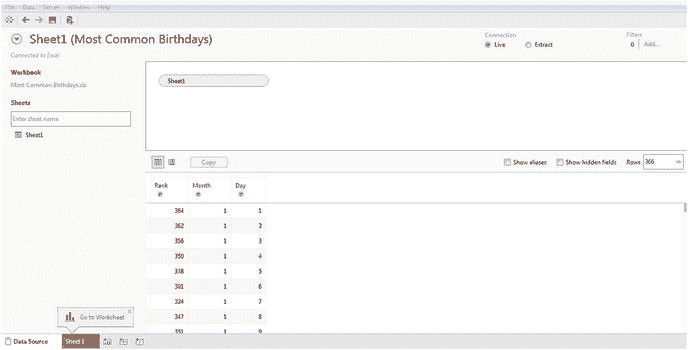

图 8-21. 读取到 Tableau 中的 `"Most Common Birthdays.xls"` 数据

转到工作表或视图（如图 8-22 所示）。

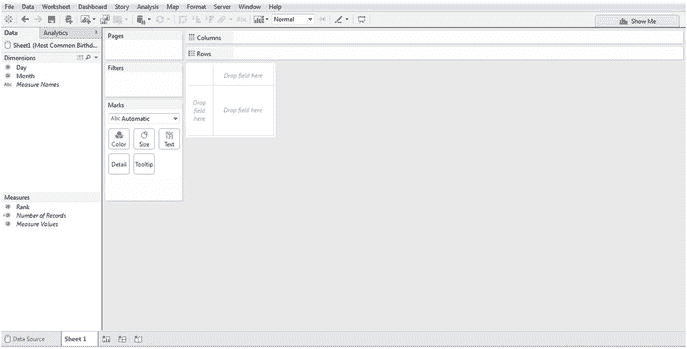

图 8-22. 连接到 `"Most Common Birthdays.xls"` 后的 Tableau 工作表/视图

**第 2 步**

创建一个计算字段 `"MonthNames"`，用于存储与月份对应的月份名称。例如，1 对应 `"Jan"`，2 对应 `"Feb"`，以此类推（如图 8-23 所示）。

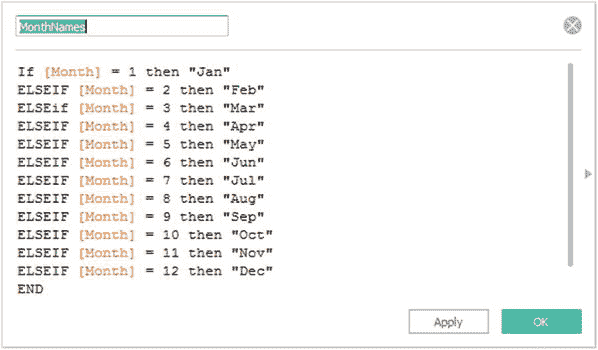

图 8-23. 正在创建的计算字段 `"MonthNames"`

使用的公式如下：

```
If [Month] = 1 then "Jan"
ELSEIF [Month] = 2 then "Feb"
ELSEIF [Month] = 3 then "Mar"
ELSEIF [Month] = 4 then "Apr"
ELSEIF [Month] = 5 then "May"
ELSEIF [Month] = 6 then "Jun"
ELSEIF [Month] = 7 then "Jul"
ELSEIF [Month] = 8 then "Aug"
ELSEIF [Month] = 9 then "Sep"
ELSEIF [Month] = 10 then "Oct"
ELSEIF [Month] = 11 then "Nov"
ELSEIF [Month] = 12 then "Dec"
END
```

**第 3 步**

将维度 `"Day"` 转换为 `"离散"`（如图 8-24 所示）。

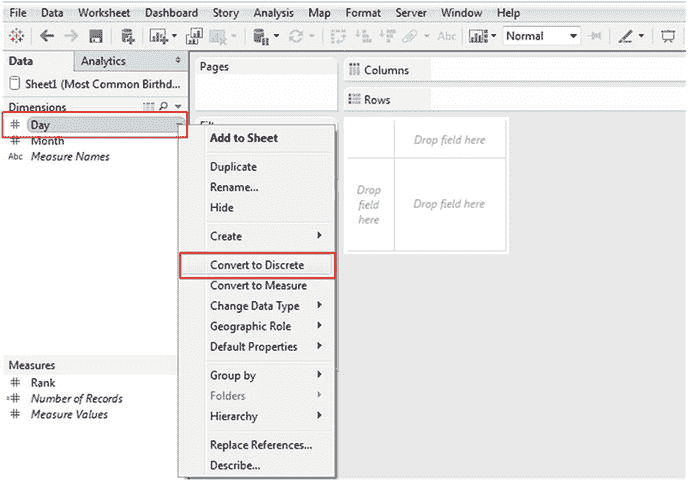

图 8-24. 维度 `"Day"` 正在转换为 `"离散"`

**第 4 步**

将维度 `"MonthNames"` 从数据窗格的维度区域拖放至列功能区（如图 8-25 所示）。

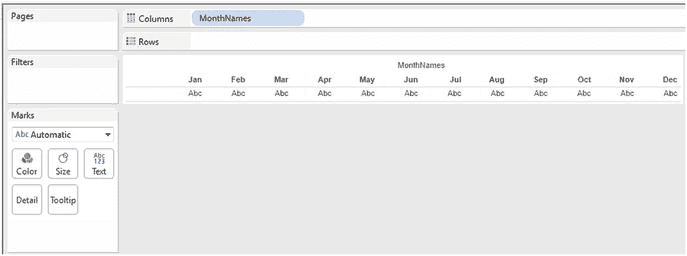

图 8-25. 计算字段 `"MonthNames"` 放置在列功能区上

**第 5 步**

将维度 `"Day"` 从数据窗格的维度区域拖放至行功能区（如图 8-26 所示）。

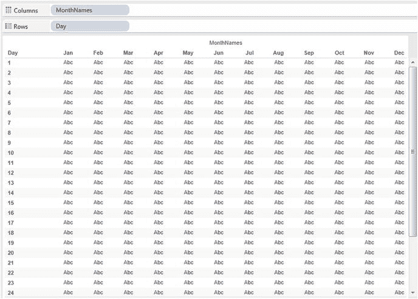

图 8-26. 维度 `"Day"` 放置在行功能区上

**第 6 步**

将标记类型从 `"自动"` 更改为 `"方形"`（如图 8-27 所示）。

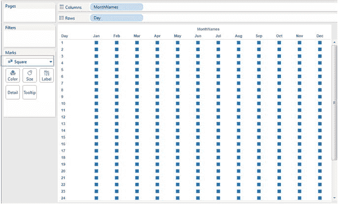

图 8-27. 标记类型已更改为 `"方形"`

**第 7 步**

将度量 `"Rank"` 从数据窗格的度量区域拖放至标记卡上的 `"颜色"`（如图 8-28 所示）。

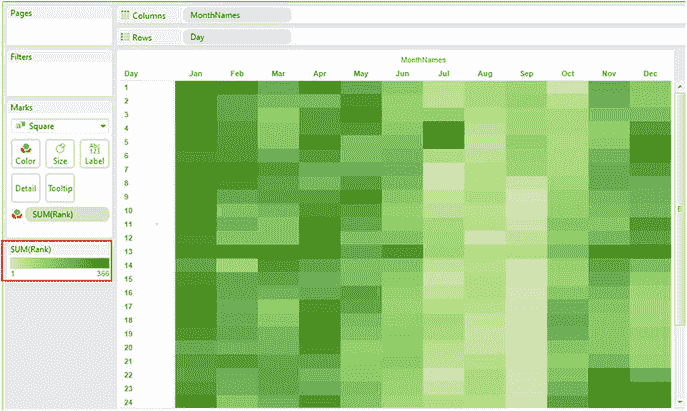

图 8-28. 度量 `"Rank"` 放置在标记卡的 `"颜色"` 上

**第 8 步**

双击 `"颜色"` 以打开编辑颜色对话框。将颜色从 `"绿色"` 更改为 `"橙色"`（如图 8-29 所示）。

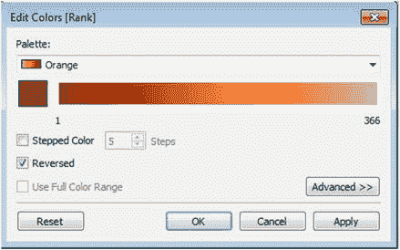

图 8-29. `"Rank"` 的 `"编辑颜色"` 对话框

点击 `"应用"`，然后点击确定。输出结果如图 8-30 所示。

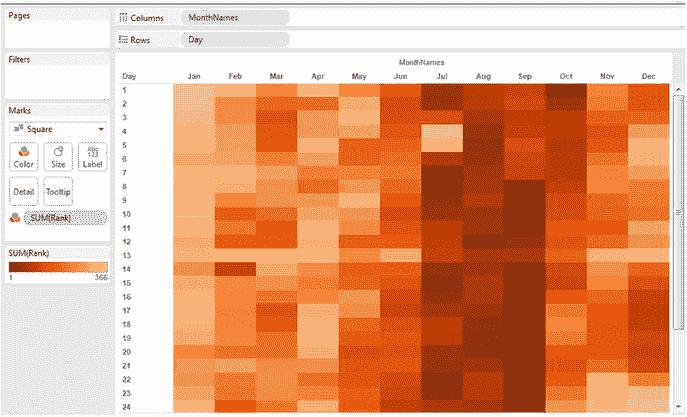

图 8-30. 热图 - 演示 1 - 最终输出

**结论**

9 月 16 日排名第一，这意味着 9 月 16 日出生的婴儿数量最多（如图 8-31 所示）。

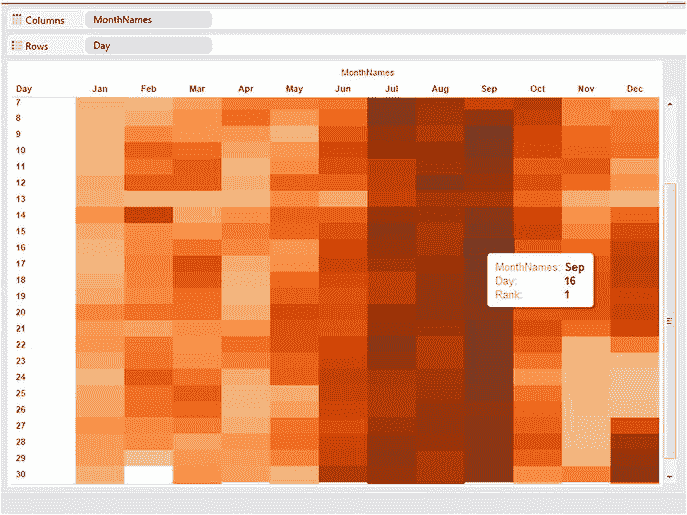

图 8-31. 热图解读 - 演示 1

同样，2 月 29 日出生的婴儿数量最少。

## 突出显示表

突出显示表本质上是一个大型文本表，其中的数据值通过颜色进行编码。例如，利润值越高，颜色越深。这有助于减少洞察时间，并提高洞察的准确性。它们适用于：

*   快速识别数据中的高值、低值或其他关注点。
*   作为增强交叉表的一种手段。

创建突出显示表需要使用一个或多个维度，并且恰好将一个度量放置在标记卡的 `"颜色"` 上。

#### 演示 1

目标：研究维度 `"子类别"` 和 `"订单日期"` 上的度量 `"销售额"`。

输入：`"Sample – Superstore.xls"`

预期输出：（如图 8-32 所示）。

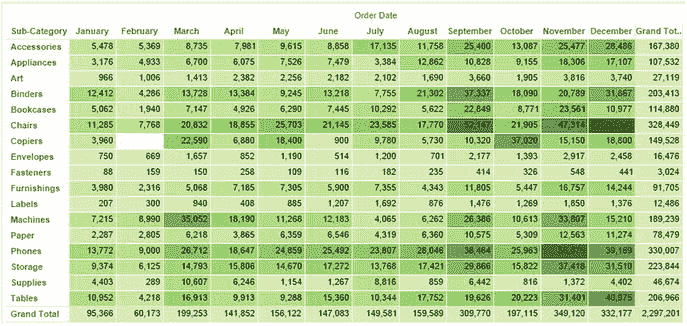

图 8-32. 突出显示表 - 演示 1 - 预期输出

#### 8.4.1.1 创建突出显示表的步骤

**第 1 步**

将维度 `"子类别"` 从数据窗格的维度区域拖放到行功能区（如图 8-33 所示）。

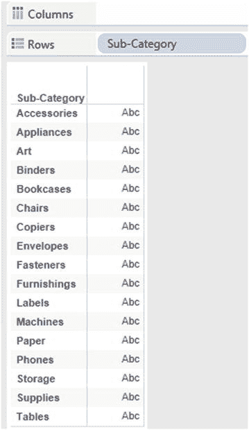

图 8-33. 维度 `"子类别"` 放置在行功能区上

将维度 `"订单日期"` 从数据窗格的维度区域拖放到列功能区。将粒度更改为 `月 (订单日期)` （如图 8-34 所示）。

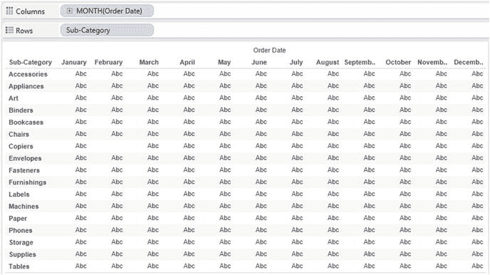

图 8-34. 维度 `"订单日期"` 放置在列功能区上

**第 2 步**

将度量 `"销售额"` 从数据窗格的度量区域拖放到标记卡上的 `"标签"`（如图 8-35 所示）。

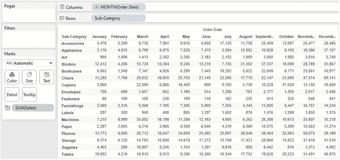

图 8-35. 度量 `"销售额"` 放置在标记卡的 `"标签"` 上

**第 3 步**

将度量 `"销售额"` 从数据窗格的度量区域拖放到标记卡上的 `"颜色"`（如图 8-36 所示）。

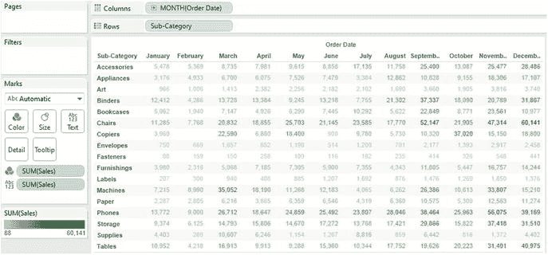

图 8-36. 度量 `"销售额"` 放置在标记卡的 `"颜色"` 上

**第 4 步**

将标记类型更改为 `"方形"`（如图 8-37 所示）。

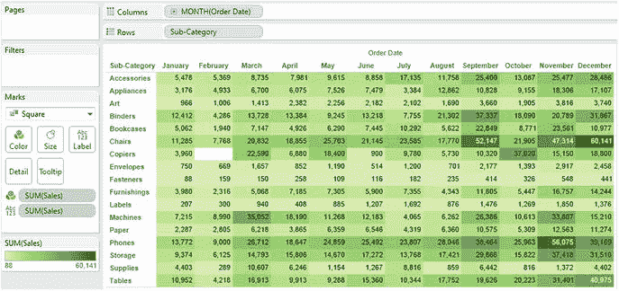

图 8-37. 标记类型设置为 `"方形"`

点击标记卡上的 `"颜色"`，将边框更改为 `"白色"`（如图 8-38 所示）。

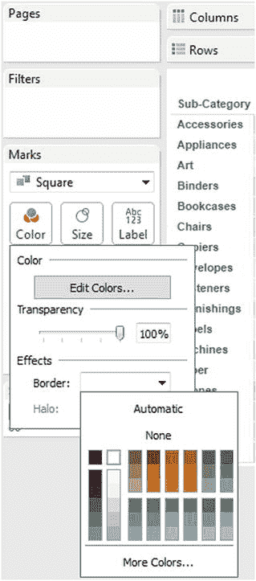

图 8-38. 工作表单元格的边框正在设置为 `"白色"`

将边框设置为 `"白色"` 后的输出结果（如图 8-39 所示）。

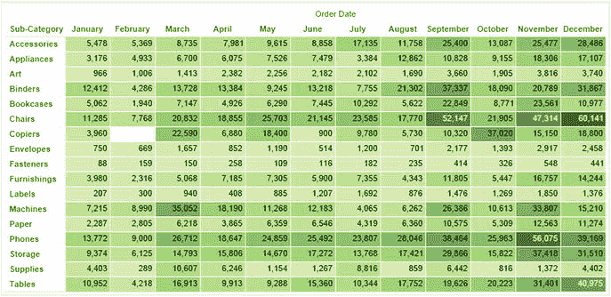

图 8-39. 工作表格边框设置为 `"白色"` 后的输出结果


好的，作为一名高级文档工程师和翻译员，我将严格遵循您的注意事项和示例格式，对给定的英文文本进行专业、准确的中文翻译。


##### 步骤 5

在菜单栏上选择 `Analysis`。选择 `Totals`，然后选择 `Show Row Grand Totals` 和 `Show Column Grand Totals`（如图 8-40 所示）。

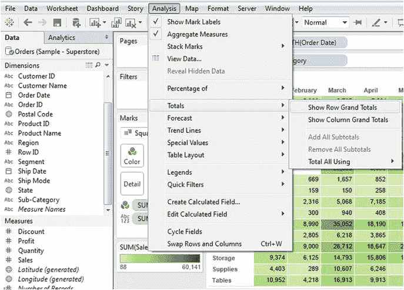

图 8-40. 设置`行合计和列合计`

添加`行合计`和`列合计`后的输出结果（如图 8-41 所示）。

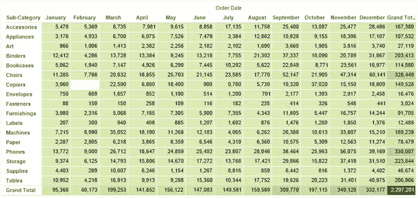

图 8-41. 设置`行合计和列合计`后的输出结果

请注意，`总计`会以最深的绿色阴影显示。这是因为它是所有单元格中的最大值，但我们的要求是不要让`总计`显示为最深的绿色。

如何更改这一点呢？

单击标记卡上放置在 `Color` 上的 `Sum(Sales)`。选择 `Total Using (Automatic)` ➤ `Hide`（如图 8-42 所示）。

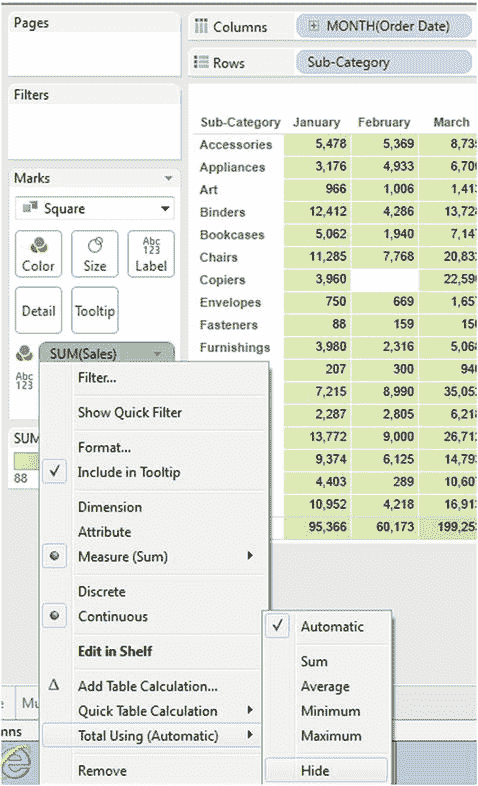

图 8-42. 为标记卡上放置在 `Color` 的度量 `Sales` 设置 `Total Using (Automatic)` 选项

单击 `Hide`。最终输出结果如图 8-43 所示。

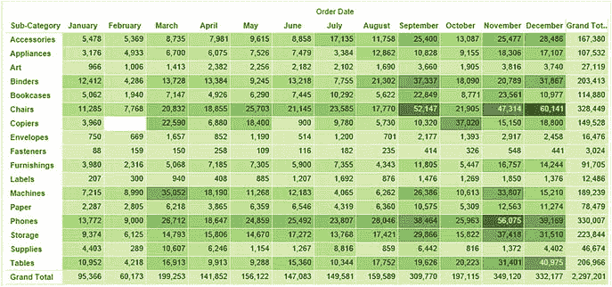

图 8-43. 突出显示表 – 演示 1 - 最终输出

### 演示 2

**目标：** 研究由维度 `Region`、`Segment`、`Category` 和 `Sub-Category` 构成的交叉表中的度量 `Sales`。对度量 `Sales` 使用阶梯颜色可以快速查看哪些项目“表现良好”、“表现一般”和“表现不佳”。

**输入：** `Sample – Superstore.xls`

**预期输出：** （如图 8-44 所示）。

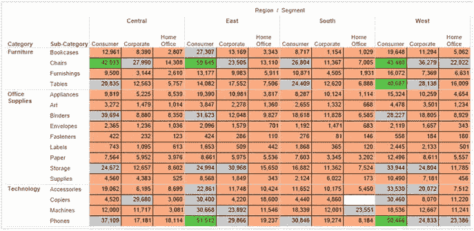

图 8-44. 突出显示表 - 演示 2 - 预期输出

### 创建突出显示表的步骤

##### 步骤 1

从数据窗格下的维度区域中，将维度 `Region` 和 `Segment` 拖放到列功能区上（如图 8-45 所示）。

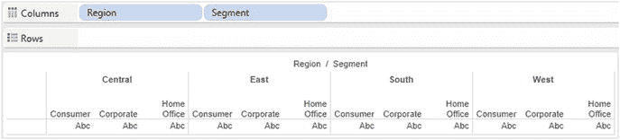

图 8-45. 维度 `Region` 和 `Segment` 放置在列功能区上

从数据窗格下的维度区域中，将维度 `Category` 和 `Sub-Category` 拖放到行功能区上（如图 8-46 所示）。

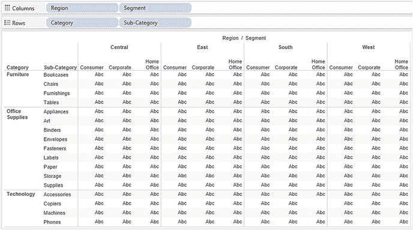

图 8-46. 维度 `Category` 和 `Sub-Category` 放置在行功能区上

##### 步骤 2

从数据窗格下的度量区域中，将度量 `Sales` 拖放到标记卡上的 `Label` 上（如图 8-47 所示）。

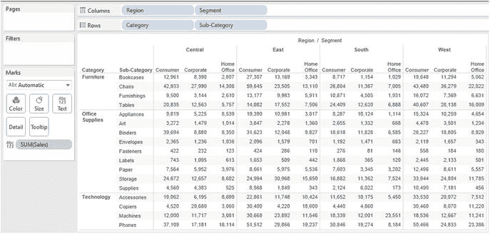

图 8-47. 度量 `Sales` 放置在标记卡上的 `Label` 上

从数据窗格下的度量区域中，将度量 `Sales` 拖放到标记卡上的 `Color` 上（如图 8-48 所示）。

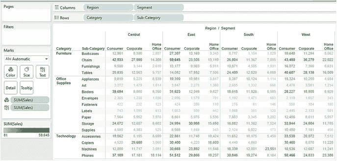

图 8-48. 度量 `Sales` 放置在标记卡上的 `Color` 上

##### 步骤 3

将标记类型更改为 `Square`（如图 8-49 所示）。

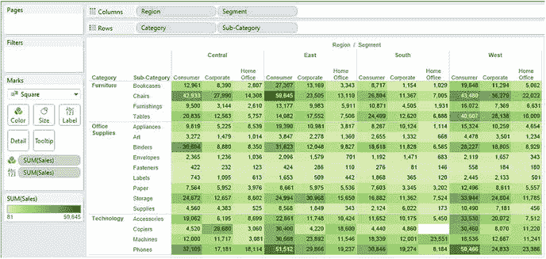

图 8-49. 标记类型设置为 `Square`

通过单击标记卡上的 `Color` 来更改 `Color`（如图 8-50 所示）。

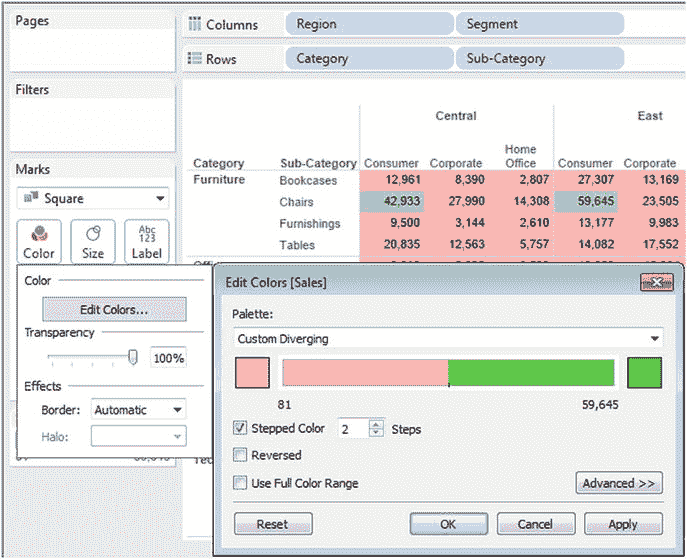

图 8-50. `编辑颜色`对话框

将单元格边框更改为 `Black`（如图 8-51 所示）。


图 8-51. 工作表单元格的单元格边框设置为 `Black`

**最终输出：** （如图 8-52 所示）。


图 8-52. 突出显示表 - 演示 2 - 最终输出

## 折线图

折线图是一种将信息显示为由直线段连接的一系列数据点的图表。这些数据点也称为 `标记`。折线图通常用于可视化一段时间间隔内的数据趋势。换句话说，它们有助于可视化数据随时间连续变化的情况。

#### 演示 1

**目标：** 使用折线图查看 `Sales` 和 `Profit` 随时间的趋势，并学习预测。

**输入：** `Sample – Superstore.xls`

**预期输出：** （如图 8-53 所示）。


图 8-53. 折线图 - 演示 1 - 预期输出

#### 创建折线图的步骤

##### 步骤 1

从数据窗格下的维度区域中，将维度 `Order Date` 拖放到列功能区上。让日期层次结构保持为 `Year`。从视觉提示可以看出，它是 `Discrete` 数据。（日期在列功能区上显示为蓝色）（如图 8-54 所示）。


图 8-54. 维度 `Order Date` 放置在列功能区上

##### 步骤 2

从数据窗格下的度量区域中，将度量 `Sales` 拖放到行功能区上（如图 8-55 所示）。


图 8-55. 度量 `Sales` 放置在行功能区上

从数据窗格下的度量区域中，将度量 `Profit` 拖放到行功能区上度量 `Sales` 的右侧（如图 8-56 所示）。


图 8-56. 度量 `Profit` 放置在行功能区上度量 `Sales` 的右侧

将度量 `Profit` 从行功能区拖出，放到与 `Sales` 相同的轴上（如图 8-57 所示）。


图 8-57. 度量 `Profit` 放置在与度量 `Sales` 相同的轴上

##### 步骤 3

将日期从 `Discrete` 更改为 `Continuous`，并将粒度从 `Year` 更改为 `Month`（如图 8-58 所示）。


图 8-58. 维度 `Order Date` 转换为 `Continuous`，粒度更改为 `Month`

##### 步骤 4

转到分析窗格，将 `Forecast` 拖到视图中（如图 8-59 所示）。


图 8-59. 预测已添加到视图/工作表中

右键单击预测区域以调出预测菜单，然后选择 `Describe Forecast`（如图 8-60 和图 8-61 所示）。


图 8-61. `Describe Forecast` 窗口


图 8-60. 从预测菜单中选择 `Describe Forecast`

### 演示 2

**目标：** 在不使用日期维度的情况下绘制折线图。

**输入：** `Sample – Superstore.xls`

**预期输出：** （如图 8-62 所示）。


图 8-62. 折线图 - 演示 2 - 预期输出

#### 创建折线图的步骤


#### 8.5.2.2 第 1 步

将数据窗格下度量区域中的度量`Sales`拖放到列功能区上（如图 8-63 所示）。


图 8-63. 将度量`Sales`放置在列功能区上

将列功能区上的度量`Sales`转换为`维度`（如图 8-64 所示）。


图 8-64. 将列功能区上的度量`Sales`转换为`维度`

#### 8.5.2.3 第 2 步

将数据窗格下度量区域中的度量`Profit`拖放到行功能区上（如图 8-65 所示）。


图 8-65. 将度量`Profit`放置在行功能区上

## 8.6 堆叠条形图

堆叠条形图或堆叠柱状图用于分解和比较整体的各个部分。每个条形代表整体，条形内的分段代表整体的类别或部分。不同类别或部分使用不同颜色进行区分，便于理解。

### 8.6.1 演示 1

想象一下……公共卫生部门进行了一项调查。调查问卷包含三个问题。共有 100 名受访者参与了调查。回答采用李克特量表，评分等级如下：

*   非常不同意
*   不同意
*   中立
*   同意
*   非常同意

以下是每个评分等级对应的受访者人数。


目标：绘制每个评分等级的受访者百分比，其中`非常同意`和`同意`一起出现在正轴，`非常不同意`和`不同意`构成负轴。`中立`的受访者百分比一半出现在正轴，另一半出现在负轴。

输入：`StackedBar.xlsx`

预期输出：如图 8-66 所示。


图 8-66. 堆叠条形图 - 演示 1 - 预期输出

### 8.6.2 创建堆叠条形图的步骤

#### 8.6.2.1 第 1 步

将来自 `Stacked Bar.xlsx` 的数据读入 Tableau（如图 8-67 所示）。


图 8-67. 将来自 `Stacked Bar.xlsx` 的数据读入 Tableau

#### 8.6.2.2 第 2 步

将数据窗格下维度区域中的维度`Survey Questions`拖放到行功能区上（如图 8-68 所示）。


图 8-68. 将维度`Survey Questions`放置在行功能区上

将数据窗格下度量区域中的度量`Strongly Disagree`拖放到列功能区上（如图 8-69 所示）。


图 8-69. 将度量`Strongly Disagree`放置在列功能区上

将数据窗格下度量区域中的度量`Disagree`拖放到与度量`Strongly Disagree`相同的轴上（如图 8-70 所示）。


图 8-70. 将度量`Disagree`放置在度量`Strongly Disagree`相同的轴上

注意行功能区上的`Measure Names`和列功能区上的`Measure Values`。

将数据窗格下度量区域中的度量`Agree`、`Strongly Agree`拖放到与先前度量相同的轴上（如图 8-71 所示）。


图 8-71. 将度量`Agree`和`Strongly Agree`放置在度量`Disagree`和`Strongly Disagree`相同的轴上

#### 8.6.2.3 第 3 步

创建两个计算字段：`NeutralNegative`和`NeutralPositive`（如图 8-72 & 图 8-73 所示）。


图 8-73. 正在创建计算字段`NeutralPositive`


图 8-72. 正在创建计算字段`NeutralNegative`

#### 8.6.2.4 第 4 步

如图 8-74 和图 8-75 所示，手动对维度`Measure Names`进行排序。排序顺序应如下：


图 8-75. 手动排序度量名称


图 8-74. 排序度量名称

*   非常不同意
*   不同意
*   非常同意
*   同意

排序后的输出如图 8-76 所示。


图 8-76. 对度量名称进行排序后的输出

#### 8.6.2.5 第 5 步

将`Measure Names`从行功能区拖放至标记卡上的`颜色`（如图 8-77 所示）。


图 8-77. 将维度`measure names`放置在标记卡上的`颜色`上

将数据窗格下维度区域中的维度`Measure Names`拖放至标记卡上的`标签`（如图 8-78 所示）。


图 8-78. 将维度`Measure Names`放置在标记卡上的`标签`上

将数据窗格下度量区域中的度量`NeutralNegative`拖放至`X 轴`（即所有度量放置的同一轴）上（如图 8-79 所示）。


图 8-79. 将计算字段`NeutralNegative`放置在`X 轴`上

将数据窗格下度量区域中的度量`NeutralPositive`拖放至`X 轴`（即所有度量放置的同一轴）上（如图 8-80 所示）。


图 8-80. 将计算字段`NeutralPositive`放置在`X 轴`上

#### 8.6.2.6 第 6 步

转到`分析`窗格，将`常量线`拖放到视图中（如图 8-81 所示）。


图 8-81. 视图上的常量线

上述操作会绘制一条数值为 -15 的常量线。我们来编辑这条常量线。按照图 8-82 所示填写数值。


图 8-82. `编辑参考线、带或框`对话框

上述设置将在`X 轴`的 0 位置绘制一条常量线（如图 8-83 所示）。


图 8-83. 在`X 轴`的 0 位置绘制的常量线

度量`Neutral`已被拆分为两部分，以便一半显示在负刻度上，另一半显示在正刻度上。

最终输出如图 8-84 所示。


图 8-84. 堆叠条形图 - 演示 1 - 最终输出


