# 8.7 甘特图

美国工程师兼社会科学家亨利·L·甘特于 1917 年发明了**甘特图**。它在项目管理中被广泛用于项目进度的图形化表示。

甘特图有助于规划、协调和跟踪项目中的具体任务。换句话说，它能帮助你快速可视化以下信息：

-   整个项目的开始和结束日期。
-   整个项目的持续时间。
-   作为项目一部分需要执行的各种任务或活动有哪些？
-   每个任务/活动的开始和结束时间。
-   每项活动的持续时间。
-   哪些活动存在重叠以及重叠的程度。

甘特图有一个水平轴，代表项目的整个生命周期。这个时间跨度被细分为较小的增量，如月、周、天等。项目的任务则显示在垂直轴上。每个任务由一个条形表示。条形的**位置**和**长度**表示任务的开始日期、持续时间和结束日期。

## 8.7.1 甘特图的缺点

-   它们不指示任务依赖关系。它们无法告诉我们一个或多个进度落后的任务将如何影响其他任务。
-   它们可能是在规划阶段早期制定的。随着项目发生变化，需要不断更新甘特图。不应将其视为一成不变。
-   它们没有考虑成本因素。
-   对于有多个里程碑且每个里程碑需要完成多个任务的大型项目来说，它们可能会变得非常复杂。
-   如果图表超过一页，可能会难以查看。
-   条形的大小并不表示完成任务所需的工作量。

### 8.7.1.1 演示 1

**目标：**

你是一名项目经理，负责管理三个项目（“项目 1”、“项目 2”和“项目 3”）。你的团队中有三名技术架构师。我们称他们为“人员 1”、“人员 2”和“人员 3”。你正在将他们分配到这三个项目中。你为他们制定了以下时间表。你希望有一个可视化图表，能一目了然地清晰展示他们的时间表。你决定使用“**甘特图**”来实现这一目标。

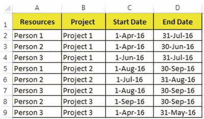

**输入：** `GanttChart.xlsx`

**预期输出：** 如图 8-85 所示。

*图 8-85. 甘特图 - 演示 1 - 预期输出*

#### 8.7.1.1.1 创建甘特图的步骤

#### 8.7.1.1.2 步骤 1

将 `GanttChart.xlsx` 中的数据读入 Tableau（如图 8-86 所示）。

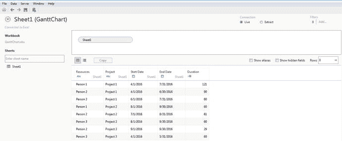

*图 8-86. 将 `GanttChart.xlsx` 中的数据读入 Tableau*

#### 8.7.1.1.3 步骤 2

将数据窗格中维度区域的 `Start Date` 维度拖放到列功能区（如图 8-87 所示）。

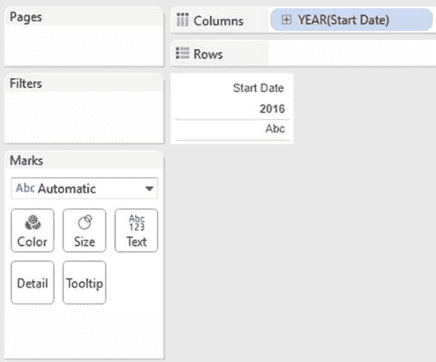

*图 8-87. 将维度 `Start Date` 放置在列功能区上*

点击列功能区上 `YEAR(Start Date)` 旁边的下拉菜单。选择 `Exact Date`（如图 8-88 所示）。

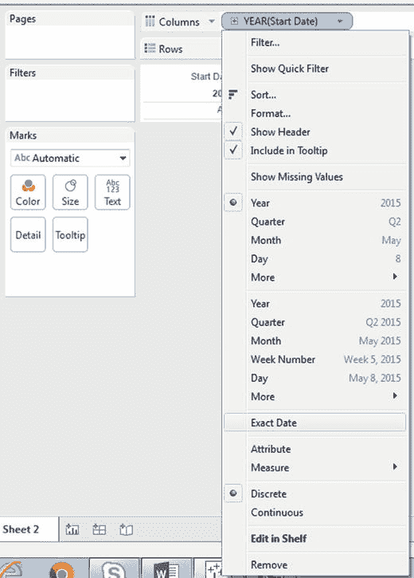

*图 8-88. 为维度 `Start Date` 选择 `Exact Date`*

选择 `Exact Date` 后的输出（如图 8-89 所示）。

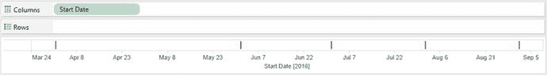

*图 8-89. 选择 `Exact Date` 后的输出*

#### 8.7.1.1.4 步骤 3

将数据窗格中维度区域的 `Project` 和 `Resources` 维度拖放到行功能区（如图 8-90 所示）。

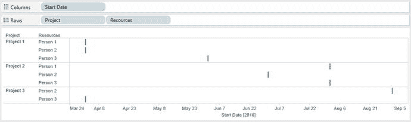

*图 8-90. 将维度 `Project` 和 `Resources` 放置在行功能区上*

#### 8.7.1.1.5 步骤 4

将标记类型更改为 `Gantt Bar`（如图 8-91 所示）。

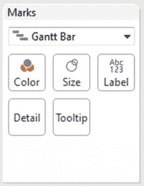

*图 8-91. 将 `标记类型` 设置为 `Gantt Bar`*

#### 8.7.1.1.6 步骤 5

创建一个计算字段 `Duration`（如图 8-92 所示）。

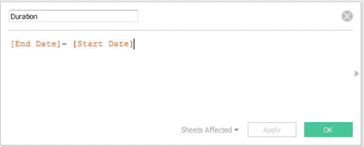

*图 8-92. 正在创建计算字段 `Duration`*

将数据窗格中度量区域的计算字段 `Duration` 拖放到标记卡上的 `大小` 上（如图 8-93 所示）。

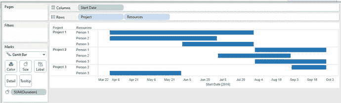

*图 8-93. 将计算字段 `Duration` 放置在标记卡的 `大小` 上*

#### 8.7.1.1.7 步骤 6

将数据窗格中维度区域的 `Resources` 维度拖放到标记卡上的 `颜色` 上（如图 8-94 所示）。

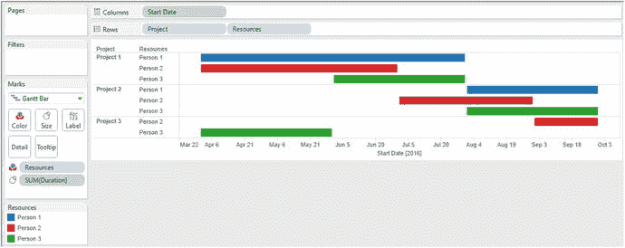

*图 8-94. 将维度 `Resources` 放置在标记卡的 `颜色` 上*

将数据窗格中维度区域的 `Start Date` 维度拖放到标记卡上的 `标签` 上（如图 8-95 所示）。

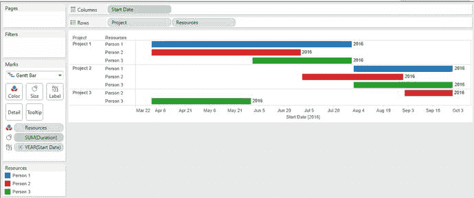

*图 8-95. 将维度 `Start Date` 放置在标记卡的 `标签` 上*

点击放置在标记卡 `标签` 上的 `YEAR(Start Date)` 以调出菜单。选择 `Exact Date`（如图 8-96 所示）。

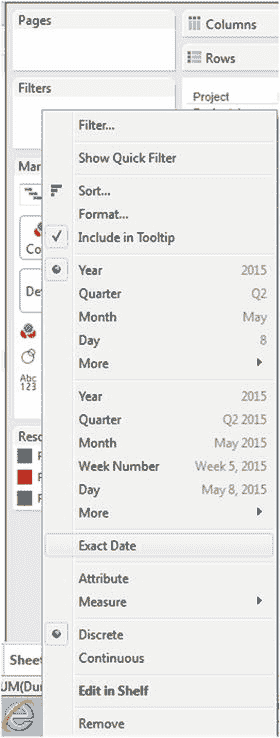

*图 8-96. 为 `Start Date` 选择 `Exact Date` 选项*

将 `Start Date` 设置为 `Exact Date` 并将其放置在标记卡的 `标签` 上后的输出（如图 8-97 所示）。

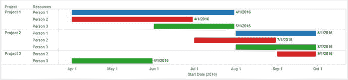

*图 8-97. 将 `Start Date` 设置为 `Exact Date` 并放在 `标签` 上后的输出*

点击 `标签` 将对齐方式更改为 `左`（如图 8-98 所示）。

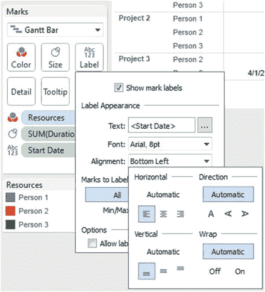

*图 8-98. 标签左对齐*

将适合方式设置为 `整个视图`。

输出如图 8-99 所示。

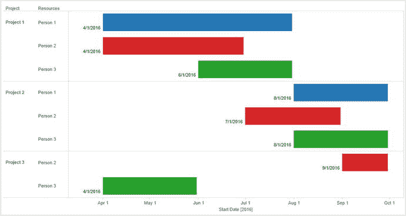

*图 8-99. 甘特图 - 演示 1 - 最终输出*

## 8.7.2 演示 2

**目标：**

你是一名建筑商，负责一家热门上城区餐厅宴会厅的改造项目。你已经做好了全面规划。以下是提议的时间表。

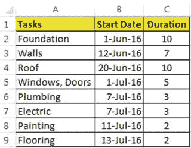

为了向所有利益相关方展示该时间表，你决定绘制一张甘特图，以便于查看和理解。

**输入：** `GanttChartAssignment.xlsx`

**预期输出：** 如图 8-100 所示。

*图 8-100. 甘特图 - 演示 2 - 预期输出*

### 8.7.2.1 创建甘特图的步骤

### 8.7.2.2 步骤 1

将 `GanttChartAssignment.xlsx` 中的数据读入 Tableau（如图 8-101 所示）。

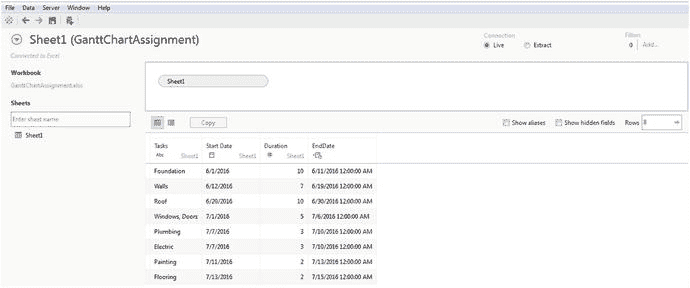

*图 8-101. 将 `GanttChartAssignment.xlsx` 中的数据读入 Tableau*

#### 8.7.2.3 步骤 2

将数据窗格下维度区域中的维度`开始日期`拖拽至列功能区（如图 8-102 所示）。

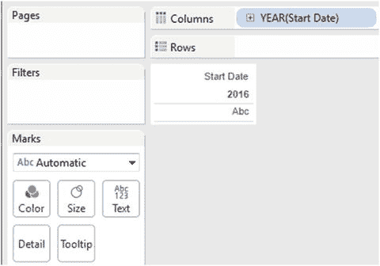

图 8-102. 将维度`开始日期`放置在列功能区

点击列功能区上维度`开始日期`的下拉菜单。选择`精确日期`（如图 8-103 所示）。

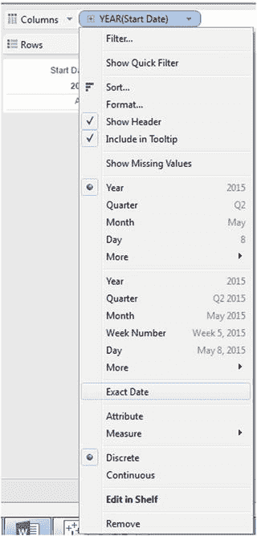

图 8-103. 为维度`开始日期`选中`精确日期`选项

将维度`开始日期`设置为`精确日期`后的输出结果（如图 8-104 所示）。

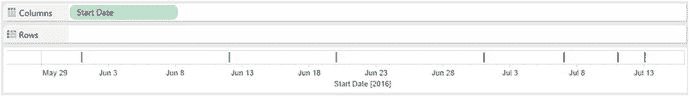

图 8-104. 维度`开始日期`设置为`精确日期`后的输出结果

将数据窗格下维度区域中的维度`任务`拖拽至行功能区（如图 8-105 所示）。

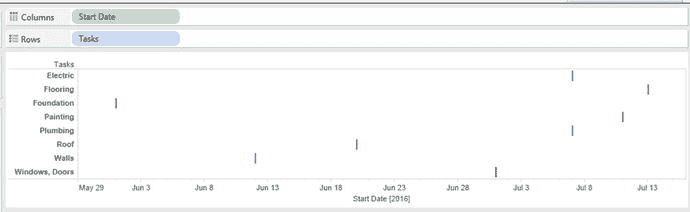

图 8-105. 将维度`任务`放置在行功能区

#### 8.7.2.4 步骤 3

创建一个计算字段`结束日期`（如图 8-106 所示）。

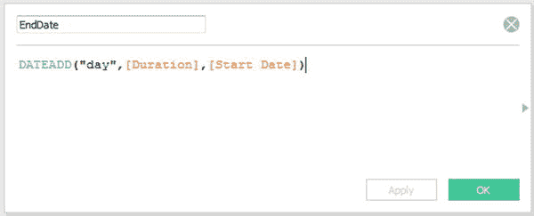

图 8-106. 正在创建计算字段`结束日期`

#### 8.7.2.5 步骤 4

将数据窗格下度量区域中的度量`持续时间`拖拽至标记卡上的`大小`（如图 8-107 所示）。

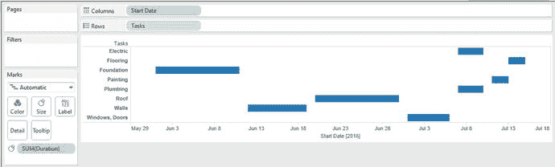

图 8-107. 将度量`持续时间`放置在标记卡的`大小`上

将数据窗格下维度区域中的维度`任务`拖拽至标记卡上的`颜色`（如图 8-108 所示）。

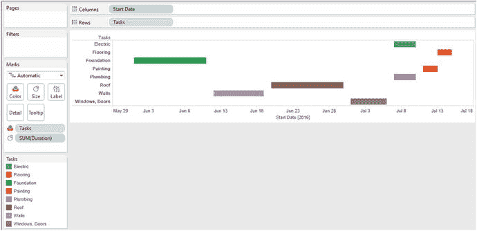

图 8-108. 将维度`任务`放置在标记卡的`颜色`上

将数据窗格下维度区域中的维度`开始日期`拖拽至标记卡上的`标签`（如图 8-109 所示）。

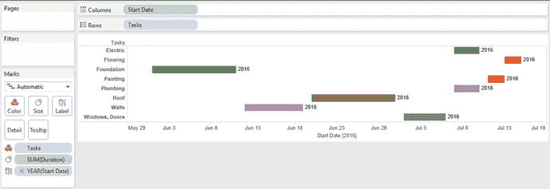

图 8-109. 将维度`开始日期`放置在标记卡的`标签`上

点击`标签`上维度`开始日期`的下拉菜单，将其更改为`精确日期`（如图 8-110 所示）。

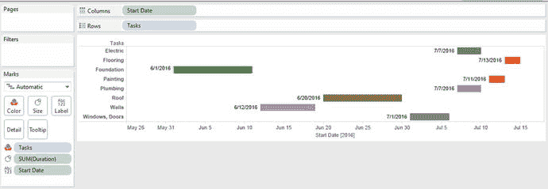

图 8-110. 将维度`开始日期`放置在`标签`上并设置为`精确日期`

对`结束日期`重复此操作。将数据窗格下维度区域中的计算字段`结束日期`拖拽至标记卡上的`标签`（如图 8-111 所示）。

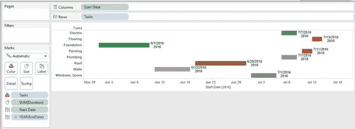

图 8-111. 将计算字段`结束日期`放置在标记卡的`标签`上

将`标签`上的`结束日期`更改为`精确日期`（如图 8-112 所示）。

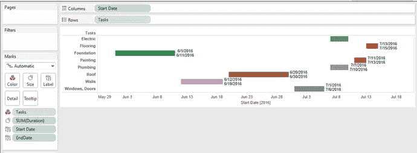

图 8-112. 将计算字段`结束日期`设置为`精确日期`

点击标记卡上的`标签`以打开标签对话框（如图 8-113 所示）。

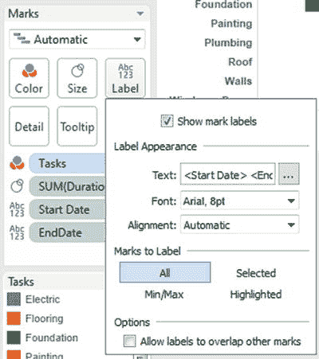

图 8-113. 标签对话框

点击`文本`旁边的省略号（如图 8-114 所示）以打开`编辑标签`对话框。

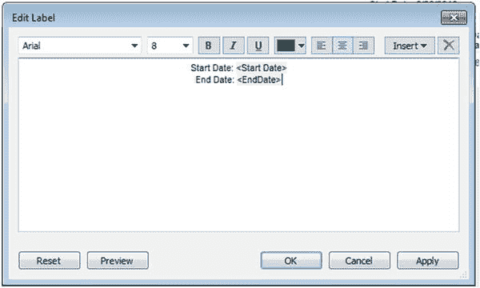

图 8-114. `编辑标签`对话框

最终输出结果如图 8-115 所示。

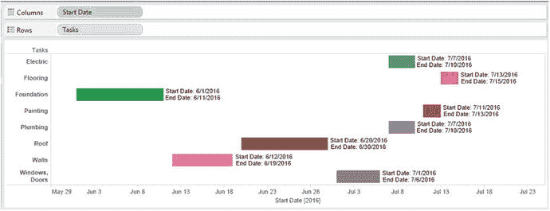

图 8-115. 甘特图 - 演示 2 - 最终输出结果

## 8.8 散点图

### 8.8.1 为什么使用散点图？

为了可视化数值变量之间的关系。

### 8.8.2 什么是散点图？

散点图是在笛卡尔平面上显示许多分散点的图表。

### 8.8.3 相关系数

相关性的强弱由相关系数 (`R`) 决定。有时它也被称为“皮尔逊积矩相关系数”。相关性用从 `+1` 到 `-1` 的范围表示。`+1` 表示完全正相关，而 `-1` 表示完全负相关。值为零表示没有相关性。相关性并不意味着因果关系。可能存在一个未知因素同时对两个变量产生相似的影响。

#### 8.8.3.1 正相关

正相关是方向相同的相关性。这意味着如果一个变量的值增加，另一个变量的值也增加。同样，如果一个变量的值减少，另一个变量的值也减少。换句话说，两个变量同向变化（如图 8-116 所示）。

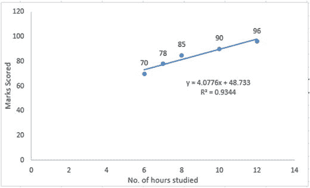

图 8-116. 正相关

#### 8.8.3.2 示例

-   随着温度升高，铁棒的长度也会增加。
-   随着燃料价格上涨，机票成本也会增加。
-   随着学生学习时长的增加，获得的分数也会提高。

#### 8.8.3.3 负相关

负相关是方向相反的相关性。这意味着如果一个变量的值增加，另一个变量的值就会减少，反之亦然（如图 8-117 所示）。

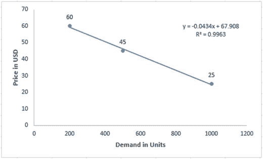

图 8-117. 负相关

示例：随着产品价格上涨，对该产品的需求下降。

#### 8.8.3.4 无相关或零相关

如果两个变量之间没有关系，即一个变量的值发生变化而另一个变量的值保持不变，则称为无相关或零相关（如图 8-118 所示）。

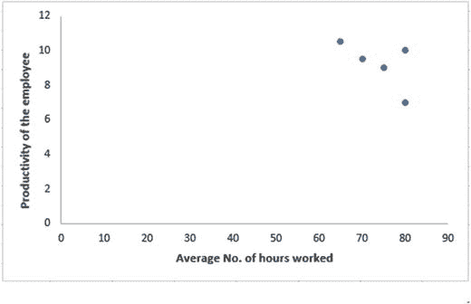

图 8-118. 无相关或零相关

### 8.8.4 如何在 Tableau 中绘制散点图？

#### 8.8.4.1 演示 1

目标：使用两个度量（`销售额`和`利润`），分别放置在列功能区和行功能区上，绘制一个简单的散点图。

输入：`Sample – Superstore.xls`

预期输出：（如图 8-119 所示）。

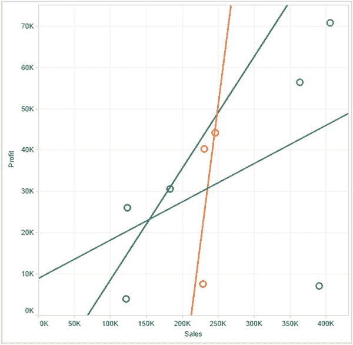

图 8-119. 散点图 - 演示 1 - 预期输出

#### 8.8.4.2 创建散点图的步骤

##### 8.8.4.2.1 第 1 步

从数据窗格下的度量区域拖出度量“销售额”和“利润”，分别放置在`列`和`行`功能区上（见图 8-120）。

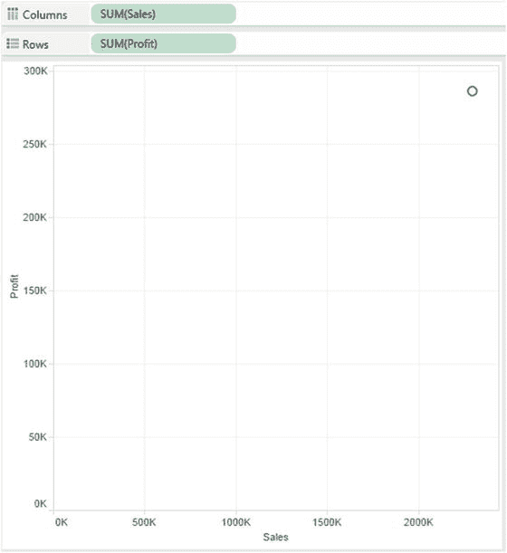

图 8-120. 度量“销售额”和“利润”分别放置在`列`和`行`功能区上

##### 8.8.4.2.2 第 2 步

从数据窗格下的维度区域拖出维度“细分”，将其放置在`标记`卡片上的“颜色”上（如图 8-121 所示）。

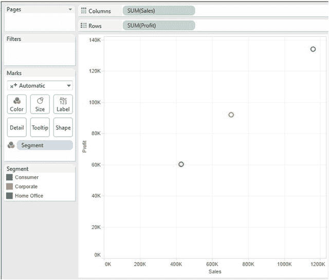

图 8-121. 维度“细分”放置在`标记`卡片上的“颜色”上

存在三个细分，即“消费者”、“企业”和“家庭办公室”。显示了三个点/标记，每个标记代表一个特定的细分。

从数据窗格下的维度区域拖出维度“类别”，将其放置在`标记`卡片上的“详细信息”上。我们的数据集包含三个类别，即“家具”、“办公用品”和“技术”（如图 8-122 所示）。

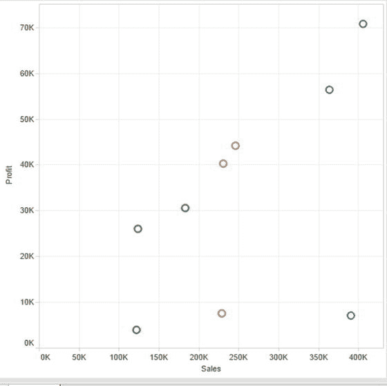

图 8-122. 维度“类别”放置在`标记`卡片上的“详细信息”上

注意：标记的数量为 9。

三个细分 * 三个类别 = 视图上的 9 个标记。

在视图区域右键单击以显示“趋势线”（如图 8-123 所示）。

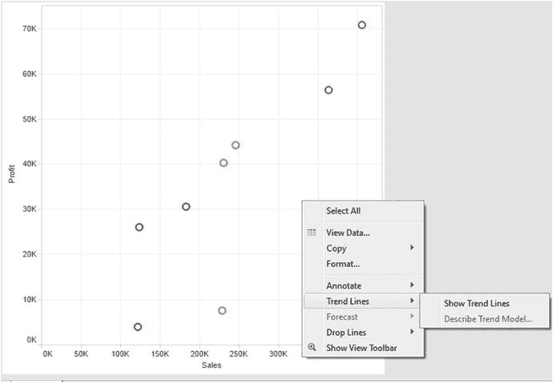

图 8-123. 设置“趋势线”

编辑趋势线以移除“置信区间”（如图 8-124 所示）。

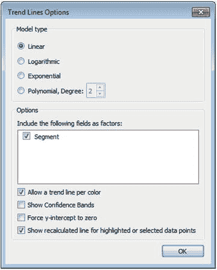

图 8-124. 趋势线选项

右键单击一条趋势线以描述趋势线（如图 8-125 所示）。

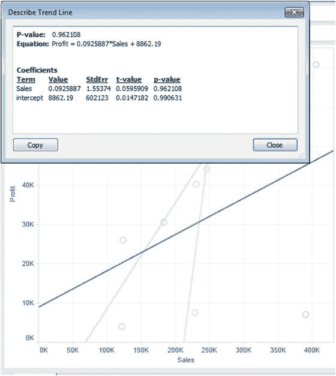

图 8-125. 描述“趋势线”

#### 8.8.4.3 演示 2

目标：使用`标记`卡片以及`列`和`行`功能区上的维度绘制散点图矩阵。

输入：“Sample – Superstore.xls”

预期输出：如图 8-126 所示。

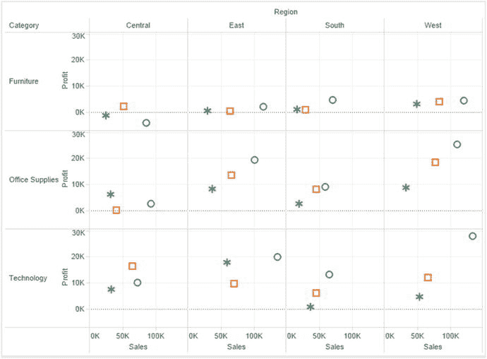

图 8-126. 散点图 - 演示 2 - 预期输出

##### 8.8.4.3.1 创建散点图的步骤

##### 8.8.4.3.2 第 1 步

从数据窗格下的维度区域拖出维度“区域”，将其放置在`列`功能区上。数据包含四个区域，例如“中部”、“东部”、“南部”和“西部”（如图 8-127 所示）。

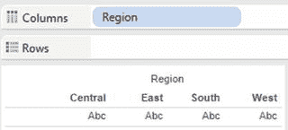

图 8-127. 维度“区域”放置在`列`功能区上

从数据窗格下的维度区域拖出维度“类别”，将其放置在`行`功能区上（如图 8-128 所示）。

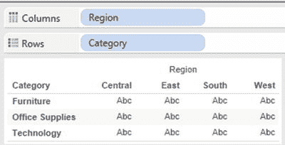

图 8-128. 维度“类别”放置在`行`功能区上

##### 8.8.4.3.3 第 2 步

从数据窗格下的度量区域拖出度量“销售额”，将其放置在`列`功能区上，位于维度“区域”的右侧（如图 8-129 所示）。

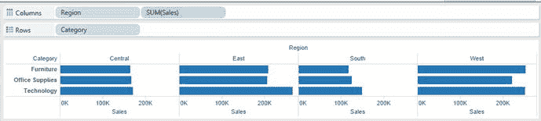

图 8-129. 度量“销售额”放置在`列`功能区上，位于维度“区域”的右侧

从数据窗格下的度量区域拖出度量“利润”，将其放置在`行`功能区上，位于维度“类别”的右侧（如图 8-130 所示）。

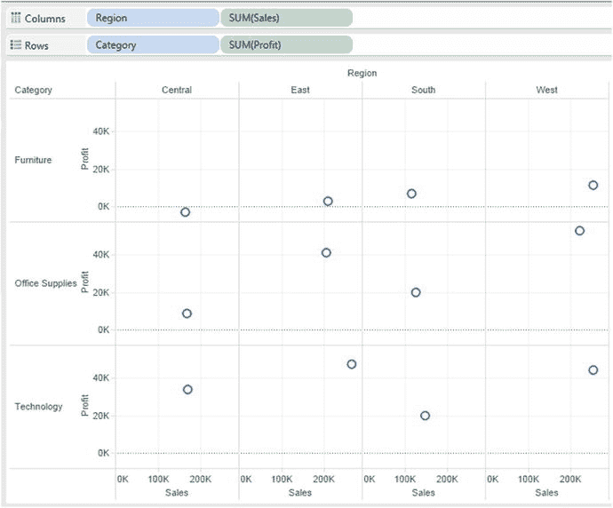

图 8-130. 度量“利润”放置在`行`功能区上，位于维度“类别”的右侧

##### 8.8.4.3.4 第 3 步

从数据窗格下的维度区域拖出维度“细分”，将其放置在`标记`卡片上的“颜色”上（如图 8-131 所示）。

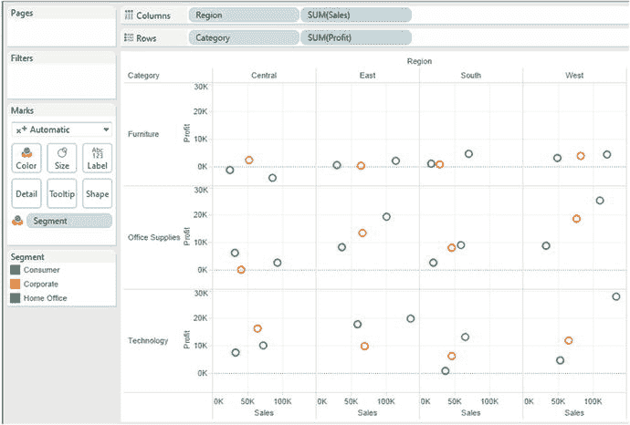

图 8-131. 维度“细分”放置在`标记`卡片上的“颜色”上

从数据窗格下的维度区域拖出维度“细分”，将其放置在`标记`卡片上的“形状”上（如图 8-132 所示）。

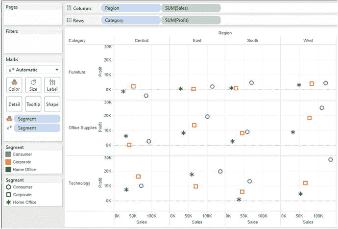

图 8-132. 维度“细分”放置在`标记`卡片上的“形状”上

## 8.9 直方图

用于显示连续数据的频率分布。

直方图最早由卡尔·皮尔逊于 1891 年提出。

“直方图”一词可拆分为两部分。希腊词 “histos” 意为“任何直立之物”，“gramma” 意为“绘图/书写”。

### 8.9.1 绘制直方图需要什么？

第一步是决定将数值范围划分为多少个区间/组。下一步是计算落在每个区间/组内的数值个数。

区间或组距可以相等或不相等。

通常区间是连续的、等宽的且不重叠的。

如果区间大小相等，则在区间上方竖立一个矩形，其高度与频率（即落入每个区间的数值个数）成正比。如果区间大小不等，则在区间上方竖立的矩形面积与频率成正比。

直方图中常用的术语：

- **对称分布**：对称分布是指直方图的两半互为镜像。
- **非对称分布**：非对称分布中，直方图的两半不互为镜像。
- **偏态分布**：偏态分布是指分布的一侧尾部比另一侧更长。
- **右偏分布**：右偏分布是指分布具有右侧尾部。
- **左偏分布**：左偏分布是指分布具有左侧尾部。
- **单峰分布**：单峰分布是指只有一个峰的分布。
- **双峰分布**：双峰分布是指具有两个不同峰的连续概率分布。
- **多峰分布**：多峰分布是指具有多个峰的连续概率分布。

### 8.9.2 与柱状图的区别

直方图表示连续数据，而柱状图用于分类数据。

### 8.9.3 直方图的优点

- 易于发现异常值
- 使得分数分布更容易解读

### 8.9.4 绘制直方图（自定义区间大小）

用于绘图的数据集：2014 年奥运会数据。该数据集包含 494 名运动员的以下列信息：

- 国家
- 运动员
- 性别
- 年龄
- 运动项目
- 金牌
- 银牌
- 铜牌
- 总计

数据的一个子集如图 8-133 所示。

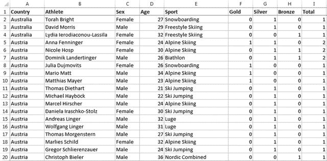

图 8-133. “奥林匹克数据集”的子集

我们想要做什么？

我们希望确定以下年龄段的运动员人数：

- 年龄 < 25
- 年龄 >= 25 且 <= 35
- 年龄 > 35

需要什么？

创建自定义区间，然后计算频率，即每个类别中的运动员人数计数。

#### 8.9.4.1 创建直方图的步骤

##### 8.9.4.1.1 第一步

连接至 2014 年奥运会数据集（如图 8-134 所示）。

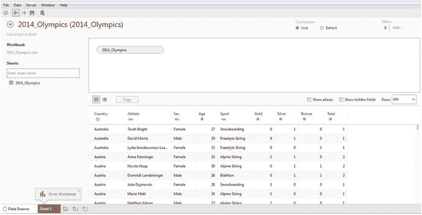

图 8-134.

从奥运会数据集读取到 Tableau 中的数据

##### 8.9.4.1.2 第二步

进入工作表/视图（如图 8-135 所示）。

图 8-135.

从“奥运会”数据集中读取值后的工作表/视图

##### 8.9.4.1.3 第三步

创建一个计算字段“年龄段”（如图 8-136 所示）。

图 8-136.

正在创建的计算字段“年龄段”

注意：新创建的计算字段“年龄段”会出现在数据窗格的维度区域中。

##### 8.9.4.1.4 第四步

将维度“年龄段”拖放到列架上。将度量“记录数”拖放到行架上（如图 8-137 所示）。

图 8-137.

放置在列架和行架上的维度“年龄段”与度量“记录数”

| 列架 | 年龄段（计算字段） |
| 行架 | 记录数。应用于该度量的聚合方式是 SUM。 |

##### 8.9.4.1.5 第五步

将度量“记录数”拖放到标记卡上的“标签”（如图 8-138 所示）。

图 8-138.

放置在标记卡“标签”上的度量“记录数”

#### 8.9.4.2 绘制直方图（等宽桶）

用于绘图的数据集：`“TestResultsSample.tde”`。数据包含 51,185 名学生的信息，标题如下：

*   `Exams_ID`
*   `Exams_Name`
*   `SubjectArea`
*   `Name`
*   `School_Id`
*   `State`
*   `Date`
*   `Exam`
*   `Score`
*   `Scores_Id`
*   `Student`
*   `DateOfBirth`
*   `FirstName`
*   `Id`
*   `School`
*   `LastName`
*   `SubjectAreas_1`
*   `SubjectAreas_Name`

数据子集如图 8-139 所示。

图 8-139.

`“TestResultsSample”` 数据子集

##### 8.9.4.2.1 第一步

连接至 `TestResultsSample` 数据集（如图 8-140 所示）。

图 8-140.

从 `“TestResultsSample”` 数据集读取到 Tableau 中的数据

##### 8.9.4.2.2 第二步

定义数据桶。右键单击度量 `“Score”`，选择 `“创建”`，然后选择 `“数据桶”`（如图 8-141 所示）。

图 8-141.

创建数据桶

在 `“创建数据桶 [Score]”` 对话框中填写数值，如图 8-142 所示。将数据桶的大小指定为 10。注意字段 `“BinSize”` 旁边的直方图图标（如图 8-143 所示）。

图 8-143.

`BinSize` 旁边的直方图图标

图 8-142.

设置数据桶的大小

##### 8.9.4.2.3 第三步

将维度 `“BinSize”` 拖放到列架上。将度量 `“Score”` 拖放到行架上（如图 8-144 所示）。

图 8-144.

放置在列架上的维度 `“BinSize”`。放置在行架上的度量 `“Score”`

| 列架 | `BinSize`（计算字段） |
| 行架 | `Score`。应用于该度量的聚合方式是 COUNT。 |

将 `“BinSize”` 的值更改为 2。为此，右键单击维度 `“BinSize”` 并选择 `“编辑”`。这将打开 `“编辑数据桶 [Score]”` 对话框。将数据桶的大小更改为 2（如图 8-145 和图 8-146 所示）。

图 8-146.

`“编辑数据桶 [Score]”` 对话框

图 8-145.

编辑 `“BinSize”`

将数据桶大小更改为 `“2”` 后的输出结果如图 8-147 所示。

图 8-147.

将数据桶大小设置为 `“2”` 后的输出结果

## 8.10 词云

“词云”在视觉设计中也被称为“标签云”或“加权列表”，或“文本云”。

### 8.10.1 为什么要使用词云？

*   你希望改善客户体验质量（QCE）。
*   想象一下……

你接任一家零售公司的负责人。你为自己设定的目标之一是提升客户体验质量。为此，你进行了一项在线调查。为了鼓励越来越多的客户就你的公司提供的服务质量提供反馈，你设计了一份简洁的客户调查问卷。其中一个问题涉及客户遇到的痛点。客户需要从诸如“不友好的员工”、“质量差”、“价格高”等词语中进行选择。你想快速了解客户最大的顾虑是什么。通过词云可以很容易地看到这一点。

*   你希望保留并壮大你的员工队伍。

### 8.10.2 何时应该使用词云？

当需要突出显示重要的文本数据点时。

### 8.10.3 词云应该用于什么？

词云是文本数据的可视化展示，是一种简单的文本分析。它通常用于描绘网站上的关键词或元数据。一个词在文本数据源（如底层数据库、演讲或博客文章）中出现得越多（频率越高），它在词云中就显得越大越粗。这是通过字体和颜色的变化来实现的。换句话说，单词的字号大小和/或颜色反映了该目标词在源文本中出现的相对频率。

### 8.10.4 哪些情况下不应该使用词云？

*   如果你的数据没有针对上下文进行优化。不能简单地将任何数据倒入词云生成器。数据应该经过数据分析师仔细筛选和优化。
*   不应过度使用词云，仅仅因为它易于创建和使用。可能存在其他效果更好的可视化方式。

#### 8.10.4.1 示例

让我们为以下莎士比亚的十四行诗创建一个词云。

“爱情太年轻，不知良心为何物，  
但谁不知良心由爱情而生？  
那么，温柔的骗子，别指责我的错，  
免得你自身因我的过失而有罪：  
因为，你背叛了我，我也背叛  
我高贵的部分，向肉体粗鄙的叛逆屈服；  
我的灵魂告诉我的身体，他可以在爱情中凯旋；肉体不再需要更多理由，  
但听到你的名字便起身指向你，  
作为他胜利的战利品。他以此为傲，  
满足于做你卑微的苦力，  
为你的事务操劳，跌倒在你的身旁。  
不要认为我缺乏良心，我称她的爱为爱，  
我为她珍贵的爱而起起落落”。

上述十四行诗的“词云”如图 8-148 所示。

图 8-148.

给定莎士比亚十四行诗的词云

为进行验证，按降序排列的单词频率如图 8-149 所示。

图 8-149.

莎士比亚十四行诗单词频率降序排列

### 8.10.5 如何绘制词云？

#### 8.10.5.1  创建词云的步骤

##### 8.10.5.1.1 第一步

莎士比亚的十四行诗已被分解为单词并存储在一个 Excel 工作表中。该工作表只有一列，名为`"Words"`。连接到该 Excel 工作表（如图 8-150 所示）。

**图 8-150.** 连接到 Tableau 的包含莎士比亚十四行诗单词的 Excel 工作表

##### 8.10.5.1.2 第二步

在标记卡中选择`"文本"`。

##### 8.10.5.1.3 第三步

选择维度`"单词"`。将其拖放至标记卡的`"标签"`上（如图 8-151 所示）。

**图 8-151.** 将维度`"单词"`放置在标记卡的`"标签"`上

##### 8.10.5.1.4 第四步

将度量`"记录数"`的默认聚合更改为`"计数"`（如图 8-152 所示）。

**图 8-152.** 将度量`"记录数"`的聚合设置为`"计数"`

##### 8.10.5.1.5 第五步

选择度量`"记录数"`。将其拖放至标记卡的`"大小"`上（如图 8-153 所示）。

**图 8-153.** 将度量`"记录数"`放置在标记卡的`"大小"`上

##### 8.10.5.1.6 第六步

将度量`"记录数"`拖放至标记卡的`"颜色"`上（如图 8-154 所示）。

**图 8-154.** 将度量`"记录数"`放置在标记卡的`"颜色"`上

从图 8-155 可以明显看出，单词`"my"`以最深的颜色显示，其字体也最大。单词`"my"`的频率是 6。它在十四行诗中出现了六次。紧随其后的是单词`"Love"`，其字体大小位居第二，因为它在十四行诗中出现了 5 次。

## 8.11 要点提醒

*   即使是不了解情况的受众也能轻松理解饼图。
*   层次数据也称为树状结构数据。树图可用于表示层次数据。
*   热图是一种数据的二维表示形式。热图使用颜色来显示数值。
*   突出显示表本质上是一个大型的文本表格，其中的数据值通过颜色进行编码。
*   折线图以一系列由直线段连接的数据点的形式显示信息。
*   散点图用于可视化数值变量之间的关系。
*   甘特图是项目进度的图形化表示。它有助于规划、协调和跟踪项目中的特定任务。
*   堆叠条形图用于分解和比较整体的各个部分。
*   使用标签云来突出显示重要的文本数据点。

## 8.12 后续步骤

下一章将带您深入探索高级可视化。您将了解以下可视化图表：

*   瀑布图
*   凹凸图
*   子弹图

