# 9. 高级可视化

> “在优秀的信息可视化中，没有规则，没有准则，没有模板，没有标准技术，没有风格指南……你只需尽一切可能。” — 爱德华·塔夫特，数据科学家，数据可视化领域的先驱

在上一章中，我们介绍了一些图表形式，例如条形图、饼图、折线图、散点图、直方图等。在本章中，我们将介绍以下内容：

*   瀑布图
*   凹凸图
*   子弹图

## 9.1 瀑布图

瀑布图是描绘顺序过程如何对整体做出贡献的强大工具。换句话说，它通过分解正向和负向贡献的累积效应，有助于展示如何得出净值。瀑布图的其他名称包括飞行砖图、马里奥图，在金融领域特别称为桥梁图。

### 9.1.1 瀑布图可以在哪些场景下使用？

瀑布图在许多不同的情况下都很有用。

以下仅举几例：

*   假设您在一家领先公司的法律部门工作。您负责公司的所有交易和合同。您从上年结转的交易和合同开始本财年。再加上全年赢得的交易和合同。然后，您去掉全年取消的合同。最后，在年底，您将得到最终实现的合同总数。
*   瀑布图有助于可视化财务报表。
*   瀑布图用于浏览关于人口、出生和死亡的数据。
*   假设您是一名参加了 GRE 研究生入学考试的学生。您希望评估自己的表现。您希望看到您在语文和数学部分答对的题目数量，以及您在两个部分（语文+数学）中答错的题目数量。然后，您希望将两个分数相加，最终得出总分。

现在让我们看一些示例。这些示例将提供创建瀑布图的分步说明。

#### 9.1.1.1 示例 1

目标：让我们为以下场景绘制一个瀑布图……

您在一家领先零售店的男装部工作。您收到了最新一批男士 T 恤的库存。该部门库存有 225 件。您摆放了 100 件 T 恤进行展示。顾客也可以试穿 T 恤以检查尺寸、面料和合身度。您发现由于多人试穿，有几件被损坏了。您立即着手修复这些损坏的衣物。在损坏的 55 件中，有 18 件已修复。这使您剩下 188 件可销售的商品（见表 9-1 和图 9-1）。

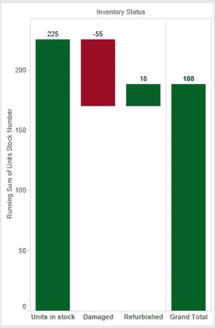

**图 9-1.** 显示男士 T 恤库存变化的瀑布图

**表 9-1.** 男士 T 恤库存

| 库存数量 | 225 |
| 损坏 | 55 |
| 翻新 | 18 |
| 可销售数量 | 188 |

预期输出：

##### 9.1.1.1.1 创建瀑布图的步骤

应采取以下步骤。数据可在`"WaterfallChart.xlsx"`文件中获取（见表 9-2）。

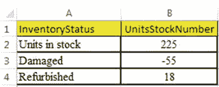

**表 9-2.** Excel 文件中的数据

##### 9.1.1.1.2 第一步

将数据从 Excel 读入 Tableau（如图 9-2 所示）。

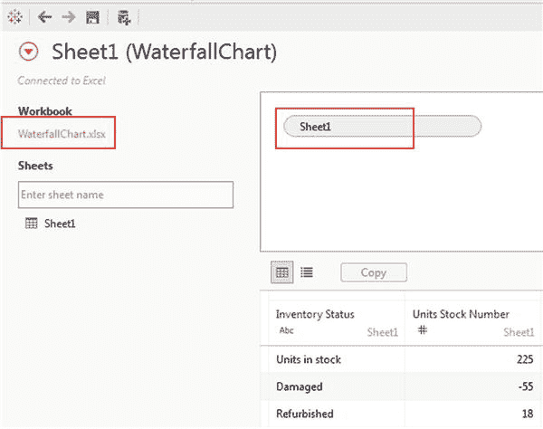

**图 9-2.** 从 Excel 数据源`"WaterfallChart.xlsx"`读取数据到 Tableau

##### 9.1.1.1.3 第二步

转到`"Sheet1"`（如图 9-3 所示）。

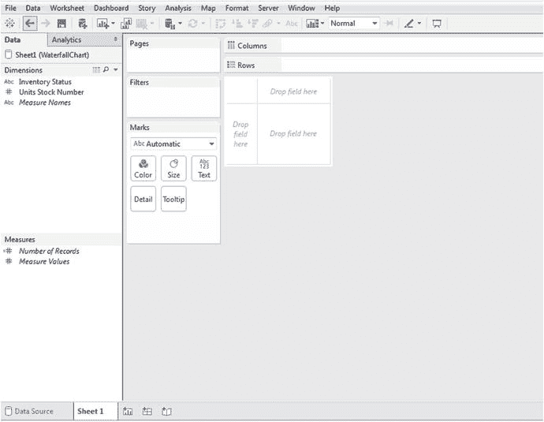

**图 9-3.** Tableau 工作簿的`"Sheet1"`

### 9.1.1.1.4 步骤 3

对维度 `Inventory Status` 进行排序（如图 9-4 和图 9-5 所示）。`Inventory Status` 的数据成员应排序如下：

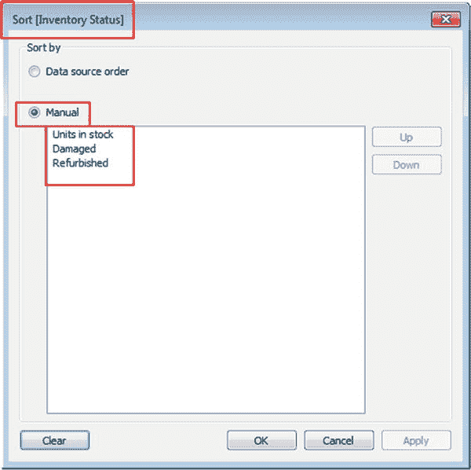

图 9-5. 执行 `Manual Sort`

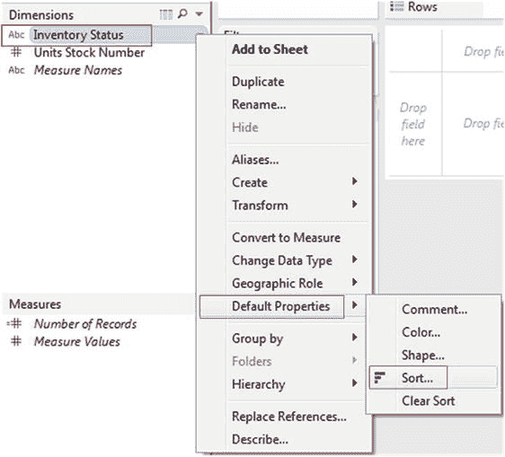

图 9-4. 维度的`Default Properties`下的排序选项

- 库存单位
- 损坏
- 翻新

将维度 `Units Stock Number` 转换为度量（如图 9-6 所示）。

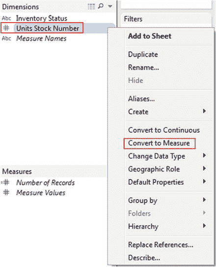

图 9-6. 将维度 `Units Stock Number` 转换为度量

转换后的工作表如下所示（如图 9-7 所示）：

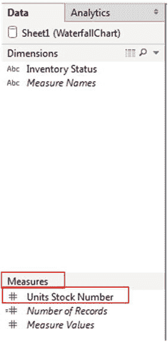

图 9-7. 更改后的 `Sheet1`

### 9.1.1.1.5 步骤 4

将维度 `Inventory Status` 拖到列功能区。将度量 `Units Stock Number` 拖到行功能区。向度量 `Units Stock Number` 添加表计算 `Running Total`（参见表 9-3、图 9-8 和图 9-9）。

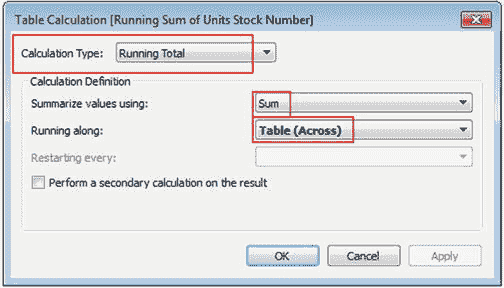

图 9-9. 表计算 `Running Total` 沿 `Table(Across)` 进行计算

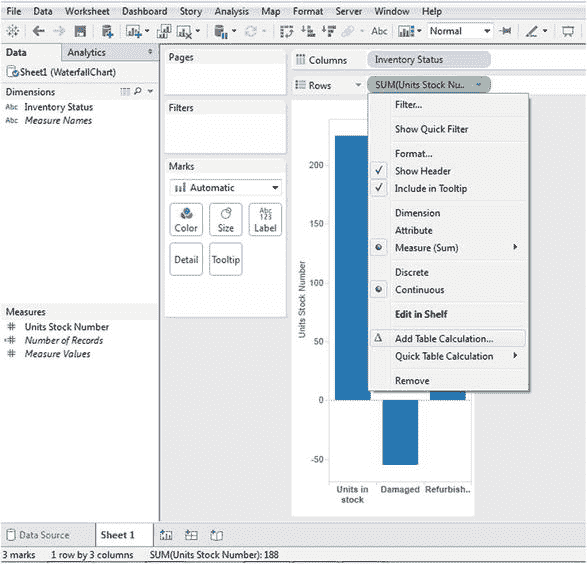

图 9-8. 向度量 `Units Stock Number` 添加表计算

**表 9-3.** 需执行的操作

| 列功能区 | 库存状态 |
| :--- | :--- |
| 行功能区 | 库存单位数量 |
| 表计算依据 | 累计总计 表（横穿） |

输出结果如图 9-10 所示。

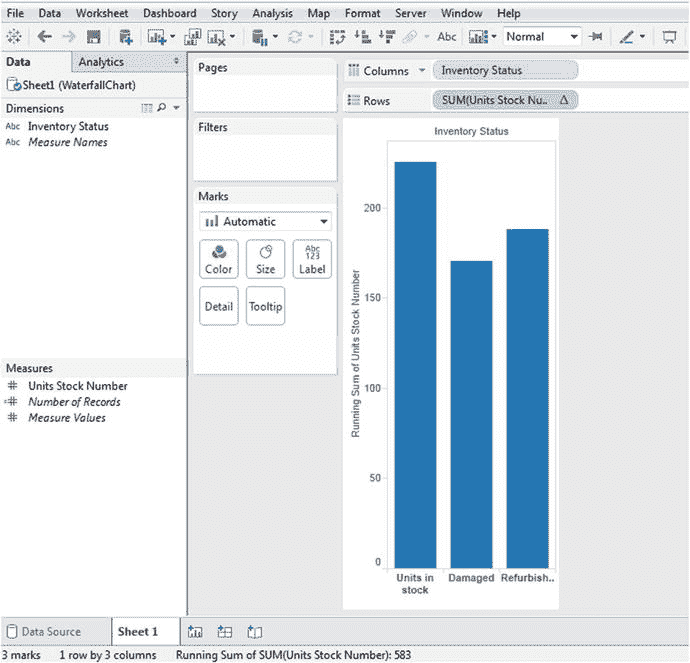

图 9-10. 将表计算 `Running Total` 应用于度量 `Units Stock Number` 后的输出

### 9.1.1.1.6 步骤 5

将标记类型从 `Automatic` 更改为 `Gantt Bar`（如图 9-11 所示）。

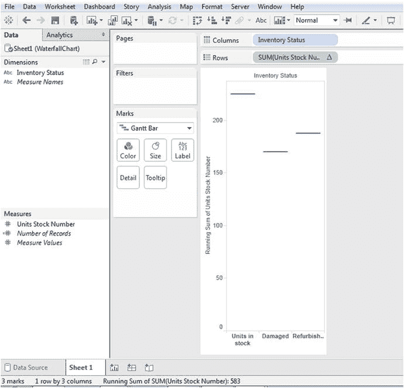

图 9-11. 标记类型已更改为 `Gantt Bar`

### 9.1.1.1.7 步骤 6

创建一个计算字段 `-UnitsStockNumber`（如图 9-12 所示）：

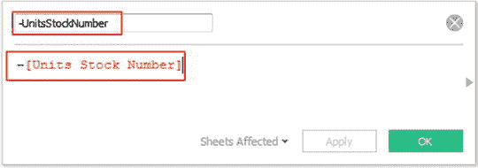

图 9-12. 已创建计算字段 `- Units Stock Number`

### 9.1.1.1.8 步骤 7

将计算字段 `- Units Stock Number` 拖到标记卡上的 `Size` 处（如图 9-13 所示）。

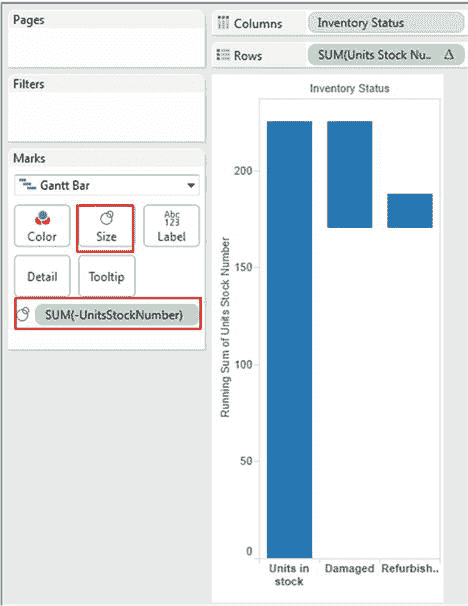

图 9-13. 计算字段 `- Units Stock Number` 放置在标记卡的 `Size` 上

### 9.1.1.1.9 步骤 8

将度量 `Units Stock Number` 拖到标记卡上的 `Color` 处（如图 9-14 所示）。

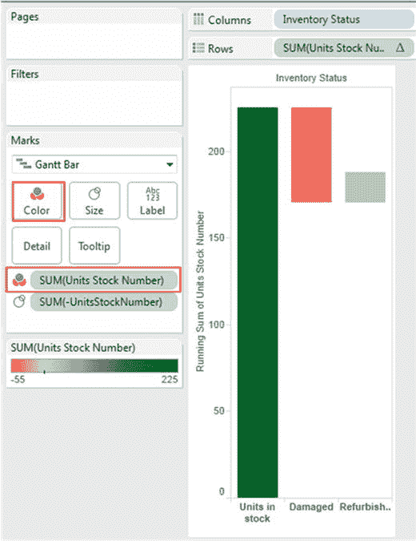

图 9-14. 度量 `Units Stock Number` 放置在标记卡的 `Color` 上

### 9.1.1.1.10 步骤 9

将 `Stepped Color` 更改为 `2`（如图 9-15 和图 9-16 所示）。

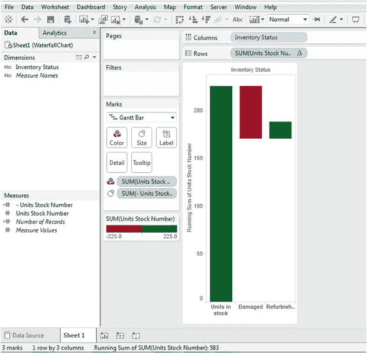

图 9-16. 将步进颜色设置为 `2` 后的输出

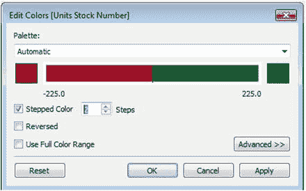

图 9-15. `Stepped Color` 设置为 `2`

### 9.1.1.1.11 步骤 10

选择 **分析** ➤ **合计** ➤ **显示行总计**（如图 9-17 所示）。

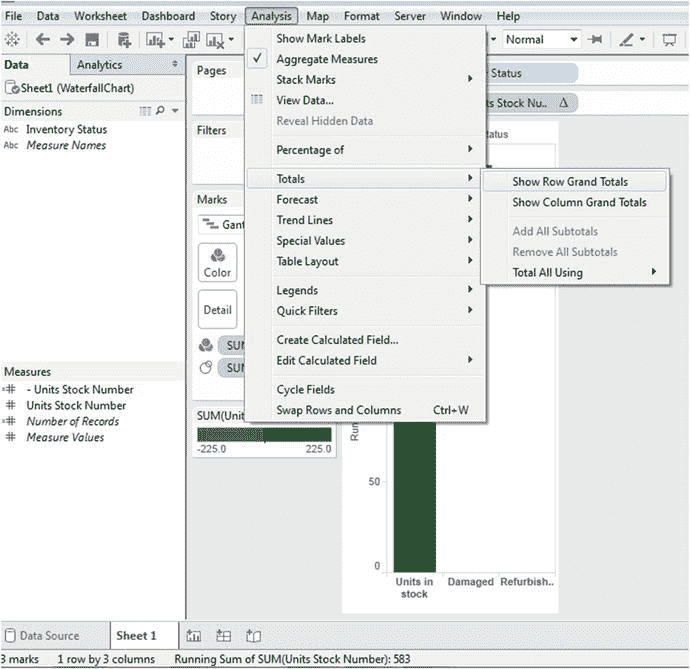

图 9-17. 计算 `Row Grand Totals`

输出结果（如图 9-18 所示）：

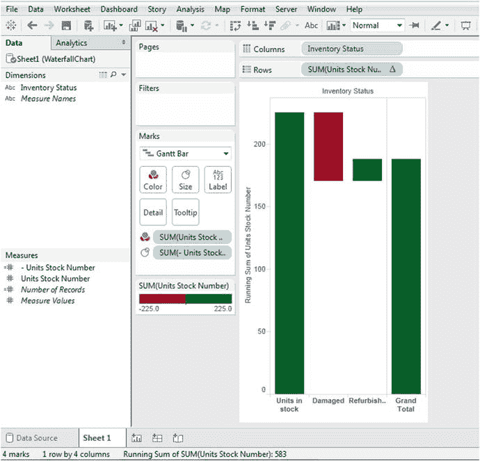

图 9-18. 计算 `Row Grand Totals` 后的输出

最后，将度量 `Units Stock Number` 拖到标记卡上的 `Label` 处（如图 9-19 所示）。

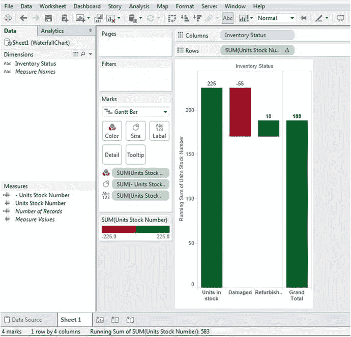

图 9-19. 将 `Units Stock Number` 放置在标记卡的 `Label` 上后的最终输出

### 9.1.1.2 演示 2

您是某领先 IT 公司`XYZ`账户的项目经理，同时负责该账户的人员配备。财年年初，您有 100 名员工。您的 HR 部门协助招聘了 30 名员工，有 8 名员工从公司其他部门调入您的部门。有 12 名员工从您的部门调至其他部门，另有 10 名员工离开了公司。您希望向经理展示财年年底的员工人数（见表 9-4 和图 9-20）。

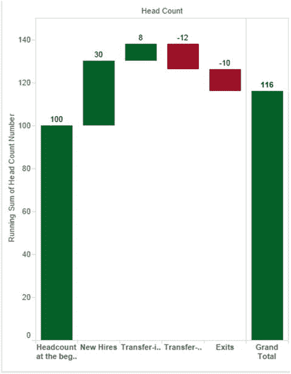

图 9-20. 显示`XYZ`项目账户员工人数变化的瀑布图

**表 9-4.** `XYZ`账户员工人数状态

| 年初人数 | 100 |
| :--- | :--- |
| 新招聘 | 30 |
| 调入 | 8 |
| 调出 | 12 |
| 离职 | 10 |
| 年末人数 | 116 |

#### 9.1.1.2.1 创建瀑布图的步骤

以下是 `Waterfall Chart Assignment2.xlsx` 中的数据（见表 9-5）。

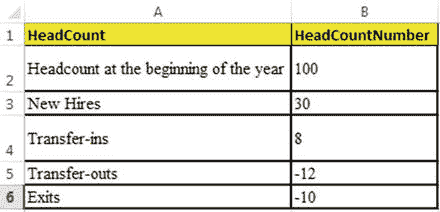

表 9-5. Excel 工作表中的可用数据

##### 9.1.1.2.2 步骤 1

将 Excel 中的数据读入 Tableau（如图 9-21 所示）。

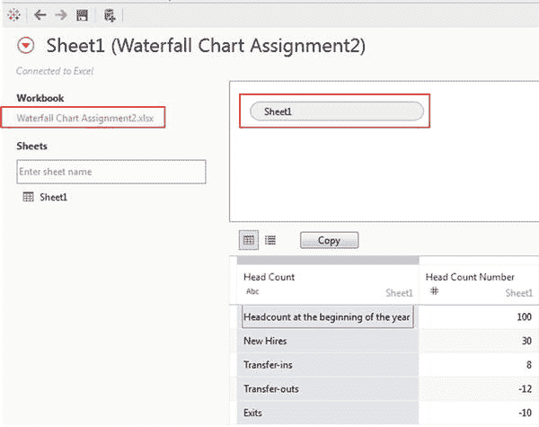

图 9-21. 从 Excel 读取到 Tableau 中的数据

##### 9.1.1.2.3 步骤 2

前往 `Sheet1`（如图 9-22 所示）。

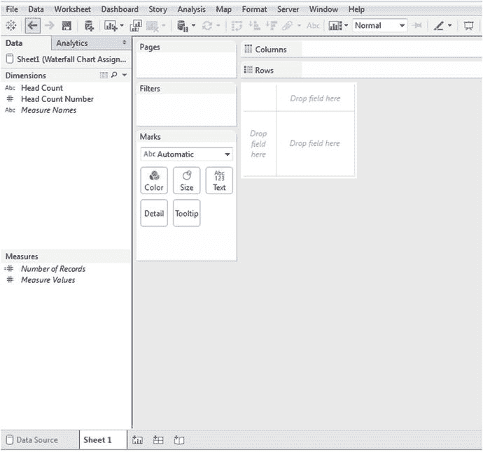

图 9-22. Tableau 工作簿的 `Sheet1`

##### 9.1.1.2.4 步骤 3

对维度 `Head Count` 进行排序（如图 9-23 和图 9-24 所示）。`Head Count` 的数据成员应排序如下：

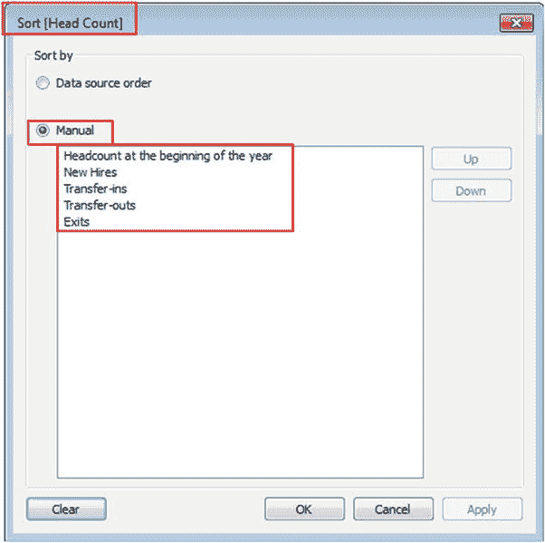

图 9-24. 对维度 `Head Count` 执行 `Manual Sort`

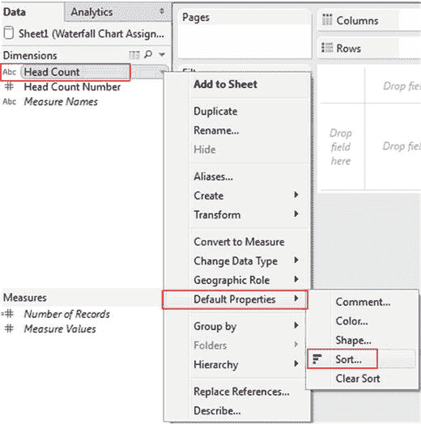

图 9-23. 对维度 `Head Count` 进行排序

- 年初人数
- 新招聘
- 调入
- 调出
- 离职

将维度 `Head Count Number` 转换为度量（如图 9-25 所示）。

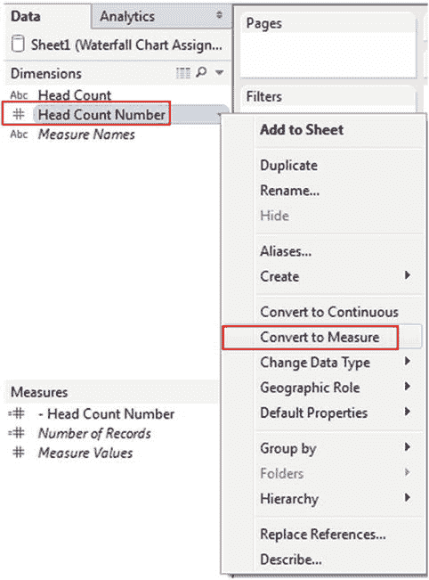

图 9-25. 将维度 `Head Count Number` 转换为度量

转换后的工作表（如图 9-26 所示）：

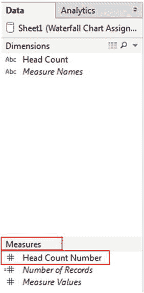

图 9-26. 更改后的 `Sheet1`

### 9.1.1.2.5 第 4 步

将维度`Head Count`拖拽到列功能区。将度量`Head Count Number`拖拽到行功能区。为度量`Head Count Number`添加表计算`Running Total`（见表 9-6、图 9-27 和图 9-28）。

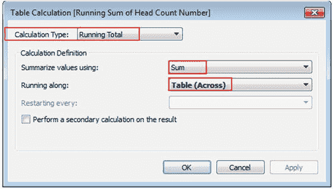

**图 9-28.** 表计算`Running Total`的计算方式为`Table(Across)`

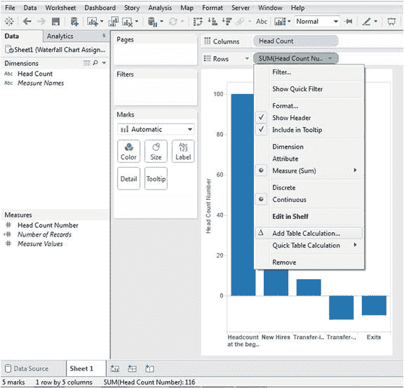

**图 9-27.** 为度量`Head Count Number`添加表计算

**表 9-6.** 待执行的活动列表

| 列功能区 | `Head count` |
|---|---|
| 行功能区 | `Head count number` |
| 表计算沿...运行 | `Running total Table across` |

输出结果如图 9-29 所示。

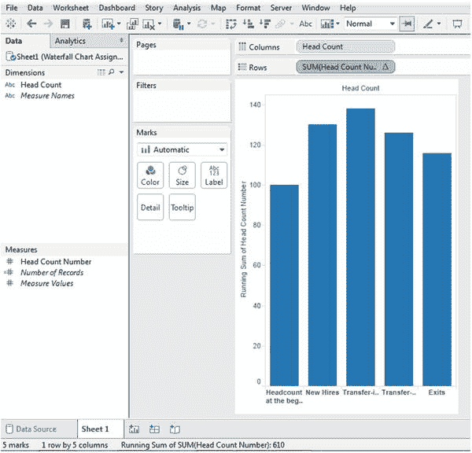

**图 9-29.** 对行功能区上的度量`Head Count Number`应用表计算后的输出结果

### 9.1.1.2.6 第 5 步

将标记类型从`Automatic`更改为`Gantt Bar`（如图 9-30 所示）。

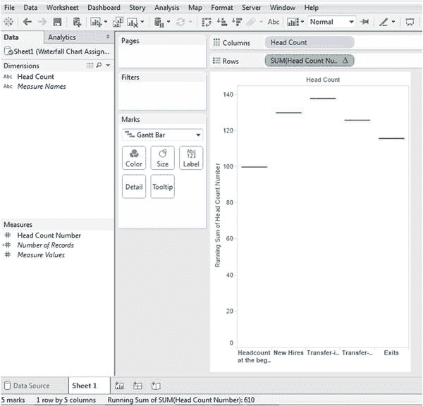

**图 9-30.** 标记类型更改为`Gantt Bar`

### 9.1.1.2.7 第 6 步

创建一个计算字段`- Head Count Number`（如图 9-31 所示）：

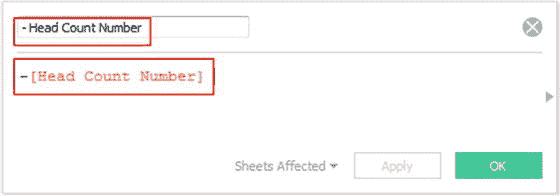

**图 9-31.** 已创建计算字段`- Head Count Number`

### 9.1.1.2.8 第 7 步

将计算字段`- Head Count Number`拖拽到标记卡上的`Size`（如图 9-32 所示）。

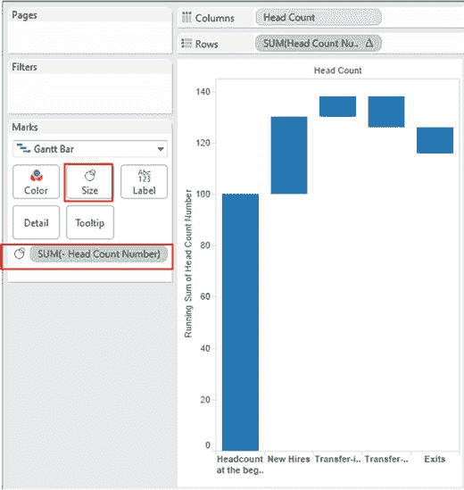

**图 9-32.** 计算字段`- Head Count Number`已放置在标记卡的`Size`上

### 9.1.1.2.9 第 8 步

将度量`Head Count Number`拖拽到标记卡上的`Color`（如图 9-33 所示）。

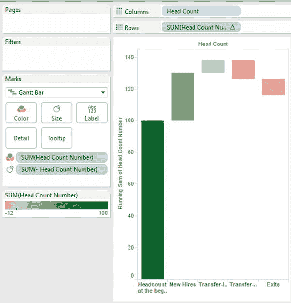

**图 9-33.** 度量`Head Count Number`已放置在标记卡的`Color`上

### 9.1.1.2.10 第 9 步

将`Stepped Color`设置为`2`（如图 9-34 和图 9-35 所示）。

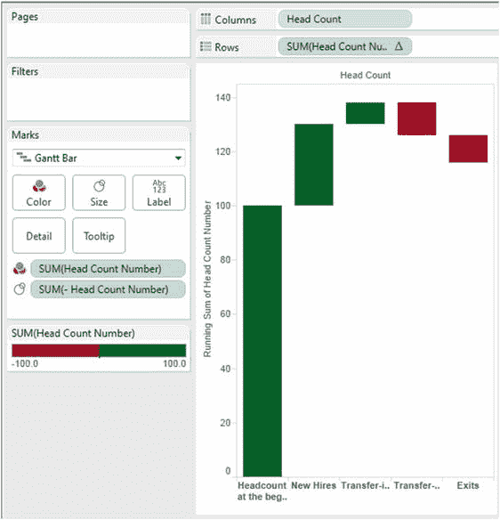

**图 9-35.** 将`Stepped Color`设置为`2`后的输出结果

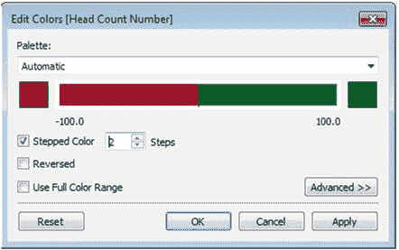

**图 9-34.** `Stepped Color`已设置为`2`

### 9.1.1.2.11 第 10 步

选择`Analysis` ➤ `Totals` ➤ `Show Row Grand Totals`（如图 9-36 所示）。

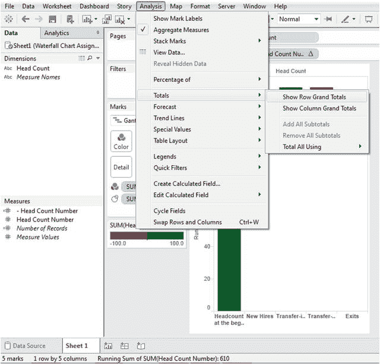

**图 9-36.** 计算`Row Grand Totals`

输出结果（如图 9-37 所示）：

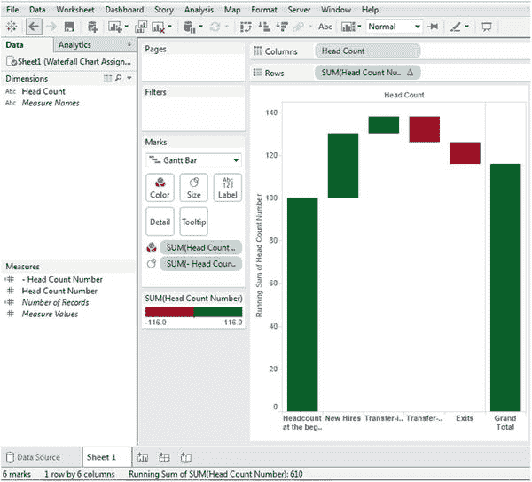

**图 9-37.** 计算`Row Grand Totals`后的输出结果

最后，将度量`Head Count Number`拖拽到标记卡上的`Label`（如图 9-38 所示）。

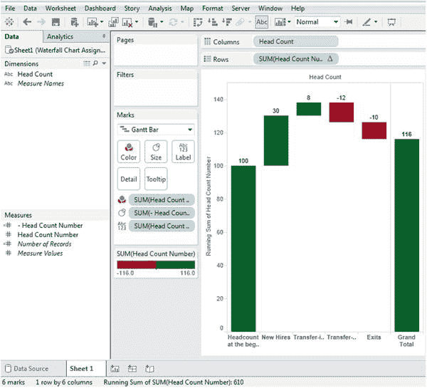

**图 9-38.** 将度量`Head Count Number`放置在标记卡的`Label`上的最终输出结果

## 9.2 凹凸图

`Bump charts`（凹凸图）的名称源于`bumps race`，这是一个术语，指一种每艘船试图“碰撞”前面的船并在图表中向上移动的划船比赛。`Bump charts`近来变得相当普遍，通常用于表示在固定时间内，给定数量的竞争实体排名的变化。

### 9.2.1 何时使用凹凸图？

当需要使用一个度量值来比较两个维度时，可以使用凹凸图。凹凸图有助于显示值的排名变化，通常维度是时间，也可以是任何与分析相关的其他维度。

要创建凹凸图，至少需要两个维度，以及零个或多个度量。有关示例凹凸图，请参见图 9-39。

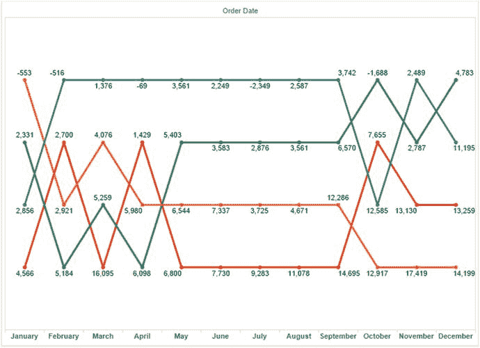

**图 9-39.** 示例`Bump Chart`

这种图表也称为`slope graph`。

现在让我们看一些演示。这些演示将提供创建凹凸图的分步说明。

## 9.2.1.1 演示 1

创建凹凸图的步骤。

### 9.2.1.1.1 步骤 1

从 `"Sample – Superstore.xls"` 读取数据到 Tableau（如图 9-40 所示）。

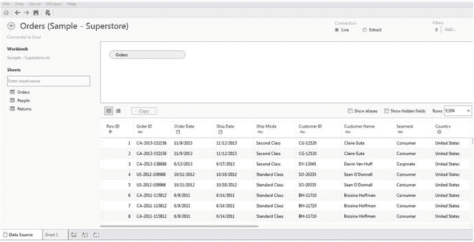

**图 9-40.** 从 `"Sample - Superstore.xls"` 读取到 Tableau 中的数据

### 9.2.1.1.2 步骤 2

将维度 `"Order Date"` 从数据窗格下方的维度区域拖放到列功能区上。日期应为 `"离散"`，粒度应设置为 `"月"`（如图 9-41 所示）。

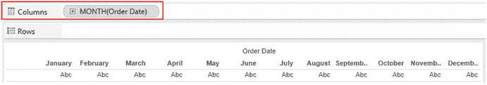

**图 9-41.** 放置在列功能区上的维度 `"Order Date"`

将维度 `"Region"` 从数据窗格下方的维度区域拖放到标记卡上的 `"颜色"` 上。数据涵盖四个区域：`"Central"`、`"East"`、`"South"` 和 `"West"`（如图 9-42 所示）。

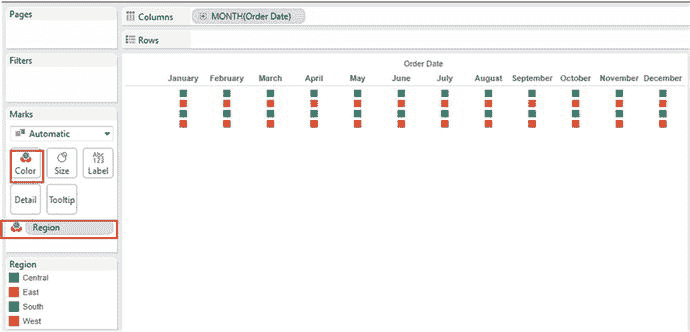

**图 9-42.** 放置在标记卡 `"颜色"` 上的维度 `"Region"`

### 9.2.1.1.3 步骤 3

创建一个计算字段 `"RankRegion"`（如图 9-43 所示）。

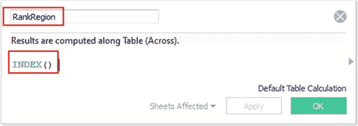

**图 9-43.** 已创建计算字段 `"RankRegion"`

`Index()` 函数返回分区中当前行的索引位置。示例：对于分区中的第一行，`Index()` 函数将返回 1。

单击 `"应用"`，然后单击确定。

将新创建的计算字段 `"RankRegion"` 拖放到行功能区上（如图 9-44 所示）。

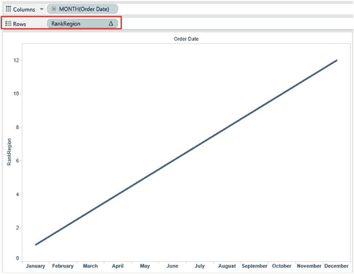

**图 9-44.** 放置在行功能区上的计算字段 `"RankRegion"`

单击 `"RankRegion"` 度量，并选择 `"编辑表计算"`（如图 9-45 所示）。

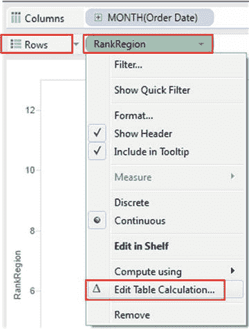

**图 9-45.** 计算字段 `"RankRegion"` 的编辑表计算选项

出现表计算 `[RankRegion]` 对话框。选择 `"计算依据"` 旁边的下拉菜单，然后选择 `"高级"`（如图 9-46 所示）。

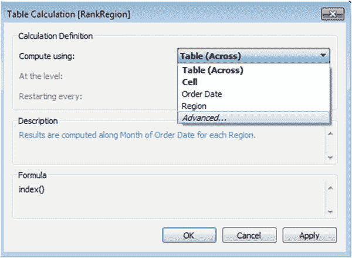

**图 9-46.** 计算字段 `"RankRegion"` 的表计算对话框

通过选择 `"高级"` 选项，会出现 `"高级"` 对话框。在 `"高级"` 对话框中，按如下所示进行设置，然后单击确定按钮（如图 9-47 所示）。

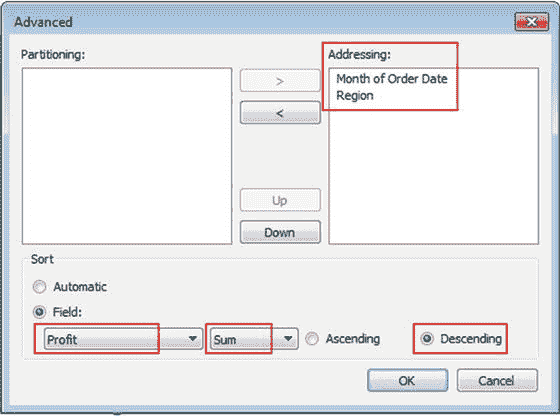

**图 9-47.** `"高级"` 对话框中的设置

对于表计算 `[RankRegion]`，按所示对剩余字段进行设置，然后单击确定按钮（如图 9-48 所示）。

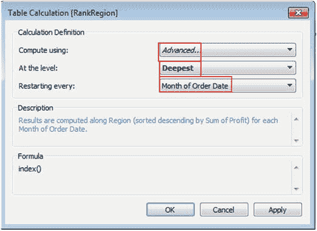

**图 9-48.** 在计算字段 `"RankRegion"` 对应的 `"表计算"` 对话框中执行其他设置

将数据窗格下可用的度量 `"Profit"` 拖放到标记卡上的 `"标签"` 上。

最终输出（如图 9-49 所示）：

**图 9-49.** 放置在标记卡 `"标签"` 上的度量 `"Profit"`

凹凸图解读：

折线图沿维度 `"Region"`（按 `"Profit"` 总和降序排列）排列，针对 `"Order Date"` 的每个月。

`"West"` 区域在 `"January"` 月份拥有最大的 `"Profit"`，其次是 `"Central"`、`"South"` 和 `"East"`。

## 9.2.1.2 演示 2

将数据从 `"Bump.xls"` 读取到 Tableau 中，并绘制以下凹凸图（如图 9-50 所示）。

**图 9-50.** 凹凸图——演示 2——预期输出

### 9.2.1.2.1 步骤 1

将数据从 `"Bump.xls"` 读取到 Tableau 中（如图 9-51 所示）。

**图 9-51.** 从 `"Excel"` 读取到 `"Tableau"` 中的数据

### 9.2.1.2.2 步骤 2

将维度 `"Year"` 从数据窗格下方的维度区域拖放到列功能区上。将度量 `"Rank"` 从数据窗格下方的度量区域拖放到行功能区上（参见表 9-7）。

**表 9-7.** 要执行的操作

| 列功能区 | `Year` |
| :--- | :--- |
| `行功能区` | `Rank`。默认聚合：总和 |

将维度 `"Company Name"` 从数据窗格下方的维度区域拖放到标记卡上的 `"颜色"` 上。

将维度 `"Company Name"` 从数据窗格下方的维度区域拖放到标记卡上的 `"标签"` 上（参见图 9-52）。

**图 9-52.** 表 9-7 中所述操作已执行

### 9.2.1.2.3 步骤 3

选择 `"Rank"` 轴。右键单击并选择 `"编辑轴"`。勾选 `"倒序"` 旁边的复选框（如图 9-53 所示）。

**图 9-53.** 将 `"Rank 轴"` 设置为 `"倒序"`

最终输出（如图 9-54 所示）：

**图 9-54.** 凹凸图——演示 2——最终输出

## 9.3 子弹图

子弹图由 Stephen Few 于 2005 年发明，作为仪表盘上仪表和径向计的替代品。它们可以在很小的空间内传递大量信息。子弹图包含一个单一的定量性能指标，并与一个目标值进行比较。然而，我们可以设置不同的定性度量范围来衡量 KPI 绩效，以判断指标是否在正轨上。它们通常将主要的定量度量显示在定性范围（例如 `"非常满意"`、`"满意"`、`"既不满意也不失望"`、`"不满意"` 和 `"非常不满意"`）的上下文中。

仪表图或径向计有什么问题？

*   它们缺乏背景信息
*   它们浪费空间
*   它们过于简单（危险地简单！）

另一方面，子弹图利用了我们感知和认知上的倾向。人类更擅长感知和比较长度或平行位置，而不是角度。

这里的一个重要问题是，如果需要显示多个度量，是否应该使用多个子弹图。如果所有度量共享相同的定量量表和定性范围，答案是否定的。在这种情况下，一个单一的条形图就足够了。这将有助于将所有度量放在一起，便于比较。

参见图 9-55 了解一个简单的子弹图。

**图 9-55.** 一个示例子弹图

### 9.3.1 演示 1

目标：比较 2014 年的 `"销售额"` 与 2013 年的 `"销售额"`。

输入：`"Sample – Superstore.xls"`

预期输出：如图 9-56 所示。

**图 9-56.** 子弹图——演示 1——预期输出

#### 9.3.1.1 创建子弹图的步骤

#### 9.3.1.2 步骤 1

从 `"Sample – Superstore.xls"` 读取数据到 Tableau（如图 9-57 所示）。

**图 9-57.** 从 `"Sample – Superstore.xls"` 读取到 Tableau 中的数据

### 9.3.1.3 步骤 2

将数据窗格下维度区域中的维度`"Sub-Category"`拖放到行架（如图 9-58 所示）。

图 9-58. 维度`"Sub-Category"`放在行架上

### 9.3.1.4 步骤 3

创建一个计算字段`"2013Sales"`（如图 9-59 所示）。

图 9-59. 正在创建计算字段`"2013Sales"`

创建一个计算字段`"2014Sales"`（如图 9-60 所示）。

图 9-60. 正在创建计算字段`"2014Sales"`

### 9.3.1.5 步骤 4

将数据窗格下度量区域中的计算字段`"2014Sales"`拖放到列架（如图 9-61 所示）。

图 9-61. 计算字段`"2014Sales"`放在列架上

### 9.3.1.6 步骤 5

将数据窗格下度量区域中的计算字段`"2013Sales"`拖放到标记卡上的`"Detail"`（如图 9-62 所示）。

图 9-62. 计算字段`"2013Sales"`放在标记卡上的`"Detail"`中

### 9.3.1.7 步骤 6

转到分析窗格。将参考线拖到视图/工作表上。按照图 9-63 所示进行设置。

图 9-63. 在`"编辑参考线、区间或框"`对话框中进行设置

确保该值设置为`SUM(2013Sales)`。这基本上就是将`"2013Sales"`放在标记卡上`"Detail"`中的原因。

添加`"参考线"``"Per Cell"`后的输出结果（如图 9-64 所示）。

图 9-64. 添加参考线后的输出结果

### 9.3.1.8 步骤 7

从分析窗格中拖动`"分布区间"`并将其放置在工作表/视图上。按照图 9-65 所示进行设置。

图 9-65. 在`"编辑参考线、区间或框"`对话框中进行设置

为`"填充"`选择颜色`"灰色"`，并选中`"填充下方"`复选框。通过使用标记卡上的`"大小"`适当调整条形的大小。

使用`"分布区间"`后的输出结果（如图 9-66 所示）。

图 9-66. 使用`"分布区间"`后的输出结果

### 结论

让我们考虑子类别`"Machines"`。我们看到，平均`2013Sales`的 60% = 33,544；平均`2013Sales`的 80% = 44,726。`2014Sales`几乎接近 80% 的目标值 43,545。

## 9.3.2 演示 2

**目标：** 可视化实现设定目标的阶段性进展。

**输入：** `"Bar-inBarChart.xls"`。

**预期输出：** 如图 9-67 所示。

图 9-67. 子弹图 – 演示 2 – 预期输出

#### 9.3.2.1 创建子弹图的步骤

#### 9.3.2.2 步骤 1

将`"Bar-inBarChart.xlsx"`中的数据读入 Tableau（如图 9-68 所示）。

图 9-68. 来自`"Bar-inBarChart.xlsx"`的数据读入 Tableau

#### 9.3.2.3 步骤 2

将数据窗格下维度区域中的维度`"Goals"`拖放到行架（如图 9-69 所示）。

图 9-69. 维度`"Goals"`放在行架上

将数据窗格下度量区域中的度量`"Actuals"`拖放到列架（如图 9-70 所示）。

图 9-70. 度量`"Actuals"`放在列架上

将数据窗格下度量区域中的度量`"Planned"`拖放到标记卡上的`"Detail"`（如图 9-71 所示）。

图 9-71. 度量`"Planned"`放在标记卡上的`"Detail"`中

#### 9.3.2.4 步骤 3

转到分析窗格，将`"参考线"`拖到视图/工作表上。在`"编辑参考线、区间或框"`对话框中编辑参考线（如图 9-72 所示）。

图 9-72. 在`"编辑参考线、区间或框"`对话框中进行设置

#### 9.3.2.5 步骤 4

拖放分析窗格下的`"分布区间"`，并将其放置在视图/工作表上。按照图 9-73 所示进行设置。

图 9-73. 在`"编辑参考线、区间或框"`对话框中进行设置

设置分布区间和参考线后的最终输出结果（如图 9-74 所示）。

图 9-74. 子弹图 – 演示 2 – 最终输出

### 结论

让我们看看其中一个目标`"NoofTrainingsonNewTechnologies"`。我们远低于 60% 的目标线。该目标的`"Planned"`是 40。该目标的`"Actuals"`是 15。完成目标的 60% 意味着完成 24 天的培训交付，完成目标的 80% 意味着完成 32 天的培训交付。

## 9.4 要点回顾

在本章中，我们学习了何时使用每种图表类型：

- 瀑布图用于显示初始值如何受一系列正值或负值的影响。它们用于库存管理、绩效分析、财务等领域。
- 凹凸图用于非常有效地显示排名变化。顾名思义，凹凸图就像意大利面条一样。减少凹凸图中的杂乱，使其更清晰易读。

你可以通过回答以下问题来测试自己：

1.  这种图表也称为积木图。
2.  这种图表表示在固定时间段内，给定数量的竞争实体位置的变化。
3.  这种图表在仪表板上用作仪表盘和径向计量表的替代品。

你答对了吗？

1.  瀑布图
2.  凹凸图
3.  子弹图

## 9.5 下一步

在下一章中，我们将继续学习如何创建交互式仪表盘并学习讲述故事。

