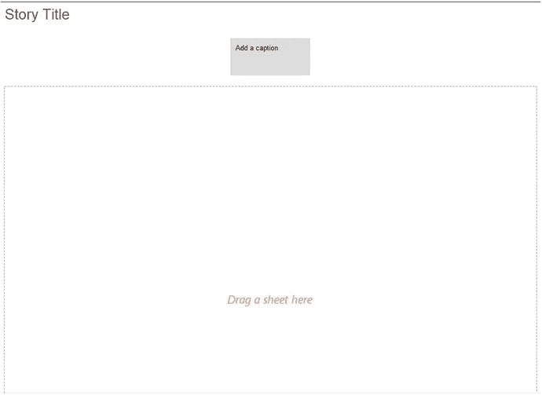
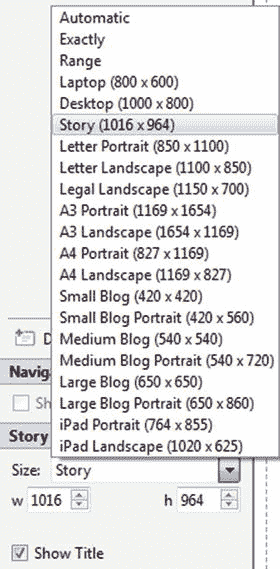
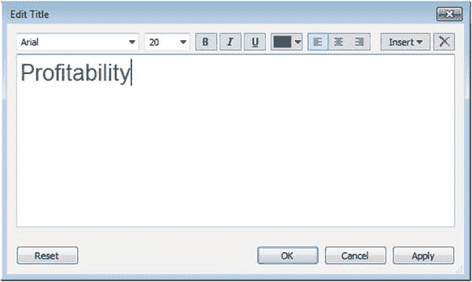
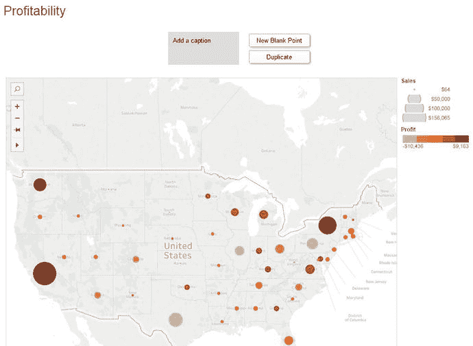
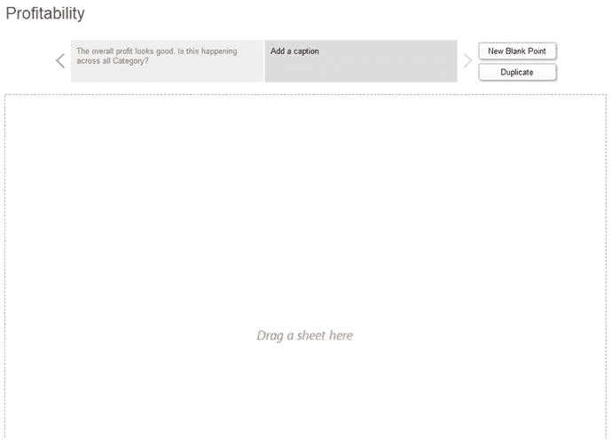
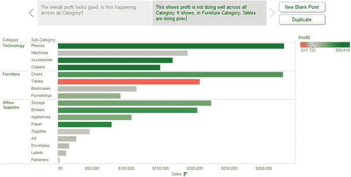
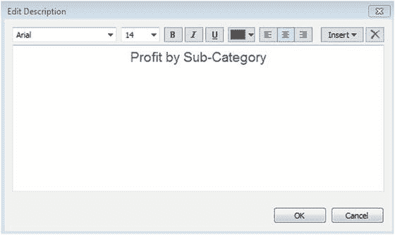
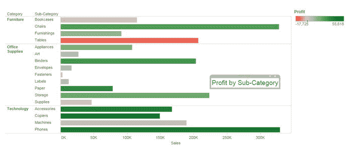

# 什么是故事？

故事是一个工作表或按顺序排列的工作表集合。故事中的每个单独工作表称为一个故事点。

在 Tableau 中，故事不仅仅是静态工作表的集合。你可以让故事点保持与基础数据的连接，以反映数据变化。

你可以通过不同方式使用故事：

-   用于协作分析：你可以组合序列工作表以执行假设分析。
-   用作演示工具：你可以使用故事向观众展示视图或仪表板的历史记录。

## 如何创建故事

### 创建故事的步骤

#### 第 1 步

单击`新故事`选项卡（如图 10-71 所示）。

图 10-71. `新故事`选项卡

#### 第 2 步

此时故事工作表打开（如图 10-72 所示）。

图 10-72. 显示的`故事工作表`

#### 第 3 步

你可以从仪表板和工作表窗格的左下角为你的故事选择`大小`，如图 10-73 所示。

图 10-73. `故事大小`选项

#### 第 4 步

单击故事标题以编辑故事标题，如图 10-74 所示。

图 10-74. 故事`编辑标题`对话框

#### 第 5 步

将“各销售区域的销售额与利润”视图从仪表板和工作表窗格拖动到视图中心（如图 10-75 所示）。

图 10-75. 视图中心的各销售区域销售额与利润视图

#### 第 6 步

单击`添加说明文字`以总结故事点，如图 10-76 所示。

图 10-76. 故事点的说明文字

#### 第 7 步

单击`新建空白点`以添加另一个故事点，如图 10-77 所示。

图 10-77. 用于添加另一个故事点的`新建空白点`

#### 第 8 步

此时工作表打开，如图 10-78 所示。

图 10-78. 带说明文字的`新故事工作表`

#### 第 9 步

添加工作表及说明文字，如图 10-79 所示。

图 10-79. `各类别销售额`故事点

#### 第 10 步

你可以继续添加故事点，直到故事完成为止。

这些工作表保持与原始工作表的连接。如果你对原始工作表做了任何更改，你的更改将自动更新到故事点中。但是，你在故事点中所做的更改不会自动更新原始工作表。

## 描述

### 为`故事点`添加描述的步骤

请遵循以下步骤：

#### 第 1 步

要为故事点添加描述，请双击仪表板和工作表下方左下角的描述（如图 10-80 所示）。

图 10-80. `描述`选项

#### 第 2 步

此时将打开`编辑描述`对话框，如图 10-81 所示。

图 10-81. `编辑描述`窗口

#### 第 3 步

你可以将描述拖放到工作表中的任意位置，如图 10-82 所示。

图 10-82. 描述`各分类利润`

要演示故事，请使用工具栏上的演示模式按钮。

## 记住要点

-   仪表板是达成一个或多个目标所需的最重要信息的可视化展示，它完全适合单个电脑屏幕，以便可以一目了然地监视。
-   你可以使用操作向仪表板添加交互性。
-   故事是一个可以包含一系列工作表或仪表板以传达特定信息的工作表。你可以创建故事来讲述事实如何关联、提供背景信息，并提出令人信服的论据。

## 后续步骤

在下一章中，我们将学习 Tableau 与 R 的集成，并了解以下内容：

-   函数（例如 `SCRIPT_INT()`、`SCRIPT_REAL()`、`SCRIPT_BOOL()`、`SCRIPT_STR()`）
-   数据挖掘
-   关联分析
-   K 均值聚类

