# Tableau 与 R 的集成

上一章向我们介绍了 Tableau 中的仪表板。我们学习了如何创建交互式仪表板以及如何使用数据讲述故事。本章将向我们介绍 Tableau 与 R 的集成。

R 是一个开源统计分析工具。Tableau Desktop 可以通过计算字段连接到 R，并利用 R 函数、库和包所提供的优势。这些计算会动态调用 R 引擎，并通过 `Rserve` 包将值传递给 R，然后将计算结果返回给 Tableau。这种 R 与 Tableau 的集成结合了 R 的统计分析能力和 Tableau 的拖放式可视化功能。

## 实现此集成的步骤

-   启动 R 和 `Rserve` 包：
    ```
    > install.packages("Rserve")
    > library(Rserve)
    > Rserve()
    ```
-   启动 Tableau。
-   连接到 `Rserve`：帮助 ➤ 设置和性能 ➤ 管理 R 连接... 参考图 11-1 和图 11-2。

    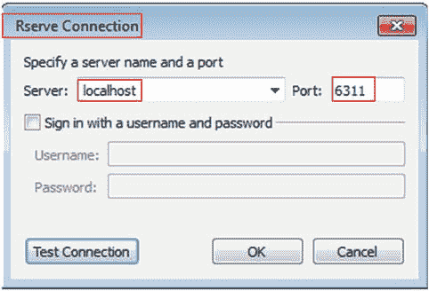

    图 11-2. 设置`Rserve`连接

    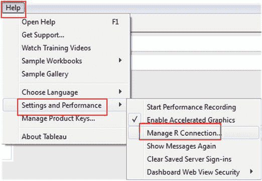

    图 11-1. 管理 R 连接
-   将数据读入 Tableau。
-   创建计算字段以调用 R 功能。
-   使用维度、度量和计算字段创建图表和仪表板。

有四个新的内置函数用于调用特定的 R 模型和函数：

-   `SCRIPT_REAL` - 返回实数
-   `SCRIPT_STR` - 返回字符串
-   `SCRIPT_INT` - 返回整数
-   `SCRIPT_BOOL` - 返回布尔值

这些函数的参数包括 R 语言脚本和 R 函数调用。

### SCRIPT_STR 函数

`SCRIPT_STR()` 从给定的 R 表达式返回字符串结果。R 表达式直接传递给正在运行的 `Rserve` 实例。在 R 表达式中使用 `.arg#` 来引用参数。

语法：`SCRIPT_STR(string, expression, ...)`


### 11.1.1.1 演示 1

目标：从“客户名称”中提取名字，并将其显示在工作表/视图中。

输入：`Sample – Superstore.xls`

预期输出：参见图 11-3。

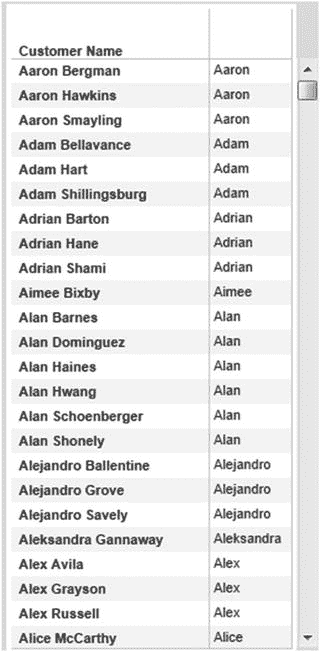

图 11-3. `SCRIPT_STR` 函数 - 演示 1 - 预期输出

#### 11.1.1.1.1 使用 `SCRIPT_STR()` 从“客户名称”中提取名字的步骤

执行以下步骤，从维度“客户名称”中检索名字。

#### 11.1.1.1.2 步骤 1

通过执行以下操作在 R 中启动 `Rserve` 服务：

*   `Library(Rserve)`
*   `Rserve()`

#### 11.1.1.1.3 步骤 2

创建一个计算字段“CustFirstName”（如图 11-4 所示）。

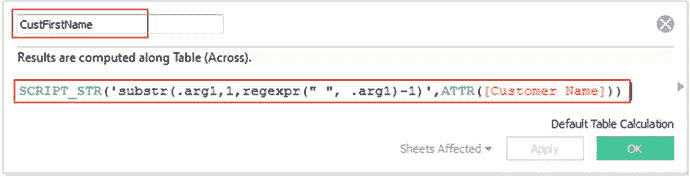

图 11-4. 创建了调用 `SCRIPT_STR` 函数的计算字段“CustFirstName”

`SCRIPT_STR` 函数调用 R 中的 `substr` 函数，以“客户名称”作为参数 1，并从“客户名称”中提取字符，从字符位置 1 开始，直到首次出现空格为止。

`substr()` 函数用于从字符串中检索或替换子字符串。该函数的语法如下：

`substr(x, start, stop)` 其中

- `x` – 一个字符串，
- `start` – 开始提取字符的索引位置，
- `stop` – 要返回的字符数

Tableau 中的 `ATTR()` 函数，如果组中所有行仅包含单一值，则返回给定表达式的值；否则，它返回一个星号（`*`）。空值将被忽略。

#### 11.1.1.1.4 步骤 3

从数据窗格下的维度区域拖动维度“客户名称”，并将其放置在行架上（如图 11-5 所示）。

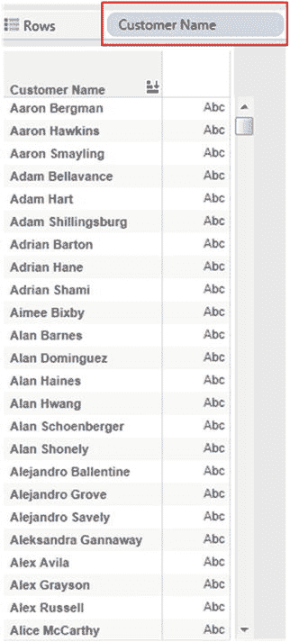

图 11-5. 维度“客户名称”放置在行架上

#### 11.1.1.1.5 步骤 4

从数据窗格下的度量区域拖动计算字段“CustFirstName”，并将其放置在标记卡上的“标签”上（如图 11-6 所示）。

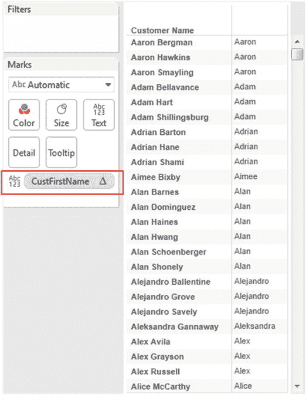

图 11-6. 计算字段“CustFirstName”放置在标记卡上的“标签”上

### 11.1.2 `SCRIPT_BOOL` 函数

`SCRIPT_BOOL()` 从给定的 R 表达式返回布尔结果。R 表达式直接传递到正在运行的 `Rserve` 实例。在 R 表达式中使用 `.arg#` 来引用参数。

语法：`SCRIPT_BOOL(string, expression, …)`

#### 11.1.2.1 演示 2

目标：显示华盛顿州所有城市的“销售额”。

输入：`Sample – Superstore.xls`

预期输出：如图 11-7 所示。

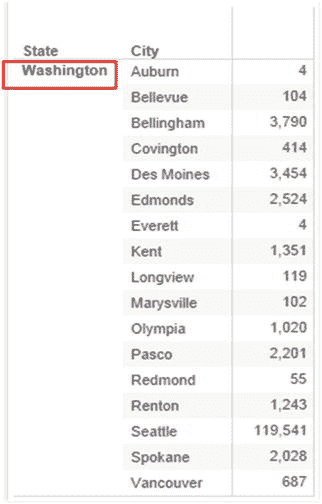

图 11-7. `SCRIPT_BOOL` 函数 - 演示 2 - 预期输出

##### 11.1.2.1.1 使用 `SCRIPT_BOOL()` 显示“华盛顿”州所有城市“销售额”的步骤

执行以下步骤以检索华盛顿州所有城市的列表。

##### 11.1.2.1.2 步骤 1

将来自 `Sample – Superstore.xls` 的数据读入 Tableau（如图 11-8 所示）。

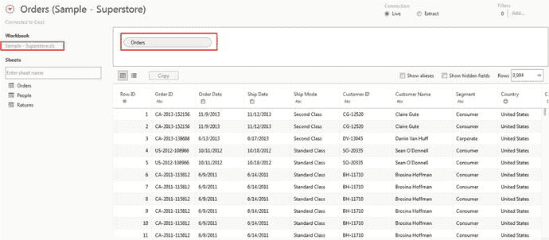

图 11-8. 来自 `Sample - Superstore.xls` 的数据被读入 Tableau

##### 11.1.2.1.3 步骤 2

从数据窗格下的维度区域拖动维度“州”和“城市”，并将其放置在行架上（如图 11-9 所示）。

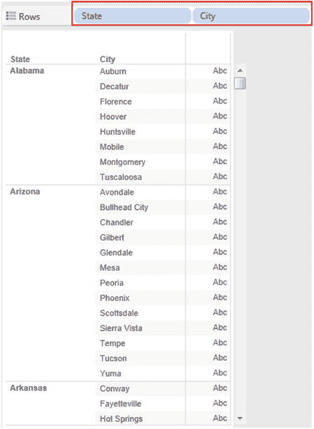

图 11-9. 维度“州”和“城市”放置在行架上

从数据窗格下的度量区域拖动度量“销售额”，并将其放置在标记卡上的“标签”上（如图 11-10 所示）。

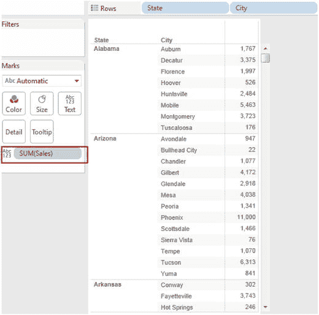

图 11-10. 度量“销售额”放置在标记卡上的“标签”上

##### 11.1.2.1.4 步骤 3

按如下方式在 R 中启动 `Rserve` 服务：

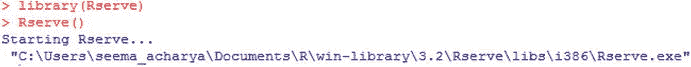

创建一个计算字段“StateWashington”，如图 11-11 所示。

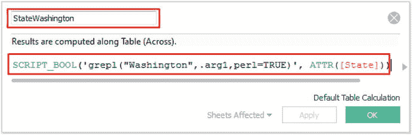

图 11-11. 正在创建的计算字段“StateWashington”，它调用了 `SCRIPT_BOOL` 函数

`SCRIPT_BOOL` 函数调用 R 中的 `grepl` 函数，该函数评估“州”属性，如果“州”属性的值为“Washington”，则返回 `TRUE`。

如果字符串包含该模式，`grepl` 函数返回 `TRUE`，否则返回 `FALSE`。如果参数恰好是字符串向量，则该函数返回一个逻辑向量（如果匹配则为 `TRUE`，否则为 `FALSE`）。该函数的语法：

`grepl(pattern, x, ignore.case = FALSE, perl = FALSE, fixed = FALSE, useBytes = FALSE)`

- `pattern`：正则表达式，或当 `fixed=TRUE` 时为字符串
- `x`：字符串，字符向量
- `ignore.case`：是否区分大小写
- `perl`：逻辑值。是否应使用与 Perl 兼容的正则表达式？
- `fixed`：逻辑值。如果为 `TRUE`，则 `pattern` 是一个要按原样匹配的字符串。会覆盖所有冲突的参数
- `useBytes`：逻辑值。如果为 `TRUE`，则逐字节执行匹配，而不是逐字符执行

##### 11.1.2.1.5 步骤 4

将计算字段“StateWashington”拖动到筛选器架上，并将其设置为“True”（如图 11-12 所示）。

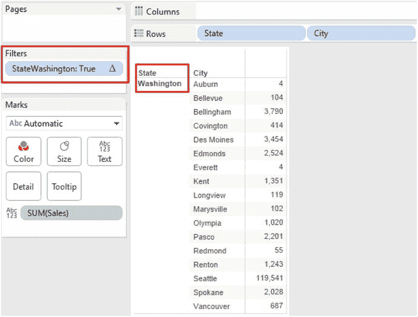

图 11-12. 计算字段“StateWashington”放置在筛选器架上并设置为“True”

最终输出如图 11-13 所示。

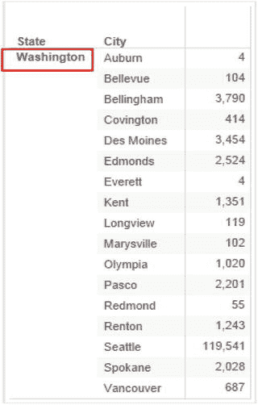

图 11-13. `SCRIPT_BOOL` 函数 - 演示 2 - 最终输出

### 11.1.3 `SCRIPT_REAL` 函数

`SCRIPT_REAL()` 从给定的 R 表达式返回数值结果。R 表达式直接传递到正在运行的 `Rserve` 实例。在 R 表达式中使用 `.arg#` 来引用参数。

语法：`SCRIPT_REAL(string, expression, …)`

#### 11.1.3.1 演示 3

目标：计算 Excel、R 和 Tableau 中两个数据集之间的相关系数。

输入：`Correlation.xlsx`

预期输出：如图 11-14 所示。

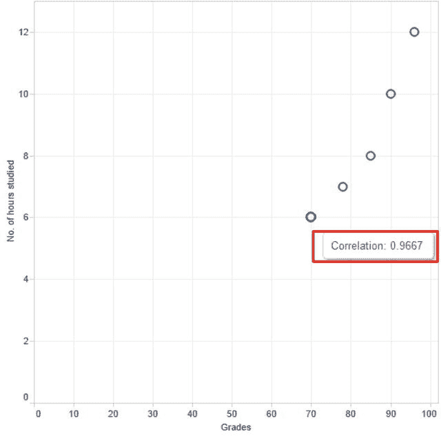

图 11-14. `SCRIPT_REAL` 函数 - 演示 3 - 预期输出

##### 11.1.3.1.1 在 Excel、R 和 Tableau 中确定两个数据集之间相关系数的步骤

执行以下步骤以确定 Excel、R 和 Tableau 中两个数据集之间的相关系数。

让我们考虑以下数据集（如图 11-15 所示）。

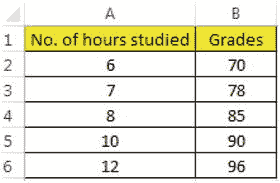

图 11-15. 演示 3 中使用的数据集

在 Excel 中，计算相关系数的公式是

`CORREL(array 1, array 2)`（如图 11-16 所示）。

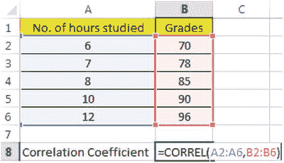

图 11-16. 计算相关系数的公式

Excel 中的输出（如图 11-17 所示）：

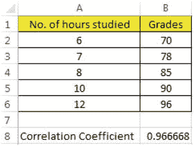

图 11-17. 在 Excel 中计算的相关系数

在 R 中确定相关系数：

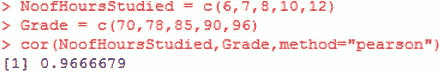

在 Tableau 中确定相关系数：

相关性是一种统计度量，用于指示两个或多个变量共同变化的程度。当变量的值同增同减时，为正相关；当一个变量的值增加而另一个变量的值减少时，为负相关。

相关性不指定因果关系。


### 在 Tableau 中计算相关系数的步骤

##### 步骤 1

将 `Correlation.xlsx` 中的数据读取到 Tableau 中（如图 11-18 所示）。

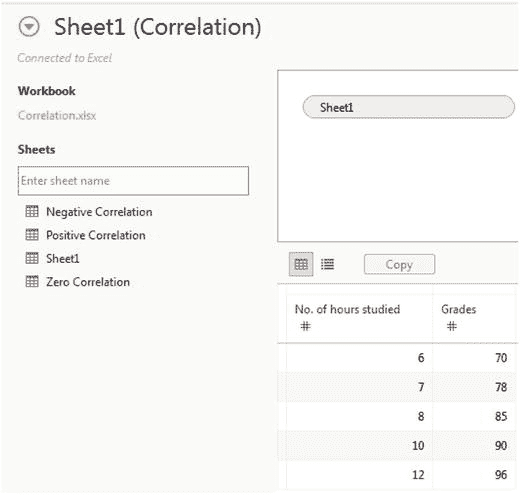

图 11-18. 将来自 `Correlation.xlsx` 的数据读取到 Tableau 中

##### 步骤 2

将度量 `Grades` 和 `No. of hours studied` 从数据窗格下的度量区域分别拖动到列 shelves 和行 shelves 上（如图 11-19 所示）。

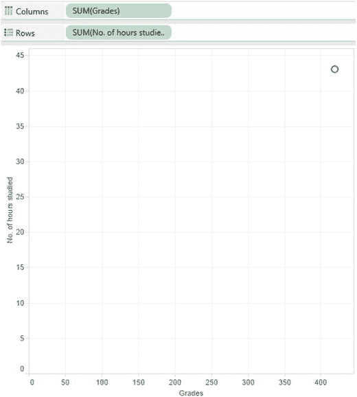

图 11-19. 度量 `Grade` 和 `No. of hours studied` 之间的散点图

##### 步骤 3

执行以下步骤启动 Rserve：

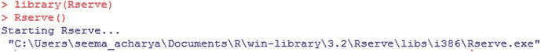

创建一个名为 `Correlation` 的计算字段，如图 11-20 所示。

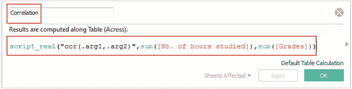

图 11-20. 正在创建的计算字段 `Correlation`

函数 `SCRIPT_REAL` 调用 R 中的 `cor` 函数，以确定作为参数（`.arg1` 和 `.arg2`）传递的度量 `No. of hours studied` 和 `Grades` 之间的相关系数。

R 中的 `cor()` 函数返回相关系数。该函数的语法如下：

```
cor(x, use=, method= )
```

其中 `x` 是一个矩阵或数据框，`use` 指定如何处理缺失数据（选项包括 `all.obs`（假设无缺失数据 – 缺失数据将产生错误）、`complete.obs`（按列表删除）和 `pairwise.complete.obs`（按成对删除）），`method` 指定相关类型（选项包括 `pearson`、`spearman` 或 `kendall`）。

将计算字段 `Correlation` 拖动到标记卡上的 `Detail` 中（如图 11-21 所示）。

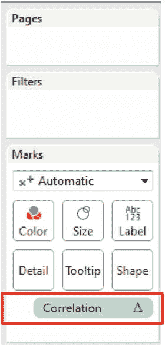

图 11-21. 计算字段 `Correlation` 被放置在标记卡的 `Detail` 上

##### 步骤 4

按如下方式取消对度量的聚合：

`分析` ➤ `聚合度量`；取消勾选 `聚合度量`。

如果取消聚合数据，Tableau 将为数据源中每一行的数据值显示一个单独的标记。取消聚合数据时需谨慎，因为这可能导致性能显著下降，尤其是在数据源非常庞大时。

设置工具提示以显示相关系数，如图 11-22 所示。

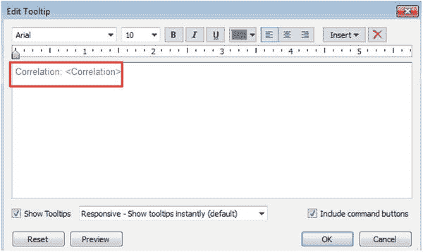

图 11-22. 编辑工具提示以显示 `Correlation`

最终输出（如图 11-23 所示）：

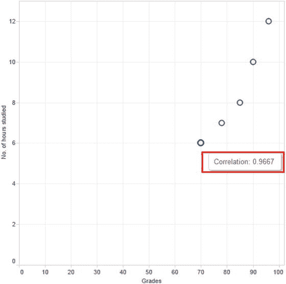

图 11-23. `SCRIPT_REAL` 函数 - 演示 3 - 最终输出

### `SCRIPT_INT` 函数

`SCRIPT_INT()` 从给定的 R 表达式返回一个整数结果。R 表达式被直接传递到正在运行的 Rserve 实例。在 R 表达式中使用 `.arg#` 来引用参数。

语法：`SCRIPT_INT(string, expression, ...)`

**什么是 k-means 聚类？**

k-means 聚类意味着形成 k 个组/簇。维基百科将其解释为：“k-means 聚类旨在将 n 个观测值 [划分](https://en.wikipedia.org/wiki/Partition_of_a_set#Partition%20of%20a%20set) 为 k 个簇，其中每个观测值属于具有最近 [均值](https://en.wikipedia.org/wiki/Mean#Mean) 的簇，该均值作为该簇的 [原型](https://en.wikipedia.org/wiki/Prototype#Prototype)”。

K-means 聚类是最简单的无监督学习算法。它之所以是无监督的，是因为只需指定簇的数量。K-means 在没有关于观测值属于哪个簇的任何信息的情况下，自行“学习”簇。

从原始数据开始 ➤ 将其传递通过聚类算法 ➤ 获取数据的簇

K-means 聚类的工作原理如下：

1.  选择 K 个质心。簇质心是簇的中心。
2.  将每个数据点分配给它最近的质心。
3.  将质心重新计算为簇中所有数据点的平均值（即，质心是 p 长度的均值向量，其中 p 是变量的数量）。
4.  将数据点分配给它最近的质心。

K-means 聚类持续执行步骤 3 和 4，直到无法重新分配观测值或达到最大迭代次数（R 默认使用 10 次）。

**目标：** 将 `Cars.xlsx` 中的给定数据分成三个簇。

**输入：** `Cars.xlsx`。数据集如图 11-24 所示：

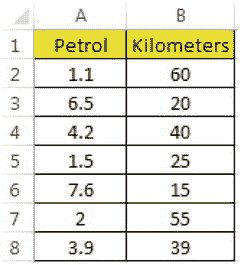

图 11-24. 用于 k-means 聚类演示的数据集

**预期输出：** 如图 11-25 所示。

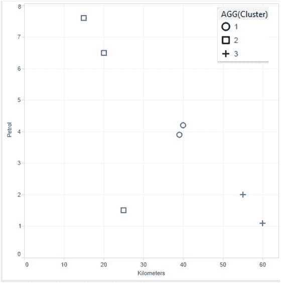

图 11-25. `SCRIPT_INT` 函数 - K-means 聚类 - 预期输出

#### 创建簇的步骤

##### 步骤 1

将 `Cars.xlsx` 中的数据读取到 Tableau 中（如图 11-26 所示）。

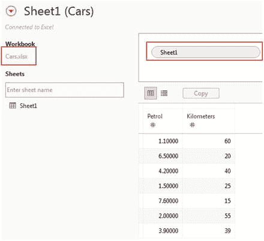

图 11-26. 将来自 `Cars.xlsx` 的数据读取到 Tableau 中

##### 步骤 2

创建一个名为 `Cluster` 的计算字段，如图 11-27 所示。

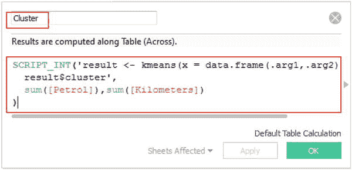

图 11-27. 正在创建的计算字段 `Cluster`

`SCRIPT_INT` 函数调用 R 中的 `kmeans` 函数，并将维度 `Petrol` 和 `Kilometers` 作为参数传递给它。R 中的 `kmeans` 函数返回数据簇。

R 中 `kmeans()` 函数的语法：

```
kmeans(x, centers, iter.max=10)
```

其中：
- `x` 是一个数据框或矩阵。所有值必须是数值型。
- `centers` 是 K 均值的 K。例如，`centers = 5` 将创建 5 个簇。
- `iter.max` 是算法重复簇分配和移动质心的次数。

##### 步骤 3

转到 `分析` 菜单选项，取消勾选 `聚合度量`。取消聚合度量很重要（如图 11-28 所示）。

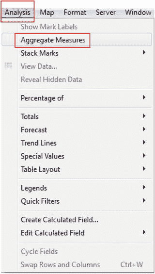

图 11-28. 取消聚合度量

##### 步骤 4

将度量 `Kilometers` 从数据窗格下的度量区域拖动并放置到列 shelves 上（如图 11-29 所示）。

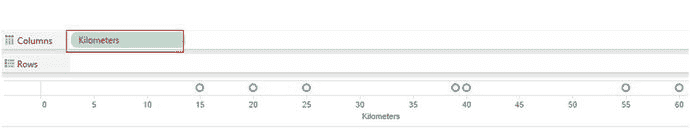

图 11-29. 将度量 `Kilometers` 放置在列 Shelves 上

##### 步骤 5

将度量 `Petrol` 从数据窗格下的度量区域拖动并放置到行 shelves 上（如图 11-30 所示）。

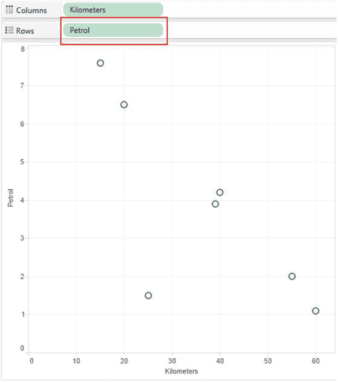

图 11-30. 将度量 `Petrol` 放置在行 shelves 上

##### 步骤 6

将计算字段 `Cluster` 拖动到标记卡上的 `Shape` 中（如图 11-31 所示）。

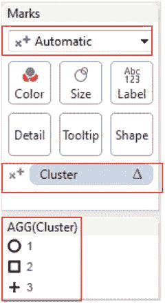

图 11-31. 计算字段 `Cluster` 被放置在标记卡的 `Shape` 上

将计算字段 `Cluster` 放置在标记卡的 `Shape` 上之后的最终输出（如图 11-32 所示）。

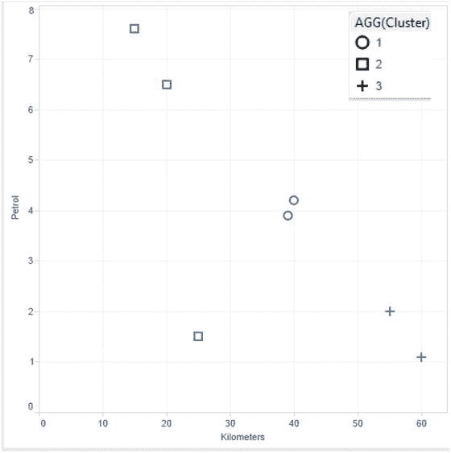

图 11-32. `SCRIPT_INT` 函数 - K-means 聚类 - 预期输出

**结论：** 数据已被分成三个簇。


### 11.1.5 购物篮分析

购物篮分析有助于发现顾客经常一起购买的商品组合。这是一种基于以下理论的建模技术：如果你购买了某组商品，你就更有可能（或更不可能）购买另一组商品。

例如，购买面粉和糖的顾客更有可能同时购买鸡蛋，以凑齐烘焙蛋糕的基本原料。这种分析使零售商能够将经常一起购买的商品摆放在一起，从而提升顾客的购物体验。此外，这种分析还有助于零售商进行定向营销（向购买某商品的顾客发送邮件，提供另一款顾客经常选购商品的优惠）。购物篮分析有助于实现以下目标：

-   交叉销售
-   追加销售
-   促销活动
-   忠诚度计划
-   店铺设计
-   折扣方案

让我们看看购物篮分析的其他应用领域：

尽管购物篮分析让人联想到购物车和超市顾客的画面，但重要的是要认识到它还有许多其他应用：
-   信用卡购买分析。
-   电话通话模式分析。
-   识别欺诈性医疗保险索赔。（考虑违反常规规则的案例）。
-   电信服务购买分析。

目标：确定共同创造最高销售额的产品。

输入："Sample – Superstore.xls"。将使用该工作表中的“Orders”两次来执行自连接。

预期输出：如图 11-33 所示。

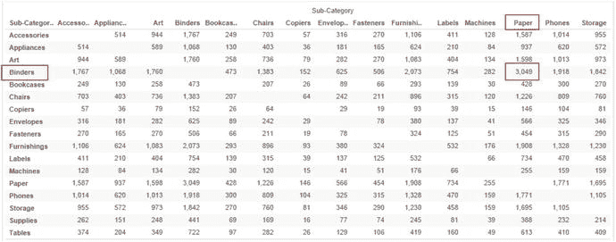

图 11-33。

购物篮分析 - 预期输出

#### 11.1.5.1 执行购物篮分析的步骤

执行以下步骤以确定共同创造最高销售额的产品。

##### 11.1.5.1.1 步骤 1

将“Sample – Superstore.xls”中“Orders”工作表的数据读入 Tableau（如图 11-34 所示）。

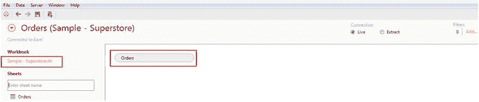

图 11-34。

从“Sample - Superstore.xls”的“Orders”工作表读入 Tableau 的数据

##### 11.1.5.1.2 步骤 2

第二次将“Orders”工作表拖到“将工作表拖放到此处”。“内连接”对话框将弹出（如图 11-35 所示）。

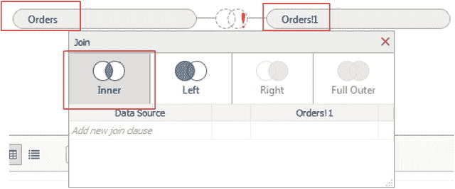

图 11-35。

“内连接”对话框

填写“内连接”的条件（如图 11-36 所示）。

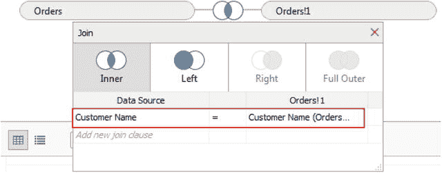

图 11-36。

设置“内连接”的条件

转到“Sheet1”。

##### 11.1.5.1.3 步骤 3

从“Orders$”工作表中将维度“子类别”拖到列功能区上（如图 11-37 所示）。

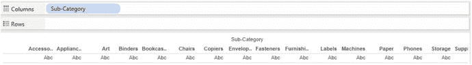

图 11-37。

来自“Orders$”工作表的维度“子类别”放置在列功能区上

从“Orders$1”工作表中将维度“子类别”拖到行功能区上（如图 11-38 所示）。

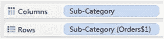

图 11-38。

来自“Orders$1”工作表的维度“子类别”放置在行功能区上

##### 11.1.5.1.4 步骤 4

从“Orders$”中将维度“客户名称”拖到标记卡的“标签”上（如图 11-39 所示）。

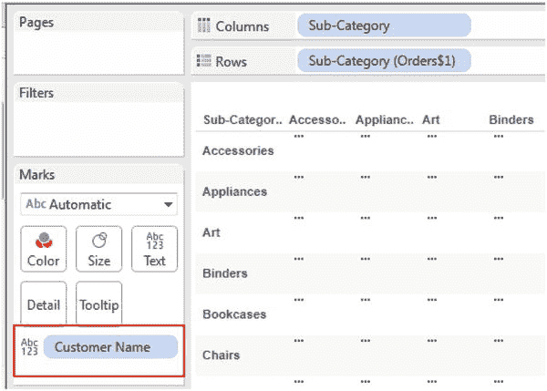

图 11-39。

来自“Orders$”工作表的维度“客户名称”放置在标记卡的“标签”上

将标记卡上“标签”中的维度“客户名称”的聚合方式更改为“计数”（如图 11-40 所示）。

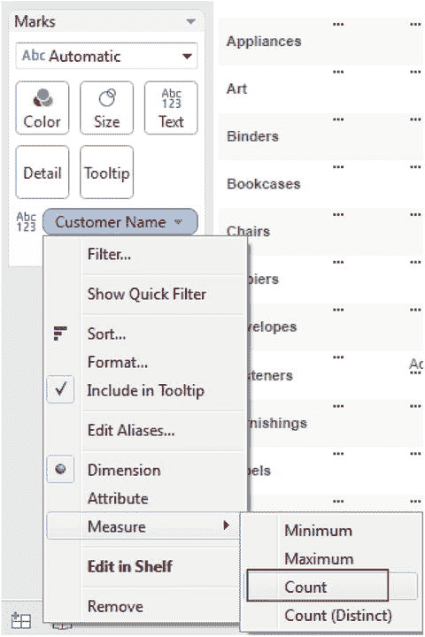

图 11-40。

维度“客户名称”的聚合方式更改为“计数”

将聚合方式设置为“计数”后的输出结果（如图 11-41 所示）。

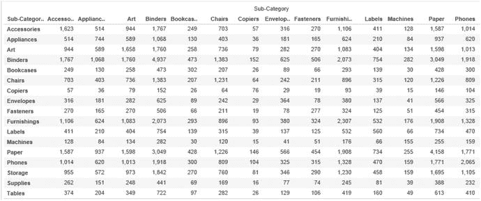

图 11-41。

将“客户名称”的聚合方式更改为“计数”后的输出结果

##### 11.1.5.1.5 步骤 5

删除重复项。为删除重复项，创建一个计算字段“Duplicates”（如图 11-42 所示）。

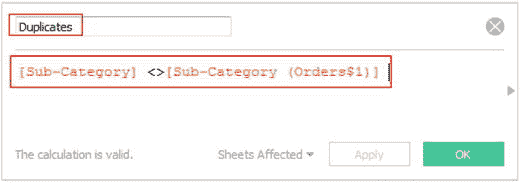

图 11-42。

正在创建计算字段“Duplicates”

##### 11.1.5.1.6 步骤 6

将计算字段“Duplicates”拖到筛选器功能区，并将其设置为“True”（如图 11-43 所示）。

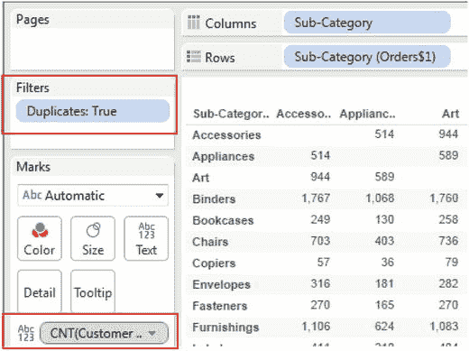

图 11-43。

计算字段“Duplicates”放置在筛选器功能区上

删除重复项后（其中 Orders$ 工作表中的子类别等于 Orders$1 工作表中的子类别）的最终输出结果（如图 11-44 所示）。

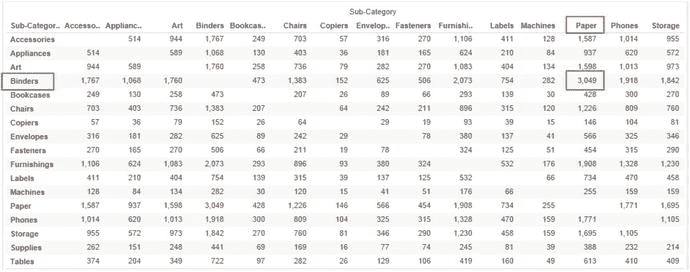

图 11-44。

购物篮分析 - 最终输出结果

结论：

子类别“装订机”和“纸张”创造了最高销售额。

## 11.2 要点提示

-   Tableau Online 和 Tableau Public 不支持 R。
-   数据无法直接从 Tableau 导出到 R。
-   无法从 R 将数据集导入 Tableau。
-   在 R 中创建的可视化无法导入 Tableau；但是，可以在 Tableau 仪表板中使用 R 可视化的图像文件或指向 R 可视化的 URL。


