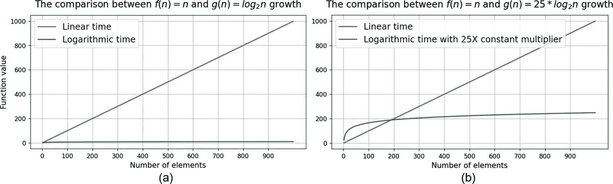
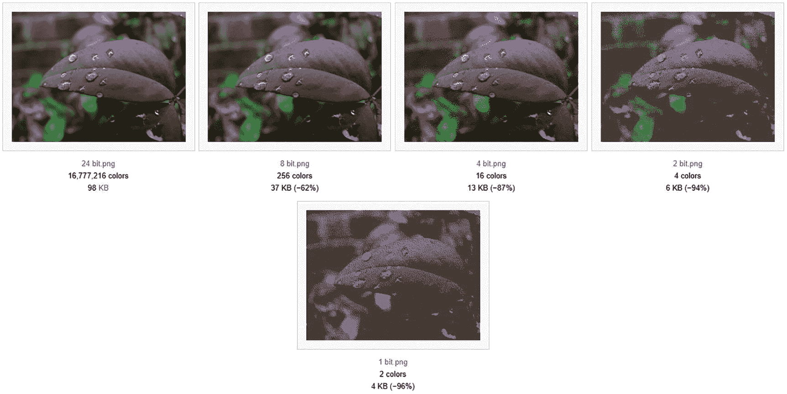
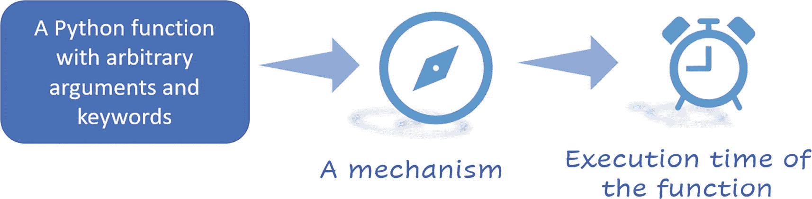
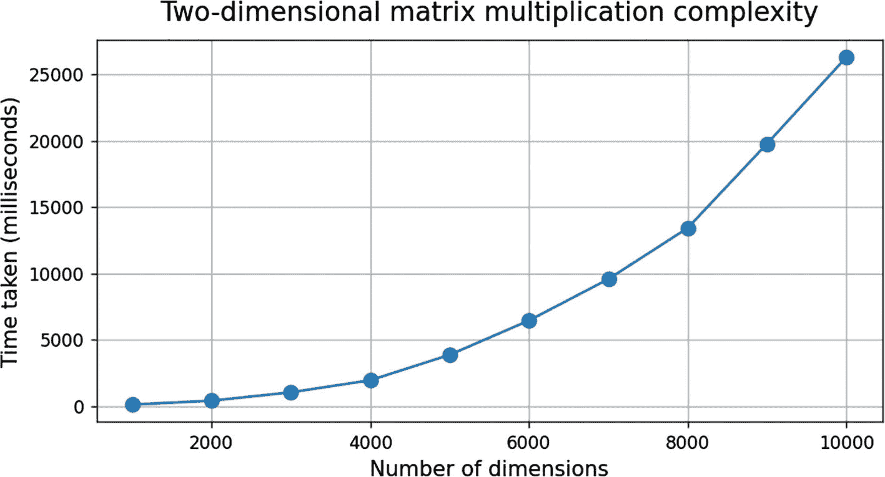

# 2. 高效数据科学的更佳编程原则

本章旨在向你介绍某些编程风格和习惯的概念，这些风格和习惯在开发高效的数据科学（DS）与机器学习（ML）系统及管道中起着至关重要的作用。我将通过简要示例（或在适用处使用伪代码）来阐述这些概念，并讨论如何衡量或追踪低效问题。

首先，我将介绍编程和算法中时间与空间复杂度（`https://levelup.gitconnected.com/time-and-space-complexity-725dcba31902`）的概念。你还会看到在此背景下使用的[大 O 表示法](https://en.wikipedia.org/wiki/Big_O_notation)（`https://en.wikipedia.org/wiki/Big_O_notation`）。这些是分析任何算法运行时或效率的基础概念，例如可用于衡量和描述标准 ML 算法的效率。我还将简要讨论为何复杂度度量对数据科学任务尤为重要。

接着，我将演示常见、低效的数据科学和 ML 编码实践的实际示例。这绝非旨在详尽列举每一种低效的数据科学编程方式。不过，我会尽力让你一窥典型的低效代码片段，这些代码要么扩展性不佳，要么导致整体系统设计的某些方面变得低效。希望你能将这些示例内化，并将相同的思考过程应用于自己的分析工作，从而提高生产力。

在大多数情况下，我还会展示一些可行的替代示例，例如如何通过采用更佳的编程风格或在 Python 生态系统内选择不同的工具或函数，来改进同一任务的效率。

最后，我将介绍用于测量代码或功能块执行时间的工具和技术。在这方面，我会涵盖通用的 Python 模块和 Jupyter 魔术命令。

## 时间与空间复杂度及大 O 表示法的概念

算法的时间与空间复杂度，通常与给定输入下该算法的最坏情况执行时间及所需内存/存储空间相关。由于时间和空间几乎总是取决于输入规模（例如数组中的元素数量），这些复杂度度量被表示为输入规模的函数，因此对于包含`n`个元素的数组，用`f(n)`或`g(n)`表示，其中`f`或`g`分别代表时间复杂度和空间复杂度。

### 一个简单示例：搜索元素

让我们用一个简单例子来演示。考虑以下在列表中搜索给定元素的 Python 程序。注意，你本可以用更符合*Python 风格*的方式编写代码，如`if ele in lst`，但为了演示目的，我们使用朴素的列表遍历代码：

```python
def ele_in_lst(ele,lst):
    len_lst = len(lst)
    for i in range(len_lst):
        if lst[i] == ele:
            return True
    return False
```

如果你用以下输入测试此函数，会得到 `True`：

```python
ele_in_lst(ele=2,lst=[3,4,5,2,9])
>> True
```

但如果你用以下输入测试，则会得到 `False`：

```python
ele_in_lst(ele=2,lst=[3,4,5,5,9,11,3,4,-1,3,5,7,12,15])
>> False
```

在上述第二个例子中，循环被完整遍历了，因此 `if lst[i] == ele` 的相等性检查操作执行了 14 次（即列表的长度）。这是程序的核心操作，由 CPU 执行，并构成代码时间复杂度的一部分。

那么，这种搜索方法的时间复杂度是多少？显然，**在最坏情况下**，即当`ele`不在给定的`lst`中时，**所花费的时间总是与`lst`的长度成正比**（假设每次相等性操作耗费恒定时间）。这由函数 `O(n)` 表示，其中 `n` 表示输入数组中的元素数量。

### 大 O 表示法

函数 `O(n)` 中的这个 `O` 符号被称为大 O 表示法。根据维基百科的说法，“*它描述了当参数趋向于特定值或无穷大时，函数的极限行为*”（`https://en.wikipedia.org/wiki/Big_O_notation`）。具体来说，这是这种情况下最坏情况时间复杂度的一个例子（因为元素不在给定列表中），但在极限情况下，这正是每位计算机程序员应该关注的。

有人可能会好奇，为什么我们不计算*平均情况*的时间复杂度。事实证明，在大多数情况下，计算甚至估算平均情况的样子相当困难，而最坏情况则通常能以更简单的方式定义和理解。此外，`O(n)` 表示法是在渐近意义上理解的，因此当 `n` 变大时，最坏情况所需时间不会偏离这种线性趋势。

为什么是*线性*趋势？因为 `O(n)` 表示 `n` 的一次幂。类似地，我们有复杂度为 `O(n²)` 或 `O(n³)` 的算法，它们呈现二次或三次趋势。换句话说，所花费的时间将像问题规模`n`的二次或三次函数那样增长。

这种大 O 表示法的起源深深植根于更高级的数学领域——[解析数论](https://en.wikipedia.org/wiki/Analytic_number_theory)（`https://en.wikipedia.org/wiki/Analytic_number_theory`），并且在许多数学定理的讨论中也会出现。但在计算机科学和编程的语境下，这是表示给定算法时间/空间复杂度的标准符号。

### 复杂度：线性、对数、二次及其他

那么，如果这是 `O(n)`，搜索能否做得更好？是的，事实证明，如果列表预先排序，搜索可以快到 `O(log2(n))`。在这种情况下使用的特定算法称为*二分搜索*。而你大概能猜到，我们上面编写的朴素算法被称为*线性搜索*。

#### 速度能快多少？

那么，`O(log2(n))` 到底比 `O(n)` 快多少呢？我们可以通过绘制函数 `f(n) = n` 和 `g(n) = log2(n)` 随着数值 `n` 增大的曲线来找到答案。为了更清晰地说明，请参见图 2-1。图中包含两条曲线：一条是这两个函数的直接对比，另一条是对数函数乘以一个较大的常数（如 25）后的结果。



图 2-1

对数时间复杂度和线性时间复杂度算法的函数值增长对比。在 (a) 中，两者的常数乘数均为 1。在 (b) 中，对数算法的乘数为 25

图 2-1 中的第二种情况代表什么？它表示我们正在使用一个 `O(log2(n))` 算法，但每次单位计算有较大的开销，即基本计算单元的速度远慢于 `O(n)` 线性算法中对应的单元操作。

从图 2-1 中可以非常清楚地看出，无论常数乘数是多少（1 或 25），随着 `n` 的增长，`O(log2(n))` 算法变得比 `O(n)` 算法快得多，因此代表算法运行时间的函数值随 `n` 增长得慢得多。因此，对于相同的任务，**我们应当始终使用对数复杂度算法来替代线性复杂度算法（如果我们能找到这样的算法的话）**。

对于搜索示例，这需要对列表进行预排序，而这本身具有其算法复杂度（参见 [`www.geeksforgeeks.org/time-complexities-of-all-sorting-algorithms`](http://www.geeksforgeeks.org/time-complexities-of-all-sorting-algorithms) 上的排序算法复杂度）。但这一步通常是值得的，因为在典型的应用场景中，*你可能对列表进行排序的频率远低于对其执行搜索的频率*。

#### 比线性更复杂的是什么？

尽管线性时间复杂度相比对数时间看起来更差，但实际上，在我们通常遇到的一般计算算法（无论是数据科学领域还是非数据科学领域）中，它已经是一种相当高效的算法了。可以想见，`n` 的高次幂复杂度非常常见，并相应地表示为：

- `O(n²)` 表示二次时间复杂度

- `O(n³)` 表示三次时间复杂度

- `O(2^n)` 表示指数时间复杂度（没错，这些可怕的东西确实存在！）

让我快速展示一下 `O(n²)` 和 `O(n³)` 算法的简单（且初级）示例。下面是一个简单的算法，它遍历给定的 NumPy 数组的维度，并统计大于零的元素个数（如果你对数据科学感兴趣，想必你一定了解 [`https://numpy.org/doc/stable/user/whatisnumpy.html`](https://numpy.org/doc/stable/user/whatisnumpy.html) 上的 [NumPy 库和数组](https://numpy.org/doc/stable/user/whatisnumpy.html)，对吧？）：

```python
import numpy as np
array_2D = np.random.normal(size=(5,5))
def count_positives(array):
"""
统计二维随机数组中的正数个数
"""
m,n = array.shape
count = 0
for i in range(m):
for j in range(n):
if array[i][j] > 0.0:
count+=1
return count
```

## 为什么复杂度对数据科学很重要
所有这些关于算法复杂度的讨论可能会让你思考，如何将这方面的知识应用于数据科学工作中，尤其是高效的数据科学实践。为了回答这个问题，首先你需要了解一些在数据科学任务中可能具有高算法复杂度的常见示例。我在上一节中介绍了线性、对数和二次复杂度。接下来，让我展示两个更糟的复杂度示例，它们出现在数据科学任务中。

### 图像数据：三次复杂度算法
作为`O(n²)`案例中代码示例的自然延伸，如果我们将循环次数增加到 3 次（例如三维数组），那么时间复杂度就变成了`O(n³)`。三维数组的一个典型示例（尤其是在数据科学领域）是图像数据：其中二维数组表示像素的坐标，每个像素中还有另一个数字表示颜色深度（`https://en.wikipedia.org/wiki/Color_depth`）或灰度值（示例见图 2-2）。
由于作为数据科学家，你可能需要频繁处理图像数据，因此遇到`O(n³)`算法的可能性很高。实际上，每个像素上的计算任务可能更复杂，因为它可能是一个包含多个颜色值（例如 RGB）的向量，而不仅仅是单个浮点数。



图 2-2
颜色深度和灰度图像示例（来源：维基共享资源，GNU 自由文档许可证）

### 最佳回归模型：指数级复杂度
那令人望而生畏的`O(2^n)`复杂度呢？在日常数据科学工作中真的会遇到吗？是的，事实证明，这方面也有一个简单的数据科学实例。
考虑这样一个任务：为一个具有众多特征的大型数据集确定最佳线性回归模型。并非所有特征都同等重要或具有影响力。对于大多数实际情况，只有特定的特征子集是最优的。确定这个最优子集听起来是一项常见的数据科学任务。
我们知道，向模型中添加更多特征会提高简单的`R²`系数，但当我们考虑诸如调整后`R²`（详见 `www.statisticshowto.com/probability-and-statistics/statistics-definitions/adjusted-r2/` ）或 AIC 准则（详见 `https://en.wikipedia.org/wiki/Akaike_information_criterion`）这类高级指标时，就需要对多种特征组合进行试验，以找出最佳组合。简而言之，我们需要搜索所有可能的特征组合空间，为每种组合构建回归模型，计算所需的性能指标，最后选出最优的那个（例如，性能指标最高的那个组合）。
用更数学化的语言来说，这相当于在给定集合的所有子集中找出最佳子集。这是一个计算上难度呈指数级增长的问题。也就是说，其算法复杂度为`O(2^n)`。而且，这还仅仅是构建特征空间所有子集的工作量，尚未考虑为每种组合构建实际回归模型的计算成本。
为什么？原因在于下面这个我们可能在高中学过的简单等式。基本上，从`n`个可能的项目中选取 1、2、3……`n`个的所有组合的总和为`2^n`。在我们的回归问题中，我们是一次选取 1 个、2 个、3 个或更多特征来构建模型。
```
∑(C^n_1 + C^n_2 + ... + C^n_n) = 2^n
```
正因如此，在回归模型优化中几乎从不鼓励使用穷举搜索法。取而代之的是，我们采用贪婪搜索法（详见 `https://en.wikipedia.org/wiki/Greedy_algorithm`），例如前向选择和后向选择算法（详见 `https://quantifyinghealth.com/stepwise-selection/`），这些方法能显著缩短搜索时间，同时在几乎所有实际情况下都能找到相当不错的解决方案。

### 相对增长速度对比
为了说明具有不同复杂度阶数的算法所带来的优势（或劣势），我们可以绘制如图 2-3 所示的简单图表。很明显，对数时间算法增长最慢，其次是线性时间算法。更高次幂的算法增长很快，而指数型算法则像弹道导弹一样飞速上升！
图 2-3：不同时间复杂度算法的相对增长速度（未按比例绘制）
同样值得注意的是，由于这些复杂度度量和大`O`表示法本质上是在渐近意义上定义的（即针对`n`值很大的极限情况），因此我们确实需要将它们视为属于完全不同的计算难度类别。这意味着，无论一个特定算法可以化简为什么具体的复杂度函数，如果它是三次的，那么从长远来看，它总是比线性或二次算法更差。
最快速的判断方法是查看算法的最高阶并确定其等级。指数级总是比多项式级差，多项式级总是比线性级差。以下是一些快速示例：
-   复杂度为`O(200n + 3)`的算法优于复杂度为`O(0.1n² + 12)`的算法。
-   复杂度为`O(3n³ + 2n + 5)`的算法比复杂度为`O(100n² + 12)`的算法差。
-   复杂度为`O(4^(0.1n))`的算法比复杂度为`O(100n¹⁰⁰)`的算法差。
上面列表中的最后一条一定让你感到惊讶！建议你尝试计算这两个函数，从较小的`n`值开始直到较大的值，并将它们叠加画图，以理解第一个函数如何在较大的`n`值下超越第二个函数。因此，从渐近意义上来判断，你仍然应该优先选择多项式阶算法（即使包含`n¹⁰⁰`这样的项），而不是指数阶算法（`4^(0.1n)`）。

### 人工智能难以攻克，却行之有效
> *深度学习网络*已经过训练，能够以高性能水平识别语音、为照片添加说明以及在语言之间进行文本翻译。尽管深度学习网络在现实世界问题中的应用已变得无处不在，但我们对它们为何如此有效仍缺乏理解。***根据统计学和非凸优化理论中的样本复杂度，这些实证结果本不可能实现。***
>
> *特伦斯·J·塞诺夫斯基（*[*www.salk.edu/scientist/terrence-sejnowski/*](http://www.salk.edu/scientist/terrence-sejnowski/)*）*，*《人工智能中深度学习的惊人有效性》* *（*[*www.pnas.org/doi/10.1073/pnas.1907373117*](http://www.pnas.org/doi/10.1073/pnas.1907373117)*），《美国国家科学院院刊》，2020 年 12 月*

从简单的搜索和排序算法跃升到深度学习中所使用的梯度下降和反向传播（[`https://blog.paperspace.com/intro-to-optimization-in-deep-learning-gradient-descent/`](https://blog.paperspace.com/intro-to-optimization-in-deep-learning-gradient-descent/)）的世界，是一个巨大的跨越，但为了阐明人工智能算法虽难以攻克却仍可管理这一观点，这一步是必要的。
那么，什么是**难解性**？这本身就是一个全新的主题，超出了本书的范围，尽管它与前面小节讨论的算法复杂度主题密切相关。简单来说，**难解问题是指那些无法找到有效算法（来求解它们）的计算问题**。在这里，术语“高效”在大多数情况下指的是多项式时间算法，即复杂度最多为`O(n^k)`的算法，而非`O(2^n)`或`O(n!)`这类算法。
不幸的是，在人工智能领域，大多数常见问题在理论上都可被证明是难解的。特别是，对于人工智能问题，其最优化解决方案需要某种搜索本质上是指数级的空间算法，例如决策树中所有可能树（及分支）的数量，或简单多元回归中所有可能模型的数量。由于这些传统的机器学习任务属于难解范畴，深度学习网络同样受困于相同的计算难题也就不足为奇了。

然而，尽管存在理论上的不可能性（即找到最佳可行解），但常见的机器学习算法和解决方案通过运用诸如贪心搜索（[`www.programiz.com/dsa/greedy-algorithm`](http://www.programiz.com/dsa/greedy-algorithm)）、启发式方法（[`https://en.wikipedia.org/wiki/Heuristic_(computer_science)`](https://en.wikipedia.org/wiki/Heuristic_%2528computer_science%2529)）、动态规划（[`www.programiz.com/dsa/dynamic-programming`](http://www.programiz.com/dsa/dynamic-programming)）、随机化算法（[`https://en.wikipedia.org/wiki/Randomized_algorithm`](https://en.wikipedia.org/wiki/Randomized_algorithm)）等巧妙技术，在几乎所有实际情况下都能奏效。具体而言，这些实用技术并非寻求绝对最佳解，而是寻找一个能够利用合理计算资源高效找到的“足够好”的解。它们还大量利用领域知识和归纳偏置来缩减潜在解的搜索空间。

启发式搜索技术常被称为知情搜索，因为它们倾向于利用关于问题及环境（人工智能体可能所处的环境）的额外信息。想象一下，你身处异国他乡，无法使用谷歌地图！作为抵达最终目的地的旅程第一步，你可以从当前位置驾车前往几个城市。你可能不知道这些城市的确切驾驶距离，但你也许从朋友那里听说，她乘坐火车到城市`A`所花的时间比到城市`B`要少。这就是关于环境的额外信息，虽然它不能保证实际驾车到城市`A`的距离一定小于到城市`B`的距离，但这种情况很有可能为真。这被称为启发式信息，你可以用它来决定旅途中要采取的优化路径。大量的人工智能算法都使用这种技术来实现高效搜索。

因此，总结一下，前面关于计算复杂度和大*O*记法的小节，其目的是介绍常见算法的效率概念，并说明确实存在不同类别的算法，它们在输入规模增长时表现迥异。这样做是为了在你的脑海中培养一种探究意识，去检查你的代码和实现中的弱点，即使你不需要为某个特定的解严格分析并数学推导出精确的大*O*函数。此外，这也是为了让你确信，即便面对看似难解的大数据问题，也存在巧妙的解决方案技术，你应该抓住每次机会去探索它们。

## 数据科学中的低效编程

数据科学代码可能以无数种方式受到低效实践和设计模式的困扰。造成这种情况的主要原因之一是，数据科学家通常来自不同的背景（例如物理学、生物学、经济学、统计学、电气工程等），而且他们并非总是遵循成熟完善的软件工程设计模式（[`https://en.wikipedia.org/wiki/Software_design_pattern`](https://en.wikipedia.org/wiki/Software_design_pattern)）。数据科学训练营、研讨会和在线课程（通常是许多崭露头角的数据科学家接受培训的地方）会教授涵盖 Python 编程、统计学和机器学习的大量主题，但未必会教授这些高效编程技术。

然而，需要在一开始就指出，本书并非一本关于数据科学软件工程的人门读物。具体而言，本章的目标是展示数据科学任务中一些最明显且广泛重复的低效编程模式，以便你能识别并从这些示例中学习。这正是我接下来几个小节要做的事情。此外，为了确保效果，我也会展示应该更高效的变通方法和替代方案。

### 典型示例

在本节中，我将展示一些在常规数据科学工作流中频繁出现的低效编程模式。我采用的方法偏重实用和动手操作，而非教学灌输。这意味着我不会采用严格的数学方法来计算和证明各种函数及代码片段的算法复杂度。相反，我鼓励你使用各种工具测量代码片段的执行时间，并自行探索可能的改进策略。关于如何改进这些代码片段，并没有唯一正确的答案。

需要指出的是，本小节我讨论的并非像 `NumPy` 或 `pandas` 这样的特定库。事实上，我将在下一章讨论使用这些库的高效最佳实践。这里，我展示的是基本的 Python 编码模式示例，你可以在许多场景（数据科学及其他领域）中加以利用。

给读者的一条说明：我打算让代码片段保持简洁，因此不会让它们自包含且详尽无遗。这意味着这些代码片段并非设计为可独立运行。随附的笔记将提供完整的可运行代码。

# 使用过滤器代替`for`循环

关于避免使用`for`循环来完成那些可以用其他数学逻辑形式简化的简单重复性任务，已有无数文章进行过讨论。诚然，对于许多复杂的逻辑和迭代场景，你无法回避`for`循环。然而，在很多情况下，你可以使用替代方法，并且你应该时刻留意它们。Python提供了一些内建方法，可用于数据过滤等特定场景。

考虑以下包含三个函数定义的代码块：

```python
ONE_MILLION = list(range(int(1e6)))
def for_loop():
    result = []
    for ele in ONE_MILLION:
        if not ele % 3:
            result.append(ele)
    return result
def list_comprehension():
    return [num for num in ONE_MILLION if not num % 3]
def filter_fn():
    return filter(lambda x: not x % 3, ONE_MILLION)
```

第一个函数包含一个标准的`for`循环和列表追加操作。第二个函数更为简洁，使用了Python的列表推导式（[`https://realpython.com/list-comprehension-python/`](https://realpython.com/list-comprehension-python/)）。最后，第三个函数使用内建的`filter`函数和`lambda`表达式（[`https://realpython.com/python-lambda/`](https://realpython.com/python-lambda/)）来实现相同的目标。

让我们使用Jupyter Notebook的内建魔法命令（[`https://stackoverflow.com/questions/29280470/what-is-timeit-in-python`](https://stackoverflow.com/questions/29280470/what-is-timeit-in-python)）`%%timeit`来测量执行速度。

对于`for_loop`函数：

```python
%%timeit -r20 -n5
for_loop()
```
输出结果：
```
56.6 ms ± 3.03 ms per loop (mean ± std. dev. of 20 runs, 5 loops each)
```

对于`list_comprehension`函数：

```python
%%timeit -r20 -n5
list_comprehension()
```
输出结果：
```
44.2 ms ± 2.21 ms per loop (mean ± std. dev. of 20 runs, 5 loops each)
```

对于`filter_fn`函数：

```python
%%timeit -r20 -n5
filter_fn()
```
输出结果：
```
440 ns ± 93.6 ns per loop (mean ± std. dev. of 20 runs, 5 loops each)
```

列表推导式的速度比普通`for`循环略快，而基于过滤器的方法则快得多。显然，对于这种情况——你本质上是在进行数据过滤（通过遍历列表，并根据每个元素是否满足特定条件来创建一个新列表）——你应该尽可能尝试使用`filter`函数。

关于本书中穿插的这些示例，有一点需要牢记：计时测量的精确数值结果会因机器不同而有巨大差异，甚至同台机器上的不同次执行结果也会不同。性能基准测试是一个棘手的话题，很难实现标准化。根据你所使用的硬件和本地软件设置，你可能会得到完全不同的结果。尽管如此，（在大多数情况下）示例呈现的整体趋势将是显而易见的。

# 使用集合来查找唯一元素

集合是 Python 中一种强大的数据结构（[https://realpython.com/python-sets/](https://realpython.com/python-sets/)），当你需要从一个长列表或数组中找出唯一元素时，可以创造性地使用它。考虑以下包含两个函数定义的代码：

```python
import random
random_lst = [random.randint(1,100) for _ in range(100000)]

def unique_for_loop():
    unique_elements = []
    for ele in random_lst:
        if ele not in random_lst:
            unique_elements.append(ele)
    return unique_elements

def unique_set():
    return list(set(random_lst))
```

像往常一样，你使用 Jupyter 的 `%%timeit` 命令进行测试，对于使用 `for` 循环的函数，得到以下结果：

```python
%%timeit -r20 -n5
unique_for_loop()
# 109 ms ± 4 ms per loop (mean ± std. dev. of 20 runs, 5 loops each)
```

使用 `set` 后，你得到以下结果：

```python
%%timeit -r20 -n5
unique_set()
# 788 μs ± 181 μs per loop (mean ± std. dev. of 20 runs, 5 loops each)
```

使用 `set` 的方法要快得多！因此，在任何需要从长数组中查找唯一元素的场景中，使用它都是合理的。

此外，`in` 运算符在被用于集合时被设计得非常快。因此，如果你想检查一个元素是否存在于一个长列表中（即检查该元素是否在列表中存在），并且你有理由认为该列表包含大量重复条目，那么你可以通过首先移除所有重复项并基于该列表创建一个集合，来显著减少搜索时间。一个伪代码看起来像这样：

```python
a_long_list = ...
duplicates_removed = set(a_long_list)
ele = ...
if ele in duplicates_removed:
    print(f"元素 {ele} 存在于列表中")
```

上面展示的方法并不是改变搜索操作算法复杂度的基本原则（如前一节所述）。它是一种技巧，可以在特定情况下利用 Python 的内建数据结构及其优化的方法和运算符来获益。在数据科学任务中（或者，一般来说，在编程中），你应该对这些技巧保持敏锐的洞察力，因为它们随处可见，并且存在于每一种编程语言中。

## 使用专门的数据结构进行计数

在许多情况下，你可能需要从大量文本或数据块中统计变量或元素的频率。一种本能的反应是构建一个字典，将变量作为键，其对应的计数作为整数值。一个简单的实现方法是编写如下函数：

```python
def word_counts(text):
    dict_words = {}
    for w in text.split(' '):
        if w in dict_words.keys():
            dict_words[w] += 1
        else:
            dict_words[w] = 1
    return dict_words
```

在来自熟悉的《双城记》的文本样本上运行它：

```python
text = """It was the best of times, it was the worst of times,
it was the age of wisdom, it was the age of foolishness,
it was the epoch of belief, it was the epoch of incredulity,
it was the season of Light, it was the season of Darkness,
it was the spring of hope, it was the winter of despair,
we had everything before us, we had nothing before us,
we were all going direct to Heaven, we were all going direct the other way – in short, the period was so far like the present period, that some of its noisiest authorities insisted on its being received, for good or for evil, in the superlative degree of comparison only
"""
```

你会得到以下结果：

```python
%%timeit -r1000 -n10
word_counts(text)
# 28.6 μs ± 13.9 μs per loop (mean ± std. dev. of 1000 runs, 10 loops each)
```

对于这种涉及计数的场景，你可以使用 Python 的 `collections` 模块（[https://docs.python.org/3/library/collections.html#collections.Counter](https://docs.python.org/3/library/collections.html#collections.Counter)）中一个名为 `Counter` 的专用数据结构。你会看到，通过使用这个内置数据结构，你可以让代码更紧凑、更有条理，并且运行速度更快。

以下是用单行代码从给定文本创建 `Counter` 对象的方法：

```python
counter_words = Counter(text.split(' '))
```

这个 `counter_words` 对象拥有类似字典的 API，与 `word_counts` 函数返回的 `dict_words` 对象一致。例如，你可以使用 `.items()` 方法轻松打印（每个唯一单词的）计数：

```python
counter_words.items()
# dict_items([('It', 1), ('was', 11), ('the', 14), ('best', 1), ('of', 12), ('times,', 2), ('it', 5), ('worst', 1), ('\nit', 4), ('age', 2), ('wisdom,', 1), ('foolishness,', 1), ('epoch', 2), ...
```

`输出已截断以节省空间`

请注意，`counter_words` 拥有比普通字典 `dict_words` 更多有用的内置方法。例如，最常用的数据科学任务之一（在自然语言处理或 NLP 流程中反复使用）是列出出现频率最高前 5 个（或前 10 个）单词。如果你使用原生的 Python 字典方法，则需要额外编写一小段代码来获取该列表：

```python
dict_words = word_counts(text)
top_5 = sorted([(v,i) for i,v in dict_words.items()], reverse=True)[:5]
```

这将得到包含五个最常出现单词的元组列表：

```python
[(14, 'the'), (12, 'of'), (11, 'was'), (5, 'it'), (4, '\nit')]
```

但你可以使用内置的 `most_common()` 方法获得相同的结果，该方法接受一个参数，即你想提取的前几位单词数量：

```python
counter_words.most_common(5)
# [('the', 14), ('of', 12), ('was', 11), ('it', 5), ('\nit', 4)]
```

这种方法不仅速度更快（建议你使用 Jupyter 魔法命令测量执行速度），而且更简洁、更不易出错，因为你无需自己编写带有单独列表变量（如 `top_5`）的代码。你只需将数字作为参数传递给内置方法，即可返回一个列表。

## 使用 `itertools` 库处理组合结构

假设你正在处理一个机器学习模型，该数据集包含四个数值特征和四个类别特征。你想要构建所有由一个人工数值特征和一个类别特征组成的双特征模型组合，并比较所有这些模型的性能。

一种构建数值特征和类别特征组合列表的朴素方法是使用嵌套的 `for` 循环，如下所示：

```python
lst_features = []
for i in num_features:
    for j in cat_features:
        lst_features.append((i,j))
```

结果列表可能如下所示：

# 数据特征组合示例

```python
[('num_feature-1', 'cat_feature-1'),
 ('num_feature-1', 'cat_feature-2'),
 ('num_feature-1', 'cat_feature-3'),
 ('num_feature-1', 'cat_feature-4'),
 ('num_feature-2', 'cat_feature-1'),
 ('num_feature-2', 'cat_feature-2'),
 ('num_feature-2', 'cat_feature-3'),
 ('num_feature-2', 'cat_feature-4'),
 ('num_feature-3', 'cat_feature-1'),
 ('num_feature-3', 'cat_feature-2'),
 ('num_feature-3', 'cat_feature-3'),
 ('num_feature-3', 'cat_feature-4'),
 ('num_feature-4', 'cat_feature-1'),
 ('num_feature-4', 'cat_feature-2'),
 ('num_feature-4', 'cat_feature-3'),
 ('num_feature-4', 'cat_feature-4')]
```

对于此类组合数据结构，你可以使用 `itertools` 模块（Python 内置库）。你可以通过使用该库中的 `product` 函数获得与上述相同的结果。以下是单行代码：

```python
lst_features = list(product(num_features, cat_features, repeat=1))
```

建议你测量这两种方法的执行时间。`itertools` 函数很可能运行得更快。

此外，你可能希望将数值特征和类别特征混合在一起，构建所有五特征模型的组合。同样，只需一行代码，使用该库中的 `combinations` 函数即可完成整个组合的构建。请注意函数中的参数 `r=5`，表示需要五特征组合：

```python
comb_features = list(combinations(num_features+cat_features, r=5))
```

结果如下所示（输出已截断）：

```
Model 0: num_feature-1, num_feature-2, num_feature-3, num_feature-4, cat_feature-1,
Model 1: num_feature-1, num_feature-2, num_feature-3, num_feature-4, cat_feature-2,
Model 2: num_feature-1, num_feature-2, num_feature-3, num_feature-4, cat_feature-3,
Model 3: num_feature-1, num_feature-2, num_feature-3, num_feature-4, cat_feature-4,
Model 4: num_feature-1, num_feature-2, num_feature-3, cat_feature-1, cat_feature-2,
Model 5: num_feature-1, num_feature-2, num_feature-3, cat_feature-1, cat_feature-3,
```

## 从示例中学到的经验

在上述示例中，你涵盖了重要的计算任务，例如：
* 过滤
* 查找唯一元素
* 统计出现频率和最常见元素
* 构建组合数据结构

在所有这些案例中，我首先展示了一种使用 Python 代码完成任务的朴素方法，然后演示了一种使用 Python 中专用数据结构或内置函数完成相同任务的更快、更简洁的方法。尽管这些示例涵盖了任何数据科学工作流中的许多常见任务，但还有更多情况可以应用此处学到的经验。

那么，核心经验教训是什么？以下是一个简短的列表：
*   始终寻找**最佳的数据结构**来存储和操作你的数据。针对不同情况，不同的数据结构可能是最优的。
*   **不必局限于默认的容器**，例如列表、集合、元组和字典。Python 还有其他模块提供了专用容器和数据结构，在许多情况下都能派上用场并提供更快的性能。
*   **更干净的代码就是高效且富有成效的代码**。一行干净的紧凑代码可能并不比它所替代的五行代码更快，但它能提高整个代码库的可维护性和可读性。从长远来看，这能提升生产力并提高效率。
*   始终注意**测量执行时间**，并尝试各种选项（如上所列），以确定最适合特定情况的方法。没有测量，你无法断言任何事情。

# 测量代码执行时间

从前一节的示例中，你已经看到了测量代码和函数执行时间与速度的重要性。但有哪些标准方法可以实现这一点呢？在本节中，我将介绍几种方法（图 2-4）。


图 2-4

测量执行速度是使你的数据科学代码更高效、更具生产力的首要关键步骤

## Python 的 `time` 模块是你的好帮手

对于几乎任何计时测量场景，你都可以使用 Python `time` 模块中的函数。它提供了几个不同的函数，你应该以特定的方式使用它们以获得准确的结果。

### 基本用法示例

`time` 模块中的一个基础函数也叫 `time()`，它返回当前系统时间。以下是一个简单的代码示例，用于说明其用法：

```python
from time import time, sleep

# 一个仅休眠 2 秒的函数
def sleep_fn():
    sleep(2)

# 主要的计时模块
t1 = time()
sleep_fn()
t2 = time()

print("Elapsed time: ", t2-t1)
```

你可能会得到以下结果：

```
Elapsed time:  2.0102791786193848
```

你可以将上述代码中的 `sleep_fn` 替换为任何代码片段（无论多长或多复杂），计时模块会在代码执行前后分别测量 `t1` 和 `t2`。根据这些测量值，你可以得到代码的差异值或运行时间。因此，这是基本的使用模式：

```python
t1 = time()

t2 = time()
time_delta = t2-t1
```

看起来很简单，对吧？不过，有几个注意事项我将在下面讨论。

### 快速代码块需要多次循环

`time` 函数返回的值以秒为单位，因此如果你试图测量一个快速的代码块，它可能会返回零。例如：

```python
t1 = time()
s = sum([i for i in range(10)])
t2 = time()

print("Sum: ", s)
print("Elapsed time: ", t2-t1)
```

你会得到正确的总和，但运行时间会显示为零。它就是这么快的。

```
Sum:  45
Elapsed time:  0.0
```

那么，你能做什么呢？只需多次运行相同的代码，使总时间至少达到毫秒级。然后计算平均值。

```python
NUM_LOOPS = 10000
t1 = time()
for _ in range(NUM_LOOPS):
    s=sum([i for i in range(10)])
t2 = time()

print("Sum: ", s)
print("Elapsed time: ", t2-t1)
print("Average time: ", (t2-t1)/NUM_LOOPS)
```

你可能会得到类似这样的结果：

```
Sum:  45
Elapsed time:  0.006996631622314453
Average time:  6.996631622314453e-07
```

因此，你将求和代码运行了 10,000 次，发现对 1 到 10 的整数求和大约需要 0.7 微秒或 699 纳秒。正如你所能肯定的，对 10,000 次运行的测量值进行平均也消除了任何类型的方差，提供了稳定的测量结果。

### 计时装饰器

像上面那样编写计时代码是可以的，但本着软件工程中重构和 DRY 原则（https://thevaluable.dev/dry-principle-cost-benefit-example/）的精神，最好避免重复编写相同的代码。相反，更好的办法是拥有一种机制，你可以将任何数据科学函数丢给它，它就能告诉你执行时间。毋庸置疑，这种机制应该能够接受带有任意参数和关键字的函数（图 2-5）。



图 2-5

一种能够测量任意 Python 函数执行时间的机制

幸运的是，Python 提供了一些巧妙的构造来实现这一点。你可以使用 Python 装饰器和来自 `functools` 模块的包装构造来得到你想要的东西。

以下供你参考的模板代码：

```python
from functools import wraps
from time import time

def timing(func):
    @wraps(func)
    def wrap(*args, **kw):
        ts = time()
        result = func(*args, **kw)
        te = time()
        print (f"Function '{func.__name__}' with arguments {args}, keywords {kw} took {te-ts} seconds to run")
        return result
    return wrap
```

这段代码基本上允许你定义任何带有任意参数和关键字的函数 `func`，并测量其执行时间。以下是一个简单的示例，你将 `@timing` 用作函数 `std_dev` 的装饰器，该函数接受一个大整数 `n` 作为输入，使用 NumPy 库生成那么多随机数，并计算它们的标准差：

```python
import numpy as np

@timing
def std_dev(n=10000):
    a = np.random.randint(1,1000,size=n)
    s = a.std()
    return s
```

一旦被 `@timing` 装饰，每当你运行该函数时，可能会得到类似以下的输出：

```
std_dev(n=1000000)
>> Function 'std_dev' with arguments (), keywords {'n': 1000000} took 0.012999773025512695 seconds to run
```

如果你以 1000 万作为参数（`n=10000000`）重新运行该函数，你会得到：

```
std_dev(n=10000000)
>> Function 'std_dev' with arguments (), keywords {'n': 10000000} took 0.1154332160949707 seconds to run
```

输入扩大 10 倍，耗时几乎增加了 10 倍。因此，计时计算是自动的，并且会随着函数每次执行的实例而更新。

Python 装饰器的话题非常广泛，值得单独写一本小书或一门课程。你可以以多种方式利用它们进行高效的数据科学工作。请访问 `https://realpython.com/primer-on-python-decorators/` 获取快速介绍。你还应该查看 `functools` 模块，探索它的更多功能。

### 使用装饰器衡量复杂度

下面用一个简单示例演示如何使用计时装饰器来衡量特定代码片段的时间复杂度。假设你想要衡量你最爱的 NumPy 包中矩阵乘法方法的复杂度。这自然是因为你在机器学习代码的许多地方都使用了该算法或函数（`numpy.matmul`）。你可能只是想知道随着矩阵规模增加，该函数的执行时间会如何变化。

以下代码使用计时装饰器包装了一个测试函数：

```python
def gettime(func):
    @wraps(func)
    def wrap(*args, **kw):
        ts = time()
        result = func(*args, **kw)
        te = time()
        tdelta = round(1000*(te-ts), 3)
        return tdelta
    return wrap

@gettime
def matrix_mult(n=100):
    matrix_1 = np.random.normal(size=(n, n))
    matrix_2 = np.random.normal(size=(n, n))
    result = np.matmul(matrix_1, matrix_2)
    return result
```

请注意，你返回的是时间差（`tdelta`），并将其乘以 1,000 转换为毫秒，然后四舍五入到三位小数（`round(1000*(te-ts), 3)`）以提高可读性。你的测试函数生成两个包含随机高斯数（`np.random.normal`）的二维矩阵（`size=(n,n)`）来执行矩阵乘法。现在你只需调用带尺寸参数 `n` 的 `matrix_mult()` 即可获得乘法操作所花费的时间（以毫秒为单位）。

有关绘图代码的详细信息，请参考本书附带的 Jupyter notebook。当计算矩阵规模从 1,000 到 10,000 范围内的执行时间时，你将得到图 2-6 所示的结果。这条曲线看起来像是 `n` 的多项式函数，对吧？它是否符合 `O(n²)` 复杂度？我们也鼓励你尝试三维矩阵，看看计算复杂度会发生什么变化。是否会像我们在上一章关于图像处理任务时讨论的那样变成 `O(n³)`？

矩阵乘法对于机器学习任务来说是如此基础和普遍，以至于其执行时间和性能通常决定了整个机器学习流程的计算效率。即使是看似简单的线性回归，在使用普通最小二乘解法时，也会利用矩阵乘法（和逆矩阵）来获得最佳系数。如果想要一篇解释此方法的简单文章，请访问 [`www.kdnuggets.com/2016/11/linear-regression-least-squares-matrix-multiplication-concise-technical-overview.html`](http://www.kdnuggets.com/2016/11/linear-regression-least-squares-matrix-multiplication-concise-technical-overview.html)。当你进入深度学习领域时，矩阵乘法无处不在。事实上，在现有基础上改进算法复杂度已十分困难，因此当前的重点在于设计针对矩阵乘法优化的硬件架构（请访问 [`https://maitrix.com/dsr-modular-computation/hardware-matrix-multiplication/`](https://maitrix.com/dsr-modular-computation/hardware-matrix-multiplication/)）。这些新颖的硬件解决方案正以 AI 优化芯片或处理器的形式在 AI/ML 应用中得到越来越广泛的应用。



`图 2-6` 使用 NumPy 函数进行二维矩阵乘法的时间

## Jupyter/IPython 魔法命令

Jupyter notebook 起源于 IPython（或 [Interactive](https://ipython.org/)[‑Python](https://ipython.org/) 项目，网址为 [`https://ipython.org/`](https://ipython.org/)），该项目也为 Jupyter 前端提供了核心内核。凭借其语言无关的 notebook 格式以及对代码、图形渲染和 Markdown 文本的无缝支持，Jupyter Notebook（以及最近的 Jupyter Lab）迅速成为数据科学家事实上的标准和原型设计工具。

在其强大的功能中，有一组魔法命令（[`www.tutorialspoint.com/jupyter/ipython_magic_commands.htm`](http://www.tutorialspoint.com/jupyter/ipython_magic_commands.htm)）值得一提。它们可以执行许多有用的操作，例如：

* 执行系统命令（切换目录、显示当前目录等）

* 从 Jupyter 单元格打开默认文本编辑器

* 列出环境变量

其中一组特定的魔法命令（`%timeit` 和 `%%timeit`）也可以帮助衡量代码执行时间。你已经在本书中见过这些命令，用于在 Jupyter notebook 环境中衡量各种代码片段的效率。

### `%timeit`：单行代码的执行时间

这个魔法命令也被称为“行命令”，因为它用于单行命令场景。例如：

```
%timeit sum(range(100000))
>> 2.25 ms ± 199 μs per loop (mean ± std. dev. of 7 runs, 100 loops each)
```

它衡量对数字 0 到 99999 求和所花费的时间。由于核心操作非常快，它运行了 7 次运行、每次 100 个循环，并计算了平均值和方差。

这种魔法命令对于展示使用专门数值计算包（如 NumPy）相比原生 Python 函数所能带来的显著改进特别有用。对于上述相同的任务，你可以使用带 NumPy 代码的 `%timeit` 得到以下结果：

```
%timeit np.sum(np.arange(100000))
>> 91.6 μs ± 3.47 μs per loop (mean ± std. dev. of 7 runs, 10000 loops each)
```

请注意，由于 `np.sum` 比内置的 Python `sum` 函数快得多，`%timeit` 自动增加了循环次数以准确计算单个代码运行时间。

### `%%timeit`：衡量单元格中代码块的执行时间

这些魔法命令也被称为“单元格魔法”，因为它们适用于整个 Jupyter notebook 单元格的内容（通常是多行代码块，而不是单行代码）。你在本书前面已经使用过一个。事实上，它们是衡量函数或逻辑条件循环性能的首选工具。

沿用上面相同的求和示例，它将如下所示：

```
%%timeit
s = 0
for i in range(100000):
    s += i
>> 5.08 ms ± 724 μs per loop (mean ± std. dev. of 7 runs, 100 loops each)
```

但是请注意，这段代码中没有打印语句。这是因为包含打印语句会因额外的函数调用而略微改变总时间。

记住并实践这一点很重要：**当你衡量一段代码的性能时，要专注于测量该代码确切的执行时间，不多也不少**。这意味着你应该只对计时测量感兴趣，而不是实际的计算结果。

虽然 `%%timeit` 命令会自动智能地调整循环次数，但你也许希望在速度可能不同的函数之间进行比较时控制这一点。你只需要在命令中插入一些额外的运行时参数即可。例如，以下代码将使用 50 个循环和 10 次运行来对相同的求和代码计时。请注意命令行参数 `-n50` 和 `-r10`，分别表示循环次数和运行次数：

```
%%timeit -n50 -r10
s = 0
for i in range(100000):
    s += i
```

### 摘要

在本章中，我首先讨论了算法复杂度的概念，以及常见算法（例如搜索或排序）基于输入规模的渐近行为。为此，我介绍了大 *O* 记法的概念，以及它在比较和分析算法及计算任务相对性能方面的普遍意义。

随后，我通过图像数据分析和为特征丰富的数据集评估最佳回归模型等常规数据科学工作中的多项式与指数复杂度示例，阐述了这一概念对常见数据科学任务的重要性。我初步展示了指数增长相比多项式时间增长的发生速度有多快，以及为何几乎从不采用穷举搜索来寻找最佳模型。在此背景下，我还进一步探讨了 AI 算法普遍存在的难解性，以及为何其实际应用在当今取得了巨大成功。

接着，我借助 Python 代码片段，在过滤、搜索和计数等常见任务的背景下，展示了数据科学中低效编程模式的示例。我提供了更高效的替代方案，希望能激发你产生新的思路。

最后，我利用计时工具和命令探讨了如何衡量低效性本身。我详细研究了 Python 内置的 `time` 模块的各种用法，特别是展示了如何创建一个计时装饰器来测量任意通用函数的执行时间。Jupyter 魔法命令则是这方面的第二套工具，我也通过简单示例对其进行了讨论。我将在第 8 章中借助专用工具重新讨论时间剖析这一主题。

本章的核心目标是向你灌输一种探究的意识，你可以在代码库的任何地方运用这种意识，*深入挖掘并检验实现方案的效率，在多种备选方案之间进行比较*。我希望这方面的努力能够达到预期效果。

