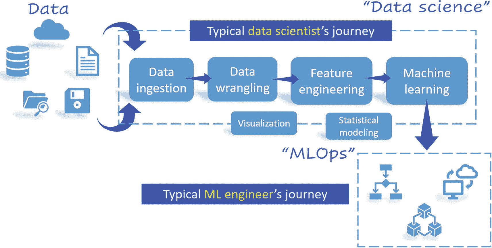
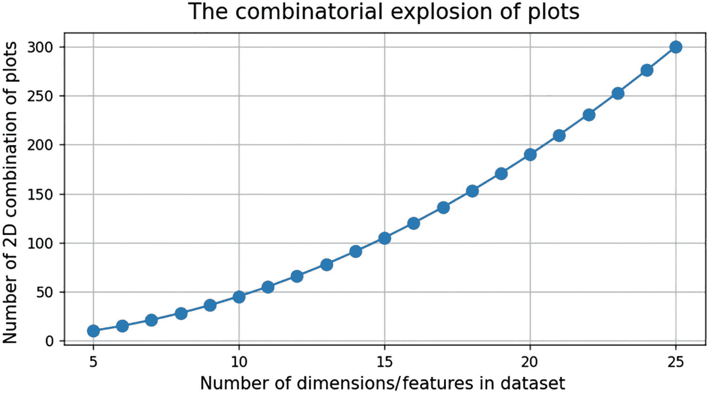
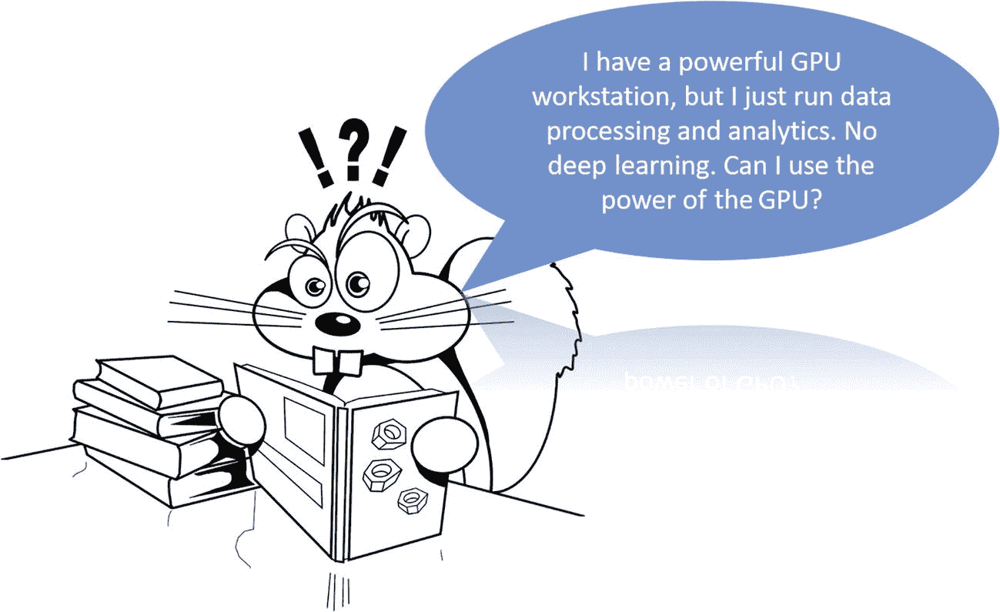
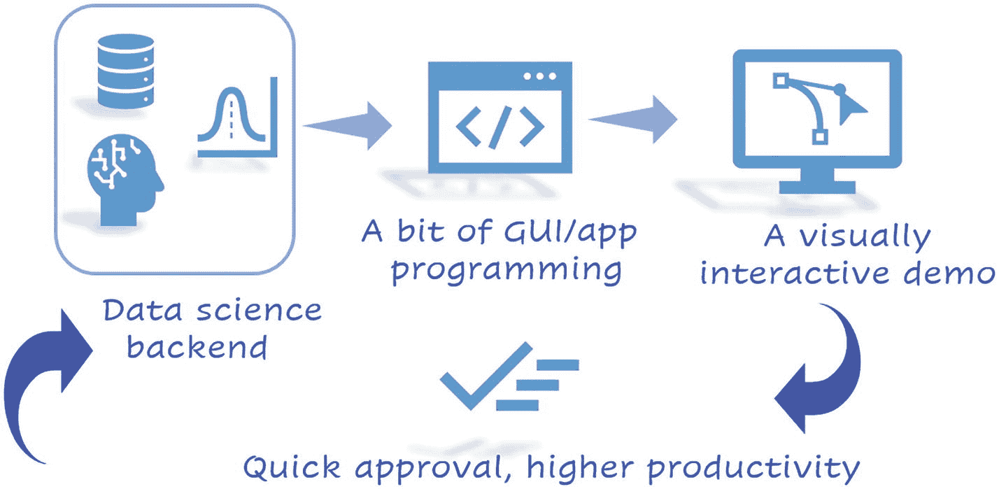

# 1. 什么是高效且有生产力的数据科学？

本章的目标是向你介绍高效且富有生产力地执行数据科学任务的好处。我还将阐述常规数据科学家日常工作中可能存在的一些潜在陷阱，以强调*高效数据科学*这一要点。

如同生活中任何其他计算（和非计算）任务一样，数据科学 (DS) 和机器学习 (ML) 可以在不同效率和生产力水平下实践。本书特别聚焦于**基于 Python 的工具和技术**，旨在帮助数据科学家（无论是初学者还是经验丰富的专业人士）在**典型 DS 技术栈的各个方面实现高度生产力**（例如统计分析、可视化、模型选择、特征工程、代码质量测试、模块化、并行处理，甚至简易的 Web 应用部署）。

但是，为什么要努力追求数据科学中的效率呢？如果在常规的数据科学流程中不考虑并勤勉地实践这些效率和生产力方面的要点，可能会出现什么问题？

为了理解这些问题，你首先需要审视一个典型的数据科学流程。让我带你走过这段旅程。


## 典型的数据科学流水线

数据科学是一个广阔且充满活力的领域。在现代商业和技术空间中，数据科学学科已扮演起真正变革性力量的角色。从医疗保健到交通运输，从在线零售到按需音乐，每一种行业和社会经济领域都以各种方式运用着数据科学工具与技术。每天，由复杂的**DataOps 架构**所设计的日益复杂的 *数据流流水线* 会处理海量商业和个人数据，这些数据由数据库引擎或机器学习算法进行摄取、处理和分析，最终促成富有洞察力的商业决策或技术突破。

然而，为了说明高效数据科学实践的关键点，让我们以图 1-1 中所示的一个典型数据科学任务流程作为通用示例。你或许在入门数据科学课程中遇到过，或在日常工作中实践过。



图 1-1  
典型的数据科学流水线，展示了数据摄取、整理、可视化、建模乃至 MLOps 等多个阶段

你可能猜测，在数据整理或摄取阶段，编写低效代码的可能性很高。但你可能好奇，在机器学习/统计建模阶段会出什么问题呢？毕竟你使用的是像`Scikit-learn`、`Scipy`或`TensorFlow`这些高度优化的 Python 库中的现成方法和例程。此外，你可能还会想，为什么像质量测试和应用部署这类任务也应该包含在高效的数据科学流水线中。

在下一节，我将通过简单的例子来回答这些问题。

## 数据科学中低效实践的典型示例

图 1-1 中数据科学流水线的某些模块，例如数据整理、可视化、统计建模、机器学习训练和测试，相比其他模块更直接地受到低效编程风格和实践的影响。

让我展示几个简单的例子，并带你了解一些数据科学故事。

### 在 pandas DataFrame 上迭代

作为数据科学家，我们都遇到过这种情况。

我们拿到一个大型的 pandas DataFrame，需要逐行检查各列字段之间的某些关系。这可能是一个逻辑操作，或是对原始数据进行复杂的数学变换。

本质上，这是一个简单的按行迭代 DataFrame 并在每次迭代中执行某些处理的任务。然而，在选择执行这个看似简单任务的最有效方法时，事情可能就没那么简单了。例如，你可以从以下几种方法中选择。

#### 暴力 for 循环

这种朴素方法的代码如下所示：

```
for i in range(len(df)):
if (some condition is satisfied):
 df.iloc[i]
```

本质上，你是在使用通用的`for`循环逐行迭代（`df.iloc[i]`），并逐一处理。逻辑上没有问题，最终你会得到正确的结果。

但这注定是低效的。如果你尝试用这个方法处理一个行数很多（比如约 1,000,000 行，即 100 万行）且包含 10 列的 DataFrame，总迭代时间可能会运行几十秒或更久（即使在快速的机器上）。

现在，你可能会认为能够在几十秒内处理一百万条记录还是可以接受的。但是，随着列数或计算复杂度的增加（或者每次迭代中条件检查的复杂度增加），你会发现这些开销会迅速累积，因此在构建可扩展的数据科学流水线时应尽可能避免这种方法。更重要的是，如果你需要定期（在标准商业/生产环境中）对数百个数据集重复此类迭代任务，那么低效性会随着时间累积。

#### 更好的方法：`df.iterrows()` 和 `df.values()`

根据具体情况，对于这个迭代任务，你可能会选择两种更好的方法。

*   pandas 库有一个专门用于逐行迭代的方法，名为 `iterrows()`，在这种特定情况下使用起来可能很方便。根据 DataFrame 的大小和行操作的复杂度，与`for`循环方法相比，这可以将总执行时间减少约 10 倍。

*   pandas 提供了一种返回 DataFrame 的 NumPy 表示的方法，名为 `df.values()`。这可以显著加快处理速度（甚至优于`iterrows()`）。然而，该方法会移除轴标签（列名），因此你必须使用通用的 NumPy 数组索引（如 0, 1）来处理数据。

### 将大型数据集中的所有内容都绘制成散点图

通常，在数据分析任务开始时，我们倾向于可视化数据集中所有数值特征之间的两两相互关系。这通常是探索性数据分析（EDA；参见 [`https://en.wikipedia.org/wiki/Exploratory_data_analysis`](https://en.wikipedia.org/wiki/Exploratory_data_analysis)）的必要步骤，并能揭示关于数据集整体模式的重要见解。然而，对于包含数百个特征（列）的大型数据集，这可能会给可视化例程带来极大的压力，导致出图质量差且响应缓慢。

#### 组合爆炸

很容易解释为什么这个看似简单的（两两）散点图任务很快就会变得难以处理。原因是[组合爆炸](https://en.wikipedia.org/wiki/Combinatorial_explosion)（[`https://en.wikipedia.org/wiki/Combinatorial_explosion`](https://en.wikipedia.org/wiki/Combinatorial_explosion)）。本质上，你是在试图绘制所有两两关系的组合，因此你需要绘制的组合数为 ^n*C*[2]，其中 `n` 是数值特征的数量，`C` 表示组合符号。一些具体例子会有所帮助。

*   ⁴*C*[2] = **6**，因此对于一个数据集的 4 个特征进行两两绘图，你需要绘制 6 张图。

*   ⁶*C*[2] = **15**，因此对于一个数据集的 6 个特征进行两两绘图，你需要绘制 15 张图。

*   ¹⁰*C*[2] = **45**，因此对于一个数据集的 10 个特征进行两两绘图，你需要绘制 45 张图。

*   ²⁰*C*[2] = **190**，因此对于一个数据集的 20 个特征进行两两绘图，你需要绘制 190 张图。

如图 1-2 所示，图的数量增长得相当快！除此之外，如果你有一个大型数据集（包含数百万个样本），那么每张图都需要在屏幕上渲染数百万个数据点。在网页浏览器中为数百张图渲染数百万个点，这在计算上是不可行的。



图 1-2  
组合爆炸如何即使对于一个中等规模的数据集，也能导致产生大量可能的二维图

#### 为什么我要提及网页浏览器？

Jupyter notebook 是数据科学家进行探索性数据分析（以及许多情况下的高级机器学习）最流行的选择。Jupyter notebook 系统的核心运行着一个 Web 服务器，它允许你在浏览器窗口中编写代码、Markdown 文本并渲染图表（很多情况下使用 JavaScript 代码）。因此，如果你试图渲染数百张包含数百万个数据点的图表，你的浏览器内存可能会不堪重负，甚至崩溃！


### 重复编写相似的绘图代码

这是数据科学家非常普遍的做法：在分析用的`Jupyter`笔记本中反复复制粘贴相同的绘图代码（例如使用`Matplotlib`或`Seaborn`库）。虽然这本身可能不会增加代码的总运行时间，但这是一个糟糕的软件工程实践，违反了`DRY`原则（[不要重复自己](https://en.wikipedia.org/wiki/Don%27t_repeat_yourself)）。

本质上，当你在多个地方复制粘贴相同的绘图代码时，你就放弃了代码重构（[代码重构](https://en.wikipedia.org/wiki/Code_refactoring)）的机会，从而增加了引入错误的风险，并使代码在长期内难以阅读和维护。

#### 编写一个通用函数

相反，你应该尝试编写一个通用函数，该函数能够生成所需样式和属性的绘图，然后只需向该函数传递变量即可进行绘图。一个伪代码示例如下：

```python
def plot_linechart(x):
"""
Plots line chart of given 'x' variable from dataframe df
"""
# Extracts the values from the dataframe as Numpy array
x_array = df[x].values
# Mean and upper and lower limits calculations
x_mean = x_array.mean()
x_upper = x_mean+2*x_array.std()
x_lower = x_mean-2*x_array.std()
# Data length
data_len = len(x_array)
# Size and title
plt.figure(figsize=(15,3))
plt.title(x,fontsize=15)
# Main plot
plt.plot(x_array,color='blue',alpha=0.6)
# Mean, upper limit, lower limit horizontal lines
plt.hlines(y=x_mean,xmin=0,xmax=data_len,
linestyle='--',color='k',linewidth=4)
plt.hlines(y=x_upper,xmin=0,xmax=data_len,
linestyle='--',color='red',linewidth=2.5)
plt.hlines(y=x_lower,xmin=0,xmax=data_len,
linestyle='--',color='red',linewidth=2.5)
# Show
plt.show()
```

这里，工作空间中已经存在一个`pandas`的`DataFrame`对象`df`。这个函数只是将该`DataFrame`中的不同列绘制为折线图，并同时显示均值、上界和下界线。列名作为该函数的唯一参数传递。

这是一个常见场景吗？

这是一个典型的数据分析场景，可能涉及某些制造过程或质量测试数据。你可能有包含大量参数的表格数据集（即包含多个列的`DataFrame`），并且希望并排或叠加绘制多个折线图，以比较性能或研究某种模式。通过首先编写一个经过良好规划的函数，然后不断重构该函数，你可以避免低效且容易出错的代码。

### 不编写测试模块

测试能提升任何软件产品/服务的交付质量、性能和长期盈利能力，适用于各种类型的企业和行业。因此，**数据科学和机器学习也应养成测试每一个重要代码段的习惯**，这应该是不言而喻的。

我们越来越期望各种机器学习服务背后有一个高质量且健壮的软件框架，这些服务能预测最喜欢的餐厅，或在我们迷失在新城市时提供指引。对这些往往看似神奇的服务的信任，只有当我们知道其背后的软件是经过经过验证的、健壮的方法论测试后，才能建立。

在许多情况下，这类新服务的开发速度甚至高于传统软件产品。加快产品开发往往以牺牲质量为代价。一个好的软件测试策略可以帮助抵消这种取舍。

换句话说，**一个健全的测试策略可以在长期内为数据科学任务流程节省大量开发时间**，同时保证最终产品的高质量。在编码和软件工程阶段节省时间本身就是一项富有成效且高效的举措。

## 需要避免的一些陷阱

从前面的章节可以清楚地看到，数据科学家可能会以无数种方式陷入低效数据科学实践的陷阱。几乎不可能穷尽所有这些方式，但这里我将列出一些在进行商业或科学探索的数据科学任务时需要避免的常见陷阱。

### 不要活在无知中。要衡量效率。

*你的代码运行速度或效率如何*？不要依赖猜测。没有可靠的度量标准，你就无法比较多种编码风格或选项，并从中选出最佳方案。简而言之，**没有某种效率的衡量，你甚至永远无法开始改进**。

因此，始终尝试在你的分析代码或测试模块中包含某种计时/速度衡量的代码，以便你能够测试和衡量各种数据科学任务或功能块实际上的效率。我们将在第[2]章中更详细地重新讨论这个主题。

### 不要让代码成为“孤儿”。要对它们进行模块化。

如果你专注于构建模块化且表达力强的数据科学流水线，它将通过提高生产力来回报你。但什么会阻碍你这样做呢？令人惊讶的是，这可能正是我们所有人都已经接受并赞赏其强大和简单性的编程语言：`Python`。

#### Python 驱动的数据科学遗产可能存在问题

我们在数据科学工作中大量使用`Python`。为什么？因为它对机器学习和数据科学社区来说非常棒。它正逐渐成为现代数据驱动分析和人工智能应用中增长最快的主要语言。它还被用于简单的脚本编写、自动化任务、测试假设、创建用于头脑风暴的交互式图表、控制实验室仪器等。

然而，用于软件开发的`Python`和用于脚本编写的`Python`并不完全相同，至少在数据科学领域是这样。**脚本编写（大部分）是为你自己写的代码。软件则是你（和其他队友）为他人编写的代码的集合。**

明智的做法是承认，当（大多数）没有软件工程背景的数据科学家为人工智能/机器学习模型和统计分析编写`Python`程序时，*他们倾向于为自己编写这类代码*。他们只想快速触及隐藏在数据中的模式核心。他们不会深入思考普通用户。他们编写一段代码来生成一张丰富而美观的图表，但不会将其封装成一个函数以便后续使用。他们从标准库中导入大量方法和类，但不会通过继承创建自己的子类并添加方法来扩展功能。


#### 尽可能拥抱面向对象编程原则

`Functions`、`inheritance`、`methods`、`classes`：它们都是健壮的面向对象编程（OOP；[`www.educative.io/blog/object-oriented-programming`](http://www.educative.io/blog/object-oriented-programming)）的核心，但如果你只想创建一个包含数据分析与图表的 `Jupyter` 笔记本，它们在一定程度上是可以避免的。

你可以避免使用 OOP 原则的初期痛苦，但这几乎总是会导致你的笔记本代码变得不可复用且不可扩展。简而言之，那段代码只为你自己服务（直到你忘记自己究竟编写了什么逻辑），其他人无法使用。

但可读性（以及由此带来的可复用性）至关重要。这是对你所产出的价值的真正考验。不是为了你自己，而是为了他人。

因此，不要为了进行快速而粗糙的分析而陷入编写零散代码片段的陷阱。尽可能地将你的代码组织到规划良好的函数和模块（`class` 和 `subclass`）中。我们将在第 5 章和第 6 章中更详细地讨论这个话题，并提供实际的代码示例。

### 不要被硬件或传统工具所限制

许多数据科学家在面对大规模数据（例如数百 GB 或数 TB）时，会感到有些无助。虽然企业级软件解决方案每天都能常规处理这种数据量，但个人数据科学从业者在处理此类数据集时，仍然可能遇到可扩展性和执行方面的问题。这当然会影响他们的整体生产力。

#### 本地硬件内存限制是一个真实的问题

大多数数据科学任务，尤其是初始的数据摄取、数据整理、探索性分析、统计建模和特征工程，都是在单个数据科学家（或一个团队）的本地硬件上完成的。这是这种工作方式的一个事实。随着 AutoML 工具的出现以及对“公民数据科学家”的强调，越来越鼓励个人承担数据科学任务，并启动当前每个可想象的业务都急需的分析工作负载。

这具有彻底改变整个领域并将其推向更高高度的巨大潜力。然而，它也伴随着一个警告：在许多情况下，当处理 TB 级（甚至多 GB 级）规模的数据集时，个人数据科学家可能会撞上本地硬件内存或计算能力的“南墙”。

个人笔记本电脑的内存（`RAM`）最多为 16 GB 或 32 GB，这限制了可以完整加载到工作内存中的数据集的大小。即使对于一个规模仅为 10 GB 的数据集，当你将整个数据加载到单个 `DataFrame` 对象中时，像 `pandas` 这样的传统分析工具也会变得极其缓慢。许多这些广泛使用的 Python 数据科学包根本不支持并行计算。

> **注意**
> 
> 1 GB（吉字节）约等于 10⁹ 字节或 1,000 MB。1 TB（太字节）等于 1,000 GB 或约 10¹² 字节。1 PB（拍字节）等于 1,000 TB 或约 10¹⁵ 字节。据估计，整个美国国会图书馆的馆藏，包括照片、录音和电影，可能需要大约 3,000 TB 的存储空间。

#### GPU 加速计算并未全面聚焦于数据科学

从计算角度来看，`GPU` 对于使用大数据集进行高级机器学习来说一直是一大福音。然而，它们在深度学习任务上的讨论和实践远多于其他领域。无论深度学习对于 AI 和 ML 的崛起是多么伟大的成功故事，大多数数据科学和分析工作流仍然很少用到 `GPU`。

因此，一个常见场景是：数据科学家可以访问一台配备 `GPU` 的工作站或一个多 `GPU` 云计算实例，但却无法有效地利用这些硬件资源来完成他们想要完成的分析任务（图 1-3）。



**图 1-3** 基于 `GPU` 的加速计算需要成为主流数据分析（即使没有任何深度学习组件）的基本组成部分。

#### 始终探索替代库/框架

因此，从以上讨论可以清楚地看到，为了实践高效且富有成效的数据科学，从业者必须学习：

- 如何使用支持开箱即用的并行计算和多任务处理的库，高效地处理大型复杂数据集（使用传统数据科学工具将会很困难）。
- 如何充分利用 `GPU` 和多核处理器来执行各种数据科学和分析任务，而不仅仅是专门的深度学习建模。

我们将在第 10 章至第 12 章中详细讨论这些问题的许多方面，并展示一些新兴的（且令人兴奋的）传统工具和框架的替代品。

## 效率与生产力相辅相成

这是关于数据科学或任何技术事业中一个很少被理解和重视的事实：**高效、整洁并避免错误和漏洞，能直接提升职场生活的各个方面的生产力**。虽然其中一些联系很容易发现，但其他联系则不那么明显。因此，在本节中，我将提供一些关于数据科学实践方面实现高效率的关键技术示例。

### 度量效率大有裨益

正如前一节所讨论的，如果你养成了度量代码或函数效率的习惯，你会自动创造一个环境，在这个环境中你可以跟踪这些指标以及你是如何逐步改进的。通过这种方式，你可以在日常任务中变得更有生产力，因为一旦它们出现任何延迟迹象，你就可以通过明确的目标来探查和改进。测量内存和计算占用就是一个突出的例子；我将在第 9 章中详细讨论这一点。

这个习惯也有助于在大型企业范围内提高生产力。例如，**只有当你确信你的团队已经彻底衡量了代码执行效率，并确保在面对千兆字节级的实时数据流时代码不会搞垮 API 端点时**，你才能自信地提交一段由你或你的团队编写的大型 ML 预测代码。

### 测试降低返工几率

在数据科学流水线或 ML 预测框架的开发阶段，计划并编写的单元测试或功能测试模块越多，在部署阶段发现关键错误的几率就越小。虽然对于纯探索性分析而言，测试对开发周期的整体速度影响较小，但任何实际部署的生产力都将取决于是否养成这个习惯。

然而，**传统的软件测试最佳实践可能无法 100% 适用于数据科学和 ML 代码测试，因为它们涉及大量概率性特征或随机化的输入/输出模式**。因此，周密的规划以及对这些系统随机性本质的深刻理解，是构建高性能测试框架的基本要素。这也要求测试工程团队具备一定的数据科学专业知识。


### 规划机器学习模型开发

`ML 模型`的开发和调优通常以临时方式进行，唯一目标是获得最高精度或类似的模型性能指标。长期生产力提升并不被视为这类实验和模型迭代的主要目标。

然而，对流程进行微小的改变，例如正确记录超参数和指标，或创建系统存储和可视化调优过程的模型迭代例程，可以大大减少重复性工作中的浪费。我在第 4 章中讨论了一些这类最佳实践。

但重要的是，要从整体角度识别完整机器学习平台的生产力，**更强调整个系统的生产力，而非单个模型的开发速度**。加入模型跟踪、记录和可视化代码确实会给单个建模组件带来一些开销，但长期来看，其益处将在系统层面得以体现。这必须得到高层管理者的认可和支持，数据科学团队才能充满信心地执行。

### GUI 编程/Web 应用开发知识非常有帮助

这听起来可能有些反直觉，但学习一点`GUI/API`编程知识，往往能提高数据科学管线的整体生产力。当然，这发生在你利用这些知识将图形用户界面封装在`机器学习模型`或数据分析代码周围，使其能够向广大用户群体展示的时候。

让我用一个具体例子来说明。通常，获得大规模机器学习平台开发批准的关键第一步，是为内部用户或利益相关者（如高层管理人员或销售与市场部门）制作一个可运行的原型。如果受众能以可视化方式看到原型，甚至能亲身体验平台（图 1-4），他们就会更好地理解原型的目的和用途。



**图 1-4** 向高层管理人员快速演示可运行的数据科学原型，通常能提升团队的整体生产力

这不仅需要构建机器学习模型和数据分析管线的后端，还需要一个前端应用，以尽可能直观和交互的方式展示内部工作原理。数据科学团队可能不会亲自编写创建这个演示应用的确切代码，但深入了解如何设计这些前端元素和组件并将其集成到后端机器学习平台中，将大大有助于原型的快速开发。减少这个阶段的时间间隔，自动意味着更快的决策时间线，并整体提升团队的上线时间和生产力。`Web/浏览器`类应用是此类任务的天然选择，我在第 12 章中讨论了一些能够快速创建网页应用以展示数据科学成果的工具。

## 践行高效数据科学的技能与态度

不言而喻，你必须自觉地努力培养特定的技能和才能，才能步入高效数据科学的领域。数据科学本质上欢迎并接纳来自各种技术背景和专业训练的专业人士。虽然这总体上对这个领域是件好事，但也意味着任何想要打破低效循环的人都必须集中精力培养这些技能。

没有哪本书或课程能涵盖推动数据科学家走向高效数据科学之路所需的全部技能和主题。然而，如果我必须为这样一本理想书籍设想一些具体内容，我希望它能：

-   教授如何识别标准数据科学代码中的低效和瓶颈，以及如何跳出常规思维来解决这些问题。
-   教授如何编写模块化、高效的数据分析和机器学习代码，以在诸如探索性数据分析、可视化、深度学习等各种情境下提高生产力。
-   涵盖一系列辅助主题，如软件测试、模块开发、GUI 编程以及将机器学习模型部署为 Web 应用，这些对于初露头角的数据科学家来说是宝贵的技能集。
-   教授如何快速构建用于演示数据科学/机器学习想法或模型调优的 GUI 应用，或者如何轻松（且快速）地将机器学习模型和数据分析代码部署到 Web 应用端点。
-   通过动手示例介绍并行计算、外核（大于系统内存）可扩展性以及基于 GPU 的数据科学技术栈。
-   向读者展示并引导其进入更广阔且不断扩展的 Python 数据科学工具生态系统，这些工具与软件工程和生产级部署的更广泛方面相关联。
-   最重要的是，**灌输并强化对自身数据科学管线效率的探究意识**，以便从业者能够持续研究和开发自己的方法及最佳实践，来审视他们正在使用的代码和系统。

## 总结

在这章引言中，我涵盖了很多内容，让你对高效数据科学的新兴概念有了相当详细的了解。我讨论了从技术角度看这意味着什么，以及它如何对整个组织有所帮助。我指出，低效可能渗透到典型数据科学管线的任何阶段：数据摄取、数据整理、可视化、`EDA`（探索性数据分析）、`机器学习`建模，甚至是演示阶段。

我深入探讨了在典型数据科学任务中频繁出现的一些具体例子，例如对大型数据集进行迭代或对复杂数据集进行可视化实践。特别是，我讨论了在从事`数据科学`任务时，采用良好的`OOP`（面向对象编程）原则并培养测试工程师的心态。

我描述了在这些方面需要避免的常见陷阱。我特别强调，在处理大型 TB 级数据集时，不要将自己局限于本地硬件或传统工具。我还讨论了`GPU`加速计算，这一领域在深度学习之外并未受到太多关注。我也提及了并行计算的概念，这些将在本书后续章节中更详细地探讨。

接着，我通过具体例子展示了在典型的数据科学任务或平台中，生产力和效率是如何相辅相成的。在这方面，我讨论了将`图形用户界面/应用`开发作为加速决策过程的工具加以运用。

最后，我讨论了为了养成高效数据科学的习惯而需要培养的理想技能和才能。你将在后续章节中通过动手示例来探索这些想法。


