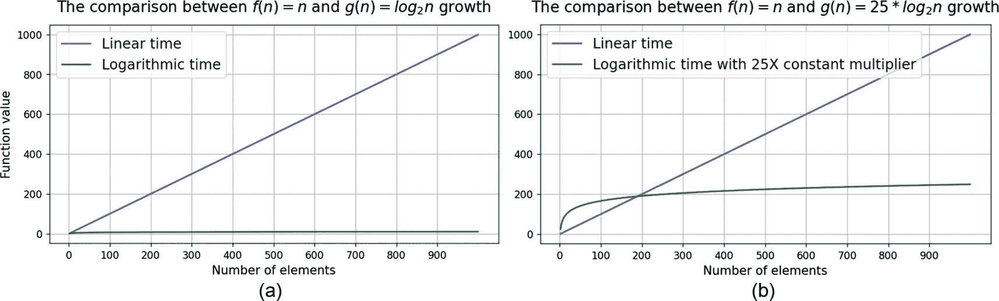
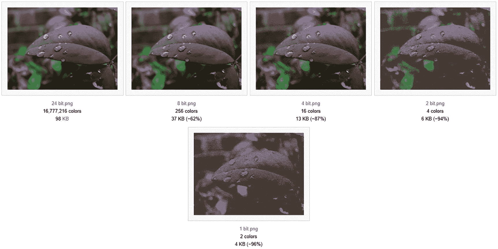

# 2. 高效数据科学的更佳编程原则

本章旨在向你介绍某些编程风格和习惯的概念，这些风格和习惯在开发高效的数据科学（DS）与机器学习（ML）系统及管道中起着至关重要的作用。我将通过简要示例（或在适用处使用伪代码）来阐述这些概念，并讨论如何衡量或追踪低效问题。

首先，我将介绍编程和算法中时间与空间复杂度（`https://levelup.gitconnected.com/time-and-space-complexity-725dcba31902`）的概念。你还会看到在此背景下使用的[大 O 表示法](https://en.wikipedia.org/wiki/Big_O_notation)（`https://en.wikipedia.org/wiki/Big_O_notation`）。这些是分析任何算法运行时或效率的基础概念，例如可用于衡量和描述标准 ML 算法的效率。我还将简要讨论为何复杂度度量对数据科学任务尤为重要。

接着，我将演示常见、低效的数据科学和 ML 编码实践的实际示例。这绝非旨在详尽列举每一种低效的数据科学编程方式。不过，我会尽力让你一窥典型的低效代码片段，这些代码要么扩展性不佳，要么导致整体系统设计的某些方面变得低效。希望你能将这些示例内化，并将相同的思考过程应用于自己的分析工作，从而提高生产力。

在大多数情况下，我还会展示一些可行的替代示例，例如如何通过采用更佳的编程风格或在 Python 生态系统内选择不同的工具或函数，来改进同一任务的效率。

最后，我将介绍用于测量代码或功能块执行时间的工具和技术。在这方面，我会涵盖通用的 Python 模块和 Jupyter 魔术命令。

## 时间与空间复杂度及大 O 表示法的概念

算法的时间与空间复杂度，通常与给定输入下该算法的最坏情况执行时间及所需内存/存储空间相关。由于时间和空间几乎总是取决于输入规模（例如数组中的元素数量），这些复杂度度量被表示为输入规模的函数，因此对于包含`n`个元素的数组，用`f(n)`或`g(n)`表示，其中`f`或`g`分别代表时间复杂度和空间复杂度。

### 一个简单示例：搜索元素

让我们用一个简单例子来演示。考虑以下在列表中搜索给定元素的 Python 程序。注意，你本可以用更符合*Python 风格*的方式编写代码，如`if ele in lst`，但为了演示目的，我们使用朴素的列表遍历代码：

```python
def ele_in_lst(ele,lst):
    len_lst = len(lst)
    for i in range(len_lst):
        if lst[i] == ele:
            return True
    return False
```

如果你用以下输入测试此函数，会得到 `True`：

```python
ele_in_lst(ele=2,lst=[3,4,5,2,9])
>> True
```

但如果你用以下输入测试，则会得到 `False`：

```python
ele_in_lst(ele=2,lst=[3,4,5,5,9,11,3,4,-1,3,5,7,12,15])
>> False
```

在上述第二个例子中，循环被完整遍历了，因此 `if lst[i] == ele` 的相等性检查操作执行了 14 次（即列表的长度）。这是程序的核心操作，由 CPU 执行，并构成代码时间复杂度的一部分。

那么，这种搜索方法的时间复杂度是多少？显然，**在最坏情况下**，即当`ele`不在给定的`lst`中时，**所花费的时间总是与`lst`的长度成正比**（假设每次相等性操作耗费恒定时间）。这由函数 `O(n)` 表示，其中 `n` 表示输入数组中的元素数量。

### 大 O 表示法

函数 `O(n)` 中的这个 `O` 符号被称为大 O 表示法。根据维基百科的说法，“*它描述了当参数趋向于特定值或无穷大时，函数的极限行为*”（`https://en.wikipedia.org/wiki/Big_O_notation`）。具体来说，这是这种情况下最坏情况时间复杂度的一个例子（因为元素不在给定列表中），但在极限情况下，这正是每位计算机程序员应该关注的。

有人可能会好奇，为什么我们不计算*平均情况*的时间复杂度。事实证明，在大多数情况下，计算甚至估算平均情况的样子相当困难，而最坏情况则通常能以更简单的方式定义和理解。此外，`O(n)` 表示法是在渐近意义上理解的，因此当 `n` 变大时，最坏情况所需时间不会偏离这种线性趋势。

为什么是*线性*趋势？因为 `O(n)` 表示 `n` 的一次幂。类似地，我们有复杂度为 `O(n²)` 或 `O(n³)` 的算法，它们呈现二次或三次趋势。换句话说，所花费的时间将像问题规模`n`的二次或三次函数那样增长。

这种大 O 表示法的起源深深植根于更高级的数学领域——[解析数论](https://en.wikipedia.org/wiki/Analytic_number_theory)（`https://en.wikipedia.org/wiki/Analytic_number_theory`），并且在许多数学定理的讨论中也会出现。但在计算机科学和编程的语境下，这是表示给定算法时间/空间复杂度的标准符号。

### 复杂度：线性、对数、二次及其他

那么，如果这是 `O(n)`，搜索能否做得更好？是的，事实证明，如果列表预先排序，搜索可以快到 `O(log2(n))`。在这种情况下使用的特定算法称为*二分搜索*。而你大概能猜到，我们上面编写的朴素算法被称为*线性搜索*。


#### 速度能快多少？

那么，`O(log2(n))` 到底比 `O(n)` 快多少呢？我们可以通过绘制函数 `f(n) = n` 和 `g(n) = log2(n)` 随着数值 `n` 增大的曲线来找到答案。为了更清晰地说明，请参见图 2-1。图中包含两条曲线：一条是这两个函数的直接对比，另一条是对数函数乘以一个较大的常数（如 25）后的结果。



图 2-1

对数时间复杂度和线性时间复杂度算法的函数值增长对比。在 (a) 中，两者的常数乘数均为 1。在 (b) 中，对数算法的乘数为 25

图 2-1 中的第二种情况代表什么？它表示我们正在使用一个 `O(log2(n))` 算法，但每次单位计算有较大的开销，即基本计算单元的速度远慢于 `O(n)` 线性算法中对应的单元操作。

从图 2-1 中可以非常清楚地看出，无论常数乘数是多少（1 或 25），随着 `n` 的增长，`O(log2(n))` 算法变得比 `O(n)` 算法快得多，因此代表算法运行时间的函数值随 `n` 增长得慢得多。因此，对于相同的任务，**我们应当始终使用对数复杂度算法来替代线性复杂度算法（如果我们能找到这样的算法的话）**。

对于搜索示例，这需要对列表进行预排序，而这本身具有其算法复杂度（参见 [`www.geeksforgeeks.org/time-complexities-of-all-sorting-algorithms`](http://www.geeksforgeeks.org/time-complexities-of-all-sorting-algorithms) 上的排序算法复杂度）。但这一步通常是值得的，因为在典型的应用场景中，*你可能对列表进行排序的频率远低于对其执行搜索的频率*。

#### 比线性更复杂的是什么？

尽管线性时间复杂度相比对数时间看起来更差，但实际上，在我们通常遇到的一般计算算法（无论是数据科学领域还是非数据科学领域）中，它已经是一种相当高效的算法了。可以想见，`n` 的高次幂复杂度非常常见，并相应地表示为：

- `O(n²)` 表示二次时间复杂度
- `O(n³)` 表示三次时间复杂度
- `O(2^n)` 表示指数时间复杂度（没错，这些可怕的东西确实存在！）

让我快速展示一下 `O(n²)` 和 `O(n³)` 算法的简单（且初级）示例。下面是一个简单的算法，它遍历给定的 NumPy 数组的维度，并统计大于零的元素个数（如果你对数据科学感兴趣，想必你一定了解 [`https://numpy.org/doc/stable/user/whatisnumpy.html`](https://numpy.org/doc/stable/user/whatisnumpy.html) 上的 [NumPy 库和数组](https://numpy.org/doc/stable/user/whatisnumpy.html)，对吧？）：

```
import numpy as np
array_2D = np.random.normal(size=(5,5))
def count_positives(array):
"""
统计二维随机数组中的正数个数
"""
m,n = array.shape
count = 0
for i in range(m):
for j in range(n):
if array[i][j] > 0.0:
count+=1
return count
```

核心计算单元（`if array[i][j] > 0.0`）执行了多少次？显然，对于这个维度为 (5, 5) 的二维数组，它执行了 5 x 5 = 25 次。如果我们将数组维度改为 (100, 100)，那么该计算将执行 100 x 100 = 10,000 次！

因此，这里的时间复杂度是 `O(m×n)`，其中 (`m`, `n`) 是二维数组的维度。对于正方形数组，它大致等于我们熟悉的 `O(n²)`。

## 为什么复杂度对数据科学很重要

所有这些关于算法复杂度的讨论可能会让你思考，如何将这方面的知识应用于数据科学工作中，尤其是高效的数据科学实践。为了回答这个问题，首先你需要了解一些在数据科学任务中可能具有高算法复杂度的常见示例。我在上一节中介绍了线性、对数和二次复杂度。接下来，让我展示两个更糟的复杂度示例，它们出现在数据科学任务中。

### 图像数据：三次复杂度算法

作为 `O(n²)` 案例中代码示例的自然延伸，如果我们将循环次数增加到 3 次（例如三维数组），那么时间复杂度就变成了 `O(n³)`。三维数组的一个典型示例（尤其是在数据科学领域）是图像数据：其中二维数组表示像素的坐标，每个像素中还有另一个数字表示颜色深度（`https://en.wikipedia.org/wiki/Color_depth`）或灰度值（示例见图 2-2）。

由于作为数据科学家，你可能需要频繁处理图像数据，因此遇到 `O(n³)` 算法的可能性很高。实际上，每个像素上的计算任务可能更复杂，因为它可能是一个包含多个颜色值（例如 RGB）的向量，而不仅仅是单个浮点数。



图 2-2

颜色深度和灰度图像示例（来源：维基共享资源，GNU 自由文档许可证）


### 最佳回归模型：指数级复杂度

那令人望而生畏的 `O(2^n)` 复杂度呢？在日常数据科学工作中真的会遇到吗？是的，事实证明，这方面也有一个简单的数据科学实例。

考虑这样一个任务：为一个具有众多特征的大型数据集确定最佳线性回归模型。并非所有特征都同等重要或具有影响力。对于大多数实际情况，只有特定的特征子集是最优的。确定这个最优子集听起来是一项常见的数据科学任务。

我们知道，向模型中添加更多特征会提高简单的 *R*² 系数，但当我们考虑诸如调整后`R²`（详见 `www.statisticshowto.com/probability-and-statistics/statistics-definitions/adjusted-r2/` ）或 AIC 准则（详见 `https://en.wikipedia.org/wiki/Akaike_information_criterion`）这类高级指标时，就需要对多种特征组合进行试验，以找出最佳组合。简而言之，我们需要搜索所有可能的特征组合空间，为每种组合构建回归模型，计算所需的性能指标，最后选出最优的那个（例如，性能指标最高的那个组合）。

用更数学化的语言来说，这相当于在给定集合的所有子集中找出最佳子集。这是一个计算上难度呈指数级增长的问题。也就是说，其算法复杂度为 `O(2^n)`。而且，这还仅仅是构建特征空间所有子集的工作量，尚未考虑为每种组合构建实际回归模型的计算成本。

为什么？原因在于下面这个我们可能在高中学过的简单等式。基本上，从 *n* 个可能的项目中选取 1、2、3……*n* 个的所有组合的总和为 `2^n`。在我们的回归问题中，我们是一次选取 1 个、2 个、3 个或更多特征来构建模型。

```
∑(C^n_1 + C^n_2 + ... + C^n_n) = 2^n
```

正因如此，在回归模型优化中几乎从不鼓励使用穷举搜索法。取而代之的是，我们采用贪婪搜索法（详见 `https://en.wikipedia.org/wiki/Greedy_algorithm`），例如前向选择和后向选择算法（详见 `https://quantifyinghealth.com/stepwise-selection/`），这些方法能显著缩短搜索时间，同时在几乎所有实际情况下都能找到相当不错的解决方案。

### 相对增长速度对比

为了说明具有不同复杂度阶数的算法所带来的优势（或劣势），我们可以绘制如图 2-3 所示的简单图表。很明显，对数时间算法增长最慢，其次是线性时间算法。更高次幂的算法增长很快，而指数型算法则像弹道导弹一样飞速上升！

图 2-3：不同时间复杂度算法的相对增长速度（未按比例绘制）

同样值得注意的是，由于这些复杂度度量和大*O*表示法本质上是在渐近意义上定义的（即针对 ***n*** 值很大的极限情况），因此我们确实需要将它们视为属于完全不同的计算难度类别。这意味着，无论一个特定算法可以化简为什么具体的复杂度函数，如果它是三次的，那么从长远来看，它总是比线性或二次算法更差。

最快速的判断方法是查看算法的最高阶并确定其等级。指数级总是比多项式级差，多项式级总是比线性级差。以下是一些快速示例：

-   复杂度为 `O(200n + 3)` 的算法优于复杂度为 `O(0.1n² + 12)` 的算法。
-   复杂度为 `O(3n³ + 2n + 5)` 的算法比复杂度为 `O(100n² + 12)` 的算法差。
-   复杂度为 `O(4^(0.1n))` 的算法比复杂度为 `O(100n¹⁰⁰)` 的算法差。

上面列表中的最后一条一定让你感到惊讶！建议你尝试计算这两个函数，从较小的 `n` 值开始直到较大的值，并将它们叠加画图，以理解第一个函数如何在较大的 `n` 值下超越第二个函数。因此，从渐近意义上来判断，你仍然应该优先选择多项式阶算法（即使包含 `n¹⁰⁰` 这样的项），而不是指数阶算法（`4^(0.1n)`）。


### 人工智能难以攻克，却行之有效

> *深度学习网络*已经过训练，能够以高性能水平识别语音、为照片添加说明以及在语言之间进行文本翻译。尽管深度学习网络在现实世界问题中的应用已变得无处不在，但我们对它们为何如此有效仍缺乏理解。***根据统计学和非凸优化理论中的样本复杂度，这些实证结果本不可能实现。***
>
> *特伦斯·J·塞诺夫斯基（*[*www.salk.edu/scientist/terrence-sejnowski/*](http://www.salk.edu/scientist/terrence-sejnowski/)*）*，*《人工智能中深度学习的惊人有效性》* *（*[*www.pnas.org/doi/10.1073/pnas.1907373117*](http://www.pnas.org/doi/10.1073/pnas.1907373117)*），《美国国家科学院院刊》，2020 年 12 月*

从简单的搜索和排序算法跃升到深度学习中所使用的梯度下降和反向传播（[`https://blog.paperspace.com/intro-to-optimization-in-deep-learning-gradient-descent/`](https://blog.paperspace.com/intro-to-optimization-in-deep-learning-gradient-descent/)）的世界，是一个巨大的跨越，但为了阐明人工智能算法虽难以攻克却仍可管理这一观点，这一步是必要的。

那么，什么是**难解性**？这本身就是一个全新的主题，超出了本书的范围，尽管它与前面小节讨论的算法复杂度主题密切相关。简单来说，**难解问题是指那些无法找到有效算法（来求解它们）的计算问题**。在这里，术语*高效*在大多数情况下指的是多项式时间算法，即复杂度最多为 `O(n^k)` 的算法，而非 `O(2^n)` 或 `O(n!)` 这类算法。

不幸的是，在人工智能领域，大多数常见问题在理论上都可被证明是难解的。特别是，对于人工智能问题，其最优化解决方案需要某种搜索本质上是指数级的空间算法，例如决策树中所有可能树（及分支）的数量，或简单多元回归中所有可能模型的数量。由于这些传统的机器学习任务属于难解范畴，深度学习网络同样受困于相同的计算难题也就不足为奇了。

然而，尽管存在理论上的不可能性（即找到最佳可行解），但常见的机器学习算法和解决方案通过运用诸如贪心搜索（[`www.programiz.com/dsa/greedy-algorithm`](http://www.programiz.com/dsa/greedy-algorithm)）、启发式方法（[`https://en.wikipedia.org/wiki/Heuristic_(computer_science)`](https://en.wikipedia.org/wiki/Heuristic_%2528computer_science%2529)）、动态规划（[`www.programiz.com/dsa/dynamic-programming`](http://www.programiz.com/dsa/dynamic-programming)）、随机化算法（[`https://en.wikipedia.org/wiki/Randomized_algorithm`](https://en.wikipedia.org/wiki/Randomized_algorithm)）等巧妙技术，在几乎所有实际情况下都能奏效。具体而言，**这些实用技术并非寻求绝对最佳解，而是寻找一个能够利用合理计算资源高效找到的“足够好”的解**。它们还大量利用领域知识和归纳偏置来缩减潜在解的搜索空间。

启发式搜索技术常被称为*知情搜索*，因为它们倾向于利用关于问题及环境（人工智能体可能所处的环境）的额外信息。想象一下，你身处异国他乡，无法使用谷歌地图！作为抵达最终目的地的旅程第一步，你可以从当前位置驾车前往几个城市。你可能不知道这些城市的确切驾驶距离，但你也许从朋友那里听说，她乘坐火车到城市 *A* 所花的时间比到城市 *B* 要少。这就是关于环境的*额外信息*，虽然它不能保证实际驾车到城市 *A* 的距离一定小于到城市 *B* 的距离，但这种情况很有可能为真。这被称为*启发式信息*，你可以用它来决定旅途中要采取的优化路径。大量的人工智能算法都使用这种技术来实现高效搜索。

因此，总结一下，前面关于计算复杂度和大*O*记法的小节，其目的是介绍常见算法的效率概念，并说明确实存在不同类别的算法，它们在输入规模增长时表现迥异。这样做是为了在你的脑海中培养一种探究意识，去检查你的代码和实现中的弱点，即使你不需要为某个特定的解严格分析并数学推导出精确的大*O*函数。此外，这也是为了让你确信，**即便面对看似难解的大数据问题，也存在巧妙的解决方案技术**，你应该抓住每次机会去探索它们。

## 数据科学中的低效编程

数据科学代码可能以无数种方式受到低效实践和设计模式的困扰。造成这种情况的主要原因之一是，数据科学家通常来自不同的背景（例如物理学、生物学、经济学、统计学、电气工程等），而且他们并非总是遵循成熟完善的软件工程设计模式（[`https://en.wikipedia.org/wiki/Software_design_pattern`](https://en.wikipedia.org/wiki/Software_design_pattern)）。数据科学训练营、研讨会和在线课程（通常是许多崭露头角的数据科学家接受培训的地方）会教授涵盖 Python 编程、统计学和机器学习的大量主题，但未必会教授这些高效编程技术。

然而，需要在一开始就指出，本书并非一本关于数据科学软件工程的人门读物。具体而言，本章的目标是展示数据科学任务中一些最明显且广泛重复的低效编程模式，以便你能识别并从这些示例中学习。这正是我接下来几个小节要做的事情。此外，为了确保效果，我也会展示应该更高效的变通方法和替代方案。

### 典型示例

在本节中，我将展示一些在常规数据科学工作流中频繁出现的*低效编程模式*。我采用的方法偏重实用和动手操作，而非教学灌输。这意味着我不会采用严格的数学方法来计算和证明各种函数及代码片段的算法复杂度。相反，我鼓励你使用各种工具测量代码片段的执行时间，并自行探索可能的改进策略。关于如何改进这些代码片段，并没有唯一正确的答案。

需要指出的是，**本小节我讨论的并非像 `NumPy` 或 `pandas` 这样的特定库**。事实上，我将在下一章讨论使用这些库的高效最佳实践。这里，我展示的是基本的 Python 编码模式示例，你可以在许多场景（数据科学及其他领域）中加以利用。

给读者的一条说明：我打算让代码片段保持简洁，因此不会让它们自包含且详尽无遗。这意味着这些代码片段并非设计为可独立运行。随附的笔记将提供完整的可运行代码。


