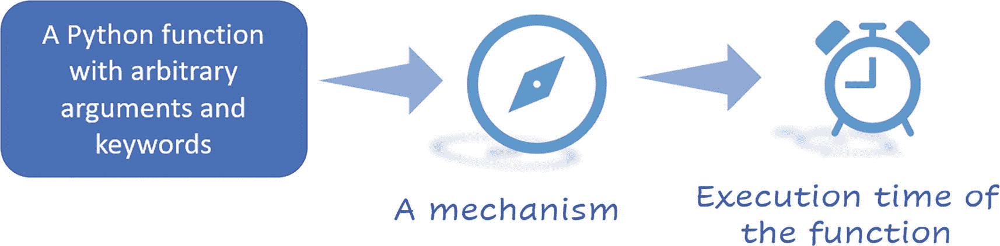
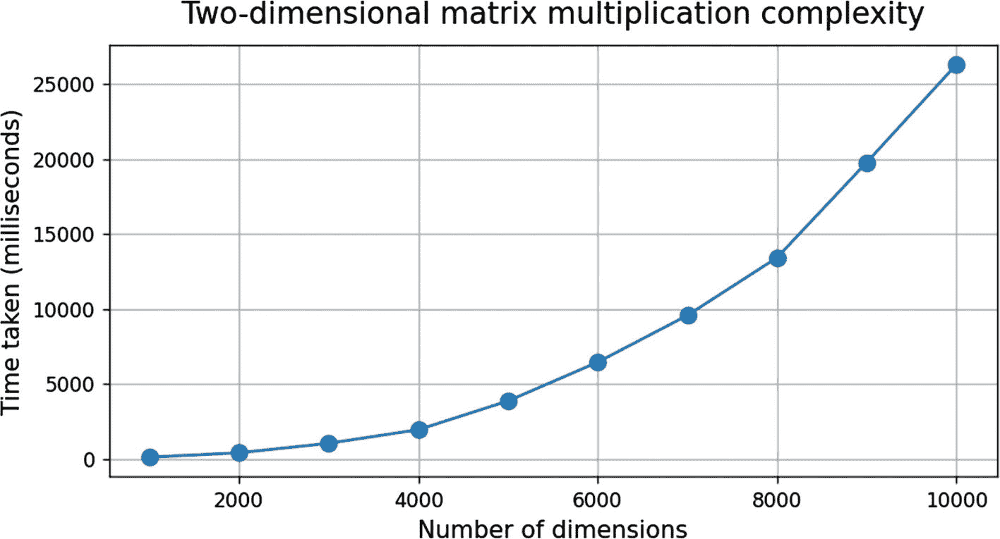

# 测量代码执行时间

从前一节的示例中，你已经看到了测量代码和函数执行时间与速度的重要性。但有哪些标准方法可以实现这一点呢？在本节中，我将介绍几种方法（图 2-4）。


图 2-4

测量执行速度是使你的数据科学代码更高效、更具生产力的首要关键步骤

## Python 的 `time` 模块是你的好帮手

对于几乎任何计时测量场景，你都可以使用 Python `time` 模块中的函数。它提供了几个不同的函数，你应该以特定的方式使用它们以获得准确的结果。

### 基本用法示例

`time` 模块中的一个基础函数也叫 `time()`，它返回当前系统时间。以下是一个简单的代码示例，用于说明其用法：

```python
from time import time, sleep

# 一个仅休眠 2 秒的函数
def sleep_fn():
    sleep(2)

# 主要的计时模块
t1 = time()
sleep_fn()
t2 = time()

print("Elapsed time: ", t2-t1)
```

你可能会得到以下结果：

```
Elapsed time:  2.0102791786193848
```

你可以将上述代码中的 `sleep_fn` 替换为任何代码片段（无论多长或多复杂），计时模块会在代码执行前后分别测量 `t1` 和 `t2`。根据这些测量值，你可以得到代码的差异值或运行时间。因此，这是基本的使用模式：

```python
t1 = time()

t2 = time()
time_delta = t2-t1
```

看起来很简单，对吧？不过，有几个注意事项我将在下面讨论。

### 快速代码块需要多次循环

`time` 函数返回的值以秒为单位，因此如果你试图测量一个快速的代码块，它可能会返回零。例如：

```python
t1 = time()
s = sum([i for i in range(10)])
t2 = time()

print("Sum: ", s)
print("Elapsed time: ", t2-t1)
```

你会得到正确的总和，但运行时间会显示为零。它就是这么快的。

```
Sum:  45
Elapsed time:  0.0
```

那么，你能做什么呢？只需多次运行相同的代码，使总时间至少达到毫秒级。然后计算平均值。

```python
NUM_LOOPS = 10000
t1 = time()
for _ in range(NUM_LOOPS):
    s=sum([i for i in range(10)])
t2 = time()

print("Sum: ", s)
print("Elapsed time: ", t2-t1)
print("Average time: ", (t2-t1)/NUM_LOOPS)
```

你可能会得到类似这样的结果：

```
Sum:  45
Elapsed time:  0.006996631622314453
Average time:  6.996631622314453e-07
```

因此，你将求和代码运行了 10,000 次，发现对 1 到 10 的整数求和大约需要 0.7 微秒或 699 纳秒。正如你所能肯定的，对 10,000 次运行的测量值进行平均也消除了任何类型的方差，提供了稳定的测量结果。

### 计时装饰器

像上面那样编写计时代码是可以的，但本着软件工程中重构和 DRY 原则（https://thevaluable.dev/dry-principle-cost-benefit-example/）的精神，最好避免重复编写相同的代码。相反，更好的办法是拥有一种机制，你可以将任何数据科学函数丢给它，它就能告诉你执行时间。毋庸置疑，这种机制应该能够接受带有任意参数和关键字的函数（图 2-5）。



图 2-5

一种能够测量任意 Python 函数执行时间的机制

幸运的是，Python 提供了一些巧妙的构造来实现这一点。你可以使用 Python 装饰器和来自 `functools` 模块的包装构造来得到你想要的东西。

以下供你参考的模板代码：

```python
from functools import wraps
from time import time

def timing(func):
    @wraps(func)
    def wrap(*args, **kw):
        ts = time()
        result = func(*args, **kw)
        te = time()
        print (f"Function '{func.__name__}' with arguments {args}, keywords {kw} took {te-ts} seconds to run")
        return result
    return wrap
```

这段代码基本上允许你定义任何带有任意参数和关键字的函数 `func`，并测量其执行时间。以下是一个简单的示例，你将 `@timing` 用作函数 `std_dev` 的装饰器，该函数接受一个大整数 `n` 作为输入，使用 NumPy 库生成那么多随机数，并计算它们的标准差：

```python
import numpy as np

@timing
def std_dev(n=10000):
    a = np.random.randint(1,1000,size=n)
    s = a.std()
    return s
```

一旦被 `@timing` 装饰，每当你运行该函数时，可能会得到类似以下的输出：

```
std_dev(n=1000000)
>> Function 'std_dev' with arguments (), keywords {'n': 1000000} took 0.012999773025512695 seconds to run
```

如果你以 1000 万作为参数（`n=10000000`）重新运行该函数，你会得到：

```
std_dev(n=10000000)
>> Function 'std_dev' with arguments (), keywords {'n': 10000000} took 0.1154332160949707 seconds to run
```

输入扩大 10 倍，耗时几乎增加了 10 倍。因此，计时计算是自动的，并且会随着函数每次执行的实例而更新。

Python 装饰器的话题非常广泛，值得单独写一本小书或一门课程。你可以以多种方式利用它们进行高效的数据科学工作。请访问 `https://realpython.com/primer-on-python-decorators/` 获取快速介绍。你还应该查看 `functools` 模块，探索它的更多功能。

### 使用装饰器衡量复杂度

下面用一个简单示例演示如何使用计时装饰器来衡量特定代码片段的时间复杂度。假设你想要衡量你最爱的 NumPy 包中矩阵乘法方法的复杂度。这自然是因为你在机器学习代码的许多地方都使用了该算法或函数（`numpy.matmul`）。你可能只是想知道随着矩阵规模增加，该函数的执行时间会如何变化。

以下代码使用计时装饰器包装了一个测试函数：

```python
def gettime(func):
    @wraps(func)
    def wrap(*args, **kw):
        ts = time()
        result = func(*args, **kw)
        te = time()
        tdelta = round(1000*(te-ts), 3)
        return tdelta
    return wrap

@gettime
def matrix_mult(n=100):
    matrix_1 = np.random.normal(size=(n, n))
    matrix_2 = np.random.normal(size=(n, n))
    result = np.matmul(matrix_1, matrix_2)
    return result
```

请注意，你返回的是时间差（`tdelta`），并将其乘以 1,000 转换为毫秒，然后四舍五入到三位小数（`round(1000*(te-ts), 3)`）以提高可读性。你的测试函数生成两个包含随机高斯数（`np.random.normal`）的二维矩阵（`size=(n,n)`）来执行矩阵乘法。现在你只需调用带尺寸参数 `n` 的 `matrix_mult()` 即可获得乘法操作所花费的时间（以毫秒为单位）。

有关绘图代码的详细信息，请参考本书附带的 Jupyter notebook。当计算矩阵规模从 1,000 到 10,000 范围内的执行时间时，你将得到图 2-6 所示的结果。这条曲线看起来像是 `n` 的多项式函数，对吧？它是否符合 `O(n²)` 复杂度？我们也鼓励你尝试三维矩阵，看看计算复杂度会发生什么变化。是否会像我们在上一章关于图像处理任务时讨论的那样变成 `O(n³)`？

矩阵乘法对于机器学习任务来说是如此基础和普遍，以至于其执行时间和性能通常决定了整个机器学习流程的计算效率。即使是看似简单的线性回归，在使用普通最小二乘解法时，也会利用矩阵乘法（和逆矩阵）来获得最佳系数。如果想要一篇解释此方法的简单文章，请访问 [`www.kdnuggets.com/2016/11/linear-regression-least-squares-matrix-multiplication-concise-technical-overview.html`](http://www.kdnuggets.com/2016/11/linear-regression-least-squares-matrix-multiplication-concise-technical-overview.html)。当你进入深度学习领域时，矩阵乘法无处不在。事实上，在现有基础上改进算法复杂度已十分困难，因此当前的重点在于设计针对矩阵乘法优化的硬件架构（请访问 [`https://maitrix.com/dsr-modular-computation/hardware-matrix-multiplication/`](https://maitrix.com/dsr-modular-computation/hardware-matrix-multiplication/)）。这些新颖的硬件解决方案正以 AI 优化芯片或处理器的形式在 AI/ML 应用中得到越来越广泛的应用。



`图 2-6` 使用 NumPy 函数进行二维矩阵乘法的时间

## Jupyter/IPython 魔法命令

Jupyter notebook 起源于 IPython（或 [Interactive](https://ipython.org/)[‑Python](https://ipython.org/) 项目，网址为 [`https://ipython.org/`](https://ipython.org/)），该项目也为 Jupyter 前端提供了核心内核。凭借其语言无关的 notebook 格式以及对代码、图形渲染和 Markdown 文本的无缝支持，Jupyter Notebook（以及最近的 Jupyter Lab）迅速成为数据科学家事实上的标准和原型设计工具。

在其强大的功能中，有一组魔法命令（[`www.tutorialspoint.com/jupyter/ipython_magic_commands.htm`](http://www.tutorialspoint.com/jupyter/ipython_magic_commands.htm)）值得一提。它们可以执行许多有用的操作，例如：

* 执行系统命令（切换目录、显示当前目录等）

* 从 Jupyter 单元格打开默认文本编辑器

* 列出环境变量

其中一组特定的魔法命令（`%timeit` 和 `%%timeit`）也可以帮助衡量代码执行时间。你已经在本书中见过这些命令，用于在 Jupyter notebook 环境中衡量各种代码片段的效率。

### `%timeit`：单行代码的执行时间

这个魔法命令也被称为“行命令”，因为它用于单行命令场景。例如：

```
%timeit sum(range(100000))
>> 2.25 ms ± 199 μs per loop (mean ± std. dev. of 7 runs, 100 loops each)
```

它衡量对数字 0 到 99999 求和所花费的时间。由于核心操作非常快，它运行了 7 次运行、每次 100 个循环，并计算了平均值和方差。

这种魔法命令对于展示使用专门数值计算包（如 NumPy）相比原生 Python 函数所能带来的显著改进特别有用。对于上述相同的任务，你可以使用带 NumPy 代码的 `%timeit` 得到以下结果：

```
%timeit np.sum(np.arange(100000))
>> 91.6 μs ± 3.47 μs per loop (mean ± std. dev. of 7 runs, 10000 loops each)
```

请注意，由于 `np.sum` 比内置的 Python `sum` 函数快得多，`%timeit` 自动增加了循环次数以准确计算单个代码运行时间。

### `%%timeit`：衡量单元格中代码块的执行时间

这些魔法命令也被称为“单元格魔法”，因为它们适用于整个 Jupyter notebook 单元格的内容（通常是多行代码块，而不是单行代码）。你在本书前面已经使用过一个。事实上，它们是衡量函数或逻辑条件循环性能的首选工具。

沿用上面相同的求和示例，它将如下所示：

```
%%timeit
s = 0
for i in range(100000):
    s += i
>> 5.08 ms ± 724 μs per loop (mean ± std. dev. of 7 runs, 100 loops each)
```

但是请注意，这段代码中没有打印语句。这是因为包含打印语句会因额外的函数调用而略微改变总时间。

记住并实践这一点很重要：**当你衡量一段代码的性能时，要专注于测量该代码确切的执行时间，不多也不少**。这意味着你应该只对计时测量感兴趣，而不是实际的计算结果。

虽然 `%%timeit` 命令会自动智能地调整循环次数，但你也许希望在速度可能不同的函数之间进行比较时控制这一点。你只需要在命令中插入一些额外的运行时参数即可。例如，以下代码将使用 50 个循环和 10 次运行来对相同的求和代码计时。请注意命令行参数 `-n50` 和 `-r10`，分别表示循环次数和运行次数：

```
%%timeit -n50 -r10
s = 0
for i in range(100000):
    s += i
```

### 摘要

在本章中，我首先讨论了算法复杂度的概念，以及常见算法（例如搜索或排序）基于输入规模的渐近行为。为此，我介绍了大 *O* 记法的概念，以及它在比较和分析算法及计算任务相对性能方面的普遍意义。

随后，我通过图像数据分析和为特征丰富的数据集评估最佳回归模型等常规数据科学工作中的多项式与指数复杂度示例，阐述了这一概念对常见数据科学任务的重要性。我初步展示了指数增长相比多项式时间增长的发生速度有多快，以及为何几乎从不采用穷举搜索来寻找最佳模型。在此背景下，我还进一步探讨了 AI 算法普遍存在的难解性，以及为何其实际应用在当今取得了巨大成功。

接着，我借助 Python 代码片段，在过滤、搜索和计数等常见任务的背景下，展示了数据科学中低效编程模式的示例。我提供了更高效的替代方案，希望能激发你产生新的思路。

最后，我利用计时工具和命令探讨了如何衡量低效性本身。我详细研究了 Python 内置的 `time` 模块的各种用法，特别是展示了如何创建一个计时装饰器来测量任意通用函数的执行时间。Jupyter 魔法命令则是这方面的第二套工具，我也通过简单示例对其进行了讨论。我将在第 8 章中借助专用工具重新讨论时间剖析这一主题。

本章的核心目标是向你灌输一种探究的意识，你可以在代码库的任何地方运用这种意识，*深入挖掘并检验实现方案的效率，在多种备选方案之间进行比较*。我希望这方面的努力能够达到预期效果。