# 8. 内存与时间剖析

数据科学任务伴随着各种各样的空间和时间计算成本。数据 wrangling 工作可能需要大容量存储的支持，而高级 ML 算法需要高强度的计算速度。一些 ML 算法在拥有大型本地内存（RAM）支持时表现更好，并且无法与位于硬盘上远离 CPU 的数据良好配合，而其他算法则针对分布式数据存储进行了优化。

此外，数据的性质可能根据应用场景变化缓慢或频繁。一些模型和数据科学代码能够随着输入数据规模和复杂性的增加而优雅地扩展，而另一些则不能。当扩展没有妥善规划或嵌入代码中时，性能可能会下降，甚至可能导致时间上的灾难性故障。在许多此类情况下，代码的过度内存使用（或对内存带宽的需求）是问题的根源。

为了规划此类情况或稳健地设计数据科学代码，你必须从基础开始：衡量代码在内存使用或剖析方面的效率。显然，这与本书主题——高效数据科学的核心哲学——紧密相连。根据代码和底层硬件的不同，有许多用于此类测量的工具和技术。在第 2 章中，我们讨论了基本的时间测量和一个用于测量 ML 函数执行时间的时间装饰器。在本章中，我的目标是向你介绍一些工具（附带动手示例），这些工具可用于衡量数据科学和 ML 代码的内存使用情况。

## 为什么要分析内存使用情况？

对于大多数数据科学工作来说，内存使用测量或剖析可能被视为事后考虑。然而，它正变得越来越普遍和关键。作为一名数据科学家，如果你能够可靠地测量代码的内存使用情况并规划更大的代码库，你肯定会对你软件平台的稳健性产生积极影响。

### 一个常见场景

假设你编写了一个很酷的机器学习应用程序或创建了一个闪亮的神经网络模型。现在你想通过某个 Web 服务或 REST API 部署这个模型。或者，你可能基于来自制造工厂工业传感器的数据流开发了一个模型，现在你必须将该模型部署在某个工业控制 PC 上，以根据连续输入的数据提供决策。

作为一名数据科学家，你可能会从工程/平台团队那里收到一个非常常见的问题：“**你的模型/代码的内存占用是多少？**”或“**在给定数据负载下运行时，你的代码的峰值内存使用量是多少？**” 这很自然，因为硬件资源可能有限，单个 ML 模块不应占用系统的所有内存。这对于边缘计算场景尤其如此，例如 ML 应用程序可能在最边缘运行，比如在工业 PC 上的虚拟化容器内（并且没有云支持的自动扩展内存或动态分配）。

此外，你的模型可能只是运行在那块硬件上的数百个模型之一。因此，你必须对模型的峰值内存使用量有所了解，因为如果多个模型同时达到内存使用峰值，可能会导致整个系统崩溃。而且这些模型并不一定都来自同一位数据科学家。不同的团队可能在不同时间开发了它们。因此，拥有一个通用机制来测量或评估所有这些模型（以及一般的数据科学代码）的内存使用情况（峰值和平均值）是合理的。该想法如图 8-1 所示。

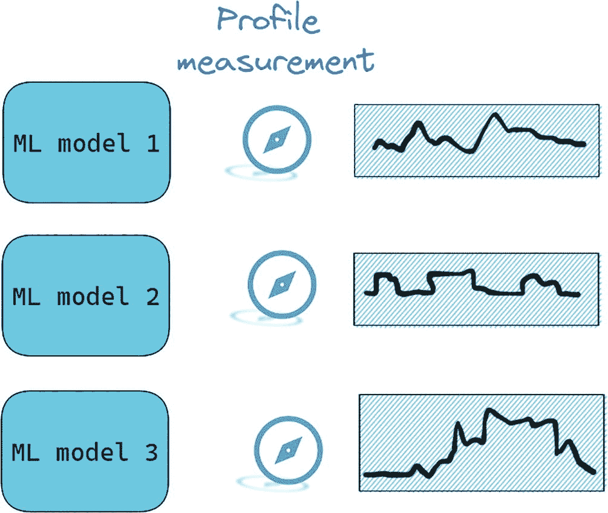

图 8-1：对运行在单个系统上的众多 ML 模型的内存和 CPU（执行）情况进行测量（评估）

### 不在于模型大小（或压缩）

你可能会认为制作一个紧凑且复杂度较低的机器学习模型就能解决所有问题。但这将是一个错误的假设。当谈到峰值内存使用问题时，我们讨论的是整个代码的运行时内存概况（一个动态量）。这与你的机器学习模型的大小（甚至压缩程度）关系甚微（这些模型可能作为特殊对象保存在磁盘上，例如`scikit-learn`的`Joblib`转储、简单的 Python `pickle`转储，或 TensorFlow 的`HFD5`文件）。

模型压缩和规模调整也相当重要。在许多情况下，你可能需要特别注意这一点。你可能需要通过选择更简单的模型架构来限制自己训练拥有数百万参数的模型。你可能需要尝试训练后模型压缩（例如，有意降低数值系数的浮点精度）来减小模型在磁盘上的大小。通常，这些操作会降低模型运行时的活动内存使用量。然而，你仍然需要有效的代码和机制来测量运行时的内存使用情况。

### Scalene：一个精巧的内存分析器

尽管有许多内存和 CPU 分析器，但拥有一个能够全面审视整个数据科学代码的“一站式”工具是件好事。**Scalene** 就是这样一个全面的工具。我们来详细了解一下。

根据其 GitHub 页面描述，“Scalene 是一个用于 Python 的高性能 CPU、GPU 和内存分析器，它能做其他 Python 分析器做不到或不能做的几件事。它比其他分析器快几个数量级，同时提供更详细的信息。” 它由马萨诸塞大学开发。可以观看[`www.youtube.com/watch?v=5iEf-_7mM1k&feature=youtu.be`](http://www.youtube.com/watch%253Fv%253D5iEf-_7mM1k%2526feature%253Dyoutu.be)上的视频以获取全面介绍。

因此，Scalene 承诺以下功能：

*   分析 CPU、GPU 和内存

*   执行速度比其他分析器快一个数量级

*   提供比其他类似工具更详细的信息

### 基本用法

通过`pip`安装：

```bash
pip install scalene
```

一个明显的限制是**目前它仅适用于 Linux 操作系统**。如果你使用的是 Windows 或 MacOS，可以通过创建虚拟机并在其中运行脚本来使用它。

Scalene 的使用非常简单。你只需在 Python 脚本名称前输入`scalene`：

```bash
scalene my_script.py
```

或者，你可以在 Jupyter 笔记本中使用它，首先执行这个魔法命令：

```python
%load_ext scalene
```

典型的输出快照如图 8-2 所示。后面会有更详细的解释。

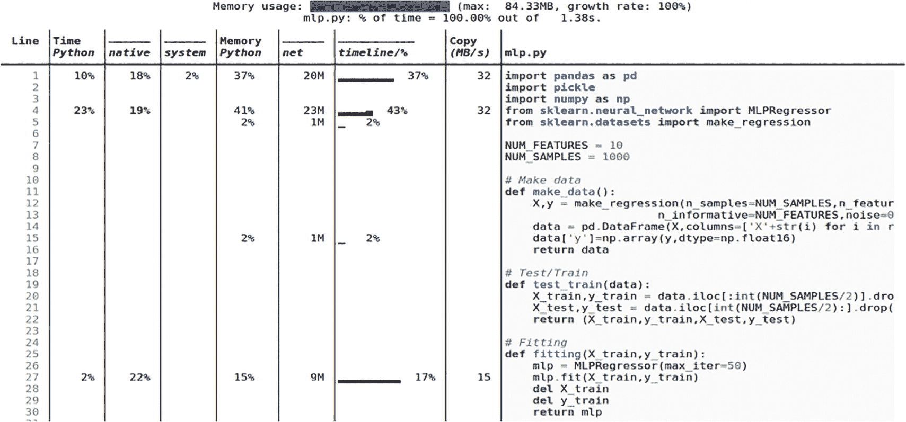

图 8-2：来自 Scalene 的典型输出快照

#### 特性

以下是 Scalene 的一些酷炫特性。其中大部分不言自明，可以从图 8-2 中看出。

*   **行或函数**：报告整个函数以及每个独立代码行的信息

*   **线程**：支持 Python 线程

*   **多进程**：支持使用`multiprocessing`库

*   **Python vs. C 时间**：Scalene 区分在 Python 和原生代码（例如库）上花费的时间

*   **系统时间**：它区分了系统时间（例如，休眠或执行 I/O 操作）

*   **GPU**：它还可以报告在 NVIDIA GPU 上花费的时间（如果存在）

*   **复制量**：报告每秒复制的兆字节数据

*   **检测泄漏**：Scalene 可以自动定位可能导致内存泄漏的代码行！

### 一个具体的机器学习示例

现在让我们着手将 Scalene 用于标准机器学习代码的内存分析。你将查看两种不同类型的机器学习模型，原因稍后会说明。你将使用`scikit-learn`库来构建所有三个模型，并利用其合成数据生成函数来创建数据集：

*   一个多元线性回归模型

*   一个基于相同数据集的深度神经网络模型

这两个模型的建模代码遵循完全相同的结构。外部 I/O 操作也在图 8-3 中进行了标注，你将会看到，它们是否主导内存分布取决于模型类型。

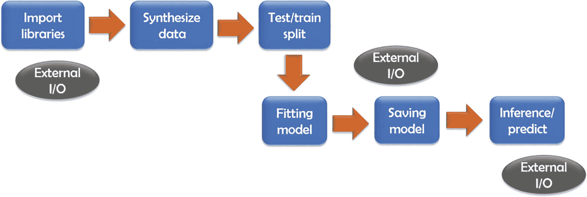

图 8-3：用于 Scalene 演示示例的通用 ML 模型代码流程

#### 线性回归模型

完整代码在随附的 Jupyter 笔记本中。你使用标准导入和两个名为`NUM_FEATURES`和`NUM_SAMPLES`的变量，以便稍后进行一些实验：

```python
import pandas as pd
import pickle
import numpy as np
from sklearn.linear_model import LinearRegression
from sklearn.datasets import make_regression

NUM_FEATURES = 10
NUM_SAMPLES = 1000
```

为简洁起见，我将不展示数据生成和模型拟合的代码，因为它们是标准流程。你将拟合好的模型保存为 pickle 转储文件，并加载该 pickle 对象以及一个用于推理的测试 CSV 文件：

```python
# 模型保存函数
def save(lm):
    """
    将 sklearn 线性模型保存为 pickle 对象
    """
    with open('LinearModel.sav', mode='wb') as f:
        pickle.dump(lm, f)

# 模型运行函数
def model_run(model, testfile):
    """
    从 pickle 对象加载并运行 sklearn 线性模型
    """
    lm = pickle.load(open(model, 'rb'))
    X_test = pd.read_csv(testfile)
    _ = lm.predict(X_test)
    return None
```

为了清晰起见，你将所有代码放在一个主循环下运行，以便于 Scalene 执行和报告（稍后你会理解）。

```
if __name__ == '__main__':
    data = make_data()
    X_train, y_train, X_test, y_test = test_train(data)
    lm = fitting(X_train, y_train)
    save(lm)
    model_run('LinearModel.sav', 'Test.csv')
```

运行命令：

```
$ scalene linearmodel.py --html >> linearmodel-scalene.html
```

你将得到如图 8-4 所示的输出结果。请注意，你使用了`--html`标志和管道操作符（`>>`）将输出导向到一个 HTML 文件，以便于报告。

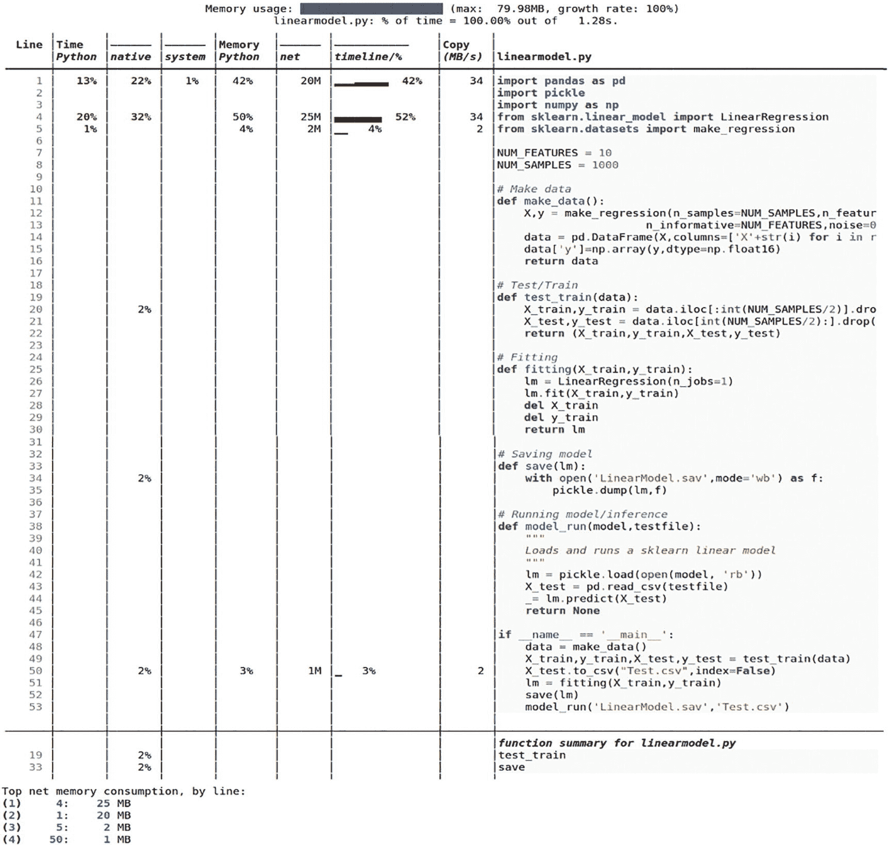

图 8-4：线性回归模型代码通过 Scalene 分析后的输出

从这个分析中得到的最重要的观察结果是，**内存占用几乎完全由外部 I/O 主导**，例如 pandas 和 `scikit-learn` 估计器的加载。仅有极少的内存用于将测试数据写入磁盘上的 CSV 文件。

*实际的机器学习建模、NumPy 或 pandas 操作以及推理完全不影响内存*。这是一个有些出乎意料且不直观的事实。显然，如果没有像 `scalene` 这样的合适内存分析器，你是不可能发现这一点的。

### 随着模型和数据规模的扩大，会发生什么？

你可以扩展数据集大小（行数）和模型复杂度（特征数），并运行相同的内存分析，以记录各种操作在内存消耗方面的表现。

结果如图 8-5 所示。X 轴以成对形式表示特征数/数据点数。请注意，此图描绘的是百分比而非绝对值，以展示各类操作的相对重要性。

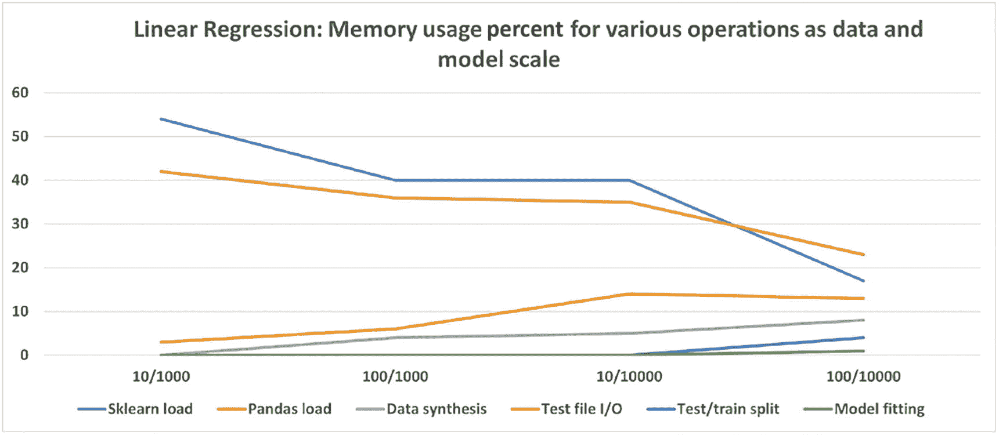

图 8-5 数据和模型（参数数量）规模对线性模型的影响

从这些实验中，你可以得出结论：`scikit-learn` 线性回归估计器非常高效，并且**在实际模型拟合或推理时不会消耗太多内存**。然而，它在代码方面有一个固定的内存占用，并且在加载时会消耗那么多内存。但是，随着数据大小和模型复杂度的增加，该代码占用量的百分比会下降。

因此，如果你处理的是小型到中型的线性模型（例如，数千个数据点但只有数十个参数），你可能需要关注数据文件 I/O，以优化数据加载、存储、建模和推理代码，从而实现更好的内存利用。例如，你可以使用不同于纯 CSV 的文件存储选项（如 `Parquet` 或类似的针对内存分析优化的现代数据格式；访问 [https://medium.com/productive-data-science/why-you-should-use-parquet-files-with-pandas-b0ca8cb14d71](https://medium.com/productive-data-science/why-you-should-use-parquet-files-with-pandas-b0ca8cb14d71) 了解更多信息）。

### 深度学习模型

如果你对具有两个隐藏层（每个隐藏层 50 个神经元）的神经网络运行类似的实验，结果将如图 8-6 所示。它使用了来自 `sklearn.neural_network` 模块的 `MLPRegressor` 估计器。代码在附带的 Python 脚本中。

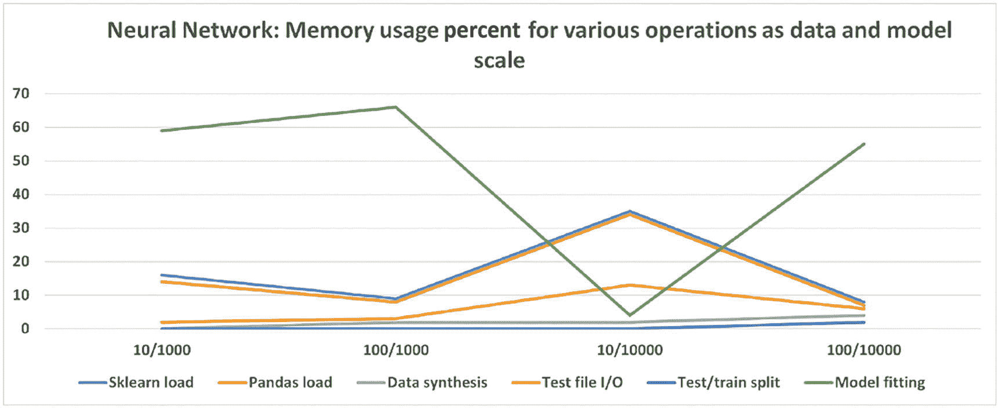

图 8-6 数据和模型（参数数量）规模对神经网络模型的影响

显然，与线性回归模型不同，神经网络模型在训练/拟合步骤中消耗了大量内存。然而，对于少量特征和大数据量，拟合所需的内存较低。你还可以尝试不同的架构和超参数，并记录内存使用情况，以找到适用于特定数据科学任务的配置。

### 关键方法和建议

如果你用相同的代码文件重复实验，结果会根据你的硬件（磁盘/CPU/GPU/内存类型）而有很大差异。上面展示的结果的目的不是关注实际值甚至趋势。我希望你能学会为自己代码做内存分析实验。

### 关键建议

在这方面，一些关键建议如下：

- 最好编写专注于单一任务的小函数。
- 保留一些自由变量，如特征数和数据点数，以便在数据/模型规模变化时，能以最少的更改运行相同的代码文件来检查内存配置。
- 如果你在比较两种机器学习算法，尽量保持整体代码的结构和流程尽可能一致，以减少混淆。最好只更改估计器类并比较内存配置。
- 数据和模型 I/O（导入语句、模型持久化到磁盘）的内存占用可能出乎意料地高，具体取决于你的建模场景。在进行优化时，切勿忽略它们。
- 基于上述原因，考虑比较来自多个实现/包（例如，`Keras` vs. `PyTorch` vs. `scikit-learn`）的同一算法的内存配置。如果内存优化是你的主要目标，你可能需要寻找一个占用内存最小但仍能令人满意地完成工作的实现，即使它在功能或性能上并非绝对最佳。
- 如果数据 I/O 成为瓶颈，可以探索更快的选项或其他存储类型，例如将 `pandas` 的 `CSV` 替换为 `Parquet` 文件和 `Apache Arrow` 存储。

### 使用 `Scalene` 可以做的其他事情

在本节中，我讨论了以规范的机器学习建模代码为重点的最基本的内存分析。`Scalene` CLI 还有其他选项可以利用：

- 仅分析 CPU 时间，不分析内存配置
- 仅对非零内存占用进行简化分析
- 指定 CPU 和内存分配的最小阈值
- 设置 CPU 采样率
- 多线程并检查差异

### 有时最终验证是必要的

在许多情况下，机器学习模型运行在硬件资源（尤其是内存/RAM 端）有限的边缘设备上。对于这种低资源场景，最好托管一个验证环境/服务器，该环境/服务器将接受给定的建模代码（在开发和测试之后，但在部署之前），并通过内存分析器运行它以生成运行时统计信息。如果它通过了内存占用的预定标准，然后就可以被接受进行进一步部署。这个想法如图 8-7 所示。

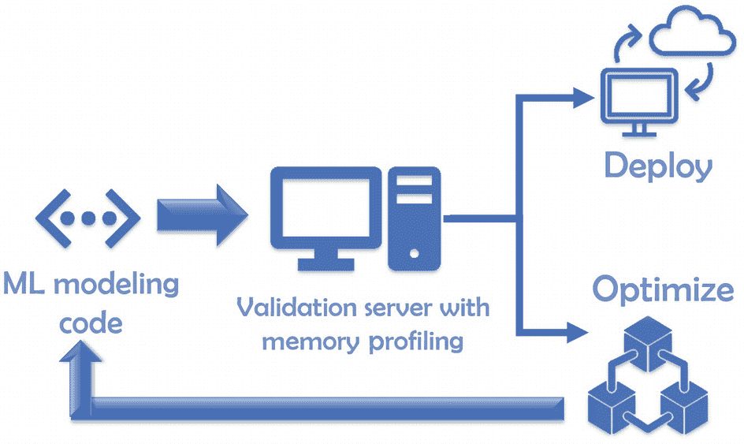

图 8-7 部署机器学习模型前的内存配置验证检查

像 `Scalene` 这样的框架在这些情况下非常有用。通过设置这样的验证网关，数据科学家可以使整个平台更加稳定和健壮，抵御偶然的内存过冲和系统崩溃。

## 使用 `cProfile` 进行时间分析

你已经看到了一些使用计时装饰器测量简单代码块或函数执行时间的基本技巧和技术。在本节中，我将讨论一个名为 `cProfile` 的内置 Python 库，它可以通过一个简单的命令为你提供关于数据科学代码各个部分的详细时间分析。其优点是你不必在多个地方插入像 `time.time()` 这样的代码片段（如第 2 章所示）并手动跟踪它们。

### 基本用法

`cProfile` 库随默认 Python 安装提供，因此无需额外安装。以下是其基本用法，通过简单代码实现两个 NumPy 数组的相加：

```python
import numpy as np
import cProfile
SIZE = 10_000_000
a = np.arange(SIZE)
b = np.random.normal(size=SIZE)
cProfile.run('a+b')
```

主要需要注意，你必须将代码包裹在字符串中，并将其传递给 `cProfile.run` 函数。此处代码仅为 `'a+b'`。输出可能类似于图 8-8 所示。当然，具体耗时将根据底层硬件而有所不同。

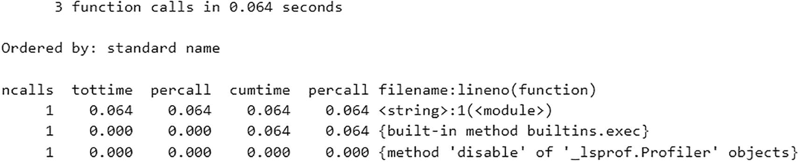

**图 8-8**：对简单 NumPy 数组加法执行 `cProfile` 运行的输出快照

值得记住的是，唯一被计时测量的代码段是 `a+b`。此处并未测量数组的创建过程，仅测量了加法操作。

如果你想测量所有步骤的时序分析，可以编写如下代码：

```python
code = """SIZE = 10_000_000
a = np.arange(SIZE)
b = np.random.normal(size=SIZE)
a+b"""
cProfile.run(code)
```

这里你将所有代码放入字符串变量 `code` 中，然后将其传递给 `cProfile.run` 函数。输出结果有所不同（图 8-9），符合预期。

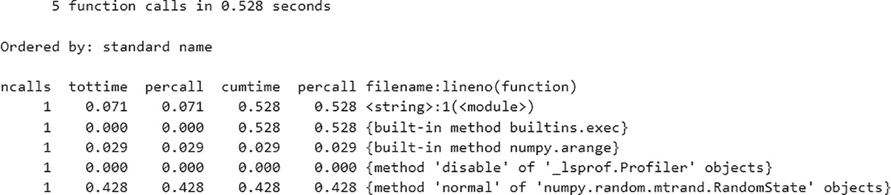

**图 8-9**：包含数组创建和加法操作的 `cProfile` 运行输出快照

注意，额外的数组创建操作总共导致了五次函数调用，而基本加法代码仅三次。

### 将函数作为参数传入

当然，你也可以创建一个独立的函数，并将该函数名称传递给 `cProfile.run` 函数来执行相同任务：

```python
def add():
    SIZE = 10_000_000
    a = np.arange(SIZE)
    b = np.random.normal(size=SIZE)
    c=a+b
cProfile.run('add()')
```

输出（图 8-10）与图 8-9 中的输出类似，但多注册了一次由 `add` 函数本身构造所产生的函数调用。

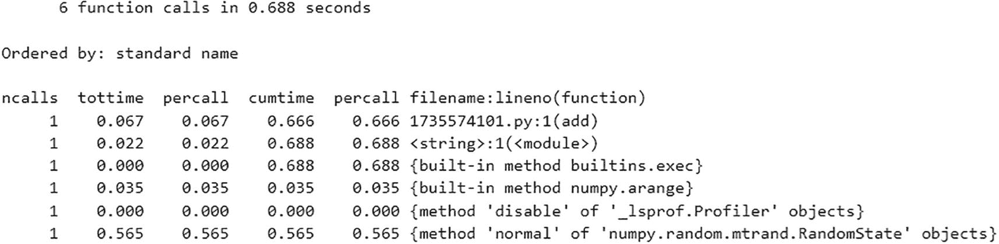

**图 8-10**：对独立函数（相同`NumPy`操作）执行`cProfile`运行的输出快照

传递给`cProfile`的函数也可以带有任意参数。在许多情况下，你可以更改参数并观察其对分析结果的影响。这是该库最明显的用例之一。让我们重写`add`函数，使其接受一个`size`参数：

```
def add(size):
a = np.arange(size)
b = np.random.normal(size=size)
c = a+b
```

然后，你可以使用它来对包含 1000 万个元素的数组操作进行分析（图 8-11）：

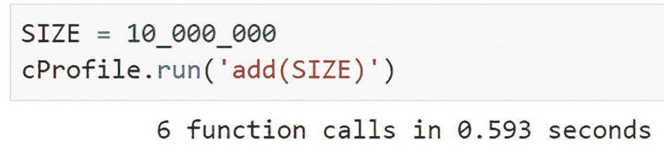

**图 8-11**：运行`cProfile`并向函数传递 1000 万个元素的参数

```
SIZE = 10_000_000
cProfile.run('add(SIZE)')
```

当你将元素数量改为 2000 万时，结果会立即反映出来（图 8-12）：

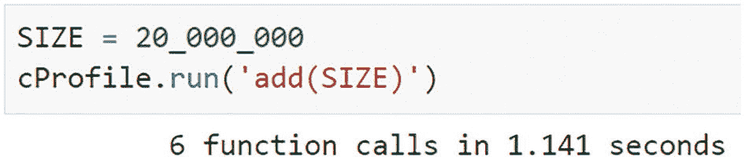

**图 8-12**：运行`cProfile`并向函数传递 2000 万个元素的参数

```
SIZE = 20_000_000
cProfile.run('add(SIZE)')
```

### 使用`Profiler`类

`cProfile`有一个特殊的`Profiler`类，用于存储所有重要信息，并且可以通过编程方式启用/禁用。你还可以使用`pstats`库，并将此`Profiler`对象传递给它，以打印和提取数据。以下是测量并打印总执行时间的代码：

```
import cProfile, pstats
profiler = cProfile.Profile()
# Enable profiler
profiler.enable()
# Function execution
add(SIZE)
# Disable profiler
profiler.disable()
# pstats
stats = pstats.Stats(profiler)
# Print the total time and number of calls
print("Total function calls:", stats.total_calls)
print("Total time (seconds):", stats.total_tt)
```

结果如下所示：

```
>> Total function calls: 48
>> Total time (seconds): 1.1527893999999999
```

这里，你从`stats`对象的`total_tt`属性获取执行时间，并从`total_calls`属性获取调用次数。

因此，这开启了一种可能性，即可以根据需要以编程方式控制性能分析和信息存储。例如，你可以在一系列数组大小上分析相同`add`函数的执行情况：

```
size = [int(i*1e6) for i in range(5,26,5)]
total_tt = []
for s in size:
profiler = cProfile.Profile()
profiler.enable()
add(s)
profiler.disable()
stats = pstats.Stats(profiler)
total_tt.append(round(stats.total_tt,3))
```

计时结果存储在`total_tt`数组中。绘制成图后，显示出预期的模式（图 8-13）。

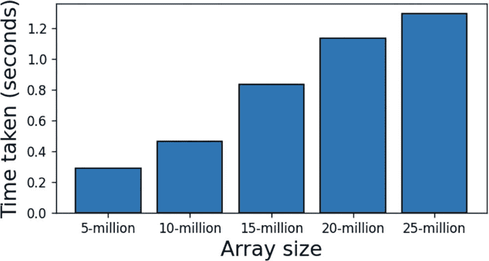

**图 8-13**：使用`cProfile`提取的不同数组大小的计算时间

### 数据科学工作流分析

虽然测量这些小型独立函数的执行时间只是这些分析器用法的基本演示，但其真正价值体现在大规模数据科学工作流中。此类工作流包含多种模块和函数，必要时你可以为所有这些模块和函数设置性能分析。输出结果可以记录到数据库中，甚至可以馈送到一个监控系统，该系统将随时间跟踪模块的性能，并在需要时采取行动（例如，如果某个函数在特定运行中或针对特定输入数据耗时过长，性能表现不佳）。该思路如图 8-14 所示。

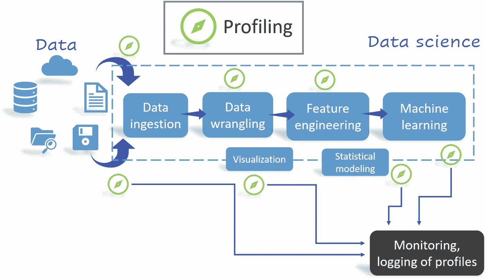

**图 8-14**：数据科学工作流各个阶段的时间和内存分析

## 总结

在本章中，你了解了内存分析对于机器学习代码的重要性，以确保与负责在服务/机器上部署代码的平台/工程团队顺利进行接口对接。分析内存还可以提示你，根据所处理的具体数据集和算法组合，采用出人意料的方式来优化代码。你看到了一个典型的机器学习建模代码示例，并使用一个功能强大且轻量级的 Python 库对其进行了分析。你看到了线性回归和神经网络模型的代表性结果，并获得了一些通用建议。

接下来，你学习了内置 Python 时序分析器`cProfile`的基本用法，以及如何将其用于原始代码或函数模块。你了解了如何使用该库提取`NumPy`操作的总执行时间或函数调用次数。这一思路可以扩展到任何包含多个阶段和模块的数据科学工作流。

每个数据科学团队或组织都有自己的测量代码和模块效率及内存占用风格。本章的目的是向你介绍这些测量的重要性，并展示一些动手示例，以便你能进一步探索并为此类实现做好准备。

