# 如何更高效地使用 Python 数据科学包

毫无疑问，Python 是全世界数据科学家（以及机器学习工程师或人工智能研究员等相关专业人士）使用最多且增长最快的编程语言。Python 作为数据科学的*通用语言*（主要是在过去十年左右）能够爆发式增长，原因有很多：它的学习曲线平缓、支持动态类型、既可以编写脚本式代码，也可以采用面向对象的方式编写，等等。

然而，它之所以能增长，或许最重要的原因在于令人惊叹的开源社区活动，以及由此产生的专注于数据科学工作的强大且丰富的库和框架生态系统。默认的、最小化的 Python 安装无法用于执行任何有实际意义的数据科学任务。但只需极少的额外工作，任何数据科学家都可以安装并使用一些功能丰富、经过充分测试、达到生产级别的库，从而立即启动他们的工作。

在这些能够快速启动工作的软件包中，最受欢迎且广泛使用的包括：

*   **NumPy** 用于数值计算（几乎被所有 Python 数据科学库用作基础）
*   **pandas** 用于处理表格化、结构化数据的数据分析
*   **Matplotlib/Seaborn** 用于强大的图形和统计可视化

然而，仅仅因为这些库提供了简单的 API 和平滑的学习曲线，并不意味着每个人都能以高效且富有成效的方式使用它们。我们必须深入探索这些库，了解它们的能力和局限性，才能充分加以利用，实现高效的数据科学工作。

这正是本章的目标：展示如何以及为何要在各种典型的数据科学任务中使用这些库，以实现高效率。我们将从 `NumPy` 库开始，因为它也是 `pandas` 和 `SciPy` 的基础。接着探索 `pandas` 库，然后介绍 `Matplotlib` 和 `Seaborn` 包。

但需要注意的是，我的目标并不是向你介绍这些库的典型特性和函数。这方面已有大量优秀的课程和书籍。我期望你已具备使用其中部分（若非全部）库的基本知识和经验。我将向你展示**如何以富有成效的方式使用这些包来完成数据科学工作的经典范例**。

你可能还想知道另一个广泛使用的 Python 机器学习包 `scikit-learn` 在这个体系中处于什么位置。我将在第 4 章中介绍。此外，在第 7 章中，我将介绍如何使用一些不那么知名的 Python 包来辅助 `NumPy` 和 `pandas`，以更高效、更富成效地使用它们。

## 为什么 NumPy 比常规 Python 代码更快，以及快多少

`NumPy`（或 `numpy`），是 **Num**erical **Py**thon 的缩写，是在 Python 生态系统中用于高性能科学计算和数据分析的基础包。几乎所有更高级的数据科学工具和框架（如 `pandas` 和 `Scikit-learn`）都构建在它的基础之上。

像 `TensorFlow` 和 `PyTorch` 这样的深度学习库，将其基础的构建模块 `NumPy` 数组作为基础，并在此基础上构建其专门的 `Tensor` 对象和用于深度学习任务的图流例程。大多数机器学习算法在长列表/向量/数字矩阵上大量使用线性代数运算，而 `NumPy` 代码和方法正是为此进行了优化。

### NumPy 数组与众不同

NumPy 引入的基本数据结构是 `ndarray`，即 **N 维数值数组**。对于 Python 初学者来说，这些数组有时看起来与 Python 列表相似。但它们绝非类似。让我们用一个简单的例子来演示这一点。

考虑以下创建两个 Python 列表的代码。当你对它们使用 `+` 运算符时，第二个列表会被追加到第一个列表之后。

```
lst1 = [i for i in range(1,11)]
lst2 = [i*10 for i in range(1,11)]
print(lst1+lst2)
>> [1, 2, 3, 4, 5, 6, 7, 8, 9, 10, 10, 20, 30, 40, 50, 60, 70, 80, 90, 100]
```

对列表中元素的处理感觉很像对象，而不是数值，不是吗？如果这些是数值向量而不是简单的数字列表，你会期望 `+` 运算符的行为略有不同，它会将第一个列表中的数字与第二个列表中对应的数字进行*逐元素*相加。

这正是这些列表的 NumPy 数组版本所做的事情：

```
import numpy as np
arr1 = np.array(lst1)
arr2 = np.array(lst2)
arr1+arr2
>> array([ 11,  22,  33,  44,  55,  66,  77,  88,  99, 110])
```

什么是 `np.array`？它只不过是调用了 NumPy 模块中的数组方法（代码的第一行通过 `import numpy as np` 实现了这一点）。

也许了解这种数组表示丰富性的最简单方法是检查与该数据结构关联的所有方法列表。你可以使用 `dir` 函数来做到这一点，如下所示：

```
for p in dir(lst1):
if '__' not in p:
print(p, end=', ')
>> append, clear, copy, count, extend, index, insert, pop, remove, reverse, sort,
```

如果你对 `arr1` 对象运行类似的代码，你将看到以下输出：

```
>> T, all, any, argmax, argmin, argpartition, argsort, astype, base, byteswap, choose, clip, compress, conj, conjugate, copy, ctypes, cumprod, cumsum, data, diagonal, dot, dtype, dump, dumps, fill, flags, flat, flatten, getfield, imag, item, itemset, itemsize, max, mean, min, nbytes, ndim, newbyteorder, nonzero, partition, prod, ptp, put, ravel, real, repeat, reshape, resize, round, searchsorted, setfield, setflags, shape, size, sort, squeeze, std, strides, sum, swapaxes, take, tobytes, tofile, tolist, tostring, trace, transpose, var, view,
```

NumPy 数组对象拥有更多（且看起来不同）的函数和属性。特别是，请注意像 `mean`、`std` 和 `sum` 这样的方法，它们清楚地表明这类数组对象侧重于数值/统计计算。而且这些操作速度也很快。有多快？你马上就会看到。

### NumPy 数组与原生 Python 计算

NumPy 速度更快，这得益于其**向量化实现**，以及其许多核心例程最初是用 C 语言编写的（基于 CPython 框架）这一事实。NumPy 数组是同类类型的密集打包数组。相比之下，Python 列表是指向对象的指针数组，即使所有对象都是同一类型。因此，我们获得了引用局部性的好处。

许多 NumPy 操作是用 C 语言实现的，**避免了 Python 中循环的一般开销、指针间接引用以及逐元素动态类型检查**。特别是，速度的提升取决于你所执行的操作。对于数据科学和机器学习任务来说，这是一个无价的优势，因为它避免了对长维度数组和多维数组的循环。

[引用局部性](https://www.geeksforgeeks.org/locality-of-reference-and-cache-operation-in-cache-memory/)是 NumPy 数组比 Python 列表对象更快、更高效的主要原因之一。内存访问模式中的空间局部性会带来性能提升，这主要归功于 CPU 缓存操作。缓存从 RAM 中成块地将字节加载到 CPU 寄存器（计算机系统中速度最快的内存，位于处理器旁边）。然后，内存中的相邻元素会被非常高效地加载。

#### NumPy 与原生 Python 实现

让我们使用上一章熟悉的 `@timing` 装饰器来说明这一点。以下代码将装饰器包裹在两个函数 `std_dev` 和 `std_dev_python` 周围，这两个函数分别使用 NumPy 和原生 Python 代码实现列表/数组的标准差计算。

## NumPy 与原生 Python 性能对比

首先，我们定义两个计算标准差的函数，一个使用 NumPy，一个使用纯 Python。

```python
@timing
def std_dev(a):
    if isinstance(a,list):
        a = np.array(a)
    s = a.std()
    return s

from math import sqrt

@timing
def std_dev_python(lst):
    s = sum(lst)
    av = s/len(lst)
    sumsq = 0
    for i in lst:
        sumsq+=(i-av)**2
    sumsq_av = sumsq/len(lst)
    result = sqrt(sumsq_av)
    return result
```

接下来，定义两个相同长度（1,000,000）的对象：一个 NumPy 数组和一个 Python 列表，并计算标准差所需的时间：

```python
a = np.arange(1000000)
lst = [i for i in range(1000000)]
```

对于 NumPy 函数，

```python
std_dev(a)
# 输出:
# Function 'std_dev' took 8.996 milliseconds to run
# 288675.1345946685
```

对于 Python 函数，

```python
std_dev_python(lst)
# 输出:
# Function 'std_dev_python' took 212.995 milliseconds to run
# 288675.1345958226
```

因此，NumPy 实现要快得多，默认情况下应将其用于数据科学任务。

### 转换会增加开销

如果你查看 `std_dev` 函数的代码，你会注意到开头有一小段但很重要的类型检查和强制转换代码。这是为了处理 NumPy 函数接收到列表对象而不是预期的 NumPy 数组的情况。

```python
if isinstance(a,list):
    a = np.array(a)
```

如果你将 `lst` 对象传递给 `std_dev` 函数，你可能会看到类似这样的结果：

```python
std_dev(lst)
# 输出:
# Function 'std_dev' took 84.004 milliseconds to run
# 288675.1345946685
```

这很有趣。该操作仍然比原生 Python 实现快很多，但肯定比将 NumPy 数组传入函数的情况慢得多。结果也略有不同（尽管只是在五位小数之后）。这是因为在函数内部将 `lst` 对象转换为 NumPy 数组类型消耗了额外的时间。转换也会影响数值精度，导致结果略有不同。

因此，尽管类型检查和转换应该是你代码的一部分，但你应该专注于**在数据科学流程开始时尽快将数值列表或表格转换为 NumPy 数组**，然后对它们进行处理，这样你就不会在计算阶段损失额外的时间。

## 高效使用 NumPy

对于高级数据科学和机器学习工程，NumPy 提供了令人眼花缭乱的函数和方法，用于处理数值数组和矩阵。你可以找到大量深入探讨 NumPy 这些方面和特性的资源。

由于本书是关于高效数据科学的，我更多地关注*如何在数据科学工作中使用 NumPy 构建高效编程模式*这一基本方面。我倾向于通过展示低效编码风格的典型示例以及如何正确使用基于 NumPy 的代码来提高生产力来说明这一点。让我们就此开始吧。

### 先转换，后运算

虽然不保证总是如此，但**先将数据向量化**（图 3-1）几乎总是更好的做法。换句话说，就是尽早将数据转换为 NumPy 数组，并在这些数组对象上运行数学运算，而不是先运行原生 Python 函数，然后再将它们转换为数组。


图 3-1

当您先将数据向量化，然后执行必要操作时，才能最好地利用 NumPy 的优势

下面是一个数字列表和一个数学运算函数：

```python
lst_of_nums = [i for i in range(100000)]

def calc_nums(x):
    return (x+1)/(x+1000)
```

执行以下操作是一种不好的做法，然而这种代码模式在数据科学领域却非常普遍：

```python
result_lst = []
for i in lst_of_nums:
    result_lst.append(calc_nums(i))
result_array = np.array(result_lst)
```

相反，应该首先将其转换为数组格式，然后直接在数组上应用数学运算。你甚至不需要编写单独的 Python 函数。

```python
array_of_nums = np.array(lst_of_nums)
result_array = (array_of_nums+1)/(array_of_nums+1000)
```

如果你测试执行时间，对于这些数据，你会发现第二种方法快了 2 到 3 倍。对于更大的数据量来说，这种性能提升可能会非常显著。

现实生活中的数据来自业务操作和数据库。数据以流式或批处理模式传输。数据也可以以 JSON 或 XML 格式通过 Web API 获取。数据几乎永远不会以整洁的 NumPy 格式提供。这就是为什么理解数组转换（例如，追加和更新数组）、以及在必须通过 JSON 接口将数据流式传回另一个 API 时，将数组转换回 Python 列表等操作优缺点至关重要的原因。

### 向量化逻辑运算

你也可以向量化一个列表，在此过程中，你需要在使用 NumPy 直接进行数学运算之前检查逻辑条件。假设从前面的例子中，你只想对 7 的整数倍的数字应用该函数。你可能会倾向于编写如下代码：

```python
result_lst = []
for i in lst_of_nums:
    if i%7==0:
        result_lst.append(calc_nums(i))
result_array = np.array(result_lst)
```

相反，你应该像这样直接使用 NumPy 操作：

```python
array_of_nums = np.array(lst_of_nums)
array_div7 = array_of_nums[array_of_nums%7==0]
result_array = (array_div7+1)/(array_div7+1000)
```

这段代码的第二行使用了**NumPy 的布尔索引**，你通过 `array_of_nums%7==0` 创建一个布尔型 NumPy 数组，然后将此数组作为主数组的索引。这将有效地创建一个仅包含能被 7 整除的元素的数组。最后，你在这个更短的 `array_div7` 上运行你的操作。在某种程度上，这也是一种过滤操作，你基于逻辑检查将主数组过滤成一个更短的数组。

### 使用内置的向量化函数

NumPy 提供了一个内置的向量化函数，以帮助尽可能轻松地向量化许多用户自定义函数。速度和效率的具体提升取决于所讨论的特定函数的类型和复杂性。下面是一个函数的示例，该函数处理两个浮点数，并根据它们之间的相互关系执行特定的数学运算：

```python
from math import sin

def myfunc(x,y):
    if (x>0.5*y and y<0.8*x):
        return (x*sin(y+2*x))
    elif (x>0.2*y):
        return (2*sin(x+2*y))
    else:
        return (sin(y+x))
```

在这种情况下，你可以按如下方式几乎机械地应用 `numpy.vectorize` 方法：

```python
vectfunc = np.vectorize(myfunc,
                        otypes=[np.float64],
                        cache=False)
result_array = vectfunc(lst_x, lst_y)
```

这里，你将自定义函数对象 `myfunc` 作为第一个参数传递给 `np.vectorize`，并通过 `otypes` 参数定义它应期望的对象类型。很棒的一点是，尽管主函数 `myfunc` 处理的是单个浮点数 `x` 和 `y`，但生成的 `vectfunc` 可以接受任何具有 `np.float64` 数据类型（甚至是原生的 Python 浮点数据，这些数据会被自动强制转换为 `np.float64` 类型）的数组（甚至是 Python 列表）。

### 避免使用 `.append` 方法

将新的或传入的数据追加到数组中是一种常见的数据科学操作。通常的情况是，数据由随机或随机过程（例如，金融交易或传感器测量）生成，并且必须记录在 NumPy 数组中（例如，供后续在机器学习算法中使用）。

**NumPy 有一个** `append` **方法，但效率相当低下**，因为它在每次更新时都会将整个数据数组复制到内存中。对于将这种随机数据追加到 NumPy 数组，你有两种选择：

*   如果你知道数组的最终长度，那么初始化一个空的 NumPy 数组（使用 `numpy.empty` 方法）或一个零/一数组，并在迭代范围内时将新的数据放入当前索引中。

*   或者，你可以使用 Python 列表，向其追加数据，最后再转换为 NumPy 数组。你可以使用 `while` 循环来实现，直到随机过程终止，这样你就不需要事先知道长度。

你可以看到，这与我们在"先转换，后运算"小节中讨论的内容直接相悖。然而，这里的情况略有不同，因为在这种情况下，你正在用来自未知过程的传入数据更新数组，所以你不知道对数组执行什么精确的数学运算。

例如，以下代码使用已知的形状（等于已知的数据长度 1,000）初始化一个空的 NumPy 数组，记录 1,000 次高斯随机数，并将该数的平方放入数组中：
```
desired_length = 1000
results = np.empty(desired_length)
for i in range(desired_length):
    sample = np.random.normal()
    results[i] = sample**2
```

以下代码**模拟了数据长度本身不确定的情况**。当变量 `TERMINATE` 本身超过 2.0 时，该过程终止。
```
TERMINATE = np.random.normal()
result_lst = []
while TERMINATE < 2.0:
    sample = np.random.normal()
    result_lst.append(sample**2)
    TERMINATE = np.random.normal()
result_array = np.array(result_lst)
```

如前所述，由于数据或其生成过程的长度不确定，建议使用 Python 列表来追加传入的数据。当数据收集完成后，再回到“先转换，后运算”原则，在对其执行任何复杂的数学运算之前，将 Python 列表转换为 NumPy 数组。

**什么时候 `TERMINATE` 会大于 2.0？** 在上面的代码中，由于变量 `TERMINATE` 来自均值为零、标准差为一的正态分布，任何大于 2.0 的值都将位于均值两个标准差之外。这意味着在每次迭代中，生成大于 2.0 的值的概率约为 5%。如果你重复运行此代码，每次重新运行时，你将获得一个不同长度的新 NumPy 数组。

### 利用 NumPy 读取工具

如何将以 CSV 格式存储的数值数据文本文件读入 NumPy 数组？这种情况在常规的数据科学流程中非常常见，因为 CSV（逗号分隔值）仍然是所有平台（Windows、Linux、Mac OS 等）上最流行的文件格式之一。

当然，你可以使用 Python 自带的 `csv` 模块并逐行读取。但方便的是，NumPy 提供了许多用于从文件或字符串对象读取的工具函数。使用它们可以使代码更简洁，从而提高效率。这些例程在速度方面也经过充分优化，因此你的代码能保持高效。

#### 从纯文本文件中读取

`numpy.fromfile` 方法可用于此目的。这是一种高效读取已知数据类型二进制数据以及解析简单格式化文本文件的方法。例如，你可能正在读取一个包含逗号分隔数值数据的文本文件：
```
with open('fdata.txt') as f:
    data = f.readline()
    data = data.split(',')
    fr = np.array(data[:-1], dtype=float)
```

请注意，当你对打开的文件使用 Python 原生的 `readline` 时，得到的是一个字符串对象。因此，你需要用逗号分隔符拆分该字符串，然后将生成的列表作为 NumPy 数组读取，并设置 `dtype` 为 `float`。你可以仅用一行代码完成相同的读取操作：
```
fr = np.fromfile('fdata.txt', sep=',')
```

显然，这种方法比使用 Python 原生的文件读取代码出现 bug 和错误的几率要小得多。

#### 文本文件中表格数据的实用工具

NumPy 提供了另一个类似的文本读取实用工具，名为 `loadtxt`，它功能更强大、更丰富。它适用于数据以表格格式（即行和列）写入的文本文件，并且只要每行的条目数保持一致，它就能将数据直接加载到多维数组中。图 3-2 对此进行了说明。


图 3-2

展示 `loadtxt` 工具在 NumPy 中的工作方式

例如，假设你有一个包含三行三列数据的 CSV 文本文件，如图 3-3 所示。

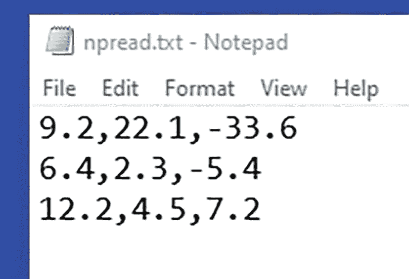

图 3-3

一个包含待读取的制表符逗号分隔数据的简单文本文件

一行代码即可将该文件的内容读取到一个 3x3 的 NumPy 数组/矩阵中：
```
np.loadtxt('npread.txt', delimiter=',')
>> array([[  9.2,  22.1, -33.6],
           [  6.4,   2.3,  -5.4],
           [ 12.2,   4.5,   7.2]])
```

你甚至可以只读取文件中的选定列。如果你总是从客户那里获得一个大型数据文件，但知道只有某些特定列对你的数据科学工作有用，那么这种方法尤其有用。然后，你可以仅将选定的数据加载到内存中，从而使你的处理流程快速高效。
```
np.loadtxt('npread.txt', delimiter=',', usecols=(0,2))
>> array([[  9.2, -33.6],
           [  6.4,  -5.4],
           [ 12.2,   7.2]])
```

想象一下，如果没有 NumPy 提供的这个实用工具函数，你将不得不编写多少自定义的文本读取代码。秉承高效数据科学的理念，并保持代码的整洁和可读性，请尽可能使用这些实用工具。

### 高效使用 pandas

在介绍了 NumPy 库的一些最佳实践和高效实用工具之后，现在让我们来看看 Python 生态系统中使用最广泛的数据分析包：pandas。你遇到的几乎每个数据科学家和分析师都会使用这个包。

pandas 在底层使用 NumPy，并与 Scikit-learn 等其他非常流行的 Python 库交互，这样你就可以在 pandas 中进行数据分析和整理工作，并将处理后的数据无缝传输到机器学习算法中。它还提供了丰富的从各种常见数据源（例如网页、HTML、CSV、Microsoft Excel、JSON 格式对象，甚至 zip 文件）读取数据的选项，这使得它在数据整理任务中非常宝贵。

然而，它是一个庞大的库，拥有众多方法和实用工具，可以通过多种方式来实现相同的最终目标。这使得不同的数据科学家（即使是在同一个团队内）很有可能使用不同的编程风格和模式来用 pandas 完成相同的工作。其中一些模式比其他的执行速度更快、更干净，应该优先采用。在本小节中，我将通过简单的示例介绍其中几个方面。

#### 在新 DataFrame 中设置值

pandas 提供了多种选项来索引、选择特定数据并将其设置为给定值。在许多情况下，你会发现自己有一个 Python 列表或 NumPy 数组，想要将其设置到 DataFrame 的特定位置（行）。

为了演示，让我们定义一个包含六个值的简单列表：
* `First name`（一个 Python 字符串对象）
* `Last name`（一个 Python 字符串对象）
* `Age`（一个 Python 整数对象）
* `Address`（一个 Python 字符串对象）
* `Price`（一个 Python 浮点数对象）
* `Date`（一个 Python 日期时间对象）
```
profile_data = ['First name', 'Last name', 30, 'An address', 25.2, today]
```

你有几种选项可以将这些数据插入到 DataFrame 的行中。请注意，在实际应用中，你可能会有字典或数千个这样的列表（都不同）。为了速度演示，我仅展示将相同的列表数据插入到 DataFrame 中。

你可以像这样创建一个空的 DataFrame，并显式定义列名：
```
df = pd.DataFrame(columns=['FirstName', 'LastName', 'Age', 'Address', 'Price', 'Date'])
```

现在进入迭代并将数据逐行插入的部分。

##### `.at` 或 `.iloc` 方法速度较慢

许多数据科学家一旦开始使用 DataFrame，就会使用 `.at` 或 `.iloc` 方法进行索引和切片。这些都是非常有用的方法，用于索引目的也是可以的。但是，在从头构建 DataFrame 时，尽量避免使用它们来插入/设置数据。

将 `N = 2000` 设置为速度测试参数，并运行以下代码来测量使用这些方法设置数据的速度：
```
%%timeit -n5 -r10
for i in range(N):
    df.at[i] = profile_data
>> 207 ms ± 58.6 ms per loop (mean ± std. dev. of 10 runs, 5 loops each)
```

以及

### 使用 `.values` 显著加快速度

`pandas.DataFrame.values` 方法返回 DataFrame 的 NumPy 表示，因此以最佳方式针对速度进行了优化。所以，如果你运行以下代码，将获得快得多的执行时间：

```
%%timeit -n5 -r10
for i in range(N):
    df.values[i] = profile_data
>> 12 ms ± 2.63 ms per loop (mean ± std. dev. of 10 runs, 5 loops each)
```

请注意，要使此代码生效，你必须有一个预先存在的包含 2000 行的 DataFrame。现在，使用这段代码设置新值比使用`.at`或`.iloc`方法快得多。但这不适用于新创建的、空的 DataFrame。

### 尽可能指定数据类型

让 pandas 猜测数据类型是最常见的低效代码模式之一，几乎所有数据科学家都遇到过这种情况。之所以效率低下，是因为当你将数据导入`DataFrame`时，如果没有明确告知 pandas 各列的数据类型，它会先将整个数据集读入内存，仅仅是为了确定数据类型。这自然会导致系统内存占用过高，产生大量资源浪费，而通过更明确的代码本可以避免这种浪费。

那么，如何将其作为标准做法呢？从磁盘读取数据通常是通过 CSV 等纯文本文件来完成的。你可以只读取 CSV 文件的前几行，确定数据类型，创建一个字典，然后在完整读取文件时使用该字典，或者反复使用它来读取相似文件（如果列类型不变）。你可以在各种 pandas 读取函数中使用`dtype`参数来指定预期的数据类型。

以下是实现此任务的样板代码。函数`csv_read()`接受一个`filename`（字符串）参数，并返回一个`DataFrame`。在内部，它首先读取前 20 行的样本数据（`nrows=20`），确定数据类型（`df_sample.dtypes`），创建这些类型的字典，然后通过传递该字典（`dtype = dt`）并显式指定类型来读取完整数据集：

```python
def csv_read(filename):
"""
使用显式数据类型读取 CSV 文件
"""
# 仅读取前 20 行
df_sample = pd.read_csv(filename, nrows=20)
# 构建数据类型字典
dt = {}
for col,dtyp in zip(df_sample.columns, df_sample.dtypes):
dt[col] = dtyp
# 使用显式数据类型完整读取
df1 = pd.read_csv(filename, dtype = dt)
return df1
```

图 3-4 以可视化方式展示了先读取样本数据、确定数据类型，然后将其用于完整数据读取的思路。

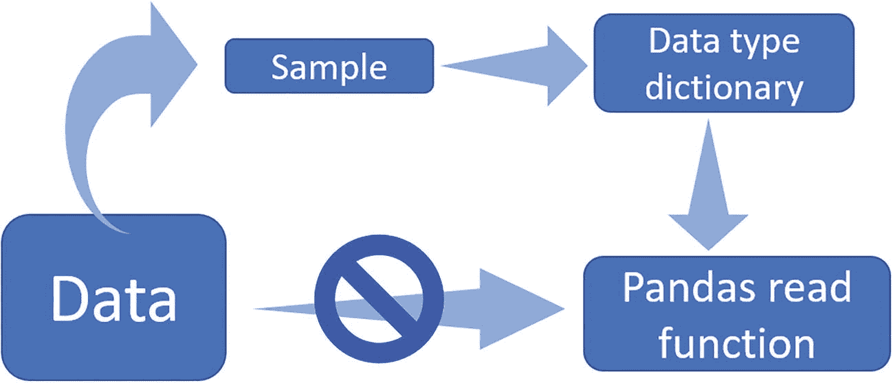

图 3-4 在 pandas 中读取大型数据文件时，先确定数据类型，然后在读取时显式指定它们

举一个实际的例子：假设每天早晨，你的数据处理流程必须读取昨晚存入数据仓库的所有业务交易生成的大型 CSV 文件。列名和类型保持不变，只有原始数据每天发生变化。你每天都要对新原始数据进行大量数据清洗和处理，以便将其传递给某个出色的机器学习算法。在这种情况下，你应该准备好数据类型字典，并在每天早晨将其传递给文件读取函数。同时，你仍然需要定期检查数据类型是否发生了变化（例如，整型变为浮点型，字符串变为布尔型）。

### 遍历 DataFrame

有一种非常常见的情况：你拿到一个大型 pandas `DataFrame`，需要逐行检查各列中不同字段之间的某些关系。这种检查可能是一些逻辑运算，或是对原始数据进行复杂的数学变换的条件逻辑。

本质上，这是一个遍历`DataFrame`行并在每次迭代中进行一些处理的简单场景。你可以从以下几种方法中选择。有趣的是，有些方法的效率远高于其他方法。

#### 暴力 *For 循环*

这种朴素方法的代码大致如下：

```python
for i in range(len(df)):
if (满足某个条件):
使用 df.iloc[i] 进行一些计算
```

本质上，你是使用通用的`for`循环遍历每一行（`df.iloc[i]`），并逐行处理它们。逻辑上没有错误，最终也能得到正确结果。

但这效率非常低。随着列数的增加或计算（或每次迭代中条件检查）复杂度的提升，你会发现耗时迅速累积。因此，为了构建可扩展且高效的数据科学管道，应尽可能避免使用此方法。

#### 更好的方法：`df.iterrows` 和 `df.values`

根据具体场景，你可能有两种更好的方法来完成这个迭代任务。

pandas 提供了一个专用的行迭代方法，名为`iterrows()`（[`pandas.pydata.org/pandas-docs/stable/reference/api/pandas.DataFrame.iterrows.html`](https://pandas.pydata.org/pandas-docs/stable/reference/api/pandas.DataFrame.iterrows.html)），在这种特定情况下使用起来可能很方便。根据`DataFrame`的大小和行操作的复杂程度，与`for`循环方法相比，这可以将总执行时间减少大约 10 倍。

你已经看到了 pandas 获取`DataFrame`的 NumPy 表示的方法：`df.values()`。这可以显著加快处理速度（甚至比`iterrows`更好）。然而，此方法会移除轴标签（列名），因此你必须使用通用的 NumPy 数组索引（如 0, 1）来处理数据。伪代码如下所示：

```python
for row in df.values:
if function(row) 满足某个条件:
使用 row 进行一些计算
```

关于比较多种 pandas 方法效率的清晰、完整的示例，可以在下面引用的文章中找到。它还展示了速度提升如何取决于每次迭代中特定操作的复杂程度。“Faster Iteration in pandas”（[`medium.com/productive-data-science/faster-iteration-in-pandas-15cac58d8226`](https://medium.com/productive-data-science/faster-iteration-in-pandas-15cac58d8226)），*Towards Data Science*，2021 年 7 月。

### 使用现代优化文件格式

`CSV` 是一种在数据分析中广泛使用的平面文件格式。它易于使用，在中小型数据场景下性能尚可。但是，当你处理更大的文件（并且可能还要为其基于云的存储付费）时，有很多充分的理由转向采用列式数据存储原理（[www.stitchdata.com/columnardatabase/](http://www.stitchdata.com/columnardatabase/)）的文件格式。列式数据存储（相对于传统的行式存储）的基本思想示意图如图 3-5 所示。

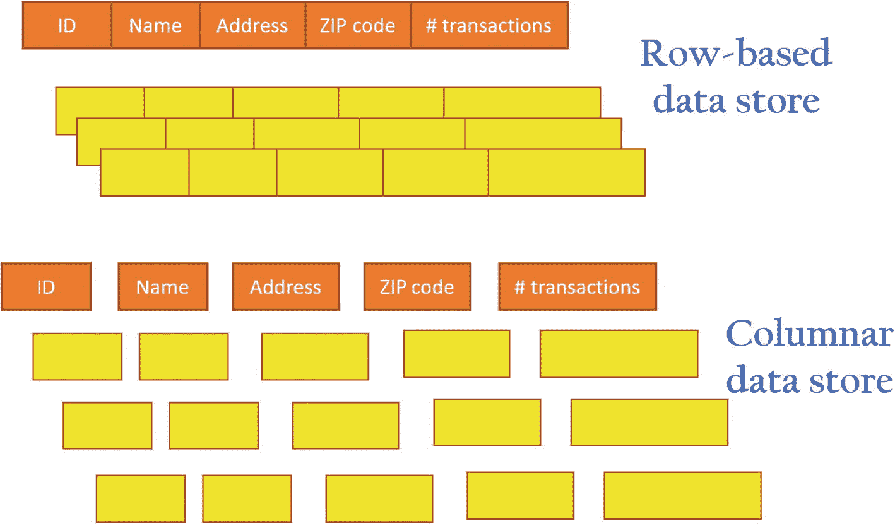

图 3-5 列式（相对于传统的行式）数据格式示意图

`Apache Parquet` 是最流行的列式文件格式之一。当你需要从磁盘或云存储中存储和读取大型数据文件时，它是一个绝佳的选择。Parquet 与 Apache Arrow 框架密切相关。那么，什么是 Apache Arrow？

根据其官方网站 [`arrow.apache.org/`](https://arrow.apache.org/) 的介绍，“*Apache Arrow 是一个用于内存分析的发展平台。它包含一系列技术，使大数据系统能够快速处理和移动数据。它规定了一种标准化的、与语言无关的列式内存格式，用于处理平面和层次化数据，旨在现代硬件上进行高效的分析操作。*”

因此，要利用这种列式存储格式，你需要使用某种 Python 绑定或工具，将存储在 Parquet 文件中的数据读入系统内存，并可能将其转换为 pandas `DataFrame` 以进行数据分析任务。这可以通过使用 PyArrow 框架来实现。

#### 惊人的速度提升

`PyArrow` 是 `Apache Arrow` 框架的 Python 绑定（API）。对 `Apache Arrow` 或 `PyArrow`（[`https://arrow.apache.org/docs/python/`](https://arrow.apache.org/docs/python/)）的详细讨论远远超出了本书的范围，但感兴趣的读者可以参考 [`https://arrow.apache.org/`](https://arrow.apache.org/) 上的官方文档来入门。

使用 `PyArrow` 函数 `read_table`，你可以展示其读取大型数据文件速度相比常用的 pandas `read_csv` 方法有显著提升。例如，图 3-6 展示了 pandas 和 PyArrow 分别读取存储为 CSV 和 Parquet 格式的相同数据所用的时间比。随着数据量的增加，这个比值会上升；对于更大的文件，PyArrow 的性能优势更为明显。

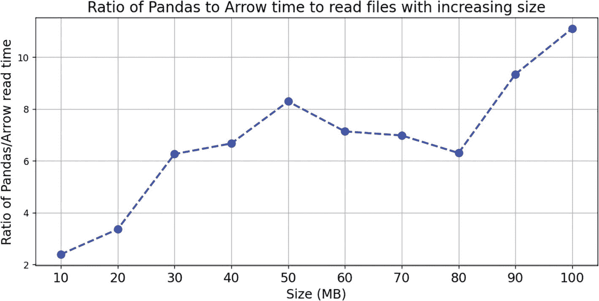

图 3-6

pandas 与 PyArrow 读取 CSV（和 Parquet）文件的时间比。来源：[https://towardsdatascience.com/how-fast-is-reading-parquet-file-with-arrow-vs-csv-with-pandas-2f8095722e94](https://towardsdatascience.com/how-fast-is-reading-parquet-file-with-arrow-vs-csv-with-pandas-2f8095722e94)，已获作者授权

这是一个非常值得深思的现象。pandas 基于快速高效的 NumPy 数组，却无法匹敌 Parquet 格式所展现出的文件读取性能。如果我们深入思考，原因就会变得清晰：文件读取操作与 pandas 在数据*被加载到*内存后如何优化数据的内存组织方式几乎无关。因此，尽管 pandas 可以成为内存分析中快速高效的包，但我们不必为了使用 pandas 而固守于 CSV 或 Excel 这类传统文件格式。相反，我们应该转向使用更现代、更高效的格式，例如 Parquet。

#### 只读取所需数据

通常，你可能不需要从列式存储文件中读取所有列。例如，你可能对数据应用一些过滤条件，只选择部分数据进行实际的内存处理。对于 CSV 文件或常规 SQL 数据库，这意味你从所有数据中选择特定的行。然而，对于列式数据库，这实际上意味着选择特定的列。因此，当你只从 Parquet 文件中读取一小部分列时，在读取速度方面你就拥有了优势。

图 3-7 展示了在相同的 CSV 与 Parquet 对比中，随着列数增加而体现的读取优势。当你读取非常小比例的列时（例如，从 100 列中读取少于 10 列），读取速度比可以高达 50 倍（即，与常规的 pandas CSV 文件读取相比，速度提升 50 倍）。当读取的列比例较大时，速度提升会逐渐减小，并稳定在一个恒定值。

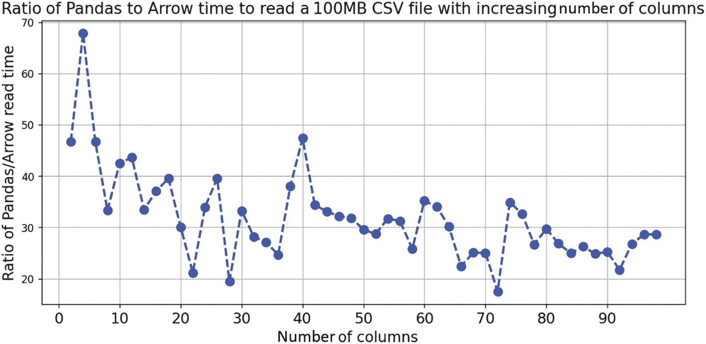

图 3-7

随着列数变化，pandas 与 PyArrow 读取 CSV（和 Parquet）文件的时间比。来源：[https://towardsdatascience.com/how-fast-is-reading-parquet-file-with-arrow-vs-csv-with-pandas-2f8095722e94](https://towardsdatascience.com/how-fast-is-reading-parquet-file-with-arrow-vs-csv-with-pandas-2f8095722e94)，已获作者授权

从大型数据集中读取选定的列是数据分析和机器学习任务中极其常见的情形。通常，领域专家会利用其专业知识为数据科学家提供建议，并可从大型数据集中预先选择少数几个特征，尽管默认的数据收集机制可能存储包含多列/多特征的文件。在这些情况下，只读取所需数据并将这些列用于机器学习工作负载是合乎逻辑的。将数据存储为 Parquet 这样的列式数据格式，在这些情况下会带来巨大回报。

#### PyArrow 与 pandas 的相互转换

虽然上述结果令人印象深刻，但核心问题在于如何利用这种快速高效的文件格式来完成基于 pandas 的数据分析任务。PyArrow 的工具方法使得这一点变得极其简单，如以下简单样板代码所示：

```python
import pyarrow as pa
import pandas as pd
df = pd.DataFrame({"a": [1, 2, 3],
    "b":[2.7,-1.2,5.4],
    "c": ['abc','xyz','pqr']})
# 从 pandas 转换为 Arrow
table = pa.Table.from_pandas(df)
# 转换回 pandas
df_new = table.to_pandas()
```

因此，存在现成的函数可以在 PyArrow 表和 pandas DataFrame 之间来回转换。你可以在图 3-8 所示场景中利用这一点。

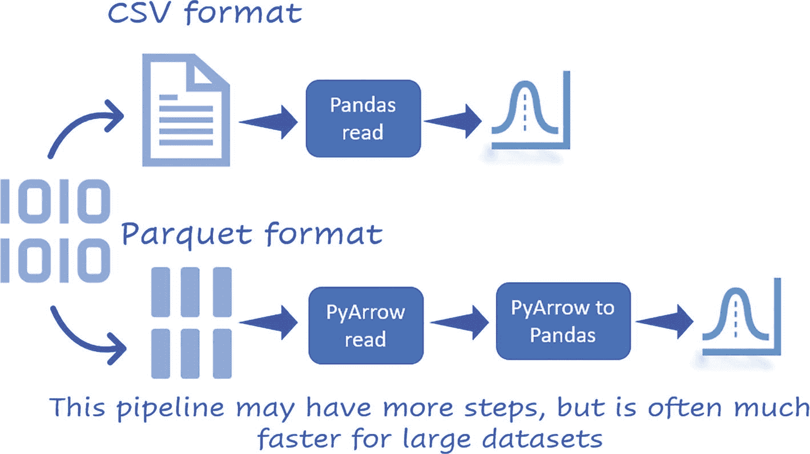

图 3-8

将大型数据集存储在 Parquet（相对于 CSV）中，可以为许多使用 pandas 的处理任务带来整体速度优势

假设你有一个包含约 100 万行和 14 列数值数据的大型 CSV 文件，并且你想要计算该数据集的基本描述性统计量。毫不意外的是，如果你只使用 pandas 代码，大部分时间将花费在文件读取操作上，而不是统计计算上。你可以通过将文件存储为 Parquet 格式（而非 CSV），使用 `read_table` 方法读取，使用 `to_pandas` 方法转换为 pandas 格式，进行统计计算，最后将结果存回 CSV 或 Parquet，从而使此任务更高效。输出结果仅包含几行/几列，因为它仅仅是描述性统计量，所以文件格式并不重要。本书附带的 Jupyter notebook 中提供了一个带有速度比较的演示示例。

### 其他杂项建议

pandas 是一个庞大且历史悠久的库，在使用它时，有成千上万种方法可以改进低效和非生产性的代码模式。这里提供几项杂项建议。

#### 定期清理孤立 DataFrame

一个非常常见的编程模式如下：

*   从内存中的对象或磁盘上的文件创建 DataFrame。

*   删除或填充 Null 或 NaN 值。

*   在某些列上应用用户自定义函数。

*   按某个特定列对最终数据集进行分组。

*   对分组后的对象进行进一步处理……

数据科学家在执行此流程时经常会创建中间 DataFrame，并且没有将它们从活动内存空间中移除，从而堆积了大量孤立或未使用的 DataFrame，成为占用大量内存的垃圾。

```python
df1 = pd.read_csv("A large file")
df2 = df1.dropna()
df3 = df2.apply(user_function, columns = [...])
df4 = df3.groupby([column_1, column_2])
df_final = ...
```

如果唯一重要的内存对象是 `df_final`，那么你必须在所有中间 DataFrame 使用完毕后主动跟踪并删除它们：

```python
df1 = pd.read_csv("A large file")
df2 = df1.dropna()
del(df1)
df3 = df2.apply(user_function, columns = [...])
del(df2)
df4 = df3.groupby([column_1, column_2])
del(df3)
df_final = ...
```

#### 方法链

延续上面的例子，为了让代码库更高效，让系统处理所有中间 DataFrame 对象的主动跟踪和删除是很有意义的。pandas 支持方法链，这使得实现这种方法相对容易。代码可以写成这样：

```python
df_final = pd.read_csv("A large file").dropna().apply(user_function, columns = [...]).groupby([column_1, column_2])
```

只要方法及其链式代码可读性强，这就是一种完全合理的方法。

#### 利用专用库提升性能

事实上，有不少外部库可以显著加速 `pandas` 任务。它们包括但不限于以下几种：

- 使用专用管道构建库

- 利用即时编译（`https://en.wikipedia.org/wiki/Just-in-time_compilation`）及其他数值计算技巧的库

- 使用并行处理和大数据辅助框架，将 `pandas` 工作负载分布到多个计算核心及内存外空间

- 使用 GPU 加速计算（`https://medium.com/dataseries/gpu-powered-data-science-not-deep-learning-with-rapids-29f9ed8d51f3as`）作为 `pandas` 的替代方案，且对 API 和代码库的改动极小

上述每个思路都需要相当篇幅才能进行合理详尽的讨论。因此，我会在后面章节中分别介绍。

## 利用 Matplotlib 与 Seaborn 实现高效 EDA

`Matplotlib` 和 `Seaborn` 是 Python 生态系统中数据科学任务广泛使用的两个可视化库。两者结合，提供了无与伦比的多功能性、丰富的图形选项，以及与 Python 数据科学生态系统的深度集成，足以实现你能想到的任何视觉分析。

然而，在某些常见情况下，你可能会以低效的方式使用这些出色的库。此外，你或许还会浪费宝贵的时间编写不必要的代码，或使用额外工具来让可视化分析的最终产品更具表现力——而这些本可以通过简单修改 `Matplotlib` 和 `Seaborn` 的设置来完成。在本节中，我将介绍一些实用技巧，助你在使用这两个库时提升数据科学与分析任务的效率。

### 拥抱 Matplotlib 的面向对象特性

`Matplotlib` 的设计匠心独运（`www.aosabook.org/en/matplotlib.html`），遵循了多层抽象与面向对象设计层级（如图 3-9 所示）。数据科学家通常只会用到脚本层来快速绘制图表（例如 `plt.scatter(x, y)`），并调整图形输出的外观与风格（例如 `plt.xlabel("x 轴变量", fontsize=15)`）。有时，他们也会涉足中间的艺术层，创建自定义的 `Axes` 并设置 `Figure` 对象的属性。在常规的数据分析任务中，数据科学家通常无需直接与后端层打交道。


图 3-9 Matplotlib 的分层架构及核心抽象/对象

不过，数据科学家若能深入了解这种分层架构，并遵循利用坚实的面向对象设计优势的最佳实践，将是极好的素养。在处理某些特定情况（例如涉及子图）时，这种知识的价值尤为凸显。

#### 使用子图创建面板的两种方法

一个体现良好实践的简单例子是：**不要使用以下旧式代码**来创建两个垂直堆叠的子图或面板：

```python
# 创建主图
plt.figure()
# 第一个面板
plt.subplot(2, 1, 1) # (行数, 列数, 面板编号)
plt.plot(x, np.sin(x))
# 第二个面板
plt.subplot(2, 1, 2)
plt.plot(x, np.cos(x));
```

更好的替代方案是使用以下代码：

```python
# 创建包含两个 Axes 对象的数组
fig, ax = plt.subplots(2)
# 在相应对象上调用 plot() 方法
ax[0].plot(x, np.sin(x))
ax[1].plot(x, np.cos(x))
```

它们会生成完全相同的图形输出，如图 3-10 所示。

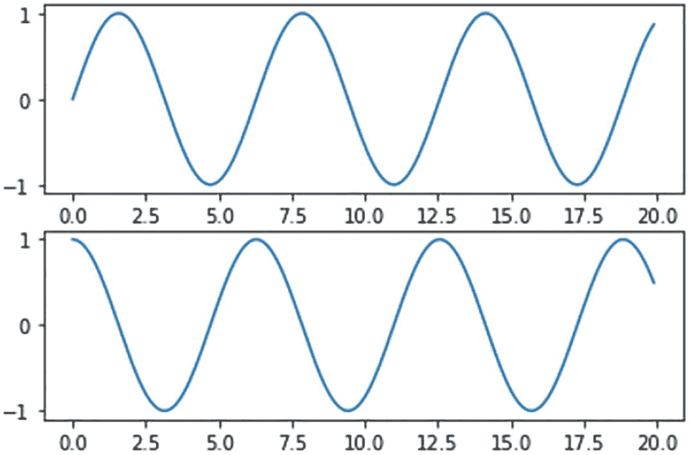

图 3-10 Matplotlib 子图面板示例

但为什么第二种方法更好或效率更高？想象一下，如果是 5 个或 15 个图而不是 2 个，你需要承受多大的认知负担？而像 `plt.subplot(3, 1, 3)` 或 `plt.subplot(4, 4, 13)` 这样的代码又有多大概率引入 bug？你该如何追踪 `plt.subplot()` 函数内部的所有那些参数？第二种方法让你摆脱了这些烦恼：你只需传入一个简单的数字（如 2 或 15），然后重复执行相应次数的绘图语句即可。

然而，还有一种更好的方法：将这段代码封装成一个恰当的函数，使其具备更强的智能来应对任意数量的子图，并通过循环来重构绘图语句。

#### 一个巧妙函数带来的更佳方案

请看以下定义函数的代码，该函数能够生成包含任意数量子图的面板（始终采用符合网页或书籍自然宽度的三列格式），并动态调整行数以匹配总的子图数量：

```python
def plot_panels(n):
"""
生成一个由可变行数和 3 列组成的面板
"""
if n%3==0:
nrows =  int(n/3)
else:
nrows = n//3+1
ncols = 3
fig, ax = plt.subplots(nrows, ncols, figsize=(15, nrows*3))
axes = ax.ravel()
for i in range(n):
axes[i].plot(x, np.sin(x))
```

在这里，你可以将变量 `n` 改为任意值。函数内部会根据代码逻辑自动计算合适的行数，并设定 `ncols = 3`。此处，`ax` 是一个（多维的）Matplotlib `Axes` 对象列表（`https://matplotlib.org/stable/api/axes_api.html`），因此你可以通过 `axes = ax.ravel()` 语句将其展平后，在循环中使用 `axes[i]` 进行索引。

当你用 `plot_panels(5)` 调用此函数时，会得到如图 3-11 所示的结果。

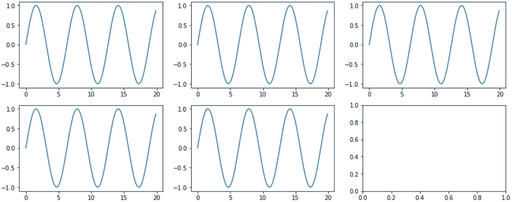

图 3-11 使用五个子图的 Matplotlib 面板函数输出结果

请注意最后一行空白的画布。这是因为子图必须排列成矩形网格，而五个子图需要放置在 3×2 的网格中，因此最后一个位置就会留空。当你用 `plot_panels(15)` 调用同一函数时，会得到如图 3-12 所示的结果。

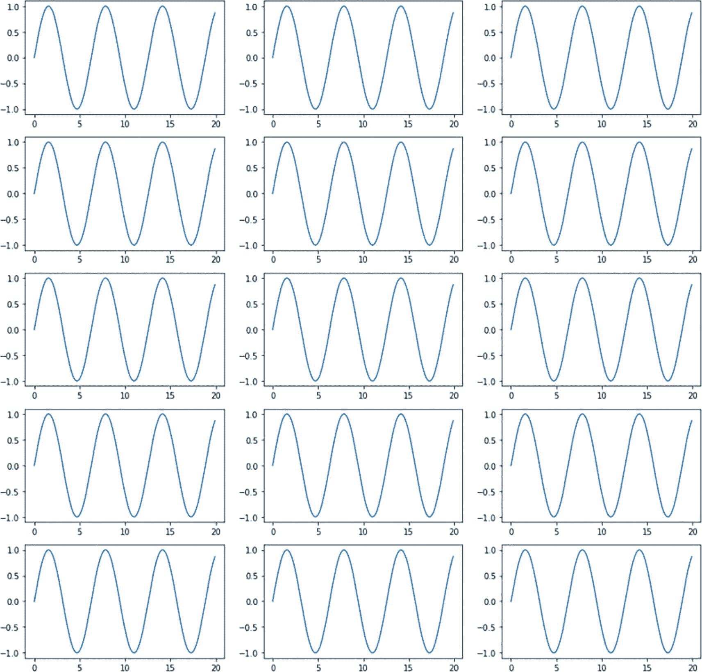

图 3-12 使用 15 个子图的 Matplotlib 面板函数输出结果

正是你在函数定义中所秉承的面向对象编程范式，才造就了这种可扩展且高效的机制：能够生成任意数量的子图，而无需担心潜在的错误。从长远来看，这种实践方式有助于提升代码库的生产力。

### 设定并控制图像质量

`Matplotlib` 以复杂的方式与用户的图形输出系统（网页浏览器或独立窗口）交互，并通过内部设置的精妙平衡来优化输出图像的质量。不过，我们仍然可以根据用户的偏好调整这些设置，以获得他们期望的最优质量。

这一点在使用 `Matplotlib` 于 Jupyter notebook 环境时尤其重要，而这种情况极为常见。在 Jupyter notebook 的网页浏览器中渲染出的默认图像质量，可能不足以用于书籍出版或进一步处理。数据科学家常常需要花费额外的时间和精力来提升他们在数据科学任务中产生的可视化效果。然而，`Matplotlib` 本身提供了一种简单直观的解决方法来实现同样的目标。

#### 在 `plt.figure()` 中直接设置 DPI

只需一个参数即可轻松设置每英寸点数：

```python
plt.figure(figsize=(6,4),dpi=150)
plt.plot(x,y)
```

在 Jupyter notebook 中，默认的 DPI 值相当低。根据你的系统设置，通常在 70 到 100 之间。当你增大这个值时，图形也会随之变大，所以必须注意不要让图像在浏览器窗口中被裁剪。

#### 为保存图形设置 DPI 和输出格式

此外，或者作为替代方案，你可能还希望将图表作为文件对象保存到本地磁盘以供日后使用。你可以选择 DPI 和输出格式：

```python
plt.figure(figsize=(6,4))
plt.plot(x,y)
plt.title("Parabola", fontsize=16)
plt.xlabel('x-axis')
plt.ylabel('y-axis')
plt.savefig("Parabola.png",
dpi=300,
format = 'png')
```

当你选择 JPEG 作为输出格式时，你可以控制一系列与 JPEG 压缩相关的其他设置。然而，就适合出版的质量而言，PNG 或 PDF 是更好的选择，因为它们是无损格式。

如何选择合适的 DPI？这当然取决于预期用途。对于打印来说，150dpi 被认为是低质量打印，尽管 72dpi 被视为网络标准（这也是为什么直接从网络打印出高质量图像并非易事）。低分辨率图像在打印后会出现模糊和像素化（[`https://en.wikipedia.org/wiki/Pixilation`](https://en.wikipedia.org/wiki/Pixilation)）。中等分辨率图像在 200dpi 到 300dpi 之间。高质量照片和图像的行业标准通常是 300dpi。

#### 调整全局参数

Matplotlib 后端在设置控制可视化外观和感觉的全局参数方面提供了极大的灵活性。`rcParams` 设置（[`https://matplotlib.org/stable/api/matplotlib_configuration_api.html#matplotlib.RcParams`](https://matplotlib.org/stable/api/matplotlib_configuration_api.html%2523matplotlib.RcParams)）包含了你能想到的所有可能变体。以下是一个代码示例：

```
import matplotlib as mpl
# 数据
x = np.arange(-10,10,0.1)
y = x**2
# 设置所有后端参数
mpl.rcParams['lines.linewidth'] = 3
mpl.rcParams['text.color'] = 'red'
mpl.rcParams['lines.linestyle'] = '--'
mpl.rcParams['axes.facecolor'] = '#c3e2e6'
mpl.rcParams['figure.dpi'] = 120
mpl.rcParams['font.style'] = 'italic'
mpl.rcParams['font.weight'] = 'heavy'
# 绘图
plt.plot(x,y)
plt.title("Parabola", fontsize=16)
plt.xlabel('x-axis')
plt.ylabel('y-axis')
```

请注意，你必须使用语句 `import matplotlib as mpl` 来导入 Matplotlib 模块本身，而不仅仅是使用 `matplotlib.pyplot as plt`。还要注意，`figure.dpi` 是你在此代码中设置的众多参数之一。此设置的一个典型结果如图 3-13 所示。

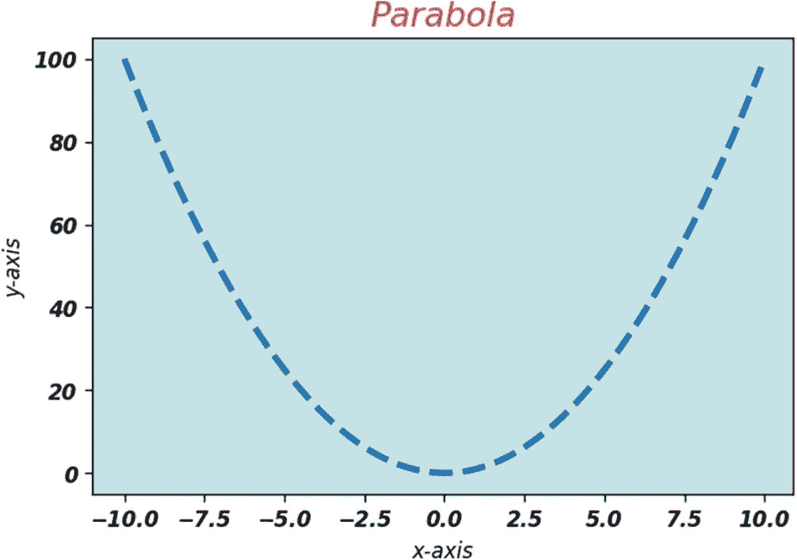

**图 3-13** Matplotlib 全局 `rcParams` 更改示意图

如果你已经确定了一套图像质量和样式设置，你可以将它们存储在一个本地配置文件中，然后在导入 Matplotlib 时，在 Jupyter notebook 或 Python 脚本的开头读取这些值。这样，该脚本或该 Jupyter 会话生成的每一幅图像都将具有相同的外观和感觉。上述代码的输出应类似于图 3-13。

你注意到上面代码中 `axes.facecolor` 被设置成了十六进制字符串 `#c3e2e6` 吗？Matplotlib 在其各种内部设置中接受常规颜色名称（如 red、green 或 blue）或十六进制字符串。你可以简单地使用在线颜色选择工具（[`https://imagecolorpicker.com/`](https://imagecolorpicker.com/)）并复制粘贴十六进制代码，以便为你的图像进行更好的样式设置。

### Seaborn 使用技巧

Seaborn 是一个构建在 Matplotlib 之上的 Python 库，专注于统计可视化，如箱线图、直方图和回归图。很自然，对于数据科学家来说，在典型的探索性数据分析（EDA）阶段，它是一个很棒的工具。然而，通过几个简单的技巧使用 Seaborn 可以提高你 EDA 任务的效率。

#### 对大型数据集使用采样数据

Seaborn 提供了出色的 API/方法，用于在数据集的所有特征/变量上生成美观的可视化：

-   成对图（将数据集中的每个变量与另一个变量关联起来）

-   直方图

-   箱线图

为所有特征及其成对组合（对于成对图）生成所有这些图可能很诱人。然而，根据数据量和成对图可能的组合数量，原始视觉元素的数量可能多到让你的系统难以处理。

这种情况的一个快速解决方案是`使用数据集的随机样本（一小部分）来生成所有这些图`。如果数据不是特别偏斜，那么通过查看一个随机样本（或其中的几个），无论如何，你通常应该能从典型的 EDA 中获得对模式和分布的良好感觉。

一个样板代码如下所示：

```
N = 100
df_sample = df.sample(N)
plot_seaborn(df_sample)
```

这里你只将原始 `DataFrame` 中的 100 个样本传递给绘图函数。请注意，为了保持可读性和数据结构完整性，你不应该从 `DataFrame` 中随机抽取 100 行，而应使用内置函数返回另一个 `DataFrame`，并将其传递给绘图函数。

#### 将 pandas 相关性分析与 Seaborn 热力图结合使用

这是一个技巧，用于`仅用两行代码快速可视化数据集中多个特征之间的相关性强弱`。这类技巧应该成为你高效数据科学工具包的标准组成部分。

以下是一个代码片段：

```
df_mpg = sns.load_dataset('mpg')
mpg_corr = df_mpg.corr()
sns.heatmap(mpg_corr,cbar=True,cmap='plasma')
plt.show()
```

这段代码加载了著名的 Auto MPG 数据集（[`https://archive.ics.uci.edu/ml/datasets/auto+mpg`](https://archive.ics.uci.edu/ml/datasets/auto%252Bmpg)），并生成了如图 3-14 所示的相关性热力图，展示了数据集中各种数值特征之间的正相关和负相关强度。此图中明亮的颜色以及斜体/粗体的坐标轴名称，是你在上一节中进行的 Matplotlib 样式设置的结果。除非你显式更改它们或启动一个新的 Jupyter notebook 会话，否则它们将保持生效。

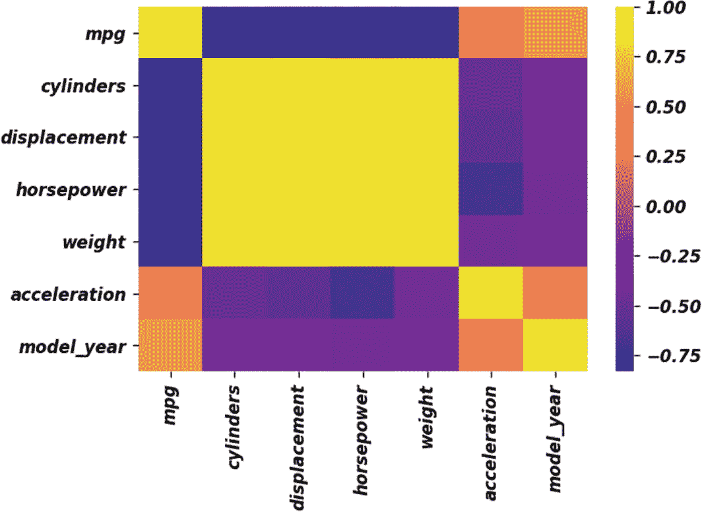

**图 3-14** 结合使用 `pandas` 相关性函数和 `Seaborn` 热力图，快速获取任意数据集的相关性可视化

#### 使用 Seaborn 特殊方法减少工作量

`Seaborn` 提供了一些特殊的方法/绘图工具，可以减少数据科学家在常见任务上的工作量，从而提高效率。应抓住一切机会使用这些工具。例如：

-   使用 `residplot` 进行线性回归并创建残差图

-   使用 `countplot` 统计分类变量的出现次数并绘制图表

-   使用 `clustermap` 从矩阵数据集创建分层彩色图表

## 总结

在本章中，我首先阐述了 NumPy 为何比原生 Python 代码更快，并列举了它在简单场景下的速度优势。我讨论了在进行数值处理前将列表、元组等 Python 对象转换为 NumPy 数组的利弊。接着，我强调了尽可能向量化操作对于构建高效数据科学流水线的重要性。我还介绍了 NumPy 提供的一些读取工具，以及它们如何让代码更简洁高效。

接下来，我深入探讨了如何高效使用 `pandas` 框架，介绍了遍历 `DataFrame`、访问或设置值的多种方法。文中详细讨论了使用 Parquet（在 Apache Arrow 和列式数据存储的背景下）等现代化、优化的文件存储格式。随后，我还提及了诸如链式调用和清理孤立 `DataFrame` 等其他想法。

最后，我展示了一些与流行可视化库 `Matplotlib` 和 `Seaborn` 配合使用的技巧。`Matplotlib` 面向对象的分层结构被视为构建高效数据科学绘图代码的坚实基础。我还演示了多种全局控制图像质量和绘图设置的方法（例如，针对 Python 或 Jupyter 会话）。采样数据作为一种控制大型数据集可能导致的图表爆炸问题的思路也得到了讨论。

这类技巧是随着时间推移，基于处理实际项目中高效利用时间和计算资源的数据集时产生的数据分析、数值计算和探索性数据可视化需求而逐步发展起来的。作为一名常规的数据科学实践者，你也会发展出自己的技巧，使数据分析和建模代码更高效。本章的内容只是引导你朝这个方向思考的入门指导。