# 4. 更高效地编写机器学习代码

数据科学家往往有着与传统计算机科学/软件工程相去甚远的背景，例如物理、生物、统计、经济和电气工程。遗憾的是，针对非软件工程背景的数据科学家和机器学习从业者的教程并不多见。

数据科学家在工作中大量使用 Python。为什么？因为它对机器学习和数据科学社区来说非常棒。它是现代数据驱动分析和人工智能应用中使用最广泛的主流语言。然而，Python 也用于简单的脚本编写、自动化任务、测试假设、创建用于头脑风暴的交互式图表、控制实验室仪器等。但用于软件开发的 Python 和用于脚本编写的 Python 并非同一回事，至少在数据科学领域是这样。

脚本编写（主要）是你为自己编写的代码。软件则是你（和其他队友）为他人编写的代码集合。明智的做法是承认，当（大多数）非软件工程背景的数据科学家为人工智能/机器学习模型和统计分析编写 Python 程序时，他们倾向于主要为自己编写这类代码。

编写高质量、生产级别的代码是一项需要终生学习和磨练的技能。这是软件工程师和开发者的谋生之道。并非所有数据科学家都有动力和驱动力去掌握这些技能。然而，一些简单的好习惯是可以在日常工作中学习和应用的。

本章将通过一些使用 `scikit-learn` 库的动手示例，带你踏上这段旅程。第 5 章和第 6 章将在此基础上进行扩展和深化。

## 为何（以及如何）为机器学习模块化代码

编写模块化、组织良好的代码几乎总是能带来长期回报。这个习惯能在调试和排查问题时节省时间和认知精力。精心规划的模块化代码看上去很优雅。它通常易读，并能自然吸引其他团队成员以协作方式帮助你并为你的工作做出贡献。这当然会提升产品/服务的整体质量和健壮性。

但如何决定将哪些内容模块化？甚至如何开始思考这个问题？以下是在处理任何数据科学项目时你可以问自己的一些问题。

### 必须不惜一切代价避免意大利面条式代码

仓促编写的代码虽然能完成任务，但无法良好扩展，这是数据科学实践中随处可见的“烂代码”或“意大利面条式代码”的典型例子。这类代码也可能源于规划不周、未遵循设计良好的编码风格、未遵守任何面向对象编程模式等。从根本上说，这种意大利面条式代码容易出错，极难扩展和调试，并且不利于生产级使用。

### 自问的问题

即使你从未上过软件工程课程，一些想法也可能自然而然产生。你所要做的就是设身处地为他人着想，思考那个人将如何建设性地使用你的代码。

* 如果你的分析中有一个代码块出现了不止一次（完全相同的形式或略有变化），你能把它做成一个函数吗？
* 当你创建这样一个函数时，哪些参数需要传入？哪些可以是可选的？默认值是什么？
* 如果遇到不知道需要传入多少个参数的情况，你是否使用了 Python 提供的 `*args` 和 `**kwargs`？
* 你是否为那个函数编写了文档字符串（docstring），以便让他人了解函数的功能、期望的参数并附带示例？
* 当你收集了一堆这样的工具函数后，你还在同一个笔记本上工作，还是切换到一个新的、干净的笔记本，仅通过 `from my_utility_script import func1, func2, func3` 来调用？（你是否将 `my_utility_script` 创建为一个简单的 Python 文件，而不是 Jupyter 笔记本？）
* 你是否将 `my_utility_script` 放入一个目录，并在同一目录中放置一个 `__init__.py` 文件（即使是空文件），使其成为一个像 NumPy 或 Pandas 那样可导入的 Python 模块？
* 你是否考虑过不仅从 NumPy 和 TensorFlow 等包中导入类和方法，还要向它们添加你自己的方法，从而扩展其功能？


### 从标准数据科学流程开始简单入门

首先，让我们考虑一个标准的数据科学任务流程，以便你能组织编码方法，遵循模块化思维。甚至在写一行代码之前，你可以在脑海中组织（*模块化*）任务并计划独立的模块，如图 4-1 所示。

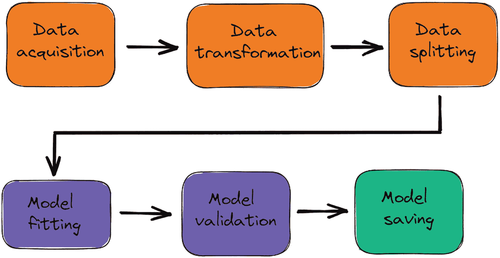

**图 4-1** 一个标准的数据科学流程，以模块化方式（在你的脑海中）组织，以便在代码中实现

为什么是这三种颜色（橙色、蓝色和绿色）？它们只是代表任务的三种主要类型：分别与数据相关、算法相关和部署相关。部署部分在此高度压缩，仅用这个单一的模型保存任务来表示。在实际的生产场景中，会有许多与之相关的模块，但所有这些模块都可以从这个模块开始，你可以将验证后的模型作为软件工件（例如，一个 Python pickle 文件）保存并输出。

然而，图 4-1 的主要思想是强调这些任务模块化的范围和必要性。作为数据科学从业者，你通常在 Jupyter notebook 中定期执行这些任务。为了拥抱高效的数据科学，你需要组织甚至超越 notebook 的思维，走向这种模块化。

让我们通过一个熟悉的 `scikit-learn` 示例来看看如何操作。

### 一个 Scikit-learn 任务流程示例

在这个示例中，你将使用著名的乳腺癌数据集（[`https://archive.ics.uci.edu/ml/datasets/breast+cancer`](https://archive.ics.uci.edu/ml/datasets/breast%252Bcancer)），并为其构建一个简单的逻辑回归分类器。任务很简单，但关键的学习点在于如何以模块化的编码实践来对待这个流程。

#### 单体示例

与模块化代码相反的是*单体代码*：所有代码都在单个文件或 Jupyter notebook 中。你可以一次性写出这个单体代码：

```python
from sklearn.datasets import load_breast_cancer
from sklearn.linear_model import LogisticRegression

# 数据加载
data = load_breast_cancer()
X, y = data['data'], data['target']
# 一些可视化探索
features_avg = []
for i in range(30):
    features_avg.append(X[:,i].mean())
plt.figure(figsize=(4,6),dpi=100)
plt.barh(y=['特征-'+str(i) for i in range(30)],width=features_avg)
plt.xlabel("特征平均值")
plt.show()
# 模型构建
clf = LogisticRegression(random_state=0,
                         max_iter=500,
                         class_weight='balanced').fit(X, y)
clf.score(X, y)
# 交叉验证
scores = cross_val_score(clf, X, y, cv=5)
scores
print(f"准确率 {scores.mean()}，标准差为 {scores.std()}")
# 模型保存
```

**上面的单体代码中所有东西都混在一起了**：导入、数据加载、模型构建、验证和保存。它有一些独立的代码，比如 `clf.score(X, y)`，**这些代码仅在 Jupyter notebook 单元格中有意义**。它有一个打印语句，这在探索和实验阶段没问题，但可能不适用于高效的代码库。它在 notebook 中运行良好，但如果出现 bug 或模型需要调整，则很难排查。

让我们看看如何清晰地划分代码，并为同一任务构建一个模块化的代码库。

#### 小盒子，小盒子……

划分或装箱对于软件开发很重要。这也越来越适用于高效的数据科学工作。对于上面的代码片段，你可以轻松地创建这些小盒子。你首先将不同任务的代码块从 Jupyter notebook 复制到单独的 Python 脚本或独立文件中。这个想法如图 4-2 所示。

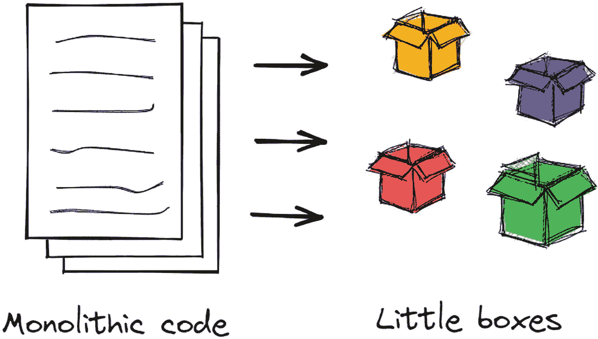

**图 4-2** 从单体代码到构建小盒子

首先，这段代码仅用于**数据加载**：

```python
from sklearn.datasets import load_breast_cancer

def load_data():
    """
    加载数据并返回 Numpy 数组
    """
    data = load_breast_cancer()
    X = data['data']
    y = data['target']
    return X, y
```

就这样。**一个只做一件工作的单一函数**。它保存在一个名为 `load_data.py` 的文件中。模块化代码强烈鼓励使用单一用途的函数，而不是脚本中的独立代码语句。这就是此处展示的内容。

接下来，**数据拆分**为测试集和训练集：

```python
from sklearn.model_selection import train_test_split

def data_split(X, y,
               test_size=0.3,
               random_state=42):
    """
    随机拆分为测试集和训练集
    并以 Numpy 数组形式返回
    """
    X_train, X_test, y_train, y_test = train_test_split(
        X, y, test_size=test_size, random_state=random_state)
    return X_train, X_test, y_train, y_test
```

注意使用了默认变量 `test_size` 和 `random_state`，以防你想针对实验目的调整测试集比例或不同的随机初始化。

接下来，**模型拟合**代码：

```python
from sklearn.linear_model import LogisticRegression
import numpy as np

def model_fit(X_train, y_train,
              max_iter=500):
    """
    使用训练数据拟合模型。
    返回拟合后的估算器。
    """
    class_zero, class_one = np.bincount(y_train)
    class_ratio = class_zero / class_one
    if class_ratio > 1.25 or class_ratio < 0.8:
        clf = LogisticRegression(max_iter=max_iter,
                                 class_weight='balanced')
    else:
        clf = LogisticRegression(max_iter=max_iter)
    clf.fit(X_train, y_train)
    return clf
```

在保存这个拟合好的模型之前，你需要对测试集数据进行一些交叉验证。因此，**交叉验证**代码如下：

```python
from sklearn.model_selection import cross_val_score

def cross_validate(clf, X_train, y_train, cv=10):
    """
    对模型进行交叉验证。
    返回一个分数数组。
    """
    scores = cross_val_score(clf, X_train, y_train, cv=cv)
    return scores
```

你会得到一个 NumPy 数组的交叉验证分数。最后，你需要保存/打包模型。但你可能只希望在交叉验证分数的平均值超过某个阈值时才保存模型。否则，你可以回去调整模型或寻找更多数据（在此示例中数据集是固定的，但总体思路是有效的）。

因此，你的最终**模型保存**代码如下所示：

```python
from joblib import dump, load

def model_save(clf, scores, threshold=0.9):
    """
    根据交叉验证分数保存模型
    """
    if scores.mean() > threshold:
        dump(clf, 'logistic_model.joblib')
        return 1
    else:
        return 0
```

注意，你使用的是 **joblib** 库而不是 `pickle`，以便更高效、更紧凑地存储 `scikit-learn` 估算器。描述见这里：[`https://scikit-learn.org/stable/model_persistence.html`](https://scikit-learn.org/stable/model_persistence.html)。

好了，你已经为数据科学任务创建了模块化代码。接下来呢？


### 如何使用模块化代码

创建这些模块后，目录结构可能如图 4-3 所示。请注意底部的 Jupyter notebook（已圈出）。这就是你代码模块化后的成果。

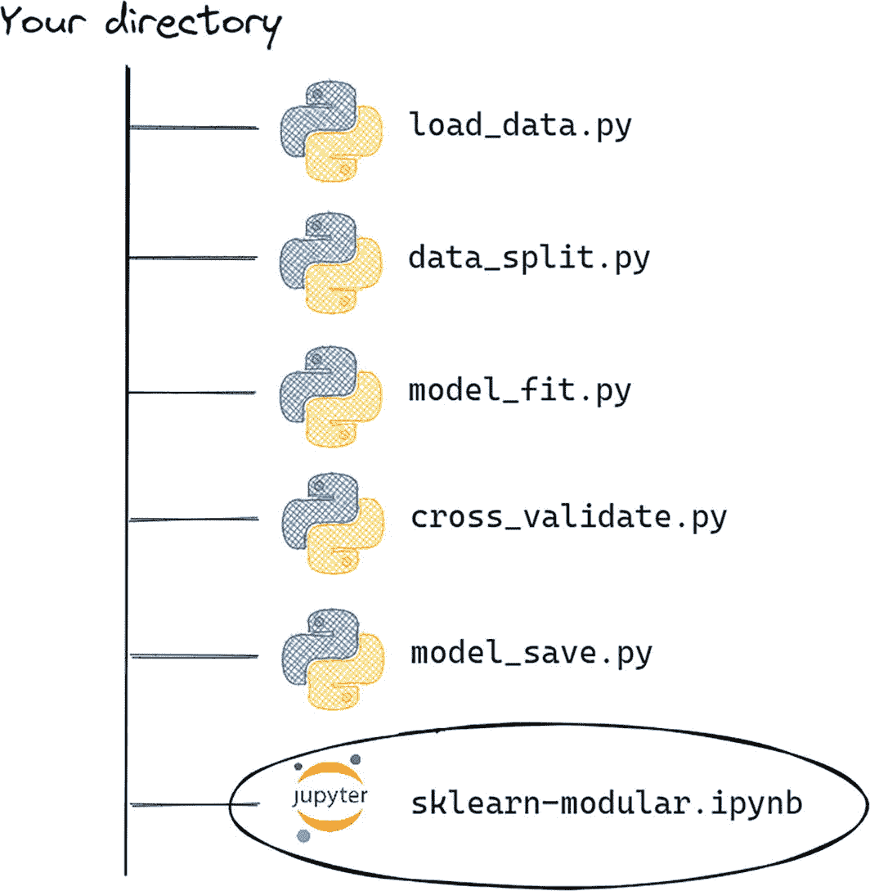

图 4-3: 用于各种机器学习任务的目录中的 Python 脚本/模块

你的 notebook 比你之前杂乱无章的代码**看起来更简洁、更易读**。如果你检查那个 Jupyter notebook，可能会看到类似图 4-4 的内容。

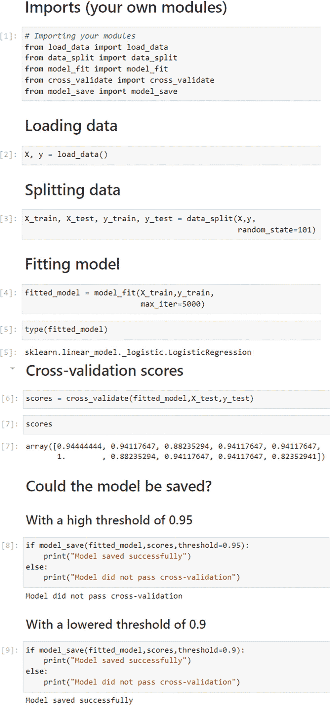

图 4-4: 代码模块化后典型的 Jupyter notebook（更简洁、更紧凑）

这种方法的关键优势在于，你可以**独立地、无需修改主 notebook 代码**来操控任务的以下方面：

-   数据源（只需修改`load_data.py`文件）
-   数据划分选项（只需修改`data_split.py`文件）
-   模型和超参数的选择（只需修改`model_fit.py`文件）
-   交叉验证策略和选项（只需修改`cross_validate.py`文件）
-   是否保存模型的决策（只需修改`model_save.py`文件）

此外，请注意每个模块的输入和输出是如何通过聚焦且目标明确的函数定义来控制的。这让你有机会**验证并检查每个模块的预期输出**。这意味着，如果数据或模型因某种原因损坏，你可以在其进入模型拟合或保存阶段之前及时发现。这节省了基础设施成本，并增强了整个机器学习平台的鲁棒性。

图 4-5 展示了针对每个核心模块的独立测试/验证块的概念。图中还展示了一个`system_config.json`文件，该文件可能存储了交叉验证的阈值，以及`model_save.py`文件，用于在保存模型前检查当前模型的性能是否符合该标准。

你能想象在一个庞大的 Jupyter notebook 中实现所有这些灵活性和可能性吗？

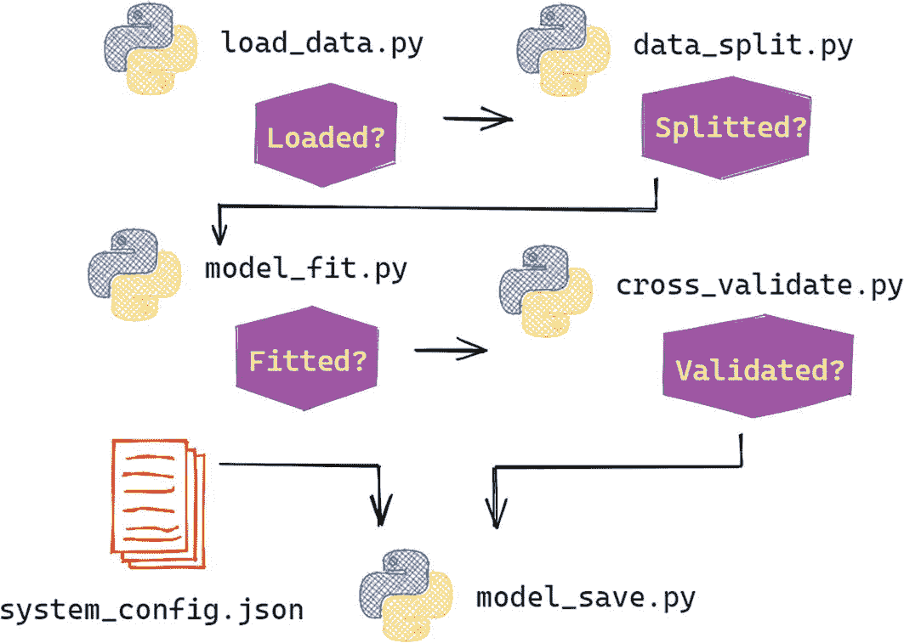

图 4-5: 结合数据/模型验证检查和系统配置文件使用的模块化代码

## 以自动化方式系统评估机器学习算法

如本章开头所述，除了模块化，高效数据科学代码的另一个核心支柱是自动化。我们经常编写重复的代码，这可能会引入错误并降低效率。

典型数据科学工作流中最常见的任务之一是将相同的数据通过多个机器学习算法运行，然后根据某个预定的指标选择最佳的算法。在本节中，你将学习一个自动化此评估任务的实践示例。

### 分类器列表

首先，你需要为此评估挑选 scikit-learn 的估算器（及其超参数）。你可以定义一个包含这些对象的列表：

```python
classifiers = [
    LogisticRegression(C=0.1, n_jobs=-1),
    KNeighborsClassifier(10, n_jobs=-1),
    SVC(kernel="linear", C=0.1),
    SVC(gamma='scale', C=1),
    DecisionTreeClassifier(max_depth=10, min_samples_leaf=10),
    RandomForestClassifier(max_depth=3, n_estimators=50, max_features=5, min_samples_leaf=10, n_jobs=-1),
    MLPClassifier(hidden_layer_sizes=(50,50), alpha=0.2, activation='relu', max_iter=200, learning_rate_init=0.01, learning_rate='adaptive', early_stopping=True, validation_fraction=0.2),
    AdaBoostClassifier(base_estimator=DecisionTreeClassifier(max_depth=3), n_estimators=50, learning_rate=0.1),
    BaggingClassifier(base_estimator=DecisionTreeClassifier(max_depth=3), n_estimators=50, max_features=5, n_jobs=-1),
    GaussianNB(),
    QuadraticDiscriminantAnalysis(reg_param=0.1)
]
```

你还可以定义一个名称列表（字符串），用于绘图和枚举：

```python
names = ["Logistic Regression", "Nearest Neighbors", "Linear SVM", "RBF SVM", "Decision Tree", "Random Forest", "Neural Net", "AdaBoost", "Bagging", "Naive Bayes", "QDA"]
```

### 自动化模型拟合的函数

此方法的核心是遍历给定的估算器列表并逐个将数据拟合到它们身上的函数。它还封装了常规的数据划分和评分记录。可选地，你还可以记录每个模型拟合所花费的时间，以便稍后进行模型性能与计算成本的权衡分析。

因此，该函数开头如下：

```python
def run_classifiers(X, y,
                    clf_lst=[LogisticRegression(C=0.1, n_jobs=-1)],
                    names=None,
                    num_runs=10,
                    test_frac=0.2,
                    scaling=True,
                    metric='accuracy',
                    runtime=True,
                    verbose=0):
    """
    遍历分类器列表指定次数。
    返回一个包含分数（以及可选的运行时间）的 DataFrame。
    """
```

请注意，它只需要一些训练数据（`X`和`y`向量）即可运行。其他所有参数都是可选的，并且具有默认值，甚至包括分类器列表。它具有诸如`test_frac`（用于训练/测试集划分）、`scaling`（用于决定是否缩放训练数据）、`metric`（用于根据单一性能指标比较算法）以及`runtime`（用于记录每个算法运行的计算时间）等关键参数。

然而，最重要的参数是`num_runs`，它可确保机器学习算法运行多次，并且所有性能指标和运行时间都被保存到一个 Pandas DataFrame 中。这就是函数返回的最终 DataFrame。

例如，如果`scaling`为`True`，则执行缩放：

```python
if scaling:
    X_train = StandardScaler().fit_transform(X_train)
    X_test = StandardScaler().fit_transform(X_test)
```

如果启用了`runtime`布尔值，则计算并存储运行时间：

```python
if runtime:
    t1 = time.time()
    clf.fit(X_train, y_train)
    t2 = time.time()
    delta_t = round((t2 - t1) * 1000, 3)
    rt.append(delta_t)
```

最后，它返回一个包含分数的单个 DataFrame，或者，如果同时也请求了运行时间，则返回两个 DataFrame：

```python
if runtime:
    return df_scores, df_runtimes
else:
    return df_scores
```

该函数的完整代码及其他细节已在随附的 Jupyter notebook 中提供。


### 自动化如何提供帮助？

从根本上说，自动化方法能让你的探索和实验代码更加简洁紧凑。你可以启动一个 Jupyter 笔记本，将一些数据加载到两个向量`X`和`y`中，然后立即执行函数。通过单次执行，你就能同时获得所有结果（准确率分数），如图 4-6 所示。

```
d1 = run_classifiers(X,y,
clf_lst=classifiers,
metric='f1',
num_runs=5,
runtime=False,
verbose=1)
```

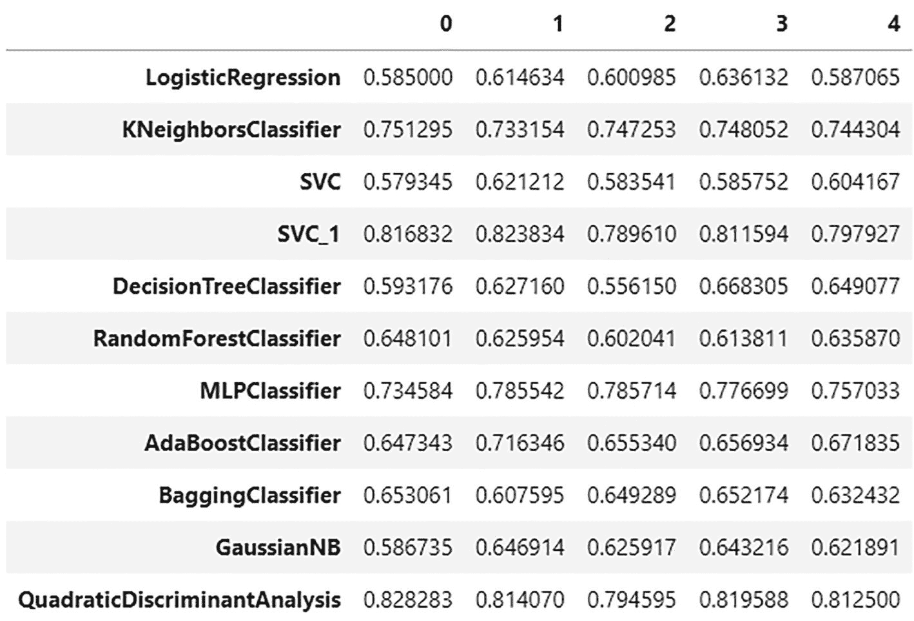

**图 4-6** — 自动运行多个机器学习算法后典型的 DataFrame 输出

由于你设置了`verbose=1`，你将看到如下这类状态信息被打印出来：

```
Finished 5 runs for LogisticRegression algorithm
Finished 5 runs for KNeighborsClassifier algorithm
Finished 5 runs for SVC algorithm
Finished 5 runs for SVC_1 algorithm
Finished 5 runs for DecisionTreeClassifier algorithm
Finished 5 runs for RandomForestClassifier algorithm
Finished 5 runs for MLPClassifier algorithm
Finished 5 runs for AdaBoostClassifier algorithm
Finished 5 runs for BaggingClassifier algorithm
Finished 5 runs for GaussianNB algorithm
Finished 5 runs for QuadraticDiscriminantAnalysis algorithm
```

随后，通过简单的绘图代码，你可以将所有算法的平均性能及其方差可视化（图 4-7）。

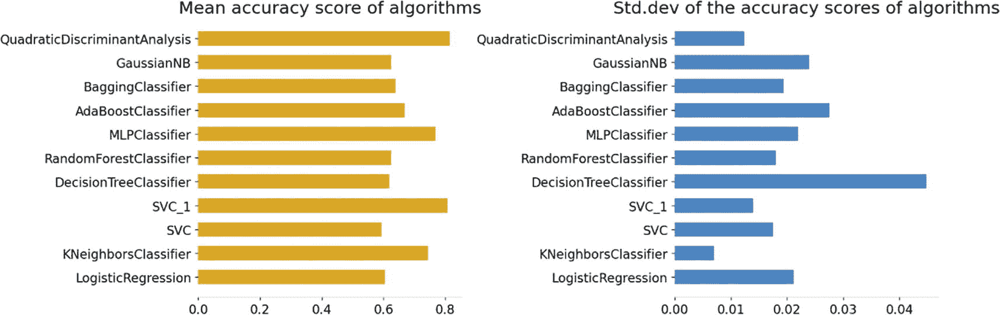

**图 4-7** — 自动运行多个机器学习算法的平均准确率分数及其标准差

请注意，你有两个支持向量分类器，它们具有不同的核函数和惩罚系数，在表中分别记录为`SVC`和`SVC_1`。

你可以通过极少的代码更改来尝试各种超参数调优。例如，要记录不同树深度下的决策树性能，你可以创建一个列表：

```
clf_lst = [DecisionTreeClassifier(max_depth=i) for i in range(2,16)]
```

然后将这个列表传递给自动化函数。你会得到 DataFrame 返回结果，并对结果进行简单的平均，从而得到图 4-8 所示的图形。

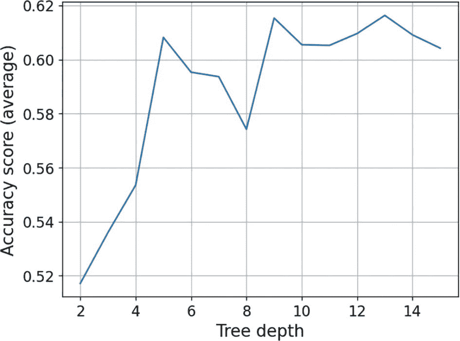

**图 4-8** — 不同深度下决策树分类器的平均准确率分数

基本上，一旦你拥有了一种自动化方法，可以一次性运行大量 ML 算法并比较它们的性能，你就能想到这个工具在实验和生产阶段的一系列实际应用。自动化和模块化自然会导向低代码环境。

在第 12 章中，我们将讨论那些抽象了大量手动数据科学工作、仅需几行代码就能生成结果的低代码库和框架。这类低代码工具背后的主要驱动力之一，就是你在这里所做的这种模块化。实际上，通过利用自定义模块，你将重复实验所需的代码减少到了仅几行。这使得整体代码库更加精简，维护和调试也更为高效。

## 决策边界可视化

对于监督学习领域中的许多分类问题，你可能希望超越数值预测（类别预测或概率预测），而将类别之间的实际决策边界可视化。当然，这特别适用于二分类问题和一对特征的情况：可视化结果将显示在二维平面上。例如，图 4-9 展示了来自 scikit-learn 官方文档（`https://scikit-learn.org/stable/modules/svm.html`）中关于支持向量机（SVM）教程的决策边界可视化。

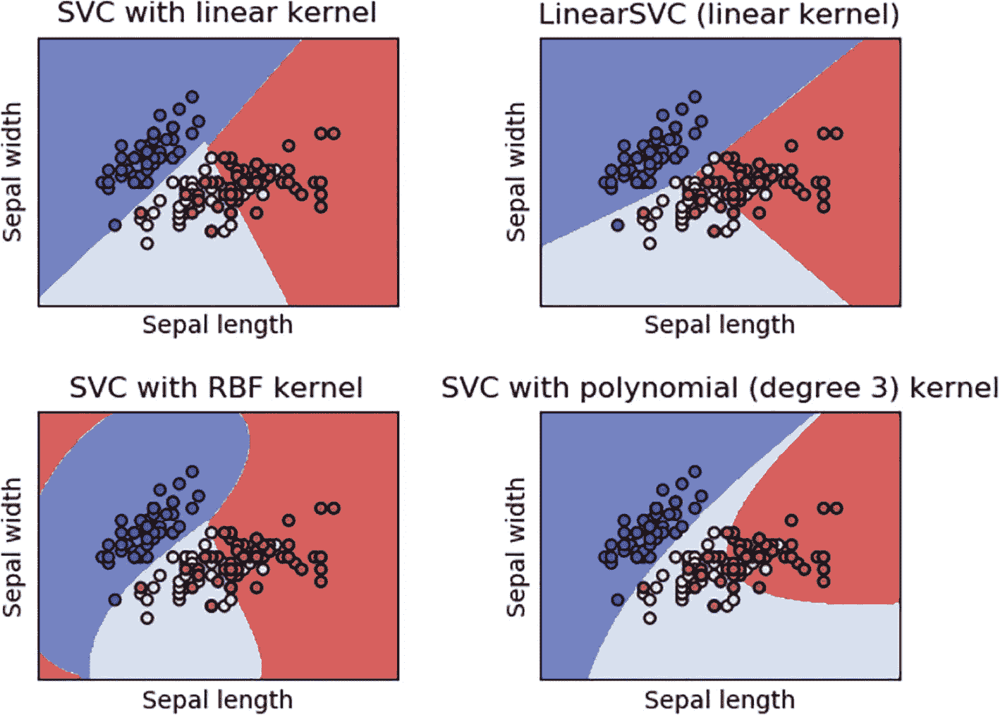

**图 4-9** — 不同核函数的 SVM 的决策边界可视化

现在的问题是，scikit-learn 并没有提供一个现成的、可直接使用的方法来完成这种可视化。然而，你可以创建自定义代码来实现这一点，这样当涉及决策边界可视化时，数据科学任务就能更高效。

### 自定义函数

该函数的完整描述和代码已在随附的 Jupyter 笔记本中提供。代码开头如下：

```
def plot_decision_boundaries(X, y,
model_class,
**model_params):
"""
绘制分类模型决策边界的函数。这仅使用数据的前两列来拟合模型，因为我们需要找到散点图中每个点的预测值。
参数：
X: 特征数据，Numpy 类型数组。
y: 标签数据，Numpy 类型数组。
model_class: 一个 Scikit-learn ML 估计器类，
例如 GaussianNB 或 LogisticRegression
**model_params: 要传递给 ML 估计器的模型参数
"""
```

注意使用了`**model_params`解包运算符，以便用户能够向函数传递与所讨论模型相关的任意数量和种类的参数。在内部，它通过创建一个二维网格，并绘制与预测类别相对应的彩色等高线区域来工作。

这里的`model_class`表示你调用的、用于实例化 ML 估计器对象的确切 scikit-learn 估计器类。请注意，你不必传递正在使用的具体 ML 估计器，只需提供类名即可。此函数将在内部拟合数据并进行预测，以创建合适的决策边界（同时会考虑你传入的模型参数）。

**什么是这个解包运算符？**

你可能在许多函数的 API 文档中见过参数`*args`和`**kwargs`。当你事先不知道参数的确切数量和顺序，必须在运行时动态决定时，它们允许你向函数传递多个参数或关键字参数。这篇文章提供了一个极好的教程。


### 示例结果

为了进行演示，我们使用一个离婚分类数据集。该数据集包含了填写了个人信息表和离婚预测因子量表的参与者信息。这些数据是在注入了一些噪声之后，对 UCI 门户网站公开数据（[`https://archive.ics.uci.edu/ml/datasets/Divorce+Predictors+data+set`](https://archive.ics.uci.edu/ml/datasets/Divorce%252BPredictors%252Bdata%252Bset)）的修改版本。共有 170 名参与者和 54 个属性（或预测变量），所有属性均为实数值。

您将比较多个机器学习估计器在同一个数据集上的性能：

*   朴素贝叶斯
*   逻辑回归
*   K-近邻

由于该数据集的二元类别是容易区分的，如图 4-10 所示，所有机器学习算法的表现几乎一样好。然而，它们各自的决策边界看起来各不相同，而这正是您希望通过此实用函数可视化的内容。

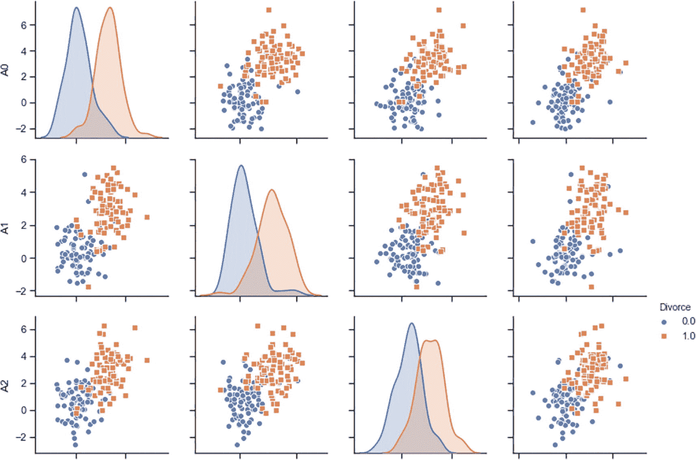

图 4-10：离婚数据集的类别可分性

朴素贝叶斯算法得出的决策边界平滑且略微非线性，如图 4-11 所示。仅用四行代码即可实现：

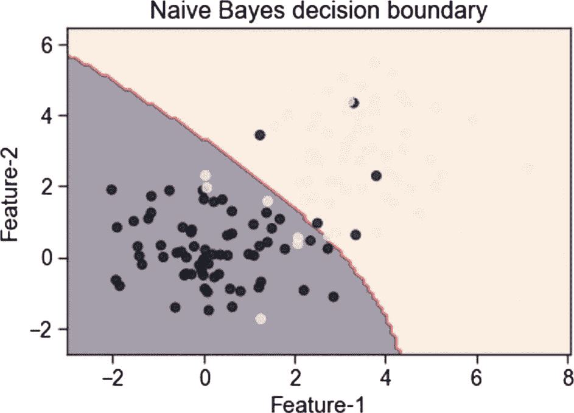

图 4-11：朴素贝叶斯算法的决策边界

```
plt.figure()
plt.title("朴素贝叶斯决策边界",fontsize=16)
plot_decision_boundaries(X_train,y_train,GaussianNB)
plt.show()
```

不出所料，逻辑回归估计器的决策边界被可视化为一条线性分隔线，如图 4-12 所示。

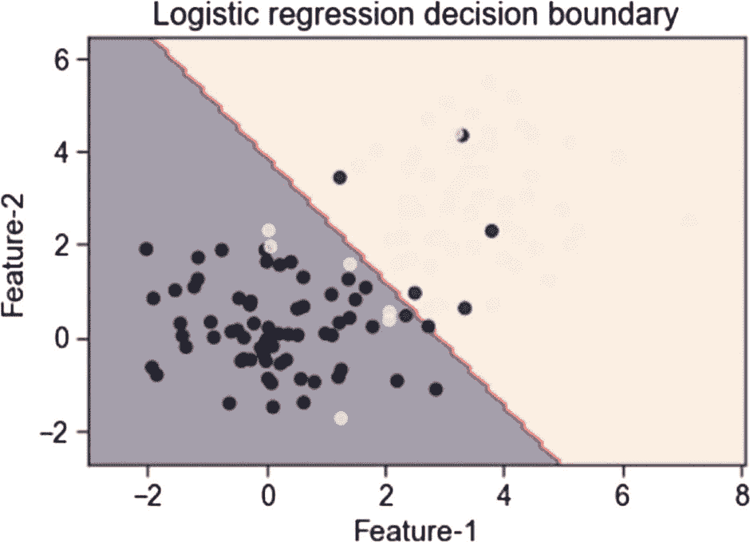

图 4-12：逻辑回归算法的决策边界

K-近邻的决策边界表现为非线性且不光滑，如图 4-13 所示。这是因为 KNN 是一种基于特征超平面上数据分布的局部几何特性（及其相对距离度量）的算法。

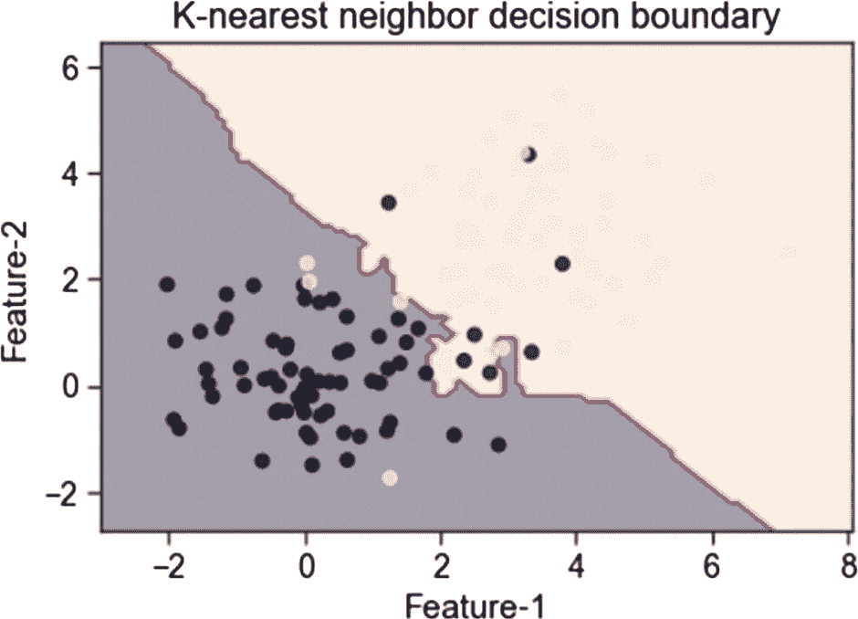

图 4-13：KNN 算法的决策边界

该函数适用于任何 scikit-learn 估计器，甚至是神经网络。以下是使用 scikit-learn 的 `MLPClassifier` 估计器得到的决策边界，该估计器模拟了一个具有用户可配置参数的密集连接神经网络（[`https://scikit-learn.org/stable/modules/generated/sklearn.neural_network.MLPClassifier.html`](https://scikit-learn.org/stable/modules/generated/sklearn.neural_network.MLPClassifier.html)）。请注意，在代码中，您传入了隐藏层设置、学习率和优化器（随机梯度下降或 SGD；[`https://towardsdatascience.com/stochastic-gradient-descent-clearly-explained-53d239905d31`](https://towardsdatascience.com/stochastic-gradient-descent-clearly-explained-53d239905d31)）。由代码生成的决策边界如图 4-14 所示。

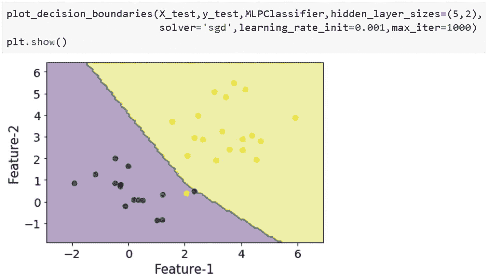

图 4-14：MLP 算法的决策边界与代码

### 参数实验

如前所述，您可以将任何想要的模型参数传递给此实用函数。对于 KNN 分类器，随着邻近数据点数量的增加，决策边界变得更加平滑。使用此实用函数可以轻松地将其可视化，如图 4-15 所示。

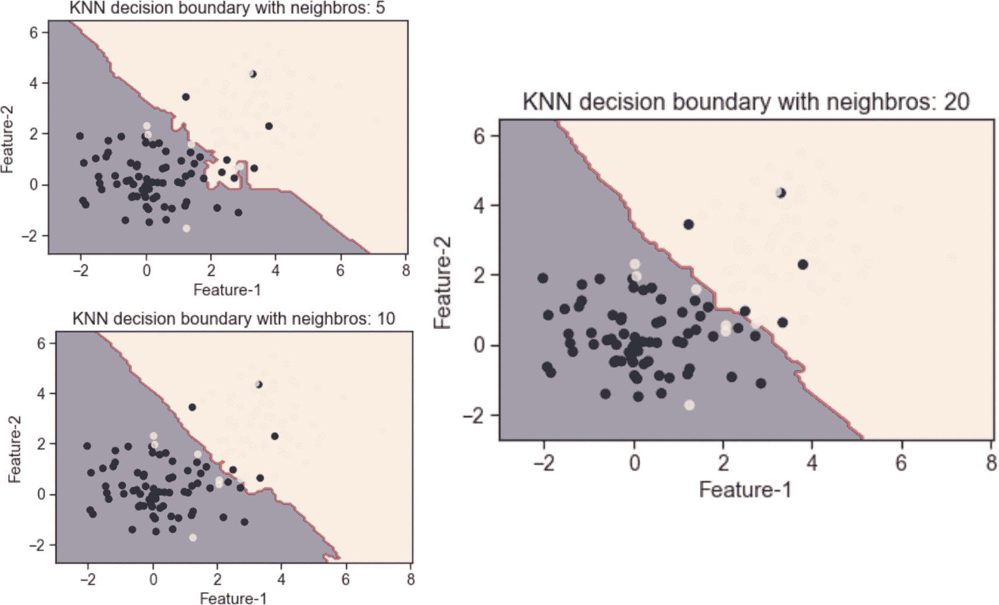

图 4-15：不同邻居数量下 KNN 的决策边界 – 算法实验

## 其他 Scikit-learn 实用工具与技术

Scikit-learn 提供了许多其他工具和实用程序，以提高您的机器学习代码的生产力。对其进行详尽阐述超出了本书的范围。然而，在此我将简要提及一些最有用的工具，您可以在自己的数据科学代码中直接使用它们。

### 超参数搜索工具

在 scikit-learn 中，超参数作为参数传递给估计器类的构造函数。为了实现良好的机器学习模型性能，通常需要仔细地调整这些超参数。然而，如果手动执行或缺乏系统计划，这项任务可能会变得繁重且低效。幸运的是，scikit-learn 提供了高效的网格搜索工具，其行为类似于标准机器学习估计器，并允许您仅用几行代码即可运行大量实验（使用不同的超参数）。

一次搜索包含以下内容：

*   一个估计器（一个回归器或分类器，例如 `sklearn.svm.SVC()`）
*   一个参数空间
*   一种搜索或采样候选参数的方法
*   一个交叉验证方案
*   一个评分函数

请查阅 scikit-learn 的官方文档，网址是 [`https://scikit-learn.org/stable/modules/grid_search.html`](https://scikit-learn.org/stable/modules/grid_search.html)，以查看各种选项及其用法。为了提高数据科学代码的生产力，它们会非常有用。

### 并行任务运行器

并非所有 scikit-learn 估计器都能原生地利用多核 CPU，但有些确实能够通过后端支持库并行化计算量大的数值运算：

*   使用 `joblib` 库。在这种情况下，可以通过 `n_jobs` 参数来控制线程或进程的数量。
*   使用 `OpenMP`，用于 C 或 Python 代码中。

`Joblib` 能够支持多处理和多线程。`joblib` 是选择生成线程还是进程，取决于其使用的后端。您可以在代码中按下述方式做出选择：

```
from joblib import parallel_backend
with parallel_backend('threading', n_jobs=2):
# estimator.fit(X,y)
```

通常，`joblib` 使用 `loky` 后端。但也有其他更强大的替代方案。例如，Dask 可以通过提供一个替代的 `joblib` 后端来将 scikit-learn 算法扩展到机器集群上：

```
from dask.distributed import Client
import joblib
client = Client(processes=False) # 创建本地集群
# 或连接到远程集群
# client = Client("scheduler-address:8786")
with joblib.parallel_backend('dask'):
# Scikit-learn 代码
```

总的来说，这种类型的并行处理非常适合那些本身就支持并行化的机器学习模型（例如，包含多棵树的随机森林或包含多个基估计器的 AdaBoost）。我们将在第 11 章讨论基于 Dask 的并行化时，更详细地回顾这一点。

### 开箱即用的可视化方法

机器学习模型输出和性能指标的可视化是一个广泛且复杂的主题。每位数据科学家都有自己选择的数据和模型输出可视化方式及风格。然而，为了高效的数据科学实践，拥有一组开箱即用的例程通常是很有益的，这些例程可以接收一个机器学习模型，并输出标准的可视化结果，例如 ROC 曲线、学习曲线、精确率-召回率曲线和混淆矩阵。

Scikit-learn 提供了一个统一的 API，可以接受估计器对象、测试数据或预测数据，并使用 Matplotlib 后端绘制出这些可视化结果。这对于快速原型设计和高效的数据科学工作流程非常有用。

更多细节请参见 scikit-learn 可视化 API 的页面，网址是 [`https://scikit-learn.org/stable/visualizations.html#visualizations`](https://scikit-learn.org/stable/visualizations.html%2523visualizations)。


### 合成数据生成器

`Scikit-learn` 提供了大量合成数据生成器，可用于快速评估和试验机器学习算法。虽然真实数据集的数据科学问题无法直接受益于这些生成器，但它们常用于衡量各种机器学习算法的相对优势与劣势，并测试不同的编码方法。

关于这些方法的更详细讨论以及合成数据生成的一般优势列表，可以在这篇文章中找到：“合成数据生成——数据科学新手的必备技能”（`https://towardsdatascience.com/synthetic-data-generation-a-must-have-skill-for-new-data-scientists-915896c0c1ae`）。

## 总结

在本章中，你首先了解了将机器学习代码模块化的实用性和好处。你采用了一个典型的数据科学工作流程——使用一个知名数据集构建分类模型，并应用了模块化代码的原则。你将 Jupyter notebook 中的单体式（或意大利面条式）代码与你编写的简短 Python 脚本/模块进行了比较，并看到了这种方法在更简洁的 Jupyter notebook 中的实用性。你还看到了这种方法如何与软件测试和平台级决策很好地结合。

接下来，你探索了一种使用自动化代码对机器学习算法进行系统评估的方法，在该方法中，你构建了一个函数，该函数可以遍历任何 `scikit-learn` 估计器列表，拟合模型，评估性能指标和运行时间，并将所有结果保存到一个整洁的数据集中以备后续评估。这种自动化是学习如何系统化、高效地进行大规模机器学习实验的第一步。

接着，你探索了另一种高效技术：使用统一函数为任意分类模型可视化决策边界。当需要检查此类特征时，这可以实现对分类边界的高效可视化分析。

最后，你学习了 `scikit-learn` 库中内置的一些实用工具和技术，它们可以提高你的机器学习代码和数据科学任务的效率。这些包括超参数搜索、并行任务运行、现成的可视化例程以及合成数据生成器。

在接下来的章节中，你将基于模块化和面向对象编码方法的概念，并探索它们在深度学习和经典机器学习任务中的实用性和应用。

