# 5. 模块化且高效的深度学习代码

在上一章中，我探讨了一个观点：大多数数据科学家通常来自与传统计算机科学/软件工程相去甚远的背景。因此，他们编写的代码非常适合出色的探索性数据分析、统计建模或创新的机器学习实验，但对于大型商业平台的生产阶段来说，却不够健壮。数据科学家常常思考的是下一个分析脚本，而不是想着要集成到更大系统中的下一个软件模块。

脚本（大部分）是你为自己编写的代码。软件是你（和你的队友）为他人编写的代码集合。一个不可否认的事实是，大多数没有传统软件开发背景和训练的数据科学家，倾向于编写 AI/ML 分析代码，*主要是为了自己使用*。

他们只想快速触及隐藏在数据中的模式核心。而不深入考虑普通用户。他们编写一段代码来生成一张丰富而美观的图表。但他们不会将其封装成一个函数以便日后重用。他们从标准库中导入大量方法和类。但他们不会通过继承创建自己的子类并添加方法来扩展功能。

在上一章中，你通过 `scikit-learn` 代码和一个典型的经典机器学习任务（拟合逻辑回归模型）探讨了其中一些问题。在本章中，你将通过一些使用 `Keras`/`TensorFlow` 的动手实践示例，探讨类似的原则如何帮助你为深度学习任务编写更好的代码。

## 模块化代码与面向对象风格，实现高效深度学习

*函数、继承、方法、类*：它们是健壮的面向对象编程（OOP）的核心。但如果你只是想创建一个 Jupyter notebook 来进行探索性数据分析和绘图，你可能并不想深入研究它们。

你可以避免一开始就使用 OOP 原则带来的痛苦，但这几乎总是导致你的 notebook 代码不可重用、不可扩展。更准确地说，那段代码只为你服务（直到你忘记自己编写的确切逻辑），而不能为其他人所用。但对于任何优秀的软件产品/服务来说，可读性（以及由此带来的可重用性）至关重要。这才是衡量你作品价值的真正考验。不是为了你自己，而是为了他人。

涉及深度学习模型和代码的数据科学也不例外。如今，像 `TensorFlow` 或 `PyTorch` 这样强大而灵活的框架使得编写复杂的神经网络架构变得相对简单和简短。然而，如果整个数据科学代码没有按照第 [4] 章“为什么（以及如何）为机器学习模块化代码”一节中讨论的大部分风格进行模块化和良好组织，那么它也会受到不可复现和不可重用等问题的困扰。让我们看一些如何在数据科学工作中组织和模块化深度学习代码的例子。

### 高效深度学习任务流程示例

深度学习使得为高度非线性（甚至带噪声）的数据集和现象训练机器学习模型变得容易。像 `Keras`/`TensorFlow`/`PyTorch` 这样的现代框架提供了强大且灵活的 API，可以用相对简单且数量惊人的少量代码来构建这些模型。然而，如果你遵循一些关于如何构建、管理和使用深度学习代码的简单指导原则，端到端的数据科学流程可以变得高效得多。采用构建紧凑模块和系统化流程的方法（如图 5-1 所示）会有所帮助。以下以问题的形式讨论了一些相关指导原则的示例。

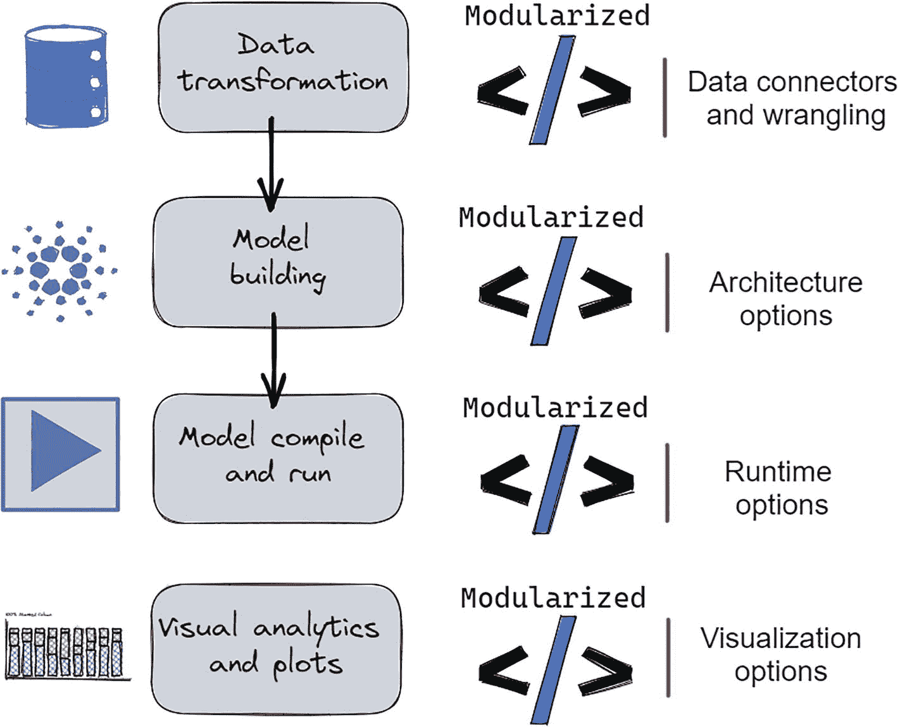

图 5-1：以模块化方式组织的深度学习任务流程

*   深度学习分析中最常见和重复的任务之一是**构建一个深度神经网络（DNN）对象**。数据科学家通常使用非模块化的代码，仅仅是通过添加层（例如，来自 `Keras` (`https://keras.io/api/layers/`) 或 `PyTorch` (`https://pytorch.org/tutorials/recipes/recipes/defining_a_neural_network.html`) 的 API）并将其作为 Jupyter notebook 中的局部变量来构建。为此任务创建一个自定义函数不是更好的主意吗？

*   构建了一个（未训练的）模型后，你必须**编译**（设置学习率、批量大小等）并使用数据**运行**模型。自定义函数是否也能帮助将此任务模块化？

*   当你创建这样一个 **DNN 构建器**函数时，哪些参数需要传递？哪些是可选的？默认值是什么？如果遇到不知道需要传递多少个参数的情况，你是否使用了 Python 提供的 `*args` 和 `**kwargs`？

*   你是否为该函数编写了**文档字符串**，以便让他人知道该函数的作用、期望的参数以及一个示例？

*   你是否也能将用于根据那些模型函数的输出**创建可视化分析**的代码模块化？


### 封装器、构建器与回调

从根本上来说，在上述小节中，我描述了将基于深度学习工作流中最核心的任务封装到自定义函数中，并将其用作数据科学代码的核心构建模块。此外，你还可以用类似的方式封装与数据格式化/转换以及预测/推理相关的任务。

需要注意的是，用于回归和分类任务的封装函数可以拥有各自独立的架构和参数集。因此，将它们分别定制构建是合理的。封装函数中默认参数值的选择也至关重要。

除了简单的函数封装器，你还可以利用一种名为*回调*的强大构造，它能够适应深度神经网络训练的动态特性。本质上，回调是一个能够在深度神经网络训练的不同阶段（例如，在一个周期开始或结束时，或者在开始处理单个批次之前）执行动作的对象。你可以在多种场景下使用回调，包括但不限于以下情况：

-   基于某个错误或计算标准的**早停法**
-   **定期将模型保存**到磁盘（使系统能够抵御意外故障）
-   在训练进行中（即中途）获取模型各种内部状态和统计信息的概览

最后，如果你希望将这种方法完全扩展到面向对象编程范式中，你可以构建包含所有这些封装器（作为特殊方法）的类和工具模块。你可以将此称为深度学习工具模块，在任何需要监督式机器学习建模的数据科学任务中，都可以调用该模块。

### 用于快速实验的模块化代码

让我们用一个简单的案例来演示上述讨论的思路：一个使用 Fashion MNIST（`https://github.com/zalandoresearch/fashion-mnist`）数据集的深度学习图像分类问题。核心的机器学习任务很简单：为这个数据集构建一个分类器，这是对著名的原始 MNIST 手写数字数据集的一个趣味性变体。Fashion MNIST 包含 60,000 张训练图像，每张大小为 28 x 28 像素，内容与时尚物品相关（例如，帽子、鞋子、裤子、T 恤、连衣裙等）。此外，它还包含 10,000 张测试图像，用于模型验证和测试。图 5-2 展示了该数据集的一个切片以供说明。


图 5-2: Fashion MNIST 数据集的一个切片

#### 业务/数据科学问题

针对该数据集的基本机器学习任务看似直接。但如果围绕这个核心机器学习任务存在一个更高阶的优化或可视化分析问题呢：*模型架构的复杂性如何影响达到期望精度所需的最小训练周期数？*

你应该清楚我们为何要关心这样的问题：因为这关系到整体的业务优化。训练神经网络并非一个微不足道的计算任务（`www.technologyreview.com/s/613630/training-a-single-ai-model-can-emit-as-much-carbon-as-five-cars-in-their-lifetimes/`）。因此，明智的做法是**调查必须投入的最小训练量**以达成目标性能指标，以及架构的选择如何影响这个量。

图像分类的精度可能与更广泛的业务成果相关联，例如时尚推荐或商店中的服装识别。核心的数据科学任务有助于优化执行该业务任务的成本——即使用机器学习代码作为底层基础，以最优的计算资源支出来使用图像数据库。

在这个例子中，你甚至不会使用通常用于图像分类任务的卷积神经网络（CNN；`https://towardsdatascience.com/a-comprehensive-guide-to-convolutional-neural-networks-the-eli5-way-3bd2b1164a53`）。这是因为对于这个数据集，一个简单的全连接神经网络就能达到相当高的精度，并且，实际上，需要一个次优的性能表现才能阐明上述高阶优化问题的核心要点。

因此，你必须解决两个问题：

-   达到*期望精度*目标所需的*最小周期数*是多少？你如何确定这个值？
-   *模型的具体架构*如何影响这个数字或训练行为？

为了实现这些目标，你将使用两个简单的面向对象编程原则：

-   从一个基类对象创建继承类
-   创建工具函数，并从紧凑的代码块中调用它们，该代码块可以呈现给外部用户，用于高阶优化和分析

#### 从 Keras 回调继承

你继承一个 Keras 回调类（作为基类），并通过添加一个方法来编写你自己的子类，该方法检查训练精度并根据该值执行操作。代码快照和一些解释如图 5-3 所示。更多细节可以在 TensorFlow 官方文章《编写你自己的回调》（`www.tensorflow.org/guide/keras/custom_callback`）中找到。

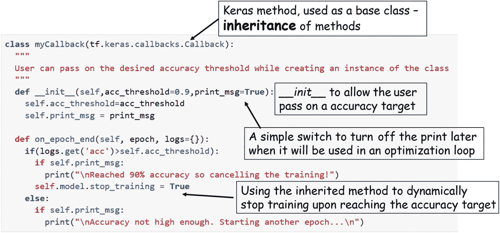

图 5-3: 基于 Keras 回调构建的自定义类

基本上，这个简单的回调实现了对**训练周期的动态控制**；当精度达到期望阈值时，训练自动停止。图 5-4 展示了一个示例运行的快照。

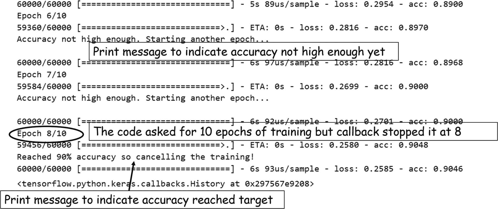

图 5-4: 启用回调的示例运行快照

#### 模型构建器与编译/训练函数

接下来，你将 Keras 模型构建代码放入一个工具函数中，这样，通过简单的用户输入（以函数参数的形式），就可以生成具有任意层数和架构（只要它们是全连接的）的模型。代码快照及相关解释如图 5-5 所示。

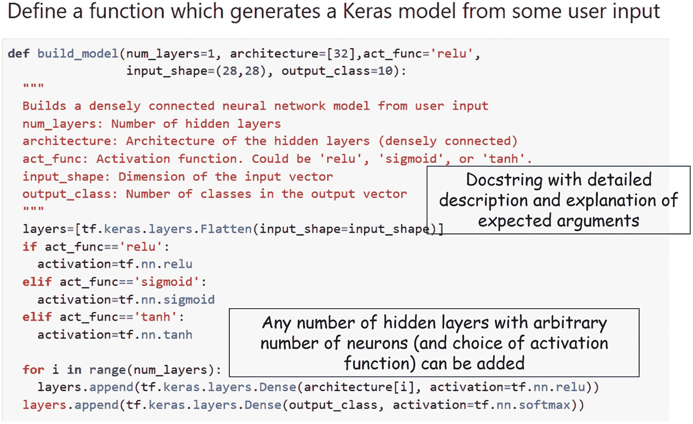

图 5-5: 模型构建函数快照

你还可以将编译和训练代码放入一个工具函数中，以便在高阶优化循环中方便地使用这些超参数。代码快照及相关解释如图 5-6 所示。

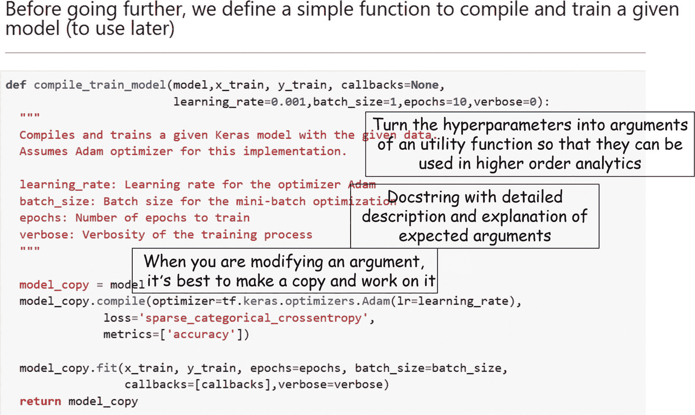

图 5-6: 模型编译与训练函数快照

#### 可视化函数

接下来，是时候进行可视化了。通用的绘图函数接受原始数据作为输入。但是，如果你有一个特定的目的，即绘制训练集精度的演变过程（并展示其与目标值的对比），那么你的绘图函数应该只接受（训练好的）深度学习模型作为输入，并生成所需的图表。代码快照及相关解释如图 5-7 所示。

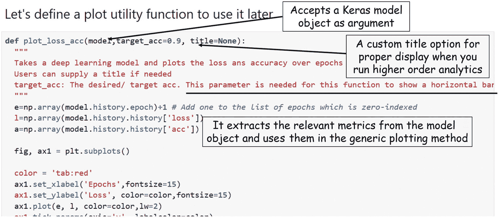

图 5-7: 可视化函数快照

一个典型的结果（损失-精度图）如图 5-8 所示。

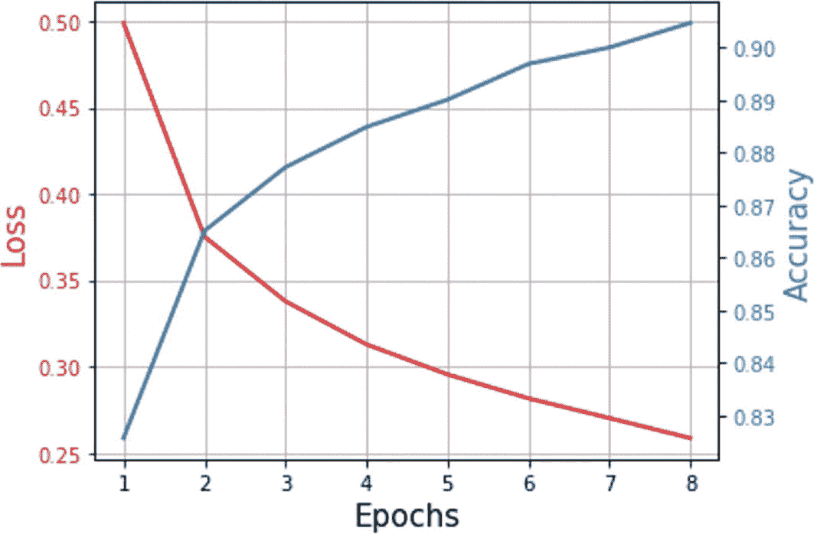

图 5-8: 来自训练好的深度学习模型的典型损失-精度图


### 终极分析代码：简洁而紧凑

到目前为止，您已经将核心深度学习代码模块化。现在，您可以利用之前定义的所有函数和类，将它们整合在一起以完成更高层次的优化任务。因此，您的最终代码将非常紧凑，但对于各种精度阈值和深度神经网络架构（神经元数量），它仍会生成同样有趣的损失和准确率变化曲线图。

这将使您能够用极少的代码生成可视分析结果，来审视性能指标（此处为分类准确率）和深度神经网络架构的选择。这是构建优化机器学习系统的第一步。

生成一些待研究的案例：

```python
from itertools import product
accuracy_desired = [0.85,0.9,0.95]
num_neurons = [16,32,64,128]
cases = list(product(accuracy_desired,num_neurons))
print("因此，我们正在考虑的案例如下...\n")
for i,c in enumerate(cases):
print("准确率目标 {}, 神经元数量: {}".format(c[0],c[1]))
if (i+1)%4==0 and (i+1)!=len(cases):
print("-"*50)
```

这段代码生成了图 5-9 所示的案例。

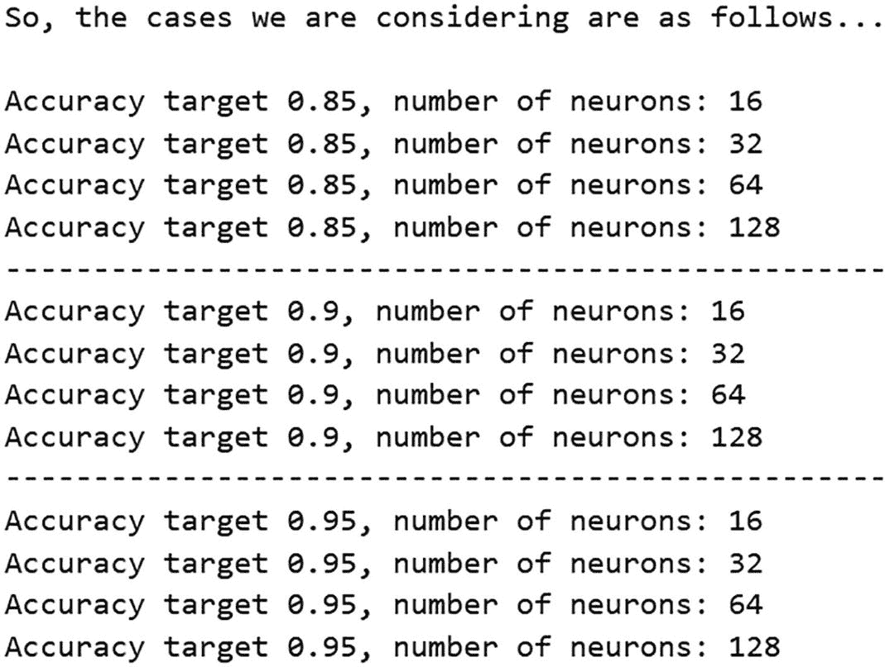

**图 5-9** – 为优化任务生成的一些代表性案例

最终的分析/优化代码简洁易懂，适合那些不需要了解 Keras 模型构建或回调类复杂性的高级用户。这是面向对象编程背后的核心原则，即**对复杂性层次进行抽象**，您现在能够为您的深度学习任务实现这一点。

请注意如何将 `print_msg=False` 传递给类实例。虽然在初始检查/调试时需要基本的打印状态，但在执行优化任务时应静默分析。如果类定义中没有这个参数，就无法停止打印调试信息：

```python
for c in cases:
    # 一个具有特定准确率目标的 mycallback 类
    callbacks = myCallback(c[0], print_msg=False)
    # 构建具有特定神经元数量的模型
    model = build_model(num_layers=1,architecture=[c[1]])
    # 使用回调类编译并训练模型。
    # 选择适当的批量大小和最大 epoch 数
    model = compile_train_model(model, x_train,y_train,callbacks=callbacks,
                                batch_size=32,epochs=30)
    # 合适的标题字符串
    title = "损失与准确率随 epoch 变化\n 准确率阈值 \
               {} 和神经元数量 {}".format(c[0],c[1])
    # 使用绘图函数，传递准确率目标、
    # 训练好的模型和自定义标题字符串
    plot_loss_acc(model,target_acc=c[0],title=title)
```

一些代表性结果如图 5-10 所示；它们是通过执行上述代码块自动生成的。这清楚地表明，只需编写极少量高级代码，就能生成可视分析结果，用以判断不同神经网络架构在不同性能指标水平下的相对表现。这使得用户无需调整底层函数，就能根据期望的准确率和复杂度，轻松做出模型选择判断。

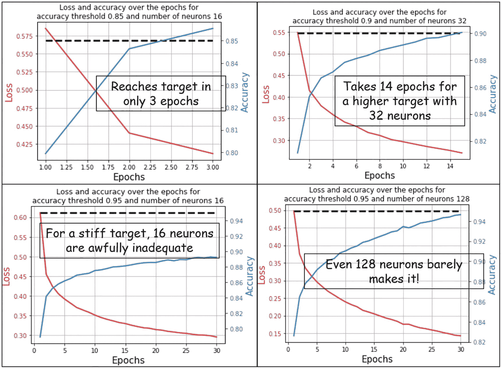

**图 5-10** – 不同模型架构（每隐藏层神经元数量）和准确率目标的代表性结果

此外，请注意每个图表的自定义标题。这些标题清晰地阐述了目标性能和神经网络的复杂度，从而使分析变得简单。虽然这只是在绘图工具函数中添加的一个小功能，但它体现了创建此类函数时进行仔细规划的必要性。如果您没有为函数规划这样的参数，就不可能为每个图表生成自定义标题。**这种对 API（应用程序编程接口）的仔细规划是优秀面向对象编程的重要组成部分**。

### 将脚本转化为工具模块

到目前为止，您可能一直在使用 Jupyter notebook，但您可能希望将这项工作转化为一个整洁的 Python 模块，以便随时导入使用。就像您编写 `from matplotlib import pyplot` 一样，您可以在任何地方导入这些工具函数（Keras 模型构建、训练和绘图）。其思路如图 5-11 所示。

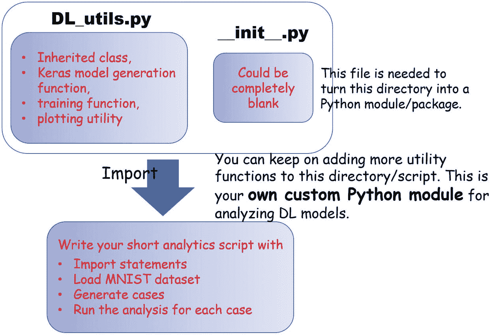

**图 5-11** – 构建深度学习工具模块（供您个人使用）

### 良好实践总结

您刚刚学习了一些源自面向对象编程的良好实践，并将其应用于深度学习分析任务。对经验丰富的软件开发人员来说，这些实践几乎都微不足道。然而，本章是为那些可能没有结构化编程背景，但需要理解将这些良好实践融入机器学习工作流重要性的崭露头角的数据科学家所设计的。

请允许我冒着重复的风险，在此总结一下这些良好实践：

-   只要有机会，就将重复的代码块转化为**工具函数**。
-   非常仔细地考虑**函数的 API**（即所需的参数最小集合，以及它们如何为更高级别的编程任务服务）。
-   别忘了为函数编写**文档字符串**，即使只是一行描述。
-   如果开始积累许多与同一对象相关的工具函数，考虑将该对象转化为一个**类**，并将这些工具函数作为**方法**。
-   只要有机会，就通过继承来**扩展类功能**，以完成复杂的分析。
-   不要止步于 Jupyter notebook。将其转化为可执行的脚本，并放入一个小的**模块**中。养成将工作模块化的习惯，以便任何人都可以轻松地**重复使用和扩展**。

在下一章中，您将尝试基于这些原则构建自己的机器学习估算器类。如需了解深度学习工具函数和神经网络训练器类的具体实现，请阅读 `https://github.com/tirthajyoti/Deep-learning-with-Python/tree/master/utils` 上的“Deep learning with Python”。

## 简化图像分类任务流程

图像分类是涉及深度学习工具的数据科学工作流中最常见的任务之一。因此，简化或自动化此类任务，是我一直在倡导的自动化和模块化理念的典型应用。

对于这个特定任务，数据科学家可能希望有一个单一的函数，能够自动从磁盘上的指定目录（或从网络地址）拉取图像，并返回一个完全训练好的神经网络模型，随时可用于预测。因此，在本节中，您将探索如何使用 Keras (TensorFlow) API 中的几个工具方法来简化此类模型（特别是针对分类任务）的训练过程，并包含内置的数据预处理功能。

简单来说，您希望：

-   获取一些数据。
-   按类别将它们放入目录/文件夹中。
-   用最少的代码/麻烦训练一个神经网络模型。

最终，您的目标是编写一个**单一的工具函数**，该函数只需接受存储训练图像的文件夹名称/地址，就能返回一个完全训练好的卷积神经网络模型。该思路如图 5-12 所示。

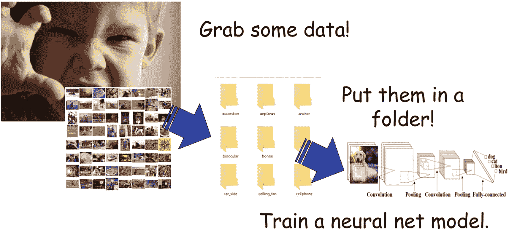

**图 5-12** – 简化（并精简）图像分类任务


## 数据集

本演示将使用一个包含 4000 多张花卉图片的数据集。该数据集可从 Kaggle 网站下载，链接如下：。数据收集基于 Flickr、Google 和 Yandex 的图片。这些图片被分为五类：

- 雏菊
- 郁金香
- 玫瑰
- 向日葵
- 蒲公英

每个类别约有 800 张照片。这些照片分辨率不算特别高（每张约 320 x 240 像素）。由于照片比例不同，它们没有被统一调整为一个尺寸。然而，这些照片被整齐地组织在五个以相应类别标签命名的目录中。你可以利用这种组织方式，应用 Keras 方法来简化卷积网络的训练过程。

完整的 Jupyter notebook 文件可以在 GitHub 仓库中找到。本部分我将选取代码中的关键片段来展示重要部分以便说明。

**是否需要使用 GPU？**

建议在 GPU 上运行此脚本。你将构建一个包含五个卷积层的卷积神经网络（CNN）；因此，如果不使用某种 GPU，对数千张图片的训练过程可能会计算量巨大且速度缓慢。对于花卉数据集，在我配备 NVidia GTX 1060 Ti GPU（6GB 显存）、Core i-7 8770 CPU 和 16GB DDR4 内存的笔记本电脑上，单次训练周期大约需要 1 分钟。

为便于说明，图 5-13 展示了这些图片在本地硬盘上的存储方式。一些示例图片则展示在图 5-14 中。

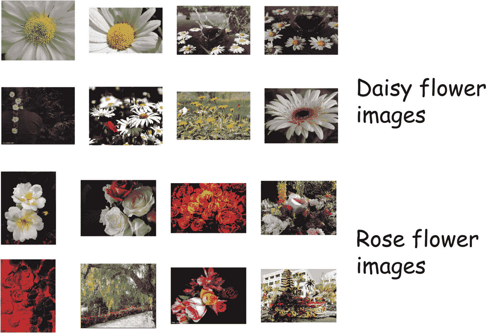

图 5-14: 示例花卉图像。注意形状和分辨率的差异

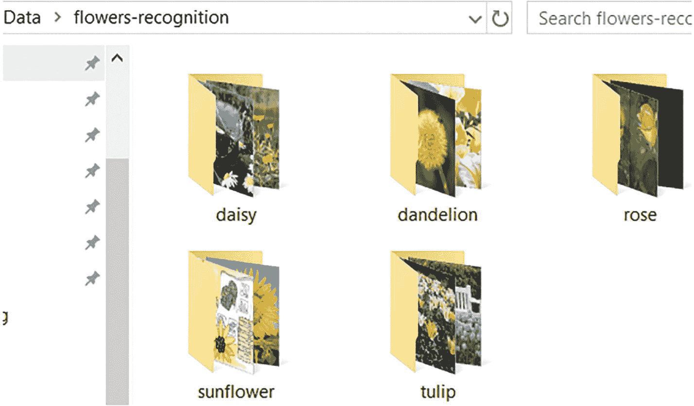

图 5-13: 存储的花卉图像数据

### 构建数据生成器对象

这才是真正的魔法发生之处。`ImageDataGenerator` 类的官方描述是：“*生成批量张量图像数据，并进行实时数据增强。数据将（按批次）循环。*” 基本上，它可用于通过大量内置预处理功能（如缩放、平移、旋转、添加噪声、白化等）来增强图像数据。现在，你只需使用 `rescale` 属性将图像张量的值缩放到 0 和 1 之间。关于该类这方面的功能，这里有一篇有用的文章：“**[如何使用 Keras ImageDataGenerator 扩增您的少量图像数据集](https://medium.com/@arindambaidya168/https-medium-com-arindambaidya168-using-keras-imagedatagenerator-b94a87cdefad)**” (`https://medium.com/@arindambaidya168/https-medium-com-arindambaidya168-using-keras-imagedatagenerator-b94a87cdefad`)。

但在当前演示中，该类真正实用之处在于其名为 `flow_from_directory` 的超实用方法，它能从指定目录中逐个提取图像文件。请注意，该目录必须是顶层目录，所有各个类别的子目录都分别存放在其中。`flow_from_directory` 方法会自动扫描这些子目录，并获取图像及其相应的标签。

你可以指定类别名称（就像你在此处使用 `classes` 参数所做的那样），但这是可选的。不过，你稍后会看到，这对于从大量数据中进行选择性训练非常有用。

另一个有用的参数是 `target_size`，它允许你将源图像调整为统一的 200 x 200 尺寸，无论原始图像大小如何。只需一个简单的函数参数就能实现如此酷炫的图像处理。

你还可以指定批次大小。如果不指定 `batch_size`，默认情况下它将被设置为 32。由于在此处进行多类别分类，请将 `class_mode` 设置为 `categorical`。以下是代码片段：

```
batch_size = 128
from tf.keras.preprocessing.image import ImageDataGenerator
# 所有图像都将按 1./255 重新缩放
train_datagen = ImageDataGenerator(rescale=1/255)
# 以 128 为一批次流式传输训练图像
# 所有图像都将调整为 200 x 200
train_generator = train_datagen.flow_from_directory(
'../Data//flowers-recognition',
target_size=(200, 200),
batch_size=batch_size,
classes = ['daisy','dandelion','rose','sunflower','tulip'],
class_mode='categorical')
```

运行此代码时，Keras 函数会扫描顶层目录，查找所有图像文件，并根据它们所在的子目录自动为它们打上正确的类别标签。该工具在花卉数据集上的工作流程如图 5-15 所示。

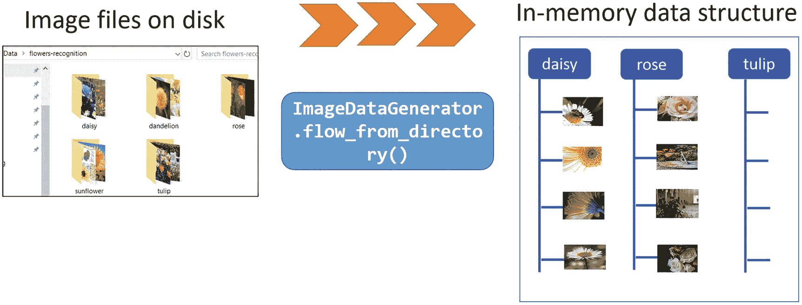

图 5-15: `ImageDataGenerator` 对象对花卉数据集进行操作

更有趣的是，这还是一个 Python 生成器对象（`https://realpython.com/introduction-to-python-generators/`）。这意味着它将用于在训练过程中*逐个生成数据*。这极大地缓解了处理内容无法一次性全部加载到内存中的超大数据集的问题。

### 构建卷积神经网络模型

为简洁起见，我不会深入探讨 CNN 模型的代码细节。简而言之，它由五个卷积层/最大池化层组成，末端是 128 个神经元，接着是一个带有 `SoftMax` 激活函数的 5 神经元输出层，用于多类别分类。你使用 `RMSprop` 优化器，初始学习率为 0.001。模型摘要如图 5-16 所示。它拥有超过 20 万个可训练参数。

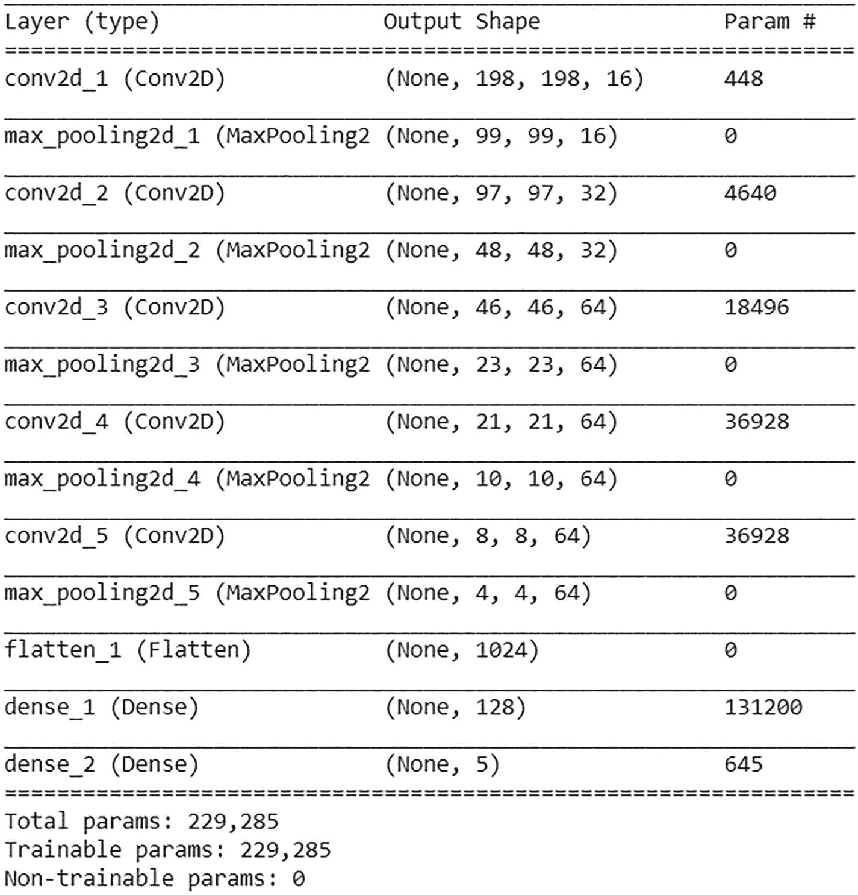

图 5-16: 用于花卉分类的 CNN 模型摘要

### 使用 `fit_generator` 方法进行训练

我之前讨论了 `train_generator` 对象配合 `flow_from_directory` 方法及其参数所实现的酷炫功能。现在，让我们在之前定义的 CNN 模型的 `fit_generator` 方法中利用这个对象。

注意 `fit_generator` 的 `steps_per_epoch` 参数。由于 `train_generator` 是一个通用的 Python 生成器，它永远不会停止，因此 `fit_generator` 无法知道一个训练周期在哪里结束，下一个又从哪里开始。你需要告知它在单个训练周期中的步数。在大多数情况下，这等于总训练样本数除以批次大小。在前面的部分中，你已计算出总样本数为 `total_sample`。因此，在这种特定情况下，`steps_per_epoch` 被设置为 `int(total_sample/batch_size)`，即 34，所以在下面的训练日志中，你将看到每个训练周期有 34 步。

```
history = model.fit_generator(
train_generator,
steps_per_epoch=int(total_sample/batch_size),
epochs=epochs,
verbose=1)
```

执行后，模型开始训练，你可以使用常见的绘图代码来检查准确率/损失（图 5-17）。

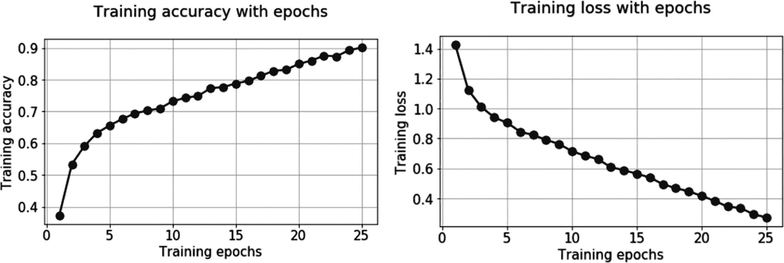

图 5-17: CNN 训练任务的代表性损失/准确率图


### 将所有步骤封装到单个函数中

到目前为止你完成了什么？你已经能够利用 Keras 的`ImageDataGenerator`和`fit_generator`方法，从单个目录中自动提取图像、标注标签、调整大小和缩放比例，并逐一（按批次）输入图像以训练神经网络。那么，你能将所有步骤封装到单个函数中吗？

构建实用软件/计算系统的核心目标之一是**抽象化**（即隐藏内部计算和数据操作的繁琐细节，向用户呈现简单直观的工作接口/API）。为实现此目标，让我们将上述流程封装到单个函数中。图 5-18 展示了这一思路。

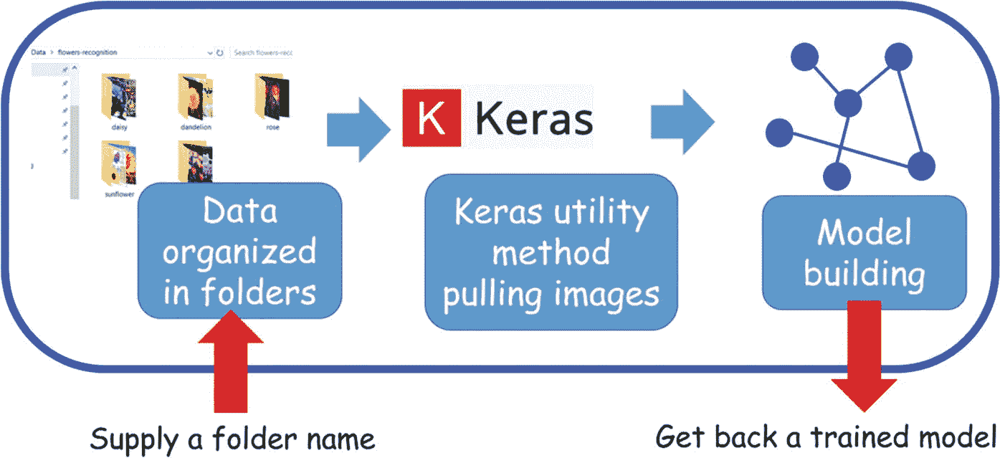

**图 5-18** 将核心组件封装到单个函数中。用户提供目录名称，即可获得训练好的模型

设计高级 API 时，应追求比特定演示所需更高的通用性。基于此，你可以考虑为函数增加更多参数，使其适用于其他图像分类场景（稍后将看到示例）。

具体而言，函数中包含以下参数：

- `train_directory`：存放训练图像的目录，图像按类别存储在不同的子文件夹中，子文件夹应以类别命名。
- `target_size`：训练图像的目标尺寸，例如元组(200,200)。
- `classes`：Python 列表，指定需要训练的类别。这强制生成器从`train_directory`中选择特定文件，而非处理所有数据。
- `batch_size`：训练时的批次大小。
- `num_epochs`：训练轮数。
- `num_classes`：输出类别的数量。
- `verbose`：训练的详细程度，直接传递给`fit_generator`方法。

当然，你还可以增加与整体模型架构或优化器设置相关的参数。本章不关注此类问题，因此保持简洁。完整代码在 GitHub 仓库中。图 5-19 展示了文档字符串部分，强调如何使其成为灵活的 API。

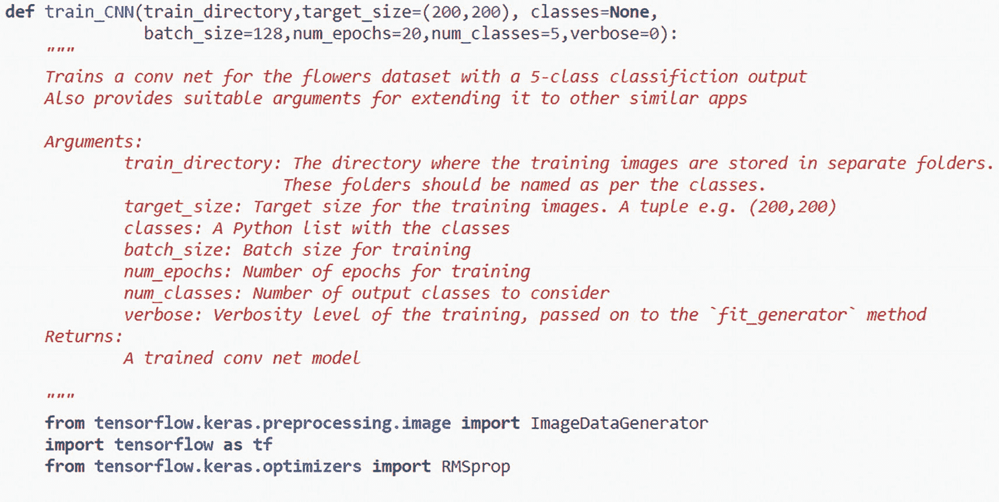

**图 5-19** 简化分类任务的单一实用函数截屏

### 测试实用函数

你可以通过简单提供文件夹/目录名称来测试`train_CNN`函数，并获得可用于预测的已训练模型。假设你只想训练`daisy`、`rose`和`tulip`这三个类，忽略其他两种花卉数据。只需将列表传递给`classes`参数。此时，必须将`num_classes`参数设置为 3。

你会注意到，由于训练样本数量少于之前的情况，每轮步数自动减少到 20。此外，上述函数中`verbose`默认设置为 0，因此如需监控每轮训练进度，需显式指定`verbose=1`。

基本上，现在你可以**用两行代码获得一个完整的 CNN 训练模型**！

```
# 定义文件夹
train_directory = "../Data//flowers-recognition/"
# 获取模型
trained_model = train_CNN(train_directory=train_directory,
                          classes=['daisy','rose','tulip'],
                          num_epochs=30,
                          num_classes=3,
                          verbose=1)
```

### 该函数能（直接）用于其他数据集吗？

这是对此类函数实用性的严峻考验：*我们能否直接将其应用于另一个数据集而无需大幅修改？* 让我们一探究竟。

一个丰富且可管理的图像分类数据集是 Caltech-101（[www.vision.caltech.edu/Image_Datasets/Caltech101/](http://www.vision.caltech.edu/Image_Datasets/Caltech101/)）。所谓“可管理”，是指它不像著名的 ImageNet（[www.image-net.org/about.php](http://www.image-net.org/about.php)）数据库那样庞大（ImageNet 需要大规模硬件基础设施进行训练，因此在笔记本电脑上快速测试想法不现实），但又足够多样化，可用于实践和学习卷积神经网络的技巧。该数据集包含 101 个类别的多种物体图像。每个类别有 40 到 800 张图像，多数类别约 50 张图像。每张图像尺寸约为 300 x 200 像素。部分类别如图 5-20 所示。

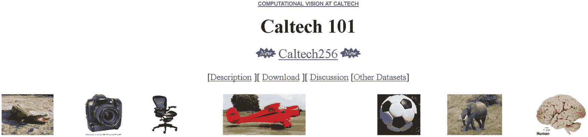

**图 5-20** Caltech-101 图像数据集

**谁创建了 Caltech-101？** Caltech-101 数据集由著名的斯坦福大学教授李飞飞博士（[`profiles.stanford.edu/fei-fei-li`](https://profiles.stanford.edu/fei-fei-li)）及其同事（Marco Andreetto 和 Marc Aurelio Ranzato）于 2003 年在加州理工学院创建，当时她是一名研究生。因此可以推断，Caltech-101 是她后续 ImageNet 工作的直接前身。

下载数据集并将其解压到之前的`Data`文件夹中。目录结构应如图 5-21 所示。

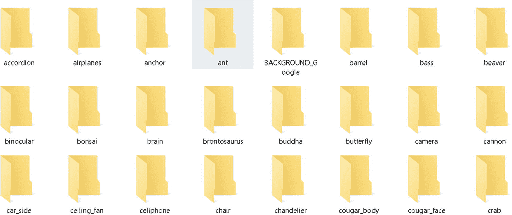

**图 5-21** 存储的 Caltech-101 图像目录

现在你已具备所需条件：一个顶层目录，其子目录包含训练图像。然后，同样只需两行代码：

```
# 定义文件夹
train_directory = "../Data/101_ObjectCategories/"
# 获取模型
model_caltech101 = train_CNN(train_directory=train_directory,
                             classes=['crab','cup'],
                             batch_size=4,
                             num_epochs=25,
                             num_classes=2,
                             verbose=1)
```

你所做的只是将目录地址传递给函数，并选择要训练的图像类别。假设你希望训练模型以区分*cup*（杯子）和*crab*（螃蟹）。只需像之前一样，将类别名称作为列表传递给`classes`参数。

此外，请注意，对于此数据集，你可能需要显著减小`batch_size`，因为训练图像总数会比花卉数据集少得多；若`batch_size`超过总样本数，`steps_per_epoch`将变为 0，导致训练时出错。

瞧！函数会自动找到相关图像（共 130 张），并以每批次 4 张进行训练，因此每轮步数为 33。结果如图 5-22 所示。

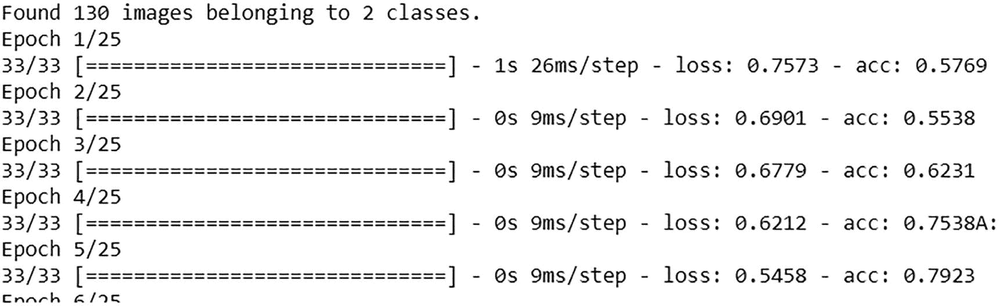

**图 5-22** 使用 Caltech-101 图像（两个类别：杯子和螃蟹）进行训练

你看到了将训练图像目录地址传递给函数，并针对所选类别训练 CNN 模型是多么简单。但模型性能如何？让我们通过测试从互联网下载的随机图片来验证。假设你下载了螃蟹和杯子的图片。你需要进行一些基础图像处理（调整大小和维度扩展），以匹配模型要求，并得到输出对象`img_crab`和`img_cup`。然后使用这些图像测试模型。

```
model_caltech101.predict(img_crab)
>> array([[1., 0.]], dtype=float32)
```

模型正确预测了螃蟹测试图像的类别。对于杯子的图像：

```
model_caltech101.predict(img_cup)
>> array([[0., 1.]], dtype=float32)
```


你可以下载任意随机图像来测试模型性能。如果不满意，你应该通过使用模块化函数修改架构和超参数来重新训练模型。

然而，重点在于，**你能够仅使用与最初完全不同的数据集完全相同的两行代码来训练一个 CNN 模型**。这就是模块化代码和构建一个适用于多种数据源的通用 API 的力量。这节省了宝贵的时间，并使代码可重用。高效数据科学的基石正是建立在这些基础元素之上。

### 其他扩展

到目前为止，在你的`fit_generator`内部，你只有一个用于训练的`train_generator`对象。但验证集怎么办？它遵循与`train_generator`完全相同的概念。你可以从训练图像中随机分割出一个验证集，并将其放在一个单独的目录中（与训练目录相同的子目录结构），然后你应该能够将其传递给`fit_generator`函数。

想直接操作一个存储了你图像的 pandas DataFrame？没问题。`ImageDataGenerator`类有一个名为`flow_from_dataframe`的方法，你可以将图像文件名（包含在 pandas DataFrame 中）传递给它，然后训练就可以进行了。

我们强烈鼓励你根据自己的应用需求来查看并扩展这些想法。

### 仅需几行代码的激活图

深度学习模型使用数百万个参数，并为其输入的图像或数据集创建极其复杂且高度非线性的内部表示。因此，它们通常被称为完美的黑盒机器学习技术（[`www.wired.com/story/inside-black-box-of-neural-network/`](http://www.wired.com/story/inside-black-box-of-neural-network/)）（图 5-23）。在用大型数据集训练后，我们可以从中获得高度准确的预测，但我们几乎无法理解模型用来将特定图像分类到某个类别中的内部特征和表示（[`www.technologyreview.com/s/604087/the-dark-secret-at-the-heart-of-ai/`](http://www.technologyreview.com/s/604087/the-dark-secret-at-the-heart-of-ai/)）。简而言之，*深度学习的黑盒问题* 是指拥有强大的预测能力，却缺乏直观且易于理解的解释。

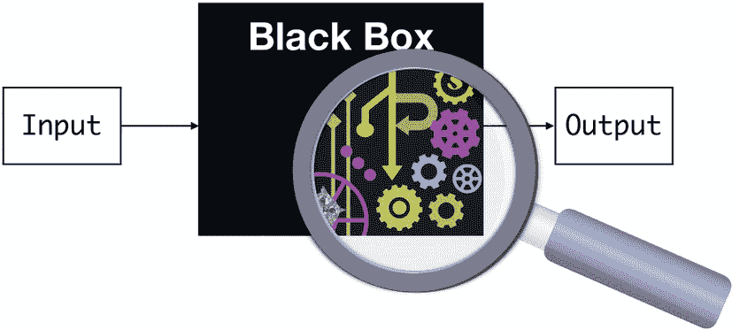

图 5-23

深度学习的黑盒问题（来源：[CMU ML 博客](https://blog.ml.cmu.edu/2019/05/17/explaining-a-black-box-using-deep-variational-information-bottleneck-approach/), [*https://blog.ml.cmu.edu/2019/05/17/explaining-a-black-box-using-deep-variational-information-bottleneck-approach/*](https://blog.ml.cmu.edu/2019/05/17/explaining-a-black-box-using-deep-variational-information-bottleneck-approach/)）。

这并非好兆头，因为我们人类是视觉生物（[`www.seyens.com/humans-are-visual-creatures/`](http://www.seyens.com/humans-are-visual-creatures/)）。数百万年的进化赋予了我们一双极其复杂的眼睛（[`www.relativelyinteresting.com/irreducible-complexity-intelligent-design-evolution-and-the-eye/`](http://www.relativelyinteresting.com/irreducible-complexity-intelligent-design-evolution-and-the-eye/)）和一个更为复杂的视觉皮层（[`www.neuroscientificallychallenged.com/blog/know-your-brain-primary-visual-cortex`](http://www.neuroscientificallychallenged.com/blog/know-your-brain-primary-visual-cortex)），我们使用这些器官来理解世界。科学过程始于观察，而这几乎总是视觉的同义词。在商业中，只有我们能够观察和衡量的东西，我们才能有效地控制和驾驭。观察/看见是我们开始构建世间现象的思维模型（[`https://medium.com/personal-growth/mental-models-898f70438075`](https://medium.com/personal-growth/mental-models-898f70438075)）、对周围物体进行分类、区分敌友等等的方式。

激活图被提出来帮助可视化复杂 CNN 模型的内部工作原理。让我们来讨论一下它们。

## 激活图

文献中已经开发了多种理解和可视化 CNN 的方法，部分原因是为了回应常见的批评，即 CNN 中学到的内部特征是不可解释的。最直接的 Visualization 技术是在网络前向传播期间显示其激活情况。

简单来说，激活函数有助于决定一个神经元是否应该被激活。这有助于确定该神经元接收到的信息是否与输入相关。激活函数是对输入信号进行的非线性变换，转换后的输出被发送到下一个神经元。

激活图只是一个给定图像在经过各种线性代数运算后，在网络不同层上这些激活数值的视觉表示。人们可以从这些图中推断出网络的工作机制和设计限制。对于基于 ReLU 激活的网络，激活图通常开始时看起来相对模糊和密集，但随着训练的进行，激活图通常会变得更加稀疏和局部化。通过这种可视化可以轻松捕获的一个设计陷阱是，某些激活图对于许多不同的输入可能全为零，这可能表明存在死亡过滤器，并且可能是高学习率的一个症状。

然而，即使你已经很好地训练了你的神经网络并从中进行预测，可视化这些激活图也是一项非平凡的任务。*如何仅用几行代码就轻松可视化和展示一个相当复杂的 CNN 的激活图*？

### 仅需几行代码的激活图

在上一节中，我展示了如何编写一个单一紧凑的函数，通过自动从磁盘逐个读取图像文件来获得一个完全训练好的 CNN 模型。现在，你将使用这个函数以及一个名为 **Keract** 的出色的小型库，它使得激活图的可视化变得非常容易。它是 Keras 的一个高级辅助库，用于在神经网络的各个层上显示有用的热力图和激活图。

因此，对于这段代码，你需要使用你之前构建的模块`train_CNN_keras`和`preprocess_image`中的几个工具函数，来使一个随机的 RGB 图像兼容以生成激活图。

你将使用上一节讨论的相同的 Caltech-101 数据集。但是，你只使用五类图像进行训练：*螃蟹*，*杯子*，*大脑*，*相机* 和 *椅子*。

#### 训练

训练仅需几行代码即可完成：

```
train_directory = "../Data/101_ObjectCategories/"
target_size=(512,512)
batch_size=4
classes = ['crab','cup','brain','camera','chair']
num_classes = len(classes)
num_epochs=10
model = train_CNN_keras(train_directory=train_directory,
num_epochs=num_epochs,
target_size=target_size,
classes = classes,
batch_size=batch_size,
num_classes=num_classes)
```

为了生成激活图，你可以从互联网或任何其他来源选择一张随机的人脑图像。将测试图像存储为文件`brain-1.jpg`。


### 激活

再添几行代码即可生成激活值：

```python
from keract import get_activations
# 图像路径
img_path = '../images/brain-1.jpg'
# 为模型预处理图像
img = preprocess_image(img_path=img_path, model=model, resize=target_size)
# 生成激活值
activations = get_activations(model, img)
```

你会得到一个字典，其中层名称作为键，NumPy 数组作为值，这些数组对应着激活值。图 5-24 展示了激活值数组长度随特定卷积层滤波器映射尺寸而变化的情况。

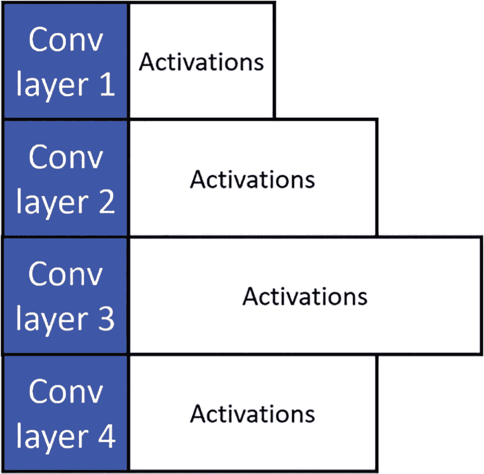

**图 5-24** 激活映射数组已存储（数组长度可变，与当前层卷积滤波器尺寸对应）

接着，用两行代码显示激活映射：

```python
from keract import display_activations
display_activations(activations, save=False)
```

你可以逐层查看激活映射。图 5-25 展示了第一个卷积层（16 张图像对应 16 个滤波器）。实际显示的图像可能因测试图像不同而有所差异，但激活层可视化的思想已清晰呈现。

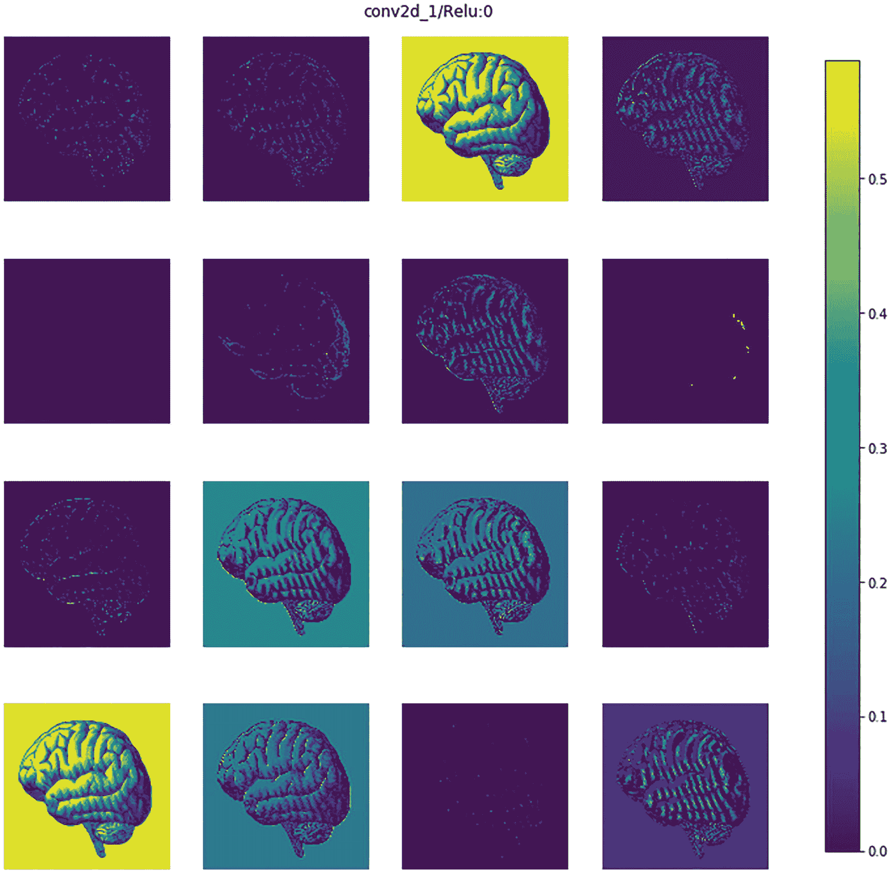

**图 5-25** 第一个卷积层的激活映射

图 5-26 展示了第二层（32 张图像对应 32 个滤波器）。

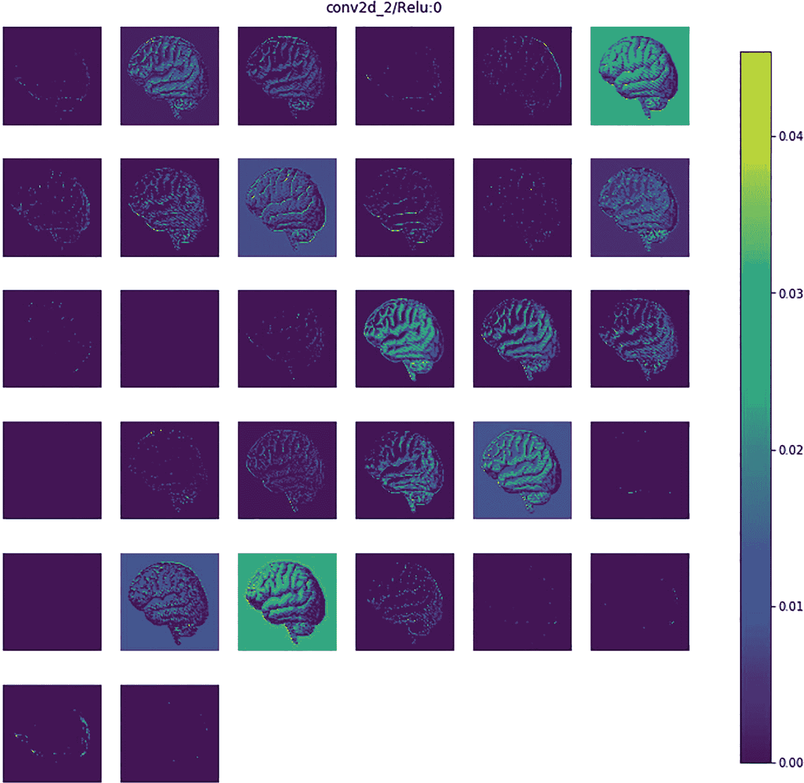

**图 5-26** 第二个卷积层的激活映射

对于该模型，共有 5 个卷积层（每个卷积层后紧跟最大池化层），因此你会得到 10 组图像。为简洁起见，此处不再展示其余图像，但建议你通过 Jupyter notebook 自行探索查看。

### 另一个用于 Web 界面的库

另一个漂亮的激活可视化库是 `Quiver`。不过，它基于 Python 微服务器框架 Flask 构建，并在浏览器端口中显示激活映射，而非在 Jupyter Notebook 内。它还需要一个训练好的 Keras 模型作为输入。因此，你可以轻松使用上一节介绍的实用函数，并尝试使用该库进行交互式激活映射可视化。

### 这如何促进高效数据科学？

在本章中，你学会了仅用几行代码（利用某个特殊模块的紧凑函数以及 Keras 的一个实用小附属库）就能从头开始训练 CNN、生成激活映射并逐层显示。这使你能够基于任何图像数据集（只需将图像按简单目录格式整理）训练 CNN 模型（从简单到复杂），并深入查看你想要的任何测试图像的内部结构。

一旦构建了必要的实用模块和激活映射脚本，你就可以将它们重复应用于各种图像数据。这有助于快速高效地探索大量图像，适用于各种应用场景。正因如此，这种方法与高效数据科学的理念相契合。

## 使用 Scikit-learn 进行超参数搜索

Keras 是深度学习初学者和专业人士最常用的 Python 库/API 之一。尽管它最初是 François Chollet 的一个独立项目，但从 2.0 版本开始，它已原生集成到 TensorFlow 中。更多信息请点击此处（[`keras.io/about/`](https://keras.io/about/)）。根据其官方文档，它是“*为人类而非机器设计的 API*”，因为它“*遵循减少认知负荷的最佳实践*”。

超参数调优正是认知负荷必然会增加的情况之一。深度学习模型从一开始就有大量超参数：学习率、衰减率、激活函数、丢弃率、动量、批量大小等等。优化深度学习模型以获得最佳性能和计算成本，关键在于正确选择这些超参数。因此，数据科学家花费大量时间和精力手动调优，或通过自动化脚本、优化策略/框架进行调优。

尽管有许多支持库和框架来处理超参数调优，但对于简单的网格搜索，Keras 提供了一个出色的 API，可与我们钟爱的 scikit-learn 库集成。本节将对此进行讨论。

### Scikit-learn 与 Keras 的融合

几乎所有 Python 机器学习从业者都熟悉 scikit-learn 库及其简洁的 API 方法（[`www.tutorialspoint.com/scikit_learn/scikit_learn_estimator_api.htm`](http://www.tutorialspoint.com/scikit_learn/scikit_learn_estimator_api.htm)），例如 `fit`、`get_params` 和 `predict`。该库还提供了极其有用的方法，用于交叉验证、模型选择、流水线构建和网格搜索。数据科学家每天都会使用这些工具处理经典的机器学习问题。但是，能否将相同的 API 用于深度学习问题呢？

事实证明，Keras 提供了几个特殊的包装类，分别用于回归和分类问题，以便充分利用 scikit-learn 原生的这些 API 的强大功能。在本节中，你将使用简单的 k 折交叉验证（[`https://medium.com/datadriveninvestor/k-fold-cross-validation-6b8518070833`](https://medium.com/datadriveninvestor/k-fold-cross-validation-6b8518070833)）和基于 Keras 分类器（[`www.tensorflow.org/api_docs/python/tf/keras/wrappers/scikit_learn/KerasClassifier`](http://www.tensorflow.org/api_docs/python/tf/keras/wrappers/scikit_learn/KerasClassifier)）模型的穷举网格搜索。它利用了 Keras 对 scikit-learn 分类器 API 的一种实现。

### 数据与（初步）Keras 模型

首先，你创建一个简单的函数，用于合成并编译一个 Keras 模型，其中内置了一些可调参数：

```python
from tf.keras.models import Sequential
from tf.keras.layers import Dense
def create_model():
    # 创建模型
    model = Sequential()
    model.add(Dense(30, input_dim=8, activation='relu'))
    model.add(Dense(15, activation='relu'))
    model.add(Dense(1, activation='sigmoid'))
    # 编译模型
    model.compile(loss='binary_crossentropy', optimizer='adam', metrics=['accuracy'])
    return model
```

你将使用流行的 Pima Indians Diabetes 数据集（[`www.kaggle.com/uciml/pima-indians-diabetes-database`](http://www.kaggle.com/uciml/pima-indians-diabetes-database)）处理一个简单的二分类任务。该数据集最初来自美国国立糖尿病、消化和肾脏疾病研究所（[`www.niddk.nih.gov/`](http://www.niddk.nih.gov/)）。数据集的目的是根据其中包含的某些诊断测量值，诊断性地预测患者是否患有糖尿病。

你进行了一些最小限度的数据预处理，包括使用 scikit-learn 的 `MinMaxScaler` 对特征数据进行缩放。你可以将这个 `X_scaled` 向量传递给将要创建的特殊包装类。


### `KerasClassifier`类

这是来自 Keras 的特殊封装类，它将 scikit-learn 分类器 API 与 Keras 参数化模型结合在一起。你可以将对应于`create_model`函数的各种模型参数以及其他超参数（如`epochs`和`batch_size`）传递给该类。代码如下：

```
from tf.keras.wrappers.scikit_learn import KerasClassifier
model = KerasClassifier(build_fn=create_model,
epochs=10,
batch_size=32,
verbose=0)
```

注意，你将模型创建函数作为`build_fn`参数传递。这是 Python 中将函数作为一等对象使用的示例（[`https://dbader.org/blog/python-first-class-functions`](https://dbader.org/blog/python-first-class-functions)），你可以将函数作为常规参数传递给其他类或函数。

目前，你已经固定了`batch_size`和`epochs`的数量，因为你只想对该模型运行交叉验证。稍后，你将把它们视为超参数，并进行全面的网格搜索以找到最佳组合。

### 使用 scikit-learn API 进行交叉验证

以下是使用 Keras 模型进行 10 折交叉验证的代码。首先，你必须从 scikit-learn 的`model_selection`模块中导入评估器。然后，你可以使用以下代码简单运行模型，其中传递了你之前构建的`KerasClassifier`对象以及特征向量和目标向量。这里的重要参数是`cv`，你传递了`kfold`对象。这告诉`cross_val_score`评估器在 10 折分层交叉验证设置中，使用提供的数据运行 Keras 模型。

```
from sklearn.model_selection import StratifiedKFold
from sklearn.model_selection import cross_val_score
num_folds = 10
kfold = StratifiedKFold(n_splits=num_folds,
shuffle=True)
cv_results = cross_val_score(model,
X_scaled, Y,
cv=kfold,
verbose=2)
```

输出变量`cv_results`是一个由所有准确率分数组成的 NumPy 数组。`accuracy`（准确率）是你在模型编译过程中编码的度量标准。显然，你可以选择任何其他分类度量标准，如`precision`（精确率）或`recall`（召回率），在这种情况下，该度量标准将被计算并存储在`cv_results`数组中。

你可以轻松计算 10 折交叉验证运行的平均值和标准差，以估计模型预测的稳定性。这是交叉验证运行的主要用途之一，现在你可以使用此方法评估任何 Keras 模型的稳定性。

### 使用更新后的模型进行网格搜索

在此示例中，你将搜索以下超参数：

*   激活函数
*   优化器类型
*   初始化方法
*   批量大小
*   迭代轮数

然而，要使此功能生效，你必须将前三个参数集成到模型定义代码中：

```
def create_model_grid(activation = 'relu',
optimizer='rmsprop',
init='glorot_uniform'):
# create model
model = Sequential()
if activation=='relu':
model.add(Dense(12, input_dim=8,
kernel_initializer=init, activation='relu'))
model.add(Dense(8, kernel_initializer=init, activation='relu'))
if activation=='tanh':
model.add(Dense(12, input_dim=8,
kernel_initializer=init, activation='tanh'))
model.add(Dense(8, kernel_initializer=init, activation='tanh'))
if activation=='sigmoid':
model.add(Dense(12, input_dim=8,
kernel_initializer=init, activation='sigmoid'))
model.add(Dense(8, kernel_initializer=init, activation='sigmoid'))
model.add(Dense(1, kernel_initializer=init, activation='sigmoid'))
# Compile model
model.compile(loss='binary_crossentropy',
optimizer=optimizer,
metrics=['accuracy'])
return model
```

然后，你创建与之前相同的`KerasClassifier`对象，但将其命名为`model_grid`：

```
model_grid = KerasClassifier(build_fn=create_model_grid, verbose=0)
```

将穷举超参数搜索空间大小设为**3 × 3 × 3 × 3 × 3 = 243**。请注意，Keras 的实际运行次数还取决于你选择的交叉验证折数，因为交叉验证将用于每组参数组合。总共有 729 次模型拟合，即 243 个参数组合中的每个组合都进行 3 次交叉验证。如果你不喜欢完整的网格搜索，总是可以尝试随机网格搜索。

图 5-27 展示了此穷举网格搜索的选项。

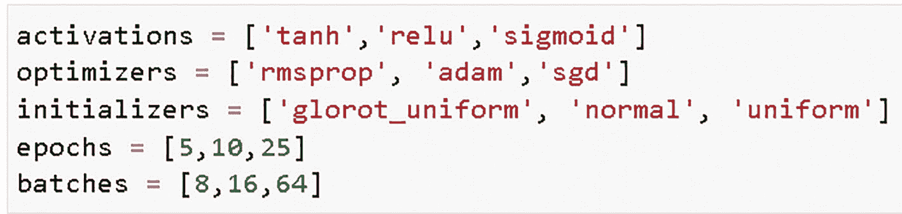

**图 5-27**：穷举网格搜索选项

你必须创建一个搜索参数字典，并将其传递给 scikit-learn 的`GridSearchCV`评估器：

```
from sklearn.model_selection import GridSearchCV
param_grid = dict(activation =  activations,
optimizer = optimizers,
epochs = epochs,
batch_size = batches,
init = initializers)
grid = GridSearchCV(estimator = model_grid,
param_grid = param_grid,
cv = 3,
verbose = 2,)
```

你设置`cv = 3`以减少运行时间。默认情况下，如果你省略该参数，scikit-learn 会将其设置为 5。

**选择何种详细程度？**

建议将`GridSearchCV`的`verbose`（详细程度）设置为 2，以便直观地跟踪运行过程。不过，请记住为主`KerasClassifier`类保持`verbose=0`，因为你可能不希望显示训练单个轮次时所有琐碎的细节。

之后，只需使用缩放后的特征数据和标签进行拟合！

```
grid_result = grid.fit(X_scaled, Y)
```

结果如何？与标准 scikit-learn 评估器的预期结果一样，所有参数都内部存储以供探索（图 5-28）。

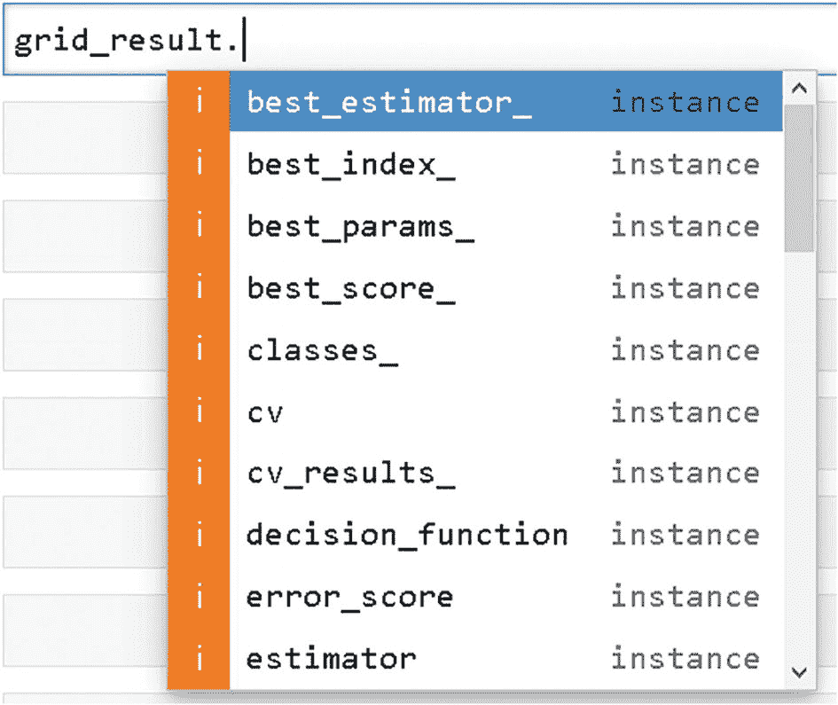

**图 5-28**：包含所有参数的拟合后网格搜索评估器

你可以通过已拟合评估器的`best_score_`和`best_params_`属性找到最佳组合。图 5-29 展示了快照。

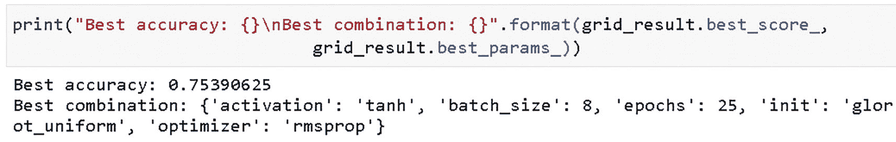

**图 5-29**：最佳超参数选择的快照

你使用`ReLU`激活函数和`Adam`优化器进行了初始的 10 折交叉验证，得到了 0.691 的平均准确率。在进行穷举网格搜索后，你发现对于此问题，`tanh`激活函数和`rmsprop`优化器可能是更好的选择。

从网格搜索结果中创建 pandas DataFrame 并进一步分析也是非常简单的。你将平均分和标准差分数包含在此表中。

```
import pandas as pd
params = grid_result.cv_results_['params']
d = pd.DataFrame(params)
d['Mean'] = grid_result.cv_results_['mean_test_score']
d['Std. Dev'] = grid_result.cv_results_['std_test_score']
```

DataFrame 看起来如图 5-30 所示。

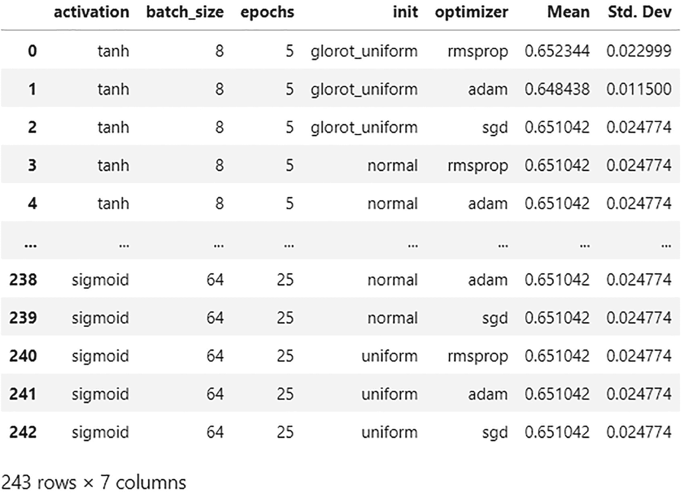

**图 5-30**：从网格搜索参数创建的 DataFrame

你可以从该数据集中创建有针对性的可视化图表，以检查哪些超参数能够提高性能并减少准确率度量标准的波动。图 5-31 展示了一些示例。

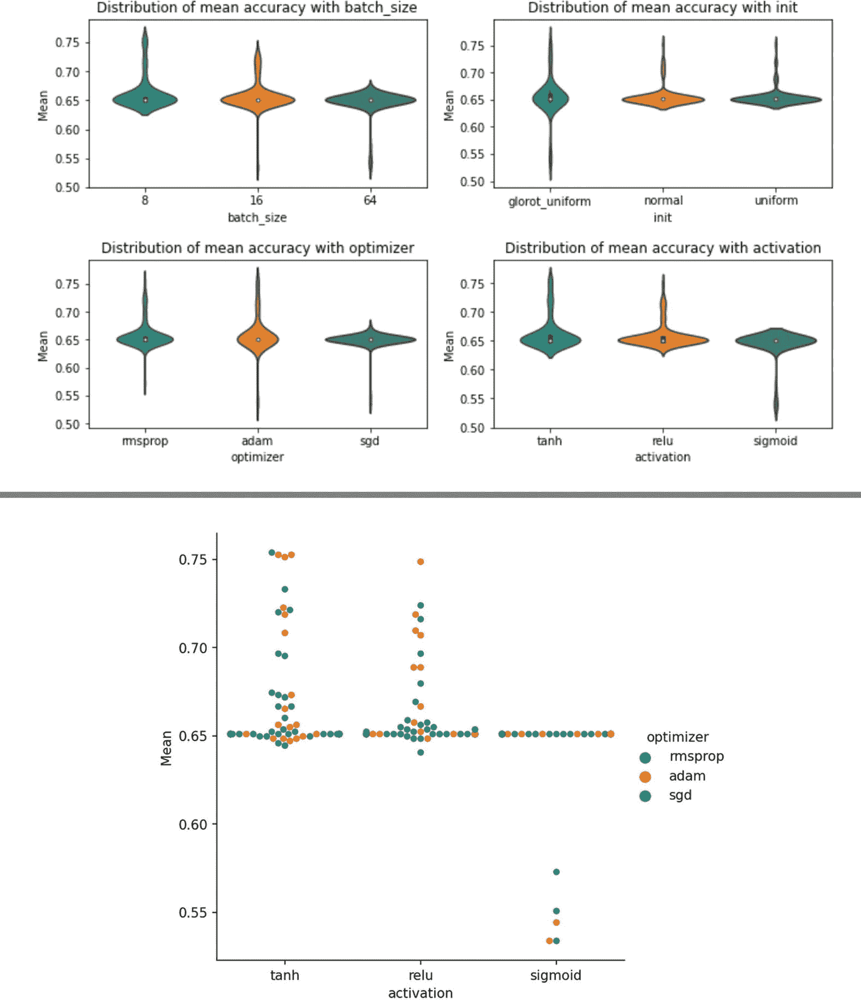

**图 5-31**：网格搜索结果的可视化


## 摘要

本章围绕如何让常用的深度学习代码与任务更具生产力和效率这一核心思想，探讨了多个主题。我延续了前一章中代码模块化的理念，并通过 Keras 框架中实用的模型构建与绘图函数，提供了具体示例。此外，本章还讨论了一种名为 Keras 回调的强大构造。

接下来，我探讨了如何简化数据科学家最常遇到的深度学习任务之一：图像分类。目标是构建一个单一的实用函数，为用户提供极其简单的 API。您只需向此函数传递一个文件夹名称，它就能通过处理该文件夹中的所有图像，返回一个经过完整训练的卷积神经网络模型。我们不仅逐步构建了这个函数，还通过将其应用于一个完全不同的数据集，演示了此类 API 的实用价值。

在下一部分中，您进一步使用此函数，并将其与一个能够提取并可视化深度学习模型各卷积层激活图的专用库集成。基本上，您演示了如何仅用几行代码就能可视化复杂深度学习模型的内部工作原理。这两部分共同体现了通往高效且富有生产力的数据科学（涵盖深度学习）的真正旅程。

最后，您探讨了如何轻松无缝地进行超参数搜索这个主题。尽管有许多专用库和框架可以完成此任务，但您看到了一种简单直观的方法，即使用 `scikit-learn` 中的网格搜索工具以及 Keras 的一些特殊包装类。这也展示了 Keras 和 `scikit-learn` 这两个最流行的机器学习库如何无缝协同工作。

让深度学习代码和产品变得快速高效本身就是一个巨大的课题。有无数的研究方法和方向专注于这一点。本章仅旨在引入一些基础概念，以便您可以进行更深入的探索。

