# 10. 并行化数据科学

在上一章中，我谈到了数据科学任务可能面临从千字节到拍字节不等的各种数据集规模。无论是样本数量还是特征维度的规模，都可能存在一个范围。为了处理复杂的数据分析和机器学习，数据科学家们使用了令人眼花缭乱的模型，并且这个生态系统也在快速扩展。

在规模上处理数据和模型是一项需要掌握的专门技能。当数据科学家开始学习这门技艺时，他们首先专注于理解数学基础、数据整理和格式化概念，以及如何从各种来源获取和抓取数据。在下一阶段，他们主要专注于各种机器学习算法和统计建模技术，以及如何将它们应用于各种任务。模型性能和超参数调优仍然是他们唯一的关注点。

然而，在几乎所有现实场景中，数据科学流水线的成功（以及它给组织整体业务带来的增值）可能取决于它能否大规模地平滑且无缺陷地部署（即，它能否轻松处理大型数据集、更快的流式数据、采样或维度上的快速变化等）。在这个大数据时代，企业级数据科学系统必须拥抱五 V（或六 V）原则。

当然，单个数据科学家不会监督整个企业或流水线的实施。然而，关于扩展数据科学工作流程的知识正在迅速成为即使是在该领域的入门级职位的先决条件。这些知识有几个不同的维度：例如，**云计算**、像 Hadoop 和 Spark 这样的**大数据技术**，以及侧重于数据科学的**并行计算**。

云计算及相关工具（如 AWS、谷歌云服务或 Azure ML）的主题完全超出了本书的范围。此外，有优秀的资源（包括在线课程和教科书）可用于学习使用 Hadoop 基础设施和相关技术进行分布式数据处理的基础知识。本章重点介绍基于 Python 的、可直接用于数据科学任务的并行计算方面。与上一章非常相似，我将讨论在使用最常见的分析和数值计算库（如`pandas`或`NumPy`）处理大型和复杂数据集时出现的一些限制，并讨论有助于完成这些任务的替代库。

然而，需要注意的是，这并非是对 Python 通用并行计算技巧和技术的详尽讨论。实际上，我将避免详细处理在标准 Python 并行计算教程或论文中经常出现的主题，例如使用`multiprocessing`、`threading`或`asynco`等内置模块。像本书中其他章节一样，重点完全放在数据科学上，因此，我将介绍两个库：`Dask`和`Ray`，它们能为任何你想混合并行计算能力的数据科学流水线真正增加价值。

## 面向数据科学的并行计算

我们将从一个简单的代码片段开始，以了解你的目标。假设你的笔记本电脑上安装了标准的 Python，请执行以下代码（在命令行界面或 Jupyter notebook 中）：

```python
import multiprocessing as mp
print("处理器数量: ", mp.cpu_count())
```

你很可能会得到 4 或 6 这样的响应。这是因为所有现代 CPU 都包含不止一个核心；实际上，它们就是并行计算单元。实际的物理核心（那些具有纳米级晶体管的电子单元）和逻辑核心之间存在细微差别，但出于所有计算目的，你可以将逻辑核心视为系统中的基本单元。

要获取有关笔记本电脑上安装的 CPU 的更详细信息，你可以执行以下代码片段：

```python
import psutil
print("="*20, "CPU 信息", "="*20)
# 核心数量
print("物理核心:", psutil.cpu_count(logical=False))
print("总核心数:", psutil.cpu_count(logical=True))
# CPU 频率
cpufreq = psutil.cpu_freq()
print(f"最大频率: {cpufreq.max:.2f}Mhz")
print(f"当前频率: {cpufreq.current:.2f}Mhz")
# CPU 使用率
print("每个核心的 CPU 使用率:")
for i, percentage in enumerate(psutil.cpu_percent(percpu=True, interval=1)):
    print(f"核心 {i}: {percentage}%")
print(f"总 CPU 使用率: {psutil.cpu_percent()}%")
```

在我的笔记本电脑上，我得到以下结果：

```
==================== CPU 信息 ====================
物理核心: 2
总核心数: 4
最大频率: 2195.00Mhz
当前频率: 2195.00Mhz
每个核心的 CPU 使用率:
核心 0: 64.7%
核心 1: 40.9%
核心 2: 58.5%
核心 3: 29.2%
总 CPU 使用率: 55.6%
```

因此，我们拥有多个核心，并且我们应该能够在我们的数据科学任务中利用这种硬件设计。那会是什么样子呢？

### 从单核到多核 CPU

尽管这是一本关于数据科学的书籍，但有时我们有必要（也颇具怀旧意味地）绕道进入硬件领域，回顾一下硬件方面的发展历史。对于并行计算而言，现代软件栈能够充分利用其优势之前，硬件领域必须在很长一段时间内经历大量的发展。简要了解这段历史将有助于我们更好地理解后续的讨论。

最早商用的 CPU 是`Intel 4004`，一款 1971 年推出的 4 位 750kHz 处理器。此后，处理器性能的提升主要得益于时钟频率的提高以及数据/地址总线宽度的扩展。一个标志性的转折点是 1979 年`Intel 8086`的发布，其最高时钟频率达 10MHz，并拥有 16 位数据宽度和 20 位地址宽度。

并行的最初迹象出现在 Intel `i386 (80386)`上首次采用的流水线 CPU 设计，这使得多条指令可以并行执行。其关键创新是将指令执行流程划分为不同的阶段。当一个指令在一个阶段执行时，其他指令可以在另一些阶段执行，从而实现了某种程度的并行性。

大约在同一时期，超标量架构被引入。从某种意义上说，这可以看作是未来多核设计的前身。这种架构复制了部分指令执行单元，允许 CPU 在指令之间没有依赖关系时，同时执行多条指令。最早采用这种架构的商用 CPU 包括`Intel i960CA`、`AMD 29000`系列和`Motorola MC88100`。

摩尔定律（以指数级速度缩小晶体管尺寸并降低制造成本；`www.synopsys.com/glossary/what-is-moores-law.html`）势不可挡的前进，为整个微架构革命提供了必要的动力。半导体工艺技术在不断进步，光刻技术将晶体管节点推向了亚 100 纳米（约为典型人类头发丝宽度的千分之一）的领域，并支持了配套电路、主板和内存技术的发展（这些技术也受益于相同的制造工艺进步）。

时钟频率之争愈演愈烈，AMD 在世纪之交的 1999 年发布了`Athlon CPU`，首次突破 1GHz 速度大关。这场竞争最终由英特尔获胜，它在 21 世纪初发布了一系列令人眼花缭乱的高频单核 CPU，最终推出了基础频率约为 3.8GHz 至 4GHz 的`奔腾 4`处理器。

但基础物理学给出了反击。高时钟频率和纳米级的晶体管尺寸虽然带来了更快的电路运作，但功耗也随之急剧上升。频率与功耗之间的直接关系为性能扩展带来了无法逾越的问题。实际上，这种功耗导致了所谓的更高漏电流，当晶体管数量也攀升至数十亿时（想象一下 CPU 内部发生数十亿次微小且不可预测的电流泄漏），这会破坏整个 CPU 和系统的稳定运行。

为了解决这个问题，人们尝试了多 CPU 设计，即在主板上安置两个物理 CPU，它们共享一条总线和同一内存池。其基本思路是停止提高工作频率，转而通过将计算任务分布到多个同等强大的计算单元上（然后以某种方式汇总结果）来实现并行。然而，由于共享外部（封装外）总线和内存所带来的通信延迟，这种设计并非真正的可扩展方案。

幸运的是，真正的多核设计很快随之而来，其中多个 CPU 核从一开始就在同一封装内设计完成，并对并行内存和总线访问进行了特别考量。它们还配备了与各个 CPU 独立缓存（L1/L2/L3）分开的共享缓存，通过显著降低延迟来改善核间通信。2001 年，IBM 发布了`Power4`，这可以被视为首款多核 CPU，尽管真正的创新和发布节奏是在英特尔于 2005 年发布`酷睿 2 双核`以及 AMD 的`速龙 X2`系列之后才加快的。

在这场竞赛中，许多架构创新和设计优化仍在进行中。提高每代 CPU 的核心数量一直是行业巨头英特尔和 AMD 的主要策略。虽然当今的台式工作站/笔记本电脑通常使用 4 核或 6 核 CPU，但高端系统（企业数据中心机器或价格较高的云实例）可能配备每 CPU 12 核或 16 核。

对于数据科学革命与进步而言，紧跟这一发展历程并充分利用硬件设计所能提供的所有创新成果是合情合理的。但这说起来容易做起来难。将日常数据科学任务并行化是一项艰巨的任务，需要特别的关注和投入。

### 数据科学中的并行是什么？

对于数据科学工作而言，数据和模型都是重要的工件。因此，任何并行计算工作的首要考虑因素之一就是并行的焦点：是数据还是模型。

# 并行数据科学与Dask

## 使用 Dask 进行并行数据科学

为什么需要思考这个问题？因为有些工件比其他工件更容易被设想为并行化。例如，假设你有 100 个数据集需要运行某些统计测试，而你的笔记本电脑有 4 个 CPU 核心。不难想象，如果你能将数据集均匀地分布到所有核心上，并并行执行相同的代码，那将非常理想（图 10-1）。这应该能显著缩短执行统计测试代码的总时间，即使该方案涉及一些用于划分和分发数据的前期开销，以及处理完数据后的聚合或累积操作。

虽然这并不难想象，但对于传统的基于 Python 的数据科学栈（使用 `pandas` 或 `SciPy`）来说，实际的实现并非那么简单。正如上一章所讨论的，Python 本质上是单线程的，用 Python 代码进行并行处理需要一些前期设置和巧妙的操作。当数据科学家使用像 `pandas` 这样的高级分析库时，了解其并行处理的限制（如果有的话）就更为重要了。

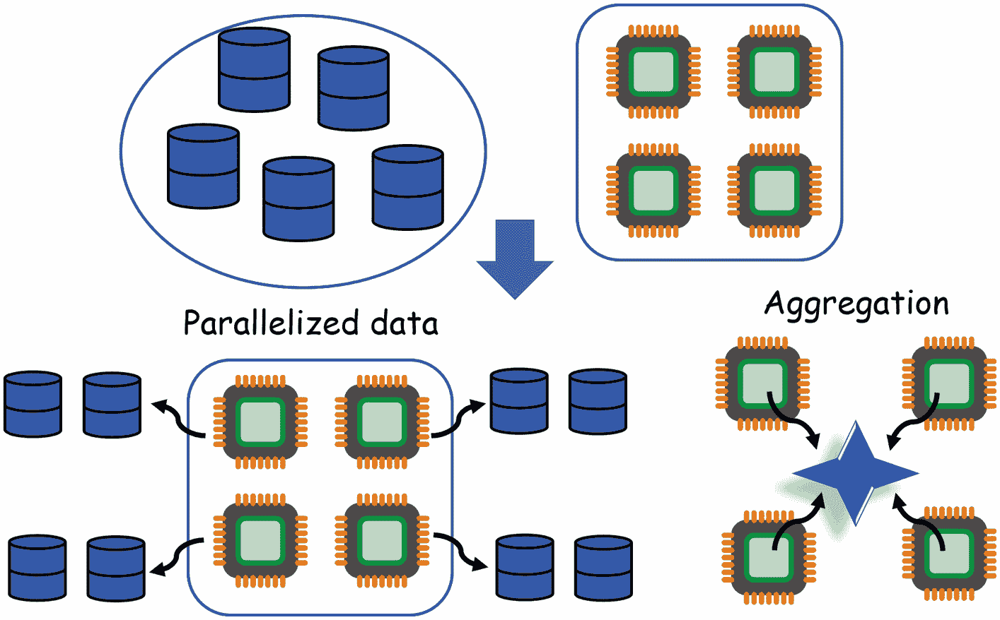
**图 10-1：** 将数据集分布到多个计算核心

此外，数据科学已不再局限于单个人笔记本电脑（或单个基于云的计算节点）上的模型探索和统计分析。当连接到由多台计算机通过高速网络连接而成的集群架构时，对于大规模数据分析而言，单台机器（无论其能力多强）的优势显而易见。在极限情况下，这样的集群旨在成为所有计算意图和目的下的单一实体：*一个由许多较小大脑通过并行组合和沟通而产生的单一大脑*。

自然而然地，数据科学家开始设想可以用这个*集体大脑*尝试和测试的各种可能性。除了分割大型数据集集合，他们还可以考虑将模型（甚至建模子任务）分块，并以并行方式执行。数据集可以通过多种方式进行切分，所有这些维度都可能根据手头的问题进行并行化。某些任务可能受益于按行分割数据样本；其他任务则可能受益于按列分割。

甚至许多优化任务也可以通过足够的投入实现并行化，并抛给多个计算节点。其中一个例子是运行并行局部区域搜索，以寻找全局问题的最佳成本函数。所有这些想法都在图 10-2 中体现。

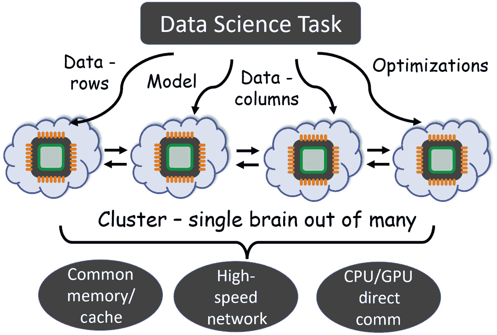
**图 10-2：** 用于在多个维度（数据、模型、优化等）上并行化数据科学任务的计算节点集群

`Dask` 是一个功能丰富、易于使用、灵活的库，适用于 Python 生态系统中的并行化和可扩展计算。虽然用 Python 进行此类并行计算有不少选择和方法，但 `Dask` 的卓越之处在于它专门针对数据科学和分析工作负载进行了优化和设计。在这方面，它确实将自己与 `Apache Spark` 等其他主要参与者区分开来。

在典型的应用场景中，当数据科学家处理大型数据集，而使用标准 Python 数据科学工作流（`NumPy`/`pandas`/`scikit-learn`/`TensorFlow`）难以（甚至完全不可能）处理时，`Dask` 就会提供帮助。尽管这些 Python 库是现代任何数据科学流水线的主力，但如何利用大型并行计算基础设施或集群并非易事。

至少，你必须花费相当多的手动精力，并设置自定义代码或预处理步骤，才能最优地分发大型数据集或分割可在并行计算基础设施上执行的模型。此外，这种限制不仅适用于基于云的集群，也适用于单台机器场景。在执行 `pandas` 数据分析任务或使用 `SciPy` 进行统计假设检验时，如何充分利用强大工作站（配备单个独立 CPU）的所有逻辑核心或线程并不明显。这些库的某些设计特性甚至可能从根本上阻止我们同时使用多个 CPU 核心。

幸运的是，`Dask` 消除了为将大多数类型的数据科学任务转化为并行计算作业而规划和编写自定义代码的痛苦，并尽可能多地抽象了隐藏的复杂性。它还提供了一个 `DataFrame` API，其外观和感觉与 `pandas DataFrame` 非常相似，因此标准的数据分析和数据处理代码可以以最少的修改和调试进行移植。它还有一个专门的机器学习库（API 类似于 `scikit-learn`）。让我们在接下来的章节中探索 `Dask` 的工作原理及其更多功能。

### `Dask` 和 Spark 一样吗？

这篇博文 (https://coiled.io/is-spark-still-relevant-dask-vs-spark-vs-rapids/) 很好地阐述了两者的异同。简而言之，对于使用 Python 代码库、解决不总是局限于 SQL 类型数据查询问题的数据科学家来说，`Dask` 更加“友好和熟悉”。

### `Dask` 底层工作原理

`Dask` 的核心在于使用高效的数据结构（数组和 DataFrame）和一个巧妙设计的图。基本上，它采用**客户端-调度器-工作节点**的集群架构（图 10-3）来最优地分发子任务、汇总它们并计算结果/预测。并行计算的复杂性对普通的 Python 程序员或数据科学家来说是透明的，因此处理大型数据集变得简单易行。图 10-3 展示了一个示意性的说明。

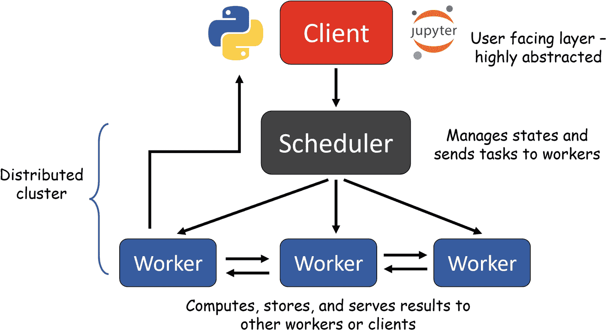
**图 10-3：** `Dask` 客户端-调度器-工作节点底层操作

`Dask` 最有用的基本构建模块如下：

- `Dask` 数组

- `Dask` DataFrame

- `Dask` bag

- `Dask` 任务图

#### `Dask` 数组

这是 `NumPy` *n* 维数组（或 `ndarray`）接口的子集实现，它使用分块算法，有效地将一个大数组切割成许多小数组/块。这有助于利用计算机中的所有核心以并行方式对超出内存（大于内存）的数组进行计算。这些分块算法通过 `Dask` 任务图进行协调。有关 `Dask` 数组的更多详细信息，请访问官方文档：https://docs.dask.org/en/latest/array.html。

#### Dask DataFrame

本质上，Dask DataFrame 是一个大规模并行化的 DataFrame，由许多较小的 `pandas` `DataFrame` 沿索引拆分而成。根据大小和情况，这些 `pandas` `DataFrame` 可能存在于磁盘上，用于单机的外存计算，或者分布在集群中的多个不同计算节点上。单个 Dask `DataFrame` 操作会触发链式反应，即以并行方式对其组成的 `pandas` `DataFrame` 执行许多操作。

效率和易用性是 Dask 项目的主要目标。因此，Dask `DataFrame` 按行进行分区，通过索引值对行进行分组以提高效率。同时，它们可以暴露与 `pandas` 稳定版相同的 API 和方法。数据科学家不会感觉到差异，也无需更改现有代码，只需使用 Dask `DataFrame` API 即可利用并行性。实际上，`pandas` 官方文档建议使用 Dask 来扩展处理大型数据集（图 10-4）。

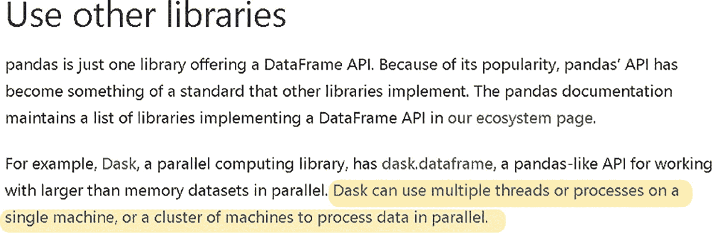
**图 10-4** `pandas` 官方文档建议使用 Dask 处理大型数据集

#### Dask Bag

这是一种数据结构，可在通用 Python 对象（如列表或元组）的集合上实现 `map`、`filter`、`fold` 和 `groupby` 等操作。它使用 Python 迭代器，内存占用小，并且本质上是并行化的。

`Apache Spark` 有其著名的弹性分布式数据集（`RDD`，参见 [`https://databricks.com/glossary/what-is-rdd`](https://databricks.com/glossary/what-is-rdd)）。Dask Bag 是该 `RDD` 的 Python 化版本，适用于 Hadoop 文件系统用户通常喜欢的操作。它们主要用于并行化处理非结构化或半结构化数据（如文本数据、JSON 记录、日志文件或自定义的用户定义 Python 对象）的简单计算。

#### Dask Task Graph

Dask 在用户空间采用了一种常见的并行执行方法：任务调度。通过这种方法，它将高级的主程序/代码分解为许多中等规模的任务或计算单元（例如，对非平凡数据量的单个函数调用）。这些任务被表示为图中的节点。如果一个任务依赖于另一个任务产生的数据，则节点之间会存在边。任务调度器负责执行整个图，同时尊重所有节点间的数据依赖性，并尽可能利用并行性，从而加速整体计算。

有许多调度技术：易并行调度、`MapReduce`、全任务调度等。任务调度逻辑通常隐藏在其他更大的框架中，如 `Luigi`、`Storm`、`Spark` 和 `IPython Parallel`。Dask 使用常见的 Python 组件（即字典、元组和可调用对象）以最小的附带复杂性实现了全任务调度（图 10-5）。Dask 甚至可以使用 Python 原生调度器，例如 `Threaded` 和 `Multiprocessing`。

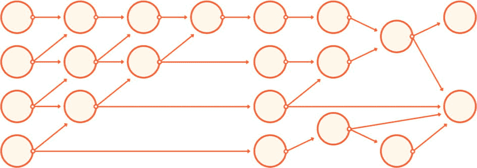
**图 10-5** Dask 为其任务图使用了全任务调度方法

基于这些基本的数据结构和调度器，我们可以展示 Dask 的灵活性，如图 10-6 所示。

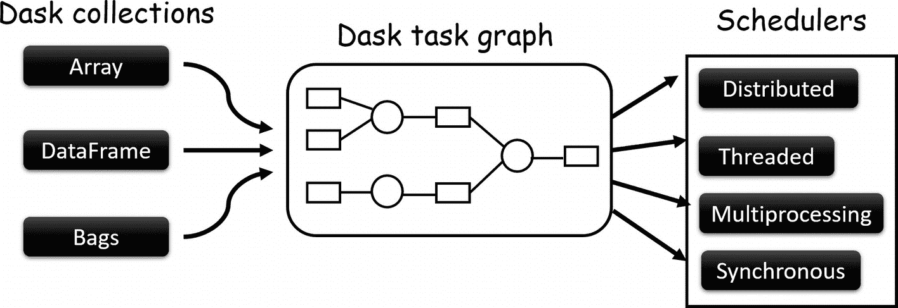
**图 10-6** Dask 集合、任务图和调度器

### 适用于多种类型的集群

Dask 的一大特点是任务和代码可以部署在多种类型的集群上：

*   运行 YARN 的 Hadoop/Spark 集群
*   运行作业管理器（如 SLURM、SGE、PBS、LSF 等）的 HPC 集群，这些在学术和科学实验室中很常见
*   Kubernetes 集群

这使得 Dask 成为一个真正强大的并行计算引擎，无论底层的分布式数据处理基础设施选择如何。自然地，Dask 代码和流水线可以轻松地从一个组织移植到另一个组织，或者在一个大型数据科学组织的团队之间共享。

### 基本使用示例

以下是如何定义和检查您刚刚了解的一些数据结构的方法。让我们从数组开始，然后展示一些 `DataFrame` 和 `Bag` 的示例。

关于 Dask 和 Ray 代码示例的说明：

本章中几乎所有的代码片段仅用于说明和概念验证目的。它们并不是完全可执行的、能运行的工作代码。原因是为了简洁。本书侧重于概念和学习，不打算作为代码手册。可用的工作代码示例在随附的 Jupyter 笔记本（或 GitHub 链接）中提供。

# Array

定义一个包含 100,000 个元素的 Numpy 数组（高斯随机数），并使用`da.from_array()`方法从中创建一个 Dask 数组：

```python
import numpy as np
import pandas as pd
import dask.dataframe as dd
import dask.array as da
import dask.bag as db
arr = np.random.normal(size=100_000).reshape(500,200)
dask_arr = da.from_array(arr,chunks=(100,100))
```

请注意，创建 Dask 数组时，你选择的块大小为 `(100, 100)`。在 Jupyter notebook 中，如果仅查看这个`dask_arr`对象，它甚至会被可视化地呈现出来（图 10-7）。

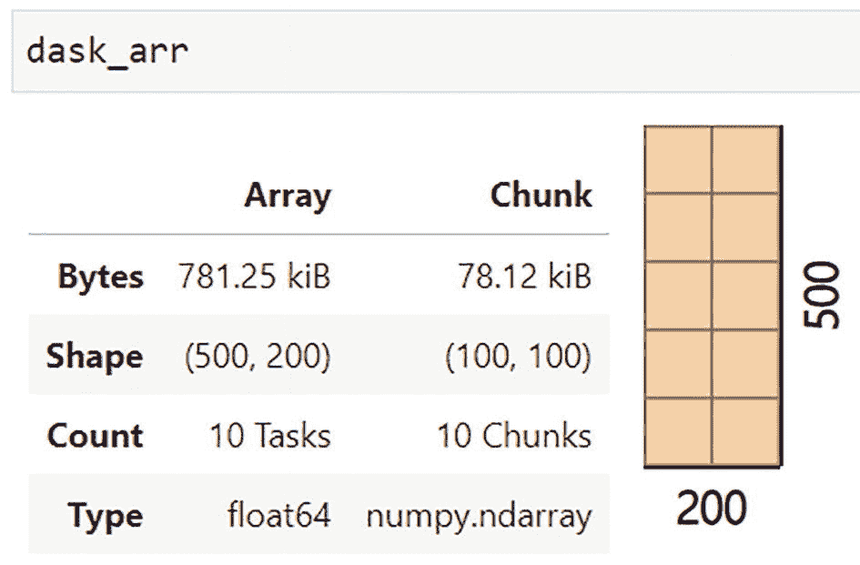

图 10-7 从随机数的 NumPy 数组创建的二维 Dask 数组

所有块的大小相同，为 78.12 kiB，而整个数据集为 781.25 kiB。这些块可以有效地分布在多个核心或机器上进行并行计算。你可以继续以类似方式定义一个三维数组：

```python
arr = np.random.normal(size=100_000).reshape(50,200,10)
dask_arr = da.from_array(arr,chunks=(50,20,10))
```

现在，Dask 数组看起来像一堆具有三维形状的砖块（图 10-8）。

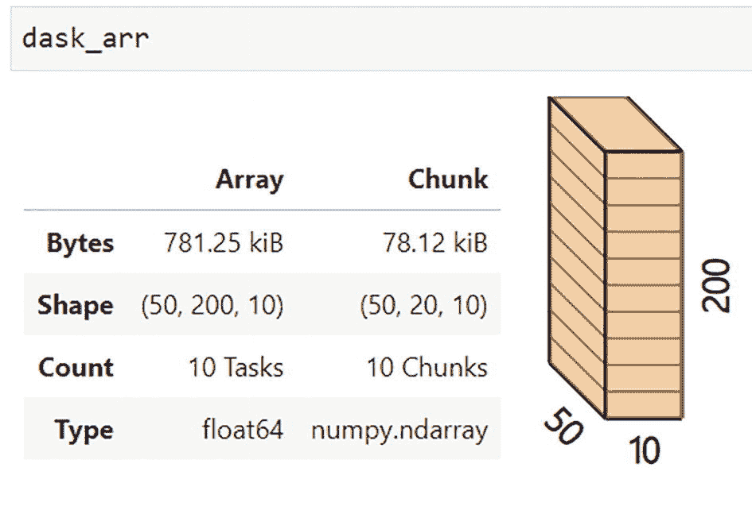

图 10-8 从随机数的 NumPy 数组创建的三维 Dask 数组

Dask 遵循延迟计算原则，除非明确要求，否则不会计算最终值。你可以像这样在三维数组上定义求和操作，同时计算操作的时间：

```python
import time
t1 = time.time()
task1 = dask_arr.sum(axis=2)
t2 = time.time()
print("Time (milliseocnds):", round((t2-t1)*1000,3))
task1
```

在 Jupyter notebook 中，这将显示一个可视化。注意此操作花费的时间约为 4 毫秒（图 10-9）。尚未计算出任何结果；只是构建了一个任务图，并确定了预期的输出数组形状。

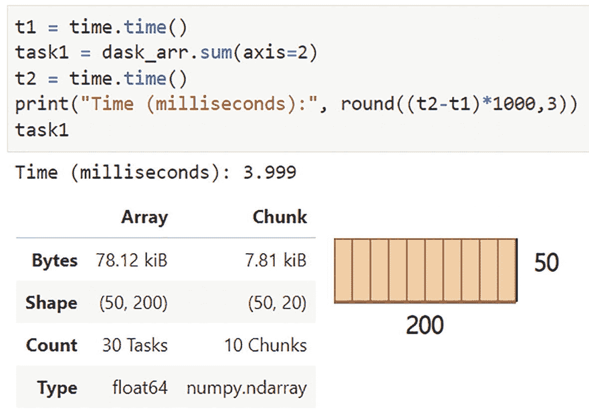

图 10-9 一个简单的求和操作产生了一个新的数组和任务图

类似地，你可以向这个链中添加另一个操作，沿着列（即`axis=1`）确定这些求和值中的最大值：

```python
t1 = time.time()
task2=task1.max(axis=1)
t2 = time.time()
print("Time (milliseocnds):", round((t2-t1)*1000,3))
task2
```

同样，`task2`显示为一个形状为 `(50,)` 的数组，构建它花费了约 6 毫秒（图 10-10）。

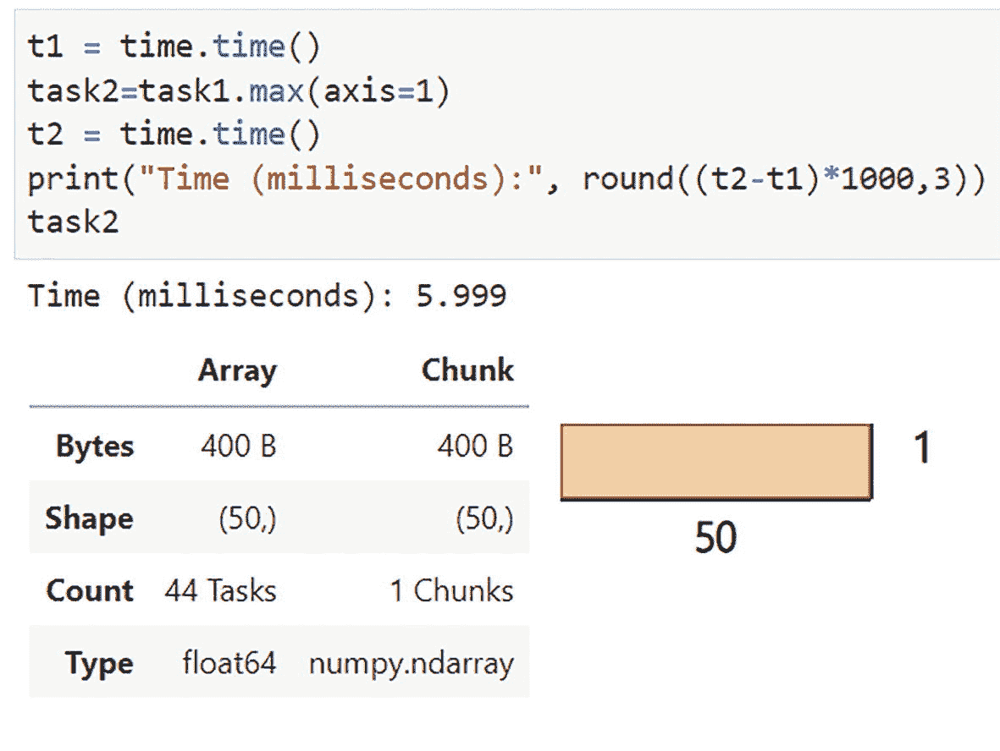

图 10-10 沿着列确定求和值中的最大值

最后，你需要调用一个特殊的计算方法来评估结果——`result = task2.compute()`。这里的计算时间要高得多（约 24 毫秒），并且你会得到如预期的一维最大值数组（图 10-11）。这就是任务图中的所有任务在多个核心上以并行方式执行的地方。

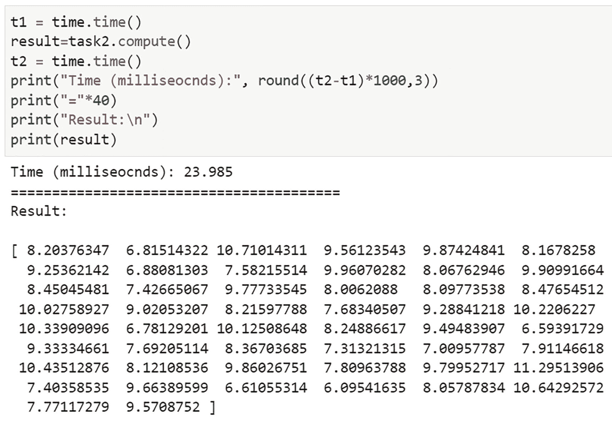

图 10-11 三维数组的最终计算

事实上，你可以通过检查任何数组（例如`task2`）的`dask`属性来查看任务图的详细信息（图 10-12）。

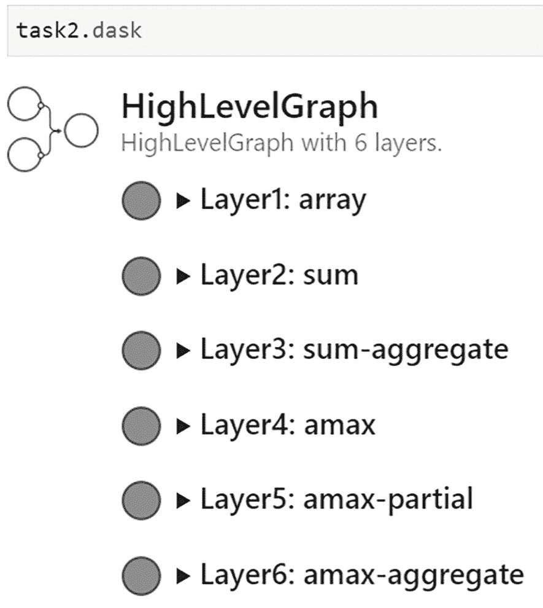

图 10-12 求和-最大值操作的高级任务图

在 Jupyter notebook 中，可以展开这些层中的每一层以查看更多细节。建议你查看随附的 notebook。

# DataFrames

如果你已经熟悉 pandas，Dask DataFrames 同样易于使用。你可以使用 Dask 内置的 `datasets` 模块创建一个包含时间序列数据的 DataFrame：

```python
from dask import datasets
df = datasets.timeseries(
start='2022-01-01',
end='2022-01-31',
freq='1min',
partition_freq='1d',)
```

现在，如果在 Jupyter notebook 单元格中仅输入 `df`，它不会显示你习惯在 pandas DataFrame 中看到的数据快照。这是因为 Dask 采用延迟计算，仅输入 `df` 并不要求任何实际计算。相反，它会显示模式（即数据类型）和一般结构信息（图 10-13）。注意它有 30 个分区，因为你在代码中选择了 `partition_freq = '1d'`，并且开始和结束日期分别落在该月的 1 日和 31 日。

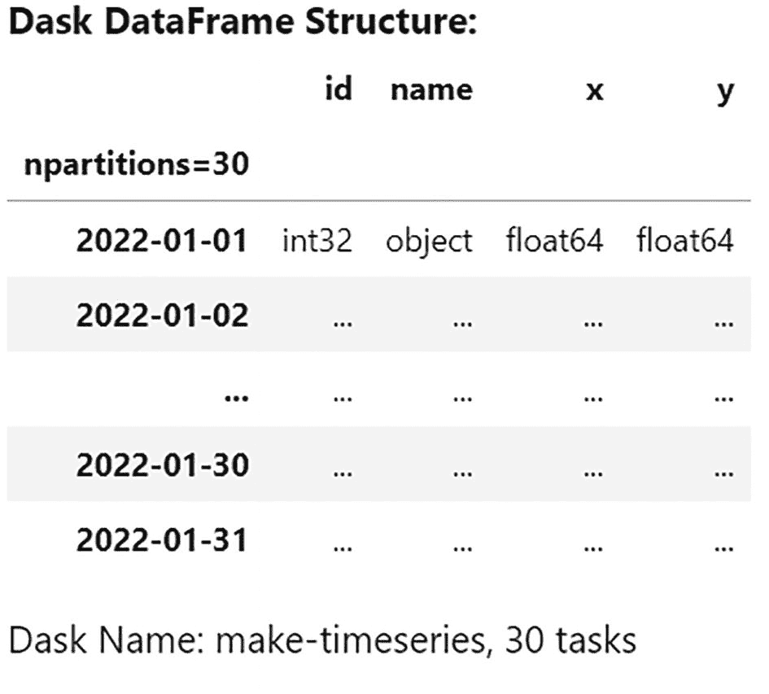

图 10-13 Dask 中的时间序列 DataFrame，显示数据模式

如果你想查看前几条记录，熟悉的 `head` 方法可以满足这一目的，并且默认情况下将进行计算（即显示实际数据），如图 10-14 所示。

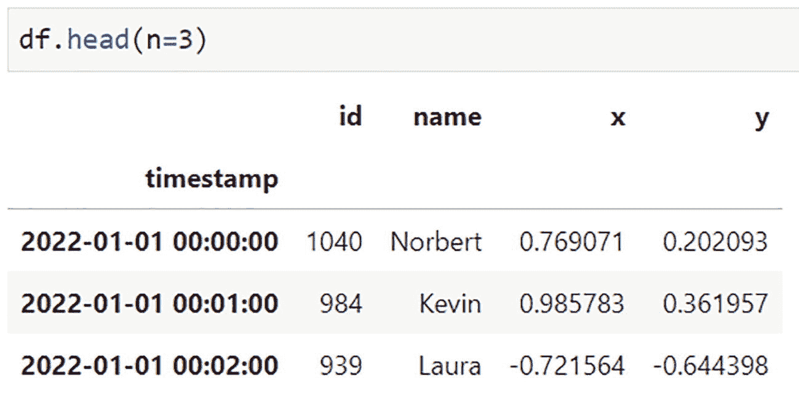

图 10-14 显示前几条记录的 Dask DataFrame

大多数 pandas 类型的操作都受支持。例如，要知道有多少个唯一的名字，可以编写以下代码：

```python
df['name'].nunique().compute()
>> 26
```

现在，要按这些名字进行分组并并排比较它们的 `x` 和 `y` 数据的方差，可以编写：

```python
df.groupby(by='name').var().compute()[['x','y']]
>>
x           y
name
Alice    0.331361    0.318624
Bob      0.328595    0.336009
Charlie  0.324984    0.334246
Dan      0.329188    0.333593
Edith    0.324070    0.332390
Frank    0.340098    0.335124
```

像 pandas 一样也支持直接绘图。使用特殊的 `resample` 方法（因为数据是时间序列），你可以像这样绘制均值数据（图 10-15）：

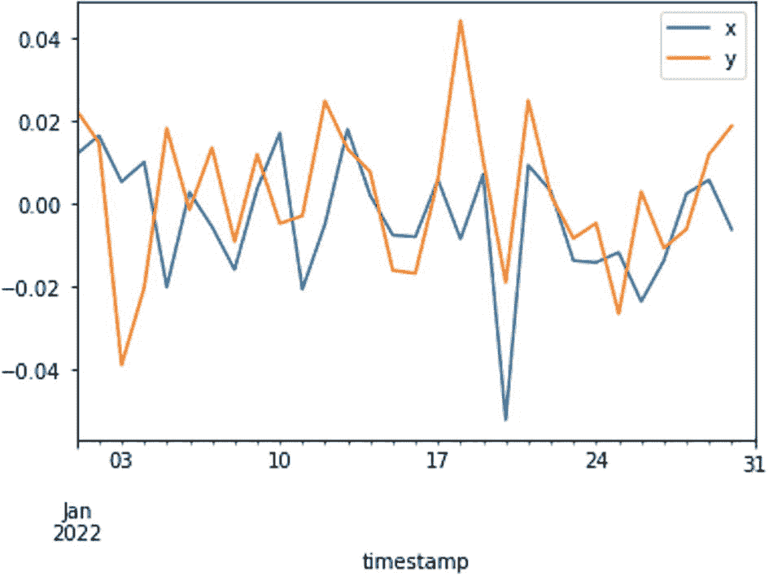

图 10-15 时间序列重采样数据均值

```python
df[['x', 'y']].resample('24h').mean().compute().plot()
```

随机访问某个分区的数据速度很快，但仍需要计算才能看到实际数据。例如，要查看 1 月 25 日分区的所有时间数据（图 10-16），可以编写以下代码：

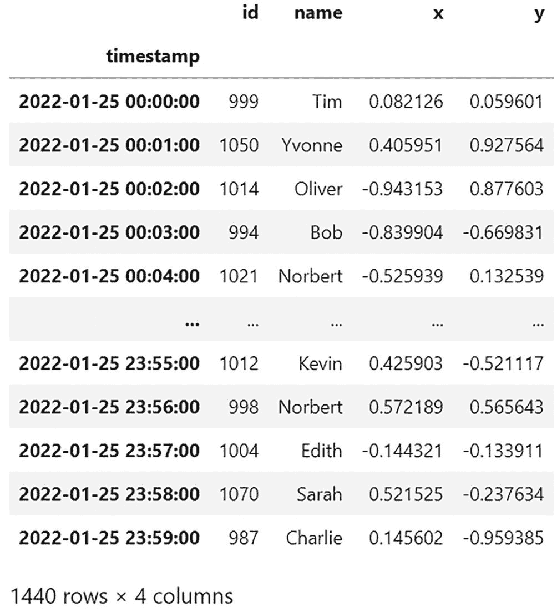

图 10-16 访问并计算特定日期/分区的数据

```python
df.loc['2022-01-25'].compute()
```

## Dask Bag 示例

以下是一个包含 JSON 记录的 Dask Bag 示例。这些数据可以是随机生成的，生成这类 JSON 数据的代码在随附的笔记本/源代码中提供。你可以在一个名为 `data` 的文件夹中存放五条 JSON 记录（关于五个人）。通过以下代码，你可以将这些记录读入 Dask Bag 结构（注意 `map` 和 `json.loads` 函数的使用）：

```python
import dask.bag as db
import json
bag = db.read_text('data/*.json').map(json.loads)
```

同样，由于惰性求值，除非你显式要求，否则无法查看 Bag 的内容。你可以使用 `take` 方法来实现：

```python
bag.take(2)
```

这应该会显示类似图 10-17 的内容。这些记录包含人们的姓名、职业、电话号码和地址信息。记录是多层级的，例如，`address` 字段还包含下一层级的数据字段：`address` 和 `city`。

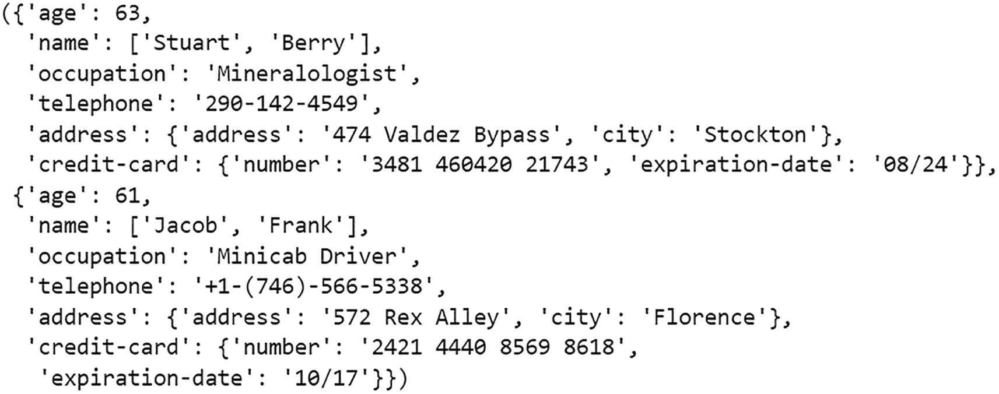

图 10-17 包含 JSON 记录的 Dask Bag（此处显示了前两条记录）

现在，你可以对这些记录数据执行 `map`、`filter` 和聚合等操作。例如，你可能想要筛选出年龄大于 50 岁且信用卡到期年份在 2022 年之后的人。你可以编写一个简单的过滤函数，并将其传递给 Bag 对象的 `filter` 方法。请注意，你必须使用 `take` 或 `compute` 来触发实际计算。

```python
def filter_func(record):
    cond1 = record['age'] > 50
    cond2 = int(record['credit-card']['expiration-date'].split('/')[-1]) > 22
    return cond1 and cond2
bag.filter(filter_func).take(2)
```

这可能会返回类似图 10-18 的结果。

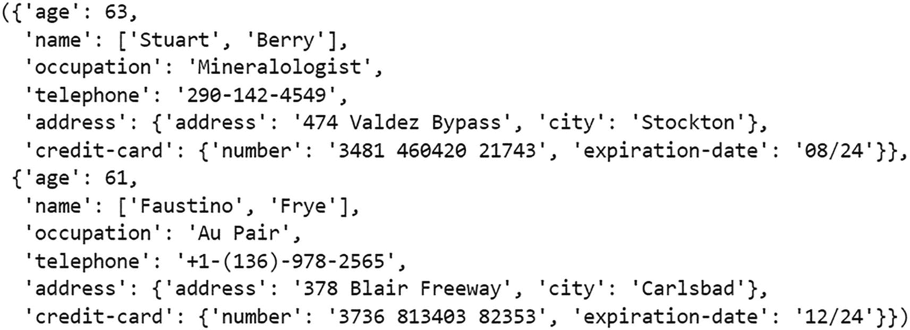

图 10-18 对 Dask Bag 包含的记录执行过滤操作

对于半结构化数据集，Dask Bag 有许多强大的用法，而这些用法仅使用数组或 DataFrames 是很难实现的。

### Dask 分布式客户端

前面章节中的所有用法示例都展示了 Dask API（数组、DataFrames 和 Bags）的形式化和惰性求值特性，但它们并未以明显的方式展示计算的分布式/并行化特性。为此，你必须从 Dask 的工具库中选择并使用分布式调度器。这实际上是一个单独的模块或轻量级库，称为 `Dask.distributed`，它将 `concurrent.futures` 和 Dask API 扩展到中等规模的集群。

该模块的一些核心特性如下：

*   **低开销和低延迟**：每个任务的开销仅为约 1 毫秒。一个小的计算和网络往返可以在 10 毫秒内完成。
*   **对等节点间的数据共享**：工作节点（例如，本地机器上的逻辑核心或集群中的廉价计算节点）相互通信以共享数据。
*   **数据本地性**：计算在数据所在位置进行。调度算法遵循此原则来分发和调度任务。这同时最小化了网络流量并提高了整体效率。
*   **复杂任务调度**：这可能**是最吸引人的特性**。调度器支持复杂的工作流，不限于标准的 `map`/`filter`/`reduce` 操作，而这些操作是基于 Hadoop 的系统的首要特性。这对于涉及 *n* 维数组、机器学习、图像或高维数据处理以及统计建模的复杂数据科学任务来说，是绝对必要的。

调度器的灵活性和强大功能也源于其**异步**和**事件驱动**的特性。这意味着它可以同时响应来自多个客户端的计算请求，并跟踪已被分配任务的众多工作节点的进度。它还能够同时处理来自多个用户的各种工作负载，同时管理一个包含可能故障和新加入节点的动态工作节点池。

对用户（数据科学家）来说，最好的事情是，他们可以使用纯 Python 代码，并以最小的学习曲线来应用所有这些特性和功能。从编程角度实现集群管理或分布式调度并非易事。使用 Dask 的数据科学家无需操心这些复杂性，因为它们已被抽象化了。这正是“高效数据科学”这一主题得以获得像 Dask 这类库支持的地方。

实际上，仅用两行代码，你就可以启动一个本地集群（利用本地机器的 CPU 核心）：

```python
from dask.distributed import Client
client = Client()
```

现在，如果你在 Jupyter notebook 单元格中输入 `client`，你将看到类似图 10-19 的描述。请注意，它显示了一个指向仪表盘的超链接，你很快就能看到它的实际效果。

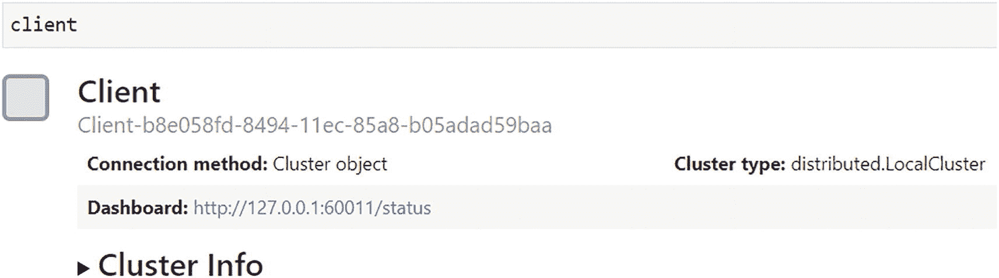

图 10-19 启动一个 Dask 分布式集群/调度器（在本地机器上）

如果你继续展开“集群信息”下拉菜单，可能会看到类似图 10-20 的内容。注意它如何显示本地机器的线程/工作节点以及可用的系统内存。

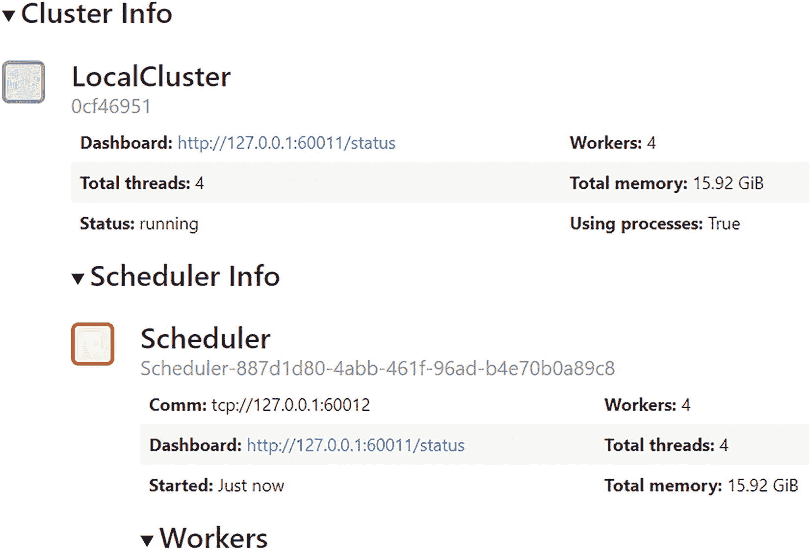

图 10-20 Dask 分布式客户端设置的集群和调度器信息

需要知道的重要一点是，在创建调度器/集群时，你可以向 `Client` 构造函数传递许多可自定义的参数。其中一些最重要的参数包括：

- `address`：真实的基于云的远程集群或本地主机的 IP 地址（带端口）。如果你能负担得起租用一台具有高 CPU 数量的高端云实例（如前一章所述），Dask 调度器可以直接连接到它并开始利用其资源。如果未指定，则仅将本地主机作为计算节点。

- `n_workers`：显式指定集群能够使用的 CPU 核心数量。这在资源受限的情况下，或者当有大量 Dask 任务需要在有限数量的 CPU 核心间分配时，可能非常重要。

- `threads_per_worker`：就像指定 CPU 核心数量一样，这决定了每个核心的线程数。通常，这个数字是 1 或 2。

- `memory_limit`：这是另一个用于优化管理分布式客户端总系统内存的有用关键字。此限制是基于每个 CPU 核心的，并且应该是一个字符串（例如，`'2 GiB'`）。

一旦调度器启动，它会自行管理分布式计算的所有方面。然而，有特定的方式通过`map`和`submit`方法向调度器提交作业。下面是一个（有些牵强的）例子。

假设你有几个从特定统计分布生成的随机变量数据集，并且希望测量它们的最大值与中位数之间的差异，然后取这些测量值的平均值。每个数据集可能包含 1,000 个值，共有 21 个这样的数据集。综合起来，这可以作为衡量数据中某种异常值的一种度量（即，对于某批数据，最大值比中位数高多少）。你可以在随附的笔记本中找到数据生成代码。各个数据集的分布如图 10-21 所示。

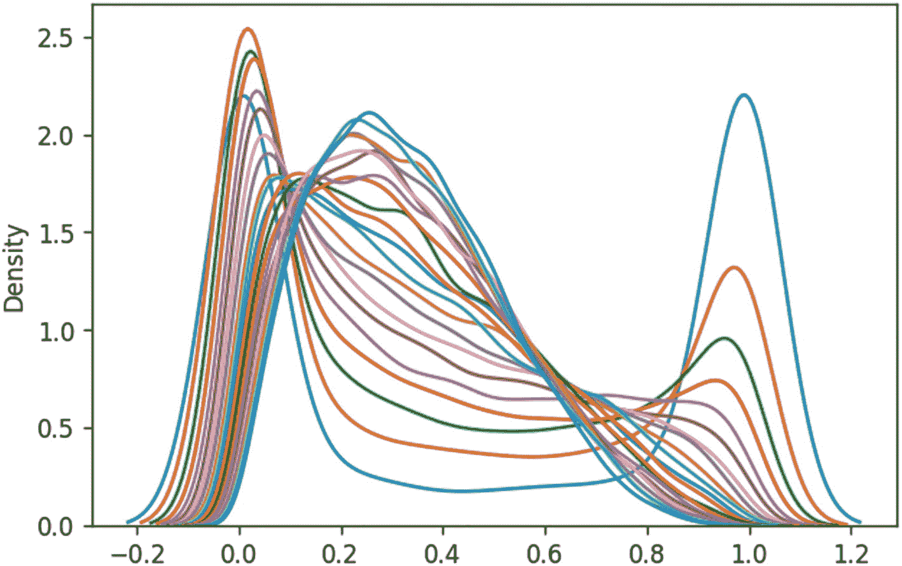

图 10-21：一个需要运行分布式处理的合成批次数据

因此，这涉及以下计算：

- 21 次最大值计算（每次从 1,000 个数据点中）

- 21 次中位数计算（每次从 1,000 个数据点中）

- 两次算术平均值计算（每次针对 21 个最大值/中位数）

- 最终的差值计算

你可以编写如下 Dask 代码（假设数据集包含在一个名为`dists`的 Python 列表中）。生成列表中此类随机数的代码在随附的源码/笔记本中给出。

```
# 将统计计算映射到数据分布
A = client.map(np.max, dists)
B = client.map(np.median, dists)
# 提交平均值计算作业
mean_max = client.submit(np.mean, A)
mean_min = client.submit(np.mean, B)
```

此时，如果你检查`mean_max`对象，你会发现它是一个被称为 Dask Future 的东西（一种承诺，将在未来被计算或执行，类似于 JavaScript 中的概念）：

```
mean_max
>> Future: mean status: finished, type: numpy.float64, key: mean-2e5b19a32f99725e1cf4f6f5ba8e295a
```

整个分布式任务在此刻只是被计划好了，并没有发生实际的计算。你必须调用`result`来执行实际计算：

```
final = mean_max.result() - mean_min.result()
final
>> 0.6780617253952232
```

然而，仅仅通过查看 Dask 提供的动态仪表板，就可以观察到更有趣的事情。你只需点击图 10-20 中所示的超链接，就会看到类似图 10-22 的内容。

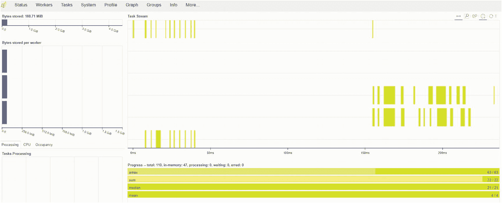

图 10-22：动态 Dask 仪表板的任务状态视图

这是仪表板任务状态选项卡的一个静态快照。当并行过程执行时（分布在多个 CPU 核心上），随着所有数据块在工作节点间分割和共享，图表会动态变化和更新。我在 [`https://medium.com/productive-data-science/out-of-core-larger-than-ram-machine-learning-with-dask-9d2e5f29d733`](https://medium.com/productive-data-science/out-of-core-larger-than-ram-machine-learning-with-dask-9d2e5f29d733) 发表的一篇文章中，通过一个涉及 Dask 机器学习库的动手实例，很好地直观演示了这个动态过程。建议你去看看这篇文章。

这个仪表板还有许多其他选项卡。关于工作节点的信息选项卡就是其中之一（图 10-23）。同样，这里的视图是静态的，并且是在处理完成之后的状态。因此，你看到的是内存和 CPU 的最低使用量。但在动态状态下，这些数字会很高并且不断变化。

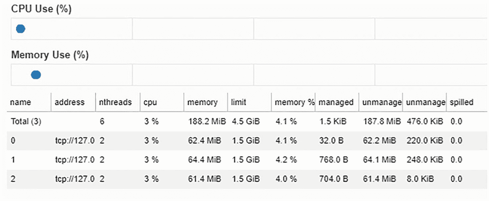

图 10-23：动态 Dask 仪表板的工作节点信息视图

### Dask 机器学习模块

尽管 Dask 提供了一套出色的并行和核外（out-of-core）计算设施以及一套直截了当的 API（Arrays、DataFrames、Bags 等），但其功能并不仅限于此。超越数据整理和转换阶段后，当数据科学家进入机器学习阶段时，他们仍然可以利用 Dask 借助并行计算的能力来进行建模和预处理任务。所有这些都可以在对现有代码库进行最小改动的情况下，以纯 Python 风格实现。

对于机器学习算法和 API，Dask 有一个可单独安装的模块，名为`dask-ml`。对该模块的完整介绍超出了本书的范围。再次建议你查看[上文提到的文章](https://medium.com/productive-data-science/out-of-core-larger-than-ram-machine-learning-with-dask-9d2e5f29d733)以了解其 API。在此，我将简要讨论`dask-ml`的一些关键方面。

#### 它解决了什么问题？

从根本上说，像`dask-ml`这样的库解决了*数据扩展*和*模型扩展*这两个问题。

**数据扩展挑战**伴随着大数据领域出现，例如，当计算硬件在将训练数据容纳在工作内存中开始遇到困难时。因此，这本质上是一个**内存受限**的问题。Dask 通过将数据溢出到磁盘存储（out-of-core）并提供增量元学习估计器来解决这个问题，这些估计器可以从数据批次中学习，而不必在内存中加载整个数据集。

**另一方面，模型扩展挑战**在机器学习模型的参数空间变得过大且操作变得**计算受限**时凸显出来。为了应对这些挑战，你可以继续使用 Dask 提供的高效集合（数组、DataFrames、bags），并使用 Dask 集群在一组机器上并行化工作负载。即使是并行化任务也有多种选择。它可以通过内置的集成之一（例如，Dask 的`joblib`后端直接并行化 scikit-learn）或`dask-ml`的估计器之一（例如，一个超参数优化器或一个并行化的随机森林估计器）来实现。

### 与 scikit-learn 的紧密集成

遵循简洁易用的原则，`dask-ml` 与最流行的 Python 机器学习库 scikit-learn 保持了高度集成，并贯彻了 **“即插即用”（drop-in replacement）** 的替换理念。`dask-ml` 提供了**数据预处理**、**模型选择**、**训练**，甚至**数据生成函数**，功能与 scikit-learn 类似，同时支持将 Dask 集合作为原生对象与这些 API 一起使用。

通用代码示例如下（非实际可运行代码）：

```python
import dask.dataframe as ddf
from dask_ml.model_selection import train_test_split
from dask_ml.preprocessing import MinMaxScaler
from dask_ml.xgboost import XGBRegressor
# 读取高效的 parquet 文件格式
data = ddf.read_parquet('Parquet file', engine='pyarrow')
X = data[Feature_columns]
y = data[Label_column]
# 测试/训练集划分
train, train_labels, test, test_labels = train_test_split(X, y,
test_size=0.2, ...)
# 缩放/预处理
train = MinMaxScaler.fit_transform(train)
test = MinMaxScaler.fit_transform(test)
# 并行化估计器
est = XGBRegressor(...)
est.fit(train, train_labels)
est.score(test)
```

很容易发现，这段代码与标准的 scikit-learn 流程几乎逐行相似。这就是 `dask-ml` 所谓的“即插即用”替换能力。你可能还会注意到，代码中使用 Parquet 文件格式，以便从磁盘或网络存储中高效地读取大规模数据集（存入 Dask DataFrame）。你可以阅读我关于此主题的文章（`https://medium.com/productive-data-science/out-of-core-larger-than-ram-machine-learning-with-dask-9d2e5f29d733`）。执行时，这段代码将 Dask DataFrame 的核外数据处理优势与并行化估计器 API 相结合，为数据科学家提供了可扩展的机器学习体验，从而大幅提升其生产力。

`dask-ml` 库还提供了一些元估计器/封装器，用于并行化和扩展某些 scikit-learn 本身无法完成的任务。例如，`ParallelPostFit` 可用于并行化 `predict`、`predict_proba` 和 `transform` 方法，使其能够处理大规模（甚至超出内存）的数据集。这非常适用于实际的生产部署，因为即使训练时使用的是较小数据集，生产环境中的实时数据也可能相当庞大。为了确保预测服务的稳定流畅运行，这些后拟合方法无论数据集大小如何都应能优雅地扩展，而 `dask-ml` 无需大量代码更改即可实现这一目标。此类任务的通用代码片段可能如下所示：

```python
from sklearn.ensemble import GradientBoostingClassifier
from dask_ml.wrappers import ParallelPostFit
# 使用 Dask 封装器包装 sklearn 估计器
clf = ParallelPostFit(estimator=GradientBoostingClassifier())
clf.fit(X, y)
# 用于预测的大数据集
X_big, _ = make_classification(n_samples=100000, chunks=10000,)
# 前 10 个数据点的概率
clf.predict_proba(X_big).compute()[:10]
```

在上面的代码中，请注意主估计器来自 scikit-learn 本身。Dask 部分只是一个封装器，它利用底层估计器来处理 Dask 集合（如 DataFrame），从而实现惰性求值和核外计算。

## 使用 Ray 进行并行计算

近年来，纯 Python 的并行计算因几个优秀开源框架的迅速崛起而发生革命性变化，`Ray` 就是其中之一。它由加州大学伯克利分校 RISElab（`https://rise.cs.berkeley.edu/`）的两名研究生 Robert Nishihara 和 Philipp Moritz 创建，旨在作为一个简化和运行时框架来简化分布式计算。在 Michael Jordan 教授和 Ion Stoica 教授的指导下，它迅速从一个研究项目发展成为一个功能齐全的计算平台，并在此基础上构建了许多子组件，用于不同的 AI 和 ML 任务（如超参数调优、强化学习、数据科学工作，甚至 ML 模型部署）。

目前，`Ray` 由 Anyscale（`www.anyscale.com/`）维护和持续增强。Anyscale 是一家由 Ray 创建者成立的商业实体（初创公司）。它提供完全托管的 Ray 服务，通过消除构建和管理复杂基础设施的需求，加速在 Ray 上构建、扩展和部署 AI 应用。

### Ray 的功能与生态系统

`Ray` 的一些核心功能如下：

- Ray 通过在**全局控制存储**中抽象系统的控制状态，并保持所有其他组件无状态，从而实现可扩展性和容错性。
- 它使用**共享内存的分布式对象存储**，通过共享内存高效处理大数据，并采用自底向上的分层调度架构，实现低延迟和高吞吐量的调度。
- Ray 提供基于**动态任务图**和**Actor**的轻量级 API，以灵活的方式表达广泛的数据科学和通用应用程序。

利用这些功能，众多分布式计算工具和框架正在基于 Ray 引擎构建。想获取这些工具的概览，可以参考一篇优秀文章，请访问 `https://gradientflow.com/understanding-the-ray-ecosystem-and-community/`。图 10-24 提供了直观的图示。

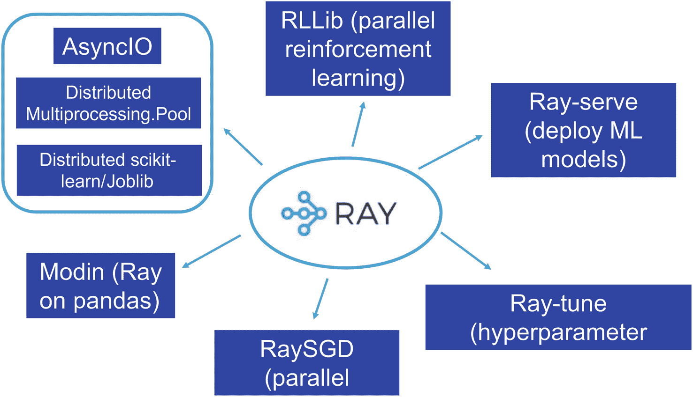

*构建在 Ray 之上的分布式数据科学/机器学习生态系统*

在本节中，我将仅演示几个使用 `Ray` 运行并行数据科学工作负载的示例。强烈建议你查看官方文档（`www.ray.io/docs`），并尝试该库提供的所有优秀功能。

### 简易并行化示例

在展示实践案例之前，我想先说明：Ray 目前主要在 Linux 和 Mac OS 系统上构建和测试，Windows 版本尚处于实验阶段，稳定性无法保证。因此，建议你在 Linux 环境中练习 Ray 示例，或在 Windows 平台上创建**虚拟机（VM）**，安装 Ray 后再继续操作。

例如，以下示例运行在 Oracle Virtual Box 软件（安装于 Windows 11 笔记本电脑）管理的虚拟机中的 Ubuntu Linux 20.04 环境里。创建者/用户为该虚拟机分配了四个逻辑 CPU 核心（图 10-25）。这一点很重要，因为 CPU 核心的默认起始数量可能仅为 1，这无法体现并行处理任务的预期加速效果。关于如何创建此类虚拟机的详细指南，请参阅本文（`https://brb.nci.nih.gov/seqtools/installUbuntu.html`）。如果你使用的是原生 Linux 或 Mac OS 机器，则可跳过此步骤。

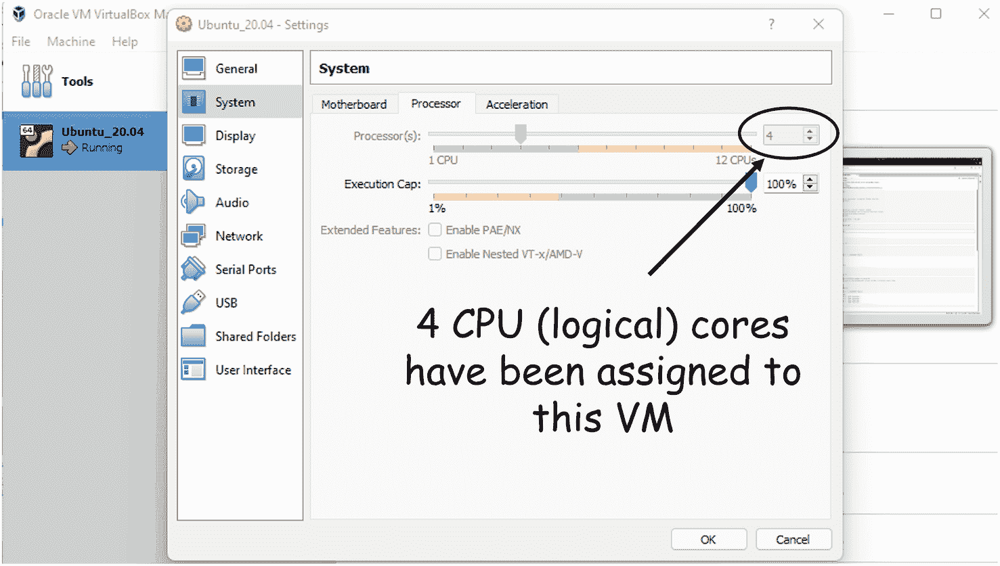

图 10-25：分配给运行 Ray 的虚拟机的多个逻辑 CPU 核心

你可以通过 `ray.init()` 方法启动 Ray：

```python
import ray
ray.init()
```

运行此代码后，你可能会看到类似以下输出：

```
{'node_ip_address': '10.0.2.15',
'raylet_ip_address': '10.0.2.15',
'redis_address': '10.0.2.15:6379',
'object_store_address': '/tmp/ray/session_2022-02-08_21-00-00_998495_21742/sockets/plasma_store',
'raylet_socket_name': '/tmp/ray/session_2022-02-08_21-00-00_998495_21742/sockets/raylet',
'webui_url': '127.0.0.1:8265',
'session_dir': '/tmp/ray/session_2022-02-08_21-00-00_998495_21742',
'metrics_export_port': 62074,
'gcs_address': '10.0.2.15:43155',
'node_id': '922916ef0c5dcf02dc25fea428b930df40ccf2450fa974bb307826fe'}
```

请注意，启动 Ray 会同时启动 Redis、对象存储和仪表盘等组件。实际上，你会在顶部看到打印出的仪表盘 URL 信息：

```
View the Ray dashboard at http://127.0.0.1:8265
```

点击此超链接后，你将看到包含工作进程及其状态的 Ray 仪表盘，如图 10-26 所示（与之前讨论的 Dask 仪表盘非常相似）。

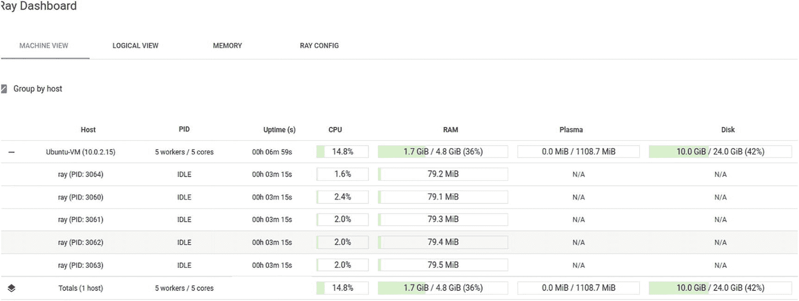

图 10-26：Ray 仪表盘快照（分配了 5 个 CPU）

你可以通过以下代码检查分配给此 Ray 集群的资源：

```python
ray.available_resources()
```

输出：

```
{'memory': 2325037056.0,
'node:10.0.2.15': 1.0,
'object_store_memory': 1162518528.0,
'CPU': 5.0}
```

现在，让我们构建几个大型 DataFrame，分别使用 pandas 和 Ray 计算其统计数据，以展示并行计算的优势：

```python
NUM_ROWS = 100_000
NUM_COLS = 20
data_dict = {}
# Pandas DataFrames
for i in range(4):
data = np.random.normal(size=(NUM_ROWS, NUM_COLS))
data_dict['df'+str(i)] = pd.DataFrame(data,
columns=['Col-'+str(i) for i in range(NUM_COLS)])
```

对于 pandas，你可以编写一个直接返回统计结果的函数：

```
def build_stats(df):
return df.describe().T
```

测量该函数在多个`DataFrame`（此处为四个）上的运行时间：

```
t1 = time.time()
results = [build_stats(data_dict['df'+str(i)]) for i in range(4)]
t2 = time.time()
print("Total time (milliseconds): ", round((t2-t1)*1000,2))
>> Total time (milliseconds):  1130.66
```

使用 Ray 实现相同功能并利用并行计算的关键在于：在相同函数上使用 `@ray.remote` 装饰器，并通过 `ray.get()` 方法在任务提交并行执行后收集结果。以下是装饰后的函数：

```
@ray.remote
def build_stats_ray(df):
return df.describe().T
```

现在可以编写类似的代码来测量时间：

```
t1 = time.time()
results = ray.get([build_stats_ray.remote(data_dict['df'+str(i)]) for i in range(4)])
t2 = time.time()
print("Total time (milliseconds): ", round((t2-t1)*1000,2))
```

你将获得更短的总执行时间（实际数值会因硬件、CPU 数量、Ray 构建版本、操作系统等多种因素而异）：

```
>> Total time (milliseconds):  575.77
```

请注意你是如何通过 `.remote()` 方法调用 `build_stats_ray` 函数，并如何将其包装在 `ray.get()` 方法中实现并行运行的。要点在于：尽管 Ray 提供了丰富的功能，但你需要学会如何正确利用它们，以及如何通过按正确顺序流水线化子组件，将可并行化的任务提交至 Ray 集群。图 10-27 展示了这一思路。

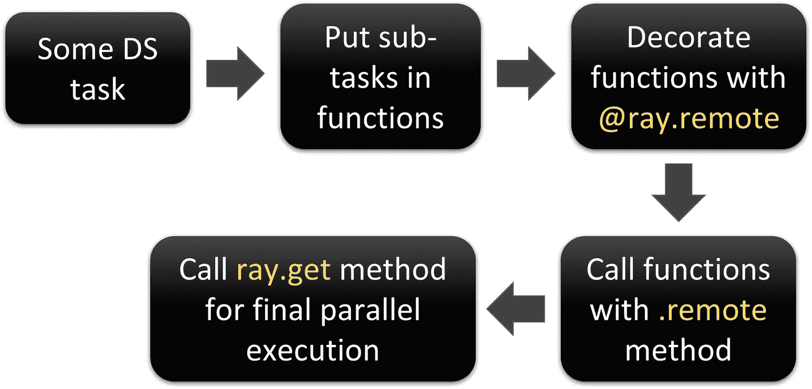

图 10-27：按正确顺序流水线化子组件

# 用于分布式加载和计算的 Ray Dataset

Ray Datasets (`https://docs.ray.io/en/latest/data/dataset.html`) 是在 Ray 生态系统中加载和交换数据的标准（也是推荐）方式。这些对象提供了基本的分布式数据转换功能，例如 `map`、`filter` 和 `repartition`，并且能够与多种文件格式、数据源和分布式框架良好配合，便于加载和转换。它们还专为高性能加载和预处理数据而设计，适用于基于 Ray 构建的分布式机器学习训练流水线，例如 Ray-Train (`https://docs.ray.io/en/latest/train/train.html#train-docs`)。

Ray Datasets 是一个相对较新的功能，从 Ray 1.8+ 版本起以 Beta 形式提供。如果你使用的是较旧版本的 Ray，则需要升级才能使用它们。此外，请确保已安装 `PyArrow` 库。

Ray Datasets 非常适合作为数据处理的“最后一公里”模块（在数据输入到并行化机器学习任务流程之前），适用于初始数据源为传统关系型数据库、ETL 流水线输出甚至 Spark DataFrames 的场景。

此前，我讨论过 Apache Arrow 以及这些现代数据存储格式如何彻底改变数据科学领域。Ray Datasets 的核心实现了分布式 Arrow。每个 Dataset 本质上是一个包含块的 Ray 对象引用列表，这些块持有 Arrow 表（某些情况下为 Python 列表）。这种块级结构带来了并行性，并使其与分布式机器学习训练兼容。这样看来，Ray Datasets 与你在 Dask 中看到的情况类似。此外，由于 Datasets 只是 Ray 对象引用的列表，它们可以在 Ray 的任务、Actor 和库之间自由传递（几乎没有内存操作开销）。这让你在使用和集成方面拥有极大的灵活性，同时提升了系统性能。

如前所述，Ray Datasets 支持日常工作中使用的几乎所有类型的数据源。图 10-28 展示了其输入兼容性的部分概览。

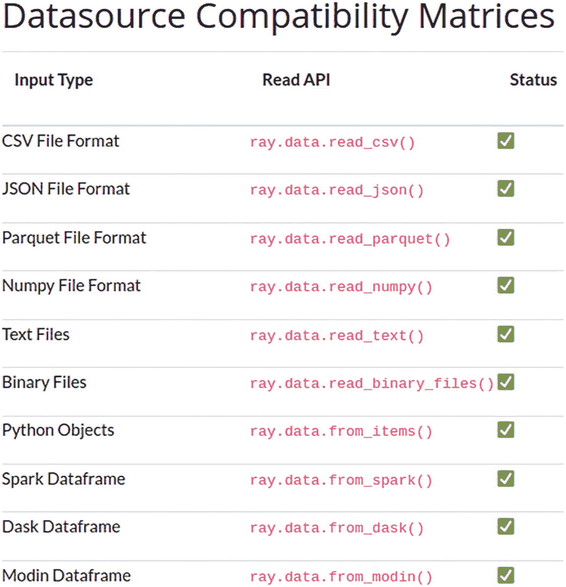

图 10-28

Ray Datasets 输入兼容性概览

例如，你可以使用 `range` 函数创建一个 Ray Dataset：

```
ds = ray.data.range(100000)
```

如果你在 Jupyter notebook 单元格中键入 `ds` 进行查看，将看到：

```
Dataset(num_blocks=200, num_rows=100000, schema=<class 'int'>)
```

因此，默认情况下，它创建了 200 个对象引用块，并为数据分配了整数模式。这种并行性和数据类型集成使得 Dataset 天然比传统数据源（如 pandas DataFrame）更高效。

你可以像对待其他数据集一样对 Dataset 应用映射函数：

```
op_ds = ds.map(lambda x: np.sin(x)+np.cos(x))
```

`op_ds` 本身现在是一个 Ray Dataset，但其模式因操作而发生了变化。

```
op_ds
>> Dataset(num_blocks=200, num_rows=100000, schema=<class 'numpy.float64'>)
```

由于模式发生了变化，现在可以直接使用许多 NumPy 方法。

```
op_ds.std()
>> 1.0000051823664913
```

一个很酷的地方是，你可以将数据的批次（原始数据为整数）作为 Python 列表或 pandas DataFrames 读取，并对这些批次进行计算。这对于在此类数据上进行分布式机器学习训练非常有用。以下代码每次以 pandas DataFrame 的形式读取大小为 25,000 的批次，并打印其统计信息：

```
i = 1
for batch in ds.iter_batches(batch_size=25000, batch_format='pandas'):
    print("批次编号：", i)
    print("=" * 40)
    print(batch.describe(percentiles=[0.5]))
    print("=" * 40)
    i += 1
```

结果如图 10-29 所示。

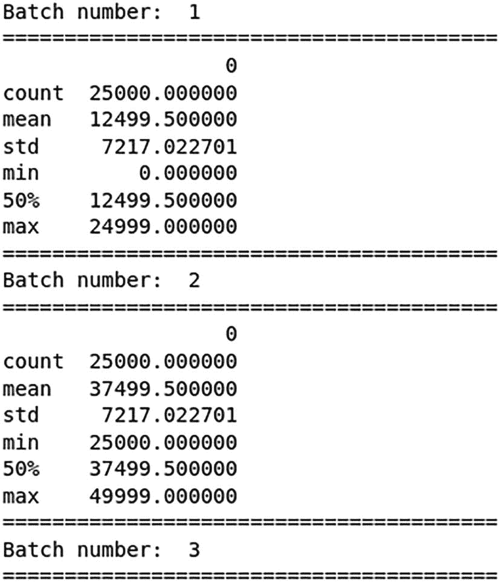

图 10-29

以 pandas DataFrame 块形式迭代 Ray Dataset 批次的部分结果

Dataset 使得在数据块上以 pandas 方式运行并行数据转换任务成为可能。以下是一个伪代码示例：

```
# 一个 pandas DataFrame UDF
def transform_batch(df: pd.DataFrame):
    # 删除空值。
    df = df.dropna(...)
    # 添加新列。
    df["new_col"] = (...)
    # 转换现有列。
    df["feature_1"] = (...)
    # 删除列。
    df.drop(...)
    # 独热编码。
    categories = ["cat_1", "cat_2", "cat_3"]
    for category in categories:
        (...)
    return df

# batch_format="pandas" 告诉 Datasets 为转换器提供
# 表示为 pandas DataFrame 的块。
ds = ds.map_batches(transform_batch, batch_format="pandas")
```

## 总结

在本章中，我继续讨论了如何利用并行（及分布式）计算工具，使数据科学在大型数据集和模型上具备可扩展性。我探讨了原始数据和大模型都可以通过这些并行处理技术进行处理。随着现代多核 CPU 的出现以及以合理成本（来自云供应商）轻松获取大型计算集群，并行化数据科学的前景一片光明。

我特别关注了两个 Python 框架：Dask 和 Ray。我详细介绍了 Dask 提供的各种核心数据结构和内部表示，它们让并行计算变得简单又有趣。我还结合动手示例详细讨论了 Dask 分布式客户端。对于 Ray，我介绍了基本的 Ray 并行性（使用特殊的装饰器和方法）以及分布式数据加载功能。

在下一章中，我将超越 CPU 的范畴，探讨另一种可扩展性：如何移植到基于 GPU 的系统并利用其优势来完成数据科学任务。

