# 6. 构建你自己的机器学习估算器/包

本章开头，我沿用第 4 章的观点：*数据科学家通常来自与传统计算机科学/软件工程截然不同的背景*，例如物理学、生物学、统计学、经济学和电气工程。图 6-1 证实了这一点。

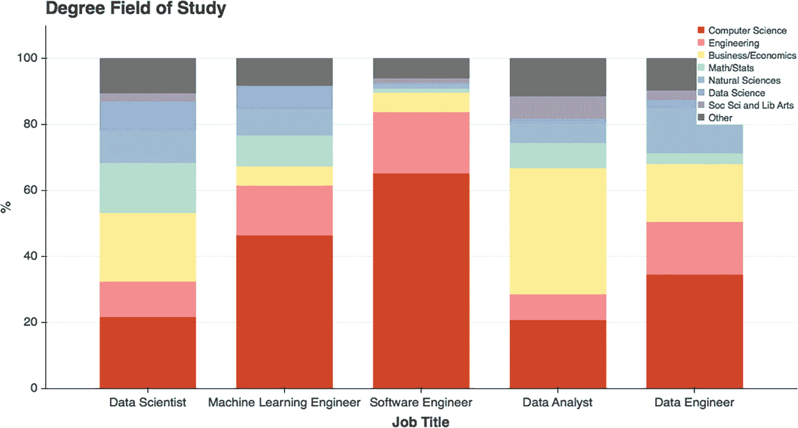

**图 6-1** 数据科学家来自各种各样的领域和专业背景。来源：“[数据科学家来自何处](https://medium.com/indeed-engineering/where-do-data-scientists-come-from-fc526023ace)？” ([*https://medium.com/indeed-engineering/where-do-data-scientists-come-from-fc526023ace*](https://medium.com/indeed-engineering/where-do-data-scientists-come-from-fc526023ace))

但最终，数据科学家需要掌握足够的编程/软件工程技能，才能对其组织和业务产生真正的影响。即使数据科学家不编写机器学习平台/服务的最终生产代码，他们也期望能够与经验丰富的软件开发团队进行高度集成的工作。这对于确保顺畅的交付体验、机器学习产品的完美执行，以及当然，实现期望的业务成果至关重要。

这意味着数据科学家必须学习如何高效地编写机器学习代码（无论是最终模型还是仅用于实验的原型）。

-   代码必须有恰当的**组织**和**模块化**，以便能够与标准的软件工程工具和技术良好对接。
-   代码中必须有一定程度的**自动化**，以减少探索、评估和试验数据与模型的时间。
-   数据科学家必须能够自如地编写**功能和模块测试**、**融入面向对象原则**等。
-   数据科学家还必须养成为其代码编写良好**文档**的习惯，以便其他开发者可以重用和阅读。

在第 4 章和第 5 章中，我触及了其中一些概念，特别是模块化和面向对象编程原则。本章将带领你经历开发一个轻量级但实用的机器学习包的过程，让你体验为数据科学制作完整软件的诸多方面。根据我的经验，编写（并发布）一个机器学习包这项练习，能给任何即将入行的数据科学家上几堂宝贵的课。

## 为什么要开发你自己的机器学习包？

对于上述问题，有一个非常简洁的答案：*以便他人（世界各地的任何人）能够使用你的工作成果并从中受益*。

想象一下那种感觉。你的代码不再局限于一个独立的 Jupyter notebook。它首先被恰当地结构化和模块化，这样你就可以像使用你最喜欢的 Python 库（例如 `NumPy` 和 `pandas`）一样调用其中的有用方法。更进一步，你将代码打包成一个可下载的 Python 库，这样世界上的任何人都可以通过一个简单的 `pip` 命令安装它，并开始从你的工作中受益。这个想法在图 6-2 中得到了简单说明。

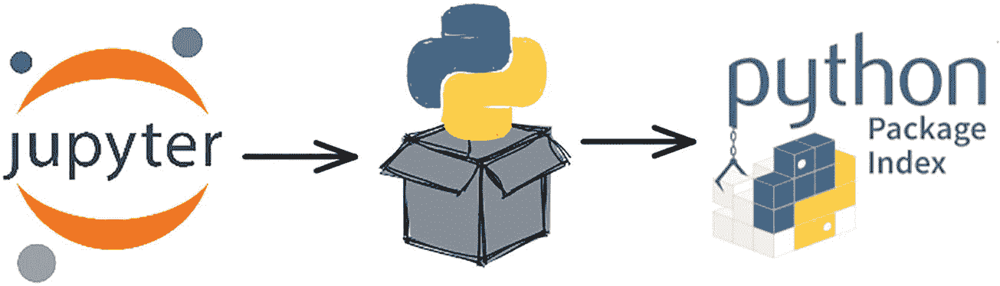

**图 6-2** 从 Jupyter notebook 到 PyPi 安装包

经历此过程的一些步骤（及相关学习要点）如下：

-   **代码组织思维**：发布一个开源的 Python 包会迫使数据科学家精心规划和组织他们的代码和模块。
-   **编写文档字符串**：在高度欢迎协作的高质量开源包中，文档字符串是一项基本的良好实践。数据科学家在此过程中将学到其价值。好的文档字符串甚至可能为包带来高质量的文档（通常维护在 `readthedoc.io` 等网站上）。
-   **单元测试和功能测试**：测试对良好软件开发的重要性怎么强调都不为过。对于数据科学来说，测试带来了其自身的挑战。包的开发通常包括编写一套基本的测试用例。这将在数据科学家的技能储备中添加一项具有根本价值的能力。
-   **GitHub 提交和动作**：虽然发布开源包并非严格必需，但强烈建议建立一个 GitHub 仓库和 GitHub actions（例如，基于代码更改或提交触发的命令），以便长期维护和更新包（例如，发布新版本或修复错误）。

讨论所有这些方面超出了本书的范围。因此，我将主要专注于从头开始构建代码结构。不过，网上有很多关于如何编写优秀文档字符串或为开源包设置 GitHub actions 的优秀教程，鼓励你去探索。

## 一个数据科学家的示例

有一些教程和指南涉及教授数据科学家面向对象编程和模块化编码的原则。然而，几乎所有这些都是标准的、现成的面向对象编程示例，并不吸引数据科学家。让我举例说明我的意思。


### 一个算术示例

如果有人让你编写一个程序，实现对两个变量 `a` 和 `b` 的加、减、乘、除运算，你最可能怎么做？你很可能打开一个 Jupyter notebook，在单元格中输入以下内容，然后按下 Shift-Enter，得到结果：

```
a+b
a-b
a*b
a/b
```

如果你喜欢用函数来整理代码，那么你可能会这样做：

```
def add(a,b):
return a + b
def subtract(a,b):
return a - b
...
```

但是，你会进一步定义一个 `Calc` 类（包含一个初始化方法），并将这些函数作为方法放入该类中吗？这些都是性质类似的操作，并且处理类似的数据。为什么不将它们封装在一个更高级的对象中呢？为什么不采用下面的代码呢？

```
class Calc:
def __init__(self,a,b):
self.a = a
self.b = b
def add(self):
return self.a+self.b
def sub(self):
return self.a-self.b
def mult(self):
return self.a*self.b
def div(self):
return self.a/self.b
```

不，你很可能不会这样做。对于这个问题来说，这样做也没有意义。但这个想法是合理的：如果你有可以在逻辑上组合的数据和函数（在面向对象编程的术语中称为方法），那么它们应该被封装在一个类中。

但仅仅为了快速得到一些简单数值计算的结果，这看起来工作量太大了。那么，意义何在？数据科学家通常以能否找到数据问题的正确答案来衡量，而不是看他们在代码中使用了多么复杂精美的编程结构。

这类示例常被用来向数据科学家传授面向对象编程原则。它们是非常好的示例，涵盖了编写优秀的面向对象 Python 代码所需的所有必要知识。然而，由于最终产品可能相当刻板（比如一个算术计算器），所以缺少了一点火花。

### 数据科学家一直在使用面向对象编程

如果数据科学家不这样编码，那是不是意味着他们真的不需要使用这些复杂的编程结构呢？

错误。

数据科学家在不知不觉中大量利用了面向对象编程范式的优势。一直在利用。

你还记得 `import matplotlib.pyplot as plt` 之后的 `plt.plot` 吗？那些 `.` 符号？你当时就接触到了一点面向对象编程。

或者你还记得在 Jupyter notebook 中学会的一个酷炫技巧：输入一个点（`.`）后按 Tab 键，就可以显示所有与该对象关联的函数（见图 6-3）吗？

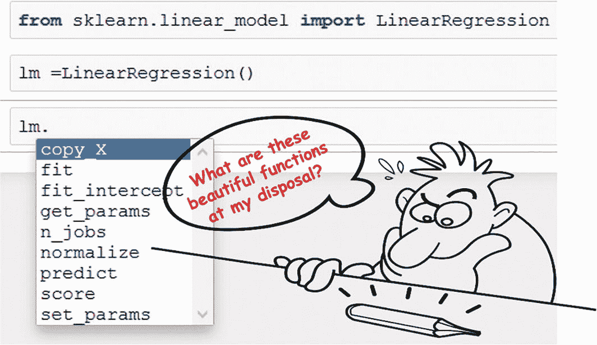

图 6-3

面向对象编程范式使得访问方法和参数变得容易

这个例子展示了对逻辑一致性的遵循。如果不遵循面向对象编程范式，我们可能不得不将函数命名为 `linear_model_linear_regression_fit`、`linear_model_linear_regression_predict` 等等。它们将无法被分组在同一个逻辑单元下。

为什么这样？因为它们是不同的函数，并且处理不同的数据集。`fit` 函数需要训练特征和训练目标，而 `predict` 只需要测试数据集。`fit` 函数不期望返回任何东西，而 `predict` 函数期望返回一组预测值。

那么，为什么它们会出现在同一个下拉菜单中呢？尽管功能不同，但它们有一个共同点，即都可以被视为整个线性回归过程中的基本组成部分。我们期望一个线性回归模型能够拟合一些训练数据，然后能够对未见过的未来数据进行预测。我们还期望线性回归模型能够提供一些关于拟合优度的指示，通常以单个数值或得分的形式呈现，称为回归系数或 *R*²。正如预期的那样，我们看到一个 `score` 函数，它正好返回那个 *R*² 数值，也位于 `fit` 和 `predict` 旁边。这既简洁又干净。*数据、函数和参数共存于一个单一的逻辑单元中*（图 6-4）。

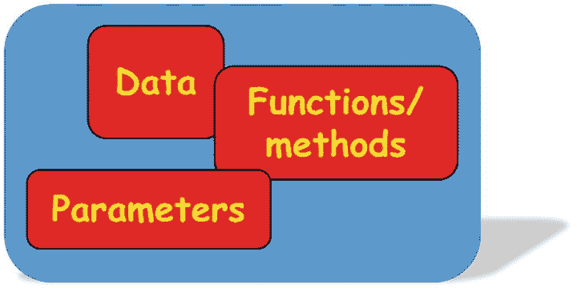

图 6-4

数据、函数和参数共存于一个单一的逻辑单元中

### 它是如何实现的？

这之所以成为可能，是因为有人（scikit-learn 项目的开发者）将线性回归视为一个高级过程，并决定了它应该提供哪些基本操作，以及应该告知用户哪些关键参数。有人创建了一个名为 `LinearRegression` 的高级类，所有那些看似不相关的函数都可以被归入其中，以便于管理和提升可用性。

作为数据科学家，一旦你从库中导入这个类，你只需创建该类的一个实例（命名为 `lm`）。仅此而已。所有归入该类的函数，都可以通过这个新定义的实例访问。如果你对某些函数的内部实现不满意，你可以对其进行修改，并在修改后重新挂接到主类上。只有内部函数的代码发生变化，其他一切不变。图 6-5 直观地展示了这个思想。

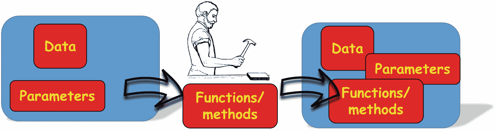

图 6-5

根据需要将函数和方法附加到类上

在接下来的章节中，你将逐步了解从头开始构建这样一个有用的机器学习估算器所涉及的步骤和思考过程。你将从一个基础的数据和参数开始，根据需要添加方法，并将它们归入合适的逻辑单元下。

## 线性回归估算器——增添一点新意

传统的面向对象编程入门教程会大量使用诸如动物、运动、几何形状等类的示例。但对于数据科学家来说，为什么不以他们在代码中每天都会用到的对象——机器学习估算器——为例来阐述这些概念呢？它就像上面图片中展示的来自 scikit-learn 库的 `LinearRegression` 对象一样。

接下来，你将逐步构建一个遵循面向对象编程范式的简单线性回归（单变量或多变量）估算器类。是的，就是那个经典的线性回归类。它拥有与 scikit-learn 中 `LinearRegression` 类类似的常规 `fit` 和 `predict` 方法。但它增添了一点新意：*它提供了更多功能*。图 6-6 展示了其中一二。

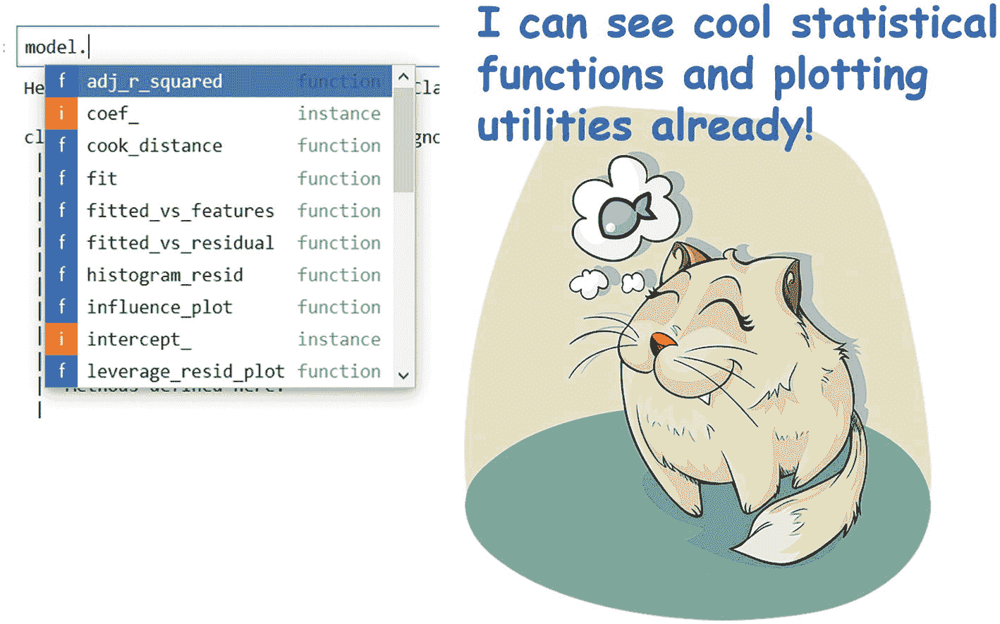

图 6-6

一个带有额外统计函数和绘图工具的线性回归估算器

如上所示，这个估算器比 scikit-learn 的估算器更丰富，因为它除了标准的 `fit`、`predict` 和 *R*² 得分函数外，还拥有一系列其他对线性回归建模任务至关重要的工具，特别适用于那些不仅想要预测，还希望进行以下操作的数据科学家和统计建模人员：

*   衡量拟合优度
*   验证线性回归的假设
*   检查数据中的多重共线性
*   检测异常值

让我们看看如何开始构建它。

## 如何开始构建这个类？

在本节中，我将展示如何从机器学习估算器开始，并添加基本方法。接下来的部分将涵盖添加更多实用函数、对它们进行分组等内容。然而，我想指出的是，为简洁起见，将跳过大量实际代码，仅通过代码片段展示核心概念。要获取完整代码，你可以查看本书附带的 Jupyter notebook 或 Python 脚本文件。


### 基类定义

我们先从一个简单的代码片段开始，定义基类：`MyLinearRegression`。这里，`self` 代表对象本身，而 `__init__` 是一个特殊函数，当在代码中某处创建类的实例时会被调用。顾名思义，`__init__` 可用于用必要的参数（如果有）初始化类。我们再添加一个包含 `__repr__` 方法的简单描述符。

```
import numpy as np

class MyLinearRegression:
    def __init__(self, fit_intercept=True):
        self.coef_ = None
        self.intercept_ = None
        self._fit_intercept = fit_intercept

    def __repr__(self):
        return "I am a Linear Regression model!"
```

这些带有双下划线的方法（`__init__` 和 `__repr__`）在 Python 类中具有特殊用途，被称为**特殊方法**。

### 什么是特殊方法？

它们是 Python 类定义中的**魔术方法**，可以帮助为自定义类重写内置函数的功能。之所以这样称呼，是因为它们的名称中带有双下划线。一些常见的有：

- `__init__`：用默认参数和状态初始化类
- `__repr__`：类的通用描述
- `__str__`：当用 `print` 函数打印类时，返回类某个属性的字符串描述
- `__len__`：返回类/对象的长度（在合理的情况下，例如，如果类代表某种集合或数组）

这里有一篇关于它们的好文章：“Python 中的特殊/魔术方法” (`www.section.io/engineering-education/dunder-methods-python/`)。

基本上，你现在可以实例化一个对象并打印它：

```
mlr = MyLinearRegression()
print(mlr)
>> I am a Linear Regression model!
```

### 添加实用方法

到目前为止，你有一个正确但无用的类定义，因为它没有执行任何机器学习任务。在本节中，你将开始添加一些有用的方法，并了解如何测试它们。

#### 拟合方法

首先，让我们为 ML 估计器添加最有用的方法：`fit` 方法，它执行与给定数据的训练/拟合。这是代码。请注意，此函数定义将放在基类内部。

```
def fit(self, X, y):
    """
    Fit model coefficients.

    Arguments:
    X: 1D or 2D numpy array
    y: 1D numpy array
    """
    # Data type check and conversion
    if type(X) is not np.ndarray:
        try:
            X = np.array(X)
        except:
            print("Could not convert features to Numpy array")
            return None
    if type(y) is not np.ndarray:
        try:
            y = np.array(y)
        except:
            print("Could not convert labels to Numpy array")
            return None
    # check if X is 1D or 2D array
    if len(X.shape) == 1:
        X = X.reshape(-1, 1)
    # add bias if fit_intercept is True
    if self._fit_intercept:
        X_biased = np.c_[np.ones(X.shape[0]), X]
    else:
        X_biased = X
    # closed form solution
    xTx = np.dot(X_biased.T, X_biased)
    inverse_xTx = np.linalg.inv(xTx)
    xTy = np.dot(X_biased.T, y)
    coef = np.dot(inverse_xTx, xTy)
    # set attributes
    if self._fit_intercept:
        self.intercept_ = coef[0]
        self.coef_ = coef[1:]
    else:
        self.intercept_ = 0
        self.coef_ = coef
```

代码很长，但借助文档字符串和精心添加的注释，它不言自明。你使用 NumPy 矩阵求逆（`np.linalg.inv`）从普通最小二乘法（`en.wikipedia.org/wiki/Ordinary_least_squares`）的角度解决线性回归问题，并获得最佳拟合系数。同时，注意开头的**基本检查**（`if type(X) is not np.ndarray`）和数据形状的变换（`X = X.reshape(-1, 1)`），以确保线性代数计算无误。

#### 测试该方法

让我们通过生成一些随机数据来测试这个方法：

```
X = 10 * np.random.random(size=(20, 2))
y = 3.5 * X.T[0] - 1.2 * X.T[1] + np.random.randn(20)
```

因此，在 2D 向量 `X` 和 1D 向量 `y` 之间存在线性关系。你可以在图 6-7 中可视化这种线性关系（注意数据中添加了刻意为之的噪声）。

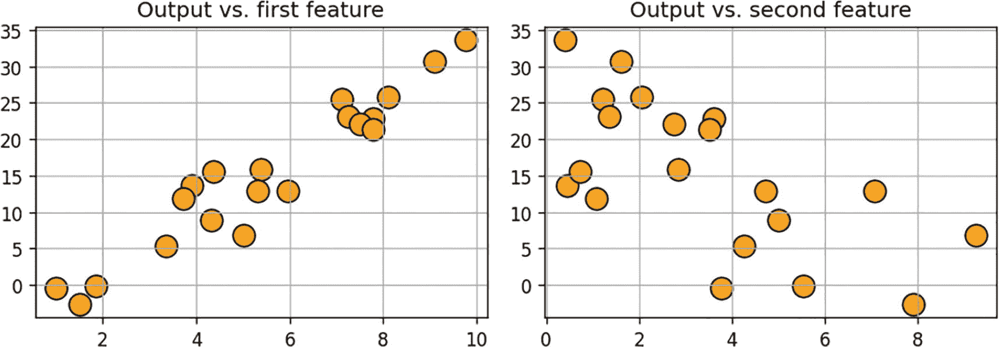

**图 6-7** 测试（随机生成的）数据图

创建一个新实例：

```
mlr = MyLinearRegression()
```

你可以尝试打印系数（`mlr.coef_`），但要先检查 `mlr.fitted_` 状态。如果未拟合，则打印该消息。

```
if mlr.fitted_:
    print("Regression coefficients:", mlr.coef_)
else:
    print("Not fitted yet")
>> Not fitted yet
```

然后进行拟合，如下所示：

```
mlr.fit(X, y)
```

现在，对于相同的打印系数的代码，你将得到预期的结果：

```
if mlr.fitted_:
    print("Regression coefficients:", mlr.coef_)
else:
    print("Not fitted yet")
>> Regression coefficients: [ 3.40807972 -1.23152211]
```

因此，实际系数是 3.5 和 -1.2，但由于添加了随机噪声，你得到的最佳拟合系数约为 3.4 和 -1.23。你还可以得到截距，如下所示：

```
print("The intercept term is given by: ", mlr.intercept_)
>> The intercept term is given by:  0.7673816772685598
```

请注意，**估计的系数和截距每次运行此代码时都会改变**，因为数据生成过程中添加了随机噪声。

#### 预测方法

现在，让我们向类中添加 `predict` 方法：

```
def predict(self, X):
    """
    Output model prediction.

    Arguments:
    X: 1D or 2D numpy array
    """
    # check if X is 1D or 2D array
    if len(X.shape) == 1:
        X = X.reshape(-1, 1)
    # Calculates only if already fitted
    if self.fitted_:
        self.predicted_ = self.intercept_ + np.dot(X, self.coef_)
    else:
        print("Not fitted yet")
        return None
    return self.predicted_
```

#### 测试预测

你使用旧的（训练）数据进行拟合，并使用一组新点进行预测。以下是测试的示例代码：

```
num_new_samples = 10
X_new = 10 * np.random.random(size=(num_new_samples, 2))
y_new = 3.5 * X_new.T[0] - 1.2 * X_new.T[1] + np.random.randn(num_new_samples)

mlr = MyLinearRegression()
mlr.fit(X, y)
y_pred = mlr.predict(X_new)
```

当你绘制预测值与真实值时，将得到如图 6-8 所示的结果。

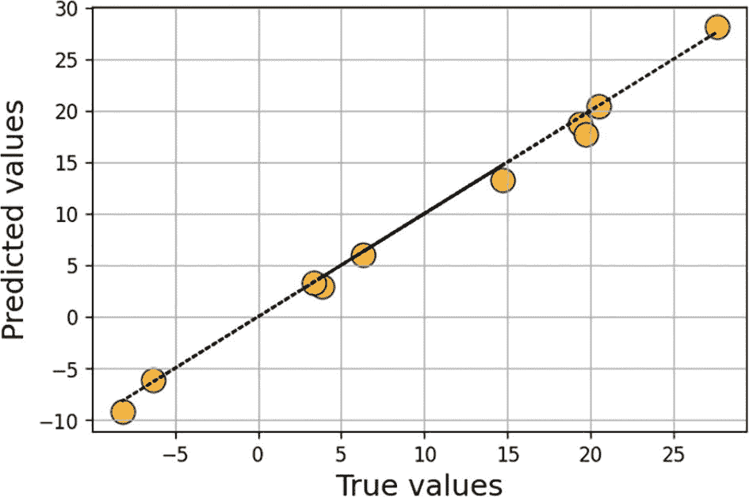

**图 6-8** y 向量的预测值与真实值

现在你已经解决了基本方法，接下来让我们讨论添加一些实用方法，例如可视化和统计分析。

### 添加实用方法

此时，你可以开始扩展你的回归类，并添加即使标准 `scikit-learn` 类中也不存在的功能！例如，你总是希望看到拟合值与真实值的比较。这正是上面绘制的内容。但与其让那段代码散落在 Jupyter notebook 中，你可以为此创建一个函数并将其添加到类中。


### 绘制真实值与预测值图表的方法

我们将此方法命名为 `plot_fitted`。请注意，方法如同普通函数，可以接受额外参数。此处有一个参数 `reference_line`（默认设为 `False`），用于在拟合值与真实值图上绘制一条 45 度参考线。此外，请注意文档字符串中的说明。

```
def plot_fitted(self,reference_line=False):
"""
绘制拟合值与真实输出值的对比图
参数：
reference_line: 布尔开关，用于在图上绘制 45 度参考线
"""
if self.fitted_:
y_pred = np.dot(X,self.coef_) + self.intercept_
plt.title("真实值与拟合值",fontsize=14)
plt.scatter(y,y_pred,
s=150,alpha=0.75,
color='orange',
edgecolor='k')
if reference_line:
plt.plot(y,y,c='k',linestyle='dotted')
plt.xlabel("真实值")
plt.ylabel("拟合值")
plt.grid(True)
plt.show()
else:
print("尚未拟合")
return None
```

请注意，绘图代码内部进行了预测（`y_pred = np.dot(X, self.coef_) + self.intercept_`），然后使用该向量进行绘图。和往常一样，只有在确保已有数据被拟合后（`if self.fitted_`），才会执行绘图代码。

以下代码展示了此方法的实用性。仅需三行代码，你就能创建一个全新的估计器，拟合数据，并绘制真实值与预测值的对比图！

```
# 创建一个新的估计器
mlr = MyLinearRegression()
# 用数据拟合
mlr.fit(X, y)
# 调用 'plot_fitted' 方法
mlr.plot_fitted()
```

图 6-9 展示了结果。它与图 6-8 类似，但使用的是内置方法而非独立代码。

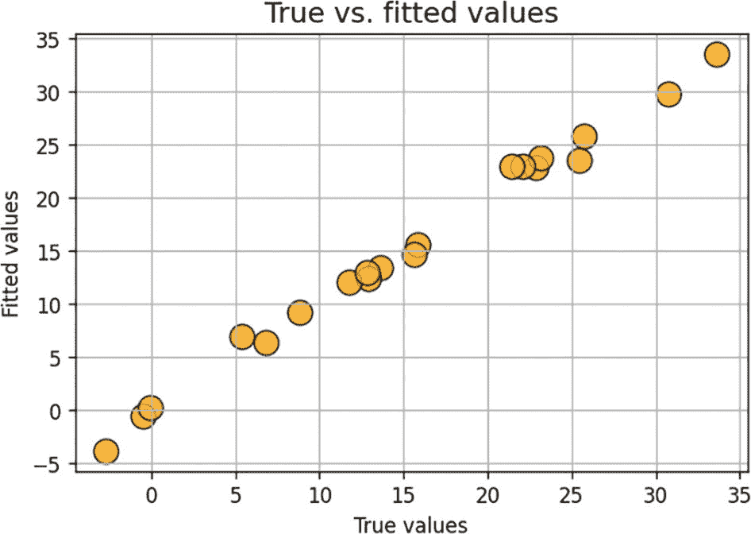

图 6-9

使用内置绘图工具绘制的预测值与真实值对比图

以下是可以添加的更多实用绘图工具：

*   **配对图**（绘制所有特征与输出之间的配对关系，非常类似于 R 语言中的 `pairs` 函数）
*   **拟合值与残差图**（属于线性回归的诊断图，用于检验回归基本假设的有效性，参考链接：[`https://towardsdatascience.com/how-do-you-check-the-quality-of-your-regression-model-in-python-fa61759ff685`](https://towardsdatascience.com/how-do-you-check-the-quality-of-your-regression-model-in-python-fa61759ff685)）
*   残差的**直方图**和**分位数-分位数 (Q-Q) 图**（用于检验误差分布的正态性假设）

### 各类误差度量指标

你可以像这样在基类中添加一系列误差度量指标：

```
def sse(self):
'''返回误差平方和（模型值与实际值）'''
squared_errors = (self.resid_) ** 2
self.sq_error_ = np.sum(squared_errors)
return self.sq_error_
def sst(self):
'''返回总平方和（实际值与平均值）'''
avg_y = np.mean(self.target_)
squared_errors = (self.target_ - avg_y) ** 2
self.sst_ = np.sum(squared_errors)
return self.sst_
def r_squared(self):
'''返回计算得到的 r² 值'''
self.r_sq_ = 1 - self.sse()/self.sst()
return self.r_sq_
# 更多度量指标在此处
def pretty_print_stats(self):
'''返回给定模型对象的统计报告'''
items = ( ('sse:', self.sse()), ('sst:', self.sst()),
('mse:', self.mse()), ('r²:', self.r_squared()),
('adj_r²:', self.adj_r_squared()))
for item in items:
print('{0:8} {1:.4f}'.format(item[0], item[1]))
```

为了让上述代码生效，你必须在拟合数据时计算一个关键属性——*残差*（`self.resid_`）。因此，当然要将该代码添加到 `fit` 方法中：

```
# 特征与数据
self.features_ = X
self.target_ = y

# 预测的/拟合的 y 值
self.predicted_ = np.dot(X, self.coef_) + self.intercept_
# 残差
self.resid_ = self.target_ - self.predicted_
```

然而，与其用这么多方法把基类弄得杂乱无章，不如回到逻辑一致性和分组的思路上，利用更多面向对象编程（OOP）原则来更好地组织代码。让我们在下一节中看看如何实现。

## 以面向对象编程风格完成更多工作

当你满怀热情地计划向类中添加实用方法时，你意识到这种方法可能会使主类的代码变得非常冗长且难以调试。为了解决这个难题，你可以利用面向对象编程中另一个精妙的原则——继承（参考链接：[`www.geeksforgeeks.org/inheritance-in-python/`](http://www.geeksforgeeks.org/inheritance-in-python/)）。

### 分离绘图类

你意识到并非所有绘图都属于同一类型。配对图以及拟合值与真实数据图性质相似，因为它们可以仅从数据中衍生出来。而其他绘图则与拟合优度和残差相关。因此，你可以创建两个独立的类来包含这些绘图函数：`Data_plots` 和 `Diagnostic_plots`。此外，你还可以根据这些工具类来定义主类 `MyLinearRegression`。这便是继承的一个实例。整个方法如图 6-10 所示。

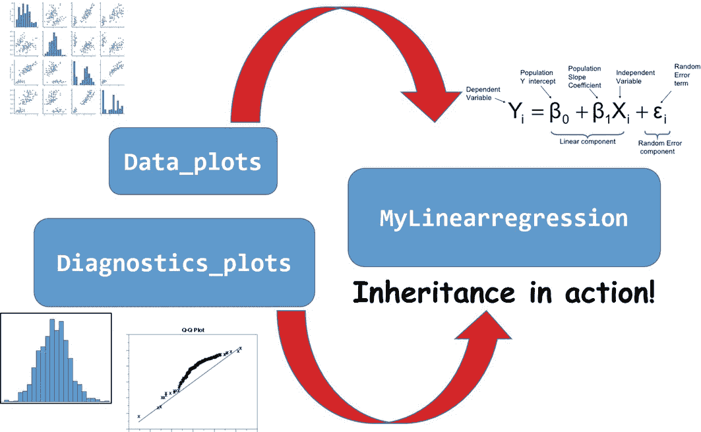

图 6-10

定义若干个不同的绘图类并在基类中使用它们

`Diagnostic_plots` 的部分代码如下：

```
class Diagnostics_plots:
"""
诊断图及相关方法
参数：
fitted_vs_residual: 绘制拟合值与残差对比图
fitted_vs_features: 以网格形式绘制残差与所有特征变量的对比图
histogram_resid: 绘制残差直方图（可归一化）
shapiro_test: 对残差执行 Shapiro-Wilk 正态性检验
qqplot_resid: 创建残差的分位数-分位数图，与正态分布进行比较
"""
def __init__():
pass
def fitted_vs_residual(self):
"""绘制拟合值与残差对比图"""
```

而对于 `Data_plots`：

```
class Data_plots:
"""
数据相关绘图的方法
pairplot: 创建所有变量与目标变量的配对图
plot_fitted: 绘制拟合值与数据中真实输出值的对比图
"""
def __init__():
pass
def pairplot(self):
"""使用 Seaborn 库创建所有变量与目标变量的配对图"""
if not self.is_fitted:
print("模型尚未拟合！")
return None
```

因此，主类的定义现在略有改变：

```
class MyLinearRegression(Data_plots, Diagnostics_plots):
def __init__(self, fit_intercept=True):
self.coef_ = None
self.intercept_ = None
self._fit_intercept = fit_intercept
```

类定义 `MyLinearRegression(Data_plots, Diagnostics_plots)` 允许主类继承在绘图类中定义的所有实用绘图方法。现在，你可以通过仅三四行代码绘制诊断图和数据图来检查回归拟合的质量：

```
mlr = MyLinearRegression()
mlr.fit(X, y)
```

拟合值与残差图如图 6-11 所示：

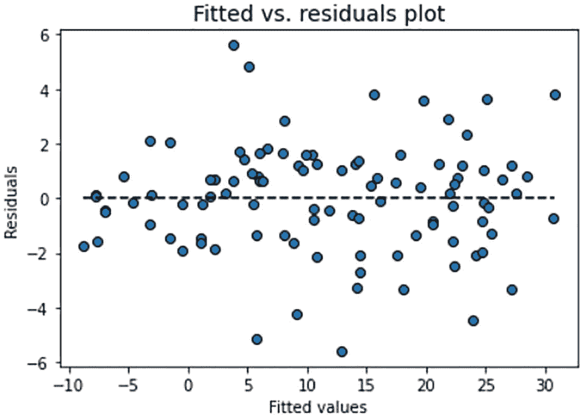

图 6-11

拟合值与残差图

```
mlr.fitted_vs_residual()
```

残差直方图（图 6-12）：

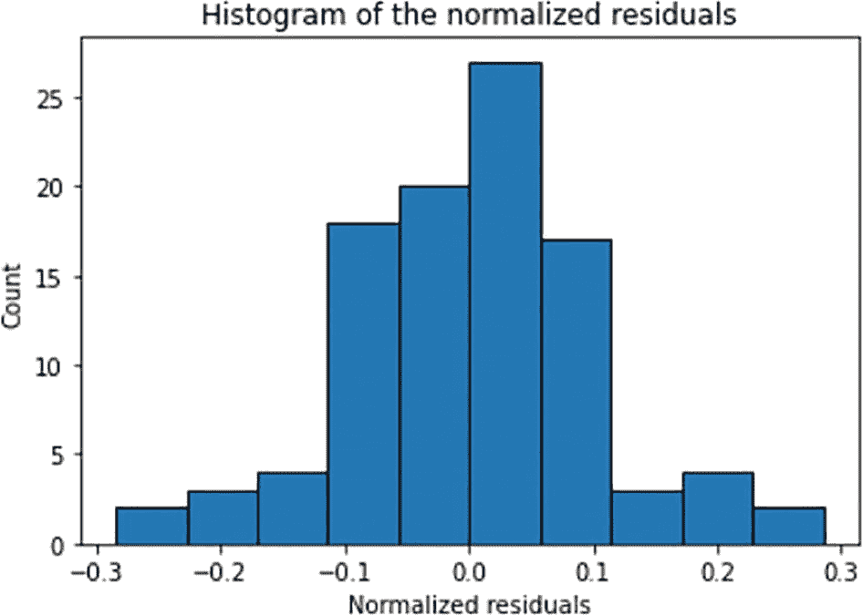

图 6-12

归一化残差直方图

```
mlr.histogram_resid()
```

残差的 Q-Q 图（图 6-13）：

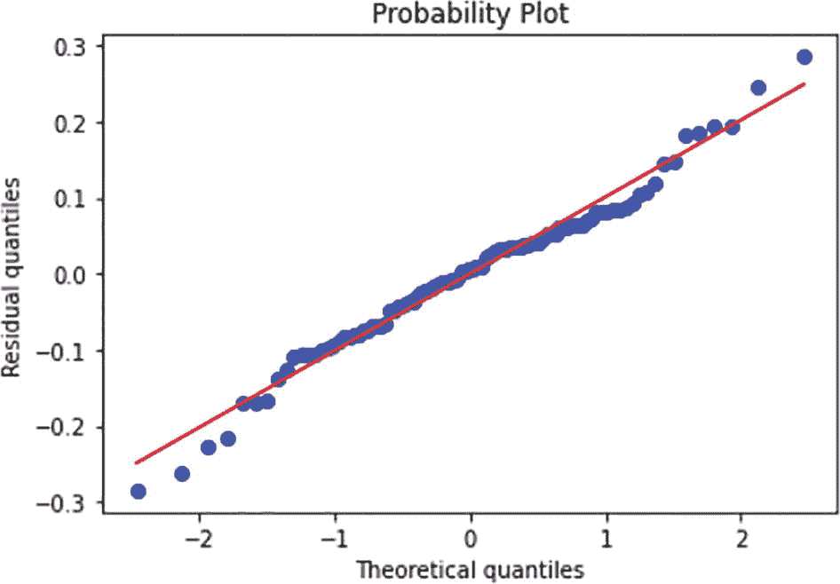

图 6-13

残差的分位数-分位数图

```
mlr.qqplot_resid()
```

代码的模块化在此处发挥作用。你可以在不触及主类的情况下修改和改进核心绘图工具。这是一种高度灵活且不易出错的方法，能够提高数据科学家的生产力和效率。


### 更多支持类与语法糖

为了完整性，请考虑以下内容：

*   用于计算各类回归指标的 `Metrics` 类：SSE、SST、MSE、*R*² 以及调整后的 *R*²。
*   用于绘制库克距离 ([`https://en.wikipedia.org/wiki/Cook%27s_distance`](https://en.wikipedia.org/wiki/Cook%2527s_distance))、杠杆值和影响图的 `Outliers` 类。
*   用于计算方差膨胀因子 (VIF；[`https://en.wikipedia.org/wiki/Variance_inflation_factor`](https://en.wikipedia.org/wiki/Variance_inflation_factor)) 的 `Multicollinearity` 类。

总而言之，整体架构如图 6-14 所示。

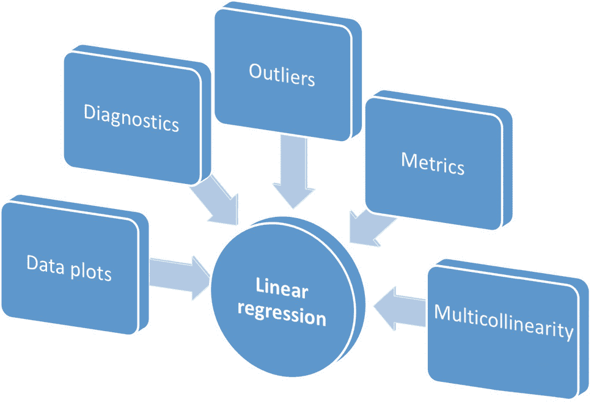

带有所有支持类的线性回归评估器

一旦你继承了其他类，它们的行为就像你熟悉的普通 Python 模块一样。因此，你可以向主类添加实用方法，以同时执行子类中的多个方法。例如，下面的方法一次性运行所有常用的诊断检查。请注意，你是通过使用简单的 `.`（点号）来访问绘图方法的（即 `Diagnostics_plot.histogram_resid`），就像从 `pandas` 或 `NumPy` 库中访问函数一样。

```
def run_diagnostics(self):
"""运行诊断测试并绘图"""
Diagnostics_plots.fitted_vs_residual(self)
Diagnostics_plots.histogram_resid(self)
Diagnostics_plots.qqplot_resid(self)
print()
Diagnostics_plots.shapiro_test(self)
```

### 模块化：将类作为模块导入

虽然这不是标准的 OOP 原则，但遵循 OOP 范式的关键优势在于能够将代码模块化。你可以在标准的 Jupyter notebook 中实验并开发所有这些代码。但为了最大程度的模块化，请考虑将 notebook 转换为独立的可执行 Python 脚本（扩展名为 `.py`）。作为良好实践，请从该文件中删除所有不必要的注释和测试代码，只保留这些类。

完成此操作后，你可以从一个完全不同的 notebook 中导入 `MyLinearRegression` 类。这通常是测试代码的首选方式，因为它不会触及核心模型，而只是用不同的数据样本和功能参数对其进行测试。图 6-15 展示了一个简洁的 notebook 快照，其中你从一个单独的模块导入了该类。

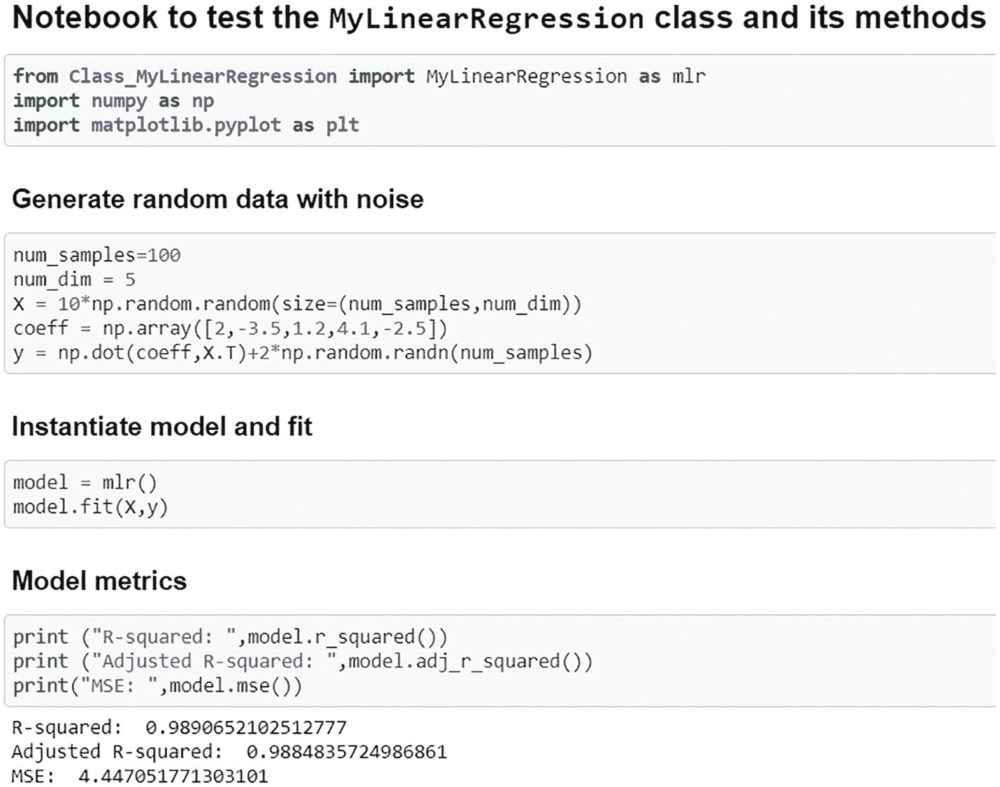

通过从单独模块导入来测试机器学习评估器

## 将其发布为 Python 包

此时，你可以考虑将这个 Python 脚本发布为一个独立的 Python 包 ([`https://towardsdatascience.com/build-your-first-open-source-python-project-53471c9942a7`](https://towardsdatascience.com/build-your-first-open-source-python-project-53471c9942a7))，该包能够进行拟合、预测、绘图、诊断等操作。虽然你可以将包托管在自己的个人网站或云上，但最明显的位置是官方的 Python 包仓库 **PyPI**。这是全世界任何人都可以通过 `pip` 命令下载和安装你的包的地方。例如，如果你的包名为 `my_ml_package`，那么任何人都可以运行 `pip install my_ml_package`，Python 库就会被安装到他们的机器上。

### PyPI 托管的特别说明

要在 PyPI 上托管，你必须遵循特定步骤：

1.  创建一个 `setup.py` 文件 ([`https://godatadriven.com/blog/a-practical-guide-to-using-setup-py/`](https://godatadriven.com/blog/a-practical-guide-to-using-setup-py/))。
2.  创建正确的目录结构（如果你有除了主脚本和 `setup.py` 之外的其他文件，例如样本数据和测试脚本）。
3.  将文件放入 GitHub 仓库。
4.  设置 GitHub Actions 用于定期提交和更新。
5.  使用诸如 Sphinx 之类的工具创建文档，并将其链接到 GitHub 的 Readme 文件。
6.  等等。

这些具体说明在提供的链接中已有详细解释，因此本书不再赘述。

当然，为了让你的包成为一个好包，你应该提供大量的文档字符串描述 ([`www.geeksforgeeks.org/python-docstrings/`](http://www.geeksforgeeks.org/python-docstrings/))、函数使用示例、断言检查 ([`https://airbrake.io/blog/python/python-assertionerror`](https://airbrake.io/blog/python/python-assertionerror)) 和单元测试 ([`https://softwaretestingfundamentals.com/unit-testing/`](https://softwaretestingfundamentals.com/unit-testing/))。但由于你是从头开始构建代码（遵循一些关键的 OOP 原则），你学到了很多宝贵的经验。你体验了从零开始开发一个有用的软件。

**什么是 PyPI?** Python 包索引 (PyPI) 是 Python 语言的官方第三方软件仓库。它类似于 Perl 的 CPAN 仓库或 R 语言的 CRAN 仓库。PyPI 由 Python 软件基金会 (PSF) 运营，该基金会维护并开发官方的 Python 版本发布。

### GitHub 集成

我的开源包版本位于：[`https://github.com/tirthajyoti/mlr`](https://github.com/tirthajyoti/mlr) (图 6-16)。虽然 GitHub 仓库不是将 Python 包发布到 PyPI 的必要条件，但强烈建议创建并维护一个。GitHub 集成可以使包的更新和版本控制变得简单无忧。通过合适的 GitHub 设置，你只需将最新更新的文件推送/提交到 GitHub，PyPI 版本也会随之更新（在执行一组告诉 PyPI 从你的 GitHub 仓库读取更新文件的特殊命令之后）。相关文档可以在这里找到：[`https://mlr.readthedocs.io/en/latest/`](https://mlr.readthedocs.io/en/latest/)。

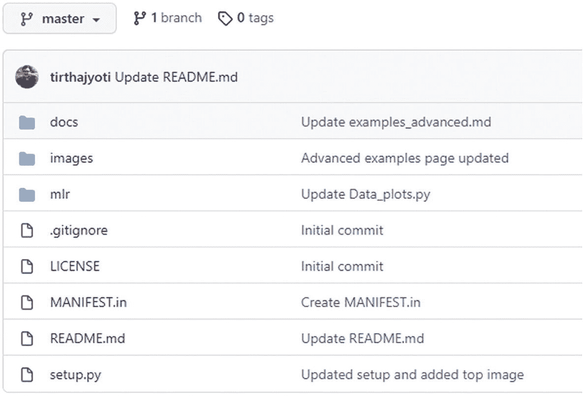

线性回归包的 GitHub 仓库快照

## 总结

在本章中，你专注于从头开始构建一个线性回归评估器。你的目标是实现一个干净、简单的 API，类似于 `scikit-learn` 评估器所提供的那样。然而，你为此类添加了比标准 `scikit-learn` 评估器中更多的额外方法和实用工具（例如，用于可视化和统计推断）。

在此过程中，你学习了如何规划和组织构建此类机器学习评估器的代码，以及如何利用 OOP 范式的继承和封装优势。本设计并非一成不变，而是旨在为你规划和构建用于各种业务和科学应用的数据科学 API 提供指南。

你还学习了数据科学家为了将这个代码作为功能完整的 Python 包（在 PyPI 服务器上）发布所需采取的额外步骤，以及这如何能让你学到宝贵的技能。


