# 11. 基于 GPU 的高效数据科学

在前两章中，你了解了用于执行超大数据集及分布式/并行化数据科学的多种工具和框架。其核心目标始终如一：提升数据科学管道的生产力。生产力通常与各类数据科学任务（包括数值处理、数据整理和特征工程）的执行速度直接相关。当进入高级机器学习阶段时，根据建模的复杂程度，速度和性能问题甚至会变得至关重要。

如今已公认，现代机器学习系统前所未有的成功，在很大程度上取决于其利用任务优化硬件以并行方式处理海量原始数据的能力。机器学习的历史已清晰表明，像图形处理器（GPU）这样的专用硬件在机器学习的早期成功中发挥了重要作用。

例如，2012 年，亚历克斯·克里热夫斯基（[`https://qz.com/1307091/the-inside-story-of-how-ai-got-good-enough-to-dominate-silicon-valley/`](https://qz.com/1307091/the-inside-story-of-how-ai-got-good-enough-to-dominate-silicon-valley/)）与伊利亚·苏茨克弗以及[杰弗里·辛顿](https://www.cs.toronto.edu/%257Ehinton/)（[`www.cs.toronto.edu/~hinton/`](http://www.cs.toronto.edu/%257Ehinton/)）合作，设计了一个最终被称为 `AlexNet`（[`https://proceedings.neurips.cc/paper/2012/file/c399862d3b9d6b76c8436e924a68c45b-Paper.pdf`](https://proceedings.neurips.cc/paper/2012/file/c399862d3b9d6b76c8436e924a68c45b-Paper.pdf)）的神经网络，该网络赢得了著名的 `ImageNet` 大规模视觉识别挑战赛（[`https://en.wikipedia.org/wiki/ImageNet_Large_Scale_Visual_Recognition_Challenge`](https://en.wikipedia.org/wiki/ImageNet_Large_Scale_Visual_Recognition_Challenge)）。在众多创新特性中，它是早期在并行 GPU 组合上训练的神经网络之一，并在 `ImageNet` 竞赛中以巨大优势击败了经典机器学习算法。因此，深度神经网络的整体概念得到了巨大推动，基于 GPU 的训练硬件在这一成功中所起的关键作用也随之凸显。自那以后，人们投入大量精力构建高度优化的软件工具和定制化的数学处理引擎（包括硬件和软件），以利用 GPU 的算力与架构以及并行计算来服务于人工智能和机器学习。

虽然 GPU 和分布式计算在学术界和商业界被广泛讨论用于核心 AI/ML 任务（例如，运行超过 100 层的深度神经网络进行图像分类，或拥有数十亿参数的 `BERT` 语言合成模型（[`https://towardsdatascience.com/bert-explained-state-of-the-art-language-model-for-nlp-f8b21a9b6270`](https://towardsdatascience.com/bert-explained-state-of-the-art-language-model-for-nlp-f8b21a9b6270)）），但在常规数据科学和数据工程任务中的实用性却较少被关注。这些与数据相关的任务是 AI 管道中任何机器学习工作负载的必要前提，并且它们通常占据了数据科学家甚至机器学习工程师所花费的时间和智力投入的大部分比例。

事实上，著名的 AI 先驱吴恩达最近谈到，AI 工具开发应从以模型为中心转向以数据为中心（[`https://spectrum.ieee.org/andrew-ng-data-centric-ai`](https://spectrum.ieee.org/andrew-ng-data-centric-ai)）。其核心思想是`不使用大型数据集，而使用更高质量的小型数据集`。这意味着在 AI 工作负载在管道上实际执行之前，需要花费更多时间处理原始数据并进行预处理。观看吴恩达在[`www.youtube.com/watch?v=06-AZXmwHjo`](http://www.youtube.com/watch%253Fv%253D06-AZXmwHjo)的采访（注意这是一个 YouTube 视频链接）。这也意味着，如果能够将 GPU 的强大能力应用到这类 ML 前置数据处理任务中，那么整个管道的效率将立即得到提升。

然而，一个重要问题依然存在：`我们能否将 GPU 的强大能力用于常规数据科学工作（例如数据整理、描述性统计）？` 答案并非显而易见，需要一些特别的考量与知识共享（图 11-1）。在本章中，我将重点介绍一套名为 `RAPIDS` 的专用工具套件，它能够帮助任何数据科学家在广泛的数据科学任务（不一定是深度学习或高级 ML）中利用基于 GPU 的硬件。我们期望通过利用 GPU 固有的并行处理能力，能够显著提升这类常见数据科学任务的生产力。

## 什么是 ImageNet？

`ImageNet` 是一项持续进行的研究工作，旨在为全球研究人员提供一个易于访问的图像数据库。该项目源于图像与视觉研究领域日益强烈的共识：对更多数据的需求。`该项目对推动计算机视觉和深度学习研究起到了关键作用`。这些数据免费提供研究人员用于非商业用途。每年都会围绕这个数据仓库举办一场竞赛，最新的深度学习架构在此相互角逐，算法/架构/技术的性能将根据它们对来自该数据源的图像的处理效果进行衡量。

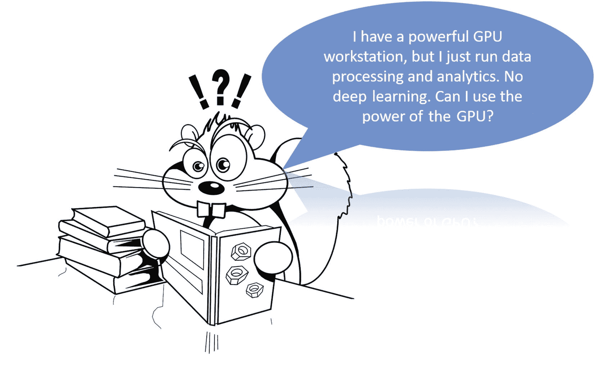

**图 11-1** `我们能否利用 GPU 的强大能力来处理常规数据科学工作？`

## RAPIDS 生态系统

`RAPIDS` 是一套开源软件库和 API，能够完全在 GPU 上执行端到端的数据科学和分析流程。Nvidia 孵化了这个项目，并构建了利用 `CUDA` 原语进行底层计算优化的工具。它特别专注于通过广受数据科学家和分析专业人士喜爱的友好型 Python 语言，来展现 GPU 的并行能力和高带宽内存速度特性。

常见的数据准备和数据整理任务在 `RAPIDS` 生态系统中备受重视，因为它们占据了典型数据科学流程中的大量时间。一个类数据框式的熟悉 API 已被开发出来，其中融入了大量优化和健壮性设计。它还被定制为能够与多种机器学习算法集成，从而实现端到端的流程加速，且无需承担序列化成本。

`RAPIDS` 还包含大量对多节点、多 GPU 部署和分布式处理的内置支持。它与其它库集成，使得处理内存溢出（即数据集大小超过单个计算机内存）的数据变得简单易行，方便单个数据科学家使用。

以下各小节将简要介绍该生态系统中数据科学家会发现非常有用的几个最突出的库。

## 什么是 CUDA？

`CUDA` 是由 NVIDIA 创建的并行计算平台和编程模型。它于 2006 年首次推出，现已发展成为实现 GPU 加速计算的最常见选择，支持多种编程语言（例如 C、C++、Fortran、Python 和 MATLAB）和 API。

一个值得注意的点是，`CUDA` 本身既不是一种编程语言，也不是一个 API。它是一个用于构建第三方库、SDK 以及性能分析和优化工具的平台。它主要提供用于添加到现有编程语言中的扩展或原语，这些扩展本质上是将计算（由高级语言或 API 执行）直接连接到底层 GPU 硬件。

`CUDA` 工具包（`https://developer.nvidia.com/cuda-toolkit`）包含 GPU 加速库、编译器、开发工具和 `CUDA` 运行时。为了在从 AI 到 HPC 的多个应用领域提升性能，开发者可以利用 NVIDIA `CUDA-X`——一个基于 `CUDA` 构建的库、工具和技术集合（`www.nvidia.com/en-us/technologies/cuda-x/`）。

## CuPy

`CuPy` 是一个由 `CUDA` 驱动的数组库，其外观和操作方式与 `NumPy` 相似，而 `NumPy` 是所有使用 Python 进行数值计算和机器学习的基础。在底层，它使用基于 `CUDA` 的低级库，包括 `cuBLAS`、`cuDNN`、`cuRand`、`cuSolver`、`cuSPARSE`、`cuFFT` 和 `NCCL`，以充分利用给定 GPU 架构，目标是通过 Python 提供 GPU 加速计算。

`CuPy` 的接口与 `NumPy` 高度相似，在大多数用例中可以简单地直接替换使用。以下是 `CuPy` 和 `NumPy` 之间 API 兼容性的模块级详细列表：`https://docs.cupy.dev/en/stable/reference/comparison.html`。请注意，几乎所有常见的 `NumPy` 方法都在 `CuPy` 中进行了复制，并且名称也完全相同。对于数据科学任务，这基本上为您提供了由 GPU 驱动的加速效果，而无需任何显著的学习曲线。

相对于 NumPy 的加速效果可能非常显著，具体取决于数据类型和用例。在下一节中，我将展示一个动手实践示例，比较 CuPy 和 NumPy 在两种不同数组大小以及各种常见数值运算（如切片、对多维数组的 `sum` 和标准差等统计运算、矩阵乘法和逆运算、快速傅里叶变换 (FFT) 以及奇异值分解 (SVD)）上的速度差异。

## CuDF

CuDF 基于 `Apache Arrow` 列式内存格式构建，是一个 GPU 加速的数据分析库，用于以各种可能的方式加载、连接、聚合、过滤和操作表格数据。它提供了一个类似 pandas 的 API，这对于几乎所有数据工程师和数据科学家来说都不陌生，这并不意外。其理念是数据科学家应该能够使用 CuDF，通过强大的 GPU 轻松加速他们的工作流程，而无需深入研究 CUDA 编程的细节。就像 CuPy 一样，大多数方法都可以从现有的 pandas 代码库中直接替换使用。

但是请注意，目前 CuDF 仅支持 Linux 操作系统，并且适用于 Python 3.7 及更高版本。安装和使用 CuDF 的其他要求包括：

* CUDA 11.0+

* NVIDIA 驱动 450.80.02+

* Pascal 架构或更新版本（计算能力 >=6.0）

因此，在使用 CuDF 之前，您必须完成一些环境设置和安装步骤。这是快速开始使用这个强大库的资源：`https://docs.rapids.ai/api/cudf/stable/10min.html`。

总的来说，无论数据科学家是否使用深度学习，CuPy 和 CuDF 都为他们提供了一个绝佳的机会，可以利用 GPU 加速的计算能力来提高工作效率。

## CuML

CuML 是 `RAPIDS` 中的另一个库，它使数据科学家、分析师和研究人员能够在 GPU 上运行传统/经典的机器学习算法任务（主要处理表格数据），而无需了解太多 CUDA 编程细节。在大多数情况下，CuML 的 Python API 与流行的 Python 库 `scikit-learn` 相匹配，从而可以快速、轻松地过渡到 GPU 硬件。这是该库的 GitHub 页面，供您关注和深入研究：`https://github.com/rapidsai/cuml`。

除了 CuPy 和 CuDF，在下一节中，您还将探索一些 CuML 函数和方法在常见机器学习任务上的动手实践示例，并将其执行速度和可扩展性与等效的 `scikit-learn` 算法进行比较。

超越笔记本电脑单 GPU 的场景，CuML 还在可能的情况下与 `Dask` 集成，为越来越多的利用这种分布式处理的算法提供多 GPU 和多节点 GPU 支持。基本上，许多现代高端硬件平台不是配备单个 GPU，而是配备四个甚至八个 GPU，有时通过特殊的内存总线和数据接口通道互连，这些通道完全绕过 CPU 和传统的低速主板通信总线，实现 GPU 到 GPU 的直接连接。

## CuGraph

CuGraph 是 GPU 加速图算法的集合，用于处理 GPU 数据框中的数据。CuGraph 的愿景是使图分析普及到用户只需从分析角度思考，而无需考虑技术或框架的程度。

数据科学家将很容易掌握 CuGraph 如何与类似 pandas 的 CuDF API 集成。另一方面，熟悉 `NetworkX` 的用户将很快识别出 CuGraph 中提供的类似 `NetworkX` 的 API，其目标是允许现有代码以最小的代价移植到 `RAPIDS` 中。目前，它支持广泛的图分析算法：

*   中心性分析

*   社区发现

*   链接分析

*   链接预测

*   遍历算法

许多科学和商业分析任务涉及到对大型数据集使用广泛的图算法。当工程师投资于 GPU 驱动的工作站时，像 CuGraph 这样的库为他们提供了更高生产率的保障。

## 硬件发展史

硬件在这一领域所扮演的角色，其重要性无论如何强调都不为过。在人工智能和机器学习解决方案取得巨大成功并被广泛采用（尤其是深度学习应用）的推动下，针对运行此类工作负载的定制化硬件领域涌现了大量投资和开发。例如，所有主要服务器和工作站供应商（如 `HP`、`IBM`、联想、`Super Micro` 等），此前只专注于为云计算构建计算基础设施，如今也提供了令人眼花缭乱的 GPU 优化硬件选项。谷歌的张量处理单元（`TPU`；[`https://en.wikipedia.org/wiki/Tensor_Processing_Unit`](https://en.wikipedia.org/wiki/Tensor_Processing_Unit)）就是一个典型的专用集成电路，它从零开始设计，唯一目标就是加速机器学习和深度学习工作负载特有的计算，例如线性代数、矩阵乘法、特殊非线性变换，并支持多种浮点数格式。GPU 研发领域的领导 `NVIDIA` 同样也在开创许多此类突破性的硬件平台。事实上，一个包含专用存储、共享内存架构和芯片组、主板设计以及数据通信通道和标准的完整硬件生态系统正在积极开发中，以满足人工智能工作负载的需求（图 11-2）。

诚然，此类硬件开发的焦点一直是特定类型的人工智能工作负载，例如大规模计算机视觉、强大的聊天机器人或工业级自然语言处理。尽管如此，借助像 `RAPIDS` 这样的框架，数据科学家和分析师（即那些在日常工作中不一定使用深度学习的群体）终于可以欢呼雀跃，并使用这些强大的人工智能工作站来提高他们的生产力。


图 11-2

数据科学家可以欢呼雀跃，并使用专为人工智能优化的硬件来完成他们的任务。

### 环境与设置的选择

如前所述，`RAPIDS` 仅能在 Linux 操作系统上运行，并且需要特定的 GPU 及更高版本。尽管 CuPy 支持早期版本的 GPU，但对于 CuDF 和 CuML，你必须拥有计算能力为 6 或更高版本的 GPU。`NVIDIA` 提供了一个 GPU 及其计算能力的列表（[`https://developer.nvidia.com/cuda-gpus#compute`](https://developer.nvidia.com/cuda-gpus%2523compute)），你可以查看以确保拥有合适的 GPU，从而利用 `RAPIDS` 框架。

对于笔记本电脑，如果你的显卡高于 `GeForce 1050`，`RAPIDS` 就能运行。这当然包括了 `RTX` 系列的 GPU。对于工作站，`M6000` 或 `K` 系列可能无法运行，但 `P400` 以上的任何型号都能运行。对于数据中心 GPU（例如，当你租用云实例时），它必须是帕斯卡架构或更高版本，例如 `P4`、`P40`、`P100`、`V100` 和 `A100`。

一旦你有了合适的 GPU，还需要确保安装了 `CUDA 11.2` 或更高版本。之后，需要完成许多自定义设置和环境安装，才能使 `RAPIDS` 正常工作。因此，有两种常见的实现方式如下：

-   使用托管环境，无需深入了解自定义设置的细节。

-   如果你在裸机 Linux 操作系统上使用（例如在 `EC2` 实例上），则使用 `NVIDIA Docker` 镜像。

例如，下面的示例是在 `Saturn Cloud` 上使用免费的托管设置运行的。该服务是一个完全托管的数据科学云服务，提供基于 GPU 的基础设施和透明的定价。对于免费套餐，每月的免费使用时长有一定限制。不过，对于基础学习来说，免费使用配额（每月 30 小时的 `Jupyter Lab` 会话）应该足够了。建议你在他们的网站上注册，并跟随本书中的示例（以及附带的 `Jupyter notebooks`）进行操作。

当你登录 `Saturn Cloud` 平台时，会看到几个启动 `Jupyter notebook` 的选项。每个选项都代表一项托管服务（例如，`RAPIDS` 环境、`TensorFlow`、`PyTorch` 或 `FastAPI` 实例）。图 11-3 展示了所有选项的典型快照（请注意，该截图拍摄于 2022 年 4 月，提供的服务可能已发生变化）。


图 11-3

`Saturn Cloud` 的启动页面，展示了各种托管服务选项

在图 11-3 的底部，你可以看到我已经创建的一个 `RAPIDS Jupyter` 服务器。当你点击你的版本时，会看到图 11-4 所示的界面，你可以在其中启动 `Jupyter lab`。本质上，`Saturn Cloud` 部署了一个 `Docker` 容器，其中预装了 `Jupyter lab`、`RAPIDS` 和其他 Python 库，并在基于 GPU 的硬件/计算节点上进行了正确配置。需要注意的是，他们还为此服务配对了 `Dask` 集群选项，以便你可以在需要时利用多 GPU 系统。免费套餐限制了你可以利用的 GPU 类型和数量；不过，如前所述，对于基础学习，你不需要超过一个 GPU，因此你不会启动 `Dask` 集群。


图 11-4

带有 `RAPIDS` 的 `Saturn Cloud` 的 `Jupyter` 服务器

Jupyter lab 启动后，你可以验证是否拥有兼容 RAPIDS 的 GPU。图 11-5 显示了该命令及其典型输出。在这里，GPU 是 Tesla T4（[`www.nvidia.com/en-us/data-center/tesla-t4/`](http://www.nvidia.com/en-us/data-center/tesla-t4/)），CUDA 版本是 11.4，NVIDIA 驱动版本是 470.57.02。

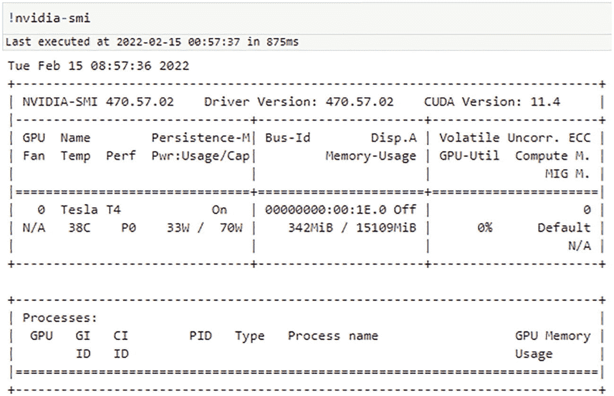

图 11-5
Nvidia 显卡状态命令的典型输出

## CuPy 与 NumPy

在本节中，我将展示一些 `CuPy` 使用的基础示例，以及它与无处不在的 `NumPy` 包的比较。由于 `NumPy` 在几乎所有数据科学和机器学习任务中都有广泛而多样的应用，值得注意的是，通过切换到 `CuPy`，所有这些任务的生产力很可能都会有显著提升。

### 外观和工作方式与 NumPy 完全相同

如前所述，`CuPy` API 被设计为 `NumPy` 代码的即插即用替代品。因此，所有常见的方法都可以使用。首先导入两个库（用于比较）以及其他库：

```python
import numpy as np, cupy as cp
import matplotlib.pyplot as plt
import time
```

你可以像在 `NumPy` 中一样定义数组：

```python
a1 = cp.array([1,2,3])
a2 = cp.arange(1,11,2)
a3 = cp.random.normal(size=(3,3))
```

只是类型不同：

```python
type(a3)
>> cupy._core.core.ndarray
```

你可以使用所有常见且有用的 `NumPy` 操作，例如广播、转置、求逆和布尔过滤。

```python
a3.T
a3+1
a3.mean(axis=1)
a3*(a3>0)
```

最后一个操作的输出如下：

```python
>> array([[ 0.58731747, -0\.        , -0\.        ],
[-0\.        , -0\.        ,  0.7699453 ],
[ 1.80051069,  0.67680871,  1.3091392 ]])
```

### 比 NumPy 快得多

尽管 `CuPy` 在外观和感觉上与 `NumPy` 相同，但在高性能 GPU 的支持下，其向量化运算速度要快得多。以下代码可以明确证明这一点：

```python
SIZE = 200
%%timeit -n10 -r10
np.random.normal(size=(SIZE,SIZE))@np.random.normal(size=(SIZE,SIZE))
>> 3.67 ms ± 258 μs per loop (mean ± std. dev. of 10 runs, 10 loops each)
```

这段代码测量了 `NumPy` 执行 `(200 x 200)` 大小矩阵乘法操作所需的平均时间。

现在，让我们运行完全相同的代码，只需将 `np` 替换为 `cp`（即使用 `CuPy` 数组和方法替代 `NumPy`）：

```python
%%timeit -n10 -r10
cp.random.normal(size=(SIZE,SIZE))@cp.random.normal(size=(SIZE,SIZE))
>> 127 μs ± 40.7 μs per loop (mean ± std. dev. of 10 runs, 10 loops each)
```

即使是一个简单的 `200 x 200` 矩阵乘法，也显示出超过 25 倍的速度提升（127 μs 对比 3.67 ms）。可以想象，对于涉及更大数值数据集的大型数据科学操作，性能提升的幅度会有多大。

### 数据（数组）大小至关重要

上述性能提升会随着数组大小的增加而迅速扩大。让我们通过一组简单的代码来观察这一点。首先，你使用 `NumPy` 的 `np.linalg.solve()` 方法（即求解一组联立方程）编写一个计时测量代码。回想一下，在底层实现简单的多元线性回归算法时，使用的正是这个方法。

```python
import time, tqdm
size=[100*i for i in range(1,21)]
numpy_time = []
for s in tqdm(size):
a = np.array([np.random.randint(-10,10,s).tolist() for i in range(s)])
b = np.array([np.random.randint(-100,100,s)]).T
t1 = time.time()
x = np.linalg.solve(a,b)
t2 = time.time()
delta_t = (t2-t1)*1000
numpy_time.append(delta_t)
```

与之前一样，你必须通过将 `np` 替换为 `cp` 来重复相同的 `CuPy` 代码。最后，通过简单的绘图代码，你可以清晰地看到对比结果（图 11-6）。注意，性能提升会随数组大小增加而扩大，并且某种程度上是非线性的。这意味着对于更大的数组，性能提升甚至会更快。当然，这种提升只有在数据（数组）能够完全放入 GPU 内存时才能实现。对于拥有数千万行或列的数据集来说，这可能是一个限制，因为 GPU 内存可能比系统内存 (RAM) 小。然而，可以设计许多批量操作或分段操作来规避这一限制，同时仍然实现显著的加速效果。


图 11-6
线性系统求解中 CuPy 与 NumPy 在不同数组大小下的对比

接下来，让我们使用不同大小的随机生成方阵（从正态分布中抽取）来解决奇异值分解（SVD）问题。为了简洁起见，我在这里不再重复代码块，只展示结果（图 11-7）。请注意，在此类问题中，`CuPy` 算法并未表现出明显优于 `NumPy` 算法的性能。这或许是 `CuPy` 开发者需要改进的地方。

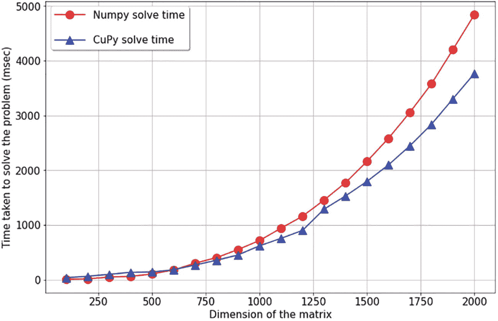

图 11-7
SVD 中 CuPy 与 NumPy 在不同矩阵大小下的对比

接下来，让我们回到基础，考虑矩阵求逆这个基本问题（几乎用于所有机器学习算法）。结果再次显示出 `CuPy` 算法相对于 `NumPy` 包具有非常有利的性能提升（图 11-8）。

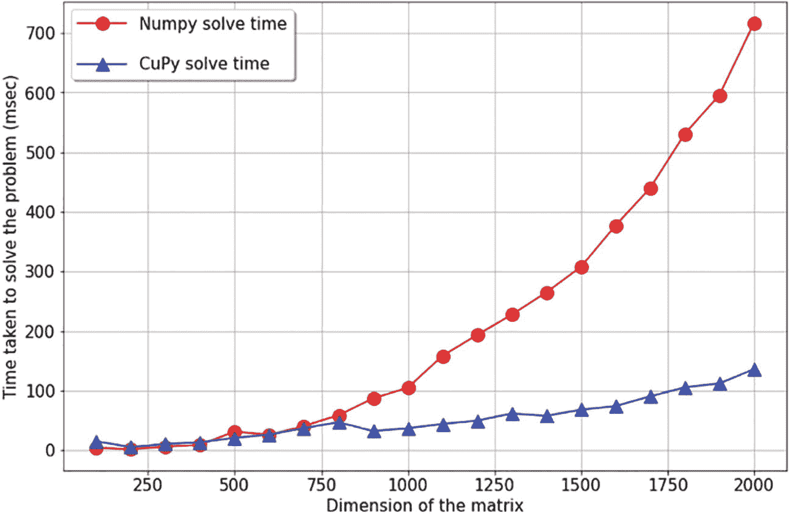

图 11-8
矩阵乘法任务中 CuPy 与 NumPy 的对比

## CuDF 与 pandas 对比

让我们使用相同的 Saturn Cloud 实例，并启动一个新的 Jupyter notebook 来进行这项练习。目的是展示一些 `CuDF` 的基本操作，并演示与 `pandas` 进行简单的计算速度比较。

### 从 URL 读取数据

让我们从托管在我个人 GitHub 上的一个 URL 读取数据集：

```python
import numpy as np, cupy as cp, cudf
import pandas as pd

url = "https://raw.githubusercontent.com/tirthajyoti/Machine-Learning-with-Python/master/Datasets/College_Data"
content = requests.get(url).content.decode('utf-8')
cdf = cudf.read_csv(StringIO(content))
```

于是你通过互联网读取一个 CSV 文件并将其加载到 `CuDF` DataFrame 中。你可以使用熟悉的 `.head()` 方法来检查前几项内容：

```python
cdf.head()
```

这将产生如图 11-9 所示的输出。

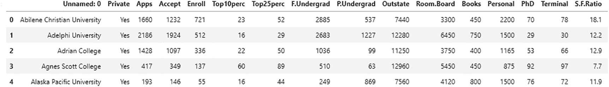

图 11-9
从 URL 加载数据后 CuDF DataFrame 的前几项内容

### 索引、过滤和分组

索引、列命名和过滤的操作方式与 `pandas` API 完全相同。首先，将 `Unnamed: 0` 列重命名为更有意义的名称：

```python
cdf.rename(columns={"Unnamed: 0": "College"}, inplace=True)
```

然后你可以查看数据的一小部分：

```python
cdf[['F.Undergrad','P.Undergrad']][2:4]
```

这将产生如图 11-10 所示的输出。

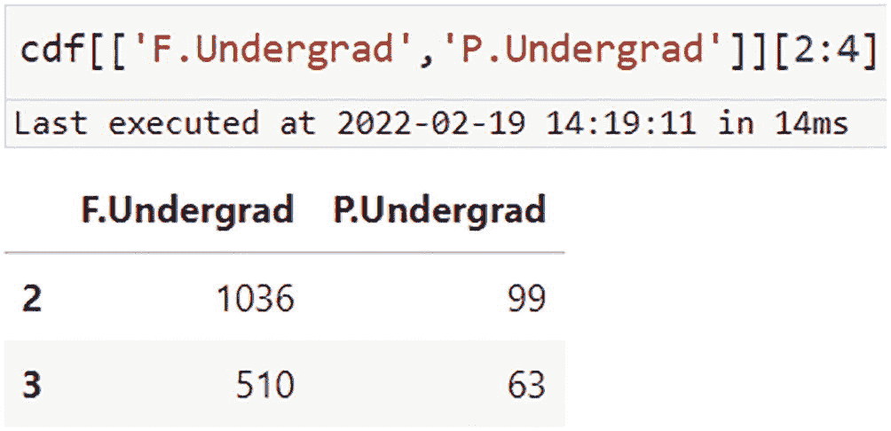

图 11-10
CuDF DataFrame 对选定列和行进行索引

现在尝试一个稍微复杂的过滤操作，以提取并列出那些师生比例合理（低于 10）且学费支出较低（低于 8000 美元）的学院：

```
filter_1 = cdf['S.F.Ratio']< 10
filter_2 = cdf['Expend'] < 8000
cdf[filter_1 & filter_2 ][['College','S.F.Ratio','Expend']]
```

结果如图 11-11 所示。


图 11-11
对 `CuDF` DataFrame 进行多重过滤操作

分组操作后接聚合操作，其工作方式也与 `pandas` 相似（图 11-12）。

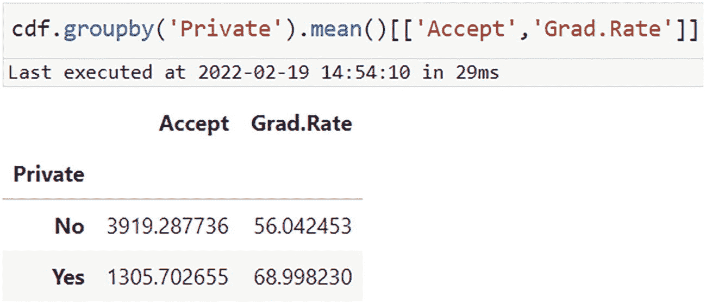

图 11-12
对 `CuDF` DataFrame 进行分组和平均操作

### NumPy 数组转换

在许多情况下，特别是为了绘图和可视化，你可能需要将 `CuDF` 数据字段转换为标准的 `NumPy` 数组。在这些情况下，仅使用标准的 `.values` 属性只会得到一个 `CuPy` 数组。要获取 `NumPy` 数组，你需要在它之上使用 `.get()` 方法。

以下是你仅使用 `.values` 得到的结果：

```
phds=cdf['PhD'].values
type(phds)
>> cupy._core.core.ndarray
```

使用 `.get` 方法，你将获得 `NumPy` 数组，并且可以绘制博士数量的直方图（图 11-13）。

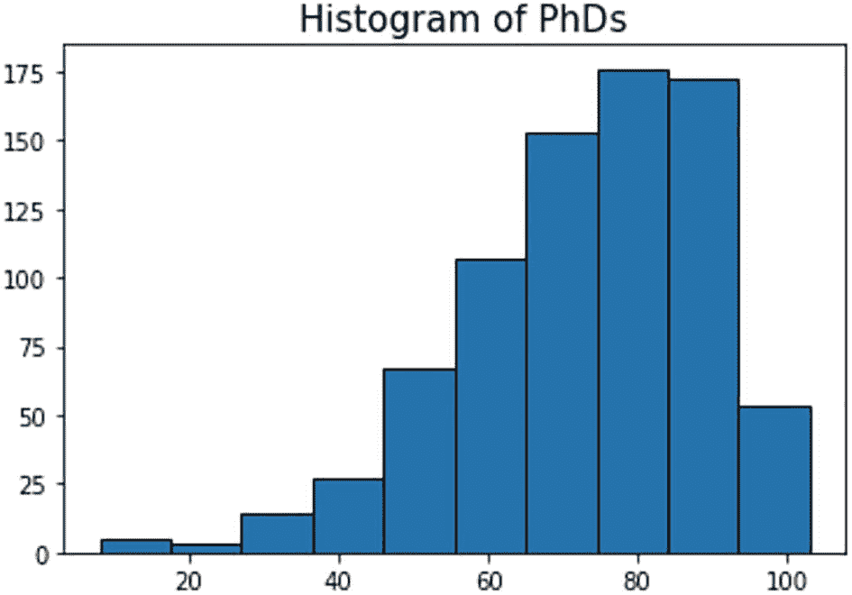

图 11-13
`NumPy` 数组转换后，来自 `CuDF` DataFrame 的博士数量直方图

```
phds=cdf['PhD'].values.get()
plt.title('Histogram of PhD',fontsize=15)
plt.hist(phds,edgecolor='k')
plt.show()
```

### 简易速度基准测试

通过一个非常简单的基准测试，你可以展示使用 `CuDF`（当然，是在 T4 GPU 上）带来的计算性能提升。

首先，构建一个包含 100 万行、100 列随机数（从高斯分布中抽取）的 `NumPy` 数组，然后将其分别转换为 `pandas` DataFrame 和 `CuDF` DataFrame：

```
data = np.random.normal(size=(1000_000,100))
df = pd.DataFrame(data)
cdf = cudf.DataFrame.from_pandas(df)
```

这里，`.from_pandas` 方法可以快速、轻松地将现有的 `pandas` DataFrame 转换为 `CuDF` DataFrame。

对第一列进行简单的 `mean` 计算，`pandas` DataFrame 的输出结果如下：

```
%timeit -n10 -r10 df[0].mean()
>> 15 ms ± 1.16 ms per loop (mean ± std. dev. of 10 runs, 10 loops each)
```

对 `CuDF` DataFrame 执行相同的操作，结果要快得多：

```
%timeit -n10 -r10 cdf[0].mean()
>> 504 μs ± 52.7 μs per loop (mean ± std. dev. of 10 runs, 10 loops each)
```

为了进一步扩展测试，你运行一个循环，每次选择递增数量的列，观察计算时间如何随列数变化，以及 `pandas` 和 `CuDF` 之间的基准测试对比情况：

```
for i in range(2,11):
    t1=time.time()
    df[[j for j in range(i)]].mean()
    t2=time.time()
    del_t = round(1000*(t2-t1),3)
    print(f"Calculation with {i} columns took {del_t} ms")
>>
Calculation with 2 columns took 3.333 ms
Calculation with 3 columns took 2.835 ms
Calculation with 4 columns took 2.878 ms
Calculation with 5 columns took 3.269 ms
Calculation with 6 columns took 3.589 ms
Calculation with 7 columns took 4.11 ms
Calculation with 8 columns took 4.606 ms
Calculation with 9 columns took 4.99 ms
Calculation with 10 columns took 5.478 ms
```

对于 `CuDF` DataFrame，计算时间要短得多，并且其随列数增长而增长的速度也更慢：

```
Calculation with 2 columns took 3.333 ms
Calculation with 3 columns took 2.835 ms
Calculation with 4 columns took 2.878 ms
Calculation with 5 columns took 3.269 ms
Calculation with 6 columns took 3.589 ms
Calculation with 7 columns took 4.11 ms
Calculation with 8 columns took 4.606 ms
Calculation with 9 columns took 4.99 ms
Calculation with 10 columns took 5.478 ms
```

### Dask 集成、用户自定义函数及其他特性

`CuDF` 可以与 `Dask` 集群良好配合，利用多 GPU 的能力进行大规模并行数据处理。它还原生支持在选定的轴或列上应用复杂的用户自定义函数（简称 UDF）。这些函数逐块工作（针对 GPU 内存中数据的内部表示），并且比基于 CPU 的 `pandas` 工作流表现出更快的计算速度。为简洁起见，我不会涵盖所有这些特性，但鼓励您查看 RAPIDS 门户网站上提供的优秀教程：[`https://docs.rapids.ai/api/cudf/stable/user_guide/10min.html`](https://docs.rapids.ai/api/cudf/stable/user_guide/10min.html)。

## CuML vs. scikit-learn

在介绍了 `CuPy` 和 `CuDF` 的基本用法，并展示了与 `NumPy` 和 `pandas` 的对比基准测试之后，接下来进入数据科学流程的下一阶段，讨论 `scikit-learn` 的 GPU 加速等价物：`CuML`。

由于传统上 GPU 硬件的大多数常规用途都集中在机器学习领域，因此有必要澄清本次对比讨论的内容。这里，我们只关注机器学习世界中非深度学习的方面（即数据科学家会应用源自 `scikit-learn` API 的现成算法的情况）。关键在于，在这种情况下，如果数据科学家能够使用基于 GPU 的系统，他们可以在不花费任何时间或精力修改代码或学习 GPU 编程的情况下，显著提升计算性能。这些情况下，不需要 `TensorFlow`，但必须充分利用 GPU 的能力。

### 使用随机森林进行分类

在此练习中，您将使用 `scikit-learn` 的 `RandomForestClassifier` 在合成数据集上进行训练，并将其性能与速度与 `CuML` API 中类似的分类器进行比较。首先，创建一些包含 10,000 个样本和 20 个特征的合成数据：

```
NUM_ROWS = 10000
NUM_FEATURES = 20
from sklearn.datasets import make_classification
X,y = make_classification(n_samples=NUM_ROWS,
                         n_classes=2,
                         n_features=NUM_FEATURES,
                         n_informative=NUM_FEATURES,
                         n_redundant=0,
                         n_repeated=0)
```

您已经从各自 API 中导入了必要的函数和类。然而，对于此类对比研究，需要注意命名问题，因为 `scikit-learn` 和 `CuML` 的类和函数名称在很大程度上是相同的。因此，您可以在导入时创建自己的版本：
```

### CuML 与 scikit-learn 对比：代码与结果

```python
from sklearn.model_selection import train_test_split as sk_tts
from cuml.model_selection import train_test_split as cuml_tts
from sklearn.ensemble import RandomForestClassifier as SKRF
from cuml.ensemble import RandomForestClassifier as CURF
```

请注意，您不仅导入了分类器，还从 `CuML` 导入了训练/测试拆分工具。通常的做法是，当您利用 GPU 的能力时，应尽可能使用 `CuML` 提供的每一个 API 功能。

为了进行恰当的对比和数据保护，您构建了两个独立的函数，一个使用 `scikit-learn` 流程，另一个使用 `CuML` API。以下是 `scikit-learn` 版本：

```python
def sklearn_pipeline(X,y,n_estimators=100):
    """
    Executes Sklearn-based pipeline
    """
    t1 =time.time()
    X_train, X_test, y_train, y_test = sk_tts(X,y, test_size=0.3)
    model = SKRF(n_estimators=n_estimators)
    model.fit(X_train,y_train)
    t2 =time.time()
    del_t = round(1000*(t2-t1),3)
    score = round(model.score(X_test,y_test),3)
    return (score, del_t)
```

以下代码是 `CuML` 版本。注意，为了与某些 GPU 计算兼容，数据类型被更改为 `np.float32`（即 `CuML` 使用 32 位浮点精度）。同时，`CuML` API 仅适用于 `CuPy` 数组，这就是需要进行 NumPy 到 `CuPy` 转换的原因。尽管如此，您测量的是整个流程所花费的总时间，而不仅仅是训练/拟合部分。该函数返回一个元组，包含（在测试集上的）分类分数和执行时间。

```python
def cuml_pipeline(X,y,n_estimators=100):
    """
    Executes CuML-based pipeline
    """
    t1 =time.time()
    X = cupy.array(X,dtype=np.float32)
    y = cupy.array(y,dtype=np.float32)
    X_train, X_test, y_train, y_test = cuml_tts(X,y, test_size=0.3)
    model = CURF(n_estimators=n_estimators)
    model.fit(X_train,y_train)
    t2 =time.time()
    del_t = round(1000*(t2-t1),3)
    score = round(model.score(X_test,y_test),3)
    return (score, del_t)
```

然后，您只需连续运行这些流程。对于 `scikit-learn` 的情况，结果如下：

```python
score_sk, t_sk = sklearn_pipeline(X,y)
print("Sklearn pipeline score: ",score_sk)
print("Sklearn pipeline time (ms): ",t_sk)
>>
Sklearn pipeline score:  0.937
Sklearn pipeline time (ms):  2132.17
```

对于 `CuML` 流程，结果如下：

```python
score_cuml, t_cuml = cuml_pipeline(X,y)
print("CuML pipeline score: ",score_cuml)
print("CuML pipeline time (ms): ",t_cuml)
>>
CuML pipeline score:  0.936
CuML pipeline time (ms):  100.471
```

您可以观察到，对于相同的数据输入，`CuML` 流程实现了巨大的速度提升。两个流程的准确率得分几乎相同，`CuML` 的得分在第三位小数上存在差异，这可能是由于 32 位浮点精度转换造成的。但速度的提升远远弥补了这一微小的精度变化。

在运行代码（或关联的 Jupyter notebook）时，首次运行可能会得到一个结果显示 scikit-learn 管道比 CuML 管道更快。这与 GPU 内存如何随代码和数据预取及缓存有关，并且仅发生在第一次运行时。这种情况应予忽略。若再次运行代码，您应得到与此处所示结果相同的趋势。

进一步扩展，让我们研究当使用 CuML 时，模型复杂度是否会影响其相对于 scikit-learn 的性能提升。将相同的数据拟合到复杂度递增（即，根估计器/树的数量增加）的随机森林模型中。图 11-14 所示结果清晰地表明：**随着模型复杂度的增长，CuML 及其并行化（GPU 驱动）操作能够显著帮助如随机森林这样的集成分类器**。虽然两个分类器的计算时间都在增加，但与 scikit-learn 相比，CuML 的增长速度极小。准确率得分存在一些微小差异，但计算效率方面的收益更为显著。


### K-Means 聚类

接下来，考虑一个使用广为人知的 k-means 算法的无监督聚类学习问题。在这里，您再次将 CuML 函数与 Scikit-learn 包中的等效估计器进行比较。仅供参考，图 11-15 展示了这两个估计器之间的 API 比较。它们看起来几乎相同，除了 `CuML` 使用称为“可扩展 k-means++”作为初始化参数。`CuML` 的 k-means 估计器还接受一个 `max_samples_per_batch` 参数，该参数允许进行受控的批量训练。

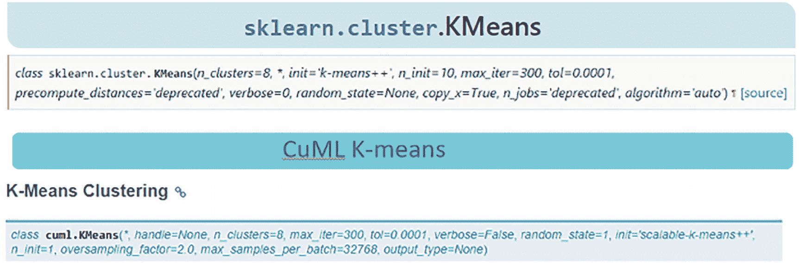

图 11-16 展示了一个具有 10 个特征/维度的数据集的结果。

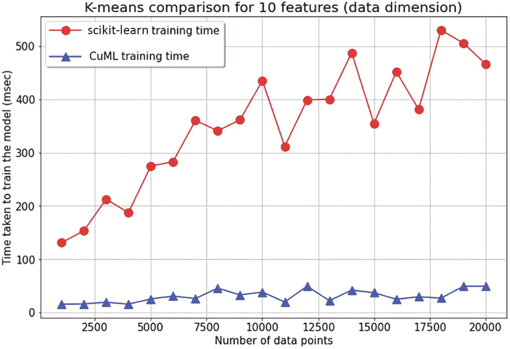

图 11-17 展示了另一个具有 100 个特征的数据集实验的结果。显然，样本量（行数）和维度（列数）都对基于 GPU 的加速性能如此出色有影响。

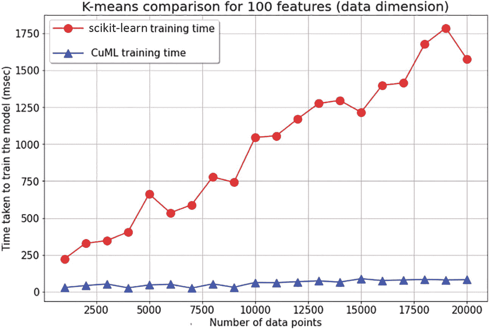

关于线性回归问题的进一步讨论和结果可在我写的这篇文章中找到：`https://medium.com/dataseries/gpu-powered-data-science-not-deep-learning-with-rapids-29f9ed8d51f3`。建议您查阅一下。

## 总结

本章重点介绍基于 GPU 的硬件系统在数据科学任务中的使用和应用，这些任务不一定涉及深度学习模型或推理，但仍然可以从以硬件为中心的优化中显著受益。

我向您介绍了 RAPIDS 这个出色的生态系统，它是一个以 GPU 为中心的数据科学框架，拥有用于数值计算、表格数据分析、经典机器学习、图分析甚至信号处理的独立库。该框架由 CUDA 加速库驱动，并充分利用了 NVIDIA GPU（高于特定代的 GPU 类别和计算能力）。

然而，其最佳特性是所有模块都试图模仿它们的非 GPU 纯 Python 对应物，如 `NumPy`、`pandas` 和 `scikit-learn`。因此，对于数据科学家来说，学习曲线很短，并且在大多数情况下，几乎可以原样替换代码。遵循这一原则，接下来您看到了多个动手示例，展示了使用由 Tesla T4 GPU 驱动的托管运行时（在云端）对这些库进行基本应用。我还展示了等效操作和机器学习算法的计算性能基准测试比较，以清晰展示 GPU 加速数据科学的优势。


# 12. 其他需要掌握的实用技能
在本书中高效且富有成效的数据科学之旅即将结束之际，我想用整整一章来介绍数据科学家应努力掌握的各种不同实用技能，以提高其生产力。与前面章节中您会看到相似归类的技能（例如，内存分析器或分布式计算工具）不同，您将在本章中探索的工具和技能可能看起来有些互不关联。确实，它们不属于同一类别，但作为一个整体，它们确实能帮助任何数据科学家以更高的效率执行任务。
我首先讨论学习基本 Web 技术（如 `HTML`、`CSS` 和 `JavaScript`）的重要性。基于相同的概念，接下来我将讨论为数据科学项目创建一个简单 Web 应用程序的实用性。我将展示一个使用两个 Python 库（`Flask` 和 `PyWebIO`）的动手示例。之后，我会介绍诸如 Amazon Web Service 之类的云技术，并展示（附有链接资源）将云能力引入本地数据科学工作流的简单过程。最后，我转换话题，讨论在许多情况下，使用所谓的“低代码”框架对数据科学任务是有用且高效的。在这方面，我将演示 `PyCaret`，一个流行的低代码 Python 库。
如您从以上描述中所见，与之前的章节不同，本章并不侧重于一个（或少数几个）Python 工具/库。虽然我可能在部分章节中讨论一些有用的 Python 库，但在其他章节中，我可能会讨论通用技术特性，而不涉及特定的 Python 工具。在这些章节中，我可能会就学习哪些主题以及如何进行学习给出一般性建议。
## 理解 Web 技术基础
您可能会疑惑为什么数据科学家需要理解 Web 应用程序或通用 Web 技术的细节。答案在于一个简单的事实：数据科学家的责任不应仅限于统计分析或构建 ML 模型。最重要的是，数据科学家的工作是使用数据，以科学的方式解决业务或科学问题。以可访问（甚至交互式）的方式向外部世界传达结果并展示建模和分析，是任何合理数据科学工作的必要目标。
### 面向消费者的交互层
换言之，虽然分析数据集、发现隐藏模式以及构建预测模型被公认为是数据科学家的核心技能，但同样重要的是，要将从这些分析中提取的关键见解传达出来，或在模型之上构建某种交互层，作为外部消费者的接触点。如果数据科学家正考虑打造一款面向消费者的产品，甚至利用数据科学方法自行创业，那么这些方面将尤为重要。
为了在数据科学核心之上构建一个可正常运行的面向消费者的交互层，创建一个网络应用是显而易见的选择。在个人计算的早期（大致直到 21 世纪初），构建一个独立的桌面应用或许就已足够。这类应用所需的技术和工具与构建网络应用的工具截然不同。然而，在当今世界，任何计算或信息技术产品都期望拥有网络应用形式，数据科学在这方面也不例外。因此，数据科学家了解构建此类应用的基础知识是合情合理的。所有惯用的数据科学工具和技术仍将被充分使用，只是最终需要通过一个网络应用来展现可呈现的输出端或用户交互层，如图 12-1 所示。

**图 12-1** 一个全方位的数数据科学项目，前端具备网络应用形式的面向消费者交互层
### 所有有用的数据科学都通过网络应用交付
从消费者的角度观察，我们会发现几乎所有*有用的数据科学*都是通过这样或那样的网络应用交付给我们的。当我们在 Netflix 上观看一部推荐电影，或在亚马逊上购买一件商品时，背后都存在一个推荐引擎和复杂的机器学习算法，这些算法由关于我们自身、我们的购买/观看习惯和偏好的 PB 级数据驱动。但最终，所有这些复杂数据科学工作的累积成果，都通过一个简单的网络界面呈现出来，向我们展示一个可供点击和享受的电影或商品链接。
现在，在任何规模适中的组织中，网络应用开发者很可能是一个独立于数据科学团队的个体（或团队）。然而，对于数据科学家来说，深入了解（达到合理的程度）完整的技术栈细节是极其有益的——这个技术栈始于源数据（由他们的团队负责），止于由其他软件工程师使用不同技术栈开发的、精美闪亮的网络应用。这类知识能够促进对话和头脑风暴，以解决现有问题（无论是数据端还是网络应用端的问题），并激发创新想法。
这类对话涉及多个维度，有助于解决问题和推动产品创新。下面给出一些典型示例。假设一个典型场景：后端运行着数据科学处理管线（并集成了某些数据库），同时有一个网络应用将该管线的结果提供给用户，这些用户可能登录门户网站，甚至付费使用部分服务。
-   当前的数据科学/处理管线是否便于网络应用的扩展？面临哪些挑战？数据科学团队能提供何种帮助？
-   可视化的哪些部分应在数据科学后端（例如，使用 Python 框架）完成，哪些部分应在前端使用 `JavaScript` 渲染？哪个 `JavaScript` 库能更好地与 Python 数据对象协同工作？需要注意哪些陷阱？
-   数据科学层与部署层之间的确切接触点在哪里？交互式用户输入及其对数据科学管线有何影响？
-   应如何组织和安排数据科学任务以辅助网络应用？各种服务的容器化情况如何？这有助于提升应用的服务质量和降低延迟吗？
-   关于数据存储和数据库的策略应如何制定，以使其既能很好地服务于数据科学后端，又能很好地服务于网络应用前端？
-   还有哪些其他后端服务（例如，用户授权、金融交易）必须与数据科学服务良好配合？它们之间存在哪些依赖关系？
显然，要对企业整体运营产生有意义的影响，数据科学团队必须对所使用的全套工具和技术有良好的掌握（仅举几例常见技术：`HTML`、`CSS`、`JavaScript`、`PHP`、`Ruby on Rails`、`Docker`、`Kubernetes`）。其他与数据科学服务（使用`Python`）紧密协作、甚至可能（在数据发送到前端之前）以某种方式消费数据科学管线输出的后端服务，可能使用如`Go`或`Rust`等语言编写。
这里的要点是：数据科学家无需成为所有这些工具和技术的专家。但他们必须保持好奇心去了解更多，并有倾向将完整的技术栈视为一个整体的、以数据为导向的赋能工具。基于 `Python` 的数据科学是企业中至关重要的一环，但正是整个技术栈将最终价值交付给客户，并为组织带来收入。
### 有哪些学习途径？
网络应用（以及完整的基于网络的服务）开发，及其相关的工具和技术，或许是软件工程和信息技术领域中最庞大的知识领域。其中存在令人眼花缭乱的选择和种类、标准和协议、语言和框架，以及良莠不齐的实践。试图教你这些技术既不在本书的范围之内，也非作者的专业所长。然而，我认为一些基于具体示例的建议可以鼓励你在数据科学之旅中探索这些领域。这些建议可能包括但不限于以下示例：
-   学习基于数据分析项目构建并部署一个简单的网络应用，其中包含探索性可视化和一个简单的预测模型
-   深入学习基于 `Python` 的网络微框架，例如`Flask`或`FastAPI`，并学习如何使用它们来部署机器学习模型
-   学习一个专为可视化分析设计的前端框架，例如`D3.js`。追寻这类知识能让你扎实掌握 `JavaScript` 编程基础，同时，看到网络可视化数据分析的强大功能也能让你保持动力
-   学习 `Markdown` 语言并掌握基础的 `CSS` 技能，以便为你开发的 `GitHub` 仓库和开源数据科学项目及工具包创建美观的 Readme 文档
-   学习并实现将数据库集成到 `Python` 数据科学服务中，且要考虑到实际运行的网络应用
-   学习容器技术，了解它们如何丰富现代网络应用，以及它们如何帮助组织摆脱老一代的单体软件构建实践
从这些建议中可以清楚地看出，它们特别针对那些并非软件或网络开发背景出身的数据科学家。事实上，有许多网络开发人员对数据科学充满热情，并正在逐步转型为数据科学家角色。他们自然早已对这些工具非常熟悉。而正是另一部分数据科学从业者，他们来自物理学、经济学、统计学和社会科学等不同背景，当他们在自己的技能库中增加与网络相关的技术时，会让他们自身受益匪浅。拥有如此全面的知识和应用的整体视野，将有助于他们在工作中取得成功，并为迎接新的挑战做好准备。

# 为数据科学构建简易 Web 应用

在本节中，我将演示如何构建一个基于若干数据科学任务和服务的简易 Web 应用。首先，我将展示一个使用最流行的 Python Web 框架之一`Flask`的机器学习模型预测示例。这需要你编写一个 Python 脚本和一个将在网页上渲染的 HTML 脚本。用 Web 应用开发的术语来说，Python 是后端（负责执行机器学习等数据科学任务），而 HTML 则是该应用的前端技术。

接下来，我将展示另一个 Python 库，它进一步简化了前端编程部分，让数据科学家能够专注于数据科学本身，同时以极低的学习成本构建出实用的 Web 应用。

## Flask 动手实践示例

`Flask`是一个强大且轻量级的 Python Web 框架，可用于构建响应迅速的 Web 应用。它在数据科学社区中尤其受欢迎，因为它学习曲线相对平缓，同时又为构建展示数据科学工作（模型或分析）的实用 Web 应用提供了极大的灵活性。它能有效处理 Web 应用中的许多环境和项目配置工作。因此，开发者（此处指数据科学家）可以专注于真正的数据科学代码和方法，而`Flask`则负责处理 HTTP、路由、静态资源等。

互联网上有很多关于`Flask`的优秀学习资源，如果你有兴趣学习这个库，建议自行查找。这里我不深入探讨这些细节，而是直接展示一个用于机器学习模型预测的小型 Web 应用的代码和结果。

一个文件夹中包含两个主要文件/脚本：一个 Python 脚本（包含`Flask`代码）和一个用作应用前端的 HTML 文件。这两个文件随书提供。Python 脚本加载了一个预训练的机器学习模型，该模型使用简单的逻辑回归模型，在著名的成人收入数据集上进行了分类任务训练。

我不会深入介绍 HTML 文件的细节，因为这并非本书的重点。我只会展示 HTML 的输出结果，即它生成的页面（图 12-2 至 12-4）。你可以看到接受数字输入的文本框和带有分类选项的下拉框。机器学习模型经过训练，可以处理这两种输入类型。但基于`Flask`的脚本必须仔细地将从 HTML 页面接收的输入进行转换和编码，以便与机器学习模型无缝处理。


图 12-4：应用上显示的种族下拉选项

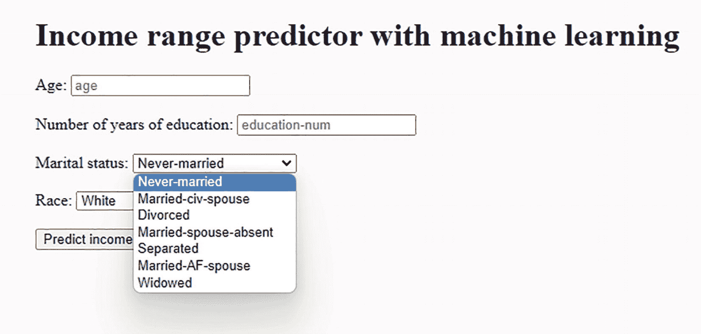

图 12-3：应用上显示的婚姻状况下拉选项

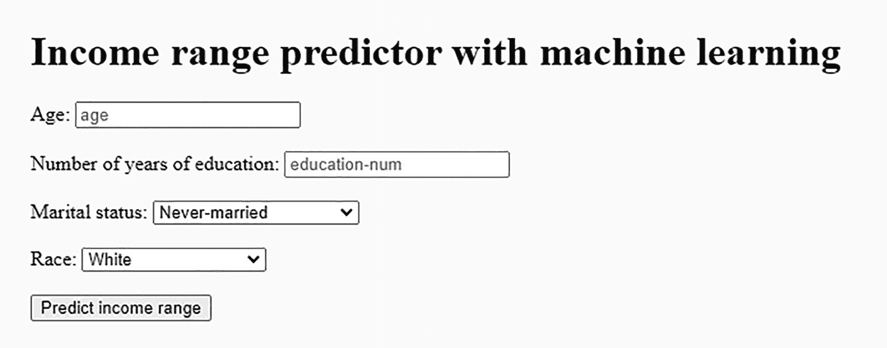

图 12-2：收入范围预测模型应用页面

接下来，我们将逐段介绍`Flask`应用代码：

```python
from flask import Flask, render_template, request
import pickle
import numpy as np
app = Flask(__name__)
# 从 pickle 转储加载模型和缩放器对象
model = pickle.load(open('income_model.pkl','rb'))
scaler = pickle.load(open('income_model_scaler.pkl','rb'))
```

这里，我们创建了`app`对象作为`Flask`类的实例，并从 pickle 转储中加载了两个对象：预训练的机器学习模型`model`和一个 scikit-learn 缩放对象`scaler`。这个`scaler`是`MinMaxScaler`类的一个实例，用于在训练模型时缩放输入数据。为了进行正确的预测，需要将其保存并加载到应用中。模型的训练是单独进行的，并记录在随书提供的 Jupyter notebook 中。

下一段代码仅使用`@app.route`装饰器创建了两个路由（或端点）。这里值得注意的是`home`函数定义中使用的`render_template`函数，你需要在此传入 HTML 文件的名称。该文件必须存储在名为`templates`的文件夹下，该文件夹与`Flask`应用脚本所在的目录相同。文件/资源的典型排列方式如图 12-5 所示。

预测路由用于装饰主预测函数 `predict()`，该函数在此代码片段中未显示。在这个路由中，你定义了 `methods` 参数，它列出了该路由允许的 URL 方法：`GET` 和 `POST`。这些是浏览器（客户端）可以在此路由上执行的操作。这些方法本质上是任何 Web 应用中客户端（前端）与服务器（后端）之间进行基本数据交换的方法。

```python
# 首页
@app.route("/")
def home():
return render_template('ml1.html')

@app.route("/predict", methods=['GET','POST'])
# 预测函数
def predict():
…
```

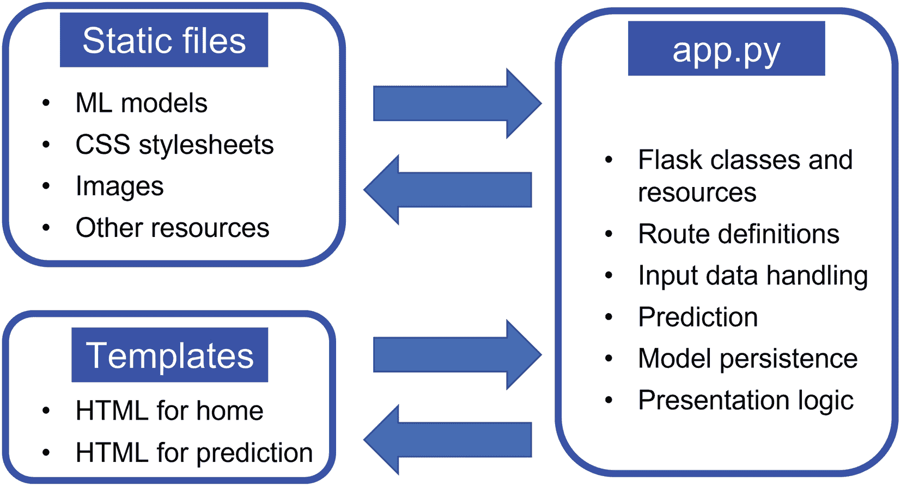

图 12-5：典型的 Flask 应用文件和资源布局

接下来是预测函数的详细内容：

```python
def predict():
    if request.method == 'POST':
        # 从表单中获取数据
        age = int(request.form["age"])
        education_num = int(request.form["education-num"])
        marital_status = request.form["maritalstatus"]
        race = request.form["Race"]
        # 将婚姻状况和种族转换为数字
        marital_status = marital_encoder(marital_status)
        race = race_encoder(race)
        # 将输入特征排列成数组
        X = np.array([age, education_num,
                      marital_status, race])
        X = scaler.transform(X.reshape(1,-1))
        # 进行预测
        prediction = model.predict(X)
        # 输出格式化
        output_fn = lambda x: '低于 50k 美元' if x==0 else '高于 50k 美元'
        output = output_fn(int(prediction))
        return render_template("ml1.html",
                               prediction_range='您的预测年收入为 {}'.format(output))
```

在这里，你通过 `POST` 方法接收来自 HTML 表单的数据负载，并对其进行解析以提取各个输入特征，例如 `age`、`education_num`、`marital_status` 和 `race` 等变量。其中一些变量需要借助辅助函数（此代码中未显示）转换/编码为数值特征，因为它们是以文本字符串的形式从 HTML 表单接收到的。实际上，`age` 和 `education_num` 也是以文本形式读取，并通过 `int` 类型转换函数转换为整数类型。

随后，你准备输入特征向量，使用缩放转换器，并将其传递给 `model` 对象进行预测。输出预测也通过一个 lambda 函数转换为字符串对象，这就是最终输出的内容。同样值得注意的是在 `return` 语句中使用了 `render_template` 函数。你本质上返回了一个格式化字符串，其中包含模型的输出，并将其放置在 id 为 `prediction_range` 的 HTML 元素/标签中。

这个 `prediction_range` 元素在 HTML 代码中被放置在提交按钮（标识为“预测收入范围”）下方的页面底部。它还带有一个 `<h2>`（二级标题）标签，以便在页面上突出显示。

```html
预测收入范围

{{ prediction_range }}
```

应用代码的最后一部分是通过 `app.run()` 方法启动 Web 应用：

```python
if __name__ == "__main__":
    app.run(debug=True)
```

你只需在命令行中运行 Python 应用即可启动它：

```bash
python app.py
```

这将启动一个 Web 服务器并暴露一个特定的端口。你可以直接在本地浏览器中访问 `localhost:5000`，查看这个 Web 应用（即由 HTML 文件渲染的首页）。

# 构建 Web 应用

当你首次加载这个 Web 应用时，该部分内容不会显示，因为它被编码为一个 `Jinja` 模板变量（使用 `{{ ... }}`）。`Jinja` 是 `Flask` 的一个辅助 Python 库，它通过一些预定义的变量和循环语句编码，负责处理 `Flask` 脚本的所有 HTML/CSS 渲染。在这里，`{{ ... }}` 本质上持有来自 `Flask` 应用脚本（通过 `predict` 函数的 `return` 语句）的一个 Python 变量。

以下是整个处理流程的回顾。用户点击 `预测收入范围` 按钮（如图 12-2 所示）后，输入将通过 HTML 表单（包含文本框和下拉菜单选项）提交，机器学习预测将在 `app.py` 层面进行，结果将通过这个 `Jinja` 占位符返回并渲染到页面底部（如图 12-6 所示）。请注意结果字符串的大字体，因为它关联了 HTML 的 `<h2>` 标签。


**图 12-6** 渲染 `Flask` 机器学习预测应用的最终结果

尽管这个示例使用了非常简单的数据流和一个小型机器学习模型，但它展示了构建一个强大 Web 应用所需的、基于 `Flask` 的 Python 项目的所有核心组件。例如，数据提交可以是手动用户输入，也可以从在线资源或后端数据库读取；机器学习算法可以是简单的逻辑回归，也可以是复杂的深度学习；在从输入层提取特征之前，可能有一个大型的数据整理和预处理管道；输出可以是简单的文本渲染，也可以是基于 JavaScript 的精美可视化。无论 Web 应用包含什么组件，它们之间的核心连接都将遵循 `Flask` 及其资源这一粘合剂。

## 使用 PyWebIO 的动手示例

`PyWebIO` 是另一个帮助快速构建 Web 应用的辅助库，无需了解任何 HTML/CSS/JavaScript。`PyWebIO` 提供了一系列多样化的命令式函数，用于在浏览器中获取用户输入和输出内容，本质上将浏览器变成了一个富文本终端。使用 `PyWebIO`，数据科学家只需编写 Python 脚本，并按需在脚本中插入基于 Web 的 GUI 元素，即可构建简单的 Web 应用。此外，它还原生支持文件处理和图像/图表生成，让数据科学家的生活更轻松。

本应用的完整代码随本书提供。此处，我只展示主要函数以突出几个特性（这些特性也与你在 `Flask` 示例中看到的不同）：

```python
def app():
    """
    主应用
    """
    put_markdown("""# 用于分析 CSV 文件的实用工具
## [Tirthajyoti Sarkar 博士](https://www.linkedin.com/in/tirthajyoti-sarkar-2127aa7/)
你可以上传数据文件 (CSV) 并，
- 显示数据列的直方图
- 将汇总统计信息下载为文件。
""")
    data = input_group("输入数据",[
        file_upload(label='上传你的 CSV 文件', accept='.csv',name='file'),
        radio('显示数据？',['是','否'], name='display_data',value='否'),
        radio('显示图表？',['是','否'], name='display_plot',value='否'),
    ])
    file = data['file']
    display_data = data['display_data']
    display_plot = data['display_plot']
    content = file['content'].decode('utf-8').splitlines()
    df = content_to_pandas(content)
    if display_data=='是':
        show_data(df)
    if display_plot=='是':
        show_plots(df)
    show_stats(df)
```

注意 `put_markdown()` 函数的用法，它有助于在 Web 应用上显示简单的 markdown 内容。这在很大程度上消除了像在 `Flask` 示例中那样，需要编写大量 HTML/CSS 内容作为模板或静态文件的需求。此外，`input_group` 对象以及像 `radio` 这样的其他元素会在 Web 应用页面上创建相应的单选按钮元素，同样消除了使用 HTML 编码它们的需要。基本上，**PyWebIO 不需要数据科学家做任何其他事情，只需处理一个单一的 Python 脚本**，但却能让他们创建一个美观的 Web 应用。

我将此脚本命名为 `csv-analysis.py`，因为它从用户那里接收一个 CSV 文件（通过文件上传功能），在内部创建一个 pandas DataFrame 表示，并显示数值变量的一些基本图表。上面显示的 `app` 函数会调用其他辅助函数，如 `show_data()` 和 `show_stats()`，这些函数接收 pandas DataFrame 并在网页上显示原始数据或描述性统计信息。

脚本的最后一段代码看起来与你之前在 `Flask` 示例中看到的非常相似：

```python
if __name__ == '__main__':
    start_server(app,port=9999,debug=True)
```

它基本上启动了一个 Web 服务器，并通过端口 9999 暴露它。当你在命令行上运行它时：

```
python csv-analysis.py
```

你会在命令行上看到以下输出：

```
在所有地址上运行。
使用 http://10.0.0.55:9999/ 访问该应用
```

因此，你在本地浏览器中访问此地址 (`http://10.0.0.55:9999/`)，会看到这个简洁的小型 Web 应用弹出（图 12-7）。注意你在 Python 脚本中编码的 markdown 内容是如何在网页上美观地渲染出来的，包括标题、超链接和项目符号。输入数据部分也很好地分组了，附带了文件上传框和用于选择数据显示或统计信息显示的单选按钮。


图 12-7

由 `PyWebIO` 仅用一个 Python 脚本创建的 CSV 分析 Web 应用

总的来说，这呈现了一个 HTML 表单（就像你之前在 `Flask` 示例中看到的那样），它接受用户输入，进行后台 Python 处理，然后将处理后的数据呈现给用户。用户需要做的就是上传文件并按下提交按钮。

文件上传功能暴露了本地文件系统，用于搜索和选择用户想要选择的任何文件。图 12-8 显示了用户按下文件上传框上的浏览按钮后应用的状态。


图 12-8

用户使用 `PyWebIO` 应用选择想要分析的文件

按下提交按钮后，后端处理发生，页面元素和状态被更新，以在底部框架中显示输出。图 12-9 显示了结果。请注意，为了便于理解，这里的原始数据表和图表部分都被截断了。


图 12-9

CSV 分析 Web 应用的典型输出

在页面底部，还显示了根据 CSV 文件数据计算出的描述性统计信息，并向用户提供了一个下载选项（图 12-10）。


图 12-10

CSV 分析应用的更多输出，包括下载选项

尽管你看到的是一项非常简单的数据分析任务，但这个示例展示了 `PyWebIO` 在此类工作流程中的基本特性和优势：用户上传数据文件、后台数据转换和可视化、显示结果，以及转换后数据的下载选项。你只需编写一个单一的 Python 脚本，并使用 `PyWebIO` 方法和工具抽象掉所有 HTML/CSS/JavaScript 前端细节，即可创建这样的应用。这提高了你的生产力，并帮助你在**短时间内以组织良好的可视化方式向外部利益相关者展示你的数据科学探索结果**。

## 其他选项和 GUI 构建工具

尽管我在本节中演示了 `PyWebIO` 库，但对于类似的任务——从 Python 脚本或 Jupyter notebook 过渡到功能完备的 Web 应用——还有不少选择。`Streamlit` 是最突出和广泛使用的选项之一。感兴趣的读者可以[参考这篇文章](https://towardsdatascience.com/data-analytics-to-web-app-streamlit-made-easy-ed687266f0e8)，这是我写的关于使用 `Streamlit` 的文章：[`https://towardsdatascience.com/data-analytics-to-web-app-streamlit-made-easy-ed687266f0e8`](https://towardsdatascience.com/data-analytics-to-web-app-streamlit-made-easy-ed687266f0e8)。

## 还有一个最近开发的工具叫做 `mljar-mercury`，它允许你通过最少量地添加一些 YAML 配置代码，将 Jupyter notebooks 转换成 Web 应用。使用这个库，你可以在 notebook 中通过 YAML 头部定义交互式小部件，最终用户可以更改小部件的值、执行 notebook 并保存结果（作为 HTML 文件）。你还可以隐藏代码，向非技术合作者抽象掉复杂性。该库使得将应用部署到任何服务器（如 AWS 或 Heroku）变得容易。更多信息，请参阅 GitHub 站点 (`https://github.com/mljar/mercury`) 或文档 (`https://mljar.com/mercury/`)。

在许多情况下，可能还需要构建一个独立的 GUI 应用（不一定在 Web 浏览器上运行），以便快速演示和传播一些数据科学工作或模型。有多种方法可以做到这一点。感兴趣的读者可以查看我写的这篇文章，关于一个名为 `PySimpleGUI` 的框架以及如何使用它构建简单的数据科学 GUI 应用：`https://towardsdatascience.com/building-data-science-gui-apps-with-pysimplegui-179db54a9a15`。

## 从本地走向云端

云技术无疑已开启了现代个人与企业计算领域最重大的变革。它充分利用了不断扩展的高速全球互联网骨干网基础设施，该网络每天都在持续触及人类社会更广泛的领域。凭借这一优势，它使各种可想象到的虚拟与实体商品及服务的交付过程变得大众化与商品化。

数据科学在这方面也不例外。尽管许多数据科学家倾向于在本地机器上工作和探索想法，但出于各种原因，他们可能需要将工作流程无缝迁移到云端资源上，或者至少具备在需要时能迅速执行此操作的能力。

一些典型的场景包括但不限于以下情况：

- 需要分析本地机器无法妥善存储的数 TB 级数据集。
- 需要大量内存分析，但本地系统内存严重不足。
- 需要利用 CPU/GPU 资源集群进行快速分布式计算。
- 需要使用高度专业化的库、框架和特制环境，这些环境通常只存在于预构建的容器或镜像中，在本地机器上搭建既困难又耗时。

在上述所有情况下，能否快速启动云端资源并将现有数据科学代码库连接到该基础设施，决定了数据科学管线的最终生产力与效率。

### 数据科学的多种云服务类型

不可否认，存在着种类繁多、令人眼花缭乱的云服务可用于提升日常数据科学工作的生产力与效率。其中一些属于基础设施即服务（IaaS）范畴，最终用户租用云端环境中的原始计算/存储能力，并将其本地代码库迁移至该层。前一节中的典型使用场景正适用于此类 IaaS 案例。一个具体例子是在 AWS 上租用一个 `EC2` 计算节点，将其连接到某个 `S3` 存储桶，然后在这个“租赁”来的基础设施上开展大规模数据科学工作——而这在有限的本地计算能力下是不可能实现的。

### 平台即服务

众多新兴初创公司（以及老牌企业的新设服务部门）也在开发可归类为平台即服务（PaaS）的服务。在此类服务中，一系列模块和子模块运行在 IaaS 层之上（该层通常不由终端用户选择或完全可见）。这些模块能够执行典型数据科学管线中所有必要且预期的任务，例如数据摄取、转换、机器学习、可视化、模型部署、长期数据与日志存储等。用户可以选择 PaaS 产品中的全部或部分模块/服务组合使用。

例如，AWS 拥有众多组件（如 Amazon QuickSight（商业分析服务）、Amazon RedShift（数据仓库）、AWS Data Pipeline、AWS Data Exchange、Amazon Kinesis（实时数据分析）、Amazon EMR（使用 MapReduce 进行大数据处理）），用户可根据其数据科学工作流程的需求来选用。谷歌云也提供了一系列类似服务（如 BigQuery（数据仓库）、`Dataflow`（流式分析）、`Dataproc`（运行 Apache Hadoop、Apache Spark 集群）、Looker（商业智能与分析）、Google Data Studio（可视化仪表板、数据报告）、`Dataprep`（分析数据准备））供终端用户挑选。在另一个极端，这些服务可能高度专业化，专注于单一类型的 AI/ML 任务。AWS 的 `Sagemaker` 和谷歌的 `Vertex AI` 便是这方面的例子。

### 数据即服务

随着基于云的数据服务的出现，数据即服务（DaaS）也成为一个流行概念。众多新兴及老牌云供应商提供 DaaS，他们利用云计算，通过分布式网络基础设施向客户提供数据存储、数据处理、多领域数据源集成以及高级数据分析服务。这些服务集成了适当的安全与身份管理层，专注于 AI/ML 和数据分析，且没有扩展限制。任何组织都可以利用此类服务，借助数据的力量快速改进业务流程并创造长期价值。该领域一些知名的服务提供商包括 Databricks 和 `H2O.ai`。

还有一些云服务专注于为终端用户提供专业的数据科学编码与编程环境。你在本书中已经见过的一个例子是 Saturn Cloud 服务，你在第 11 章中使用它启动了一个配备 GPU 的云实例，该实例已预装并配置了 RAPIDS 框架。你所需要做的只是点击几个按钮，几分钟内就能从本地浏览器连接到一个可以访问所有 RAPIDS 库的 Jupyter notebook。

Paperspace Gradient 是另一个成功的 ML 任务托管服务提供商。毫无疑问，这些服务通过降低进入需要特殊设置或专用硬件配置环境的门槛，提升了数据科学家的生产力。

### 将云端能力引入本地环境

关于云计算技术及其如何助力各类数据科学任务与项目，已有大量优秀资源可供学习。事实上，掌握此类技术的基础知识与实践经验，正逐渐成为进入数据科学专业领域的标准要求。这意味着，除了学习编程语言、算法、机器学习理论与实践、统计学概念之外，数据科学家还需要为求职面试或职业发展掌握云计算的相关技能与基础经验。

因此，一个相关的问题是：*如何将云计算的能力（主要是上一节提到的基础设施部分）引入本地环境？*

这基本上包含以下任务：

- 在 `AWS` 上启动一个 `EC2` 实例。
- 在该实例（本质上是云端的一台计算机）上搭建一个 Python 数据科学环境。
- 启动一个 `Jupyter` 服务器。
- 通过本地浏览器安全地连接到该服务器。

如果这些任务成功完成，**数据科学家将在本地浏览器上运行一个由云计算实例驱动的 `Jupyter` 笔记本**。本地文件和现有代码可以被迁移到一个不再受单系统硬件限制的环境中。

幸运的是，互联网上有很多关于此主题的优秀分步教程。我在此不再重复这些文章的步骤，而是提供链接供大家直接参考。许多教程都使用了低配置的 `EC2` 实例（例如 `t2-micro`），以将 `AWS` 服务的成本降至最低甚至为零。然而，**这个概念几乎可以扩展到任何类型的 `EC2` 实例，数据科学家可以根据数据科学工作流程的需求，启动所需的大型、强大的云计算资源**。如果是 CPU 密集型的数据科学任务，可以选择 32 核或 64 核的 CPU 实例；如果是内存密集型任务，则可以使用专门的高内存实例。

此外，以下链接还包含了使用 `Google Cloud Platform`（`GCP`）实现同样目标的指南。`GCP` 是 `AWS` 的竞争对手和同等服务。`GCP` 由谷歌庞大的分布式计算资源驱动，并在 `GCP` 计算节点上运行熟悉的 `Jupyter` 笔记本；这可能是将本地数据科学流程拓展到奇妙的云计算世界的第一步。此外，这两篇文章中整体流程的相似性将证明：**无论采用何种云服务，这种从本地到云端连接的基本原理是完全相同的**。

关于 `AWS` 的文章/指南：《`JupyterLab` on `AWS` `EC2`》（`https://medium.com/analytics-vidhya/jupyterlab-on-aws-ec2-d6b2cb945e54`）

关于 `GCP` 的文章/指南：《Setting up Jupyter Lab Instance on Google Cloud Platform》（`https://medium.com/analytics-vidhya/setting-up-jupyter-lab-instance-on-google-cloud-platform-3a7acaa732b7`）

### 用于高效数据科学的低代码库

低代码库正成为一些最有前景的入门途径，适用于来自不同背景的专业人士，如网页开发者、业务分析师，甚至是平行领域的学术研究者，他们希望进入数据科学世界，并将其全部力量用于自己的专业或日常工作。在本节中，我将讨论低代码库的本质，并展示一个流行的示例。

#### 什么是低代码库？

从核心来看，这些库建立在传统数据科学生态系统（例如使用`Python`、`R`或`Julia`等语言的编程框架）之上，其目标是**在最大程度上抽象化数据科学的编码部分，同时基本保持技术严谨性**。

自然地，这些库作为薄薄的封装层，作用于已有的面向编程的库和框架之上。它们提供易用且直观的`API`，甚至可能集成许多吸引人的可视化元素和仪表盘分析工具，使数据科学工作更易于上手和呈现。

在很多情况下，它们会集成一些**自动机器学习的附加功能**，帮助用户仅用几行代码（或点击一下按钮）就能运行一系列数据科学/机器学习实验和调优练习。当这样一个低代码库将其所有直接的编程`API`抽象成一个面向GUI的交互式前端时，它也可以被称为**无代码**数据科学库。

### PyCaret 示例

正如其官网 ([`https://pycaret.org/`](https://pycaret.org/)) 所述，“*PyCaret 是一个开源的、低代码的 Python 机器学习库，可以自动化机器学习工作流程*”（图 12-11）。虽然这句话非常强调机器学习，但它可以支持典型数据科学生产线中的各项常规任务，例如：


图 12-11

PyCaret，一个低代码、开源的数据科学/机器学习库

- 探索性数据分析

- 数据整理与预处理

- 模型训练与调参

- 基础模型可解释性与模型管理（MLOps）

下面通过一个 PyCaret 的简单分类示例来演示低代码数据科学的思想。首先，通过`pip`安装该库：

```
pip install pycaret
```

PyCaret 提供了友好的数据加载函数，可用于导入流行的机器学习数据集，其中一个是糖尿病数据集 ([`https://archive.ics.uci.edu/ml/datasets/diabetes`](https://archive.ics.uci.edu/ml/datasets/diabetes))：

```
from pycaret.datasets import get_data
data = get_data('diabetes')
```

接下来的步骤几乎是神奇的！只需一个函数调用（`setup`），数据就会被检查并设置好（即为机器学习实验做好准备）：

```
from pycaret.classification import *
s = setup(data, target = 'Class variable')
```

PyCaret 内部嵌入的（且在很大程度上对普通用户隐藏的）推断算法会根据某些属性自动推断所有特征的数据类型。如果推断并非 100% 正确，PyCaret 会在执行`setup`函数时通过显示用户提示并要求确认数据类型来处理。如果数据类型正确，可以按 Enter 键，或者输入`quit`退出设置。在 PyCaret 中确保正确的数据类型至关重要，因为它会自动执行多种针对特定类型的预处理任务，这些任务对于准确的机器学习建模是必不可少的。

下一步同样因其简洁性和强大功能而显得神奇。一次`compare_models()`函数调用即可使用交叉验证（CV）训练和评估模型库中所有可用机器学习估计器的性能。输出是一个包含平均交叉验证得分的评分网格。交叉验证指标可通过`get_metrics`函数访问，并可使用`add_metric`和`remove_metric`函数分别添加或删除自定义指标。

```
best = compare_models()
print(best)
```

图 12-12 显示了结果。


图 12-12

一次函数调用即可训练多个机器学习估计器并显示各类交叉验证指标。图片来源：[*https://pycaret.gitbook.io/docs/get-started/quickstart*](https://pycaret.gitbook.io/docs/get-started/quickstart)，经 PyCaret 创建者许可使用

接下来，你可以分析训练好的模型在测试集上的性能，同样只需一个函数调用。这实际上提供了多种图表类型供你选择，你可以任选其一。

```
evaluate_model(best)
```

一个典型结果如图 12-13 所示，其中用户选择了查看特征重要性图。

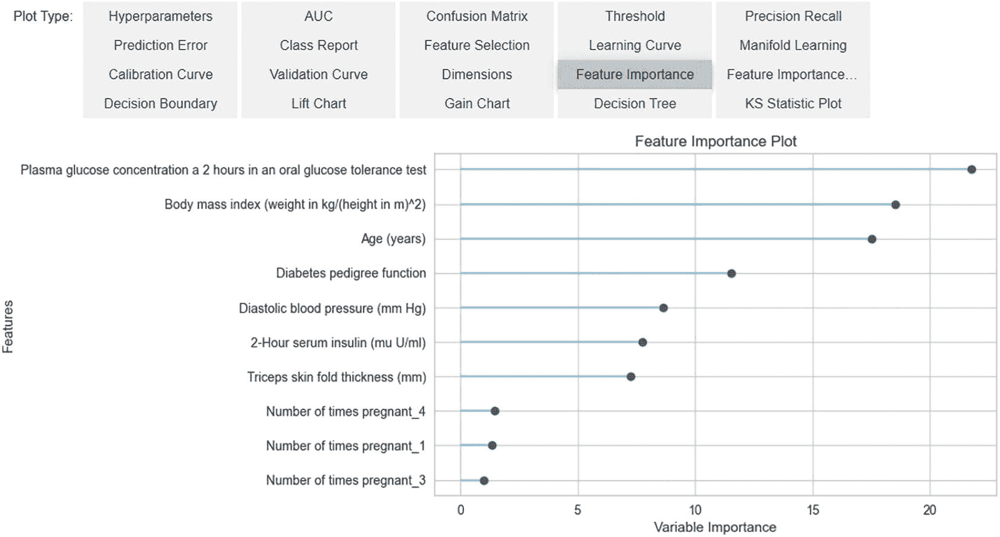

图 12-13

一次函数调用即可分析训练好的模型在测试集上的性能，并生成各种图表。图片来源：[*https://pycaret.gitbook.io/docs/get-started/quickstart*](https://pycaret.gitbook.io/docs/get-started/quickstart)，经 PyCaret 创建者许可使用

请注意，`evaluate_model`只能在 Jupyter notebook 会话中使用，因为它使用了`ipywidget`（用于交互式地向用户显示所有图表选项）。你也可以使用以下代码单独生成图表：

```
plot_model(best, plot = 'auc')
```

这会生成图 12-14 所示的曲线下面积图。

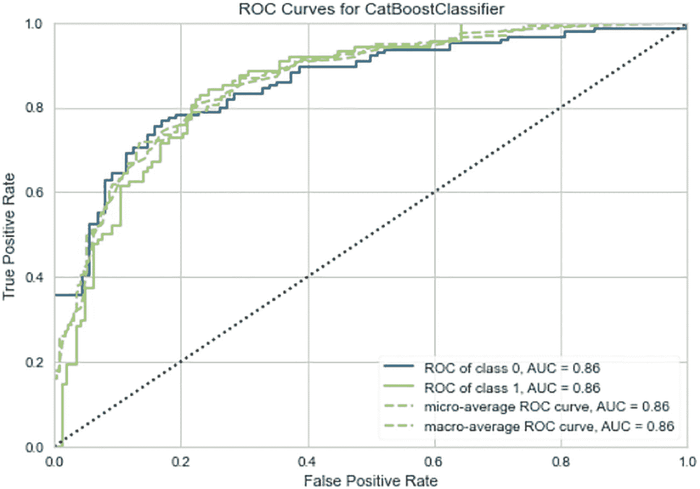

图 12-14

单独图表。图片来源：[*https://pycaret.gitbook.io/docs/get-started/quickstart*](https://pycaret.gitbook.io/docs/get-started/quickstart)，经 PyCaret 创建者许可使用

预测，正如所料，只有一行代码。评估指标在测试集上计算得出。

```
predict_model(best)
```

最后，保存模型（实际上是完整流程）并重新加载也很简单（图 12-15）。


图 12-15

保存的模型。图片来源：[*https://pycaret.gitbook.io/docs/get-started/quickstart*](https://pycaret.gitbook.io/docs/get-started/quickstart)，经 PyCaret 创建者许可使用

```
save_model(best, 'my_best_pipeline')
loaded_model = load_model('my_best_pipeline')
```

从这个动手演示中可以清楚地看出，这些库的主要目标之一是通过简化前端 API、减少所需的原始编码行数，甚至以自动驾驶模式帮助运行多个机器学习实验，从而为数据科学实践者节省时间。所有这些目标都与高效数据科学的目标非常契合，因此我坚信，低代码库将在未来成为这一倡议的重要组成部分。

## 总结

本章并非讨论特定主题或某种特定类型的 Python 框架。它是一个主题和技能的集合，数据科学家通常需要在使用高效数据科学议程的实践中并行学习和掌握这些内容。虽然这些技能并不作为明确的组成部分直接出现在数据科学流程中，但它们往往能提供额外的价值和奠定基础。学习它们确实可以放大标准数据科学任务流程的能力和效率。

本着这种学习精神，我首先讨论了学习基本 Web 技术（HTML、CSS 和 JavaScript）的重要性。接着，我谈到了为数据科学项目创建 Web 应用的实用性，并指出数据科学任务的最终成功关键取决于其产生的洞察的传达方式，而交互式 Web 应用是最好的传达方式。我演示了如何使用 Flask 和 PyWebIO 这两种不同风格的 Python 库构建简单的 Web 应用。

几乎无一例外，Web 应用都依赖于云基础设施，这是现代高科技社会的支柱。在数据科学的背景下，我还讨论了诸如亚马逊云服务和谷歌云平台等云技术，以及像 Databricks 和 Saturn Cloud 这样专注于数据的平台。我还提供了将云计算的强大能力引入本地数据科学环境的简单流程指引。

最后，我转换了话题，讨论了在许多情况下，使用“低代码”框架对于数据科学任务是多么有用和高效。我使用 PyCaret（此类工具中一个流行的 Python 库）演示了一个机器学习分类任务，并展示了以低代码为核心的抽象如何使整个数据科学工作变得高效、快速且直观简单。


# 13. 总结一下

在过去的 12 章里，你经历了一段漫长而艰辛的旅程。当你开始阅读本书的最后部分时，让我们总结一下这些章节的关键要点和突出内容。这很重要，因为本章我将重点讨论的主题之一是未曾涉及的内容。自然，通过审视和回顾已经涵盖的内容，你会更好地理解未曾涉及的部分。

## 第一章

如同生活中的任何其他计算（及非计算）任务一样，数据科学和机器学习可以以不同程度的效率和生产力来实践。因此，第一章的目标是向你介绍高效且富有成效地执行数据科学任务的好处。我还通过阐述普通数据科学家日常工作中可能存在的陷阱，来强调高效数据科学这一核心观点。

## 第二章

第二章的目标是向你介绍某些在开发高效数据科学系统和流程中至关重要的编程风格与习惯的概念。我通过简要示例阐述了这些概念，并讨论了如何衡量或追踪低效问题。文中介绍了编程和算法中时间与空间复杂度的概念，以及大 O 表示法。随后，我演示了常见低效数据科学和机器学习编码实践的实际示例，让你一窥那些典型低效（但普遍使用）的编码模式，这些模式无法良好扩展，或导致整体系统设计的某些方面效率低下。

## 第三章

在第三章中，我在某种意义上触及了本书的核心。这是一本基于探索使用 Python 编程语言实现高效数据科学的书籍。选择这门语言几乎是理所当然的。毫无疑问，Python 是全球数据科学家（以及机器学习工程师或人工智能研究员等相关专业人士）使用最广泛、增长最快的编程语言。其流行的一个主要原因，是存在大量专注于数据科学、质量高、功能强大且易于学习的库。

然而，仅仅因为这些库提供了简便的 API 和平缓的学习曲线，并不意味着每个人都能以高生产力和高效率的方式使用它们。你必须深入探索这些库，理解它们的力量与弱点，才能充分利用它们进行高效的数据科学工作。

这正是本章的目标：展示在典型的数据科学任务中，应如何以及为何使用这些库以达到高效。你从 `Numpy` 库开始，因为它也是 `Pandas` 和 `Scipy` 的基础。接着，你探索了 `Pandas` 库，随后浏览了 `Matplotlib` 和 `Seaborn` 可视化包。

## 第四章

本章建立在上一章讨论的数据科学家与 Python 语言之间的联系之上。数据科学家通常来自与传统计算机科学/软件工程相去甚远的背景，例如物理、生物、统计、经济和电气工程，他们的工作也大量使用 Python。虽然 Python 是现代数据驱动分析和人工智能应用中最广泛使用的主流语言，但它也用于简单的脚本编写、自动化任务以及构建 Web 框架后端。事实证明，用于数据科学工作的 Python 与用于脚本编写和通用软件开发的 Python，在风格和特性上可能差异巨大。

脚本（大部分）是你为自己编写的代码。软件是你（和其他队友）为他人编写的代码集合。人们普遍观察到，当（大多数）没有软件工程背景的数据科学家为 AI/ML 模型和统计分析编写 Python 程序时，他们倾向于主要为自己编写此类代码。编写高质量、生产级代码是一项需要终身学习和磨练的技能，是软件工程师和开发者的基本功。并非所有数据科学家都有动力和驱动力去获取这些技能。然而，一些好的实践可以在日常工作中学习和应用。本章在高效数据科学的背景下提供了一些指导。

## 第五章

函数、继承、方法、类：它们是健壮的面向对象编程的核心。但是，如果一个典型的数据科学家只想创建一个带有探索性数据分析和图表的 Jupyter notebook，他们可能不会深入探究这些概念。因此，他们可以避免一开始就使用 OOP 原则的痛苦，但这几乎总是会导致 notebook 代码变得不可重用和不可扩展。更准确地说，那段代码只为个人服务（直到那个个人忘记自己究竟编写了何种逻辑），而无法服务于他人。

然而，可读性（以及由此带来的可重用性）对于任何优秀的软件产品/服务都至关重要。在第四章讨论了模块化、可读、可重用的编码实践之后，本章聚焦于这些实践在深度学习领域的具体例子。如今，像 `TensorFlow` 或 `PyTorch` 这样强大而灵活的框架使得编写复杂神经网络架构的实际代码变得相对简单和简洁。但是，如果整个数据科学代码没有模块化和良好组织，它同样会面临不可复现和不可重用的问题。

具体来说，我讨论了如何封装基于深度学习的工作流程中最基本的任务，例如构建和编译分类或回归模型、创建有针对性的可视化分析、在自定义函数内创建合适的文档字符串，并将它们用作主要数据科学流程的核心构建块。此外，你可以以类似的方式封装与数据格式化/转换以及预测/推断相关的任务。除了简单的函数封装器，我还讨论了一个强大的构造——回调函数，它适应了训练深度神经网络的动态特性。我展示了如何将此方法一直扩展到完整的 OOP 范式，构建出类及实用工具模块，并将所有这些封装器作为特殊方法纳入其中。我将其称为深度学习实用工具模块，可以从任何数据科学任务中调用它。

## 第六章

在前两章中，我说明了数据科学家必须学会如何高效地编写机器学习代码（无论是最终模型还是只是一个实验原型）。代码中必须有恰当的组织和模块化，以便能与标准软件工程工具和技术良好衔接。代码中必须包含一定程度的自动化，以减少探索、评估和试验数据与模型的时间。数据科学家必须习惯于编写功能测试和模块测试，融入面向对象原则等。最后，数据科学家还必须培养为代码编写良好文档的习惯，以便其他开发者能够重用和理解代码。

本章将带你踏上一段旅程，开发属于你自己的一个轻量级但有用的机器学习包，以便你能体验为数据科学制作一整套软件产品的多个方面。根据我的经验，这个编写（并发布）机器学习包的过程会给任何有抱负的数据科学家带来宝贵的教训。

# 第 7 章

Python 拥有一个令人惊叹的数据科学生态系统，从数值分析一路延伸到高级深度学习或强化学习，同时还融入了统计建模和可视化。其出色的开源文化不断催生着新颖且激动人心的发展。数据科学家可以在这个环境中学习、贡献代码、分享经验、协助调试，并相互支持。

这个生态系统中有一些主流库和包，几乎被所有数据科学家在日常工作中使用：例如`Pandas`、`NumPy`和`Scikit-learn`。但也存在一些不那么知名的 Python 包，它们能帮助你更快、更高效地完成一些常见的数据科学任务。这些并非像`Numpy`或`Pandas`那样通用的大型项目。相反，它们专注于类似数据科学任务中的细分领域，并且做得非常出色。

在本章中，我介绍了几个这样精巧的包，并通过实战案例展示了高效数据科学的方法。目的是在你心中种下探索的想法，以便你能充分利用这个伟大的 Python 数据科学宝库。

# 第 8 章

数据科学任务伴随着多种多样的计算成本，既涉及空间也涉及时间。数据整理工作可能需要大存储容量的支持，而高级机器学习算法则需要高强度的计算速度。某些机器学习算法在拥有大容量本地内存（RAM）的支持下表现更佳，而数据若存放在远离 CPU 的硬盘上则表现不佳；另一些算法则针对分布式数据存储进行了优化。

此外，数据的性质可能会缓慢或频繁地变化，这取决于具体的应用。一些模型和数据科学代码能够优雅地随输入数据规模和复杂度的增加而扩展，而有些则不能。当扩展性没有被妥善规划或融入代码中时，性能就会受到影响，甚至可能在关键时刻导致灾难性故障。

为了规划此类情况或稳健地设计数据科学代码，你必须从衡量代码在内存使用或性能分析方面的基本效率入手。根据代码和底层硬件的不同，有许多工具和技术可用于此类测量。在本章中，我介绍了一些工具（附有实战案例），可用于测量数据科学和机器学习代码的内存使用情况。

# 第 9 章

数据科学任务可能涵盖从千字节到拍字节的各种数据集规模。有些数据集可能包含大量行和少量列，而另一些（例如基因组检测）则可能维度极高，由少量行但数百万列作为特征维度组成。即使在同一个组织或数据科学团队内部，也可能有多个管道处理不同类型的输入，它们面临的规模和复杂度差异巨大。

数据科学家通常会先构建一个数据科学任务（例如结合数据整理、机器学习算法和某些预测功能）的缩比原型。为了支持这种快速分析和原型设计，数据科学家必须能够根据需要，快速地在各种数据集规模和复杂度之间扩展。他们不应该在笔记本电脑上进行原型设计时就遇到内存不足等问题。

本章讨论了在扩展到更大数据集时出现的常见问题和限制，以及存在哪些工具可以解决这些问题。具体来说，你探索了在使用最常见的数据分析库 `Python` `Pandas` 分析大型数据集时出现的一些限制，并讨论了可用于克服这些限制的两种替代库或插件。

# 第 10 章
在几乎所有现实场景中，数据科学管道的成功（及其为组织整体业务带来的增值）可能取决于它能否`大规模地`顺利且完美地部署，例如它处理大型数据集、更快的流式数据、采样或维度的快速变化等的能力。这种可扩展性方面也与大型数据的并行处理能力密切相关。因此，第 9 章的主题在本章中得到了延续，我将讨论原生支持数据科学任务并行处理的 Python 库。
与上一章非常相似，我讨论了在使用最常见的数据分析和数值计算库（如`Pandas`或`Numpy`）处理大型复杂数据集时出现的限制，并介绍了一些有助于完成这些任务的替代库。然而，本章并非旨在全面讨论 Python 通用并行计算技巧和技术。它有意避开了标准 Python 并行计算教程或论文中经常出现的主题的详细讨论，例如使用内置模块如 `multiprocessing`、`threading` 或 `asynco`。与本书其他章节一样，本章的重点完全在于数据科学，因此我介绍了两个名为 `Dask` 和 `Ray` 的库，它们能为任何希望将并行计算能力引入其任务的数据科学管道带来真正的价值。

# 第 11 章

数据科学的生产力通常直接与各项任务（包括数值处理、数据整理和特征工程）的执行速度相关。当进入高级机器学习阶段时，根据模型的复杂程度，速度和性能问题就变得至关重要。现在公认的是，现代机器学习系统前所未有的成功，关键取决于它们能够使用针对任务优化的硬件，以并行方式处理海量原始数据。机器学习的历史已经清楚地表明，像 GPU 这样的专用硬件的使用在机器学习的早期成功中发挥了重要作用。

虽然在学术界和商业界，GPU 和分布式计算在核心 AI/机器学习任务中的应用已被广泛讨论，但它们在常规数据科学和数据工程任务中的实用性却鲜有提及。因此，一个重要的问题是：`我们能否也利用 GPU 的能力来完成常规的数据科学工作（例如数据整理、描述性统计）？` 答案并非显而易见，需要一些特殊的考虑和知识分享。在本章中，我重点介绍了一套名为 `RAPIDS` 的专业工具集，它可以帮助任何数据科学家利用基于 GPU 的硬件来完成广泛的数据科学任务（不一定是深度学习或高级机器学习）。你探索了如何通过利用 GPU 固有的并行处理能力，显著提高此类常见数据科学任务的生产力。

# 第 12 章

我将整整一章的内容，专门献给数据科学家应当努力掌握、以提升工作效率的一系列各不相同且实用的技能。不同于前几章中我审视并讨论了归类相似的技能（例如，内存分析器或分布式计算工具），本章讨论的工具和技能彼此之间可能显得有些零散。它们并不归属于某一统一类别，但总体而言，它们确实能真正帮助数据科学家提升工作效率。

我首先讨论了学习基本网络技术（如 `HTML`、`CSS` 和 `JavaScript`）的重要性。基于同样的概念，接着我探讨了为数据科学项目创建简单网络应用的实用性。你看到了一个使用两个 Python 库 `Flask` 和 `PyWebIO` 的动手实践示例。然后我转向了诸如 `AWS` 之类的云技术，并展示了（通过链接资源）将云计算的强大功能引入本地数据科学工作流的简单过程。最后，我转换了话题，讨论了在许多情况下，使用所谓的“低代码”框架如何能对数据科学任务有用且高效。我演示了 `PyCaret`，一个在这个领域广受欢迎的 Python 低代码库。

## 本书未讨论的内容

通常，在书的结尾，作者能够（并且应该）讨论的最重要的事情，不是书中涵盖的所有主题的运行列表，而是那些未被涵盖的部分。本着这种精神，在接下来的小节中，我会指出一些关键主题，希望向你（读者）指出，供你在本书之外进行自学和探索。这些主题应能帮助你用高效的数据科学技术武装自己。

### MLOps 与 DataOps

一个典型（或传统）的软件开发生命周期包括：需求获取、设计、开发、测试、部署，直至维护。多年来，这些实践严格地归属于所谓的 `DevOps` 领域。

随着商业和技术企业在产品和服务中融入越来越多的数据科学和机器学习，构建机器学习系统的新需求修改了这些久经考验的 `SDLC` 原则，催生了一个名为 `MLOps`（机器学习实践与传统 `DevOps` 的握手）的新工程学科。入门基础 `MLOps` 最流行且广泛使用的 Python 库之一是 `MLFlow`。

`MLOps` 主要处理机器学习模型和工件，一个相似且相关的概念是 `DataOps`，它将数据（以及与数据处理和流程相关的各种转换、技术和系统）作为主要工件。与 `MLOps` 一样，这个现代学科试图将由前所未有的数据规模和复杂性所产生的新需求，与传统的 `DevOps` 工具链相融合，并产生一个同质化的流水线，为任何希望利用数据科学力量的組織创造价值。

这些是新兴的学科，其标准和黄金实践不断变化。为了保持高效和生产力，数据科学家必须跟上这些发展。有专门针对这些领域的会议，并且一直有优秀的书籍和博客问世。我们强烈建议你开始探索这些途径，以牢固掌握这些概念。

### 容器技术

容器已成为任何现代软件技术栈中必不可少的一部分。从根本上说，它们能够将软件代码和服务与所有必要的组件（如库、框架和其他依赖项）打包在一起，使其在自己的私有空间中“被包含”和“被隔离”。这使得容器内的软件或应用程序能够跨越不同环境并在任何基础设施上一致地运行，而独立于该环境或基础设施的操作系统。

尽管这种进程隔离的核心思想已经存在多年，但在 2013 年，`Docker` 推出了 `Docker Engine`，它使用易于使用的工具为容器的使用设定了标准，并开创了一种通用的打包方法。这以惊人的速度加速了容器技术的采用，催生了像 `Kubernetes`（由谷歌开发并开源）这样的容器编排工具。如今，开发人员可以从大量支持 `Docker` 开创的**开放容器倡议**标准的容器化平台和工具中进行选择。

事实上，容器化的采用已将软件开发从单体式（所有服务和组件使用同一种语言或固定的一组技术）推动向了更加多样化的局面（每个单独的服务使用最适合该任务的编程语言编写，然后作为容器组通过如 `Kubernetes` 这样的容器编排工具运行）。自然，越来越多的现代数据科学和机器学习服务与平台也以容器化为其核心进行构建。为了利用这一大趋势并将其用于高效的数据科学，你应该熟悉诸如 `Docker` 和 `Kubernetes` 之类容器工具的基本原理、工作机制和特性。

# 数据库技术

数据库及相关技术的历史远比现代数据科学和机器学习要悠久，可以追溯到 20 世纪 60 年代初期。在很长一段时间里，它们都以关系型数据库管理系统（`RDBMS`）为核心。这些系统主要处理“结构化数据”，例如业务交易记录，或来自库存、质量控制、生产及其他类似性质业务流程的表格化数据。五十多年来，结构化查询语言（`SQL`，及其衍生出的众多变体）一直是高速度、高准确率地查询大型数据库的中流砥柱。

对于任何有志于成为数据科学家的人来说，掌握数据库和 SQL 的基础知识，并不断练习和提升这方面的技能，都是至关重要的。几乎每个 Web 应用、平台和企业软件都会以某种形式使用多个数据库。在现实场景中，数据科学流程所需的原始数据极有可能来自一个传统数据库（或多个此类数据库的组合）。因此，负责的数据科学家需要精通 SQL，才能执行查询，从数据库中提取原始数据。

SQL 是一种声明式语言（[`https://365datascience.com/tutorials/sql-tutorials/sql-declarative-language/`](https://365datascience.com/tutorials/sql-tutorials/sql-declarative-language/)），学习曲线未必陡峭。但对数据库设计和优化的扎实掌握，可以极大地帮助你执行优化的数据提取查询，从而提升整个数据科学流程的效率。事实上，`Python` 中有许多数据库绑定或连接器库，允许数据科学家与现有数据库建立紧密耦合，甚至在 `Python` 环境内就能提取数据。

然而，SQL 和 `RDBMS` 只是冰山一角。随着非结构化数据（如图像、视频、音频、自然语言、手写笔记以及来自数字传感器网络的流式输出）的重要性日益增长，尤其是在数据科学和机器学习领域，数据库技术迎来了一场新的革命，催生了`NoSQL`技术的发展。这些工具和语言通常是为处理非结构化或半结构化数据集而设计和优化的。

我们诚挚地建议你：更新你的数据库知识，投入时间夯实 SQL 基础，并紧跟最新数据库趋势和技术的发展。无论你来自什么背景，或从事何种业务/科学应用，这些知识都将帮助你变得极具生产力、高效率，并产生最大影响力。

## 给未来数据科学家的一般建议

不难想象，当几位数据科学家下班后聚在一起小酌时，常会冒出这样一个问题：**在工作或求职面试中，你如何才能从成百上千的其他数据科学从业者/候选人中脱颖而出？**

为什么思考这个问题很重要？

因为要获得一份数据科学家的工作，竞争异常激烈（[`www.kdnuggets.com/2020/10/getting-data-science-job-harder.html`](http://www.kdnuggets.com/2020/10/getting-data-science-job-harder.html)）。因为这是一场疯狂的争夺战。每一种工程师、科学家和职场专业人士都自称为数据科学家（[`www.linkedin.com/pulse/why-so-many-fake-data-scientist-bernard-marr/`](http://www.linkedin.com/pulse/why-so-many-fake-data-scientist-bernard-marr/)）。因为，作为一名有抱负的数据科学家，你可能不确定自己能否在这个领域崭露头角。所谓的冒名顶替症候群在数据科学领域普遍存在（[`https://towardsdatascience.com/how-to-manage-impostor-syndrome-in-data-science-ad814809f068`](https://towardsdatascience.com/how-to-manage-impostor-syndrome-in-data-science-ad814809f068)）。

我既不敢声称有现成的答案，也不知道你是否真能脱颖而出，但我会列出几点建议。

### 多提问，持续学习

问自己以下几个问题，并数一数你回答“是”的次数。你做得越多，就越能脱颖而出。

#### 如果你是初学者

*   你是否发布过自己的 `Python`/`R`（或你使用的任何编程语言）包？

*   如果是，你是否为其编写了详尽的文档，以便他人轻松使用？

*   你是否将你的分析从 `Jupyter` notebook 移植到了一个完全发布的 Web 应用中？或者，你是否研究过能帮助你轻松实现这一点的工具？

*   你是否至少撰写过几篇高质量、详细的文章来描述你自己的兴趣项目？

*   你是否尝试实践费曼学习法，即向你想象中的六年级学生解释你想学习的概念？

#### 在更进阶的阶段

如果你认为自己已是一名较为成熟的数据科学家，请回答以下问题：

*   你是否会有意识地抓住一切机会，将良好的软件工程实践（例如，面向对象编程、模块化、单元测试）融入到你的数据科学代码中？

*   你是否坚持不止步于当前所需的数据分析范围，而是会想象如果数据量扩大 100 倍，或者预测错误成本增加 10 倍，会发生什么？换句话说，你是否会有意识地思考数据或问题的规模化及其影响？

*   你是否坚持不止步于传统的机器学习指标，还会思考数据获取成本以及应用机器学习所产生的商业价值？

#### 学习多元化的技能

我尤其想建议你，不要把全部时间和精力都花在分析越来越大的数据集或试验最新的深度学习模型上。作为全面发展的数据科学家，我们应该留出至少四分之一的时间，学习做一些在任何组织、任何情况下都备受重视的事情。

*   为你日常的数据分析构建一个小巧但功能集中的实用工具。在这个练习中，你的创造力会自由流淌。你创造的东西可能不会立刻有成千上万的用户，但它会是新颖的，并且是你自己的创作。

*   阅读并撰写与你刚学会的新工具、新框架或刚构建的实用工具（见上一条）相关的高质量文档。这会迫使你学习如何以广大受众都能理解的方式，来传达你所创造之物的用途和机制。

如你所见，这些习惯很容易养成和实践。它们不需要繁重的工作、多年的统计学背景或高深的机器学习专业知识。但令人惊讶的是，并非人人都能拥抱这些习惯。所以，这就是你的机会——无论在新工作还是面试中，都能让你从一大批候选人中脱颖而出（图 13-1）。


图 13-1

构建数据科学工具（应用）和高质量文档能够让你脱颖而出。图片来源：“How Can You Distinguish Yourself from Hundreds of Other Data Science Candidates?” by Tirthajyoti Sarkar ([`https://towardsdatascience.com/how-to-distinguish-yourself-from-hundreds-of-data-science-candidates-62457dd8f385`](https://towardsdatascience.com/how-to-distinguish-yourself-from-hundreds-of-data-science-candidates-62457dd8f385))

### 抓住一切机会阅读广泛主题

有抱负的数据科学家常常会花过多的时间阅读关于最新深度学习技巧或最新 `Python` 库的博客文章。虽然这些是积极的方面，但为了高效多产，你还应分配一些时间阅读数据科学或人工智能领域中更广泛的主题。我鼓励你在行业顶级论坛和优秀书籍中阅读广泛多样的主题。图 13-2 展示了一些我个人喜欢的书籍和论坛。


图 13-2

一些关于数据科学、机器学习和人工智能广泛主题的高影响力博客、论坛和书籍

### 在求职面试中脱颖而出

为了在求职面试中脱颖而出这一目标，请设想自己正处于这样的情境。如果你对上述问题有很多肯定的回答，你可以向面试官提及类似以下内容：

* “嘿，看看我构建的酷炫 `Python` 包，它可以随意生成合成时间序列数据。”

* “我还编写了详细的文档，托管在 `MyApp.readthedocs.io` 网站上，它是用 `Sphinx` 和 `Jekyll` 构建的。”

* “我定期为最大的在线平台‘数据科学前沿’撰写数据科学文章。基于这些文章，我甚至收到了像 Packt 或 Springer 这样的知名出版社的出书邀约。”

* “每个人都可以在 `Jupyter` 笔记本中拟合 ML 模型。但我能快速为那个 `Scikit-learn` 函数构建一个基本的 Web 应用演示，让你通过 `REST API` 发送数据并获取预测结果。”

* “我可以帮助进行新机器学习项目的成本效益分析，并告诉你收益是否超过数据收集的工作量，以及如何以最优方式执行。”

想象一下，在面试委员会面前，你将与其他那些擅长统计学和梯度下降等常规问题、却无法提供全面能力证明的候选人有何不同。

这表明你对数据科学问题充满好奇。这表明你在阅读、分析和沟通。这表明你创造并撰写文档以便他人创造。这表明你的思考超越了笔记本和分类准确率，进入了业务增值和客户同理心的领域。这就是真正高效多产的秘诀。

哪家公司会不喜欢这样的候选人呢？

## 一些有用的资源

有大量出色的工具和资源可供你获取并实践这些技能。即使仅仅在单个章节中列出其中的一小部分也是不可能的，但下面我列出了一些代表性示例。关键思想是灌输探索这些方向并自行发现此类学习辅助工具的理念。

### 数据科学家精选的有用技巧与工具清单

Khuyen Tran 是 NVIDIA 的数据科学作家，也是 Ocelot Consulting 的数据科学实习生。她在“数据科学简化”网站（[`https://mathdatasimplified.com/`](https://mathdatasimplified.com/)）上撰写了超过 200 篇数据科学文章和数百条日常数据科学技巧。她当前的使命是让开源对数据科学社区更易获取。她整理了一份高效的 Python 技巧和工具清单，可作为本书的完美补充。请查阅开源书籍《数据科学家的高效 Python 技巧与工具》（图 13-2），网址为：[`https://khuyentran1401.github.io/Efficient_Python_tricks_and_tools_for_data_scientists/intro.html`](https://khuyentran1401.github.io/Efficient_Python_tricks_and_tools_for_data_scientists/intro.html)。

### 仅用 Jupyter 笔记本就能构建可安装的软件包

这个工具来自 FastAI 的开发人员，`FastAI` 是一个流行的深度学习框架和学习资源。他们尝试了一个想法：直接从 `Jupyter` 笔记本代码构建可安装的 Python 包，并最终开发出了这个工具。当然，`Jupyter` 笔记本是数据科学家最得心应手的环境，这种工具让他们能够直接从自己偏好的编码和实验环境发布软件包。以下是该项目的详细信息：[`http://www.fast.ai/2019/12/02/nbdev/`](http://www.fast.ai/2019/12/02/nbdev/)。

### 学习如何整合单元测试原则

测试软件模块能增强最终产品或服务的鲁棒性和信任度。在任何软件开发中，高质量测试的重要性怎么强调都不为过。同样的道理也适用于你的数据科学流程。即使你主要为了原型设计和研究而开发数据科学代码库，了解如何编写基本的测试模块来检查你开发的函数和类是否按预期工作，也是一个好主意。

这通常不单是检查输入数据类型，而是检查你的数据科学流程能否处理这些数据。也不只是向函数随机抛出离群变量，而是检查响应是否符合预期。

为了让你入门，这里提供几篇相关实用文章的参考资料。在这些短文中，我以一个典型的数据科学流程为例（该流程由多个小型、专用的函数组成，而非一个单体），并展示了如何为其编写 `Pytest` 模块。我还探讨了为什么为数据科学编写测试模块可能与软件工程师或质量保证人员日常工作略有不同。

“PyTest for Machine Learning” ([`https://towardsdatascience.com/pytest-for-machine-learning-a-simple-example-based-tutorial-a3df3c58cf8`](https://towardsdatascience.com/pytest-for-machine-learning-a-simple-example-based-tutorial-a3df3c58cf8))

“How to Write Test Code for a Data Science Pipeline” ([`https://heartbeat.comet.ml/how-to-write-test-code-for-data-science-pipeline-4ee35956c513`](https://heartbeat.comet.ml/how-to-write-test-code-for-data-science-pipeline-4ee35956c513))

### 直接从你的 Jupyter 笔记本编写整本编程与技术书籍

这是一个出色的开源项目，旨在帮助开发面向代码的快速阅读书籍和手册：“Books with Jupyter” ([`https://jupyterbook.org/intro.html`](https://jupyterbook.org/intro.html))。

### 开始了解 MLOps

如前所述，本书并未涵盖 MLOps，但为了在当今的商业环境中取得专业成功并高效工作，有抱负的数据科学家理应充分关注它。请查阅这份高质量入门指南：“What is MLOps – Everything You Must Know to Get Started” ([`https://towardsdatascience.com/what-is-mlops-everything-you-must-know-to-get-started-523f2d0b8bd8`](https://towardsdatascience.com/what-is-mlops-everything-you-must-know-to-get-started-523f2d0b8bd8))。

# 理解现实分析问题的多维复杂性

请阅读以下文章，了解真实分析问题的多维复杂性：《为什么一个业务分析问题需要你用到所有数据科学技能》（`https://medium.com/analytics-vidhya/why-a-business-analytics-problem-demands-all-of-your-expertise-at-once-1290170808c4`）。在这个案例研究中，我详细描述了一家希望开展断电催缴活动（针对未支付电费的用户）的电力公司可能采用的良好分析流程，如图 13-3 所示。具体来说，我分析了

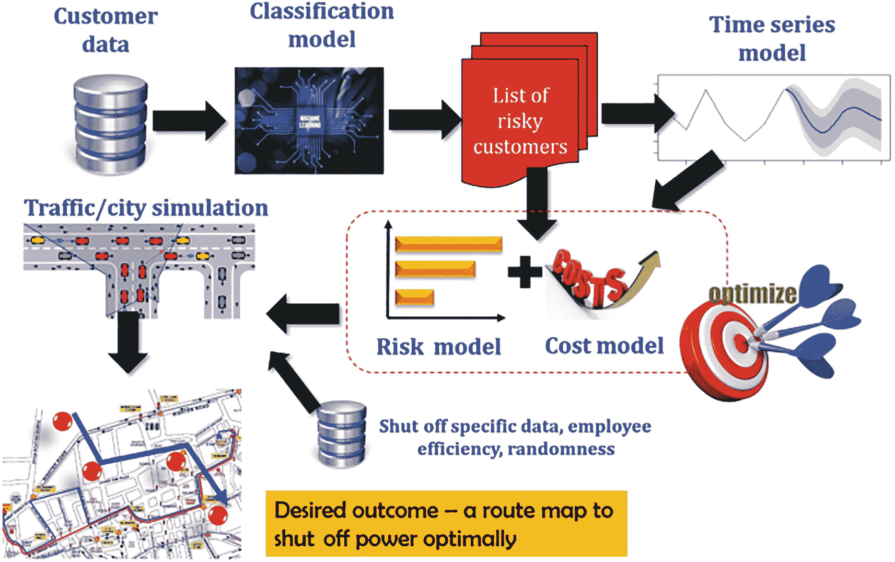
**图 13-4**
一个融合了各类数据科学工具（如`分类`、`模拟`、`时间序列`、`风险与成本建模`、`随机分析`、`优化`等）的真实业务分析问题示例。图片来源：Tirthajyoti Sarkar 所著《为什么一个业务分析问题需要你用到所有数据科学技能》（`https://medium.com/analytics-vidhya/why-a-business-analytics-problem-demands-all-of-your-expertise-at-once-1290170808c4`）

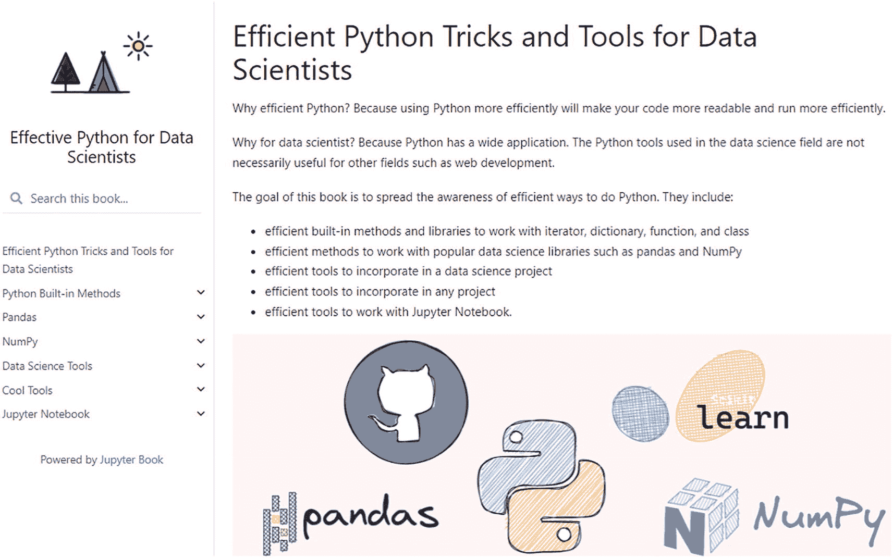
**图 13-3**
Khuyen Tran 关于数据科学高效`Python`技巧与工具的手册

*   需要收集哪些数据，以及如何通过数据整理技术进行清洗和准备
*   流程的主要组成部分有哪些
*   可以使用哪些子组件或特定的建模技术
*   如何构建优化问题
*   需要考虑哪些商业和社会因素
*   何时应用随机模拟，以及需要进行何种类型的模拟运行

阅读本文后，您将体会到，当数据驱动分析应用于真实业务问题时，它总是数据整理、机器学习、业务逻辑乃至伦理选择等多种技术与框架的复杂混合体。

## 开启新旅程

那么，本书的这段旅程就到此为止了。我的目标很简单：阐述高效数据科学的概念，并向您介绍一些有助于在数据科学工作中实现更高生产力（和效率）的工具与技术（全部使用`Python`语言及其丰富的生态系统）。基于这一目标，我在 13 章的篇幅中涵盖了广泛的主题。其中一些主题直接涉及数据科学代码和编程模式的效率，而另一些则涵盖了在实际数据科学流程中可能扮演关键角色的概念。书中讨论了诸如`模块化`、`代码打包`、`内存与时间分析`、`GPU 处理`、`并行计算`、`Web 技术`等多样化的主题。

我真诚地希望，这些混杂的内容对您有所助益并带来启发，无论您是认真跟随每个示例，还是仅仅浏览翻阅，都能通过完成这些章节的旅程，对高效数据科学实践有所领悟。正如一本涵盖如此多元主题的书籍所预期的，我已知晓对实践高效数据科学至关重要的内容，并未全部涵盖在这些章节中。只要有可能，我都鼓励您自行探索这些主题和概念。

这些探索必将为数据科学这一非凡事业（及变革性技术）的实践者带来全新的冒险、职业成功和纯粹的乐趣。怀着这份希望，我在此宣告这段更新、更远的旅程正式开启。

# 索引 A

## 激活图

基于 Web 的训练 UI，用于激活学习。

## AI/ML 模型

算法复杂度、深度学习网络图像数据、三次复杂度回归模型、相对增长比较。

## Apache Arrow

列式内存格式。

## 人工智能（AI）

有抱负的数据。

## `.at` 或 `.iloc` 方法

AutoML 工具。

# 索引 B

## 后端处理

基类、基础 Web 技术。

## 最佳匹配分布

数据集绘制简单拟合。

## 二分查找

布尔过滤器。

## 商业与技术企业

# 索引 C

## Cell 魔法命令

分类得分。

## 客户端-调度器-工作节点

云计算技术、云实例、云技术。

## Colab Pro

`ColDrop`方法。

## 计算

容器技术。

## 卷积神经网络（CNN）

`cProfile`库、数组操作、数据科学工作流、`Profiler`类的使用、`cProfile.run`函数。

## 交叉验证（CV）

CSV分析应用、CSV分析Web应用。

## CUDA编程

CUDA版本。

## CuDF

`DataFrame`，CuDF`对比`pandas。

## CuGraph

## CuML

管道（Pipeline），CuML版本。

## CuPy

算法、NumPy对比、接口使用。

# 索引 D

## Dask

数组、bag、集群、仪表盘、`DataFrame`、分布式客户端 hood、机器学习任务。

## Dask Future

`dask-ml` 库。

## 数据即服务（DaaS）

数据库技术、数据库知识。

## DataOps

架构。

## 数据/问题规模化

数据仓库、数据规模化挑战。

## 数据科学

暴力`for`循环、组合符号定义、通用函数、低效编程、典型示例、计算任务、`iterrows()` pandas `DataFrame` 陷阱、GUI 编程/Web 应用开发、硬件/传统工具、衡量效率、效率测量、机器学习模型开发、模块化且表达力强的数据科学管道、面向对象编程、高效数据 Python、单元/功能测试、绘图代码、Python 库、散点图、任务流程、测试模块、工具、工作流阶段。

## 数据科学方法

数据科学管道。

## 数据科学家

算术面向对象编程。

## 数据集

决策边界可视化。

## 深度学习（DL）

深度神经网络（DNN）。

## DevOps

`distfit` 库。

## Docker 引擎

# 索引 E

## 弹性计算（EC2）实例

`eval` 方法。

## 评估指标

执行时间、Jupyter/IPython 魔法命令、Python 的 `time` 模块。

## 扩展类功能

# 索引 F

## 过滤操作

`fit_generator` 方法、`fit_transform` 方法。

## Flask

`Flask` 应用文件、`Flask` 机器学习预测应用。

# 索引 G

## 千兆字节（GB）

全局解释器锁（GIL）。

## 拟合优度（GOF）

谷歌云平台（GCP）、Google Colaboratory。

## GPU 加速的数据科学

GPU 内存、GPU 驱动的硬件。

## 图形处理单元（GPU）

GUI/应用开发。

# 索引 H

## 硬件发展史

人工智能和机器学习解决方案、硬件开发。

## 隐藏的瑰宝

超参数交叉验证、数据/keras 模型网格搜索、`kerasClassifier`类、`scikit-learn`库。

# 索引 I

## 图像分类 CNN

数据生成器对象、数据集、封装扩展、`fit_generator` 方法、图像数据集、简化测试工具函数。

## 冒充者综合征

收入范围预测模型。

## 知情搜索

基础设施即服务（IaaS）。

# 索引 J
## JavaScript 库
工作面试。
## 启动包
`Jupyter` 魔法命令、`Jupyter` 笔记本。

# 索引 K

## Keract
`Keras` 回调类。

## k-means 算法
`K-means` 聚类。

## K-近邻算法（KNN）
`Kubernetes`。

# 索引 L

## 线性回归算法

线性查找。

## 命令行工具

低基数数据。

## 低代码库

# 索引 M

## 机器学习（ML）
算法、数据规模、深度学习实验、最终验证、关键建议、线性回归、模块化代码、标准数据科学任务流程、系统评估、系统评估与自动化。

## 数学运算符
`Matplotlib` 和 `Seaborn`。

## 内存分析
`mljar-mercury`。

## MLOps
模型压缩、模型规模化挑战。

## 现代数据科学
现代机器学习系统。

## Modin
特性、核外处理、单 CPU。

## 模块化代码
快速实验、业务/数据科学 `compile`/`train` 函数、最终代码、`keras` 回调工具函数、可视化函数、面向对象编程构建器、回调、深度学习任务封装器。

## 数万亿字节（TB）

# 索引 N

## 自然语言处理（NLP）

N 维数值数组。

## `ne.evaluate()` 函数

神经网络模型。

## NLTK 分词器方法

NoSQL 技术。

## 数值 Python

`Numexpr` 方法，`Numexpr` 包。

## NumPy

`.append` 方法、算术、数组、数组大小、数组对比原生 Python 计算、布尔过滤器、内置 `vectorize` 函数、链式调用方法、复数、复杂运算、先转换后运算定义、库、逻辑运算符、pandas 生产力、读取工具、移除孤立数据框、`vectorize` 逻辑运算。

## NumPy 操作

NumPy 包。

# 索引 O

## 面向对象编程（OOP）

模块化、分离绘图类、支持类。

## 核外数据集

# 索引 P

## Pandas

`DataFrame` 文档、`eval` 方法。

## Pandas 特定技巧

列特定函数、转换数据加载函数。

## Paperspace Gradient

并行计算数据科学、单核。

## 并行处理

`pd.eval()` 方法。

## `pdpipe`

数据集铺设管道、链式阶段、删除行、`NLTK`、`scikit-learn`。

## `pip` 命令

平台即服务（PaaS）。

## `plot` 命令

`predict` 方法。

## 高效数据科学工作

`PyArrow`、`PyCaret`。

## PyPi 安装器

包代码组织思维、GitHub、单元/功能测试、编写文档字符串。

## Python

Python 应用、基于 Python 的数据科学、Python 数据科学生态系统、Python 语言、Python 库、Python 包 GitHub 集成说明、Python 处理、Python 程序、Python 脚本。

## PyWebIO 库

# 索引 Q

## 分位数-分位数图

Quiver。

# 索引 R

## 种族下拉选项

`随机森林`。

## RAPIDS 生态系统

优势、CUDA、数据准备与整理任务、数据处理、极好的生态系统、内部支持、Jupyter 服务器、库和 API、并行性、`RAPIDS` 环境。

## Ray

数据科学数据集、分布式数据转换、生态系统、虚拟机。

## 现实生活分析问题

`残差`。

# 索引 S

## Saturn Cloud 平台

可扩展性问题。

## Scalene

CLI 特性、输出用法。

## Scikit-learn

超参数、开箱即用的可视化方法、并行任务运行器、合成数据生成器。

## Scikit-learn 任务流程

脚本编写。

## 单线程程序

奇异值分解（SVD）。

## 软件工程实践

静态快照。

## 支持向量机（SVM）

# 索引 T

## 任务调度

测试软件模块。

## 时间和空间复杂度

大 `O` 表示法、二分查找、线性时间搜索元素、最坏情况。

# 索引 U

## 无用的类

拟合方法、预测方法、测试方法、测试预测。

## 工具函数

工具方法、误差度量、绘制真实值 对比 预测值。

# 索引 V

## Vaex 库

动态可视化、表达式/虚拟列、特性、HDF5 格式、内存拷贝、多维网格、用法。

## `ValDrop` 方法

向量寄存器。

## 虚拟机（VM）

可视化函数。

# 索引 W, X, Y, Z

## Web 应用
Windows 操作系统。

## 包装函数
总结。