# 7. 一些很酷的实用工具包

Python 拥有一个令人惊叹的数据科学生态系统，从数值分析到高级深度学习或强化学习，还包含了统计建模和可视化。一个伟大的开源文化不断推动着新奇且激动人心的发展与繁荣。数据科学家可以在这个环境中学习、贡献代码、分享经验、帮助调试并互相支持。

在这个生态系统中，有一些主要的库和包几乎被所有数据科学家在日常工作中使用。我将在下一节中介绍它们。然而，还有一些鲜为人知的 Python 包（也就是所谓的 *隐藏的宝石*，如图 7-1 所示），它们可以帮助你更快、更高效地完成常见的数据科学工作。它们不像 `NumPy` 或 `pandas` 那样是通用的大型项目。相反，它们专注于类似数据科学任务中的某些特定方面，并将这些方面做得很好。

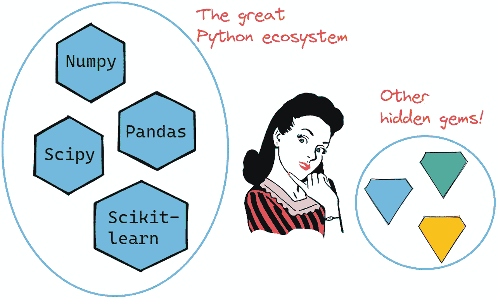
**图 7-1** 在伟大的 Python 数据科学生态系统之外，还有一些隐藏的宝石

要在数据科学领域保持高生产力，你必须紧跟这些新发展，并在合适的场景中拥抱这些专注的实用工具包。在本章中，我将介绍几个这样精巧的包，并通过一些实际示例展示高效数据科学的操作。目的是向你介绍探索的理念，以便你能够充分利用这个伟大的 Python 数据科学动物园。

## 使用 pdpipe 构建流水线

`pandas` 是 Python 生态系统中用于数据分析和机器学习的出色库。它在数据世界（Excel/CSV 文件和 SQL 表所在之处）和建模世界（`scikit-learn` 和 `TensorFlow` 施展魔法之处）之间架起了一座完美的桥梁。

一个数据科学流程通常由一系列步骤组成：在使用强大的机器学习算法之前，数据集必须经过清洗、缩放和验证。当然，这些任务可以通过 `pandas` 等包提供的许多单步函数/方法来完成。然而，一个优雅的替代方案是使用**流水线**。在几乎所有情况下，流水线都能通过自动化重复性任务来减少出错几率并节省时间。在数据科学世界中，具备流水线特性的包的代表有 R 语言中的 `dplyr` (`https://dplyr.tidyverse.org/`) 和 Python 生态系统中的 `scikit-learn` 模块组合与流水线 (`https://scikit-learn.org/stable/modules/compose.html`)。

`pandas` 也提供了一个 `pipe` 方法，可以与用户自定义函数一起用于类似目的。但是，在本节中，我将讨论一个名为 `pdpipe` 的出色小库，它专门针对 `pandas` 的 `DataFrame` 解决了流水线化的问题，并以一种优雅直观的方式解决了问题。

## 数据集

你将使用一个 [美国房价](https://www.kaggle.com/vedavyasv/usa-housing) 数据集（从 Kaggle 的 `www.kaggle.com/vedavyasv/usa-housing` 下载）。你可以在 `pandas` 中加载该数据集。其汇总统计信息如图 7-2 所示。

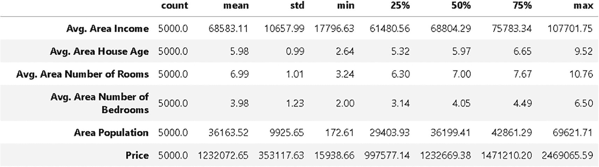
**图 7-2** 用于演示的数据集的汇总统计信息

然而，这只是一个局部视图。它还包含一个 `Address` 字段（图 7-3），其中包含原始文本数据。这不会出现在上面的汇总统计中，因为它不是数值列。

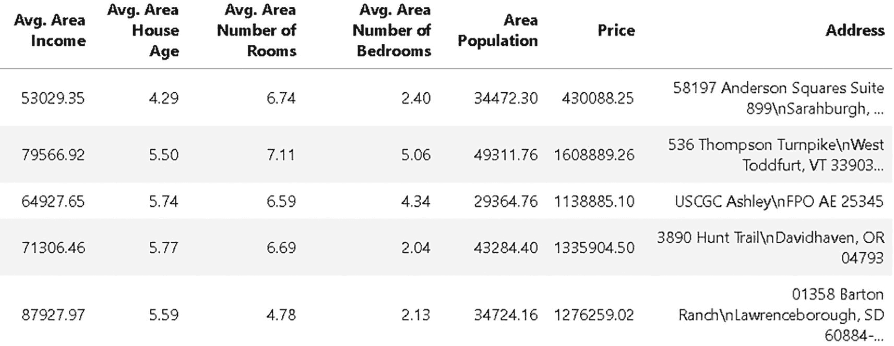
**图 7-3** 数据集包含一个带有原始文本的 `Address` 字段

让我们根据 `Avg. Area Number of Bedrooms` 列添加一个小转换。代码如下：

```
def size(n):
if n<=4:
return 'Small'
elif 4<n<=6:
return 'Medium'
else:
return 'Big'
df['House_size']=df['Avg. Area Number of Rooms'].apply(size)
```

你定义了一个名为 `size` 的函数，并将其应用于 `Avg. Area Number of Rooms` 列。得到的数据集如图 7-4 所示。

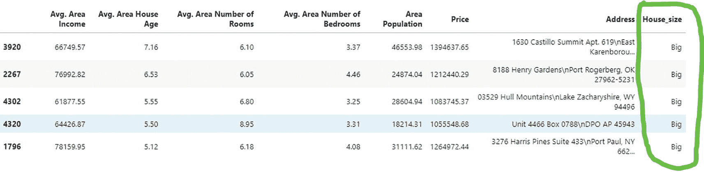
**图 7-4** 应用房屋大小转换后的数据集

### 开始铺设管道

从最简单的流水线开始，只包含一个操作。假设机器学习团队和领域专家认为，在建模时可以安全地忽略 `Avg. Area House Age` 数据。因此，你可以从数据集中删除这一列。为此，你可以使用 `pdpipe` 中的 `ColDrop` 方法创建一个名为 `drop_age` 的流水线对象，并将 `DataFrame` 传递给该流水线：

```
import pdpipe as pdp
drop_age = pdp.ColDrop(‘Avg. Area House Age’)
df2 = drop_age(df)
```

就这样。不出所料，得到的 `DataFrame` 如图 7-5 所示。

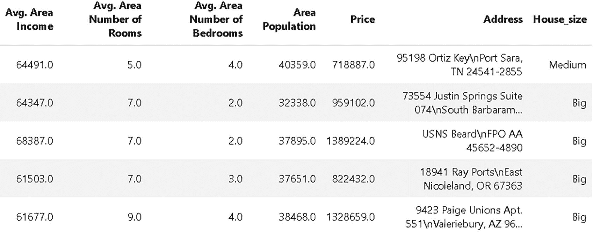
**图 7-5** 使用管道操作删除 `Age` 列后的数据集

#### 仅通过相加来连接流水线的多个阶段

现在，单个管道很有趣，但只有当流水线具有**多个（连接的）阶段**时，它才真正有用且实用。在 `pdpipe` 中，有多种方法可以实现这一点。然而，最简单直观的方法是使用 `+` 运算符。就像手动连接管道一样。只需将一个管道添加到另一个管道上。

假设除了删除 `Age` 列之外，你还希望对 `House_size` 列进行独热编码，以便在数据集上轻松运行分类或回归算法。你可以通过编写以下代码轻松实现：

```
pipeline = pdp.ColDrop('Avg. Area House Age')
pipeline += pdp.OneHotEncode(‘House_size’)
df3 = pipeline(df)
```

因此，你首先使用 `ColDrop` 方法创建了一个流水线对象来删除 `Avg. Area House Age` 列。之后，你只需使用常见的 Python `+=` 语法将 `OneHotEncode` 方法添加到此 `pipeline` 对象中。新的流水线现在处理 `DataFrame` 对象。得到的 `DataFrame` 如图 7-6 所示。请注意由独热编码过程创建的额外指示列 `House_size_Medium` 和 `House_size_Small`。

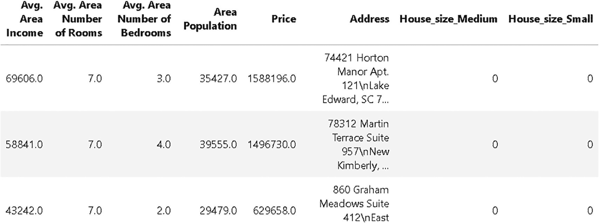
**图 7-6** 在流水线中添加独热编码后的数据集


### 基于行值删除行

接下来，你可能希望根据行中的数据值来移除某些行。具体来说，你可能需要删除所有房价低于 250,000 的数据。你可以使用 `ApplybyCol` 方法将任意用户自定义函数应用到 `DataFrame` 上。还可以使用 `ValDrop` 方法根据特定值来删除行。你可以轻松地将这些方法串联到你的管道中，以选择性删除行（你仍在向已有的管道对象中添加内容，该对象已负责处理列删除和独热编码等其他任务）。通过创建一个名为 `price_tag` 的小型用户自定义函数，并在管道中使用它来实现这一点：

```python
def price_tag(x):
    if x > 250000:
        return 'keep'
    else:
        return 'drop'

pipeline += pdp.ApplyByCols('Price', price_tag, 'Price_tag', drop=False)
pipeline += pdp.ValDrop(['drop'], 'Price_tag')
pipeline += pdp.ColDrop('Price_tag')
```

请注意，在上述代码中，对于第一个操作，`ApplyByCols` 方法的第二个参数代表用户自定义函数，而第三个参数 `Price_tag` 代表结果列的名称。图 7-7 显示了数据集。

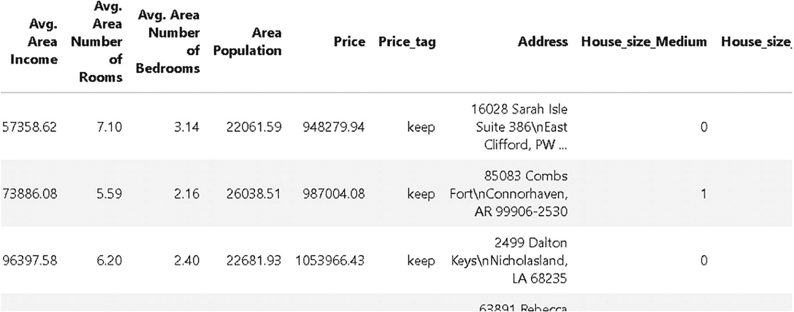

图 7-7：应用价格标签函数后的数据集

现在，`ValDrop` 方法介入，它在 `Price_tag` 列中查找字符串 "drop"，并删除那些匹配的行。最后，`ColDrop` 方法移除 `Price_tag` 列，从而清理 `DataFrame`。本质上，这个 `Price_tag` 列只是暂时需要，用于标记特定行，在完成其用途后应被移除。

其高效之处在于，所有这些只需在同一管道上简单地串联操作阶段即可完成。此时，你可以回顾一下，看看你的管道从一开始对 `DataFrame` 做了哪些处理：

- 删除指定列
- 对分类数据列进行独热编码以供建模
- 根据用户自定义函数标记数据
- 根据标记删除行
- 删除临时标记列

所有这些操作仅需六行代码：

```python
pipeline = pdp.ColDrop('Avg. Area House Age')
pipeline += pdp.OneHotEncode('House_size')
pipeline += pdp.ApplyByCols('Price', price_tag, 'Price_tag', drop=False)
pipeline += pdp.ValDrop(['drop'], 'Price_tag')
pipeline += pdp.ColDrop('Price_tag')
df5 = pipeline(df)  # 最终的 DataFrame
```

此外，该包的最新版本实现了另一种直接方法，可以用一行代码完成所有这些操作，如下所示：

```python
pdp.RowDrop({'Price': lambda x: x <= 250000})
```

### scikit-learn 与 NLTK 阶段

`pdpipe` 中还有许多更有用且直观的 `DataFrame` 操作方法，可以使数据科学任务高效且富有成效。此外，`pdpipe` 甚至包含了来自 `scikit-learn` 和 `NLTK` 包的一些操作，用于构建出色的管道。

#### 使用 scikit-learn 方法缩放数据

例如，构建机器学习模型最常见的任务之一是数据缩放。`scikit-learn` 提供了几种不同类型的缩放方法，例如最小-最大缩放或基于标准化的缩放（即先减去数据集均值，再除以标准差）。你可以直接将此类缩放操作串联到管道中。以下代码演示了其用法：

```python
exclude = ['House_size_Medium', 'House_size_Small']
pipeline_scale = pdp.Scale('StandardScaler', exclude_columns=exclude)
df6 = pipeline_scale(df5)
```

在这里，你应用了 `scikit-learn` 包中的 `StandardScaler` 估计器，以转换数据用于聚类或神经网络拟合。你可以选择排除不需要此类缩放的列，就像这里对指示列 `House_size_Medium` 和 `House_size_Small` 所做的那样。生成的 `DataFrame` 显示了缩放的效果（图 7-8）。

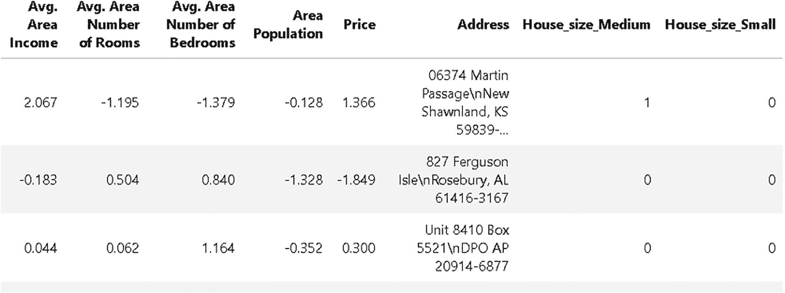

图 7-8：对选定列应用标准正态缩放后的数据集

#### 来自 NLTK 的分词器

`DataFrame` 中的 `Address` 字段目前毫无用处。但是，如果你能从这些字符串中提取出邮政编码或州名，它们可能对某些可视化或机器学习任务有用。

为此，你可以使用一个分词器。`NLTK` 是一个流行且强大的 Python 文本挖掘和自然语言处理（NLP）库，它提供了一系列分词器方法。在这里，你可以使用其中一个分词器来分割 `Address` 字段中的文本，并从中提取州名。你注意到，州名是地址字符串中的倒数第二个单词。因此，你可以为这个任务创建以下串联管道：

```python
def extract_state(token):
    return str(token[-2])

pipeline_tokenize = pdp.TokenizeWords('Address')
pipeline_state = pdp.ApplyByCols('Address', extract_state, result_columns='State')
pipeline_state_extract = pipeline_tokenize + pipeline_state
df7 = pipeline_state_extract(df6)
```

生成的 `DataFrame` 如图 7-9 所示。请注意新增的 `State` 列。

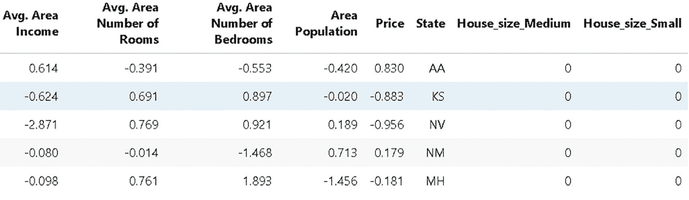

图 7-9：对 Address 列应用 NLTK 分词器方法后的数据集

### 汇总

图 7-10 总结了本演示中展示的所有操作。

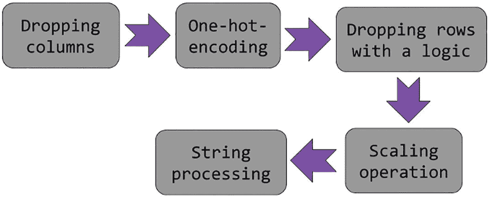

图 7-10：对 Address 列应用 NLTK 分词器方法后的数据集

所有这些操作都可以根据需要频繁地应用于类似类型的数据集。拥有一套简单的顺序代码块作为预处理操作，能够提高数据科学家的工作效率。管道是实现这一统一顺序代码块的关键。`pandas` 是数据科学团队中最广泛用于此类数据预处理任务的 Python 库，而 `pdpipe` 则提供了一种简单而强大的方式，利用 `pandas` 类型的操作来构建管道。

## 加速 NumPy 与 pandas

`NumPy` 和 `pandas` 可能是用于数据科学和机器学习任务的两个最广泛使用的核心 Python 库。显然，数值表达式求值的速度对于这些数据科学/机器学习任务至关重要，而这两个库在这方面不会令人失望。

在底层，它们尽可能使用快速且优化的向量化操作来加速数学运算。已有大量文章阐述 `NumPy` 与普通的 Python 循环或基于列表的操作相比，具有多大优势（尤其是在可以向量化计算时）。在本节中，我将展示如何使用一个名为 `NumExpr` 的简单扩展库来提升核心 `NumPy` 和 `pandas` 所执行的数学运算的速度。

### 这是什么库？

首先，使用 `pip` 命令安装它：

```bash
pip install numexpr
```

该项目托管在 GitHub 上，地址为 [`github.com/pydata/numexpr`](https://github.com/pydata/numexpr)。它来自 PyData（[`pydata.org/`](https://pydata.org/)）生态系统，该生态系统隶属于 NumFocus（[`numfocus.org/`](https://numfocus.org/)），`NumPy` 和 `pandas` 也源于此。

根据官方来源：

> “NumExpr 是 NumPy 的快速数值表达式求值器。使用它，操作数组的表达式会得到加速，并且比在 Python 中执行相同计算占用更少内存。此外，其多线程功能可以利用所有核心——与 NumPy 相比，通常会带来显著的性能提升。”

以下是该库的详细文档和各种用例示例：[`numexpr.readthedocs.io/projects/NumExpr3/en/latest/`](https://numexpr.readthedocs.io/projects/NumExpr3/en/latest/)。


### 加速运算

首先，我们从一个非常简单的数学运算开始：将一个标量数值（比如 1）与一个 NumPy 数组相加。要使用`Numexpr`包，你只需将相同的计算过程，以符号表达式的形式，包裹在一个名为`evaluate`的特殊方法中即可。以下代码清晰地展示了其用法：

```
import numpy as np
import numexpr as ne
a = np.arange(1e6)
b = np.arange(1e6)
%%timeit -n200 -r10
c = a+1
>> 3.55 ms ± 52.1 μs per loop (mean ± std. dev. of 10 runs, 200 loops each)
%%timeit -n200 -r10
c = ne.evaluate("a + 1")
>> 1.94 ms ± 86.5 μs per loop (mean ± std. dev. of 10 runs, 200 loops each)
```

效果惊人！你只需将熟悉的 NumPy 代码 `a+1` 改写为符号表达式的形式 `"a+1"`，并将其传递给 `ne.evaluate()` 函数即可。结果，速度得到了显著提升，平均执行时间从 3.55 毫秒降至 1.94 毫秒。

请注意，为了保证一致性，你在一个 10 次循环的测试中，将同一计算重复运行了 200 次以计算执行时间。当然，具体结果在一定程度上取决于底层硬件。欢迎你在自己的机器上进行评估，看看能获得多大的性能提升。

#### 涉及两个数组的算术运算

让我们稍微提高一点难度，引入两个数组。以下是使用两个数组计算一个简单线性表达式的代码：

```
%%timeit -n100 -r10
c = 2*a+3*b
>> 11.7 ms ± 177 μs per loop (mean ± std. dev. of 10 runs, 100 loops each)
%%timeit -n100 -r10
c = ne.evaluate("2*a+3*b")
>> 2.14 ms ± 130 μs per loop (mean ± std. dev. of 10 runs, 100 loops each)
```

对于双数组运算，性能提升甚至比简单的标量加法更为显著，平均耗时从 11.7 毫秒降低到了 2.14 毫秒。

#### 一个稍复杂的运算

现在，让我们进一步加大难度，通过在一个较为复杂的有理函数表达式中引入更多数组。假设你想计算图 7-11 所示的表达式，它涉及五个 NumPy 数组，每个数组包含一百万个随机数（取自正态分布）。

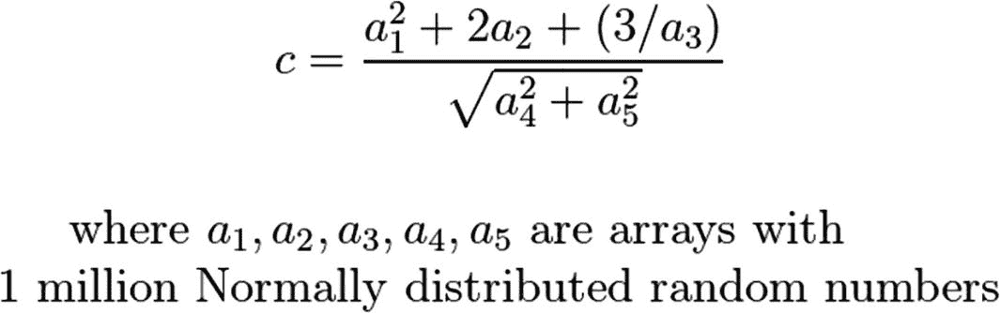

图 7-11：一个涉及多个 NumPy 数组的复杂有理函数

代码如下。你创建一个形状为 (1000000, 5) 的 NumPy 数组，然后从中提取出五个 (1000000,1) 的向量用于有理函数中。另外，请注意`Numexpr`方法中的符号表达式如何原生地理解字符串符号`sqrt`（你只需直接写`sqrt`）。

```
a = np.random.normal(size=(1000000,5))
a1,a2,a3,a4,a5 = a[:,0],a[:,1],a[:,2],a[:,3],a[:,4]
%%timeit -n100 -r10
c = (a1**2+2*a2+(3/a3))/(np.sqrt(a4**2+a5**2))
>> 47 ms ± 220 μs per loop (mean ± std. dev. of 10 runs, 100 loops each)
%%timeit -n100 -r10
ne.evaluate("(a1**2+2*a2+(3/a3))/(sqrt(a4**2+a5**2))")
>> 3.96 ms ± 218 μs per loop (mean ± std. dev. of 10 runs, 100 loops each)
```

这显示出了巨大的速度提升，平均耗时从 47 毫秒降至约 4 毫秒。事实上，这是一个趋势；你会发现，*表达式越复杂，涉及的数组数量越多*，使用`Numexpr`带来的速度提升就越大。

#### 逻辑表达式 / 布尔过滤

此外，你并不局限于上面展示的简单算术表达式。NumPy 数组最有用的功能之一，是直接在涉及逻辑运算符（如 `>` 或 `<` ）的表达式中使用它们，以创建布尔过滤器或掩码。你可以使用`Numexpr`实现同样的功能，并加速过滤过程。以下是一个检查涉及四个向量的欧几里得距离是否大于某个阈值的例子：

```
x1 = np.random.random(1000000)
x2 = np.random.random(1000000)
y1 = np.random.random(1000000)
y2 = np.random.random(1000000)
%%timeit -n100 -r10
c = np.sqrt((x1-x2)**2+(y1-y2)**2) > 0.5
>> 23.2 ms ± 143 μs per loop (mean ± std. dev. of 10 runs, 100 loops each)
%%timeit -n100 -r10
c = ne.evaluate("sqrt((x1-x2)**2+(y1-y2)**2) > 0.5")
>> 1.86 ms ± 112 μs per loop (mean ± std. dev. of 10 runs, 100 loops each)
```

这种过滤操作在数据科学/机器学习流程中司空见惯，你可以想象，通过策略性地用`Numexpr`表达式替换 NumPy 评估，可以节省多少计算时间。

#### 复数

从实数领域跨越到虚数领域相当容易。`Numexpr`在处理复数方面同样出色，复数由 Python 和 NumPy 原生支持。以下是一个例子，同时也展示了一个超越数运算——对数运算：

```
a = np.random.random(1000000)
b = np.random.random(1000000)
cplx = a + b*1j
%%timeit -n100 -r10
c = np.log10(cplx)
>> 55.9 ms ± 159 μs per loop (mean ± std. dev. of 10 runs, 100 loops each)
%%timeit -n100 -r10
c = ne.evaluate("log10(cplx)")
>> 9.9 ms ± 117 μs per loop (mean ± std. dev. of 10 runs, 100 loops each)
```

#### 数组大小的影响

接下来，让我们考察 NumPy 数组的大小对速度提升的影响。为此，我们选择一个涉及两个数组的简单条件表达式，如 `2*a+3*b < 3.5`，并针对一系列不同的大小绘制相对执行时间（取 10 次运行的平均值）。代码在随附的 Jupyter notebook 中，最终结果如图 7-12 所示。

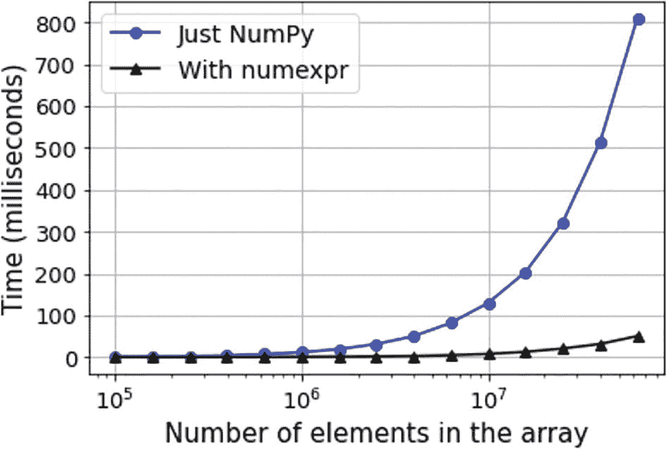

图 7-12：数组大小对速度提升的影响

### `pandas eval` 方法

事实证明，pandas 有一个`eval`方法，你可以选择使用`Numexpr`引擎来加速对 Python 符号表达式（作为字符串）的求值操作。图 7-13 展示了官方 pandas 文档中该方法的快照。

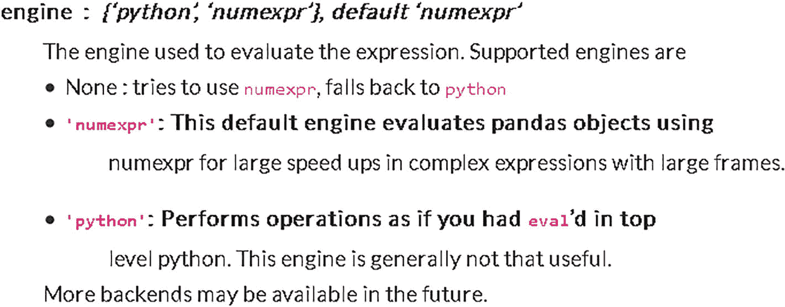

图 7-13：pandas `eval` 方法中使用 `numexpr` 引擎的部分快照

以下代码演示了一个例子，你构建了四个各有 50000 行、100 列的 DataFrame（填充均匀随机数），并计算涉及这些 DataFrame 的一个非线性变换。一种情况使用原生 pandas 表达式，另一种情况使用`pd.eval()`方法：

```
nrows, ncols = 50000, 100
df1,df2,df3,df4 = [pd.DataFrame(np.random.randn(nrows, ncols)) for _ in range(4)]
%%timeit -n20 -r10
c=2*df1 - (df2/2) + (df3/df4)
>> 55.8 ms ± 1.8 ms per loop (mean ± std. dev. of 10 runs, 20 loops each)
%%timeit -n20 -r10
pd.eval('2*df1 - (df2/2) + (df3/df4)')
>> 17.3 ms ± 539 μs per loop (mean ± std. dev. of 10 runs, 20 loops each)
```

注意，在第二种情况下，你如何为 DataFrame 使用带有符号表达式的字符串：`pd.eval('2*df1 - (df2/2) + (df3/df4)')`。

你进行了类似的分析，探究 DataFrame 的大小（行数，同时保持列数固定为 100）对速度提升的影响。结果如图 7-14 所示。

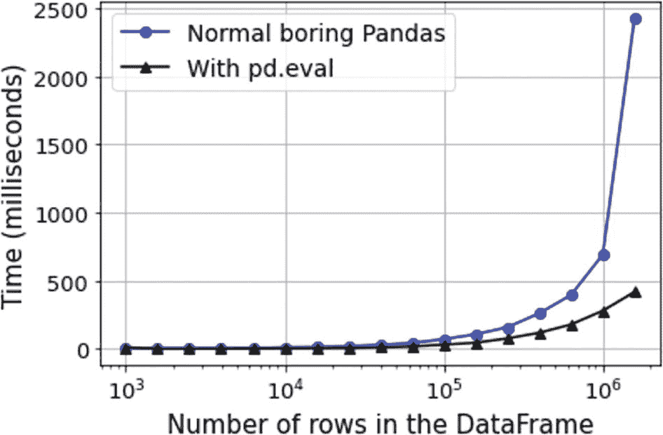

图 7-14：DataFrame 大小对速度提升的影响


### 工作原理与支持的运算符

`Numexpr` 工作机制的细节相当复杂，涉及对底层计算架构的最优利用。本书不对此进行深入介绍。其基本流程是：表达式通过 Python 的 `compile` 函数进行编译，提取变量，并构建一棵解析树。随后，这棵树被编译成字节码程序，该程序通过一种称为*向量寄存器*（每个寄存器宽度为 4096 个元素）来描述逐元素的操作流程。速度提升的关键在于`Numexpr`能够一次处理多个元素块。

它规避了 NumPy 使用临时数组的做法，后者既浪费内存，又无法将大数组缓存到内存中。此外，其虚拟机完全用 C 语言编写，这使得它比原生 Python 更快。它还支持多线程，从而能在合适的硬件上实现更快的并行操作。简化的示意图如图 7-15 所示。

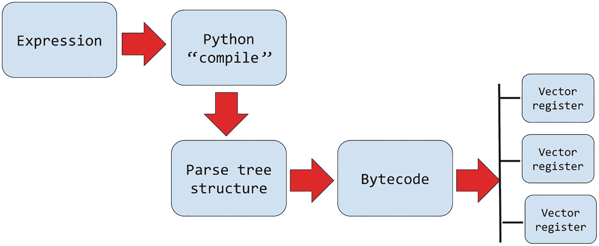

`Numexpr`支持在表达式中使用大量的数学运算符，但不支持类似`if`或`else`的条件运算符。完整的运算符列表可在[`https://numexpr.readthedocs.io/projects/NumExpr3/en/latest/user_guide.html#supported-operators`](https://numexpr.readthedocs.io/projects/NumExpr3/en/latest/user_guide.html%2523supported-operators)找到。

您还可以通过设置环境变量`NUMEXPR_MAX_THREAD`来控制用于大数组并行操作的线程数。目前，最大线程数为 64，但如果超过底层 CPU 节点可用的虚拟核心数，并不会带来实际收益。

因此，在本节中，您了解了如何利用这种特殊的基于虚拟机的表达式求值范式来加速 NumPy 和 pandas 中的数学计算。尽管这种方法可能不适用于所有任务，但数据科学、数据整理和统计建模流程中的很大一部分都能通过最少的代码改动而受益于此。

## 快速发现最佳拟合分布

假设您有一些数值数据点，并想找出它们可能来自哪种统计分布。这是一个经典的统计推断问题。

当然，有严谨的统计方法可以实现这一目标。但也许您是一位忙碌的数据科学家。或者是一位更忙碌的软件工程师，偶然获得这个数据集，需要快速编写一个应用端点，以便另一个机器学习应用可以使用基于与数据最匹配的分布生成的合成数据。

简而言之，您手头时间不多，想找到一种快速方法来发现数据可能来自的最佳匹配分布。在这种场景下，您希望自动对多个分布进行一批拟合优度（GOF）测试（[`https://en.wikipedia.org/wiki/Goodness_of_fit`](https://en.wikipedia.org/wiki/Goodness_of_fit)），并迅速总结结果。当然，您也可以从头开始编写代码，使用 Scipy 库逐个对多个分布进行标准的 GOF 测试。

或者，您可以使用一个虽小但有用的 Python 库——`distfit`来完成繁重的工作。

### 什么是 GOF 测试？

统计模型的拟合优度描述了该模型与一组观测值的拟合程度。简言之，拟合优度度量通常总结观测值与所讨论模型下预期值之间的差异。它们广泛用于各种统计问题和假设检验场景。

### 简单拟合示例

您将生成一些随机的合成数据，并仅用几行代码找到最佳匹配的分布：

```python
from distfit import distfit
import numpy as np
# 生成测试数据
data1 = np.random.normal(loc=5.0, scale=10, size=1000)
```

然后，您初始化一个模型并将数据拟合到其中：

```python
# 初始化模型
dist1 = distfit(bins=25, alpha=0.02, stats='ks')
# 拟合数据
dist1.fit_transform(data1, verbose=1)
```

注意它与 scikit-learn API 的相似之处；它有一个您刚刚使用的`fit_transform`方法。这里，`alpha`表示拟合的置信区间，`stats='ks'`表示评分策略，即 Kolmogorov-Smirnov 统计量（[`https://en.wikipedia.org/wiki/Kolmogorov%E2%80%93Smirnov_test`](https://en.wikipedia.org/wiki/Kolmogorov%25E2%2580%2593Smirnov_test)）。当您在 Jupyter notebook 中运行这段代码时，会得到如图 7-16 所示的（非常）详细的输出。

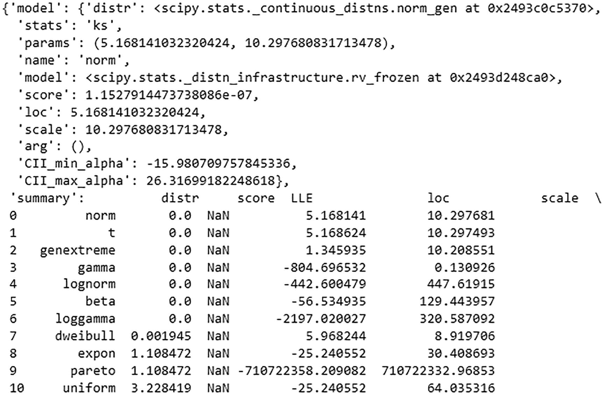

实际上，拟合过程会在`dist1`对象中创建并存储各种信息。也许您最感兴趣的是看到一些匹配的可视化结果以及与各种分布匹配性能的摘要。

### 绘图与摘要

一个简单的`plot`命令会显示最佳拟合的分布以及它与数据点的匹配情况：

```python
dist1.plot(verbose=1)
```

这会生成如图 7-17 所示的图表。

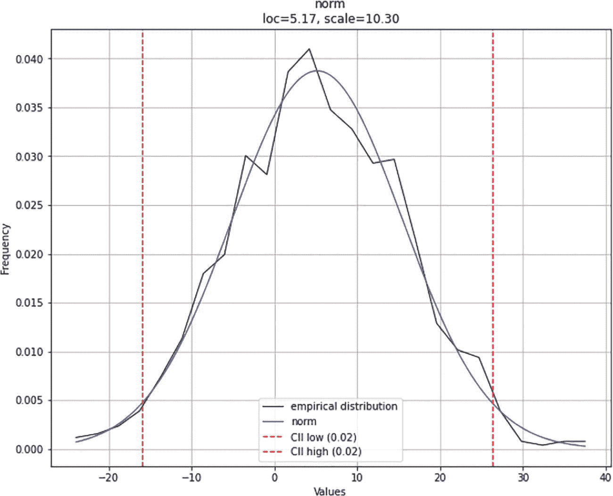

一行代码即可获得一个漂亮的摘要表格：

```python
dist1.summary
```

它显示了`fit_transform`方法在后台遍历的所有分布的相关信息。这里的分数是确定最佳匹配分布的指标。它类似于误差或距离度量，因此分数越低，匹配越好。在本例中，有不少分布的分数几乎为零。查看图 7-18 中的摘要表格后，您可以根据需要决定选择哪个分布。

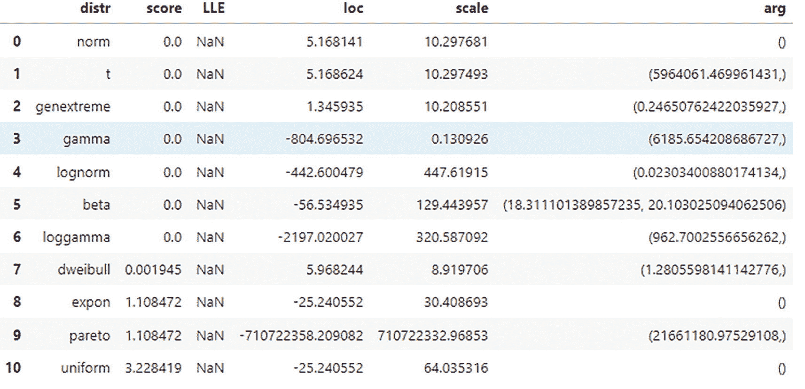

为什么这个摘要中只有 11 个分布？因为默认情况下，它使用一个最常见的分布列表进行扫描。如果您想搜索一个固定的分布列表，可以在初始化`distfit`对象时，将确切列表作为参数指定，其中分布名称使用通用字符串。


### 小心处理小数据集

与所有其他统计学习模型拟合过程一样，该方法在大数据集上效果最佳。对于小数据，拟合结果可能不明确（多个分布显示相似的匹配度）或次优（错误的分布被识别为最佳拟合）。

例如，让我们从 Beta 分布 ([`https://en.wikipedia.org/wiki/Beta_distribution`](https://en.wikipedia.org/wiki/Beta_distribution)) 生成一些数据，选择的参数使其看起来几乎像正态分布。如果你选择的参数 `α` 和 `β` 相等或接近，就可以实现这一点。然后，如果你拟合 1，000 个数据点，你可能会得到正态分布作为最佳拟合分布（图 7-19）。

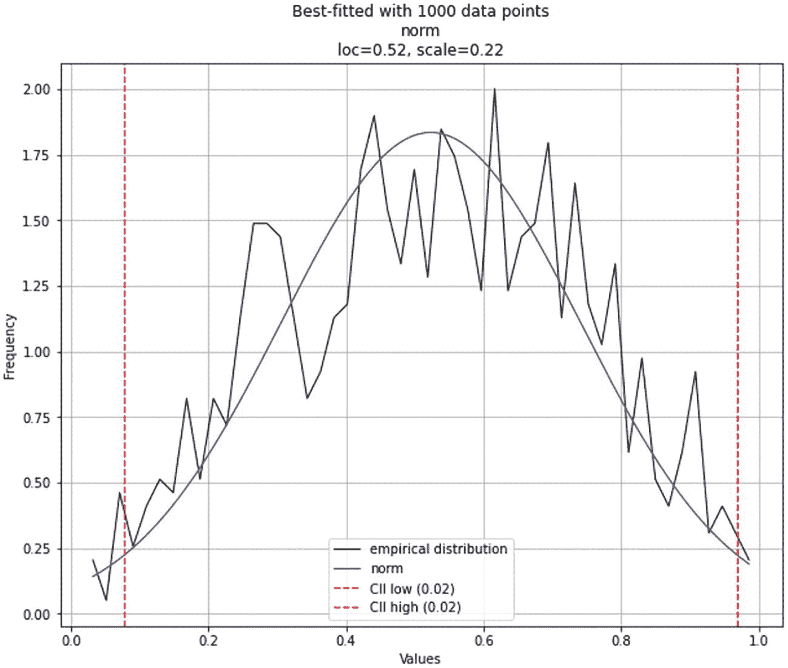

图 7-19  
由 Beta 分布生成并用 1，000 个点拟合的数据

```
import numpy as np
data2 = np.random.beta(a=2.2,b=2.0,size=500)
dist2 = distfit(bins=50,alpha=0.02,stats='ks')
dist2.fit_transform(data2,verbose=1)
dist2.plot(title="Best-fitted with 500 data points",verbose=1)
```

然而，如果你将数据集大小扩展到 10，000 个点，你很可能得到正确的答案（图 7-20）。

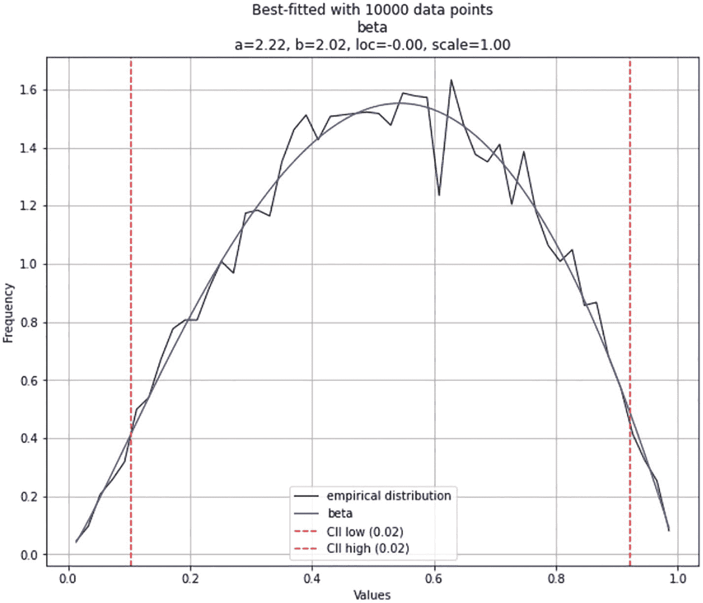

图 7-20  
由 Beta 分布生成并用 10，000 个点拟合的数据

### 其他可以做的事情

使用 `distfit` 库你可以做很多事情：

-   你可以选择使用哪种**统计检验**（RSS、Kolmogorov-Smirnov 等）来确定最佳拟合。
-   你可以控制你想要运行的确切分布列表。
-   你可以使用 `distfit.predict` 方法来**预测**响应变量的概率。
-   你可以使用 `distfit.generate` 方法生成**合成**数据。
-   我仅展示了连续分布拟合的示例。然而，你也可以轻松地对**离散**分布进行拟合。

## 总结

在本章中，你探索了轻量级的 Python 包，这些包可以加速常见的数据科学任务，例如流水线化数据 wrangling 和清洗、使用 NumPy 和 pandas 进行数值操作，以及为数值数据点找到最佳匹配的统计分布。

Python 生态系统中存在数百个这样的专用库，如果你去寻找它们，它们可以带来高效和高产的数据科学工作。GitHub 是开始搜索这些库的好地方。请注意一个 GitHub 项目获得的星标数量，以判断该包的质量，并确定它是否足够成熟/稳定，可以纳入你的数据科学工具栈。

也有优秀的文章和博客专门讨论新的、令人兴奋的 Python 包，作为老牌产品的替代品。Khyuen Tran 的开源书籍，第 5 章，紧凑地（尽管代码较多）讨论了许多此类有用的库。

