# 有哪些可选方案？

要解决内存问题（在加载和转换大型数据集时），根据你所处的具体情况，有多种可能的解决方案。有些与硬件选择有关，有些则与数据加载策略相关。让我们系统地探讨一下这些方案。

## 云实例

对于越来越大的数据集，总有一种简单粗暴的解决方案：租用一台配备大容量内存的云实例。例如，目前你可以租用一台配备 128GB 内存的 AWS（亚马逊云服务）弹性计算（EC2）实例，每小时费用不到 1 美元。图 9-3 显示了 `r6g.4xlarge` 实例（一种所谓的内存优化型 EC2 实例，[`www.amazonaws.cn/en/ec2/instance-types/#Memory_Optimized_Instances`](http://www.amazonaws.cn/en/ec2/instance-types/%2523Memory_Optimized_Instances)）的定价。

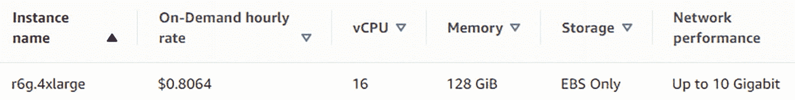

图 9-3

一个内存优化型 EC2 (AWS) 实例的定价

设置好之后，你可以安装所有常用的 Python 库，读取存储在本地（例如，映射到固态硬盘）或来自 AWS S3 文件夹的大型数据文件，并进行 `pandas` 数据转换，而无需担心内存错误。虽然这对普通用户来说可能仍然昂贵，但对于需要大量内存来定期处理 `pandas` DataFrames 的组织或团队来说，他们可能不会介意为流畅且无错误的数据科学任务流程支付每小时约 0.8 美元的费用。

然而，请记住，`pandas` 仍然仅限于一次使用一个 CPU 核心，并且默认情况下，它在加载和处理大型文件时会表现出速度慢的问题。仅仅在大内存的云实例上运行普通的 pandas 代码可能会阻止一些常见的内存错误情况，但它**无法从根本上使数据科学流程在规模化应用中变得高效或富有成效**。

### 什么是内存优化型 EC2 实例？

像 AWS 这样的云服务必须满足具有各种需求的广泛用户群体。有人可能需要使用 CPU 集群进行快速处理，有人可能需要高网络带宽，还有人可能需要大容量的板载内存（RAM）。内存优化型实例正是为此而设计的：它们以优化的成本提供大量 RAM。它们不一定拥有顶级的 CPU 或网络带宽，但对于在执行过程中需要大量物理内存的任务来说，它们的效果最佳。在这些实例中，根据成本和可用的 CPU 类型有多种选择。`r6g.4xlarge` 实际上是该系列的起点，最高可提供 768GB 内存选项，且每小时成本合理。

AWS 并非唯一提供此服务的云服务商。每一个主要玩家——例如 Google Cloud 或 Microsoft Azure——都提供类似的高内存实例作为基础设施即服务（IaaS），可以解决在（本地机器上）执行数据科学任务时内存不足的问题。

## Google Colab

Google Colaboratory（或广为人知的 Colab；[`https://research.google.com/colaboratory/faq.html`](https://research.google.com/colaboratory/faq.html)）本质上也是一种云服务。基本上，它运行一个托管在 Google 云服务器上的 Jupyter notebook 服务。你只需拥有一个 Google 帐户，就可以免费使用 CPU、GPU，甚至 TPU（如果你运气好的话）。

**与 AWS 或 GCP 相比，Colab 最大的优势在于其易用性和低准入门槛。** 如果你的数据科学 Python 代码在 Jupyter notebook 中，Colab 可以让你立即在该云实例上开始工作（只要你将 notebook 上传到实例）。与 AWS 或 GCP 的裸机实例不同，无需任何设置或安装。你可以直接通过浏览器访问 Colab notebooks，并在几分钟内开始运行代码。

### 什么是张量处理单元？

张量处理单元（TPU）是 Google 定制开发的专用集成电路（ASIC），用于加速机器学习工作负载。这些 ASIC 从底层设计之初，唯一目标就是优化深度学习中出现计算任务的速度和功耗，例如矩阵乘法和加法、特殊激活函数、其他线性代数例程（如矩阵求逆）等。它们的内部架构与为通用计算任务设计的传统 CPU 截然不同。TPU 的内存带宽和内存传输速度也得到了增强，因为这些因素对深度学习训练性能有决定性影响。

在某些特定情况下，这确实可以提高生产力和效率。例如，如果本地笔记本电脑没有足够好的 CPU 或 GPU 显卡，或者 RAM 低于 8GB，那么切换到 Google Colab 应该能立即提升生产力。

典型的（免费）实例拥有约 12-13 GB 的 RAM 和一个相当于 Intel Xeon 处理器的 CPU。获取一个 GPU 实例也相当容易，最常见的 GPU 是 Tesla K80（计算能力 3.7，拥有 2496 个 CUDA 核心和 12GB GDDR5 显存）。虽然 CPU 核心数并不值得夸耀，但拥有更大的 RAM 和 GPU 内存可能有助于数据科学探索，特别是当它涉及 GPU 密集型任务时，例如训练深度神经网络，甚至涉及 NumPy 数组的矢量化计算。如果觉得 12GB RAM 太少，你可以升级到 Colab Pro（[`https://colab.research.google.com/signup`](https://colab.research.google.com/signup)），它提供双倍内存，每月仅需 10 美元（这比租用等效的 24GB RAM EC2 实例便宜得多）。

然而，尽管功能吸引人，但**对于试图探索更大数据集并扩展其数据科学工作流程的实践型数据科学家来说，Colab 确实存在一些严重的局限性。** 首先，它对 notebook 的运行时间设置了时间限制，因此如果你让它闲置一段时间，实例将会终止（连同所有变量和内部状态）。基本上，你必须仔细规划代码执行，并时刻保持警惕，才能充分利用 Colab。

此外，文件加载（无论是从本地驱动器上传还是从网络读取）都非常缓慢（这很可能是为了控制 Google 云基础设施的带宽使用而有意为之）。因此，虽然你可以相当快速地进行内存分析和数据转换，但初始加载可能会耗费过多时间，甚至可能导致你的 notebook 崩溃。从完全免费的帐户升级到 Colab Pro 或 Pro+ 可以在一定程度上缓解这些问题，但无法完全解决。

## pandas 特有的技巧

既然我是通过指出 `pandas` 中的内存溢出问题来开始可扩展性讨论的，那么回到原点，审视一下 `pandas` 开发者针对此问题提出了哪些建议，就显得很有意义了。

在 `pandas` 文档门户网站上有一个专门的资源页面讨论这个主题：“扩展到大型数据集”（[`https://pandas.pydata.org/pandas-docs/stable/user_guide/scale.html`](https://pandas.pydata.org/pandas-docs/stable/user_guide/scale.html)）。该页面开头这样写道：

> *Pandas 提供了用于内存分析的数据结构，这使得使用 pandas 分析大于内存的数据集有些棘手。即使是占内存相当大一部分的数据集也变得难以处理，因为一些 pandas 操作需要创建中间副本。*

该页面接着指出了一些处理内存问题的有用技巧和技术。我在下面讨论其中的一些内容，并补充了几个技巧。


#### 只加载你需要的列

通常，特定的数据转换任务只需要完整数据集中的一小部分列。如果你有一个包含 1000 万行和 100 列的数据集，而你只需要前 5 列，那么只加载这 5 列，完全不碰其余列是完全合理的。这样可以避免将高达 9.5 亿个数据条目加载到内存中。这里的关键技巧是在数据加载函数中包含必要的参数。

请这样写：

```
df = pd.read_csv("Large-file.csv",
names = ['Col-1','Col-2','Col-3'])
```

而不是：

```
df = pd.read_csv("Large-file.csv")
```

这个小小的改动确实能决定你的数据转换管道的成败。

#### 针对特定列的函数（如适用）

遵循上述相同思路，根据需求编写处理数据集中特定列/特征的独立函数是一个好习惯（在适用情况下）（图 9-4）。例如，一个数据集可能包含以下内容：

-   **字符串数据**，对应姓名和地址。这可由一个特定的函数处理。
-   **日期时间数据**，对应某些业务交易。这应由另一个专门的函数处理，该函数只加载和处理这些列。
-   **纯数值数据**，可以通过多种方式处理，甚至可以作为纯`NumPy`数组读取，并利用向量化技巧（如本书其他部分所述）来加速数据转换过程。

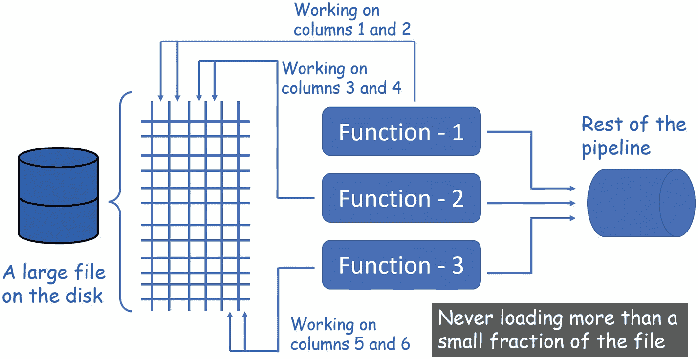

*图 9-4：用于处理大型磁盘文件特定列的函数，从不将超过一小部分数据加载到内存中。*

#### 显式指定/转换数据类型

pandas 中的默认数据类型并非设计为最高内存效率的。对于拥有相对较少唯一值的文本/字符串数据列（也称为*低基数数据*）尤其如此。通过使用更高效且更有针对性的数据类型，你可以显著减少内存使用并处理更大的数据集。

有一个名为 `loan_data.csv` 的数据集（随书提供）。让我们看看在處理这个数据集时，显式指定数据类型如何能减少内存使用：

```
import pandas as pd
df = pd.read_csv("../loan_data.csv")
df.memory_usage(deep=True)
```

函数 `memory_usage()` 显示了内存中对象的真实内存使用情况。输出如图 9-5 所示。`df.info()` 的输出也显示在同一个图中，表明默认加载将通用的 `object` 数据类型分配给了该列，而其他列则被分配了像 `int64` 或 `float` 这样的数据类型。

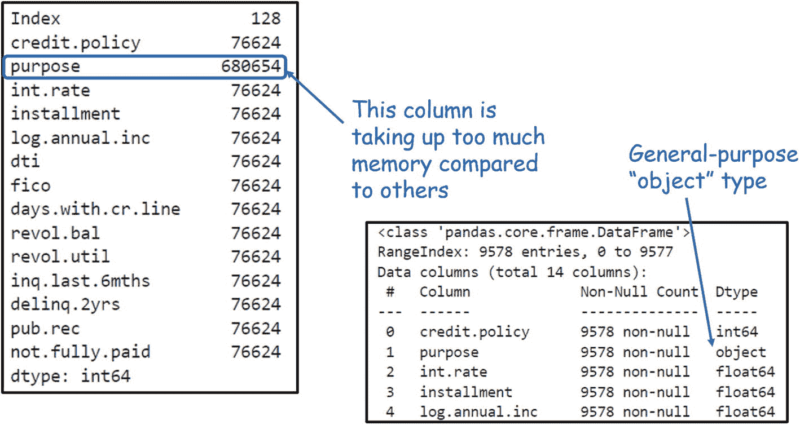

*图 9-5：默认数据加载为文本/字符串列分配了通用数据类型，导致其占用过多内存。*

你可能还注意到 `credit.policy` 是一个无符号整数，其值为 1 或 0。为什么要用 64 位整数数据类型来表示它呢？那么，让我们也对该列进行类型转换：

```
df['credit.policy'].unique()
>> array([1, 0], dtype=int64)
```

以下是执行数据类型转换（显式指定）的代码：

```
df2 = df.copy()
df2['purpose'] = df2['purpose'].astype('category')
df2['credit.policy'] = df2['credit.policy'].astype('uint8')
del(df)
```

在这里，首先你复制了现有的 `DataFrame`。然后，你使用 `astype` 函数将 `category` 数据类型分配给 `purpose` 列，并将 `uint8`（8 位无符号整数）分配给 `credit.policy` 列。最后，作为一个好习惯，你从内存中删除了旧的 `DataFrame` 对象，因为你的数据科学管道不再需要它。

你可以在图 9-6 中看到鲜明的对比。

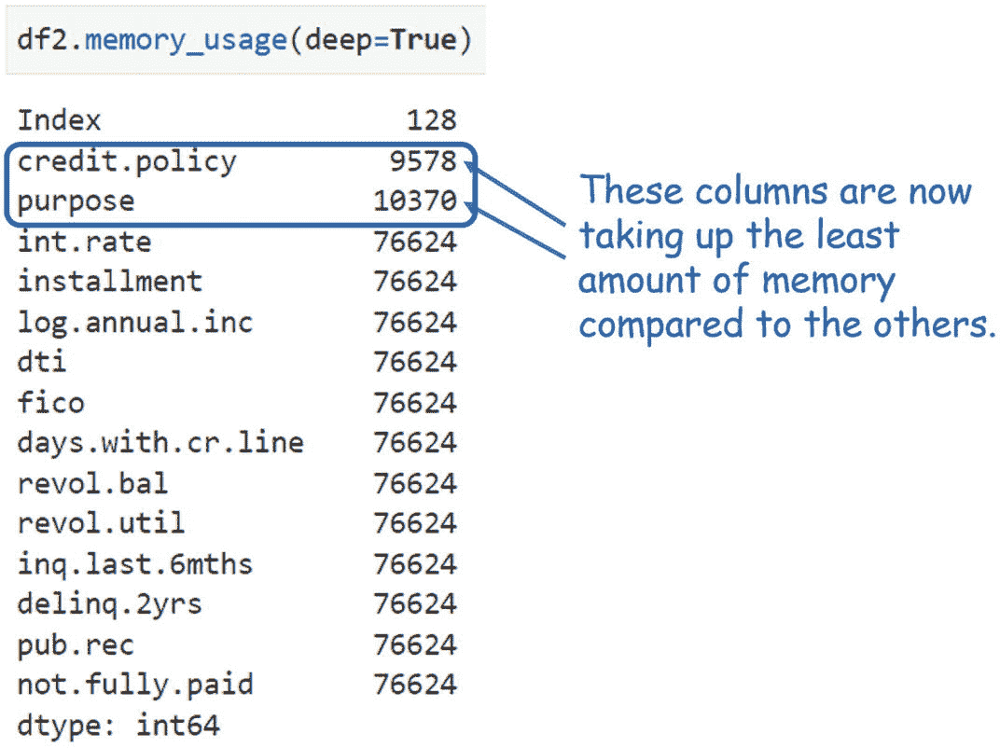

*图 9-6：显式数据类型指定/转换后的贷款数据集内存使用情况。*

对于这个例子来说，这种内存节省可能微不足道，但对于一个漫长且数据密集型的管道来说，像这样的小节省会迅速累积起来，并能显著减少总开销。

### 用于并行处理的库

并行计算本身就是一个广阔的领域。在 Python 中实现能完美且高性能地执行并行线程/进程的优化代码并非易事。幸运的是，有一些出色的 Python 框架可以用最小的学习成本进行并行处理。

我将在下一章通过动手示例讨论其中的两个，`Dask` 和 `Ray`，所以这里我不深入介绍这些细节。

### 用于处理超大数据集（无法全部装入内存）的库

有一些专门的库用于处理超大数据集。`Vaex` 和 `Modin` 就是这样的两个框架。接下来我们将通过动手示例更详细地讨论它们。

### 关于首选操作系统的说明

尽管许多数据科学家在日常工作中使用 Windows 操作系统，但已经观察到（总体而言，以及在本书的技术审阅过程中），像 `Vaex`、`Modin`、`Ray` 和 `Dask` 这样的高级库在 Windows 操作系统上可能难以设置或无法顺畅运行。因此，强烈建议你使用基于 Linux 的操作系统来练习使用这些库并运行提供的一些 Jupyter Notebook。你可以：

-   在本地机器上原生使用基于 Linux 的操作系统（例如 Ubuntu、Fedora 或 Red Hat）。
-   在你基于 Windows 的机器上使用 Oracle VirtualBox 等工具运行虚拟机，并在虚拟机上安装基于 Linux 的操作系统。
-   使用带有 Linux 操作系统的云实例（包括任何 EC2 实例自带的 Amazon Linux 版本）。

## Vaex 动手示例

`Vaex` 是一个 Python 库，专为处理**惰性超大数据集 DataFrame** 而设计。其主要目标之一是帮助可视化和探索大型表格数据集。`Vaex` 在处理大型数据集时性能优异。例如，它可以帮助计算均值、总和、计数、标准差等统计量，在包含多达十亿个对象/行的 *N* 维网格上，每秒可处理高达十亿行。

在本节中，你将看到使用 `Vaex` 库进行此类计算和可视化的动手示例。

### 功能一览

以下是 `Vaex` 关键特性的快速总结：

-   **性能**：能轻松处理巨型表格数据。其处理能力可达每秒数十亿行。
-   **惰性/虚拟列**：计算即时完成，不浪费宝贵的 RAM/虚拟内存。
-   **内存效率高**：在执行常规数据切片（如过滤、选择、子集）时，无需复制内存。
-   **可视化**：原生直接支持。拥有众多函数，可从大型表格数据集中实现常规可视化。
-   **用户友好的 API**：`DataFrame` 对象是主要 API，也是普通用户所需的一切。该 API 与 pandas 非常相似，因此在用 `Vaex` 替换 pandas 代码进行超大数据处理时，学习曲线极小。
-   **精简且模块化**：`Vaex` 被拆分为多个子包，你可以根据具体需求安装它们的任意组合。例如，`Vaex-astro` 支持与天文学相关的转换和 FITS 文件读取。`Vaex-viz` 支持所有可视化。但如果你只是想计算统计量而不可视化数据，则不必安装它。对于像 Apache Arrow 这样的现代文件类型，它有一个名为 `Vaex-arrow` 的包。


### 基本使用示例

从使用 Vaex 提供的示例数据集开始：

```python
import vaex
df = vaex.example()
```

首次运行这段代码时，它会从网络下载数据集，因此首次运行时需要网络连接。数据集（一个`.hdf5`文件）会存储在名为`data`的文件夹中。

你可以查看文件的相关信息：

```python
df.info()
```

你将看到类似图 9-7 的内容。

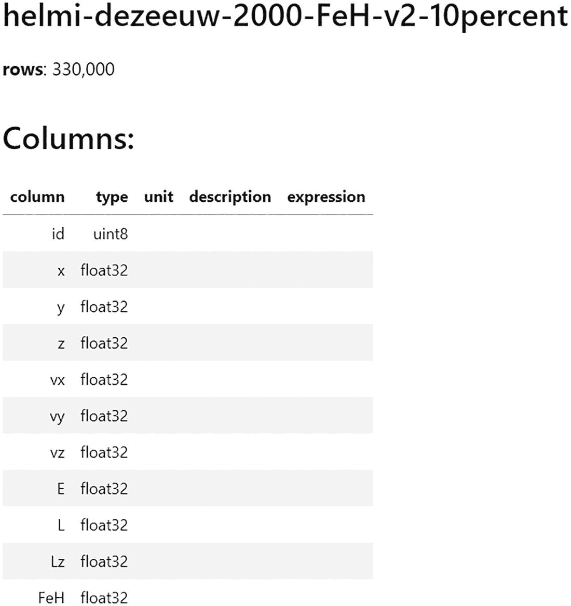

图 9-7: Vaex 示例数据集信息

数据的切片和索引操作与 pandas 类似。例如，你想查看第 3 行到第 7 行的`x`、`y`、`vx`和`vy`列：

```python
df[['x','y','vx','vy']][3:8]
```

它将给出预期的输出（图 9-8）。

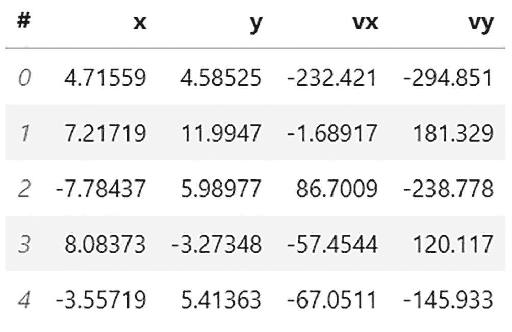

图 9-8: Vaex 数据集索引示例

统计计算非常快速。在我的笔记本上，计算 33 万行数据的平均值耗时不到 20 毫秒。

```python
%%timeit
df.x.mean()
>> 19.6 ms ± 2.1 ms per loop (mean ± std. dev. of 7 runs, 10 loops each)
```

## 无不必要的内存复制

Vaex 最出色的特性之一在于，在执行简单的过滤操作或中间计算时，它不会创建`DataFrame`对象的不必要副本。即使是基础的`DataFrame`也占用极小的内存。所有计算都采用惰性、即时（必要时）的方式完成。

使用以下代码检查内存占用：

```python
import sys
# Vaex 数据框
print("Size of Vaex DF:", sys.getsizeof(df))
# 转换为 Pandas 数据框
df_pandas = df.to_pandas_df()
print("Size of Pandas DF:", sys.getsizeof(df_pandas))
```

输出结果令人惊叹：

```
Size of Vaex DF: 48
Size of Pandas DF: 13530144
```

你可以在 Vaex 数据框对象上运行所有必要的计算，而无需过多担心内存错误突然出现。

例如，你可以过滤数据框，只保留那些`x`值为负且`z`值为正的行：

```python
df_filtered = df[df.x < 0][df.z > 0]
sys.getsizeof(df_filtered)
>> 48
```

正如预期，新的`df_filtered`数据框仍然保持较低的内存占用，但它只有 164464 行，而原始数据有 33 万行。

```python
df_filtered.shape
>> (164464, 11)
```

## 表达式与虚拟列

你可以创建自定义表达式，并将其赋值给虚拟列，同样无需内存复制。在使用纯 pandas 代码时，每次此类操作都有可能产生内存开销。假设你想计算示例数据集中两个列平方和的平方根：

```python
import numpy as np
sqroot_exp = np.sqrt(df['x']**2+df['y']**2)
```

现在，如果你检查这个`sqroot_exp`，你会发现它是一个特殊的表达式（尚未被求值）。它没有产生任何内存开销。

```python
type(sqroot_exp)
>> vaex.expression.Expression
```

如果在 pandas 中执行此操作，它会创建一个 pandas 序列对象：

```python
sqroot_pandas = np.sqrt(df_pandas['x']**2+df_pandas['y']**2)
type(sqroot_pandas)
>> pandas.core.series.Series
```

现在，这种 Vaex 表达式可以添加到 DataFrame 中，从而创建一个*虚拟列*。这些虚拟列类似于普通的 DataFrame 列，只是它们不浪费任何内存。

```python
# 将表达式赋值给虚拟列
df['sqroot'] = sqroot_exp
# 仅在需要时求值
df['sqroot'].mean()
>> array(8.38820497)
```

## 在多维网格上进行计算

Vaex 最有趣的功能之一，是能够快速、高效地在用户可选的网格上计算统计数据。当你想从大量数字中寻找局部最小值或最大值，或数字量在特定区域内的分布时，这有许多实际应用。

```python
counts_x = df.count(binby=df.x, limits=[-5, 5], shape=32)
counts_x
>> array([4216, 4434, 4730, 4975, 5332, 5800, 6162, 6540, 6805, 7261, 7478,7642, 7839, 8336, 8736, 8279, 8269, 8824, 8217, 7978, 7541, 7383,7116, 6836, 6447, 6220, 5864, 5408, 4881, 4681, 4337, 4015], dtype=int64)
```

结果只是一个 NumPy 数组，包含分布在 x = -5 到 x = 5 之间的 32 个分箱中的数量计数。这里需要注意的关键点是函数内部的`binby`参数，其作用类似于 SQL 或 pandas 中的`GroupBy`。此处数据是按 x 列分组的（`binby=df.x`）。

因此，通过这一行代码，你：

- 将数据过滤/限制在 -5 到 5 之间
- 统计了数据点的数量
- 将计数分成了 32 个分箱

图 9-9 展示了可视化效果。

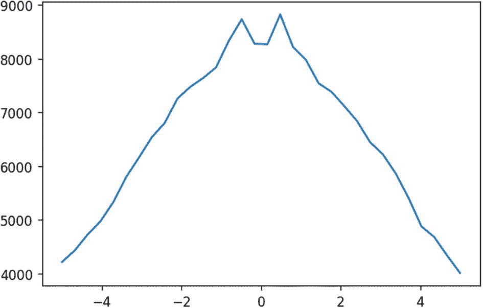

图 9-9: 特定范围和分箱计数下 x 列数据的计数

想要一个更强大的例子吗？你可以计算速度分量`vx`、`vy`和`vz`平方和的平方根，以获得合速度。不过，你可能只想针对特定的`x`和`y`数据范围执行此操作，并将结果分箱以便于可视化。

```python
# 只是一个表达式
velo = np.sqrt(df.vx**2 + df.vy**2 + df.vz**2)
# 将表达式传递给函数
# 按 x 和 y 分箱，范围限制在 -10 到 10
xy_mean_v = df.mean(velo, binby=[df.x, df.y],
limits=[[-10, 10], [-10, 10]],
shape=(64, 64))
```

你可以绘制合速度在同一 xy 范围内的二维图：

```python
plt.figure(dpi=120,figsize=(3,3))
plt.imshow(xy_mean_v.T,
origin='lower',
extent=[-10, 10, -10, 10])
plt.show()
```

图 9-10 显示了结果。

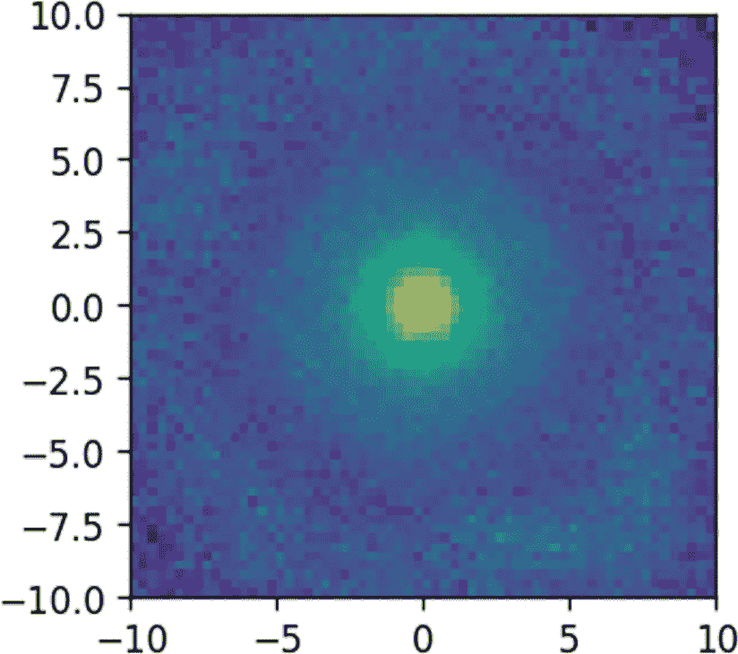

图 9-10: 在 x 和 y 数据的特定范围内计算并可视化的合速度

## 使用控件和其他绘图库的动态可视化

基于 N 维网格的计算在设计上利用了 Vaex 的快速性。这使得你可以使用控件和 bqplot 等第三方库将可视化扩展到动态形式。遗憾的是，这些动态可视化无法在书籍页面中呈现。不过，Jupyter notebook 中展示了一些代码和结果。

例如，这段简单的代码在 Jupyter notebook 中创建了一个绘图控件，你可以在其中平移和缩放，并从下拉菜单中选择一些数据转换。（图 9-11 显示了该控件的静态快照。）

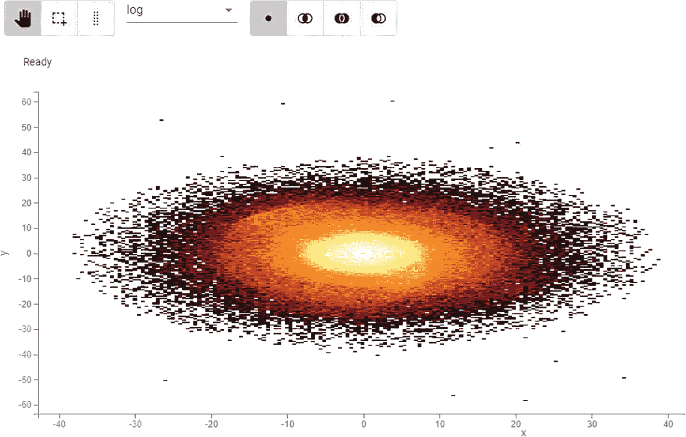

图 9-11: 使用 Vaex 绘图控件方法实现的动态可视化快照

对于大规模数据分析而言，此类实用方法的重要性怎么强调都不为过。你可以仅用几行代码，在庞大的、超出核心内存的数据集（例如大小为 10GB 或 20GB）上绘制复杂的转换，以可视化隐藏的模式。这极大地提高了此类数据分析流程的生产力和效率，远超仅使用 pandas 和 Matplotlib 代码所能达到的水平。


### Vaex 首选 HDF5 格式

Vaex 的强大之处源于其内部优化和数据结构设计。其设计选择之一便是尽可能使用 HDF5 文件格式。因此，使用 Vaex 的最佳实践是在开始探索数据之前，将其他类型的数据加载为这种格式。为方便起见，Vaex 提供了许多实用方法，可将其他文件或数据结构转换为此格式。你可以从 CSV、Arrow 表、Python 字典、NumPy 数组、JSON 等格式进行转换。

例如，以下代码将一个中等大小的 CSV 文件（接近一百万行和 15 列）转换为 HDF5 文件：

```
df2 = vaex.from_csv("Large-data.csv", convert=True)
```

运行此代码时，`Large-data.csv` 文件所在文件夹中会生成另一个名为 `Large-data.csv.hdf5` 的文件。切记必须设置 `convert=True` 才能实现此转换。

之后，你可以读取/打开此 HDF5 文件，其速度远超 pandas 读取 CSV 的速度。以下是完整代码：

```
# Pandas 读取 CSV
t1 = time.time()
df2_pandas = pd.read_csv("Large-data.csv")
t2 = time.time()
print(f"使用 Pandas 耗时 {round(1000*(t2-t1),3)} 毫秒")
# Vaex 从 CSV 转换
df2 = vaex.from_csv("Large-data.csv", convert=True)
# Vaex 读取 HDF5
t1 = time.time()
df2 = vaex.open("Large-data.csv.hdf5")
t2 = time.time()
print(f"使用 Vaex 耗时 {round(1000*(t2-t1),3)} 毫秒")
```

结果不言自明：

```
使用 Pandas 耗时 2354.523 毫秒
使用 Vaex 耗时 14.057 毫秒
"

在当今的数据科学世界中，包含一百万行的数据集并不算特别大。即使是这样中等大小的文件，pandas 从磁盘读取也需要超过 2 秒。而使用 Vaex，在转换为 HDF5 后，读取速度要快得多。因此，对于利用 Vaex 等库的功能的数据处理管道，以系统的方式将所有基于文本的数据文件（CSV，甚至是 JSON，如果可行）转换为 HDF5，并尽可能将其作为 Vaex DataFrame 读取是合理的，如图 9-12 所示。

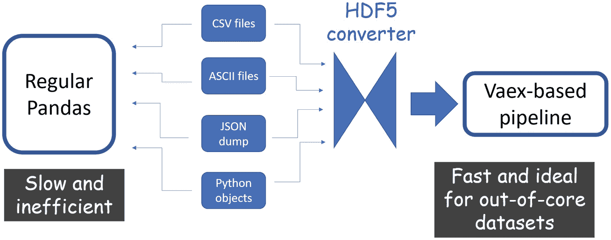

转换为 HDF5 并使用 Vaex 可构建更快、更高产的数据科学管道，尤其适用于*内存外（out-of-core）*数据集。

## Modin 实战示例

Modin 是一个实际效用属于并行处理或多核处理领域的库。它使用 `Ray` 或 `Dask` 后端，为加速 pandas 笔记本、脚本和库提供了一种轻松的方法。Modin 的主要吸引力在于它与 pandas 的紧密集成和完全相同的 API。

你将在下一章看到 Dask DataFrame 和 Ray 的使用。然而，与这些分布式 DataFrame 库不同，Modin 与现有 pandas 代码（包括 DataFrame 构建）提供了无缝集成和兼容性。基本上，你只需要更改一行代码即可开始使用。

### 从单 CPU 核心到多核心

对于大多数数据科学工作负载，要使用 Modin，你只需像这样开始：

```
import modin.pandas as pd
`

仅通过一行代码的简单更改，你就能获得巨大的好处。这是因为，尽管 pandas 拥有众多强大的特性和功能，但其核心实现本质上是单线程的。这意味着在任何给定时间，执行普通的 pandas 代码只能利用多个 CPU 核心中的一个。在单 CPU 机器（例如，数据科学家的笔记本电脑）上，情况如图 9-13 所示。

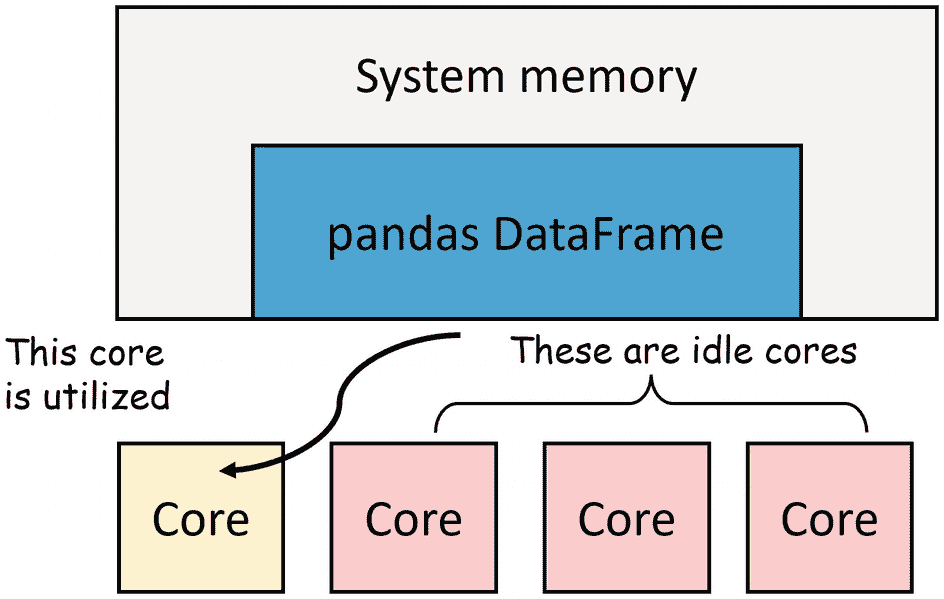

仅利用系统单核心的 pandas 代码。

然而，只需用 Modin 包装 pandas 代码（一行代码的更改），你就可以利用所有核心（通过设置 Dask 或 Ray 后端集群/工作节点系统），如图 9-14 所示。

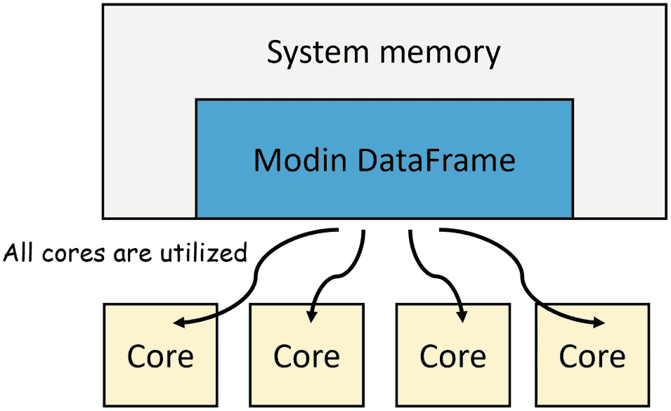

利用所有 CPU 核心的 Modin 代码。


### 核外处理

现在让我们来演示 `Modin` 的核外处理能力。这里的“核”（core）并非指 CPU 核心，而是指系统内存或 RAM。

以下代码创建了一个包含约 100 万行（精确地说是 2²⁰）和 256 列随机整数的 `DataFrame`。注意这里使用了 `modin.pandas`。

```python
import modin.pandas as pd
import numpy as np
raw_data = np.random.randint(0, 100, size=(2**20, 2**8))
df = pd.DataFrame(raw_data).add_prefix("col")
```

当你第一次执行这段代码时，可能会看到一些关于 Dask 集群设置的用户警告和消息（图 9-15） （假设你使用 Dask 后端进行并行处理/集群）。在下一章中，你将了解如何启动和监控 Dask 集群。`Modin` 的优势在于，所有这一切都在底层自动处理，用户无需编写集群设置的代码。

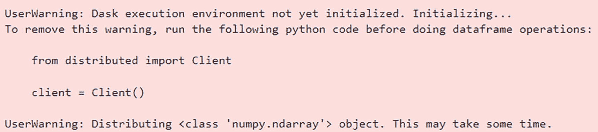

图 9-15  
与 Modin 代码执行相关的 Dask 集群设置警告消息（仅首次）

你可以查看 `DataFrame` 的信息：

```python
df.info()
```

它将显示类似这样的内容：

```
RangeIndex: 1048576 entries, 0 to 1048575
Columns: 256 entries, col0 to col255
dtypes: int32(256)
memory usage: 1.0 GB
```

因此，在底层，它使用了 `pandas.core.frame.DataFrame` 类，但当你检查 `DataFrame` 对象的类型时，它是一个 `Modin` pandas 对象，而不是普通的 pandas 对象。

```python
type(df)
>> modin.pandas.dataframe.DataFrame
```

现在进入此演示的关键部分。以下代码将 20 个这样的 1GB DataFrame 连接成一个大型 `DataFrame`。查看执行此操作所需的时间，并思考如果你尝试使用普通的 pandas 代码（假设本地机器有 16GB RAM）可能会出现什么问题。

```python
import time
t1 = time.time()
big_df = pd.concat([df for _ in range(20)])
t2 = time.time()
print(f"Took {round(1000*(t2-t1),3)} milliseconds")
```

它应该在一秒内完成。

```
Took 236.584 milliseconds
```

如果你想查看这个大型 `DataFrame` `big_df` 的形状：

```python
big_df.shape
>> (20971520, 256)
```

因此，它确实拥有**超过 2000 万行和 256 列数据**。用纯 pandas 将其作为持久化的内存对象来处理几乎是不可能的。

如果你显式地检查内存使用情况：

```python
big_df.memory_usage(deep=True)
>>
Index     167772160
col0       83886080
col1       83886080
col2       83886080
col3       83886080
...
col251     83886080
col252     83886080
col253     83886080
col254     83886080
col255     83886080
Length: 257, dtype: int64
```

因此，每列的内存使用量超过 80MB。总计，对于 256 列（和一个索引），这代表了超过 20GB 的内存使用量。我的笔记本电脑只有 16GB RAM，并且运行此代码的 Jupyter notebook 显然并没有占用所有内存。这直接证明了 `Modin` 的核外计算能力。

从现在开始，你可以将这个大型 `DataFrame` 视为一个普通的 pandas `DataFrame` 用于所有操作。例如，计算 `col0` 的平均值可以在 2 秒内完成。

```python
t1 = time.time()
big_df['col0'].mean()
t2 = time.time()
print(f"Took {round(1000*(t2-t1),3)} milliseconds for calculating mean of col0")
>> Took 2677.044 milliseconds for calculating mean of col0
```

那么计算整个 `DataFrame` 的平均值呢？不再是仅操作一列，而是操作所有 256 列数据。

```python
t1 = time.time()
big_df.mean()
t2 = time.time()
print(f"Took {round(1000*(t2-t1),3)} milliseconds for calculating mean of the entire DataFrame")
>> Took 37654.585 milliseconds for calculating mean of the entire DataFrame
```

因此，时间从 2.7 秒增加到 37.7 秒。计算时间并未增长 256 倍，而是少得多。这是并行处理以及`Dask` 集群在后台为每个工作节点最优分配数据块所结出的硕果。

### Modin 的其他特性

`Modin` 是一个活跃的开源项目，新的贡献不断加入。它还具备：

- 分布式 XGBoost 支持，用于快速机器学习
- 标准 SQL 连接支持，用于在数据库上执行 SQL 查询
- 对各种输入数据摄取 API（读取各种文件和格式）的支持逐步成熟。在这方面，如果某些 API 支持起来比较棘手，它会自动回退到 pandas 的读取 API 进行数据摄取，然后将对象作为 `Modin` `DataFrame` 处理。

有关更多详细信息和更新，感兴趣的读者应务必查看官方文档：[`https://modin.readthedocs.io/en/stable/index.html`](https://modin.readthedocs.io/en/stable/index.html)。

## 总结

在本章中，你开始探讨了将数据科学工作负载扩展到多个 CPU 核心并超越系统内存的概念。这对于处理日益增大的数据集（从 MB 到 GB 再到 TB 级别）尤其重要。使用 `NumPy`、`pandas` 和 `Matplotlib` 的传统 Python 数据科学生态系统在处理较小数据集时表现出色，但在处理大文件时开始变得低效，尤其是从磁盘读取或执行聚合与统计计算时。`pandas` 在处理许多涉及数 GB 级别数据集的常见情况时可能会抛出内存错误，因为它在执行常规数据整理时会进行大量不必要的内存拷贝。

你探索了 `pandas` 内部解决这些问题的常见技巧和技术，例如选择性数据加载、显式类型设置等。然后，你通过动手实践示例，使用两个强大的库 `Vaex` 和 `Modin`，了解了大数据集和大文件规模下的核外计算和可扩展性。使用纯 pandas 代码处理如此大规模的数据集进行数据转换（或可视化）将会缓慢且低效。

其中，`Modin` 使用 `Ray` 或 `Dask` 后端将计算负载分布到多个 CPU 核心上。在下一章中，你将通过进一步探索这些并行或分布式计算方面，深入讨论可扩展的数据科学。


