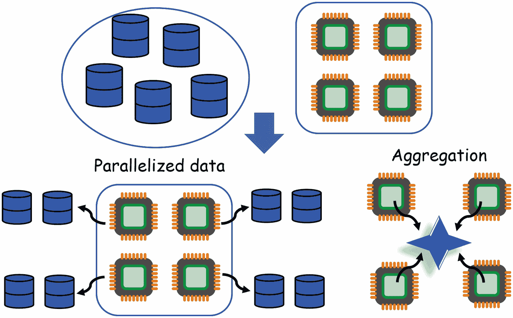
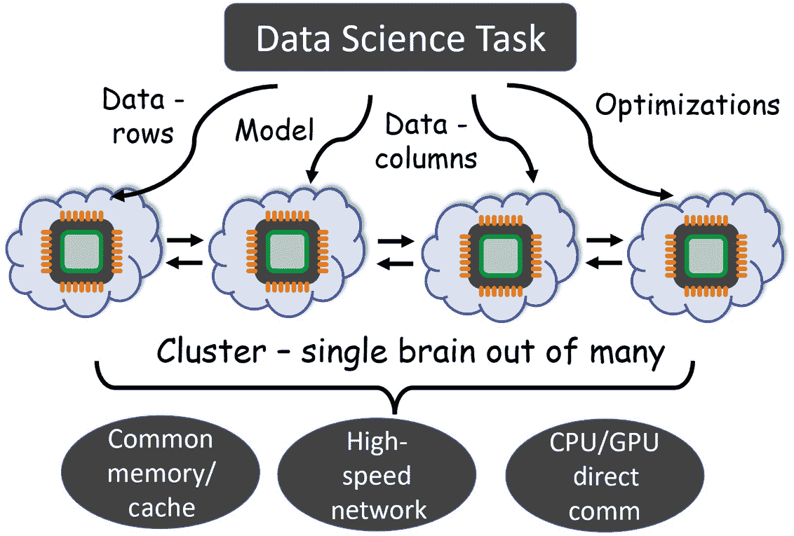
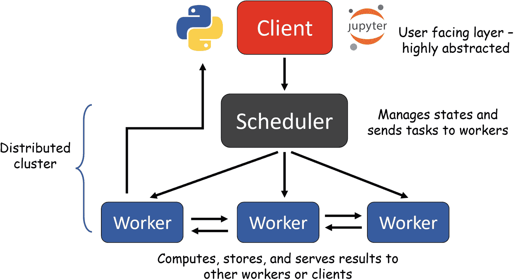
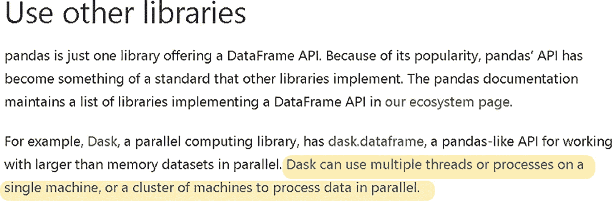
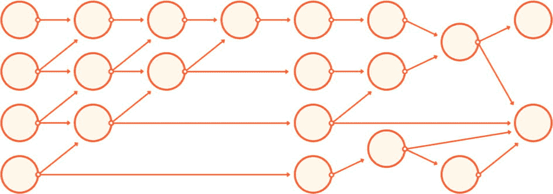
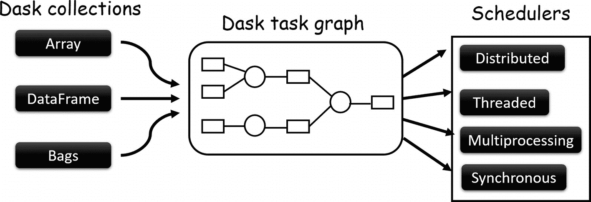

# 10. 并行化数据科学

在上一章中，我谈到了数据科学任务可能面临从千字节到拍字节不等的各种数据集规模。无论是样本数量还是特征维度的规模，都可能存在一个范围。为了处理复杂的数据分析和机器学习，数据科学家们使用了令人眼花缭乱的模型，并且这个生态系统也在快速扩展。

在规模上处理数据和模型是一项需要掌握的专门技能。当数据科学家开始学习这门技艺时，他们首先专注于理解数学基础、数据整理和格式化概念，以及如何从各种来源获取和抓取数据。在下一阶段，他们主要专注于各种机器学习算法和统计建模技术，以及如何将它们应用于各种任务。模型性能和超参数调优仍然是他们唯一的关注点。

然而，在几乎所有现实场景中，数据科学流水线的成功（以及它给组织整体业务带来的增值）可能取决于它能否大规模地平滑且无缺陷地部署（即，它能否轻松处理大型数据集、更快的流式数据、采样或维度上的快速变化等）。在这个大数据时代，企业级数据科学系统必须拥抱五 V（或六 V）原则。

当然，单个数据科学家不会监督整个企业或流水线的实施。然而，关于扩展数据科学工作流程的知识正在迅速成为即使是在该领域的入门级职位的先决条件。这些知识有几个不同的维度：例如，**云计算**、像 Hadoop 和 Spark 这样的**大数据技术**，以及侧重于数据科学的**并行计算**。

云计算及相关工具（如 AWS、谷歌云服务或 Azure ML）的主题完全超出了本书的范围。此外，有优秀的资源（包括在线课程和教科书）可用于学习使用 Hadoop 基础设施和相关技术进行分布式数据处理的基础知识。本章重点介绍基于 Python 的、可直接用于数据科学任务的并行计算方面。与上一章非常相似，我将讨论在使用最常见的分析和数值计算库（如`pandas`或`NumPy`）处理大型和复杂数据集时出现的一些限制，并讨论有助于完成这些任务的替代库。

然而，需要注意的是，这并非是对 Python 通用并行计算技巧和技术的详尽讨论。实际上，我将避免详细处理在标准 Python 并行计算教程或论文中经常出现的主题，例如使用`multiprocessing`、`threading`或`asynco`等内置模块。像本书中其他章节一样，重点完全放在数据科学上，因此，我将介绍两个库：`Dask`和`Ray`，它们能为任何你想混合并行计算能力的数据科学流水线真正增加价值。

## 面向数据科学的并行计算

我们将从一个简单的代码片段开始，以了解你的目标。假设你的笔记本电脑上安装了标准的 Python，请执行以下代码（在命令行界面或 Jupyter notebook 中）：

```python
import multiprocessing as mp
print("处理器数量: ", mp.cpu_count())
```

你很可能会得到 4 或 6 这样的响应。这是因为所有现代 CPU 都包含不止一个核心；实际上，它们就是并行计算单元。实际的物理核心（那些具有纳米级晶体管的电子单元）和逻辑核心之间存在细微差别，但出于所有计算目的，你可以将逻辑核心视为系统中的基本单元。

要获取有关笔记本电脑上安装的 CPU 的更详细信息，你可以执行以下代码片段：

```python
import psutil
print("="*20, "CPU 信息", "="*20)
# 核心数量
print("物理核心:", psutil.cpu_count(logical=False))
print("总核心数:", psutil.cpu_count(logical=True))
# CPU 频率
cpufreq = psutil.cpu_freq()
print(f"最大频率: {cpufreq.max:.2f}Mhz")
print(f"当前频率: {cpufreq.current:.2f}Mhz")
# CPU 使用率
print("每个核心的 CPU 使用率:")
for i, percentage in enumerate(psutil.cpu_percent(percpu=True, interval=1)):
    print(f"核心 {i}: {percentage}%")
print(f"总 CPU 使用率: {psutil.cpu_percent()}%")
```

在我的笔记本电脑上，我得到以下结果：

```
==================== CPU 信息 ====================
物理核心: 2
总核心数: 4
最大频率: 2195.00Mhz
当前频率: 2195.00Mhz
每个核心的 CPU 使用率:
核心 0: 64.7%
核心 1: 40.9%
核心 2: 58.5%
核心 3: 29.2%
总 CPU 使用率: 55.6%
```

因此，我们拥有多个核心，并且我们应该能够在我们的数据科学任务中利用这种硬件设计。那会是什么样子呢？

### 从单核到多核 CPU

尽管这是一本关于数据科学的书籍，但有时我们有必要（也颇具怀旧意味地）绕道进入硬件领域，回顾一下硬件方面的发展历史。对于并行计算而言，现代软件栈能够充分利用其优势之前，硬件领域必须在很长一段时间内经历大量的发展。简要了解这段历史将有助于我们更好地理解后续的讨论。

最早商用的 CPU 是`Intel 4004`，一款 1971 年推出的 4 位 750kHz 处理器。此后，处理器性能的提升主要得益于时钟频率的提高以及数据/地址总线宽度的扩展。一个标志性的转折点是 1979 年`Intel 8086`的发布，其最高时钟频率达 10MHz，并拥有 16 位数据宽度和 20 位地址宽度。

并行的最初迹象出现在 Intel `i386 (80386)`上首次采用的流水线 CPU 设计，这使得多条指令可以并行执行。其关键创新是将指令执行流程划分为不同的阶段。当一个指令在一个阶段执行时，其他指令可以在另一些阶段执行，从而实现了某种程度的并行性。

大约在同一时期，超标量架构被引入。从某种意义上说，这可以看作是未来多核设计的前身。这种架构复制了部分指令执行单元，允许 CPU 在指令之间没有依赖关系时，同时执行多条指令。最早采用这种架构的商用 CPU 包括`Intel i960CA`、`AMD 29000`系列和`Motorola MC88100`。

摩尔定律（以指数级速度缩小晶体管尺寸并降低制造成本；`www.synopsys.com/glossary/what-is-moores-law.html`）势不可挡的前进，为整个微架构革命提供了必要的动力。半导体工艺技术在不断进步，光刻技术将晶体管节点推向了亚 100 纳米（约为典型人类头发丝宽度的千分之一）的领域，并支持了配套电路、主板和内存技术的发展（这些技术也受益于相同的制造工艺进步）。

时钟频率之争愈演愈烈，AMD 在世纪之交的 1999 年发布了`Athlon CPU`，首次突破 1GHz 速度大关。这场竞争最终由英特尔获胜，它在 21 世纪初发布了一系列令人眼花缭乱的高频单核 CPU，最终推出了基础频率约为 3.8GHz 至 4GHz 的`奔腾 4`处理器。

但基础物理学给出了反击。高时钟频率和纳米级的晶体管尺寸虽然带来了更快的电路运作，但功耗也随之急剧上升。频率与功耗之间的直接关系为性能扩展带来了无法逾越的问题。实际上，这种功耗导致了所谓的更高漏电流，当晶体管数量也攀升至数十亿时（想象一下 CPU 内部发生数十亿次微小且不可预测的电流泄漏），这会破坏整个 CPU 和系统的稳定运行。

为了解决这个问题，人们尝试了多 CPU 设计，即在主板上安置两个物理 CPU，它们共享一条总线和同一内存池。其基本思路是停止提高工作频率，转而通过将计算任务分布到多个同等强大的计算单元上（然后以某种方式汇总结果）来实现并行。然而，由于共享外部（封装外）总线和内存所带来的通信延迟，这种设计并非真正的可扩展方案。

幸运的是，真正的多核设计很快随之而来，其中多个 CPU 核从一开始就在同一封装内设计完成，并对并行内存和总线访问进行了特别考量。它们还配备了与各个 CPU 独立缓存（L1/L2/L3）分开的共享缓存，通过显著降低延迟来改善核间通信。2001 年，IBM 发布了`Power4`，这可以被视为首款多核 CPU，尽管真正的创新和发布节奏是在英特尔于 2005 年发布`酷睿 2 双核`以及 AMD 的`速龙 X2`系列之后才加快的。

在这场竞赛中，许多架构创新和设计优化仍在进行中。提高每代 CPU 的核心数量一直是行业巨头英特尔和 AMD 的主要策略。虽然当今的台式工作站/笔记本电脑通常使用 4 核或 6 核 CPU，但高端系统（企业数据中心机器或价格较高的云实例）可能配备每 CPU 12 核或 16 核。

对于数据科学革命与进步而言，紧跟这一发展历程并充分利用硬件设计所能提供的所有创新成果是合情合理的。但这说起来容易做起来难。将日常数据科学任务并行化是一项艰巨的任务，需要特别的关注和投入。

### 数据科学中的并行是什么？

对于数据科学工作而言，数据和模型都是重要的工件。因此，任何并行计算工作的首要考虑因素之一就是并行的焦点：是数据还是模型。

# 并行数据科学与Dask

## 使用 Dask 进行并行数据科学

为什么需要思考这个问题？因为有些工件比其他工件更容易被设想为并行化。例如，假设你有 100 个数据集需要运行某些统计测试，而你的笔记本电脑有 4 个 CPU 核心。不难想象，如果你能将数据集均匀地分布到所有核心上，并并行执行相同的代码，那将非常理想（图 10-1）。这应该能显著缩短执行统计测试代码的总时间，即使该方案涉及一些用于划分和分发数据的前期开销，以及处理完数据后的聚合或累积操作。

虽然这并不难想象，但对于传统的基于 Python 的数据科学栈（使用 `pandas` 或 `SciPy`）来说，实际的实现并非那么简单。正如上一章所讨论的，Python 本质上是单线程的，用 Python 代码进行并行处理需要一些前期设置和巧妙的操作。当数据科学家使用像 `pandas` 这样的高级分析库时，了解其并行处理的限制（如果有的话）就更为重要了。


**图 10-1：** 将数据集分布到多个计算核心

此外，数据科学已不再局限于单个人笔记本电脑（或单个基于云的计算节点）上的模型探索和统计分析。当连接到由多台计算机通过高速网络连接而成的集群架构时，对于大规模数据分析而言，单台机器（无论其能力多强）的优势显而易见。在极限情况下，这样的集群旨在成为所有计算意图和目的下的单一实体：*一个由许多较小大脑通过并行组合和沟通而产生的单一大脑*。

自然而然地，数据科学家开始设想可以用这个*集体大脑*尝试和测试的各种可能性。除了分割大型数据集集合，他们还可以考虑将模型（甚至建模子任务）分块，并以并行方式执行。数据集可以通过多种方式进行切分，所有这些维度都可能根据手头的问题进行并行化。某些任务可能受益于按行分割数据样本；其他任务则可能受益于按列分割。

甚至许多优化任务也可以通过足够的投入实现并行化，并抛给多个计算节点。其中一个例子是运行并行局部区域搜索，以寻找全局问题的最佳成本函数。所有这些想法都在图 10-2 中体现。


**图 10-2：** 用于在多个维度（数据、模型、优化等）上并行化数据科学任务的计算节点集群

`Dask` 是一个功能丰富、易于使用、灵活的库，适用于 Python 生态系统中的并行化和可扩展计算。虽然用 Python 进行此类并行计算有不少选择和方法，但 `Dask` 的卓越之处在于它专门针对数据科学和分析工作负载进行了优化和设计。在这方面，它确实将自己与 `Apache Spark` 等其他主要参与者区分开来。

在典型的应用场景中，当数据科学家处理大型数据集，而使用标准 Python 数据科学工作流（`NumPy`/`pandas`/`scikit-learn`/`TensorFlow`）难以（甚至完全不可能）处理时，`Dask` 就会提供帮助。尽管这些 Python 库是现代任何数据科学流水线的主力，但如何利用大型并行计算基础设施或集群并非易事。

至少，你必须花费相当多的手动精力，并设置自定义代码或预处理步骤，才能最优地分发大型数据集或分割可在并行计算基础设施上执行的模型。此外，这种限制不仅适用于基于云的集群，也适用于单台机器场景。在执行 `pandas` 数据分析任务或使用 `SciPy` 进行统计假设检验时，如何充分利用强大工作站（配备单个独立 CPU）的所有逻辑核心或线程并不明显。这些库的某些设计特性甚至可能从根本上阻止我们同时使用多个 CPU 核心。

幸运的是，`Dask` 消除了为将大多数类型的数据科学任务转化为并行计算作业而规划和编写自定义代码的痛苦，并尽可能多地抽象了隐藏的复杂性。它还提供了一个 `DataFrame` API，其外观和感觉与 `pandas DataFrame` 非常相似，因此标准的数据分析和数据处理代码可以以最少的修改和调试进行移植。它还有一个专门的机器学习库（API 类似于 `scikit-learn`）。让我们在接下来的章节中探索 `Dask` 的工作原理及其更多功能。

### `Dask` 和 Spark 一样吗？

这篇博文 (https://coiled.io/is-spark-still-relevant-dask-vs-spark-vs-rapids/) 很好地阐述了两者的异同。简而言之，对于使用 Python 代码库、解决不总是局限于 SQL 类型数据查询问题的数据科学家来说，`Dask` 更加“友好和熟悉”。

### `Dask` 底层工作原理

`Dask` 的核心在于使用高效的数据结构（数组和 DataFrame）和一个巧妙设计的图。基本上，它采用**客户端-调度器-工作节点**的集群架构（图 10-3）来最优地分发子任务、汇总它们并计算结果/预测。并行计算的复杂性对普通的 Python 程序员或数据科学家来说是透明的，因此处理大型数据集变得简单易行。图 10-3 展示了一个示意性的说明。


**图 10-3：** `Dask` 客户端-调度器-工作节点底层操作

`Dask` 最有用的基本构建模块如下：

- `Dask` 数组

- `Dask` DataFrame

- `Dask` bag

- `Dask` 任务图

#### `Dask` 数组

这是 `NumPy` *n* 维数组（或 `ndarray`）接口的子集实现，它使用分块算法，有效地将一个大数组切割成许多小数组/块。这有助于利用计算机中的所有核心以并行方式对超出内存（大于内存）的数组进行计算。这些分块算法通过 `Dask` 任务图进行协调。有关 `Dask` 数组的更多详细信息，请访问官方文档：https://docs.dask.org/en/latest/array.html。

#### Dask DataFrame

本质上，Dask DataFrame 是一个大规模并行化的 DataFrame，由许多较小的 `pandas` `DataFrame` 沿索引拆分而成。根据大小和情况，这些 `pandas` `DataFrame` 可能存在于磁盘上，用于单机的外存计算，或者分布在集群中的多个不同计算节点上。单个 Dask `DataFrame` 操作会触发链式反应，即以并行方式对其组成的 `pandas` `DataFrame` 执行许多操作。

效率和易用性是 Dask 项目的主要目标。因此，Dask `DataFrame` 按行进行分区，通过索引值对行进行分组以提高效率。同时，它们可以暴露与 `pandas` 稳定版相同的 API 和方法。数据科学家不会感觉到差异，也无需更改现有代码，只需使用 Dask `DataFrame` API 即可利用并行性。实际上，`pandas` 官方文档建议使用 Dask 来扩展处理大型数据集（图 10-4）。


**图 10-4** `pandas` 官方文档建议使用 Dask 处理大型数据集

#### Dask Bag

这是一种数据结构，可在通用 Python 对象（如列表或元组）的集合上实现 `map`、`filter`、`fold` 和 `groupby` 等操作。它使用 Python 迭代器，内存占用小，并且本质上是并行化的。

`Apache Spark` 有其著名的弹性分布式数据集（`RDD`，参见 [`https://databricks.com/glossary/what-is-rdd`](https://databricks.com/glossary/what-is-rdd)）。Dask Bag 是该 `RDD` 的 Python 化版本，适用于 Hadoop 文件系统用户通常喜欢的操作。它们主要用于并行化处理非结构化或半结构化数据（如文本数据、JSON 记录、日志文件或自定义的用户定义 Python 对象）的简单计算。

#### Dask Task Graph

Dask 在用户空间采用了一种常见的并行执行方法：任务调度。通过这种方法，它将高级的主程序/代码分解为许多中等规模的任务或计算单元（例如，对非平凡数据量的单个函数调用）。这些任务被表示为图中的节点。如果一个任务依赖于另一个任务产生的数据，则节点之间会存在边。任务调度器负责执行整个图，同时尊重所有节点间的数据依赖性，并尽可能利用并行性，从而加速整体计算。

有许多调度技术：易并行调度、`MapReduce`、全任务调度等。任务调度逻辑通常隐藏在其他更大的框架中，如 `Luigi`、`Storm`、`Spark` 和 `IPython Parallel`。Dask 使用常见的 Python 组件（即字典、元组和可调用对象）以最小的附带复杂性实现了全任务调度（图 10-5）。Dask 甚至可以使用 Python 原生调度器，例如 `Threaded` 和 `Multiprocessing`。


**图 10-5** Dask 为其任务图使用了全任务调度方法

基于这些基本的数据结构和调度器，我们可以展示 Dask 的灵活性，如图 10-6 所示。


**图 10-6** Dask 集合、任务图和调度器

### 适用于多种类型的集群

Dask 的一大特点是任务和代码可以部署在多种类型的集群上：

*   运行 YARN 的 Hadoop/Spark 集群
*   运行作业管理器（如 SLURM、SGE、PBS、LSF 等）的 HPC 集群，这些在学术和科学实验室中很常见
*   Kubernetes 集群

这使得 Dask 成为一个真正强大的并行计算引擎，无论底层的分布式数据处理基础设施选择如何。自然地，Dask 代码和流水线可以轻松地从一个组织移植到另一个组织，或者在一个大型数据科学组织的团队之间共享。

### 基本使用示例

以下是如何定义和检查您刚刚了解的一些数据结构的方法。让我们从数组开始，然后展示一些 `DataFrame` 和 `Bag` 的示例。

关于 Dask 和 Ray 代码示例的说明：

本章中几乎所有的代码片段仅用于说明和概念验证目的。它们并不是完全可执行的、能运行的工作代码。原因是为了简洁。本书侧重于概念和学习，不打算作为代码手册。可用的工作代码示例在随附的 Jupyter 笔记本（或 GitHub 链接）中提供。