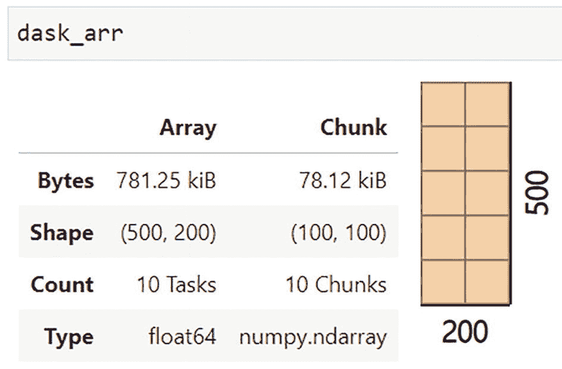
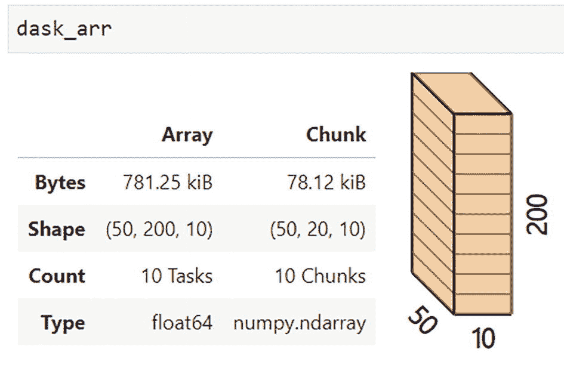
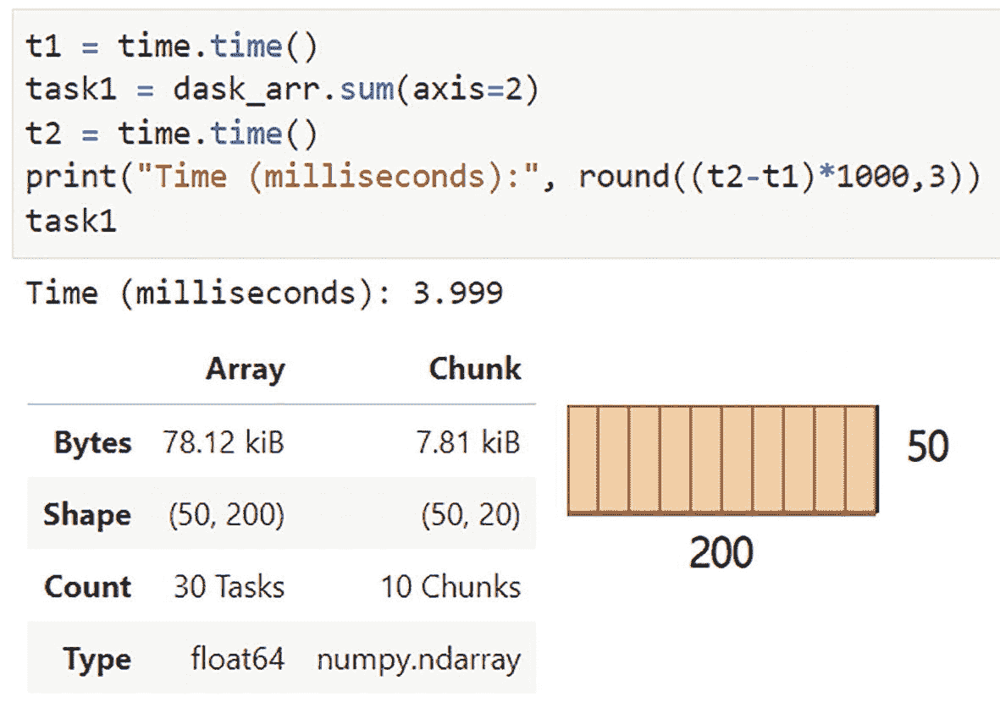
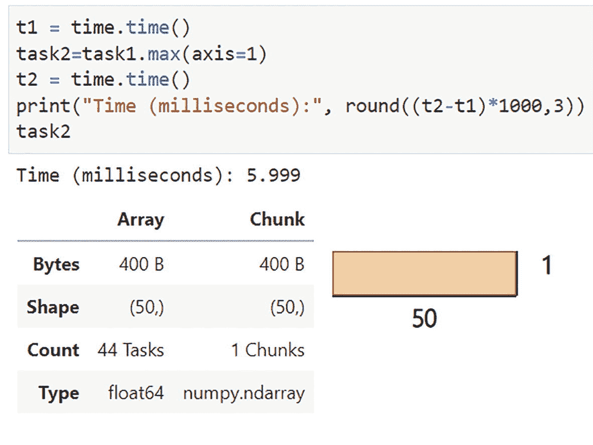
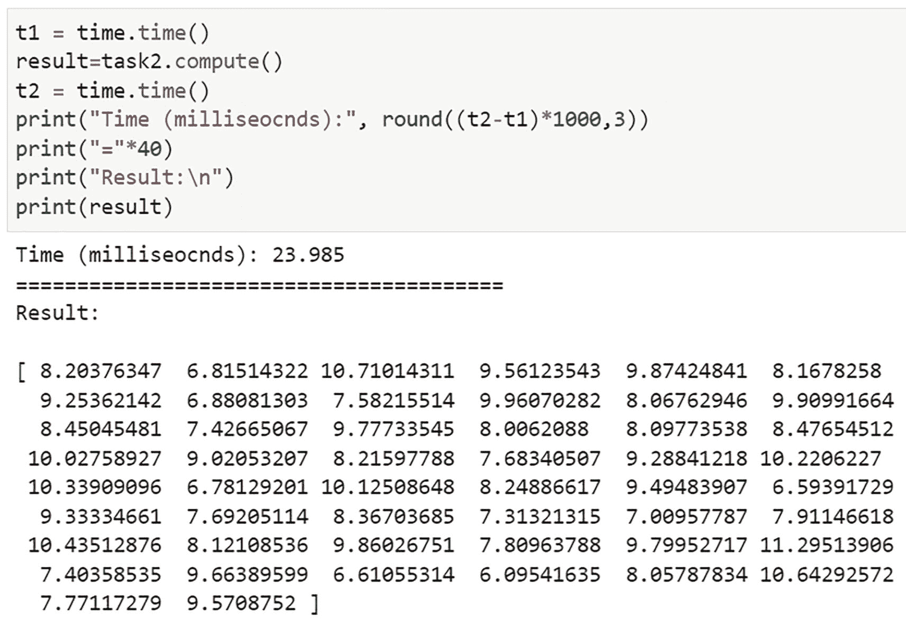
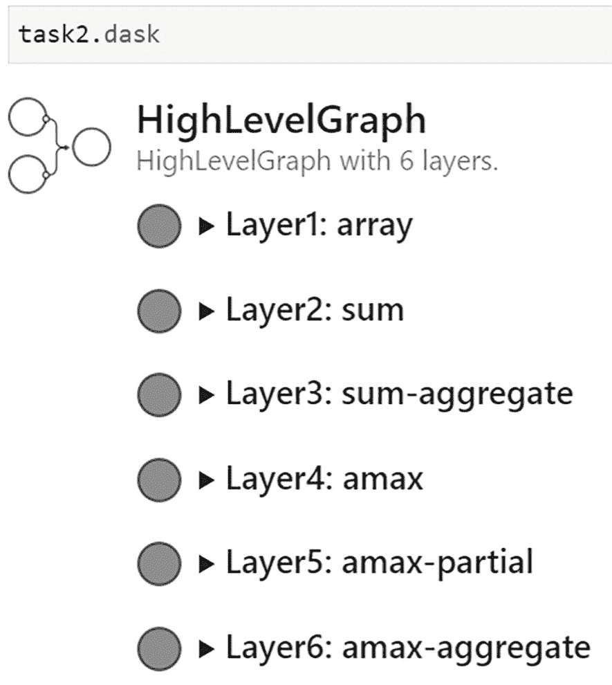

# Array

定义一个包含 100,000 个元素的 Numpy 数组（高斯随机数），并使用 `da.from_array()` 方法从中创建一个 Dask 数组：

```python
import numpy as np
import pandas as pd
import dask.dataframe as dd
import dask.array as da
import dask.bag as db
arr = np.random.normal(size=100_000).reshape(500,200)
dask_arr = da.from_array(arr,chunks=(100,100))
```

请注意，创建 Dask 数组时，你选择的块大小为 `(100, 100)`。在 Jupyter notebook 中，如果仅查看这个 `dask_arr` 对象，它甚至会被可视化地呈现出来（图 10-7）。



图 10-7 从随机数的 NumPy 数组创建的二维 Dask 数组

所有块的大小相同，为 78.12 kiB，而整个数据集为 781.25 kiB。这些块可以有效地分布在多个核心或机器上进行并行计算。你可以继续以类似方式定义一个三维数组：

```python
arr = np.random.normal(size=100_000).reshape(50,200,10)
dask_arr = da.from_array(arr,chunks=(50,20,10))
```

现在，Dask 数组看起来像一堆具有三维形状的砖块（图 10-8）。



图 10-8 从随机数的 NumPy 数组创建的三维 Dask 数组

Dask 遵循延迟计算原则，除非明确要求，否则不会计算最终值。你可以像这样在三维数组上定义求和操作，同时计算操作的时间：

```python
import time
t1 = time.time()
task1 = dask_arr.sum(axis=2)
t2 = time.time()
print("Time (milliseocnds):", round((t2-t1)*1000,3))
task1
```

在 Jupyter notebook 中，这将显示一个可视化。注意此操作花费的时间约为 4 毫秒（图 10-9）。尚未计算出任何结果；只是构建了一个任务图，并确定了预期的输出数组形状。



图 10-9 一个简单的求和操作产生了一个新的数组和任务图

类似地，你可以向这个链中添加另一个操作，沿着列（即 `axis=1`）确定这些求和值中的最大值：

```python
t1 = time.time()
task2=task1.max(axis=1)
t2 = time.time()
print("Time (milliseocnds):", round((t2-t1)*1000,3))
task2
```

同样，`task2` 显示为一个形状为 `(50,)` 的数组，构建它花费了约 6 毫秒（图 10-10）。



图 10-10 沿着列确定求和值中的最大值

最后，你需要调用一个特殊的计算方法来评估结果——`result = task2.compute()`。这里的计算时间要高得多（约 24 毫秒），并且你会得到如预期的一维最大值数组（图 10-11）。这就是任务图中的所有任务在多个核心上以并行方式执行的地方。



图 10-11 三维数组的最终计算

事实上，你可以通过检查任何数组（例如 `task2`）的 `dask` 属性来查看任务图的详细信息（图 10-12）。



图 10-12 求和-最大值操作的高级任务图

在 Jupyter notebook 中，可以展开这些层中的每一层以查看更多细节。建议你查看随附的 notebook。

