# DataFrames

如果你已经熟悉 pandas，Dask DataFrames 同样易于使用。你可以使用 Dask 内置的 `datasets` 模块创建一个包含时间序列数据的 DataFrame：

```python
from dask import datasets
df = datasets.timeseries(
start='2022-01-01',
end='2022-01-31',
freq='1min',
partition_freq='1d',)
```

现在，如果在 Jupyter notebook 单元格中仅输入 `df`，它不会显示你习惯在 pandas DataFrame 中看到的数据快照。这是因为 Dask 采用延迟计算，仅输入 `df` 并不要求任何实际计算。相反，它会显示模式（即数据类型）和一般结构信息（图 10-13）。注意它有 30 个分区，因为你在代码中选择了 `partition_freq = '1d'`，并且开始和结束日期分别落在该月的 1 日和 31 日。

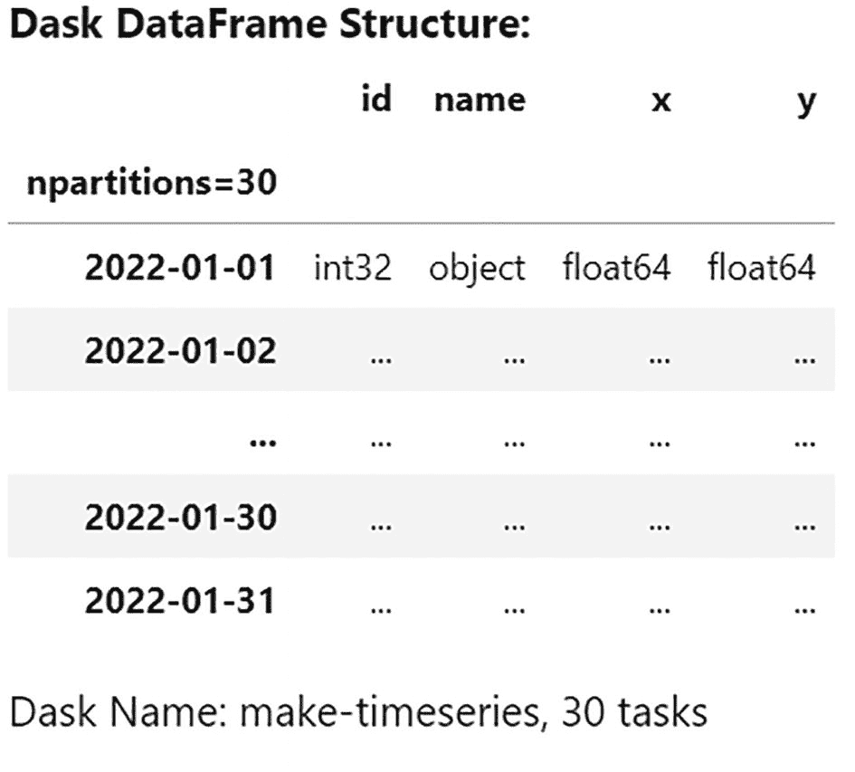

图 10-13 Dask 中的时间序列 DataFrame，显示数据模式

如果你想查看前几条记录，熟悉的 `head` 方法可以满足这一目的，并且默认情况下将进行计算（即显示实际数据），如图 10-14 所示。

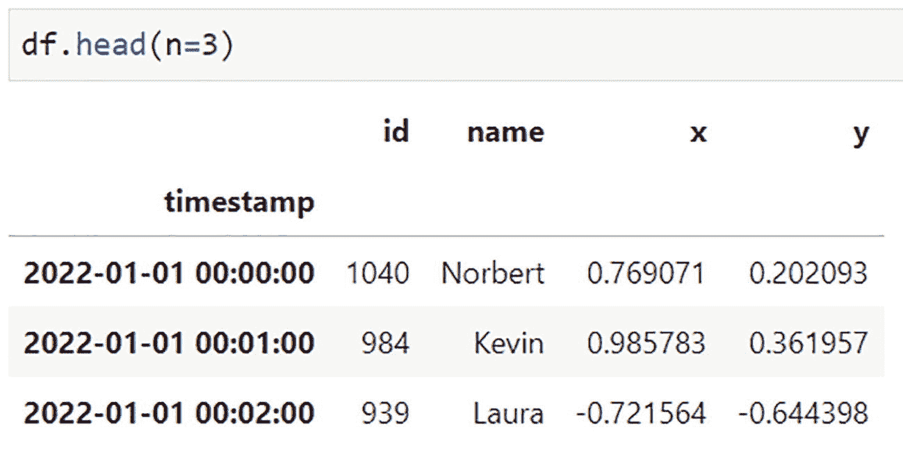

图 10-14 显示前几条记录的 Dask DataFrame

大多数 pandas 类型的操作都受支持。例如，要知道有多少个唯一的名字，可以编写以下代码：

```python
df['name'].nunique().compute()
>> 26
```

现在，要按这些名字进行分组并并排比较它们的 `x` 和 `y` 数据的方差，可以编写：

```python
df.groupby(by='name').var().compute()[['x','y']]
>>
x           y
name
Alice    0.331361    0.318624
Bob      0.328595    0.336009
Charlie  0.324984    0.334246
Dan      0.329188    0.333593
Edith    0.324070    0.332390
Frank    0.340098    0.335124
```

像 pandas 一样也支持直接绘图。使用特殊的 `resample` 方法（因为数据是时间序列），你可以像这样绘制均值数据（图 10-15）：

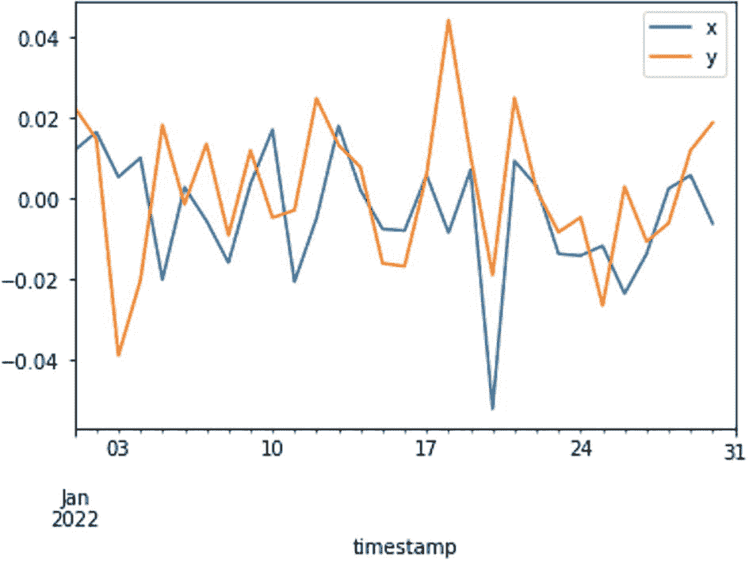

图 10-15 时间序列重采样数据均值

```python
df[['x', 'y']].resample('24h').mean().compute().plot()
```

随机访问某个分区的数据速度很快，但仍需要计算才能看到实际数据。例如，要查看 1 月 25 日分区的所有时间数据（图 10-16），可以编写以下代码：

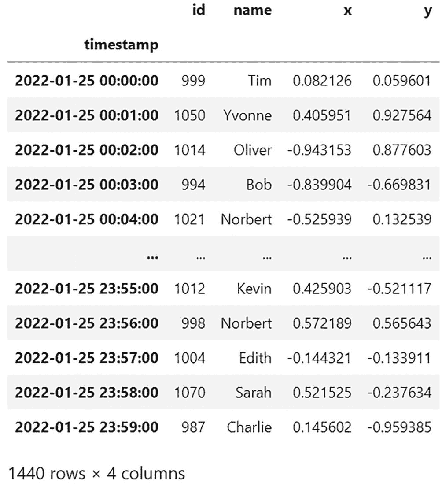

图 10-16 访问并计算特定日期/分区的数据

```python
df.loc['2022-01-25'].compute()
```

## Dask Bag 示例

以下是一个包含 JSON 记录的 Dask Bag 示例。这些数据可以是随机生成的，生成这类 JSON 数据的代码在随附的笔记本/源代码中提供。你可以在一个名为 `data` 的文件夹中存放五条 JSON 记录（关于五个人）。通过以下代码，你可以将这些记录读入 Dask Bag 结构（注意 `map` 和 `json.loads` 函数的使用）：

```python
import dask.bag as db
import json
bag = db.read_text('data/*.json').map(json.loads)
```

同样，由于惰性求值，除非你显式要求，否则无法查看 Bag 的内容。你可以使用 `take` 方法来实现：

```python
bag.take(2)
```

这应该会显示类似图 10-17 的内容。这些记录包含人们的姓名、职业、电话号码和地址信息。记录是多层级的，例如，`address` 字段还包含下一层级的数据字段：`address` 和 `city`。

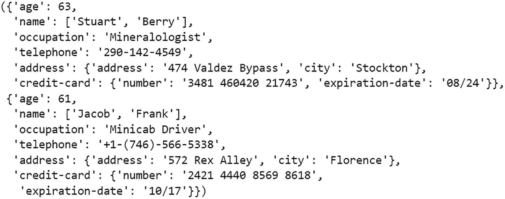

图 10-17 包含 JSON 记录的 Dask Bag（此处显示了前两条记录）

现在，你可以对这些记录数据执行 `map`、`filter` 和聚合等操作。例如，你可能想要筛选出年龄大于 50 岁且信用卡到期年份在 2022 年之后的人。你可以编写一个简单的过滤函数，并将其传递给 Bag 对象的 `filter` 方法。请注意，你必须使用 `take` 或 `compute` 来触发实际计算。

```python
def filter_func(record):
    cond1 = record['age'] > 50
    cond2 = int(record['credit-card']['expiration-date'].split('/')[-1]) > 22
    return cond1 and cond2
bag.filter(filter_func).take(2)
```

这可能会返回类似图 10-18 的结果。

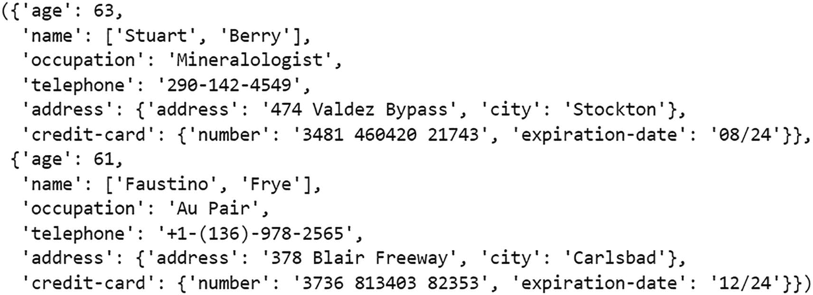

图 10-18 对 Dask Bag 包含的记录执行过滤操作

对于半结构化数据集，Dask Bag 有许多强大的用法，而这些用法仅使用数组或 DataFrames 是很难实现的。

### Dask 分布式客户端

前面章节中的所有用法示例都展示了 Dask API（数组、DataFrames 和 Bags）的形式化和惰性求值特性，但它们并未以明显的方式展示计算的分布式/并行化特性。为此，你必须从 Dask 的工具库中选择并使用分布式调度器。这实际上是一个单独的模块或轻量级库，称为 `Dask.distributed`，它将 `concurrent.futures` 和 Dask API 扩展到中等规模的集群。

该模块的一些核心特性如下：

*   **低开销和低延迟**：每个任务的开销仅为约 1 毫秒。一个小的计算和网络往返可以在 10 毫秒内完成。
*   **对等节点间的数据共享**：工作节点（例如，本地机器上的逻辑核心或集群中的廉价计算节点）相互通信以共享数据。
*   **数据本地性**：计算在数据所在位置进行。调度算法遵循此原则来分发和调度任务。这同时最小化了网络流量并提高了整体效率。
*   **复杂任务调度**：这可能**是最吸引人的特性**。调度器支持复杂的工作流，不限于标准的 `map`/`filter`/`reduce` 操作，而这些操作是基于 Hadoop 的系统的首要特性。这对于涉及 *n* 维数组、机器学习、图像或高维数据处理以及统计建模的复杂数据科学任务来说，是绝对必要的。

调度器的灵活性和强大功能也源于其**异步**和**事件驱动**的特性。这意味着它可以同时响应来自多个客户端的计算请求，并跟踪已被分配任务的众多工作节点的进度。它还能够同时处理来自多个用户的各种工作负载，同时管理一个包含可能故障和新加入节点的动态工作节点池。

对用户（数据科学家）来说，最好的事情是，他们可以使用纯 Python 代码，并以最小的学习曲线来应用所有这些特性和功能。从编程角度实现集群管理或分布式调度并非易事。使用 Dask 的数据科学家无需操心这些复杂性，因为它们已被抽象化了。这正是“高效数据科学”这一主题得以获得像 Dask 这类库支持的地方。

实际上，仅用两行代码，你就可以启动一个本地集群（利用本地机器的 CPU 核心）：

```python
from dask.distributed import Client
client = Client()
```

现在，如果你在 Jupyter notebook 单元格中输入 `client`，你将看到类似图 10-19 的描述。请注意，它显示了一个指向仪表盘的超链接，你很快就能看到它的实际效果。

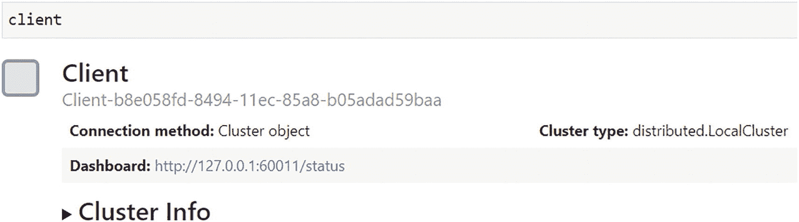

图 10-19 启动一个 Dask 分布式集群/调度器（在本地机器上）

如果你继续展开“集群信息”下拉菜单，可能会看到类似图 10-20 的内容。注意它如何显示本地机器的线程/工作节点以及可用的系统内存。

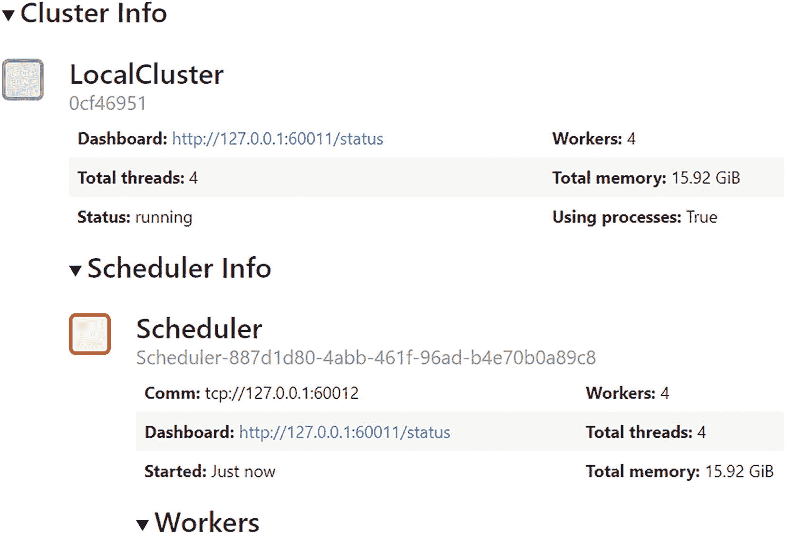

图 10-20 Dask 分布式客户端设置的集群和调度器信息

需要知道的重要一点是，在创建调度器/集群时，你可以向 `Client` 构造函数传递许多可自定义的参数。其中一些最重要的参数包括：

- `address`：真实的基于云的远程集群或本地主机的 IP 地址（带端口）。如果你能负担得起租用一台具有高 CPU 数量的高端云实例（如前一章所述），Dask 调度器可以直接连接到它并开始利用其资源。如果未指定，则仅将本地主机作为计算节点。

- `n_workers`：显式指定集群能够使用的 CPU 核心数量。这在资源受限的情况下，或者当有大量 Dask 任务需要在有限数量的 CPU 核心间分配时，可能非常重要。

- `threads_per_worker`：就像指定 CPU 核心数量一样，这决定了每个核心的线程数。通常，这个数字是 1 或 2。

- `memory_limit`：这是另一个用于优化管理分布式客户端总系统内存的有用关键字。此限制是基于每个 CPU 核心的，并且应该是一个字符串（例如，`'2 GiB'`）。

一旦调度器启动，它会自行管理分布式计算的所有方面。然而，有特定的方式通过`map`和`submit`方法向调度器提交作业。下面是一个（有些牵强的）例子。

假设你有几个从特定统计分布生成的随机变量数据集，并且希望测量它们的最大值与中位数之间的差异，然后取这些测量值的平均值。每个数据集可能包含 1,000 个值，共有 21 个这样的数据集。综合起来，这可以作为衡量数据中某种异常值的一种度量（即，对于某批数据，最大值比中位数高多少）。你可以在随附的笔记本中找到数据生成代码。各个数据集的分布如图 10-21 所示。

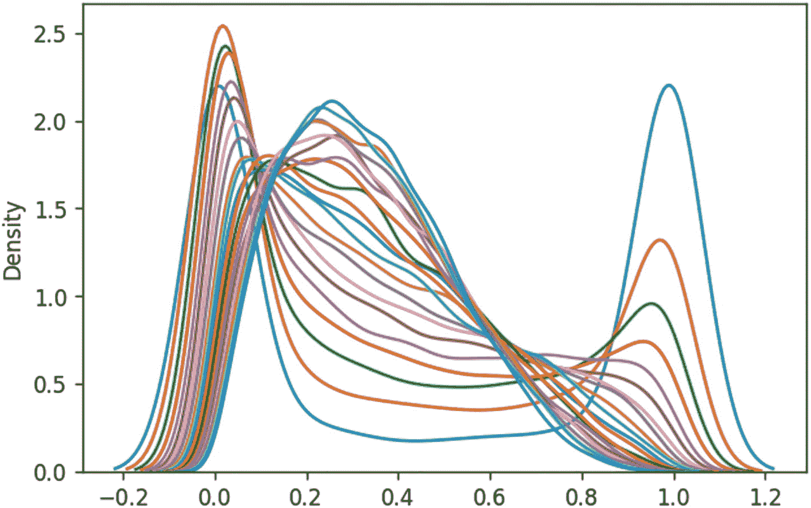

图 10-21：一个需要运行分布式处理的合成批次数据

因此，这涉及以下计算：

- 21 次最大值计算（每次从 1,000 个数据点中）

- 21 次中位数计算（每次从 1,000 个数据点中）

- 两次算术平均值计算（每次针对 21 个最大值/中位数）

- 最终的差值计算

你可以编写如下 Dask 代码（假设数据集包含在一个名为`dists`的 Python 列表中）。生成列表中此类随机数的代码在随附的源码/笔记本中给出。

```
# 将统计计算映射到数据分布
A = client.map(np.max, dists)
B = client.map(np.median, dists)
# 提交平均值计算作业
mean_max = client.submit(np.mean, A)
mean_min = client.submit(np.mean, B)
```

此时，如果你检查`mean_max`对象，你会发现它是一个被称为 Dask Future 的东西（一种承诺，将在未来被计算或执行，类似于 JavaScript 中的概念）：

```
mean_max
>> Future: mean status: finished, type: numpy.float64, key: mean-2e5b19a32f99725e1cf4f6f5ba8e295a
```

整个分布式任务在此刻只是被计划好了，并没有发生实际的计算。你必须调用`result`来执行实际计算：

```
final = mean_max.result() - mean_min.result()
final
>> 0.6780617253952232
```

然而，仅仅通过查看 Dask 提供的动态仪表板，就可以观察到更有趣的事情。你只需点击图 10-20 中所示的超链接，就会看到类似图 10-22 的内容。

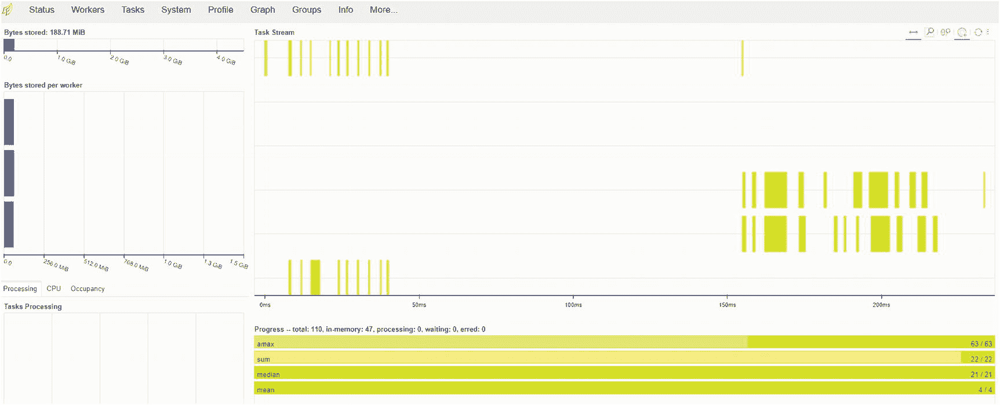

图 10-22：动态 Dask 仪表板的任务状态视图

这是仪表板任务状态选项卡的一个静态快照。当并行过程执行时（分布在多个 CPU 核心上），随着所有数据块在工作节点间分割和共享，图表会动态变化和更新。我在 [`https://medium.com/productive-data-science/out-of-core-larger-than-ram-machine-learning-with-dask-9d2e5f29d733`](https://medium.com/productive-data-science/out-of-core-larger-than-ram-machine-learning-with-dask-9d2e5f29d733) 发表的一篇文章中，通过一个涉及 Dask 机器学习库的动手实例，很好地直观演示了这个动态过程。建议你去看看这篇文章。

这个仪表板还有许多其他选项卡。关于工作节点的信息选项卡就是其中之一（图 10-23）。同样，这里的视图是静态的，并且是在处理完成之后的状态。因此，你看到的是内存和 CPU 的最低使用量。但在动态状态下，这些数字会很高并且不断变化。

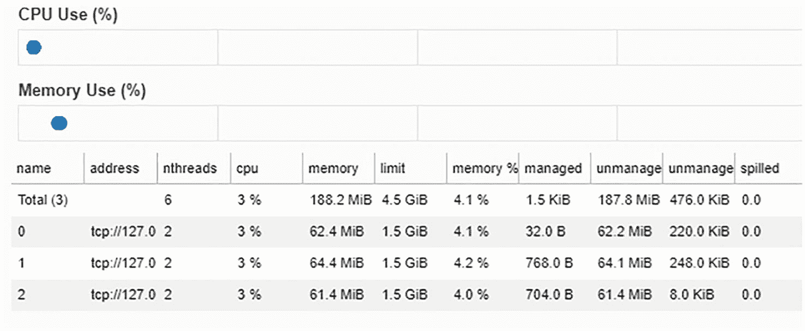

图 10-23：动态 Dask 仪表板的工作节点信息视图

### Dask 机器学习模块

尽管 Dask 提供了一套出色的并行和核外（out-of-core）计算设施以及一套直截了当的 API（Arrays、DataFrames、Bags 等），但其功能并不仅限于此。超越数据整理和转换阶段后，当数据科学家进入机器学习阶段时，他们仍然可以利用 Dask 借助并行计算的能力来进行建模和预处理任务。所有这些都可以在对现有代码库进行最小改动的情况下，以纯 Python 风格实现。

对于机器学习算法和 API，Dask 有一个可单独安装的模块，名为`dask-ml`。对该模块的完整介绍超出了本书的范围。再次建议你查看[上文提到的文章](https://medium.com/productive-data-science/out-of-core-larger-than-ram-machine-learning-with-dask-9d2e5f29d733)以了解其 API。在此，我将简要讨论`dask-ml`的一些关键方面。

#### 它解决了什么问题？

从根本上说，像`dask-ml`这样的库解决了*数据扩展*和*模型扩展*这两个问题。

**数据扩展挑战**伴随着大数据领域出现，例如，当计算硬件在将训练数据容纳在工作内存中开始遇到困难时。因此，这本质上是一个**内存受限**的问题。Dask 通过将数据溢出到磁盘存储（out-of-core）并提供增量元学习估计器来解决这个问题，这些估计器可以从数据批次中学习，而不必在内存中加载整个数据集。

**另一方面，模型扩展挑战**在机器学习模型的参数空间变得过大且操作变得**计算受限**时凸显出来。为了应对这些挑战，你可以继续使用 Dask 提供的高效集合（数组、DataFrames、bags），并使用 Dask 集群在一组机器上并行化工作负载。即使是并行化任务也有多种选择。它可以通过内置的集成之一（例如，Dask 的`joblib`后端直接并行化 scikit-learn）或`dask-ml`的估计器之一（例如，一个超参数优化器或一个并行化的随机森林估计器）来实现。

### 与 scikit-learn 的紧密集成

遵循简洁易用的原则，`dask-ml` 与最流行的 Python 机器学习库 scikit-learn 保持了高度集成，并贯彻了 **“即插即用”（drop-in replacement）** 的替换理念。`dask-ml` 提供了**数据预处理**、**模型选择**、**训练**，甚至**数据生成函数**，功能与 scikit-learn 类似，同时支持将 Dask 集合作为原生对象与这些 API 一起使用。

通用代码示例如下（非实际可运行代码）：

```python
import dask.dataframe as ddf
from dask_ml.model_selection import train_test_split
from dask_ml.preprocessing import MinMaxScaler
from dask_ml.xgboost import XGBRegressor
# 读取高效的 parquet 文件格式
data = ddf.read_parquet('Parquet file', engine='pyarrow')
X = data[Feature_columns]
y = data[Label_column]
# 测试/训练集划分
train, train_labels, test, test_labels = train_test_split(X, y,
test_size=0.2, ...)
# 缩放/预处理
train = MinMaxScaler.fit_transform(train)
test = MinMaxScaler.fit_transform(test)
# 并行化估计器
est = XGBRegressor(...)
est.fit(train, train_labels)
est.score(test)
```

很容易发现，这段代码与标准的 scikit-learn 流程几乎逐行相似。这就是 `dask-ml` 所谓的“即插即用”替换能力。你可能还会注意到，代码中使用 Parquet 文件格式，以便从磁盘或网络存储中高效地读取大规模数据集（存入 Dask DataFrame）。你可以阅读我关于此主题的文章（`https://medium.com/productive-data-science/out-of-core-larger-than-ram-machine-learning-with-dask-9d2e5f29d733`）。执行时，这段代码将 Dask DataFrame 的核外数据处理优势与并行化估计器 API 相结合，为数据科学家提供了可扩展的机器学习体验，从而大幅提升其生产力。

`dask-ml` 库还提供了一些元估计器/封装器，用于并行化和扩展某些 scikit-learn 本身无法完成的任务。例如，`ParallelPostFit` 可用于并行化 `predict`、`predict_proba` 和 `transform` 方法，使其能够处理大规模（甚至超出内存）的数据集。这非常适用于实际的生产部署，因为即使训练时使用的是较小数据集，生产环境中的实时数据也可能相当庞大。为了确保预测服务的稳定流畅运行，这些后拟合方法无论数据集大小如何都应能优雅地扩展，而 `dask-ml` 无需大量代码更改即可实现这一目标。此类任务的通用代码片段可能如下所示：

```python
from sklearn.ensemble import GradientBoostingClassifier
from dask_ml.wrappers import ParallelPostFit
# 使用 Dask 封装器包装 sklearn 估计器
clf = ParallelPostFit(estimator=GradientBoostingClassifier())
clf.fit(X, y)
# 用于预测的大数据集
X_big, _ = make_classification(n_samples=100000, chunks=10000,)
# 前 10 个数据点的概率
clf.predict_proba(X_big).compute()[:10]
```

在上面的代码中，请注意主估计器来自 scikit-learn 本身。Dask 部分只是一个封装器，它利用底层估计器来处理 Dask 集合（如 DataFrame），从而实现惰性求值和核外计算。

## 使用 Ray 进行并行计算

近年来，纯 Python 的并行计算因几个优秀开源框架的迅速崛起而发生革命性变化，`Ray` 就是其中之一。它由加州大学伯克利分校 RISElab（`https://rise.cs.berkeley.edu/`）的两名研究生 Robert Nishihara 和 Philipp Moritz 创建，旨在作为一个简化和运行时框架来简化分布式计算。在 Michael Jordan 教授和 Ion Stoica 教授的指导下，它迅速从一个研究项目发展成为一个功能齐全的计算平台，并在此基础上构建了许多子组件，用于不同的 AI 和 ML 任务（如超参数调优、强化学习、数据科学工作，甚至 ML 模型部署）。

目前，`Ray` 由 Anyscale（`www.anyscale.com/`）维护和持续增强。Anyscale 是一家由 Ray 创建者成立的商业实体（初创公司）。它提供完全托管的 Ray 服务，通过消除构建和管理复杂基础设施的需求，加速在 Ray 上构建、扩展和部署 AI 应用。

### Ray 的功能与生态系统

`Ray` 的一些核心功能如下：

- Ray 通过在**全局控制存储**中抽象系统的控制状态，并保持所有其他组件无状态，从而实现可扩展性和容错性。
- 它使用**共享内存的分布式对象存储**，通过共享内存高效处理大数据，并采用自底向上的分层调度架构，实现低延迟和高吞吐量的调度。
- Ray 提供基于**动态任务图**和**Actor**的轻量级 API，以灵活的方式表达广泛的数据科学和通用应用程序。

利用这些功能，众多分布式计算工具和框架正在基于 Ray 引擎构建。想获取这些工具的概览，可以参考一篇优秀文章，请访问 `https://gradientflow.com/understanding-the-ray-ecosystem-and-community/`。图 10-24 提供了直观的图示。

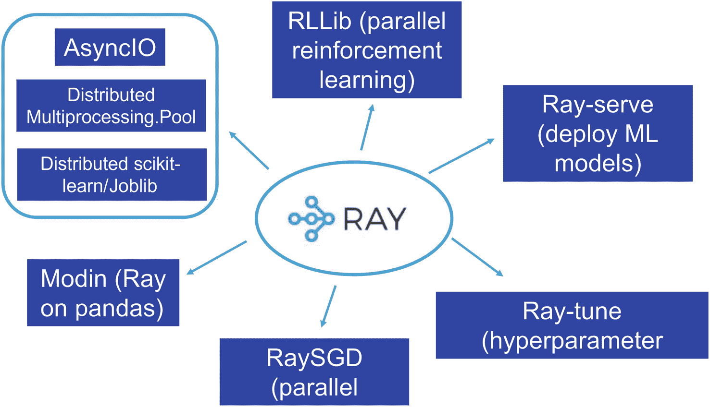

*构建在 Ray 之上的分布式数据科学/机器学习生态系统*

在本节中，我将仅演示几个使用 `Ray` 运行并行数据科学工作负载的示例。强烈建议你查看官方文档（`www.ray.io/docs`），并尝试该库提供的所有优秀功能。

### 简易并行化示例

在展示实践案例之前，我想先说明：Ray 目前主要在 Linux 和 Mac OS 系统上构建和测试，Windows 版本尚处于实验阶段，稳定性无法保证。因此，建议你在 Linux 环境中练习 Ray 示例，或在 Windows 平台上创建**虚拟机（VM）**，安装 Ray 后再继续操作。

例如，以下示例运行在 Oracle Virtual Box 软件（安装于 Windows 11 笔记本电脑）管理的虚拟机中的 Ubuntu Linux 20.04 环境里。创建者/用户为该虚拟机分配了四个逻辑 CPU 核心（图 10-25）。这一点很重要，因为 CPU 核心的默认起始数量可能仅为 1，这无法体现并行处理任务的预期加速效果。关于如何创建此类虚拟机的详细指南，请参阅本文（`https://brb.nci.nih.gov/seqtools/installUbuntu.html`）。如果你使用的是原生 Linux 或 Mac OS 机器，则可跳过此步骤。

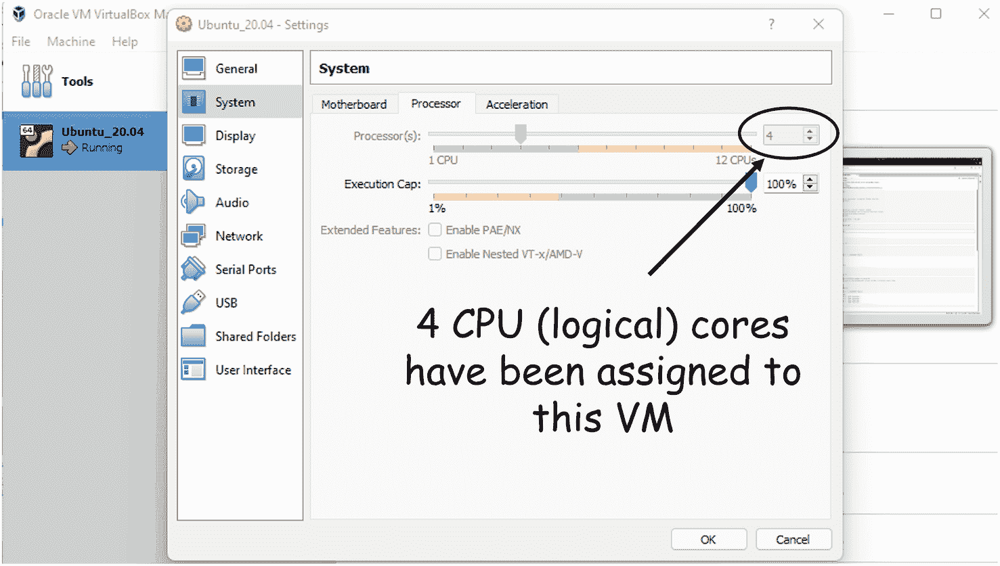

图 10-25：分配给运行 Ray 的虚拟机的多个逻辑 CPU 核心

你可以通过 `ray.init()` 方法启动 Ray：

```python
import ray
ray.init()
```

运行此代码后，你可能会看到类似以下输出：

```
{'node_ip_address': '10.0.2.15',
'raylet_ip_address': '10.0.2.15',
'redis_address': '10.0.2.15:6379',
'object_store_address': '/tmp/ray/session_2022-02-08_21-00-00_998495_21742/sockets/plasma_store',
'raylet_socket_name': '/tmp/ray/session_2022-02-08_21-00-00_998495_21742/sockets/raylet',
'webui_url': '127.0.0.1:8265',
'session_dir': '/tmp/ray/session_2022-02-08_21-00-00_998495_21742',
'metrics_export_port': 62074,
'gcs_address': '10.0.2.15:43155',
'node_id': '922916ef0c5dcf02dc25fea428b930df40ccf2450fa974bb307826fe'}
```

请注意，启动 Ray 会同时启动 Redis、对象存储和仪表盘等组件。实际上，你会在顶部看到打印出的仪表盘 URL 信息：

```
View the Ray dashboard at http://127.0.0.1:8265
```

点击此超链接后，你将看到包含工作进程及其状态的 Ray 仪表盘，如图 10-26 所示（与之前讨论的 Dask 仪表盘非常相似）。

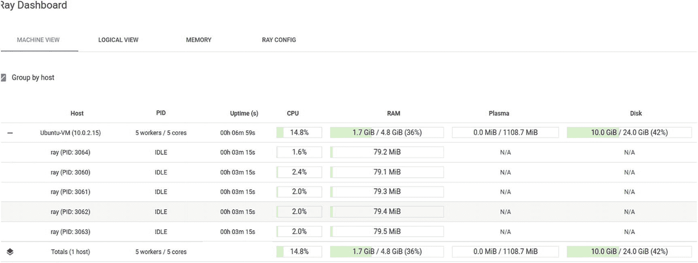

图 10-26：Ray 仪表盘快照（分配了 5 个 CPU）

你可以通过以下代码检查分配给此 Ray 集群的资源：

```python
ray.available_resources()
```

输出：

```
{'memory': 2325037056.0,
'node:10.0.2.15': 1.0,
'object_store_memory': 1162518528.0,
'CPU': 5.0}
```

现在，让我们构建几个大型 DataFrame，分别使用 pandas 和 Ray 计算其统计数据，以展示并行计算的优势：

```python
NUM_ROWS = 100_000
NUM_COLS = 20
data_dict = {}
# Pandas DataFrames
for i in range(4):
data = np.random.normal(size=(NUM_ROWS, NUM_COLS))
data_dict['df'+str(i)] = pd.DataFrame(data,
columns=['Col-'+str(i) for i in range(NUM_COLS)])
```

对于 pandas，你可以编写一个直接返回统计结果的函数：

```
def build_stats(df):
return df.describe().T
```

测量该函数在多个`DataFrame`（此处为四个）上的运行时间：

```
t1 = time.time()
results = [build_stats(data_dict['df'+str(i)]) for i in range(4)]
t2 = time.time()
print("Total time (milliseconds): ", round((t2-t1)*1000,2))
>> Total time (milliseconds):  1130.66
```

使用 Ray 实现相同功能并利用并行计算的关键在于：在相同函数上使用 `@ray.remote` 装饰器，并通过 `ray.get()` 方法在任务提交并行执行后收集结果。以下是装饰后的函数：

```
@ray.remote
def build_stats_ray(df):
return df.describe().T
```

现在可以编写类似的代码来测量时间：

```
t1 = time.time()
results = ray.get([build_stats_ray.remote(data_dict['df'+str(i)]) for i in range(4)])
t2 = time.time()
print("Total time (milliseconds): ", round((t2-t1)*1000,2))
```

你将获得更短的总执行时间（实际数值会因硬件、CPU 数量、Ray 构建版本、操作系统等多种因素而异）：

```
>> Total time (milliseconds):  575.77
```

请注意你是如何通过 `.remote()` 方法调用 `build_stats_ray` 函数，并如何将其包装在 `ray.get()` 方法中实现并行运行的。要点在于：尽管 Ray 提供了丰富的功能，但你需要学会如何正确利用它们，以及如何通过按正确顺序流水线化子组件，将可并行化的任务提交至 Ray 集群。图 10-27 展示了这一思路。

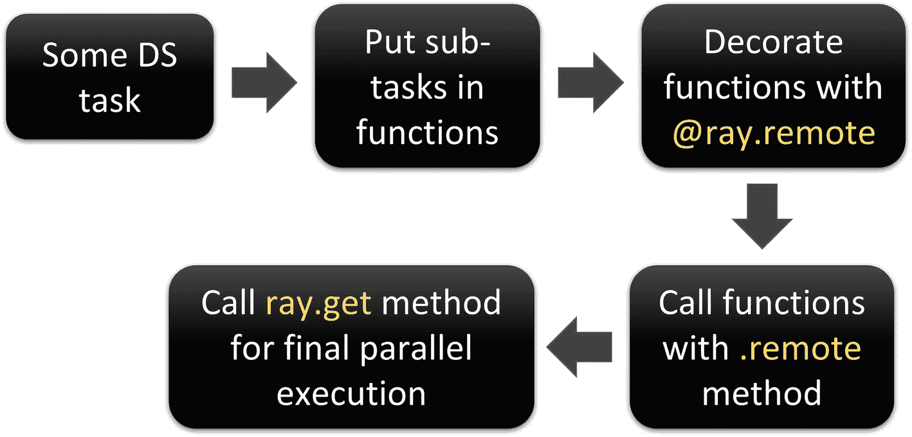

图 10-27：按正确顺序流水线化子组件