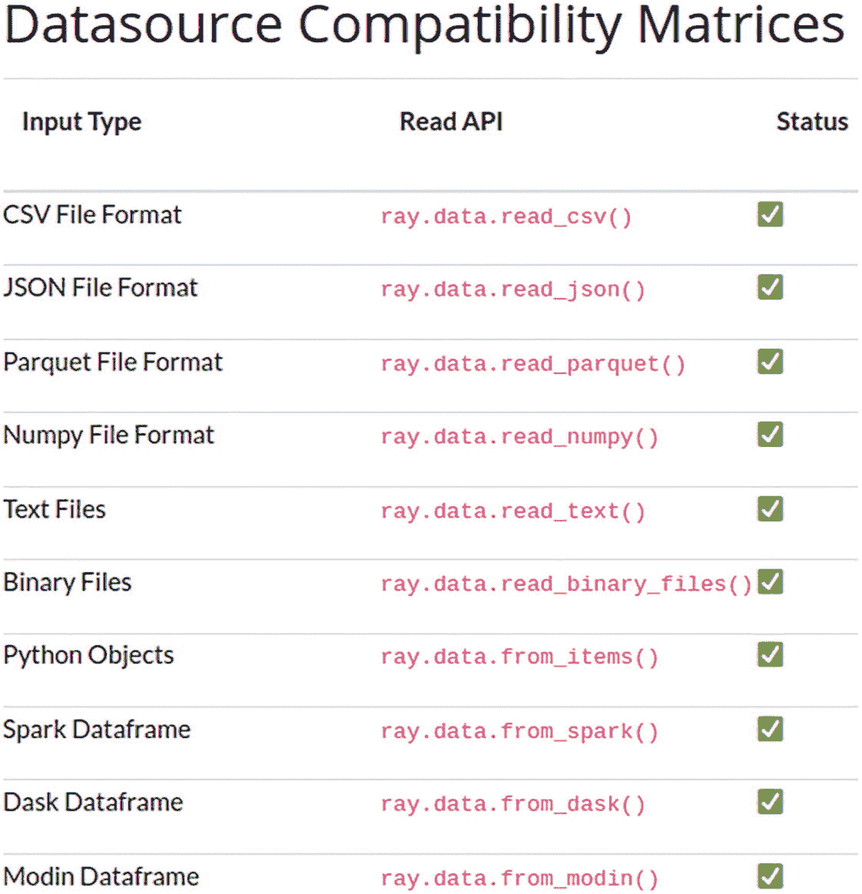
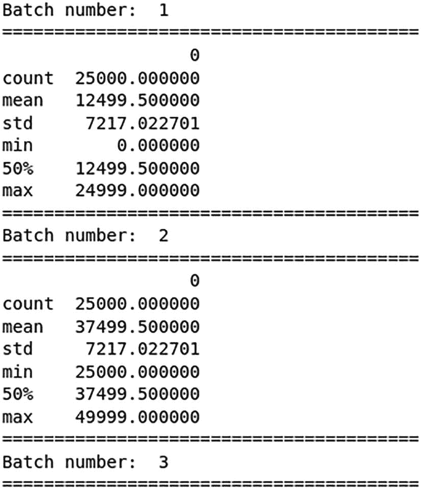

# 用于分布式加载和计算的 Ray Dataset

Ray Datasets（`https://docs.ray.io/en/latest/data/dataset.html`）是在 Ray 生态系统中加载和交换数据的标准（也是推荐）方式。这些对象提供了基本的分布式数据转换功能，例如 `map`、`filter` 和 `repartition`，并且能够与多种文件格式、数据源和分布式框架良好配合，便于加载和转换。它们还专为高性能加载和预处理数据而设计，适用于基于 Ray 构建的分布式机器学习训练流水线，例如 Ray-Train（`https://docs.ray.io/en/latest/train/train.html#train-docs`）。

Ray Datasets 是一个相对较新的功能，从 Ray 1.8+ 版本起以 Beta 形式提供。如果你使用的是较旧版本的 Ray，则需要升级才能使用它们。此外，请确保已安装 `PyArrow` 库。

Ray Datasets 非常适合作为数据处理的“最后一公里”模块（在数据输入到并行化机器学习任务流程之前），适用于初始数据源为传统关系型数据库、ETL 流水线输出甚至 Spark DataFrames 的场景。

此前，我讨论过 Apache Arrow 以及这些现代数据存储格式如何彻底改变数据科学领域。Ray Datasets 的核心实现了分布式 Arrow。每个 Dataset 本质上是一个包含块的 Ray 对象引用列表，这些块持有 Arrow 表（某些情况下为 Python 列表）。这种块级结构带来了并行性，并使其与分布式机器学习训练兼容。这样看来，Ray Datasets 与你在 Dask 中看到的情况类似。此外，由于 Datasets 只是 Ray 对象引用的列表，它们可以在 Ray 的任务、Actor 和库之间自由传递（几乎没有内存操作开销）。这让你在使用和集成方面拥有极大的灵活性，同时提升了系统性能。

如前所述，Ray Datasets 支持日常工作中使用的几乎所有类型的数据源。图 10-28 展示了其输入兼容性的部分概览。



图 10-28

Ray Datasets 输入兼容性概览

例如，你可以使用 `range` 函数创建一个 Ray Dataset：

```
ds = ray.data.range(100000)
```

如果你在 Jupyter notebook 单元格中键入 `ds` 进行查看，将看到：

```
Dataset(num_blocks=200, num_rows=100000, schema=<class 'int'>)
```

因此，默认情况下，它创建了 200 个对象引用块，并为数据分配了整数模式。这种并行性和数据类型集成使得 Dataset 天然比传统数据源（如 pandas DataFrame）更高效。

你可以像对待其他数据集一样对 Dataset 应用映射函数：

```
op_ds = ds.map(lambda x: np.sin(x)+np.cos(x))
```

`op_ds` 本身现在是一个 Ray Dataset，但其模式因操作而发生了变化。

```
op_ds
>> Dataset(num_blocks=200, num_rows=100000, schema=<class 'numpy.float64'>)
```

由于模式发生了变化，现在可以直接使用许多 NumPy 方法。

```
op_ds.std()
>> 1.0000051823664913
```

一个很酷的地方是，你可以将数据的批次（原始数据为整数）作为 Python 列表或 pandas DataFrames 读取，并对这些批次进行计算。这对于在此类数据上进行分布式机器学习训练非常有用。以下代码每次以 pandas DataFrame 的形式读取大小为 25,000 的批次，并打印其统计信息：

```
i = 1
for batch in ds.iter_batches(batch_size=25000, batch_format='pandas'):
    print("批次编号：", i)
    print("=" * 40)
    print(batch.describe(percentiles=[0.5]))
    print("=" * 40)
    i += 1
```

结果如图 10-29 所示。



图 10-29

以 pandas DataFrame 块形式迭代 Ray Dataset 批次的部分结果

Dataset 使得在数据块上以 pandas 方式运行并行数据转换任务成为可能。以下是一个伪代码示例：

```
# 一个 pandas DataFrame UDF
def transform_batch(df: pd.DataFrame):
    # 删除空值。
    df = df.dropna(...)
    # 添加新列。
    df["new_col"] = (...)
    # 转换现有列。
    df["feature_1"] = (...)
    # 删除列。
    df.drop(...)
    # 独热编码。
    categories = ["cat_1", "cat_2", "cat_3"]
    for category in categories:
        (...)
    return df

# batch_format="pandas" 告诉 Datasets 为转换器提供
# 表示为 pandas DataFrame 的块。
ds = ds.map_batches(transform_batch, batch_format="pandas")
```

## 总结

在本章中，我继续讨论了如何利用并行（及分布式）计算工具，使数据科学在大型数据集和模型上具备可扩展性。我探讨了原始数据和大模型都可以通过这些并行处理技术进行处理。随着现代多核 CPU 的出现以及以合理成本（来自云供应商）轻松获取大型计算集群，并行化数据科学的前景一片光明。

我特别关注了两个 Python 框架：Dask 和 Ray。我详细介绍了 Dask 提供的各种核心数据结构和内部表示，它们让并行计算变得简单又有趣。我还结合动手示例详细讨论了 Dask 分布式客户端。对于 Ray，我介绍了基本的 Ray 并行性（使用特殊的装饰器和方法）以及分布式数据加载功能。

在下一章中，我将超越 CPU 的范畴，探讨另一种可扩展性：如何移植到基于 GPU 的系统并利用其优势来完成数据科学任务。


