# 11. 基于 GPU 的高效数据科学

在前两章中，你了解了用于执行超大数据集及分布式/并行化数据科学的多种工具和框架。其核心目标始终如一：提升数据科学管道的生产力。生产力通常与各类数据科学任务（包括数值处理、数据整理和特征工程）的执行速度直接相关。当进入高级机器学习阶段时，根据建模的复杂程度，速度和性能问题甚至会变得至关重要。

如今已公认，现代机器学习系统前所未有的成功，在很大程度上取决于其利用任务优化硬件以并行方式处理海量原始数据的能力。机器学习的历史已清晰表明，像图形处理器（GPU）这样的专用硬件在机器学习的早期成功中发挥了重要作用。

例如，2012 年，亚历克斯·克里热夫斯基（[`https://qz.com/1307091/the-inside-story-of-how-ai-got-good-enough-to-dominate-silicon-valley/`](https://qz.com/1307091/the-inside-story-of-how-ai-got-good-enough-to-dominate-silicon-valley/)）与伊利亚·苏茨克弗以及[杰弗里·辛顿](https://www.cs.toronto.edu/%257Ehinton/)（[`www.cs.toronto.edu/~hinton/`](http://www.cs.toronto.edu/%257Ehinton/)）合作，设计了一个最终被称为 AlexNet（[`https://proceedings.neurips.cc/paper/2012/file/c399862d3b9d6b76c8436e924a68c45b-Paper.pdf`](https://proceedings.neurips.cc/paper/2012/file/c399862d3b9d6b76c8436e924a68c45b-Paper.pdf)）的神经网络，该网络赢得了著名的 ImageNet 大规模视觉识别挑战赛（[`https://en.wikipedia.org/wiki/ImageNet_Large_Scale_Visual_Recognition_Challenge`](https://en.wikipedia.org/wiki/ImageNet_Large_Scale_Visual_Recognition_Challenge)）。在众多创新特性中，它是早期在并行 GPU 组合上训练的神经网络之一，并在 ImageNet 竞赛中以巨大优势击败了经典机器学习算法。因此，深度神经网络的整体概念得到了巨大推动，基于 GPU 的训练硬件在这一成功中所起的关键作用也随之凸显。自那以后，人们投入大量精力构建高度优化的软件工具和定制化的数学处理引擎（包括硬件和软件），以利用 GPU 的算力与架构以及并行计算来服务于人工智能和机器学习。

虽然 GPU 和分布式计算在学术界和商业界被广泛讨论用于核心 AI/ML 任务（例如，运行超过 100 层的深度神经网络进行图像分类，或拥有数十亿参数的 BERT 语言合成模型（[`https://towardsdatascience.com/bert-explained-state-of-the-art-language-model-for-nlp-f8b21a9b6270`](https://towardsdatascience.com/bert-explained-state-of-the-art-language-model-for-nlp-f8b21a9b6270)）），但在常规数据科学和数据工程任务中的实用性却较少被关注。这些与数据相关的任务是 AI 管道中任何机器学习工作负载的必要前提，并且它们通常占据了数据科学家甚至机器学习工程师所花费的时间和智力投入的大部分比例。

事实上，著名的 AI 先驱吴恩达最近谈到，AI 工具开发应从以模型为中心转向以数据为中心（[`https://spectrum.ieee.org/andrew-ng-data-centric-ai`](https://spectrum.ieee.org/andrew-ng-data-centric-ai)）。其核心思想是**不使用大型数据集，而使用更高质量的小型数据集**。这意味着在 AI 工作负载在管道上实际执行之前，需要花费更多时间处理原始数据并进行预处理。观看吴恩达在[`www.youtube.com/watch?v=06-AZXmwHjo`](http://www.youtube.com/watch%253Fv%253D06-AZXmwHjo)的采访（注意这是一个 YouTube 视频链接）。这也意味着，如果能够将 GPU 的强大能力应用到这类 ML 前置数据处理任务中，那么整个管道的效率将立即得到提升。

然而，一个重要问题依然存在：**我们能否将 GPU 的强大能力用于常规数据科学工作（例如数据整理、描述性统计）？** 答案并非显而易见，需要一些特别的考量与知识共享（图 11-1）。在本章中，我将重点介绍一套名为`RAPIDS`的专用工具套件，它能够帮助任何数据科学家在广泛的数据科学任务（不一定是深度学习或高级 ML）中利用基于 GPU 的硬件。我们期望通过利用 GPU 固有的并行处理能力，能够显著提升这类常见数据科学任务的生产力。

## 什么是 ImageNet？

ImageNet 是一项持续进行的研究工作，旨在为全球研究人员提供一个易于访问的图像数据库。该项目源于图像与视觉研究领域日益强烈的共识：对更多数据的需求。**该项目对推动计算机视觉和深度学习研究起到了关键作用**。这些数据免费提供给研究人员用于非商业用途。每年都会围绕这个数据仓库举办一场竞赛，最新的深度学习架构在此相互角逐，算法/架构/技术的性能将根据它们对来自该数据源的图像的处理效果进行衡量。


**图 11-1** “我们能否利用 GPU 的强大能力来处理常规数据科学工作？”


## RAPIDS 生态系统

RAPIDS 是一套开源软件库和 API，能够完全在 GPU 上执行端到端的数据科学和分析流程。Nvidia 孵化了这个项目，并构建了利用 CUDA 原语进行底层计算优化的工具。它特别专注于通过广受数据科学家和分析专业人士喜爱的友好型 Python 语言，来展现 GPU 的并行能力和高带宽内存速度特性。

常见的数据准备和数据整理任务在 RAPIDS 生态系统中备受重视，因为它们占据了典型数据科学流程中的大量时间。一个类数据框式的熟悉 API 已被开发出来，其中融入了大量优化和健壮性设计。它还被定制为能够与多种机器学习算法集成，从而实现端到端的流程加速，且无需承担序列化成本。

RAPIDS 还包含大量对多节点、多 GPU 部署和分布式处理的内置支持。它与其它库集成，使得处理内存溢出（即数据集大小超过单个计算机内存）的数据变得简单易行，方便单个数据科学家使用。

以下各小节将简要介绍该生态系统中数据科学家会发现非常有用的几个最突出的库。

## 什么是 CUDA？

CUDA 是由 NVIDIA 创建的并行计算平台和编程模型。它于 2006 年首次推出，现已发展成为实现 GPU 加速计算的最常见选择，支持多种编程语言（例如 C、C++、Fortran、Python 和 MATLAB）和 API。

一个值得注意的点是，CUDA 本身既不是一种编程语言，也不是一个 API。它是一个用于构建第三方库、SDK 以及性能分析和优化工具的平台。它主要提供用于添加到现有编程语言中的扩展或原语，这些扩展本质上是将计算（由高级语言或 API 执行）直接连接到底层 GPU 硬件。

CUDA 工具包（`https://developer.nvidia.com/cuda-toolkit`）包含 GPU 加速库、编译器、开发工具和 CUDA 运行时。为了在从 AI 到 HPC 的多个应用领域提升性能，开发者可以利用 NVIDIA CUDA-X——一个基于 CUDA 构建的库、工具和技术集合（`www.nvidia.com/en-us/technologies/cuda-x/`）。

## CuPy

CuPy 是一个由 CUDA 驱动的数组库，其外观和操作方式与 NumPy 相似，而 NumPy 是所有使用 Python 进行数值计算和机器学习的基础。在底层，它使用基于 CUDA 的低级库，包括 `cuBLAS`、`cuDNN`、`cuRand`、`cuSolver`、`cuSPARSE`、`cuFFT` 和 `NCCL`，以充分利用给定 GPU 架构，目标是通过 Python 提供 GPU 加速计算。

CuPy 的接口与 NumPy 高度相似，在大多数用例中可以简单地直接替换使用。以下是 CuPy 和 NumPy 之间 API 兼容性的模块级详细列表：`https://docs.cupy.dev/en/stable/reference/comparison.html`。请注意，几乎所有常见的 NumPy 方法都在 CuPy 中进行了复制，并且名称也完全相同。对于数据科学任务，这基本上为您提供了由 GPU 驱动的加速效果，而无需任何显著的学习曲线。

相对于 NumPy 的加速效果可能非常显著，具体取决于数据类型和用例。在下一节中，我将展示一个动手实践示例，比较 CuPy 和 NumPy 在两种不同数组大小以及各种常见数值运算（如切片、对多维数组的 `sum` 和标准差等统计运算、矩阵乘法和逆运算、快速傅里叶变换 (FFT) 以及奇异值分解 (SVD)）上的速度差异。

## CuDF

CuDF 基于 Apache Arrow 列式内存格式构建，是一个 GPU 加速的数据分析库，用于以各种可能的方式加载、连接、聚合、过滤和操作表格数据。它提供了一个类似 pandas 的 API，这对于几乎所有数据工程师和数据科学家来说都不陌生，这并不意外。其理念是数据科学家应该能够使用 CuDF，通过强大的 GPU 轻松加速他们的工作流程，而无需深入研究 CUDA 编程的细节。就像 CuPy 一样，大多数方法都可以从现有的 pandas 代码库中直接替换使用。

但是请注意，目前 CuDF 仅支持 Linux 操作系统，并且适用于 Python 3.7 及更高版本。安装和使用 CuDF 的其他要求包括：

* CUDA 11.0+
* NVIDIA 驱动 450.80.02+
* Pascal 架构或更新版本（计算能力 >=6.0）

因此，在使用 CuDF 之前，您必须完成一些环境设置和安装步骤。这是快速开始使用这个强大库的资源：`https://docs.rapids.ai/api/cudf/stable/10min.html`。

总的来说，无论数据科学家是否使用深度学习，CuPy 和 CuDF 都为他们提供了一个绝佳的机会，可以利用 GPU 加速的计算能力来提高工作效率。

## CuML

CuML 是 RAPIDS 中的另一个库，它使数据科学家、分析师和研究人员能够在 GPU 上运行传统/经典的机器学习算法任务（主要处理表格数据），而无需了解太多 CUDA 编程细节。在大多数情况下，CuML 的 Python API 与流行的 Python 库 `scikit-learn` 相匹配，从而可以快速、轻松地过渡到 GPU 硬件。这是该库的 GitHub 页面，供您关注和深入研究：`https://github.com/rapidsai/cuml`。

除了 CuPy 和 CuDF，在下一节中，您还将探索一些 CuML 函数和方法在常见机器学习任务上的动手实践示例，并将其执行速度和可扩展性与等效的 `scikit-learn` 算法进行比较。

超越笔记本电脑单 GPU 的场景，CuML 还在可能的情况下与 Dask 集成，为越来越多的利用这种分布式处理的算法提供多 GPU 和多节点 GPU 支持。基本上，许多现代高端硬件平台不是配备单个 GPU，而是配备四个甚至八个 GPU，有时通过特殊的内存总线和数据接口通道互连，这些通道完全绕过 CPU 和传统的低速主板通信总线，实现 GPU 到 GPU 的直接连接。

## CuGraph

CuGraph 是 GPU 加速图算法的集合，用于处理 GPU 数据框中的数据。CuGraph 的愿景是使图分析普及到用户只需从分析角度思考，而无需考虑技术或框架的程度。

数据科学家将很容易掌握 CuGraph 如何与类似 pandas 的 CuDF API 集成。另一方面，熟悉 NetworkX 的用户将很快识别出 CuGraph 中提供的类似 NetworkX 的 API，其目标是允许现有代码以最小的代价移植到 RAPIDS 中。目前，它支持广泛的图分析算法：

*   中心性分析
*   社区发现
*   链接分析
*   链接预测
*   遍历算法

许多科学和商业分析任务涉及到对大型数据集使用广泛的图算法。当工程师投资于 GPU 驱动的工作站时，像 CuGraph 这样的库为他们提供了更高生产率的保障。


## 硬件发展史

硬件在这一领域所扮演的角色，其重要性无论如何强调都不为过。在人工智能和机器学习解决方案取得巨大成功并被广泛采用（尤其是深度学习应用）的推动下，针对运行此类工作负载的定制化硬件领域涌现了大量投资和开发。例如，所有主要服务器和工作站供应商（如 HP、IBM、联想、Super Micro 等），此前只专注于为云计算构建计算基础设施，如今也提供了令人眼花缭乱的 GPU 优化硬件选项。谷歌的张量处理单元（TPU；[`https://en.wikipedia.org/wiki/Tensor_Processing_Unit`](https://en.wikipedia.org/wiki/Tensor_Processing_Unit)）就是一个典型的专用集成电路，它从零开始设计，唯一目标就是加速机器学习和深度学习工作负载特有的计算，例如线性代数、矩阵乘法、特殊非线性变换，并支持多种浮点数格式。GPU 研发领域的领导者英伟达也同样在开创许多此类突破性的硬件平台。事实上，一个包含专用存储、共享内存架构和芯片组、主板设计以及数据通信通道和标准的完整硬件生态系统正在积极开发中，以满足人工智能工作负载的需求（图 11-2）。

诚然，此类硬件开发的焦点一直是特定类型的人工智能工作负载，例如大规模计算机视觉、强大的聊天机器人或工业级自然语言处理。尽管如此，借助像 RAPIDS 这样的框架，数据科学家和分析师（即那些在日常工作中不一定使用深度学习的群体）终于可以欢呼雀跃，并使用这些强大的人工智能工作站来提高他们的生产力。

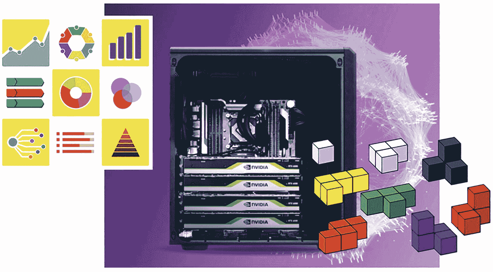

图 11-2

数据科学家可以欢呼雀跃，并使用专为人工智能优化的硬件来完成他们的任务。

### 环境与设置的选择

如前所述，RAPIDS 仅能在 Linux 操作系统上运行，并且需要特定的 GPU 及更高版本。尽管 CuPy 支持早期版本的 GPU，但对于 CuDF 和 CuML，你必须拥有计算能力为 6 或更高版本的 GPU。NVIDIA 提供了一个 GPU 及其计算能力的列表（[`https://developer.nvidia.com/cuda-gpus#compute`](https://developer.nvidia.com/cuda-gpus%2523compute)），你可以查看以确保拥有合适的 GPU，从而利用 RAPIDS 框架。

对于笔记本电脑，如果你的显卡高于 GeForce 1050，RAPIDS 就能运行。这当然包括了 RTX 系列的 GPU。对于工作站，M6000 或 K 系列可能无法运行，但 P400 以上的任何型号都能运行。对于数据中心 GPU（例如，当你租用云实例时），它必须是帕斯卡架构或更高版本，例如 P4、P40、P100、V100 和 A100。

一旦你有了合适的 GPU，还需要确保安装了 CUDA 11.2 或更高版本。之后，需要完成许多自定义设置和环境安装，才能使 RAPIDS 正常工作。因此，有两种常见的实现方式如下：

-   使用托管环境，无需深入了解自定义设置的细节。
-   如果你在裸机 Linux 操作系统上使用（例如在 EC2 实例上），则使用 NVIDIA Docker 镜像。

例如，下面的示例是在 Saturn Cloud 上使用免费的托管设置运行的。该服务是一个完全托管的数据科学云服务，提供基于 GPU 的基础设施和透明的定价。对于免费套餐，每月的免费使用时长有一定限制。不过，对于基础学习来说，免费使用配额（每月 30 小时的 Jupyter Lab 会话）应该足够了。建议你在他们的网站上注册，并跟随本书中的示例（以及附带的 Jupyter notebooks）进行操作。

当你登录 Saturn Cloud 平台时，会看到几个启动 Jupyter notebook 的选项。每个选项都代表一项托管服务（例如，RAPIDS 环境、TensorFlow、PyTorch 或 FastAPI 实例）。图 11-3 展示了所有选项的典型快照（请注意，该截图拍摄于 2022 年 4 月，提供的服务可能已发生变化）。

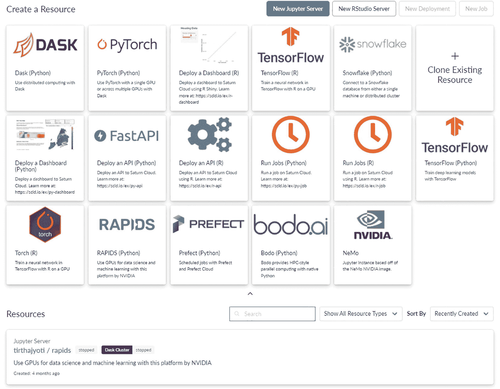

图 11-3

Saturn Cloud 的启动页面，展示了各种托管服务选项

在图 11-3 的底部，你可以看到我已经创建的一个 RAPIDS Jupyter 服务器。当你点击你的版本时，会看到图 11-4 所示的界面，你可以在其中启动 Jupyter lab。本质上，Saturn Cloud 部署了一个 Docker 容器，其中预装了 Jupyter lab、RAPIDS 和其他 Python 库，并在基于 GPU 的硬件/计算节点上进行了正确配置。需要注意的是，他们还为此服务配对了 Dask 集群选项，以便你可以在需要时利用多 GPU 系统。免费套餐限制了你可以利用的 GPU 类型和数量；不过，如前所述，对于基础学习，你不需要超过一个 GPU，因此你不会启动 Dask 集群。

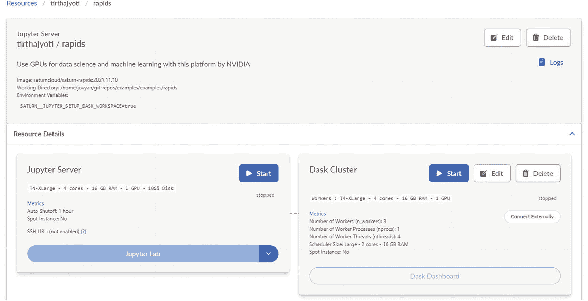

图 11-4

带有 RAPIDS 的 Saturn Cloud 的 Jupyter 服务器

Jupyter lab 启动后，你可以验证是否拥有兼容 RAPIDS 的 GPU。图 11-5 显示了该命令及其典型输出。在这里，GPU 是 Tesla T4（[`www.nvidia.com/en-us/data-center/tesla-t4/`](http://www.nvidia.com/en-us/data-center/tesla-t4/)），CUDA 版本是 11.4，NVIDIA 驱动版本是 470.57.02。

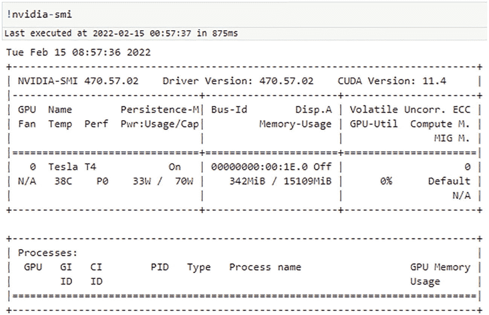

图 11-5

Nvidia 显卡状态命令的典型输出

## CuPy 与 NumPy

在本节中，我将展示一些 CuPy 使用的基础示例，以及它与无处不在的 NumPy 包的比较。由于 NumPy 在几乎所有数据科学和机器学习任务中都有广泛而多样的应用，值得注意的是，通过切换到 CuPy，所有这些任务的生产力很可能都会有显著提升。

### 外观和工作方式与 NumPy 完全相同

如前所述，CuPy API 被设计为 NumPy 代码的即插即用替代品。因此，所有常见的方法都可以使用。首先导入两个库（用于比较）以及其他库：

```
import numpy as np, cupy as cp
import matplotlib.pyplot as plt
import time
```

你可以像在 NumPy 中一样定义数组：

```
a1 = cp.array([1,2,3])
a2 = cp.arange(1,11,2)
a3 = cp.random.normal(size=(3,3))
```

只是类型不同：

```
type(a3)
>> cupy._core.core.ndarray
```

你可以使用所有常见且有用的 NumPy 操作，例如广播、转置、求逆和布尔过滤。

```
a3.T
a3+1
a3.mean(axis=1)
a3*(a3>0)
```

最后一个操作的输出如下：

```
>> array([[ 0.58731747, -0\.        , -0\.        ],
[-0\.        , -0\.        ,  0.7699453 ],
[ 1.80051069,  0.67680871,  1.3091392 ]])
```


### 比 NumPy 快得多

尽管 CuPy 在外观和感觉上与 NumPy 相同，但在高性能 GPU 的支持下，其向量化运算速度要快得多。以下代码可以明确证明这一点：

```
SIZE = 200
%%timeit -n10 -r10
np.random.normal(size=(SIZE,SIZE))@np.random.normal(size=(SIZE,SIZE))
>> 3.67 ms ± 258 μs per loop (mean ± std. dev. of 10 runs, 10 loops each)
```

这段代码测量了 NumPy 执行 `(200 x 200)` 大小矩阵乘法操作所需的平均时间。

现在，让我们运行完全相同的代码，只需将 `np` 替换为 `cp`（即使用 CuPy 数组和方法替代 NumPy）：

```
%%timeit -n10 -r10
cp.random.normal(size=(SIZE,SIZE))@cp.random.normal(size=(SIZE,SIZE))
>> 127 μs ± 40.7 μs per loop (mean ± std. dev. of 10 runs, 10 loops each)
```

即使是一个简单的 `200 x 200` 矩阵乘法，也显示出超过 25 倍的速度提升（127 μs 对比 3.67 ms）。可以想象，对于涉及更大数值数据集的大型数据科学操作，性能提升的幅度会有多大。

### 数据（数组）大小至关重要

上述性能提升会随着数组大小的增加而迅速扩大。让我们通过一组简单的代码来观察这一点。首先，你使用 NumPy 的 `np.linalg.solve()` 方法（即求解一组联立方程）编写一个计时测量代码。回想一下，在底层实现简单的多元线性回归算法时，使用的正是这个方法。

```
import time, tqdm
size=[100*i for i in range(1,21)]
numpy_time = []
for s in tqdm(size):
a = np.array([np.random.randint(-10,10,s).tolist() for i in range(s)])
b = np.array([np.random.randint(-100,100,s)]).T
t1 = time.time()
x = np.linalg.solve(a,b)
t2 = time.time()
delta_t = (t2-t1)*1000
numpy_time.append(delta_t)
```

与之前一样，你必须通过将 `np` 替换为 `cp` 来重复相同的 CuPy 代码。最后，通过简单的绘图代码，你可以清晰地看到对比结果（图 11-6）。注意，性能提升会随数组大小增加而扩大，并且某种程度上是非线性的。这意味着对于更大的数组，性能提升甚至会更快。当然，这种提升只有在数据（数组）能够完全放入 GPU 内存时才能实现。对于拥有数千万行或列的数据集来说，这可能是一个限制，因为 GPU 内存可能比系统内存 (RAM) 小。然而，可以设计许多批量操作或分段操作来规避这一限制，同时仍然实现显著的加速效果。

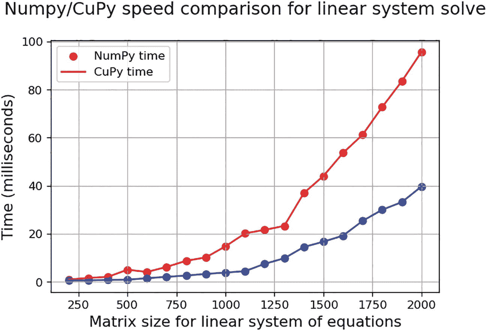

图 11-6

线性系统求解中 CuPy 与 NumPy 在不同数组大小下的对比

接下来，让我们使用不同大小的随机生成方阵（从正态分布中抽取）来解决奇异值分解（SVD）问题。为了简洁起见，我在这里不再重复代码块，只展示结果（图 11-7）。请注意，在此类问题中，CuPy 算法并未表现出明显优于 NumPy 算法的性能。这或许是 CuPy 开发者需要改进的地方。

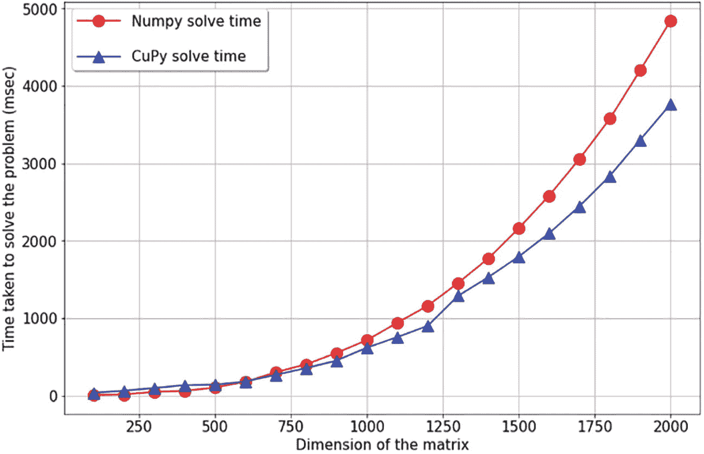

图 11-7

SVD 中 CuPy 与 NumPy 在不同矩阵大小下的对比

接下来，让我们回到基础，考虑矩阵求逆这个基本问题（几乎用于所有机器学习算法）。结果再次显示出 CuPy 算法相对于 NumPy 包具有非常有利的性能提升（图 11-8）。

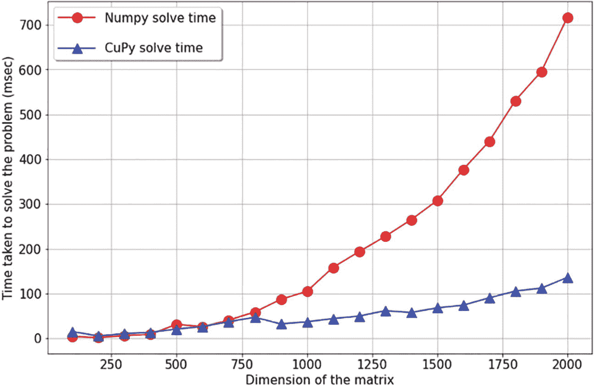

图 11-8

矩阵乘法任务中 CuPy 与 NumPy 的对比

## CuDF 与 pandas 对比

让我们使用相同的 Saturn Cloud 实例，并启动一个新的 Jupyter notebook 来进行这项练习。目的是展示一些 CuDF 的基本操作，并演示与 pandas 进行简单的计算速度比较。

### 从 URL 读取数据

让我们从托管在我个人 GitHub 上的一个 URL 读取数据集：

```
import numpy as np, cupy as cp, cudf
import pandas as pd

url = "https://raw.githubusercontent.com/tirthajyoti/Machine-Learning-with-Python/master/Datasets/College_Data"
content = requests.get(url).content.decode('utf-8')
cdf = cudf.read_csv(StringIO(content))
```

于是你通过互联网读取一个 CSV 文件并将其加载到 CuDF DataFrame 中。你可以使用熟悉的 `.head()` 方法来检查前几项内容：

```
cdf.head()
```

这将产生如图 11-9 所示的输出。

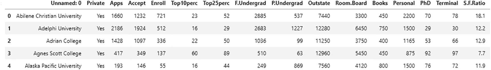

图 11-9

从 URL 加载数据后 CuDF DataFrame 的前几项内容

### 索引、过滤和分组

索引、列命名和过滤的操作方式与 pandas API 完全相同。首先，将 `Unnamed: 0` 列重命名为更有意义的名称：

```
cdf.rename(columns={"Unnamed: 0": "College"}, inplace=True)
```

然后你可以查看数据的一小部分：

```
cdf[['F.Undergrad','P.Undergrad']][2:4]
```

这将产生如图 11-10 所示的输出。

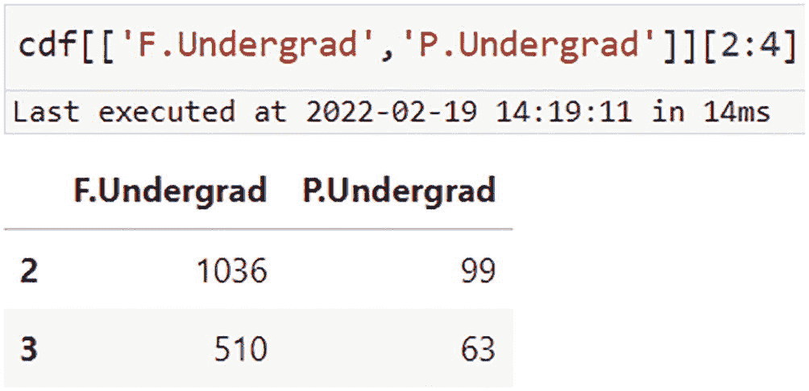

图 11-10

CuDF DataFrame 对选定列和行进行索引

现在尝试一个稍微复杂的过滤操作，以提取并列出那些师生比例合理（低于 10）且学费支出较低（低于 8000 美元）的学院：

```
filter_1 = cdf['S.F.Ratio']< 10
filter_2 = cdf['Expend'] < 8000
cdf[filter_1 & filter_2 ][['College','S.F.Ratio','Expend']]
```

结果如图 11-11 所示。

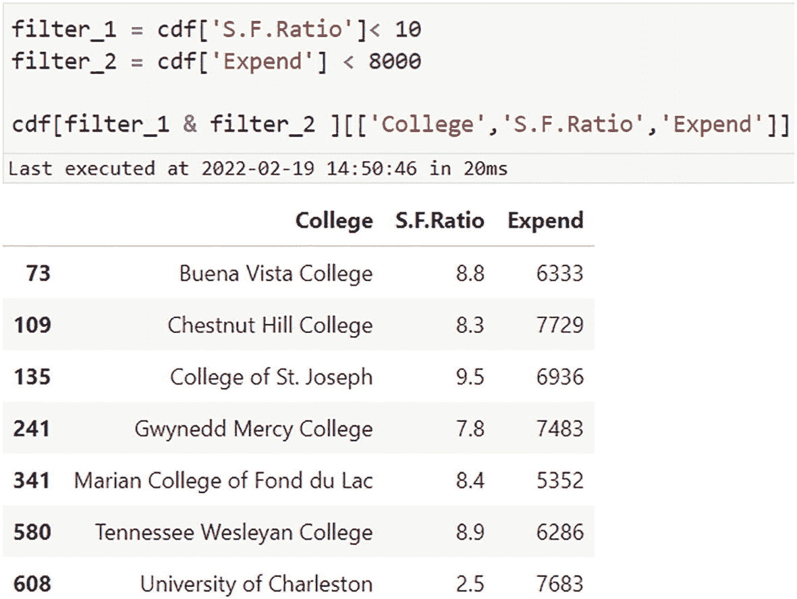

图 11-11

对 CuDF DataFrame 进行多重过滤操作

分组操作后接聚合操作，其工作方式也与 pandas 相似（图 11-12）。

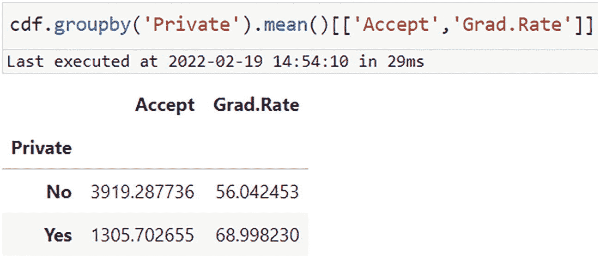

图 11-12

对 CuDF DataFrame 进行分组和平均操作

### NumPy 数组转换

在许多情况下，特别是为了绘图和可视化，你可能需要将 CuDF 数据字段转换为标准的 NumPy 数组。在这些情况下，仅使用标准的 `.values` 属性只会得到一个 CuPy 数组。要获取 NumPy 数组，你需要在它之上使用 `.get()` 方法。

以下是你仅使用 `.values` 得到的结果：

```
phds=cdf['PhD'].values
type(phds)
>> cupy._core.core.ndarray
```

使用 `.get` 方法，你将获得 NumPy 数组，并且可以绘制博士数量的直方图（图 11-13）。

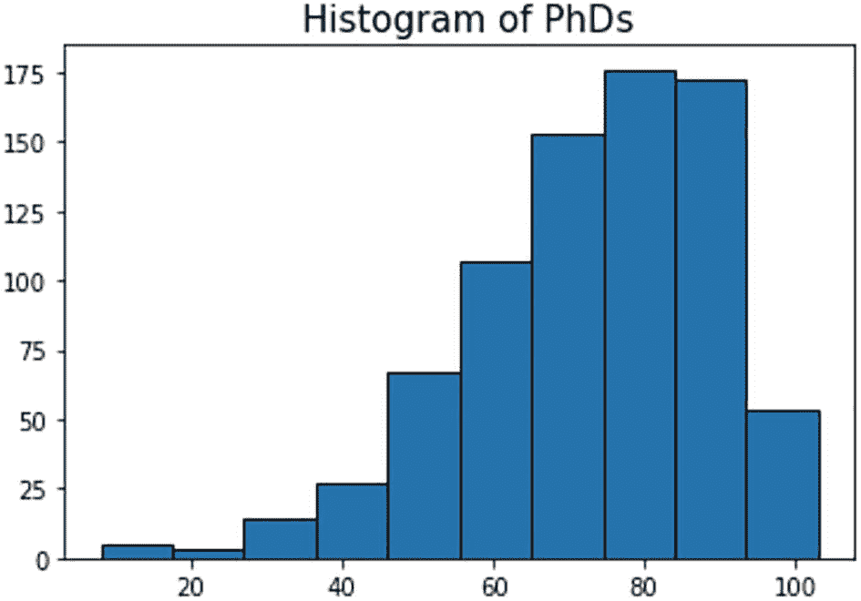

图 11-13

NumPy 数组转换后，来自 CuDF DataFrame 的博士数量直方图

```
phds=cdf['PhD'].values.get()
plt.title('Histogram of PhD',fontsize=15)
plt.hist(phds,edgecolor='k')
plt.show()
```


### 简易速度基准测试

通过一个非常简单的基准测试，你可以展示使用 `CuDF`（当然，是在 T4 GPU 上）带来的计算性能提升。

首先，构建一个包含 100 万行、100 列随机数（从高斯分布中抽取）的 `NumPy` 数组，然后将其分别转换为 `pandas` DataFrame 和 `CuDF` DataFrame：

```
data = np.random.normal(size=(1000_000,100))
df = pd.DataFrame(data)
cdf = cudf.DataFrame.from_pandas(df)
```

这里，`.from_pandas` 方法可以快速、轻松地将现有的 `pandas` DataFrame 转换为 `CuDF` DataFrame。

对第一列进行简单的 `mean` 计算，`pandas` DataFrame 的输出结果如下：

```
%timeit -n10 -r10 df[0].mean()
>> 15 ms ± 1.16 ms per loop (mean ± std. dev. of 10 runs, 10 loops each)
```

对 `CuDF` DataFrame 执行相同的操作，结果要快得多：

```
%timeit -n10 -r10 cdf[0].mean()
>> 504 μs ± 52.7 μs per loop (mean ± std. dev. of 10 runs, 10 loops each)
```

为了进一步扩展测试，你运行一个循环，每次选择递增数量的列，观察计算时间如何随列数变化，以及 `pandas` 和 `CuDF` 之间的基准测试对比情况：

```
for i in range(2,11):
t1=time.time()
df[[j for j in range(i)]].mean()
t2=time.time()
del_t = round(1000*(t2-t1),3)
print(f"Calculation with {i} columns took {del_t} ms")
>>
Calculation with 2 columns took 3.333 ms
Calculation with 3 columns took 2.835 ms
Calculation with 4 columns took 2.878 ms
Calculation with 5 columns took 3.269 ms
Calculation with 6 columns took 3.589 ms
Calculation with 7 columns took 4.11 ms
Calculation with 8 columns took 4.606 ms
Calculation with 9 columns took 4.99 ms
Calculation with 10 columns took 5.478 ms
```

对于 `CuDF` DataFrame，计算时间要短得多，并且其随列数增长而增长的速度也更慢：

```
Calculation with 2 columns took 3.333 ms
Calculation with 3 columns took 2.835 ms
Calculation with 4 columns took 2.878 ms
Calculation with 5 columns took 3.269 ms
Calculation with 6 columns took 3.589 ms
Calculation with 7 columns took 4.11 ms
Calculation with 8 columns took 4.606 ms
Calculation with 9 columns took 4.99 ms
Calculation with 10 columns took 5.478 ms
```

### Dask 集成、用户自定义函数及其他特性

`CuDF` 可以与 `Dask` 集群良好配合，利用多 GPU 的能力进行大规模并行数据处理。它还原生支持在选定的轴或列上应用复杂的用户自定义函数（简称 UDF）。这些函数逐块工作（针对 GPU 内存中数据的内部表示），并且比基于 CPU 的 `pandas` 工作流表现出更快的计算速度。为简洁起见，我不会涵盖所有这些特性，但鼓励您查看 RAPIDS 门户网站上提供的优秀教程：[`https://docs.rapids.ai/api/cudf/stable/user_guide/10min.html`](https://docs.rapids.ai/api/cudf/stable/user_guide/10min.html)。

## CuML vs. scikit-learn

在介绍了 `CuPy` 和 `CuDF` 的基本用法，并展示了与 `NumPy` 和 `pandas` 的对比基准测试之后，接下来进入数据科学流程的下一阶段，讨论 `scikit-learn` 的 GPU 加速等价物：`CuML`。

由于传统上 GPU 硬件的大多数常规用途都集中在机器学习领域，因此有必要澄清本次对比讨论的内容。这里，我们只关注机器学习世界中非深度学习的方面（即数据科学家会应用源自 `scikit-learn` API 的现成算法的情况）。关键在于，在这种情况下，如果数据科学家能够使用基于 GPU 的系统，他们可以在不花费任何时间或精力修改代码或学习 GPU 编程的情况下，显著提升计算性能。这些情况下，不需要 `TensorFlow`，但必须充分利用 GPU 的能力。

### 使用随机森林进行分类

在此练习中，您将使用 `scikit-learn` 的 `RandomForestClassifier` 在合成数据集上进行训练，并将其性能与速度与 `CuML` API 中类似的分类器进行比较。首先，创建一些包含 10,000 个样本和 20 个特征的合成数据：

```
NUM_ROWS = 10000
NUM_FEATURES = 20
from sklearn.datasets import make_classification
X,y = make_classification(n_samples=NUM_ROWS,
n_classes=2,
n_features=NUM_FEATURES,
n_informative=NUM_FEATURES,
n_redundant=0,
n_repeated=0)
```

您已经从各自 API 中导入了必要的函数和类。然而，对于此类对比研究，需要注意命名问题，因为 `scikit-learn` 和 `CuML` 的类和函数名称在很大程度上是相同的。因此，您可以在导入时创建自己的版本：

```
from sklearn.model_selection import train_test_split as sk_tts
from cuml.model_selection import train_test_split as cuml_tts
from sklearn.ensemble import RandomForestClassifier as SKRF
from cuml.ensemble import RandomForestClassifier as CURF
```

请注意，您不仅导入了分类器，还从 `CuML` 导入了训练/测试拆分工具。通常的做法是，当您利用 GPU 的能力时，应尽可能使用 `CuML` 提供的每一个 API 功能。

为了进行恰当的对比和数据保护，您构建了两个独立的函数，一个使用 `scikit-learn` 流程，另一个使用 `CuML` API。以下是 `scikit-learn` 版本：

```
def sklearn_pipeline(X,y,n_estimators=100):
"""
Executes Sklearn-based pipeline
"""
t1 =time.time()
X_train, X_test, y_train, y_test = sk_tts(X,y, test_size=0.3)
model = SKRF(n_estimators=n_estimators)
model.fit(X_train,y_train)
t2 =time.time()
del_t = round(1000*(t2-t1),3)
score = round(model.score(X_test,y_test),3)
return (score, del_t)
```

以下代码是 `CuML` 版本。注意，为了与某些 GPU 计算兼容，数据类型被更改为 `np.float32`（即 `CuML` 使用 32 位浮点精度）。同时，`CuML` API 仅适用于 `CuPy` 数组，这就是需要进行 NumPy 到 `CuPy` 转换的原因。尽管如此，您测量的是整个流程所花费的总时间，而不仅仅是训练/拟合部分。该函数返回一个元组，包含（在测试集上的）分类分数和执行时间。

```
def cuml_pipeline(X,y,n_estimators=100):
"""
Executes CuML-based pipeline
"""
t1 =time.time()
X = cupy.array(X,dtype=np.float32)
y = cupy.array(y,dtype=np.float32)
X_train, X_test, y_train, y_test = cuml_tts(X,y, test_size=0.3)
model = CURF(n_estimators=n_estimators)
model.fit(X_train,y_train)
t2 =time.time()
del_t = round(1000*(t2-t1),3)
score = round(model.score(X_test,y_test),3)
return (score, del_t)
```

然后，您只需连续运行这些流程。对于 `scikit-learn` 的情况，结果如下：

```
score_sk, t_sk = sklearn_pipeline(X,y)
print("Sklearn pipeline score: ",score_sk)
print("Sklearn pipeline time (ms): ",t_sk)
>>
Sklearn pipeline score:  0.937
Sklearn pipeline time (ms):  2132.17
```

对于 `CuML` 流程，结果如下：

```
score_cuml, t_cuml = cuml_pipeline(X,y)
print("CuML pipeline score: ",score_cuml)
print("CuML pipeline time (ms): ",t_cuml)
>>
CuML pipeline score:  0.936
CuML pipeline time (ms):  100.471
```

您可以观察到，对于相同的数据输入，`CuML` 流程实现了巨大的速度提升。两个流程的准确率得分几乎相同，`CuML` 的得分在第三位小数上存在差异，这可能是由于 32 位浮点精度转换造成的。但速度的提升远远弥补了这一微小的精度变化。


在运行代码（或关联的 Jupyter notebook）时，首次运行可能会得到一个结果显示 scikit-learn 管道比 CuML 管道更快。这与 GPU 内存如何随代码和数据预取及缓存有关，并且仅发生在第一次运行时。这种情况应予忽略。若再次运行代码，您应得到与此处所示结果相同的趋势。

进一步扩展，让我们研究当使用 CuML 时，模型复杂度是否会影响其相对于 scikit-learn 的性能提升。将相同的数据拟合到复杂度递增（即，根估计器/树的数量增加）的随机森林模型中。图 11-14 所示结果清晰地表明：**随着模型复杂度的增长，CuML 及其并行化（GPU 驱动）操作能够显著帮助如随机森林这样的集成分类器**。虽然两个分类器的计算时间都在增加，但与 scikit-learn 相比，CuML 的增长速度极小。准确率得分存在一些微小差异，但计算效率方面的收益更为显著。

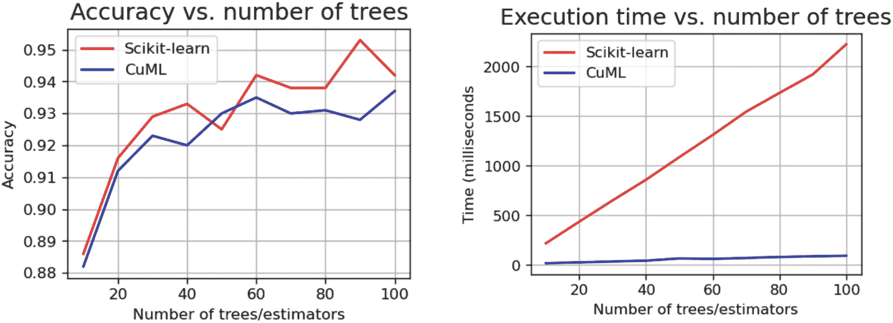

**图 11-14：** 使用 scikit-learn 和 CuML 的不同复杂度随机森林分类器

### K-Means 聚类

接下来，考虑一个使用广为人知的 k-means 算法的无监督聚类学习问题。在这里，您再次将 CuML 函数与 Scikit-learn 包中的等效估计器进行比较。仅供参考，图 11-15 展示了这两个估计器之间的 API 比较。它们看起来几乎相同，除了 CuML 使用称为“可扩展 k-means++”作为初始化参数。CuML 的 k-means 估计器还接受一个 `max_samples_per_batch` 参数，该参数允许进行受控的批量训练。

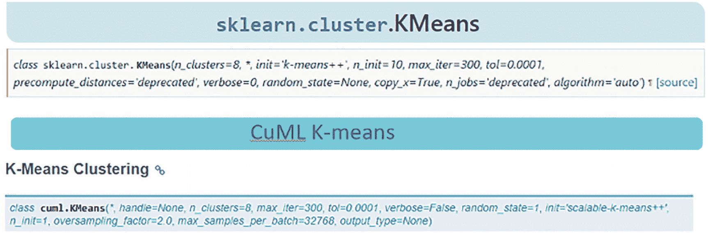

**图 11-15：** scikit-learn 和 CuML K-means 估计器之间的 API 比较

图 11-16 展示了一个具有 10 个特征/维度的数据集的结果。

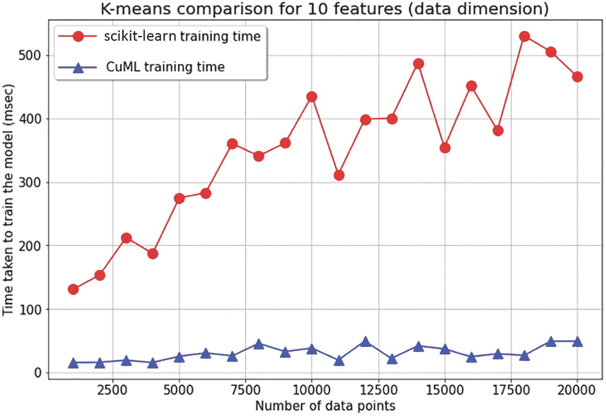

**图 11-16：** 10 个特征的 K-means 聚类速度比较

图 11-17 展示了另一个具有 100 个特征的数据集实验的结果。显然，样本量（行数）和维度（列数）都对基于 GPU 的加速性能如此出色有影响。

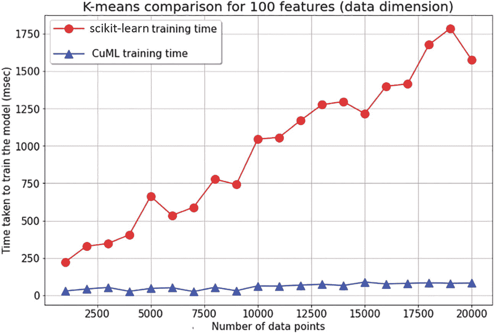

**图 11-17：** 100 个特征的 K-means 聚类速度比较

关于线性回归问题的进一步讨论和结果可在我写的这篇文章中找到：`https://medium.com/dataseries/gpu-powered-data-science-not-deep-learning-with-rapids-29f9ed8d51f3`。建议您查阅一下。

## 总结

本章重点介绍基于 GPU 的硬件系统在数据科学任务中的使用和应用，这些任务不一定涉及深度学习模型或推理，但仍然可以从以硬件为中心的优化中显著受益。

我向您介绍了 RAPIDS 这个出色的生态系统，它是一个以 GPU 为中心的数据科学框架，拥有用于数值计算、表格数据分析、经典机器学习、图分析甚至信号处理的独立库。该框架由 CUDA 加速库驱动，并充分利用了 NVIDIA GPU（高于特定代的 GPU 类别和计算能力）。

然而，其最佳特性是所有模块都试图模仿它们的非 GPU 纯 Python 对应物，如 NumPy、pandas 和 scikit-learn。因此，对于数据科学家来说，学习曲线很短，并且在大多数情况下，几乎可以原样替换代码。遵循这一原则，接下来您看到了多个动手示例，展示了使用由 Tesla T4 GPU 驱动的托管运行时（在云端）对这些库进行基本应用。我还展示了等效操作和机器学习算法的计算性能基准测试比较，以清晰展示 GPU 加速数据科学的优势。

