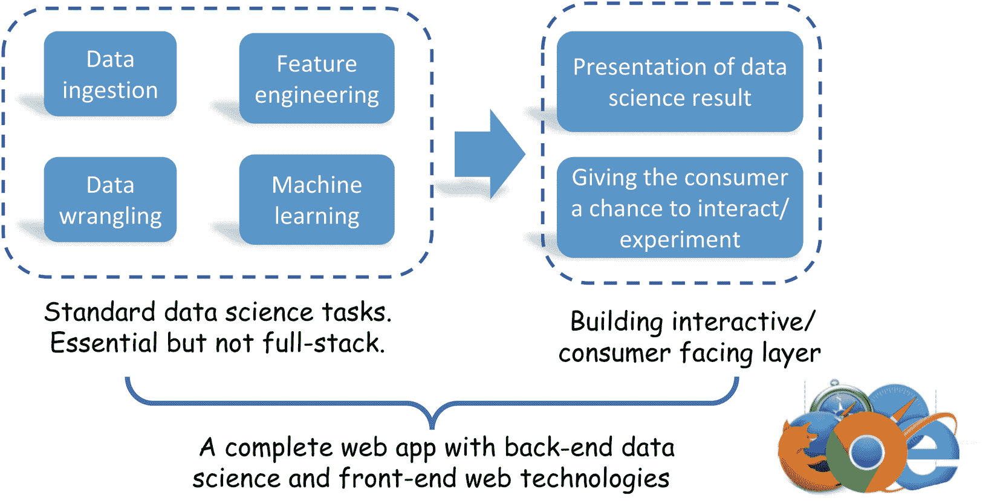

# 12. 其他需要掌握的实用技能
在本书中高效且富有成效的数据科学之旅即将结束之际，我想用整整一章来介绍数据科学家应努力掌握的各种不同实用技能，以提高其生产力。与前面章节中您会看到相似归类的技能（例如，内存分析器或分布式计算工具）不同，您将在本章中探索的工具和技能可能看起来有些互不关联。确实，它们不属于同一类别，但作为一个整体，它们确实能帮助任何数据科学家以更高的效率执行任务。
我首先讨论学习基本 Web 技术（如 `HTML`、`CSS` 和 `JavaScript`）的重要性。基于相同的概念，接下来我将讨论为数据科学项目创建一个简单 Web 应用程序的实用性。我将展示一个使用两个 Python 库（`Flask` 和 `PyWebIO`）的动手示例。之后，我会介绍诸如 Amazon Web Service 之类的云技术，并展示（附有链接资源）将云能力引入本地数据科学工作流的简单过程。最后，我转换话题，讨论在许多情况下，使用所谓的“低代码”框架对数据科学任务是有用且高效的。在这方面，我将演示 `PyCaret`，一个流行的低代码 Python 库。
如您从以上描述中所见，与之前的章节不同，本章并不侧重于一个（或少数几个）Python 工具/库。虽然我可能在部分章节中讨论一些有用的 Python 库，但在其他章节中，我可能会讨论通用技术特性，而不涉及特定的 Python 工具。在这些章节中，我可能会就学习哪些主题以及如何进行学习给出一般性建议。
## 理解 Web 技术基础
您可能会疑惑为什么数据科学家需要理解 Web 应用程序或通用 Web 技术的细节。答案在于一个简单的事实：数据科学家的责任不应仅限于统计分析或构建 ML 模型。最重要的是，数据科学家的工作是使用数据，以科学的方式解决业务或科学问题。以可访问（甚至交互式）的方式向外部世界传达结果并展示建模和分析，是任何合理数据科学工作的必要目标。
### 面向消费者的交互层
换言之，虽然分析数据集、发现隐藏模式以及构建预测模型被公认为是数据科学家的核心技能，但同样重要的是，要将从这些分析中提取的关键见解传达出来，或在模型之上构建某种交互层，作为外部消费者的接触点。如果数据科学家正考虑打造一款面向消费者的产品，甚至利用数据科学方法自行创业，那么这些方面将尤为重要。
为了在数据科学核心之上构建一个可正常运行的面向消费者的交互层，创建一个网络应用是显而易见的选择。在个人计算的早期（大致直到 21 世纪初），构建一个独立的桌面应用或许就已足够。这类应用所需的技术和工具与构建网络应用的工具截然不同。然而，在当今世界，任何计算或信息技术产品都期望拥有网络应用形式，数据科学在这方面也不例外。因此，数据科学家了解构建此类应用的基础知识是合情合理的。所有惯用的数据科学工具和技术仍将被充分使用，只是最终需要通过一个网络应用来展现可呈现的输出端或用户交互层，如图 12-1 所示。

**图 12-1** 一个全方位的数数据科学项目，前端具备网络应用形式的面向消费者交互层
### 所有有用的数据科学都通过网络应用交付
从消费者的角度观察，我们会发现几乎所有*有用的数据科学*都是通过这样或那样的网络应用交付给我们的。当我们在 Netflix 上观看一部推荐电影，或在亚马逊上购买一件商品时，背后都存在一个推荐引擎和复杂的机器学习算法，这些算法由关于我们自身、我们的购买/观看习惯和偏好的 PB 级数据驱动。但最终，所有这些复杂数据科学工作的累积成果，都通过一个简单的网络界面呈现出来，向我们展示一个可供点击和享受的电影或商品链接。
现在，在任何规模适中的组织中，网络应用开发者很可能是一个独立于数据科学团队的个体（或团队）。然而，对于数据科学家来说，深入了解（达到合理的程度）完整的技术栈细节是极其有益的——这个技术栈始于源数据（由他们的团队负责），止于由其他软件工程师使用不同技术栈开发的、精美闪亮的网络应用。这类知识能够促进对话和头脑风暴，以解决现有问题（无论是数据端还是网络应用端的问题），并激发创新想法。
这类对话涉及多个维度，有助于解决问题和推动产品创新。下面给出一些典型示例。假设一个典型场景：后端运行着数据科学处理管线（并集成了某些数据库），同时有一个网络应用将该管线的结果提供给用户，这些用户可能登录门户网站，甚至付费使用部分服务。
-   当前的数据科学/处理管线是否便于网络应用的扩展？面临哪些挑战？数据科学团队能提供何种帮助？
-   可视化的哪些部分应在数据科学后端（例如，使用 Python 框架）完成，哪些部分应在前端使用 `JavaScript` 渲染？哪个 `JavaScript` 库能更好地与 Python 数据对象协同工作？需要注意哪些陷阱？
-   数据科学层与部署层之间的确切接触点在哪里？交互式用户输入及其对数据科学管线有何影响？
-   应如何组织和安排数据科学任务以辅助网络应用？各种服务的容器化情况如何？这有助于提升应用的服务质量和降低延迟吗？
-   关于数据存储和数据库的策略应如何制定，以使其既能很好地服务于数据科学后端，又能很好地服务于网络应用前端？
-   还有哪些其他后端服务（例如，用户授权、金融交易）必须与数据科学服务良好配合？它们之间存在哪些依赖关系？
显然，要对企业整体运营产生有意义的影响，数据科学团队必须对所使用的全套工具和技术有良好的掌握（仅举几例常见技术：`HTML`、`CSS`、`JavaScript`、`PHP`、`Ruby on Rails`、`Docker`、`Kubernetes`）。其他与数据科学服务（使用`Python`）紧密协作、甚至可能（在数据发送到前端之前）以某种方式消费数据科学管线输出的后端服务，可能使用如`Go`或`Rust`等语言编写。
这里的要点是：数据科学家无需成为所有这些工具和技术的专家。但他们必须保持好奇心去了解更多，并有倾向将完整的技术栈视为一个整体的、以数据为导向的赋能工具。基于 `Python` 的数据科学是企业中至关重要的一环，但正是整个技术栈将最终价值交付给客户，并为组织带来收入。
### 有哪些学习途径？
网络应用（以及完整的基于网络的服务）开发，及其相关的工具和技术，或许是软件工程和信息技术领域中最庞大的知识领域。其中存在令人眼花缭乱的选择和种类、标准和协议、语言和框架，以及良莠不齐的实践。试图教你这些技术既不在本书的范围之内，也非作者的专业所长。然而，我认为一些基于具体示例的建议可以鼓励你在数据科学之旅中探索这些领域。这些建议可能包括但不限于以下示例：
-   学习基于数据分析项目构建并部署一个简单的网络应用，其中包含探索性可视化和一个简单的预测模型
-   深入学习基于 `Python` 的网络微框架，例如`Flask`或`FastAPI`，并学习如何使用它们来部署机器学习模型
-   学习一个专为可视化分析设计的前端框架，例如`D3.js`。追寻这类知识能让你扎实掌握 `JavaScript` 编程基础，同时，看到网络可视化数据分析的强大功能也能让你保持动力
-   学习 `Markdown` 语言并掌握基础的 `CSS` 技能，以便为你开发的 `GitHub` 仓库和开源数据科学项目及工具包创建美观的 Readme 文档
-   学习并实现将数据库集成到 `Python` 数据科学服务中，且要考虑到实际运行的网络应用
-   学习容器技术，了解它们如何丰富现代网络应用，以及它们如何帮助组织摆脱老一代的单体软件构建实践
从这些建议中可以清楚地看出，它们特别针对那些并非软件或网络开发背景出身的数据科学家。事实上，有许多网络开发人员对数据科学充满热情，并正在逐步转型为数据科学家角色。他们自然早已对这些工具非常熟悉。而正是另一部分数据科学从业者，他们来自物理学、经济学、统计学和社会科学等不同背景，当他们在自己的技能库中增加与网络相关的技术时，会让他们自身受益匪浅。拥有如此全面的知识和应用的整体视野，将有助于他们在工作中取得成功，并为迎接新的挑战做好准备。