# 为数据科学构建简易 Web 应用

在本节中，我将演示如何构建一个基于若干数据科学任务和服务的简易 Web 应用。首先，我将展示一个使用最流行的 Python Web 框架之一`Flask`的机器学习模型预测示例。这需要你编写一个 Python 脚本和一个将在网页上渲染的 HTML 脚本。用 Web 应用开发的术语来说，Python 是后端（负责执行机器学习等数据科学任务），而 HTML 则是该应用的前端技术。

接下来，我将展示另一个 Python 库，它进一步简化了前端编程部分，让数据科学家能够专注于数据科学本身，同时以极低的学习成本构建出实用的 Web 应用。

## `Flask`动手实践示例

`Flask`是一个强大且轻量级的 Python Web 框架，可用于构建响应迅速的 Web 应用。它在数据科学社区中尤其受欢迎，因为它学习曲线相对平缓，同时又为构建展示数据科学工作（模型或分析）的实用 Web 应用提供了极大的灵活性。它能有效处理 Web 应用中的许多环境和项目配置工作。因此，开发者（此处指数据科学家）可以专注于真正的数据科学代码和方法，而`Flask`则负责处理 HTTP、路由、静态资源等。

互联网上有很多关于`Flask`的优秀学习资源，如果你有兴趣学习这个库，建议自行查找。这里我不深入探讨这些细节，而是直接展示一个用于机器学习模型预测的小型 Web 应用的代码和结果。

一个文件夹中包含两个主要文件/脚本：一个 Python 脚本（包含`Flask`代码）和一个用作应用前端的 HTML 文件。这两个文件随书提供。Python 脚本加载了一个预训练的机器学习模型，该模型使用简单的逻辑回归模型，在著名的成人收入数据集（[`https://archive.ics.uci.edu/ml/datasets/adult`](https://archive.ics.uci.edu/ml/datasets/adult)）上进行了分类任务训练。

我不会深入介绍 HTML 文件的细节，因为这并非本书的重点。我只会展示 HTML 的输出结果，即它生成的页面（图 12-2 至 12-4）。你可以看到接受数字输入的文本框和带有分类选项的下拉框。机器学习模型经过训练，可以处理这两种输入类型。但基于`Flask`的脚本必须仔细地将从 HTML 页面接收的输入进行转换和编码，以便与机器学习模型无缝处理。

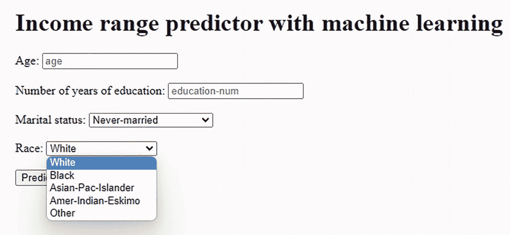

图 12-4：应用上显示的种族下拉选项

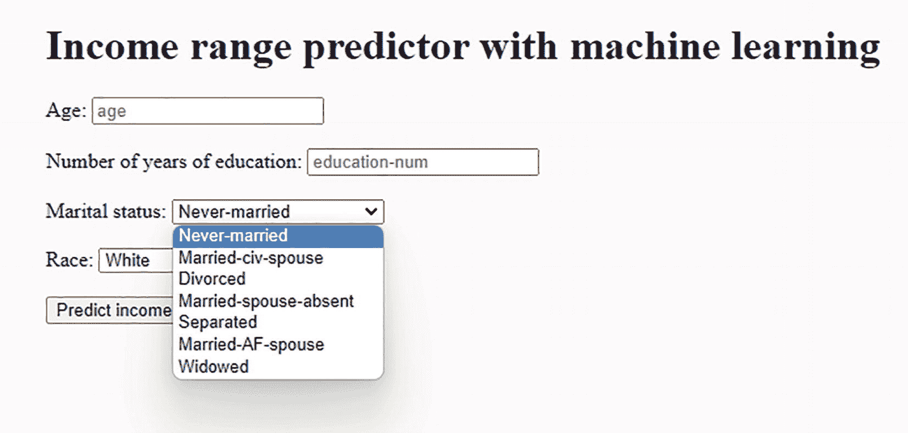

图 12-3：应用上显示的婚姻状况下拉选项

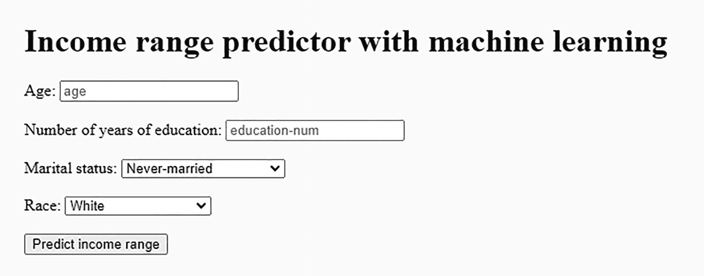

图 12-2：收入范围预测模型应用页面

接下来，我们将逐段介绍`Flask`应用代码：

```python
from flask import Flask, render_template, request
import pickle
import numpy as np
app = Flask(__name__)
# 从 pickle 转储加载模型和缩放器对象
model = pickle.load(open('income_model.pkl','rb'))
scaler = pickle.load(open('income_model_scaler.pkl','rb'))
```

这里，我们创建了`app`对象作为`Flask`类的实例，并从 pickle 转储中加载了两个对象：预训练的机器学习模型`model`和一个 scikit-learn 缩放对象`scaler`。这个`scaler`是`MinMaxScaler`类的一个实例，用于在训练模型时缩放输入数据。为了进行正确的预测，需要将其保存并加载到应用中。模型的训练是单独进行的，并记录在随书提供的 Jupyter notebook 中。

下一段代码仅使用`@app.route`装饰器创建了两个路由（或端点）。这里值得注意的是`home`函数定义中使用的`render_template`函数，你需要在此传入 HTML 文件的名称。该文件必须存储在名为`templates`的文件夹下，该文件夹与`Flask`应用脚本所在的目录相同。文件/资源的典型排列方式如图 12-5 所示。


预测路由用于装饰主预测函数 `predict()`，该函数在此代码片段中未显示。在这个路由中，你定义了 `methods` 参数，它列出了该路由允许的 URL 方法：`GET` 和 `POST`。这些是浏览器（客户端）可以在此路由上执行的操作。这些方法本质上是任何 Web 应用中客户端（前端）与服务器（后端）之间进行基本数据交换的方法。

```python
# 首页
@app.route("/")
def home():
return render_template('ml1.html')

@app.route("/predict", methods=['GET','POST'])
# 预测函数
def predict():
…
```

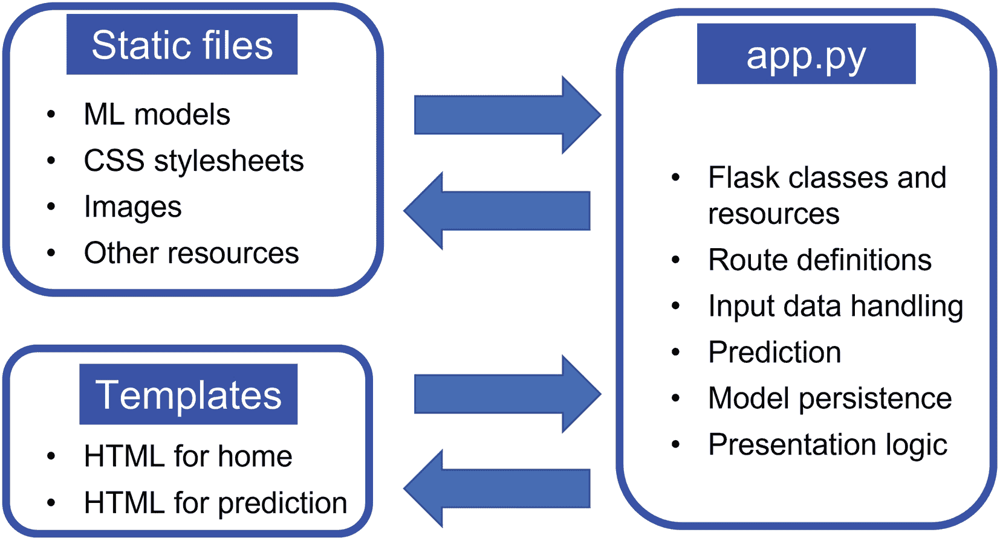

**图 12-5** 典型的 Flask 应用文件和资源布局

接下来是预测函数的详细内容：

```python
def predict():
    if request.method == 'POST':
        # 从表单中获取数据
        age = int(request.form["age"])
        education_num = int(request.form["education-num"])
        marital_status = request.form["maritalstatus"]
        race = request.form["Race"]
        # 将婚姻状况和种族转换为数字
        marital_status = marital_encoder(marital_status)
        race = race_encoder(race)
        # 将输入特征排列成数组
        X = np.array([age, education_num,
                      marital_status, race])
        X = scaler.transform(X.reshape(1,-1))
        # 进行预测
        prediction = model.predict(X)
        # 输出格式化
        output_fn = lambda x: '低于 50k 美元' if x==0 else '高于 50k 美元'
        output = output_fn(int(prediction))
        return render_template("ml1.html",
                               prediction_range='您的预测年收入为 {}'.format(output))
```

在这里，你通过 `POST` 方法接收来自 HTML 表单的数据负载，并对其进行解析以提取各个输入特征，例如 `age`、`education_num`、`marital_status` 和 `race` 等变量。其中一些变量需要借助辅助函数（此代码中未显示）转换/编码为数值特征，因为它们是以文本字符串的形式从 HTML 表单接收到的。实际上，`age` 和 `education_num` 也是以文本形式读取，并通过 `int` 类型转换函数转换为整数类型。

随后，你准备输入特征向量，使用缩放转换器，并将其传递给 `model` 对象进行预测。输出预测也通过一个 lambda 函数转换为字符串对象，这就是最终输出的内容。同样值得注意的是在 `return` 语句中使用了 `render_template` 函数。你本质上返回了一个格式化字符串，其中包含模型的输出，并将其放置在 id 为 `prediction_range` 的 HTML 元素/标签中。

这个 `prediction_range` 元素在 HTML 代码中被放置在提交按钮（标识为“预测收入范围”）下方的页面底部。它还带有一个 `<h2>`（二级标题）标签，以便在页面上突出显示。

```html
预测收入范围

{{ prediction_range }}
```

应用代码的最后一部分是通过 `app.run()` 方法启动 Web 应用：

```python
if __name__ == "__main__":
    app.run(debug=True)
```

你只需在命令行中运行 Python 应用即可启动它：

```bash
python app.py
```

这将启动一个 Web 服务器并暴露一个特定的端口。你可以直接在本地浏览器中访问 `localhost:5000`，查看这个 Web 应用（即由 HTML 文件渲染的首页）。

当你首次加载这个 Web 应用时，该部分内容不会显示，因为它被编码为一个 `Jinja` 模板变量（使用 `{{ ... }}`）。`Jinja` 是 Flask 的一个辅助 Python 库，它通过一些预定义的变量和循环语句编码，负责处理 Flask 脚本的所有 HTML/CSS 渲染。在这里，`{{ ... }}` 本质上持有来自 Flask 应用脚本（通过 `predict` 函数的 `return` 语句）的一个 Python 变量。

以下是整个处理流程的回顾。用户点击 `预测收入范围` 按钮（如图 12-2 所示）后，输入将通过 HTML 表单（包含文本框和下拉菜单选项）提交，机器学习预测将在 `app.py` 层面进行，结果将通过这个 `Jinja` 占位符返回并渲染到页面底部（如图 12-6 所示）。请注意结果字符串的大字体，因为它关联了 HTML 的 `<h2>` 标签。

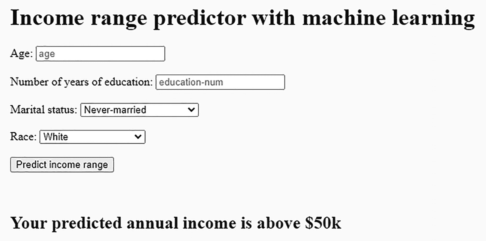

**图 12-6** 渲染 Flask 机器学习预测应用的最终结果

尽管这个示例使用了非常简单的数据流和一个小型机器学习模型，但它展示了构建一个强大 Web 应用所需的、基于 Flask 的 Python 项目的所有核心组件。例如，数据提交可以是手动用户输入，也可以从在线资源或后端数据库读取；机器学习算法可以是简单的逻辑回归，也可以是复杂的深度学习；在从输入层提取特征之前，可能有一个大型的数据整理和预处理管道；输出可以是简单的文本渲染，也可以是基于 JavaScript 的精美可视化。无论 Web 应用包含什么组件，它们之间的核心连接都将遵循 Flask 及其资源这一粘合剂。


### 使用 PyWebIO 的动手示例

`PyWebIO` 是另一个帮助快速构建 Web 应用的辅助库，无需了解任何 HTML/CSS/JavaScript。`PyWebIO` 提供了一系列多样化的命令式函数，用于在浏览器中获取用户输入和输出内容，本质上将浏览器变成了一个富文本终端。使用 `PyWebIO`，数据科学家只需编写 Python 脚本，并按需在脚本中插入基于 Web 的 GUI 元素，即可构建简单的 Web 应用。此外，它还原生支持文件处理和图像/图表生成，让数据科学家的生活更轻松。

本应用的完整代码随本书提供。此处，我只展示主要函数以突出几个特性（这些特性也与你在 `Flask` 示例中看到的不同）：

```
def app():
"""
主应用
"""
put_markdown("""# 用于分析 CSV 文件的实用工具
## [Tirthajyoti Sarkar 博士](https://www.linkedin.com/in/tirthajyoti-sarkar-2127aa7/)
你可以上传数据文件 (CSV) 并，
- 显示数据列的直方图
- 将汇总统计信息下载为文件。
""")
data = input_group("输入数据",[file_upload(label='上传你的 CSV 文件', accept='.csv',name='file'),
radio('显示数据？',['是','否'], name='display_data',value='否'),
radio('显示图表？',['是','否'], name='display_plot',value='否'),
])
file = data['file']
display_data = data['display_data']
display_plot = data['display_plot']
content = file['content'].decode('utf-8').splitlines()
df = content_to_pandas(content)
if display_data=='是':
show_data(df)
if display_plot=='是':
show_plots(df)
show_stats(df)
```

注意 `put_markdown()` 函数的用法，它有助于在 Web 应用上显示简单的 markdown 内容。这在很大程度上消除了像在 `Flask` 示例中那样，需要编写大量 HTML/CSS 内容作为模板或静态文件的需求。此外，`input_group` 对象以及像 `radio` 这样的其他元素会在 Web 应用页面上创建相应的单选按钮元素，同样消除了使用 HTML 编码它们的需要。基本上，**PyWebIO 不需要数据科学家做任何其他事情，只需处理一个单一的 Python 脚本**，但却能让他们创建一个美观的 Web 应用。

我将此脚本命名为 `csv-analysis.py`，因为它从用户那里接收一个 CSV 文件（通过文件上传功能），在内部创建一个 pandas DataFrame 表示，并显示数值变量的一些基本图表。上面显示的 `app` 函数会调用其他辅助函数，如 `show_data()` 和 `show_stats()`，这些函数接收 pandas DataFrame 并在网页上显示原始数据或描述性统计信息。

脚本的最后一段代码看起来与你之前在 `Flask` 示例中看到的非常相似：

```
if __name__ == '__main__':
start_server(app,port=9999,debug=True)
```

它基本上启动了一个 Web 服务器，并通过端口 9999 暴露它。当你在命令行上运行它时：

```
python csv-analysis.py
```

你会在命令行上看到以下输出：

```
在所有地址上运行。
使用 http://10.0.0.55:9999/ 访问该应用
```

因此，你在本地浏览器中访问此地址 (`http://10.0.0.55:9999/`)，会看到这个简洁的小型 Web 应用弹出（图 12-7）。注意你在 Python 脚本中编码的 markdown 内容是如何在网页上美观地渲染出来的，包括标题、超链接和项目符号。输入数据部分也很好地分组了，附带了文件上传框和用于选择数据显示或统计信息显示的单选按钮。

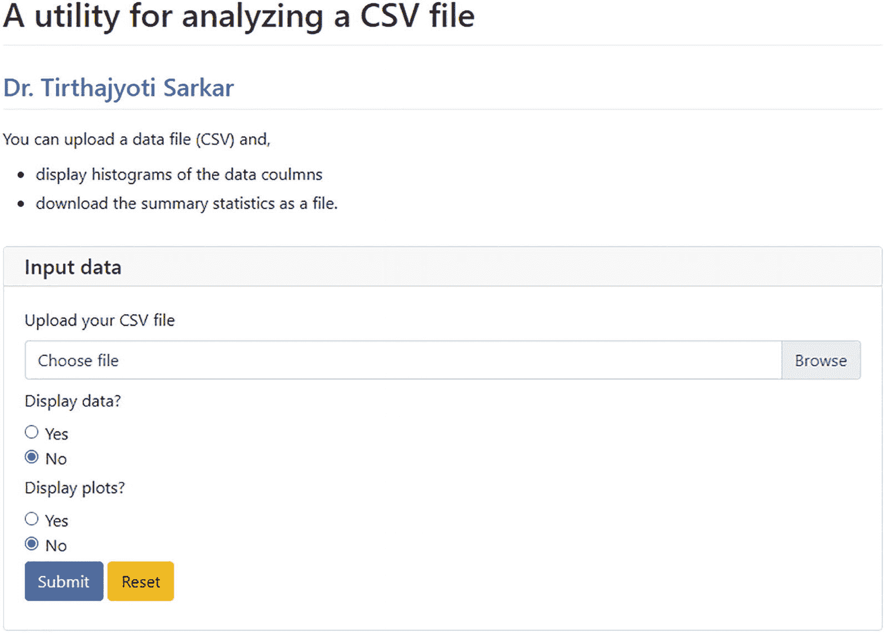

图 12-7

由 PyWebIO 仅用一个 Python 脚本创建的 CSV 分析 Web 应用

总的来说，这呈现了一个 HTML 表单（就像你之前在 `Flask` 示例中看到的那样），它接受用户输入，进行后台 Python 处理，然后将处理后的数据呈现给用户。用户需要做的就是上传文件并按下提交按钮。

文件上传功能暴露了本地文件系统，用于搜索和选择用户想要选择的任何文件。图 12-8 显示了用户按下文件上传框上的浏览按钮后应用的状态。

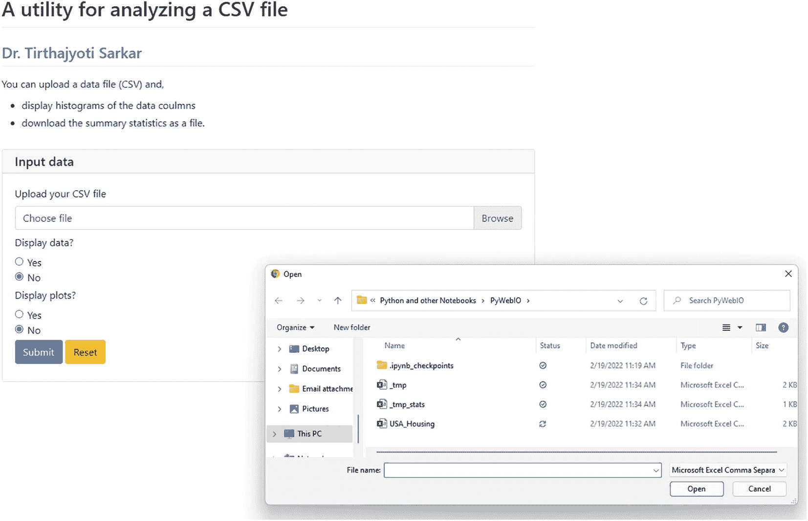

图 12-8

用户使用 PyWebIO 应用选择想要分析的文件

按下提交按钮后，后端处理发生，页面元素和状态被更新，以在底部框架中显示输出。图 12-9 显示了结果。请注意，为了便于理解，这里的原始数据表和图表部分都被截断了。

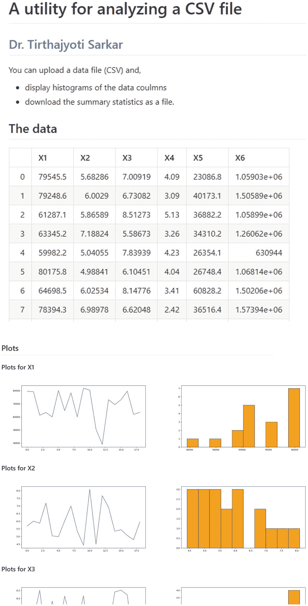

图 12-9

CSV 分析 Web 应用的典型输出

在页面底部，还显示了根据 CSV 文件数据计算出的描述性统计信息，并向用户提供了一个下载选项（图 12-10）。

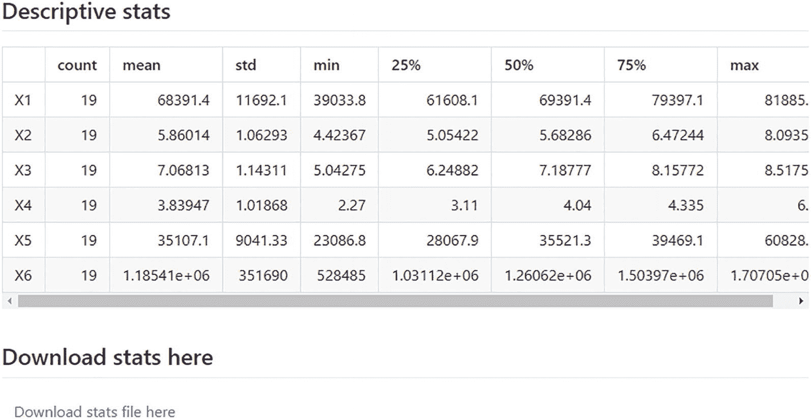

图 12-10

CSV 分析应用的更多输出，包括下载选项

尽管你看到的是一项非常简单的数据分析任务，但这个示例展示了 `PyWebIO` 在此类工作流程中的基本特性和优势：用户上传数据文件、后台数据转换和可视化、显示结果，以及转换后数据的下载选项。你只需编写一个单一的 Python 脚本，并使用 `PyWebIO` 方法和工具抽象掉所有 HTML/CSS/JavaScript 前端细节，即可创建这样的应用。这提高了你的生产力，并帮助你在**短时间内以组织良好的可视化方式向外部利益相关者展示你的数据科学探索结果**。

### 其他选项和 GUI 构建工具

尽管我在本节中演示了 `PyWebIO` 库，但对于类似的任务——从 Python 脚本或 Jupyter notebook 过渡到功能完备的 Web 应用——还有不少选择。`Streamlit` 是最突出和广泛使用的选项之一。感兴趣的读者可以[参考这篇文章](https://towardsdatascience.com/data-analytics-to-web-app-streamlit-made-easy-ed687266f0e8)，这是我写的关于使用 `Streamlit` 的文章：[`https://towardsdatascience.com/data-analytics-to-web-app-streamlit-made-easy-ed687266f0e8`](https://towardsdatascience.com/data-analytics-to-web-app-streamlit-made-easy-ed687266f0e8)。

还有一个最近开发的工具叫做 `mljar-mercury`，它允许你通过最少量地添加一些 YAML 配置代码，将 Jupyter notebooks 转换成 Web 应用。使用这个库，你可以在 notebook 中通过 YAML 头部定义交互式小部件，最终用户可以更改小部件的值、执行 notebook 并保存结果（作为 HTML 文件）。你还可以隐藏代码，向非技术合作者抽象掉复杂性。该库使得将应用部署到任何服务器（如 AWS 或 Heroku）变得容易。更多信息，请参阅 GitHub 站点 ([`https://github.com/mljar/mercury`](https://github.com/mljar/mercury)) 或文档 ([`https://mljar.com/mercury/`](https://mljar.com/mercury/))。

在许多情况下，可能还需要构建一个独立的 GUI 应用（不一定在 Web 浏览器上运行），以便快速演示和传播一些数据科学工作或模型。有多种方法可以做到这一点。感兴趣的读者可以查看我写的这篇文章，关于一个名为 `PySimpleGUI` 的框架以及如何使用它构建简单的数据科学 GUI 应用：[`https://towardsdatascience.com/building-data-science-gui-apps-with-pysimplegui-179db54a9a15`](https://towardsdatascience.com/building-data-science-gui-apps-with-pysimplegui-179db54a9a15)。


## 从本地走向云端

云技术无疑已开启了现代个人与企业计算领域最重大的变革。它充分利用了不断扩展的高速全球互联网骨干网基础设施，该网络每天都在持续触及人类社会更广泛的领域。凭借这一优势，它使各种可想象到的虚拟与实体商品及服务的交付过程变得大众化与商品化。

数据科学在这方面也不例外。尽管许多数据科学家倾向于在本地机器上工作和探索想法，但出于各种原因，他们可能需要将工作流程无缝迁移到云端资源上，或者至少具备在需要时能迅速执行此操作的能力。

一些典型的场景包括但不限于以下情况：

-   需要分析本地机器无法妥善存储的数 TB 级数据集。
-   需要大量内存分析，但本地系统内存严重不足。
-   需要利用 CPU/GPU 资源集群进行快速分布式计算。
-   需要使用高度专业化的库、框架和特制环境，这些环境通常只存在于预构建的容器或镜像中，在本地机器上搭建既困难又耗时。

在上述所有情况下，能否快速启动云端资源并将现有数据科学代码库连接到该基础设施，决定了数据科学管线的最终生产力与效率。

### 数据科学的多种云服务类型

不可否认，存在着种类繁多、令人眼花缭乱的云服务可用于提升日常数据科学工作的生产力与效率。其中一些属于基础设施即服务（IaaS）范畴，最终用户租用云端环境中的原始计算/存储能力，并将其本地代码库迁移至该层。前一节中的典型使用场景正适用于此类 IaaS 案例。一个具体例子是在 AWS 上租用一个`EC2`计算节点，将其连接到某个`S3`存储桶，然后在这个“租赁”来的基础设施上开展大规模数据科学工作——而这在有限的本地计算能力下是不可能实现的。

#### 平台即服务

众多新兴初创公司（以及老牌企业的新设服务部门）也在开发可归类为平台即服务（PaaS）的服务。在此类服务中，一系列模块和子模块运行在 IaaS 层之上（该层通常不由终端用户选择或完全可见）。这些模块能够执行典型数据科学管线中所有必要且预期的任务，例如数据摄取、转换、机器学习、可视化、模型部署、长期数据与日志存储等。用户可以选择 PaaS 产品中的全部或部分模块/服务组合使用。

例如，AWS 拥有众多组件（如 Amazon QuickSight（商业分析服务）、Amazon RedShift（数据仓库）、AWS Data Pipeline、AWS Data Exchange、Amazon Kinesis（实时数据分析）、Amazon EMR（使用 MapReduce 进行大数据处理）），用户可根据其数据科学工作流程的需求来选用。谷歌云也提供了一系列类似服务（如 BigQuery（数据仓库）、`Dataflow`（流式分析）、`Dataproc`（运行 Apache Hadoop、Apache Spark 集群）、Looker（商业智能与分析）、Google Data Studio（可视化仪表板、数据报告）、`Dataprep`（分析数据准备））供终端用户挑选。在另一个极端，这些服务可能高度专业化，专注于单一类型的 AI/ML 任务。AWS 的`Sagemaker`和谷歌的`Vertex AI`便是这方面的例子。

#### 数据即服务

随着基于云的数据服务的出现，数据即服务（DaaS）也成为一个流行概念。众多新兴及老牌云供应商提供 DaaS，他们利用云计算，通过分布式网络基础设施向客户提供数据存储、数据处理、多领域数据源集成以及高级数据分析服务。这些服务集成了适当的安全与身份管理层，专注于 AI/ML 和数据分析，且没有扩展限制。任何组织都可以利用此类服务，借助数据的力量快速改进业务流程并创造长期价值。该领域一些知名的服务提供商包括 Databricks 和`H2O.ai`。

还有一些云服务专注于为终端用户提供专业的数据科学编码与编程环境。你在本书中已经见过的一个例子是 Saturn Cloud 服务，你在第 11 章中使用它启动了一个配备 GPU 的云实例，该实例已预装并配置了 RAPIDS 框架。你所需要做的只是点击几个按钮，几分钟内就能从本地浏览器连接到一个可以访问所有 RAPIDS 库的 Jupyter notebook。

Paperspace Gradient 是另一个成功的 ML 任务托管服务提供商。毫无疑问，这些服务通过降低进入需要特殊设置或专用硬件配置环境的门槛，提升了数据科学家的生产力。


### 将云端能力引入本地环境

关于云计算技术及其如何助力各类数据科学任务与项目，已有大量优秀资源可供学习。事实上，掌握此类技术的基础知识与实践经验，正逐渐成为进入数据科学专业领域的标准要求。这意味着，除了学习编程语言、算法、机器学习理论与实践、统计学概念之外，数据科学家还需要为求职面试或职业发展掌握云计算的相关技能与基础经验。

因此，一个相关的问题是：*如何将云计算的能力（主要是上一节提到的基础设施部分）引入本地环境？*

这基本上包含以下任务：

-   在 `AWS` 上启动一个 `EC2` 实例。
-   在该实例（本质上是云端的一台计算机）上搭建一个 Python 数据科学环境。
-   启动一个 `Jupyter` 服务器。
-   通过本地浏览器安全地连接到该服务器。

如果这些任务成功完成，**数据科学家将在本地浏览器上运行一个由云计算实例驱动的 `Jupyter` 笔记本**。本地文件和现有代码可以被迁移到一个不再受单系统硬件限制的环境中。

幸运的是，互联网上有很多关于此主题的优秀分步教程。我在此不再重复这些文章的步骤，而是提供链接供大家直接参考。许多教程都使用了低配置的 `EC2` 实例（例如 `t2-micro`），以将 `AWS` 服务的成本降至最低甚至为零。然而，**这个概念几乎可以扩展到任何类型的 `EC2` 实例，数据科学家可以根据数据科学工作流程的需求，启动所需的大型、强大的云计算资源**。如果是 CPU 密集型的数据科学任务，可以选择 32 核或 64 核的 CPU 实例；如果是内存密集型任务，则可以使用专门的高内存实例。

此外，以下链接还包含了使用 `Google Cloud Platform`（`GCP`）实现同样目标的指南。`GCP` 是 `AWS` 的竞争对手和同等服务。`GCP` 由谷歌庞大的分布式计算资源驱动，并在 `GCP` 计算节点上运行熟悉的 `Jupyter` 笔记本；这可能是将本地数据科学流程拓展到奇妙的云计算世界的第一步。此外，这两篇文章中整体流程的相似性将证明：**无论采用何种云服务，这种从本地到云端连接的基本原理是完全相同的**。

关于 `AWS` 的文章/指南：《`JupyterLab` on `AWS` `EC2`》（`https://medium.com/analytics-vidhya/jupyterlab-on-aws-ec2-d6b2cb945e54`）

关于 `GCP` 的文章/指南：《Setting up Jupyter Lab Instance on Google Cloud Platform》（`https://medium.com/analytics-vidhya/setting-up-jupyter-lab-instance-on-google-cloud-platform-3a7acaa732b7`）

### 用于高效数据科学的低代码库

低代码库正成为一些最有前景的入门途径，适用于来自不同背景的专业人士，如网页开发者、业务分析师，甚至是平行领域的学术研究者，他们希望进入数据科学世界，并将其全部力量用于自己的专业或日常工作。在本节中，我将讨论低代码库的本质，并展示一个流行的示例。

#### 什么是低代码库？

从核心来看，这些库建立在传统数据科学生态系统（例如使用 `Python`、`R` 或 `Julia` 等语言的编程框架）之上，其目标是**在最大程度上抽象化数据科学的编码部分，同时基本保持技术严谨性**。

自然地，这些库作为薄薄的封装层，作用于已有的面向编程的库和框架之上。它们提供易用且直观的 `API`，甚至可能集成许多吸引人的可视化元素和仪表盘分析工具，使数据科学工作更易于上手和呈现。

在很多情况下，它们会集成一些**自动机器学习的附加功能**，帮助用户仅用几行代码（或点击一下按钮）就能运行一系列数据科学/机器学习实验和调优练习。当这样一个低代码库将其所有直接的编程 `API` 抽象成一个面向 GUI 的交互式前端时，它也可以被称为**无代码**数据科学库。


### PyCaret 示例

正如其官网 ([`https://pycaret.org/`](https://pycaret.org/)) 所述，“*PyCaret 是一个开源的、低代码的 Python 机器学习库，可以自动化机器学习工作流程*”（图 12-11）。虽然这句话非常强调机器学习，但它可以支持典型数据科学生产线中的各项常规任务，例如：


图 12-11  
PyCaret，一个低代码、开源的数据科学/机器学习库

- 探索性数据分析
- 数据整理与预处理
- 模型训练与调参
- 基础模型可解释性与模型管理（MLOps）

下面通过一个 PyCaret 的简单分类示例来演示低代码数据科学的思想。首先，通过 `pip` 安装该库：

```
pip install pycaret
```

PyCaret 提供了友好的数据加载函数，可用于导入流行的机器学习数据集，其中一个是糖尿病数据集 ([`https://archive.ics.uci.edu/ml/datasets/diabetes`](https://archive.ics.uci.edu/ml/datasets/diabetes))：

```
from pycaret.datasets import get_data
data = get_data('diabetes')
```

接下来的步骤几乎是神奇的！只需一个函数调用（`setup`），数据就会被检查并设置好（即为机器学习实验做好准备）：

```
from pycaret.classification import *
s = setup(data, target = 'Class variable')
```

PyCaret 内部嵌入的（且在很大程度上对普通用户隐藏的）推断算法会根据某些属性自动推断所有特征的数据类型。如果推断并非 100% 正确，PyCaret 会在执行 `setup` 函数时通过显示用户提示并要求确认数据类型来处理。如果数据类型正确，可以按 Enter 键，或者输入 `quit` 退出设置。在 PyCaret 中确保正确的数据类型至关重要，因为它会自动执行多种针对特定类型的预处理任务，这些任务对于准确的机器学习建模是必不可少的。

下一步同样因其简洁性和强大功能而显得神奇。一次 `compare_models()` 函数调用即可使用交叉验证（CV）训练和评估模型库中所有可用机器学习估计器的性能。输出是一个包含平均交叉验证得分的评分网格。交叉验证指标可通过 `get_metrics` 函数访问，并可使用 `add_metric` 和 `remove_metric` 函数分别添加或删除自定义指标。

```
Best = compare_models()
print(best)
```

图 12-12 显示了结果。

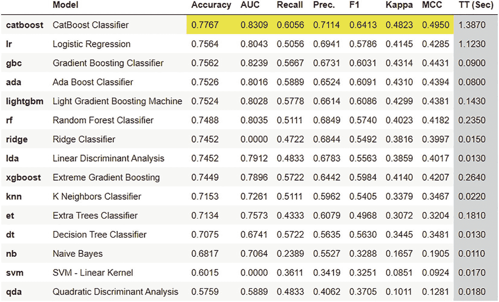

图 12-12  
一次函数调用即可训练多个机器学习估计器并显示各类交叉验证指标。图片来源：[*https://pycaret.gitbook.io/docs/get-started/quickstart*](https://pycaret.gitbook.io/docs/get-started/quickstart)，经 PyCaret 创建者许可使用

接下来，你可以分析训练好的模型在测试集上的性能，同样只需一个函数调用。这实际上提供了多种图表类型供你选择，你可以任选其一。

```
evaluate_model(best)
```

一个典型结果如图 12-13 所示，其中用户选择了查看特征重要性图。

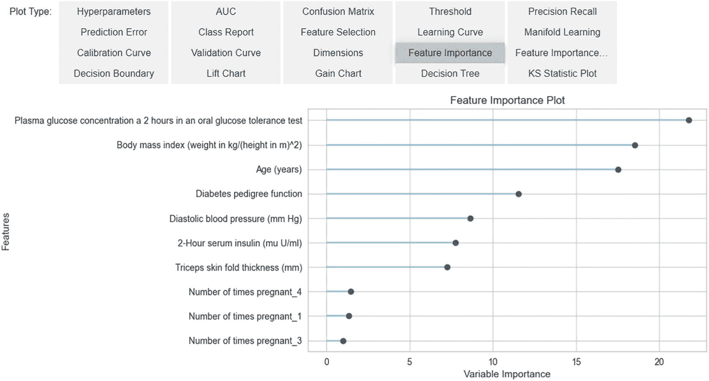

图 12-13  
一次函数调用即可分析训练好的模型在测试集上的性能，并生成各种图表。图片来源：[*https://pycaret.gitbook.io/docs/get-started/quickstart*](https://pycaret.gitbook.io/docs/get-started/quickstart)，经 PyCaret 创建者许可使用

请注意，`evaluate_model` 只能在 Jupyter notebook 会话中使用，因为它使用了 `ipywidget`（用于交互式地向用户显示所有图表选项）。你也可以使用以下代码单独生成图表：

```
plot_model(best, plot = 'auc')
```

这会生成图 12-14 所示的曲线下面积图。

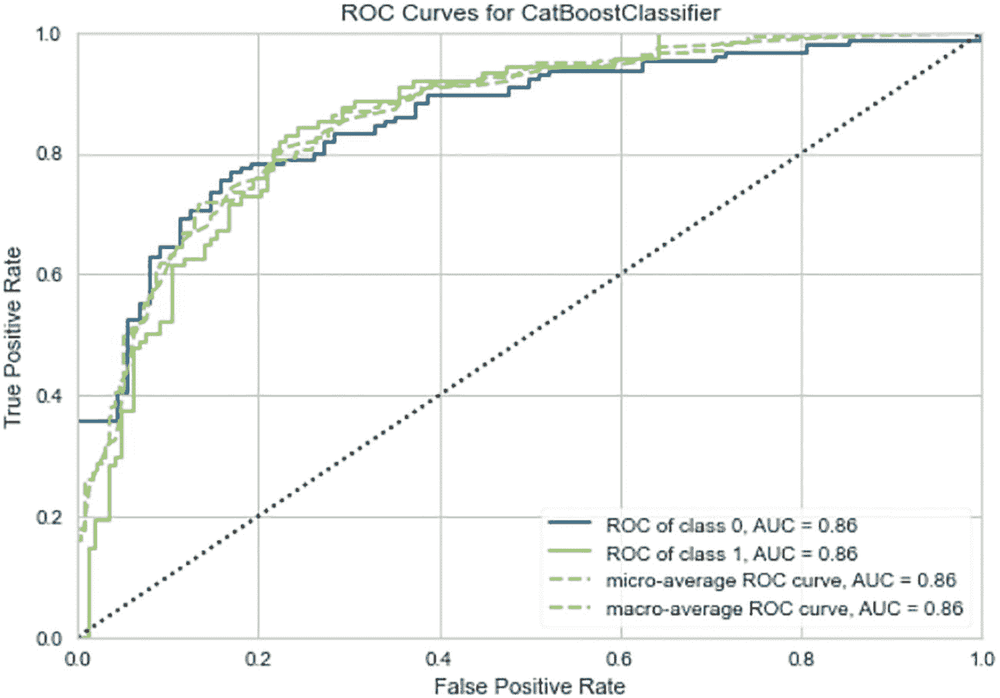

图 12-14  
单独图表。图片来源：[*https://pycaret.gitbook.io/docs/get-started/quickstart*](https://pycaret.gitbook.io/docs/get-started/quickstart)，经 PyCaret 创建者许可使用

预测，正如所料，只有一行代码。评估指标在测试集上计算得出。

```
predict_model(best)
```

最后，保存模型（实际上是完整流程）并重新加载也很简单（图 12-15）。

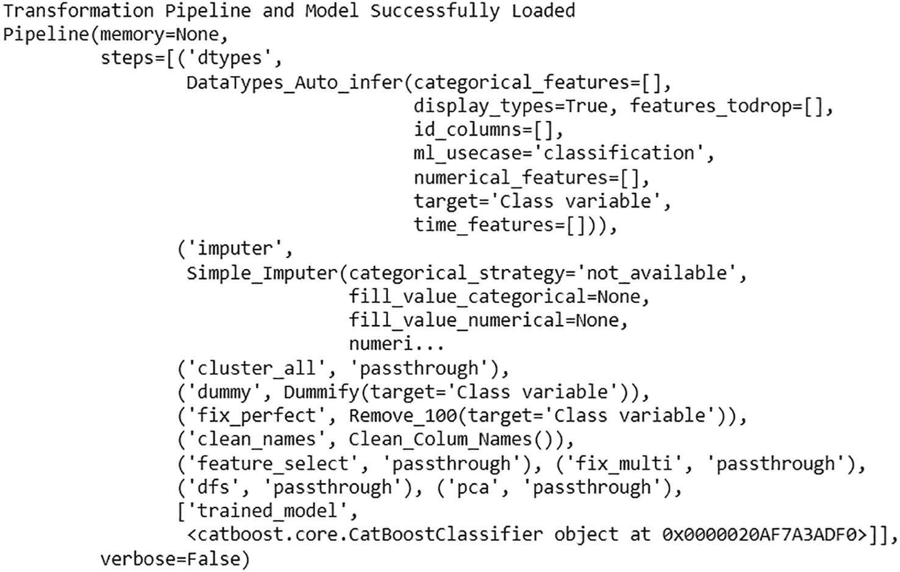

图 12-15  
保存的模型。图片来源：[*https://pycaret.gitbook.io/docs/get-started/quickstart*](https://pycaret.gitbook.io/docs/get-started/quickstart)，经 PyCaret 创建者许可使用

```
save_model(best, 'my_best_pipeline')
loaded_model = load_model('my_best_pipeline')
```

从这个动手演示中可以清楚地看出，这些库的主要目标之一是通过简化前端 API、减少所需的原始编码行数，甚至以自动驾驶模式帮助运行多个机器学习实验，从而为数据科学实践者节省时间。所有这些目标都与高效数据科学的目标非常契合，因此我坚信，低代码库将在未来成为这一倡议的重要组成部分。

## 总结

本章并非讨论特定主题或某种特定类型的 Python 框架。它是一个主题和技能的集合，数据科学家通常需要在使用高效数据科学议程的实践中并行学习和掌握这些内容。虽然这些技能并不作为明确的组成部分直接出现在数据科学流程中，但它们往往能提供额外的价值和奠定基础。学习它们确实可以放大标准数据科学任务流程的能力和效率。

本着这种学习精神，我首先讨论了学习基本 Web 技术（HTML、CSS 和 JavaScript）的重要性。接着，我谈到了为数据科学项目创建 Web 应用的实用性，并指出数据科学任务的最终成功关键取决于其产生的洞察的传达方式，而交互式 Web 应用是最好的传达方式。我演示了如何使用 Flask 和 PyWebIO 这两种不同风格的 Python 库构建简单的 Web 应用。

几乎无一例外，Web 应用都依赖于云基础设施，这是现代高科技社会的支柱。在数据科学的背景下，我还讨论了诸如亚马逊云服务和谷歌云平台等云技术，以及像 Databricks 和 Saturn Cloud 这样专注于数据的平台。我还提供了将云计算的强大能力引入本地数据科学环境的简单流程指引。

最后，我转换了话题，讨论了在许多情况下，使用“低代码”框架对于数据科学任务是多么有用和高效。我使用 PyCaret（此类工具中一个流行的 Python 库）演示了一个机器学习分类任务，并展示了以低代码为核心的抽象如何使整个数据科学工作变得高效、快速且直观简单。

