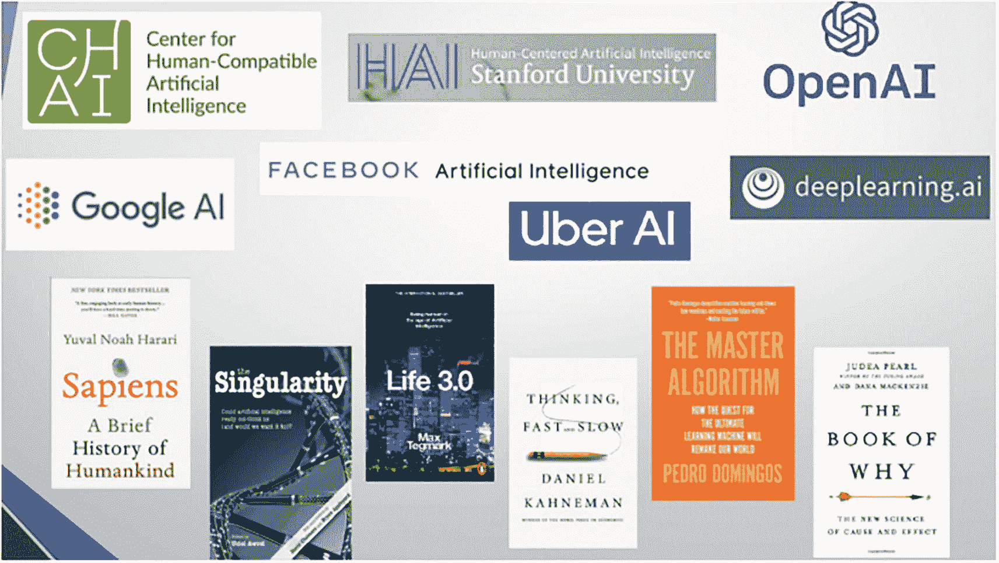

# 数据库技术

数据库及相关技术的历史远比现代数据科学和机器学习要悠久，可以追溯到 20 世纪 60 年代初期。在很长一段时间里，它们都以关系型数据库管理系统（`RDBMS`）为核心。这些系统主要处理“结构化数据”，例如业务交易记录，或来自库存、质量控制、生产及其他类似性质业务流程的表格化数据。五十多年来，结构化查询语言（`SQL`，及其衍生出的众多变体）一直是高速度、高准确率地查询大型数据库的中流砥柱。

对于任何有志于成为数据科学家的人来说，掌握数据库和 SQL 的基础知识，并不断练习和提升这方面的技能，都是至关重要的。几乎每个 Web 应用、平台和企业软件都会以某种形式使用多个数据库。在现实场景中，数据科学流程所需的原始数据极有可能来自一个传统数据库（或多个此类数据库的组合）。因此，负责的数据科学家需要精通 SQL，才能执行查询，从数据库中提取原始数据。

SQL 是一种声明式语言（[`https://365datascience.com/tutorials/sql-tutorials/sql-declarative-language/`](https://365datascience.com/tutorials/sql-tutorials/sql-declarative-language/)），学习曲线未必陡峭。但对数据库设计和优化的扎实掌握，可以极大地帮助你执行优化的数据提取查询，从而提升整个数据科学流程的效率。事实上，`Python` 中有许多数据库绑定或连接器库，允许数据科学家与现有数据库建立紧密耦合，甚至在 `Python` 环境内就能提取数据。

然而，SQL 和 `RDBMS` 只是冰山一角。随着非结构化数据（如图像、视频、音频、自然语言、手写笔记以及来自数字传感器网络的流式输出）的重要性日益增长，尤其是在数据科学和机器学习领域，数据库技术迎来了一场新的革命，催生了`NoSQL`技术的发展。这些工具和语言通常是为处理非结构化或半结构化数据集而设计和优化的。

我们诚挚地建议你：更新你的数据库知识，投入时间夯实 SQL 基础，并紧跟最新数据库趋势和技术的发展。无论你来自什么背景，或从事何种业务/科学应用，这些知识都将帮助你变得极具生产力、高效率，并产生最大影响力。

## 给未来数据科学家的一般建议

不难想象，当几位数据科学家下班后聚在一起小酌时，常会冒出这样一个问题：**在工作或求职面试中，你如何才能从成百上千的其他数据科学从业者/候选人中脱颖而出？**

为什么思考这个问题很重要？

因为要获得一份数据科学家的工作，竞争异常激烈（[`www.kdnuggets.com/2020/10/getting-data-science-job-harder.html`](http://www.kdnuggets.com/2020/10/getting-data-science-job-harder.html)）。因为这是一场疯狂的争夺战。每一种工程师、科学家和职场专业人士都自称为数据科学家（[`www.linkedin.com/pulse/why-so-many-fake-data-scientist-bernard-marr/`](http://www.linkedin.com/pulse/why-so-many-fake-data-scientist-bernard-marr/)）。因为，作为一名有抱负的数据科学家，你可能不确定自己能否在这个领域崭露头角。所谓的冒名顶替症候群在数据科学领域普遍存在（[`https://towardsdatascience.com/how-to-manage-impostor-syndrome-in-data-science-ad814809f068`](https://towardsdatascience.com/how-to-manage-impostor-syndrome-in-data-science-ad814809f068)）。

我既不敢声称有现成的答案，也不知道你是否真能脱颖而出，但我会列出几点建议。

### 多提问，持续学习

问自己以下几个问题，并数一数你回答“是”的次数。你做得越多，就越能脱颖而出。

#### 如果你是初学者

*   你是否发布过自己的 `Python`/`R`（或你使用的任何编程语言）包？

*   如果是，你是否为其编写了详尽的文档，以便他人轻松使用？

*   你是否将你的分析从 `Jupyter` notebook 移植到了一个完全发布的 Web 应用中？或者，你是否研究过能帮助你轻松实现这一点的工具？

*   你是否至少撰写过几篇高质量、详细的文章来描述你自己的兴趣项目？

*   你是否尝试实践费曼学习法，即向你想象中的六年级学生解释你想学习的概念？

#### 在更进阶的阶段

如果你认为自己已是一名较为成熟的数据科学家，请回答以下问题：

*   你是否会有意识地抓住一切机会，将良好的软件工程实践（例如，面向对象编程、模块化、单元测试）融入到你的数据科学代码中？

*   你是否坚持不止步于当前所需的数据分析范围，而是会想象如果数据量扩大 100 倍，或者预测错误成本增加 10 倍，会发生什么？换句话说，你是否会有意识地思考数据或问题的规模化及其影响？

*   你是否坚持不止步于传统的机器学习指标，还会思考数据获取成本以及应用机器学习所产生的商业价值？

#### 学习多元化的技能

我尤其想建议你，不要把全部时间和精力都花在分析越来越大的数据集或试验最新的深度学习模型上。作为全面发展的数据科学家，我们应该留出至少四分之一的时间，学习做一些在任何组织、任何情况下都备受重视的事情。

*   为你日常的数据分析构建一个小巧但功能集中的实用工具。在这个练习中，你的创造力会自由流淌。你创造的东西可能不会立刻有成千上万的用户，但它会是新颖的，并且是你自己的创作。

*   阅读并撰写与你刚学会的新工具、新框架或刚构建的实用工具（见上一条）相关的高质量文档。这会迫使你学习如何以广大受众都能理解的方式，来传达你所创造之物的用途和机制。

如你所见，这些习惯很容易养成和实践。它们不需要繁重的工作、多年的统计学背景或高深的机器学习专业知识。但令人惊讶的是，并非人人都能拥抱这些习惯。所以，这就是你的机会——无论在新工作还是面试中，都能让你从一大批候选人中脱颖而出（图 13-1）。

图 13-1

构建数据科学工具（应用）和高质量文档能够让你脱颖而出。图片来源：“How Can You Distinguish Yourself from Hundreds of Other Data Science Candidates?” by Tirthajyoti Sarkar ([`https://towardsdatascience.com/how-to-distinguish-yourself-from-hundreds-of-data-science-candidates-62457dd8f385`](https://towardsdatascience.com/how-to-distinguish-yourself-from-hundreds-of-data-science-candidates-62457dd8f385))

### 抓住一切机会阅读广泛主题

有抱负的数据科学家常常会花过多的时间阅读关于最新深度学习技巧或最新 `Python` 库的博客文章。虽然这些是积极的方面，但为了高效多产，你还应分配一些时间阅读数据科学或人工智能领域中更广泛的主题。我鼓励你在行业顶级论坛和优秀书籍中阅读广泛多样的主题。图 13-2 展示了一些我个人喜欢的书籍和论坛。

图 13-2

一些关于数据科学、机器学习和人工智能广泛主题的高影响力博客、论坛和书籍

### 在求职面试中脱颖而出

为了在求职面试中脱颖而出这一目标，请设想自己正处于这样的情境。如果你对上述问题有很多肯定的回答，你可以向面试官提及类似以下内容：

* “嘿，看看我构建的酷炫 `Python` 包，它可以随意生成合成时间序列数据。”

* “我还编写了详细的文档，托管在 `MyApp.readthedocs.io` 网站上，它是用 `Sphinx` 和 `Jekyll` 构建的。”

* “我定期为最大的在线平台‘数据科学前沿’撰写数据科学文章。基于这些文章，我甚至收到了像 Packt 或 Springer 这样的知名出版社的出书邀约。”

* “每个人都可以在 `Jupyter` 笔记本中拟合 ML 模型。但我能快速为那个 `Scikit-learn` 函数构建一个基本的 Web 应用演示，让你通过 `REST API` 发送数据并获取预测结果。”

* “我可以帮助进行新机器学习项目的成本效益分析，并告诉你收益是否超过数据收集的工作量，以及如何以最优方式执行。”

想象一下，在面试委员会面前，你将与其他那些擅长统计学和梯度下降等常规问题、却无法提供全面能力证明的候选人有何不同。

这表明你对数据科学问题充满好奇。这表明你在阅读、分析和沟通。这表明你创造并撰写文档以便他人创造。这表明你的思考超越了笔记本和分类准确率，进入了业务增值和客户同理心的领域。这就是真正高效多产的秘诀。

哪家公司会不喜欢这样的候选人呢？

## 一些有用的资源

有大量出色的工具和资源可供你获取并实践这些技能。即使仅仅在单个章节中列出其中的一小部分也是不可能的，但下面我列出了一些代表性示例。关键思想是灌输探索这些方向并自行发现此类学习辅助工具的理念。

### 数据科学家精选的有用技巧与工具清单

Khuyen Tran 是 NVIDIA 的数据科学作家，也是 Ocelot Consulting 的数据科学实习生。她在“数据科学简化”网站（[`https://mathdatasimplified.com/`](https://mathdatasimplified.com/)）上撰写了超过 200 篇数据科学文章和数百条日常数据科学技巧。她当前的使命是让开源对数据科学社区更易获取。她整理了一份高效的 Python 技巧和工具清单，可作为本书的完美补充。请查阅开源书籍《数据科学家的高效 Python 技巧与工具》（图 13-2），网址为：[`https://khuyentran1401.github.io/Efficient_Python_tricks_and_tools_for_data_scientists/intro.html`](https://khuyentran1401.github.io/Efficient_Python_tricks_and_tools_for_data_scientists/intro.html)。

### 仅用 Jupyter 笔记本就能构建可安装的软件包

这个工具来自 FastAI 的开发人员，`FastAI` 是一个流行的深度学习框架和学习资源。他们尝试了一个想法：直接从 `Jupyter` 笔记本代码构建可安装的 Python 包，并最终开发出了这个工具。当然，`Jupyter` 笔记本是数据科学家最得心应手的环境，这种工具让他们能够直接从自己偏好的编码和实验环境发布软件包。以下是该项目的详细信息：[`http://www.fast.ai/2019/12/02/nbdev/`](http://www.fast.ai/2019/12/02/nbdev/)。

### 学习如何整合单元测试原则

测试软件模块能增强最终产品或服务的鲁棒性和信任度。在任何软件开发中，高质量测试的重要性怎么强调都不为过。同样的道理也适用于你的数据科学流程。即使你主要为了原型设计和研究而开发数据科学代码库，了解如何编写基本的测试模块来检查你开发的函数和类是否按预期工作，也是一个好主意。

这通常不单是检查输入数据类型，而是检查你的数据科学流程能否处理这些数据。也不只是向函数随机抛出离群变量，而是检查响应是否符合预期。

为了让你入门，这里提供几篇相关实用文章的参考资料。在这些短文中，我以一个典型的数据科学流程为例（该流程由多个小型、专用的函数组成，而非一个单体），并展示了如何为其编写 `Pytest` 模块。我还探讨了为什么为数据科学编写测试模块可能与软件工程师或质量保证人员日常工作略有不同。

“PyTest for Machine Learning” ([`https://towardsdatascience.com/pytest-for-machine-learning-a-simple-example-based-tutorial-a3df3c58cf8`](https://towardsdatascience.com/pytest-for-machine-learning-a-simple-example-based-tutorial-a3df3c58cf8))

“How to Write Test Code for a Data Science Pipeline” ([`https://heartbeat.comet.ml/how-to-write-test-code-for-data-science-pipeline-4ee35956c513`](https://heartbeat.comet.ml/how-to-write-test-code-for-data-science-pipeline-4ee35956c513))

### 直接从你的 Jupyter 笔记本编写整本编程与技术书籍

这是一个出色的开源项目，旨在帮助开发面向代码的快速阅读书籍和手册：“Books with Jupyter” ([`https://jupyterbook.org/intro.html`](https://jupyterbook.org/intro.html))。

### 开始了解 MLOps

如前所述，本书并未涵盖 MLOps，但为了在当今的商业环境中取得专业成功并高效工作，有抱负的数据科学家理应充分关注它。请查阅这份高质量入门指南：“What is MLOps – Everything You Must Know to Get Started” ([`https://towardsdatascience.com/what-is-mlops-everything-you-must-know-to-get-started-523f2d0b8bd8`](https://towardsdatascience.com/what-is-mlops-everything-you-must-know-to-get-started-523f2d0b8bd8))。