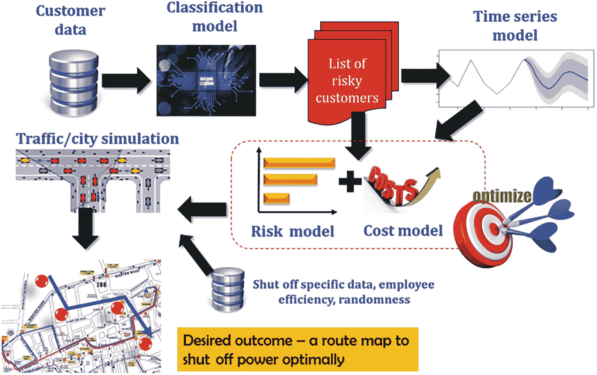
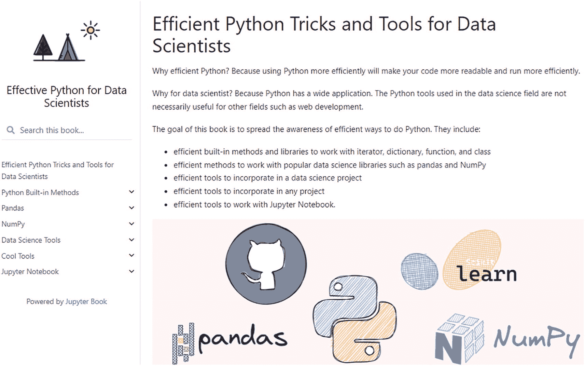

# 理解现实分析问题的多维复杂性

请阅读以下文章，了解真实分析问题的多维复杂性：《为什么一个业务分析问题需要你用到所有数据科学技能》（`https://medium.com/analytics-vidhya/why-a-business-analytics-problem-demands-all-of-your-expertise-at-once-1290170808c4`）。在这个案例研究中，我详细描述了一家希望开展断电催缴活动（针对未支付电费的用户）的电力公司可能采用的良好分析流程，如图 13-3 所示。具体来说，我分析了

**图 13-4**
一个融合了各类数据科学工具（如`分类`、`模拟`、`时间序列`、`风险与成本建模`、`随机分析`、`优化`等）的真实业务分析问题示例。图片来源：Tirthajyoti Sarkar 所著《为什么一个业务分析问题需要你用到所有数据科学技能》（`https://medium.com/analytics-vidhya/why-a-business-analytics-problem-demands-all-of-your-expertise-at-once-1290170808c4`）

**图 13-3**
Khuyen Tran 关于数据科学高效`Python`技巧与工具的手册

*   需要收集哪些数据，以及如何通过数据整理技术进行清洗和准备
*   流程的主要组成部分有哪些
*   可以使用哪些子组件或特定的建模技术
*   如何构建优化问题
*   需要考虑哪些商业和社会因素
*   何时应用随机模拟，以及需要进行何种类型的模拟运行

阅读本文后，您将体会到，当数据驱动分析应用于真实业务问题时，它总是数据整理、机器学习、业务逻辑乃至伦理选择等多种技术与框架的复杂混合体。

## 开启新旅程

那么，本书的这段旅程就到此为止了。我的目标很简单：阐述高效数据科学的概念，并向您介绍一些有助于在数据科学工作中实现更高生产力（和效率）的工具与技术（全部使用`Python`语言及其丰富的生态系统）。基于这一目标，我在 13 章的篇幅中涵盖了广泛的主题。其中一些主题直接涉及数据科学代码和编程模式的效率，而另一些则涵盖了在实际数据科学流程中可能扮演关键角色的概念。书中讨论了诸如`模块化`、`代码打包`、`内存与时间分析`、`GPU 处理`、`并行计算`、`Web 技术`等多样化的主题。

我真诚地希望，这些混杂的内容对您有所助益并带来启发，无论您是认真跟随每个示例，还是仅仅浏览翻阅，都能通过完成这些章节的旅程，对高效数据科学实践有所领悟。正如一本涵盖如此多元主题的书籍所预期的，我已知晓对实践高效数据科学至关重要的内容，并未全部涵盖在这些章节中。只要有可能，我都鼓励您自行探索这些主题和概念。

这些探索必将为数据科学这一非凡事业（及变革性技术）的实践者带来全新的冒险、职业成功和纯粹的乐趣。怀着这份希望，我在此宣告这段更新、更远的旅程正式开启。