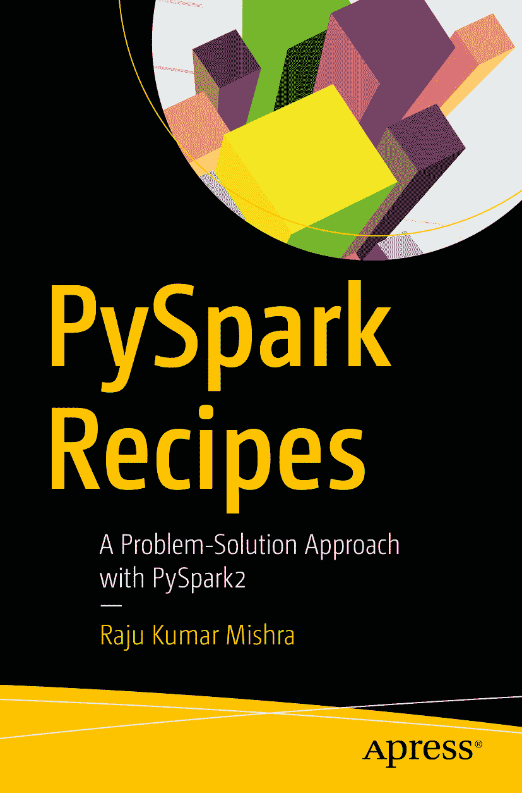

# PySpark 食谱：基于 PySpark2 的问题-解决方案方法

 拉朱·库马尔·米什拉 **PySpark 食谱：基于 PySpark2 的问题-解决方案方法**

本书作者引用的任何源代码或其他补充材料，读者均可通过本书的产品页面在 GitHub 上获取，网址为 [`www.apress.com`](http://www.apress.com)。如需更详细信息，请访问 [`www.apress.com/source-code`](http://www.apress.com/source-code)。

ISBN `978-1-4842-3140-1`
e-ISBN `978-1-4842-3141-8`
[`doi.org/10.1007/978-1-4842-3141-8`](https://doi.org/10.1007/978-1-4842-3141-8)

美国国会图书馆控制号：`2017962438`

© 拉朱·库马尔·米什拉 2018

本作品受版权保护。出版商保留所有权利，无论涉及整体或部分材料，特别是翻译、重印、重用插图、朗诵、广播、微缩胶片复制或任何其他物理形式的复制，以及信息存储与检索、电子改编、计算机软件，或采用目前已知或未来开发的任何相似或不同方法。

本书中可能出现商标名称、标识和图像。本书仅在编辑性内容中使用这些名称、标识和图像，以利于商标所有者，并非有意侵犯商标权，因此不会在每次出现商标名称、标识或图像时使用商标符号。本书中使用的商品名称、商标、服务标志及类似术语，即使未明确标识，也不应被视为对其是否受专有权利保护的意见表达。

尽管本书中的建议和信息在出版时被认为是真实准确的，但作者、编辑和出版商均不对可能存在的任何错误或疏漏承担法律责任。出版商对本书所含内容不作任何明示或暗示的保证。

印刷于无酸纸上

本书由 Springer Science + Business Media New York（地址：`233 Spring Street, 6th Floor, New York, NY 10013`）向全球图书贸易发行。电话：`1-800-SPRINGER`，传真：`(201) 348-4505`，电子邮件：`orders-ny@springer-sbm.com`，或访问 `www.springeronline.com`。Apress Media, LLC 是一家加利福尼亚有限责任公司，其唯一成员（所有者）为 Springer Science + Business Media Finance Inc (SSBM Finance Inc)。SSBM Finance Inc 是一家特拉华州公司。

献给指引我生活方方面面的全能者。也献给我的母亲，Smt. Savitri Mishra，以及我亲爱的妻子，Smt. Smita Rani Pathak。

## 引言

本书将通过问题-解决方案的方法，带你踏上一段有趣的旅程，学习 PySpark 和大数据。每个问题都附有详细、逐步的解答，这将有助于提升你使用 PySpark 解决大数据问题的思维能力。本书共分为九章，以下是各章的简要介绍：

- **第 1 章，“大数据、Hadoop 及其他大数据处理框架的时代”**，涵盖了众多大数据处理工具，例如 Apache Hadoop、Apache Pig、Apache Hive 和 Apache Spark。本章讨论了 Hadoop 的不足之处以及 Spark 的演进过程，并解释了作为发布-订阅系统的 Apache Kafka。本章还介绍了 NoSQL 数据库 HBase。
- **第 2 章，“安装”**，将带你进入实战战场。你将学习如何安装多种大数据处理工具，如 Hadoop、Hive、Spark、Apache Mesos 和 Apache HBase。
- **第 3 章，“Python 和 NumPy 入门”**，面向 Python 新手。你将通过问题-解决方案的方式，学习 Python 和 NumPy 的基础知识。本章中的问题均以数据科学为导向。
- **第 4 章，“Spark 架构与弹性分布式数据集”**，阐述了 Spark 的架构并介绍了弹性分布式数据集。你将学习如何创建 RDD，以及如何在 RDD 上使用数据聚合、数据过滤和集合运算等数据分析算法。
- **第 5 章，“键值对的威力：配对 RDD”**，展示了如何创建配对 RDD，以及如何在这些配对 RDD 上执行数据聚合、数据连接和其他算法。
- **第 6 章，“PySpark 中的输入/输出”**，将教你如何从各类文件中读取数据，并将结果保存为 RDD。
- **第 7 章，“优化 PySpark 与 PySpark Streaming”**，是最重要的章节之一。你将首先优化一个网页排名算法。然后实现一个 k-近邻算法，并通过使用 PySpark 框架提供的广播变量对其进行优化。学习 PySpark Streaming 最终将引导我们将 Apache Kafka 与 PySpark Streaming 框架集成。
- **第 8 章，“PySparkSQL”**，对于使用 SQL 的读者来说是天堂。但新手也将通过学习 PySparkSQL，使用问题-解决方案的方法，在 DataFrame 上编写类似 SQL 的查询。除了 DataFrame，我们还将使用 GraphFrames 库实现广度优先搜索和网页排名这两种图算法。
- **第 9 章，“PySpark MLlib 与线性回归”**，描述了 PySpark 的机器学习库 MLlib。你将看到许多关于 PySpark MLlib 提供的各种数据结构的示例。你还将实现线性回归。本章包含了关于套索回归和岭回归的示例。

## 致谢

我衷心感谢全能者。我还要感谢我的母亲 Smt. Savitri Mishra；我的姐妹 Mitan 和 Priya；我的表姐妹 Suchitra 和 Chandni；以及我的舅舅 Shyam Bihari Pandey，感谢他们的支持和鼓励。我非常感激我甜美美丽的妻子 Smt. Smita Rani Pathak，在我撰写本书期间，她给予了我持续不断的鼓励和爱。我感谢我的姐夫 Mr. Prafull Chandra Pandey 鼓励我撰写本书。我非常感谢我的嫂子们 Rinky、Reena、Kshama、Charu、Dhriti、Kriti 和 Jyoti，感谢她们同样给予我的鼓励。我感激 Anurag Pal Sehgal、Saurabh Gupta、Devendra Mani Tripathi 以及我所有的朋友们。最后但同样重要的是，感谢 Apress 的协调编辑 Sanchita Mandal、策划编辑 Celestin Suresh John 和开发编辑 Laura Berendson；没有他们，这本书就不可能完成。