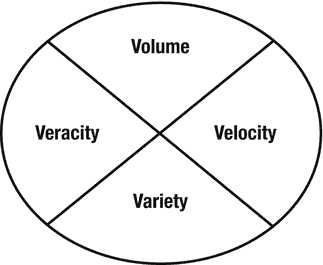
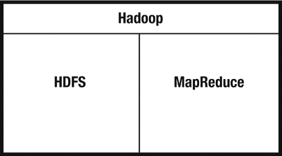
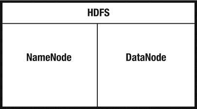
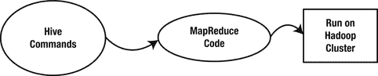
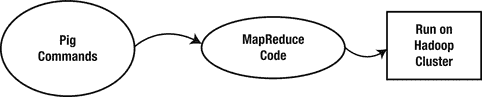

# 1. 大数据时代、Hadoop 及其他大数据处理框架

当我初次加入 `Orkut` 时，我感到很高兴。借助 `Orkut`，这个新平台让我能够了解身边的人，包括他们的想法、观点、购物习惯以及去过的地方。我们比以往任何时候都能获取更多知识，并且感觉与周围的人联系更紧密。上传照片帮助我们分享值得游览的好地方。我越来越沉迷于理解并表达情感。几年后，我加入了 `Facebook`。日复一日，我开始接触到来自世界各地近乎无穷无尽的信息。接着，我开始在网上购物，而且比起线下购物，我更喜欢这种方式。我能轻松获取大量关于产品的信息，还能比较价格和功能。我并非特例；数以百万计的人对网络都有同感。

越来越多的数据从世界的每个角落涌入网络。得益于那些与数据存储系统相关的发明，人们得以存储这股巨大的数据流。

全球越来越多的用户加入网络，因此也增加了这些存储系统中数据的总量。这些数据以观点、图片、视频以及其他形式存在。这股数据洪流迫使用户采用分布式系统。分布式系统需要分布式编程。我们也知道，分布式系统对容错性和高效算法有着额外的要求。分布式系统始终需要两样东西：系统的可靠性和所有组件的可用性。

`Apache Hadoop` 应运而生，它为分布式系统确保了高效的计算和容错性。它主要关注可靠性和可用性。由于 `Apache Hadoop` 易于编程，许多人对大数据产生了兴趣。大数据成为各地热议的话题。例如，电子商务公司希望更深入地了解客户，医疗保健行业则对从收集到的数据中获取洞见感兴趣。更多的数据指标被定义出来，更多的数据点开始被收集。

许多开源大数据工具涌现出来，包括 `Apache Tez` 和 `Apache Storm`。与此同时，许多 NoSQL 数据库也出现了，以应对这股巨大的数据流。`Apache Spark` 也作为一种分布式系统发展起来，并在此期间变得非常流行。

在本章中，我们将讨论大数据以及作为处理大数据的分布式系统 `Hadoop`。在介绍 `Hadoop` 的组件时，我们还将讨论 `Hadoop` 生态系统框架，例如 `Apache Hive` 和 `Apache Pig`。同时也会讨论 `Hadoop` 生态系统各组件的实用性，以便给你一个概览。揭示 `Hadoop` 的一些缺点，将为你理解 `Apache Spark` 的发展提供背景。接着，本章将描述 `Apache Spark`。我们还将讨论与 `Apache Spark` 协同工作的各种集群管理器。如果不讨论 NoSQL，本章就不算完整，因此也会包含对 NoSQL 数据库 `HBase` 的讨论。有时我们会从关系型数据库管理系统（`RDBMS`）中读取数据；本章将讨论 `PostgreSQL`。

## 大数据

大数据是这个时代的热门话题之一。但什么是大数据？大数据描述的是规模巨大且增长速度惊人的数据集。除了体量和速度之外，大数据的特征还包括数据类型的多样性和数据的真实性。让我们详细探讨这些术语——体量、速度、多样性和真实性。这些也被称为大数据的 `4V` 特征，如图 1-1 所示。



图 1-1. 大数据的特征

### 体量

体量指定了待处理数据的数量。大量数据需要大型机器或分布式系统。而且计算所需的时间也会随着数据体量的增加而增加。因此，如果我们可以并行化计算，最好采用分布式系统。体量可能涉及结构化数据、非结构化数据或任何类型的数据。如果我们有非结构化数据，情况会变得更加复杂且计算密集。你可能会好奇，多大才算大？什么样的数据量应该被归类为大数据？这又是一个值得商榷的问题。但总的来说，我们可以说，那些无法通过传统系统处理的数据量，可以被视为大数据。

### 速度

每个组织都越来越有数据意识。每时每刻都有大量数据被收集。这意味着数据的“速度”——数据流和数据处理的速率——也在增加。单个系统如何能够应对这种速度？当我们必须实时分析大量流入的数据时，问题就变得复杂了。每天，都有系统被开发出来以应对这股巨大的数据流。

### 多样性

有时，数据的多样性增加了足够的复杂性，以至于传统数据分析系统无法很好地分析数据。我们所说的“多样性”是什么意思？你可能会认为数据就是数据。但事实并非如此。例如，图像数据与简单的表格数据不同，因为它的组织和保存方式不同。此外，存在无限多种文件系统，每种文件系统都需要不同的处理方式。例如，读取和写入 `JSON` 文件的方式就与我们处理 `CSV` 文件的方式不同。如今，数据科学家必须处理这些数据类型的组合。你将要处理的数据可能是图片、视频和文本的组合。这种数据的多样性使得大数据的分析更加复杂。

### 真实性

你能想象一个逻辑不正确的计算机程序却能得出正确输出吗？当然不能。同样，不准确的数据会给出误导性的结果。数据的真实性是与大数据相关的重要关注点之一。当我们考虑大数据的状态时，必须思考数据中的任何异常情况。

## Hadoop

`Hadoop` 是一个用于解决大数据问题的分布式、可扩展框架。`Hadoop` 由 `Doug Cutting` 和 `Mark Cafarella` 开发，使用 `Java` 编写。它可以安装在通用硬件的集群上，并且在分布式系统上水平扩展。易于编程。`Hadoop` 的灵感来源于 Google 的研究论文。`Hadoop` 能够在通用硬件上运行，这使其具有成本效益。如果我们在通用硬件上工作，容错性是一个不可避免的问题。但 `Hadoop` 为数据存储和计算提供了一个容错系统，这种容错能力使得 `Hadoop` 广受欢迎。

`Hadoop` 包含两个组件，如图 1-2 所示。第一个组件是 `Hadoop 分布式文件系统`（`HDFS`）。第二个组件是 `MapReduce`。`HDFS` 用于分布式数据存储，而 `MapReduce` 用于对存储在 `HDFS` 中的数据进行计算。



图 1-2. Hadoop 组件


### HDFS

HDFS 用于以分布式和容错的方式存储大量数据。HDFS 使用 Java 编写，运行在商用硬件上。其设计灵感来源于谷歌关于谷歌文件系统（GFS）的研究论文。它是一个写入一次、读取多次的系统，对大量数据的处理非常有效。

HDFS 包含两个组件：`NameNode` 和 `DataNode`。这两个组件都是 Java 守护进程。`NameNode` 负责维护分布在集群上的文件的元数据，作为多个 `DataNode` 的主节点。HDFS 将大文件分割成小块，并将这些块存储在不同的 `DataNode` 上。实际的文件数据块位于 `DataNode` 中。

HDFS 提供了一套类似 Unix shell 的命令来操作它。但我们也可以使用 HDFS 提供的 Java 文件系统 API，在更细粒度上处理大文件。容错性是通过数据块的复制来实现的。

我们可以通过单线程进程并行访问 HDFS 文件。HDFS 提供了一个有用的实用工具 `distcp`，通常用于将数据从一个 HDFS 系统并行传输到另一个 HDFS 系统。它通过并行映射任务来复制数据。您可以在图 1-3 中查看 HDFS 的组件。



图 1-3. HDFS 的组件

### MapReduce

Map-Reduce 计算模型首次出现在谷歌的一篇研究论文中。这篇研究论文在 Hadoop 中实现为 Hadoop 的 MapReduce。Hadoop 的 MapReduce 是 Hadoop 框架的计算引擎，它对 HDFS 中的分布式数据执行计算。MapReduce 在商用硬件的分布式系统上是水平可扩展的。它也能扩展到解决规模较大的问题。在 MapReduce 中，解决方案被分为两个阶段：map 阶段和 reduce 阶段。在 map 阶段，处理一部分数据；在 reduce 阶段，对 map 阶段的结果执行聚合或归约操作。Hadoop 的 MapReduce 框架使用 Java 编写。

MapReduce 采用主/从模型。在 Hadoop 1 中，这种 map-reduce 计算由两个守护进程管理：`Jobtracker` 和 `Tasktracker`。`Jobtracker` 是处理多个 `Tasktracker` 的主进程。无需多言，`Tasktracker` 是 `Jobtracker` 的从属进程。但在 Hadoop 2 中，`Jobtracker` 和 `Tasktracker` 被 YARN 取代。

由于我们知道 Hadoop 的 MapReduce 框架是使用 Java 编写的，因此我们可以使用该框架提供的 API 并用 Java 编写我们的 MapReduce 代码。Hadoop 的 streaming 模块进一步提供了能力，使得掌握其他编程语言（如 Python 或 Ruby）的人也能编写 MapReduce 程序。

MapReduce 算法适用于许多算法。许多机器学习算法都是作为 Apache Mahout 实现的。Mahout 过去像 Pig 和 Hive 一样运行在 Hadoop 上。

但 MapReduce 不太适合迭代算法。在每个 Hadoop 作业结束时，MapReduce 会将数据保存到 HDFS，并为下一个作业再次读取。我们知道，读写文件是代价最高的操作之一。Apache Spark 通过提供内存数据持久化和计算，缓解了 MapReduce 的这一缺点。

**注意**

您可以在以下网页上了解更多关于 MapReduce 和 Mahout 的信息：
- [`www.usenix.org/legacy/publications/library/proceedings/osdi04/tech/full_papers/dean/dean_html/index.html`](https://www.usenix.org/legacy/publications/library/proceedings/osdi04/tech/full_papers/dean/dean_html/index.html)
- [`https://mahout.apache.org/users/basics/quickstart.html`](https://mahout.apache.org/users/basics/quickstart.html)

### Apache Hive

计算机科学的世界就是抽象的世界。众所周知，所有数据最终都以比特的形式存在。像 C 这样的编程语言使我们免于用机器级语言编程。C 语言提供了对机器语言和汇编语言的抽象。其他高级语言提供了更多的抽象。结构化查询语言（SQL）就是其中一种抽象。SQL 被全世界许多数据建模专家广泛使用。Hadoop 擅长分析大数据。那么，庞大的掌握 SQL 的用户群体如何能利用 Hadoop 的计算能力来处理大数据呢？为了编写 Hadoop 的 MapReduce 程序，用户必须掌握一种可用于编写 Hadoop MapReduce 程序的编程语言。

在现实世界中，日常遇到的问题往往遵循某种模式。在数据分析中，有些问题是常见的，例如操作数据、处理缺失值、转换数据和汇总数据。对于非程序员来说，为这些日常问题编写 MapReduce 代码是一件令人头疼的工作。编写代码来解决问题并非什么高明之举。而编写具有性能可扩展性且可扩展的高效代码才是有价值的。考虑到这个问题，Apache Hive 在 Facebook 被开发出来，这样，无需编写 MapReduce 代码也能解决常见问题。

根据 Hive 维基百科的解释：“Hive 是基于 Apache Hadoop 的数据仓库基础设施。” Hive 有自己的 SQL 方言，称为 Hive 查询语言（缩写为 `HiveQL` 或 `HQL`）。使用 `HiveQL`，Hive 可以查询 HDFS 中的数据。Hive 不仅可以在 HDFS 上运行，还可以在 Spark 和其他大数据框架（如 Apache Tez）上运行。

Hive 为用户提供了一种类似于关系数据库管理系统的抽象，用于处理 HDFS 中的结构化数据。我们可以创建表，并对它们运行类似 SQL 的查询。Hive 将表 schema 保存在一个 RDBMS 中。Apache Derby 是默认的 RDBMS，随 Apache Hive 发行版一起提供。Apache Derby 完全用 Java 编写；这个开源 RDBMS 遵循 Apache 许可证 2.0 版。

`HiveQL` 命令被转换为 Hadoop 的 MapReduce 代码，然后在 Hadoop 集群上运行。您可以在图 1-4 中查看 Hive 命令的执行流程。



图 1-4. Apache Hive 中的代码执行流程

掌握 SQL 的人可以轻松学习 Apache Hive 和 `HiveQL`，并在日常处理大数据的数据分析中受益于 Hadoop 的存储和计算能力。`HiveQL` 也受到 `PySparkSQL` 的支持。我们可以在 `PySparkSQL` 中运行 `HiveQL` 命令。除了执行 `HiveQL` 查询，我们还可以直接从 Hive 读取数据到 `PySparkSQL`，并将结果写回 Hive。

**注意**

您可以在以下网页上了解更多关于 Hive 和 Apache Derby RDBMS 的信息：
- [`https://cwiki.apache.org/confluence/display/Hive/Tutorial`](https://cwiki.apache.org/confluence/display/Hive/Tutorial)
- [`https://db.apache.org/derby/`](https://db.apache.org/derby/)


### Apache Pig

Apache Pig 是一个用于对海量数据执行数据分析算法的数据流框架。它由雅虎开发，开源至 Apache 软件基金会，目前基于 Apache 许可证 2.0 版本发布。Pig 编程语言是一种 `Pig Latin` 脚本语言。Pig 与 Hadoop 松散耦合，这意味着我们可以将其连接到 Hadoop 并执行分析。但 Pig 也可以与其他工具（如 Apache Tez 和 Apache Spark）一起使用。

Apache Hive 用作报表工具，而 Apache Pig 则用作提取、转换、加载 (ETL) 工具。我们可以通过使用用户自定义函数 (UDF) 来扩展 Pig 的功能。用户自定义函数可以用多种语言编写，包括 Java、Python、Ruby、JavaScript、Groovy 和 Jython。

Apache Pig 使用 HDFS 来读取和存储数据，并利用 Hadoop 的 MapReduce 来执行数据科学算法。Apache Pig 在使用 Hadoop 集群方面与 Apache Hive 类似。如图 1-5 所示，在 Hadoop 上，`Pig Latin` 命令首先被转换为 Hadoop 的 MapReduce 代码，然后转换后的 MapReduce 代码在 Hadoop 集群上运行。



图 1-5. Apache Pig 中的代码执行流程

Pig 最棒的一点是，其代码经过了优化和测试，可以解决日常问题。用户可以直接安装 Pig 并开始使用。Pig 提供了一个 `Grunt` shell 来运行交互式 Pig 命令，因此任何了解 `Pig Latin` 的人都可以享受 HDFS 和 MapReduce 带来的好处，而无需了解诸如 Java 或 Python 之类的高级编程语言。

**注意：** 您可以通过以下网站了解更多关于 Apache Pig 的信息：

- [`pig.apache.org/docs/`](http://pig.apache.org/docs/)
- [`en.wikipedia.org/wiki/Pig_(programming_tool)`](https://en.wikipedia.org/wiki/Pig_(programming_tool))
- [`cwiki.apache.org/confluence/display/PIG/Index`](https://cwiki.apache.org/confluence/display/PIG/Index)

### Apache Kafka

Apache Kafka 是一个发布-订阅式的分布式消息平台。它由 LinkedIn 开发，随后开源给 Apache 基金会。它具有容错性、可扩展性和高速性。在 Kafka 术语中，消息（message）是可以通过 Kafka 服务器从生产者（producer）流向消费者（consumer）的最小数据单元，并且可以被持久化供以后使用。您可能会对 `producer` 和 `consumer` 这两个术语感到困惑。我们稍后会讨论这些术语。在 Kafka 上下文中，我们将使用的另一个关键术语是 `topic`。`Topic` 是一个包含相似类别消息的流。Kafka 自带一个内置 API，开发者可以使用它来构建自己的应用程序。由我们来定义 `topic`。现在，我们来讨论 Apache Kafka 的三个主要组件。

## 生产者（Producer）

Kafka 生产者将消息生成到 Kafka 的 `topic`。它可以向多个 `topic` 发布数据。

## 代理（Broker）

代理是运行在专用机器上的主要 Kafka 服务器。消息由生产者推送到代理。代理将 `topic` 持久化到不同的分区中，并且这些分区会被复制到不同的代理上以应对故障。代理是无状态的，因此消费者需要追踪已经消费过的消息。

## 消费者（Consumer）

消费者从 Kafka 代理获取消息。记住，是消费者获取消息；Kafka 代理不会将消息推送给消费者；相反，消费者从 Kafka 代理拉取数据。消费者订阅了 Kafka 代理上的一个或多个 `topic`，并读取其中的消息。消费者还会跟踪所有已经消费过的消息。数据会在代理中持久化一段指定的时间。如果消费者发生故障，它可以在重启后重新获取数据。

图 1-6 解释了 Apache Kafka 的消息流。生产者将消息发布到 `topic`。然后消费者从代理拉取数据。在发布和拉取之间，消息由 Kafka 代理持久化存储。


图 1-6. Apache Kafka 消息流

我们将在第 7 章中将 Apache Kafka 与 PySpark 集成，届时会进一步讨论 Kafka。

**注意：** 您可以通过以下网站了解更多关于 Apache Kafka 的信息：

- [`kafka.apache.org/documentation/`](https://kafka.apache.org/documentation/)
- [`kafka.apache.org/quickstart`](https://kafka.apache.org/quickstart)

## Apache Spark

Apache Spark 是一个通用的分布式编程框架。它被认为非常适合数据的迭代处理以及批处理。Spark 由加州大学伯克利分校的 AMPLab 开发，现在是一个提供内存计算框架的开源软件。一方面，它擅长批处理；另一方面，它也适用于实时（或更准确地说，近实时）数据处理。机器学习和图算法是迭代的，这正是 Spark 大显身手的地方。根据其研究论文，它的速度大约比其同类产品 Hadoop 快 100 倍。数据可以缓存在内存中。在迭代算法中缓存中间数据提供了惊人的快速处理速度。可以使用 Java、Scala、Python 和 R 来编写 Spark 程序。

如果有人将 Spark 视为改进版的 Hadoop，我认为在某种程度上是可以接受的。因为我们可以在 Spark 中实现 MapReduce 算法，而且 Spark 利用了 HDFS 的优势；这意味着 Spark 既可以从 HDFS 读取数据，也可以将数据存储到 HDFS，并且由于数据可以持久化在内存中，Spark 能够高效地处理迭代计算。除了内存计算之外，Spark 还非常适合交互式数据分析。

我们将使用 Python 来学习 Apache Spark。这也被称为 PySpark。PySpark 自带了许多用于编写高效程序的库，同时也有一些外部库可用。以下是一些 PySpark 库：

- **PySparkSQL:** 一个 PySpark 库，用于对大量结构化或半结构化数据应用类似 SQL 的分析。我们也可以将 SQL 查询与 PySparkSQL 一起使用。它可以连接到 Apache Hive，并且也可以应用 HiveQL。PySparkSQL 是 PySpark 核心的一个包装器。PySparkSQL 引入了 `DataFrame`，它是结构化数据的表格化表示，类似于关系数据库管理系统中的表。另一个数据抽象 `DataSet` 是在 Spark 1.6 中引入的，但它不能与 PySparkSQL 一起使用。
- **MLlib:** MLlib 是 PySpark 核心的一个包装器，用于处理机器学习算法。`MLlib` 库提供的机器学习 API 易于使用。`MLlib` 支持许多用于分类、聚类、文本分析等的机器学习算法。
- **GraphFrames:** `GraphFrames` 库提供了一套 API，用于利用 PySpark 核心和 PySparkSQL 高效地执行图分析。在撰写本文时，`DataFrames` 是一个外部库，您需要单独下载和安装它。我们将在第 8 章中进行图分析。


### 集群管理器

在分布式系统中，一个作业或应用程序会被分解成不同的任务，这些任务可以在集群的不同机器上并行运行。一个任务在运行过程中需要内存和处理器等资源。最重要的是，如果某台机器发生故障，就必须将任务重新调度到另一台机器上。由于资源管理不善，分布式系统通常会面临可扩展性问题。另一种情况是，假设一个作业已经在集群上运行，另一个人想要运行另一个作业，那么第二个作业就必须等待第一个作业完成。但这样一来，我们就无法最优地利用资源。这种资源管理说起来容易，但在分布式系统上实现却很困难。

集群管理器就是为了最优地管理集群资源而开发的。Spark 有三种可用的集群管理器：`Standalone`、`Apache Mesos` 和 `YARN`。这些集群管理器最大的优点是它们在用户和集群之间提供了一个抽象层。由于集群管理器提供的这种抽象，用户感觉就像在单台机器上工作，而实际上他是在一个集群上工作。集群管理器会将集群资源调度给正在运行的应用程序。

## Standalone 集群管理器

Apache Spark 内置了 `Standalone` 集群管理器。它为 Spark 集群提供了主/从架构。这是 Spark 自带的唯一集群管理器。使用 `Standalone` 集群管理器时，你只能运行 Spark 应用程序。其组件包括 master 和 workers。Workers 是 master 进程的从属。`Standalone` 是最简单的集群管理器。可以通过 Spark 目录中 `sbin` 目录下的脚本配置 Spark Standalone 集群管理器。我们将在后续章节配置 Spark Standalone 集群管理器，并使用 Standalone 集群管理器部署 PySpark 应用程序。

#### Apache Mesos 集群管理器

Apache Mesos 是一个通用集群管理器。它由加州大学伯克利分校的 AMPLab 开发。Apache Mesos 有助于分布式解决方案高效扩展。使用 `Mesos` 时，你可以在同一个集群上使用不同的框架运行不同的应用程序。“使用不同框架运行不同应用程序”是什么意思呢？我的意思是，我们可以在 `Mesos` 上同时运行一个 Hadoop 应用程序和一个 Spark 应用程序。当多个应用程序在 `Mesos` 上运行时，它们共享集群的资源。Apache Mesos 的两个重要组件是 master 和 slaves。它拥有类似于 Spark Standalone 集群管理器的主/从架构。在 `Mesos` 上运行的应用程序被称为框架。Slaves 会以资源邀约的形式将可用资源告知 master。Slave 机器会定期提供资源邀约。master 服务器的分配模块决定哪个框架将获得资源。

#### YARN 集群管理器

`YARN` 代表 Yet Another Resource Negotiator。`YARN` 是在 Hadoop 2 中引入的，用于扩展 Hadoop；它将资源管理和作业管理分离。分离这两个组件使 Hadoop 的扩展性更好。`YARN` 的主要组件是 `ResourceManager`、`ApplicationMaster` 和 `NodeManager`。存在一个全局的 `ResourceManager`，每个集群会运行多个 `NodeManager`。`NodeManager` 是 `ResourceManager` 的从属。`Scheduler` 是 `ResourceManager` 的一个组件，它为集群上运行的不同应用程序分配资源。最棒的是，我们可以在由 `YARN` 管理的集群上同时运行 Spark 应用程序以及任何其他应用程序，如 Hadoop 或 MPI。每个应用程序都有一个 `ApplicationMaster`，它负责处理在分布式系统上并行运行的任务。请记住，Hadoop 和 Spark 有各自类型的 `ApplicationMaster`。

**注意**

您可以通过以下网页了解更多关于 Standalone、Apache Mesos 和 YARN 集群管理器的信息：

[`https://spark.apache.org/docs/2.0.0/spark-standalone.html`](https://spark.apache.org/docs/2.0.0/spark-standalone.html)

[`https://spark.apache.org/docs/2.0.0/running-on-mesos.html`](https://spark.apache.org/docs/2.0.0/running-on-mesos.html)

[`https://spark.apache.org/docs/2.0.0/running-on-yarn.html`](https://spark.apache.org/docs/2.0.0/running-on-yarn.html)

## PostgreSQL

关系数据库管理系统在各类组织中仍然非常普遍。这里的“关系”是什么意思？它指的是表。PostgreSQL 是一个关系数据库管理系统。它几乎可以在所有主流操作系统上运行，包括 Microsoft Windows、基于 Unix 的操作系统、macOS 等等。它是一个开源软件，其代码在 PostgreSQL 许可证下可用。因此，你可以自由使用并根据需求修改它。

PostgreSQL 数据库可以通过其他编程语言（如 Java、Perl、Python、C 和 C++）以及各种编程接口进行连接。它还可以通过一种过程式编程语言 PL/pgSQL（Procedural Language/PostgreSQL）进行编程，该语言类似于 PL/SQL。用户可以为此数据库添加自定义函数。我们可以用 C/C++ 和其他编程语言编写自定义函数。我们可以通过使用 Java 数据库连接（JDBC）连接器，从 PySparkSQL 中读取 PostgreSQL 的数据。在接下来的章节中，我们将使用 PySparkSQL 从 PostgreSQL 读取数据表。我们还将探索 PostgreSQL 的更多方面。

PostgreSQL 遵循 ACID（原子性、一致性、隔离性和持久性）原则。它功能丰富，其中一些可能是 PostgreSQL 独有的。它支持可更新视图、事务完整性、复杂查询、触发器和其他特性。PostgreSQL 通过使用多版本并发控制模型来进行并发管理。

如果你在使用 PostgreSQL 时遇到问题，有一个庞大的社区可以提供支持。PostgreSQL 的设计和开发宗旨就是可扩展性。

**注意**

如果你想深入学习 PostgreSQL，以下链接会对你有所帮助：

[`https://wiki.postgresql.org/wiki/Main_Page`](https://wiki.postgresql.org/wiki/Main_Page)

[`https://en.wikipedia.org/wiki/PostgreSQL`](https://en.wikipedia.org/wiki/PostgreSQL)

[`https://en.wikipedia.org/wiki/Multiversion_concurrency_control`](https://en.wikipedia.org/wiki/Multiversion_concurrency_control)

[`http://postgresguide.com/`](http://postgresguide.com/)


## HBase

HBase 是一个开源、分布式的 NoSQL 数据库。提到 NoSQL，你可能会认为它没有模式（schemaless）。在某种程度上，你是对的，但也不完全正确。因为在定义表时，你必须指定列族，所以它并非完全无模式。本节我们将创建一个 HBase 表，以便你理解这种半无模式的属性。HBase 是一个面向列的数据库。你可能会好奇这意味着什么。让我解释一下：在面向列的数据库中，数据是按列保存的。

我们将在下一章安装 HBase，但这里先展示如何创建表以及如何向表中插入数据。你可以在自己的系统上安装 HBase 后，尝试这些命令。在接下来的章节中，我们将使用 PySpark 读取同一个数据表。

```
hbase(main):001:0> list
TABLE
0 row(s) in 0.1750 seconds
=> []
hbase(main):002:0> create 'pysparkBookTable','btcf1','btcf2'
0 row(s) in 2.2750 seconds
=> Hbase::Table - pysparkBookTable
hbase(main):003:0> list
TABLE
pysparkBookTable
1 row(s) in 0.0190 seconds
=> ["pysparkBookTable"]
hbase(main):004:0> put 'pysparkBookTable', '00001', 'btcf1:btc1','c11'
0 row(s) in 0.1680 seconds
hbase(main):005:0> put 'pysparkBookTable', '00001', 'btcf2:btc2','c21'
0 row(s) in 0.0240 seconds
hbase(main):006:0> put 'pysparkBookTable', '00002', 'btcf1:btc1','c12'
0 row(s) in 0.0150 seconds
hbase(main):007:0> put 'pysparkBookTable', '00002', 'btcf2:btc2','c22'
0 row(s) in 0.0070 seconds
hbase(main):008:0> put 'pysparkBookTable', '00003', 'btcf1:btc1','c13'
0 row(s) in 0.0080 seconds
hbase(main):009:0> put 'pysparkBookTable', '00003', 'btcf2:btc2','c23'
0 row(s) in 0.0060 seconds
hbase(main):010:0>  put 'pysparkBookTable', '00004', 'btcf1:btc1','c14'
0 row(s) in 0.0240 seconds
hbase(main):011:0>  put 'pysparkBookTable', '00004', 'btcf2:btc2','c24'
0 row(s) in 0.0280 seconds
hbase(main):012:0> scan 'pysparkBookTable'
ROW                   COLUMN+CELL
00001                column=btcf1:btc1, timestamp=1496715394968, value=c11
00001                column=btcf2:btc2, timestamp=1496715408865, value=c21
00002                column=btcf1:btc1, timestamp=1496715423206, value=c12
00002                column=btcf2:btc2, timestamp=1496715436087, value=c22
00003                column=btcf1:btc1, timestamp=1496715450562, value=c13
00003                column=btcf2:btc2, timestamp=1496715463134, value=c23
00004                column=btcf1:btc1, timestamp=1496715503014, value=c14
00004                column=btcf2:btc2, timestamp=1496715516864, value=c24
4 row(s) in 0.0770 seconds
```

**注意**

你可以在 [`hbase.apache.org/`](https://hbase.apache.org/) 上获取更多关于 HBase 的信息。

Spark 可以与三种集群管理器配合使用：Standalone、Apache Mesos 和 YARN。Standalone 集群管理器随 Spark 一同发布，且它仅用于 Spark 集群。使用 Apache Mesos 和 YARN 时，我们可以运行异构应用程序。

