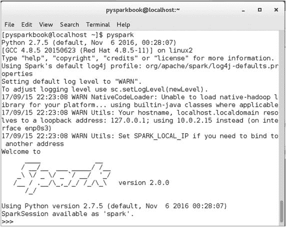

# 2. 安装

在接下来的章节中，我们将使用 PySpark 解决许多问题。PySpark 还与许多其他大数据框架交互，以提供端到端的解决方案。PySpark 可以从 HDFS、NoSQL 数据库或关系数据库管理系统（RDBMS）中读取数据。在数据分析之后，我们也可以将结果保存到 HDFS 或数据库中。

本章涵盖阅读本书所需的所有软件安装。我们将在 CentOS 操作系统上安装所有必需的大数据框架。CentOS 是一款企业级操作系统，免费使用且易于获取。你可以从 [www.centos.org/download/](https://www.centos.org/download/) 下载 CentOS，然后将其安装在虚拟机上。

本章包含以下实践方案：

*   方案 2-1. 在单机上安装 Hadoop
*   方案 2-2. 在单机上安装 Spark
*   方案 2-3. 使用 PySpark Shell
*   方案 2-4. 在单机上安装 Hive
*   方案 2-5. 安装 PostgreSQL
*   方案 2-6. 在 PostgreSQL 上配置 Hive 元存储
*   方案 2-7. 将 PySpark 连接到 Hive
*   方案 2-8. 安装 Apache Mesos
*   方案 2-9. 安装 HBase

我建议你亲自动手安装每个软件包。这是个很好的练习，能让你更深入地理解每个软件包的组件。

## 方案 2-1. 在单机上安装 Hadoop

### 问题

你想在单机上安装 Hadoop。

### 解决方案

你可能会想，我们正在学习 PySpark，为什么还要安装 Hadoop？我们要使用 Hadoop MapReduce 作为分布式框架来解决问题吗？答案是：完全不是。我们将使用 Hadoop 的两个组件：HDFS 和 YARN——HDFS 用于数据存储，YARN 用作集群管理器。安装 Hadoop 需要你下载并配置它。

### 工作原理

请按照以下步骤完成安装。

#### 步骤 2-1-1. 创建新的 CentOS 用户

在此步骤中，我们将创建一个新用户。你可能会想，为什么要创建新用户？为什么不能安装到现有用户上？原因在于，我们想为所有大数据框架提供一个专用用户。通过以下代码行，我们创建用户 `pysparkbook`：

```
[root@localhost pyspark]# adduser pysparkbook
[root@localhost pyspark]# passwd pysparkbook
```

输出如下：

```
Changing password for user pysparkbook.
New password:
passwd: all authentication tokens updated successfully.
```

在上面的代码中，你可以看到命令 `adduser` 用于创建或添加用户。Linux 命令 `passwd` 用于为新用户 `pysparkbook` 设置密码。

创建用户后，我们必须将其添加到 sudo 用户组。Sudo 代表超级用户执行（superuser do）。使用 sudo，我们可以以超级用户身份运行任何代码。Sudo 用于安装软件。

#### 步骤 2-1-2. 创建新的 CentOS 用户

新用户已创建。你可能会想，为什么要新用户？为什么不能将 Hadoop 安装到现有用户上？这背后的原因是，我们想为所有大数据框架提供一个专用用户。在以下代码行中，我们将创建一个用户 `pysparkbook`：

```
[pyspark@localhost ∼]$ su root
[root@localhost pyspark]# adduser pysparkbook
[root@localhost pyspark]# passwd pysparkbook
```

输出：

```
Changing password for user pysparkbook.
New password:
passwd: all authentication tokens updated successfully.
```

在上面的代码中，你可以看到命令 `adduser` 用于创建或添加用户。命令 `passwd` 用于为我们的新用户 `pysparkbook` 设置密码，以便其能够使用 sudo。

```
[root@localhost pyspark]# usermod -aG wheel pyspark
[root@localhost pyspark]#exit
```

然后我们将切换到用户 `pysparkbook`：

```
[pyspark@localhost ∼]$ su pysparkbook
```

我们将创建两个目录。主目录下的 `binaries` 目录将用于下载软件，根目录（`/`）下的 `allPySpark` 目录将用于安装大数据框架：

```
[pysparkbook@localhost ∼]$ mkdir binaries
[pysparkbook@localhost ∼]$ sudo mkdir /allPySpark
```


#### 步骤 2-1-3. 安装 Java

`Hadoop`、`Hive`、`Spark` 以及许多大数据框架都依赖 `Java` 运行。因此我们首先要安装 `Java`。我们将使用 `OpenJDK` 来完成此任务，具体安装的是 `OpenJDK` 的第 8 版本。在 `CentOS` 系统上，我们可以使用 `yum` 安装器来安装 `Java`，命令如下：

```
[pysparkbook@localhost binaries]$ sudo yum install java-1.8.0-openjdk.x86_64
```

安装任何软件后，最好都检查一下安装情况以确保一切正常。

要检查 `Java` 是否安装成功，我倾向于使用命令 `java -version`：

```
[pysparkbook@localhost binaries]$ java -version
```

输出结果如下：

```
openjdk version "1.8.0_111"
OpenJDK Runtime Environment (build 1.8.0_111-b15)
OpenJDK 64-Bit Server VM (build 25.111-b15, mixed mode)
```

`Java` 已安装成功。现在我们需要查找环境变量 `JAVA_HOME`，所有分布式框架都会用到它。安装完成后，可以通过 `jrunscript` 命令查找 `JAVA_HOME`，如下所示：

```
[pysparkbook@localhost binaries]$ jrunscript -e 'java.lang.System.out.println(java.lang.System.getProperty("java.home"));'
```

输出结果如下：

```
/usr/lib/jvm/java-1.8.0-openjdk-1.8.0.111-2.b15.el7_3.x86_64/jre
```

#### 步骤 2-1-4. 为 `pysparkbook` 创建免密登录

使用以下命令创建免密登录：

```
[pysparkbook@localhost binaries]$ ssh-keygen -t rsa
```

输出结果如下：

```
Generating public/private rsa key pair.
Enter file in which to save the key (/home/pysparkbook/.ssh/id_rsa):
/home/pysparkbook/.ssh/id_rsa already exists.
Overwrite (y/n)? y
Enter passphrase (empty for no passphrase):
Enter same passphrase again:
Your identification has been saved in /home/pysparkbook/.ssh/id_rsa.
Your public key has been saved in /home/pysparkbook/.ssh/id_rsa.pub.
The key fingerprint is:
fd:9a:f3:9d:b6:66:f5:29:9f:b5:a5:bb:34:df:cd:6c pysparkbook@localhost.localdomain
The key's randomart image is:
+--[ RSA 2048]----+
|                 |
|                 |
|                 |
|         .       |
|        S .      |
|           .    .|
|            . o.=|
|          .o ++OE|
|          oo.+XO*|
+-----------------+
[pysparkbook@local host binaries]$ cat ∼/.ssh/id_rsa.pub >> ∼/.ssh/authorized_keys
[pysparkbook@localhost binaries]$ chmod 755 ∼/.ssh/authorized_keys
[pysparkbook@localhost binaries]$ ssh localhost
```

输出结果如下：

```
Last login: Wed Dec 21 16:17:45 2016 from localhost
[pysparkbook@localhost ∼]$ exit
```

输出结果如下：

```
logout
Connection to localhost closed .
```

#### 步骤 2-1-5. 下载 Hadoop

我们将从 Apache 网站下载 `Hadoop`。如前所述，我们将所有软件下载到 `binaries` 目录中。我们将使用 `wget` 命令来下载 `Hadoop`：

```
[pysparkbook@localhost ∼]$ cd  binaries
[pysparkbook@localhost binaries]$ wget http://redrockdigimark.com/apachemirror/hadoop/common/hadoop-2.6.5/hadoop-2.6.5.tar.gz
```

输出结果如下：

```
--2016-12-21 12:50:55--  http://redrockdigimark.com/apachemirror/hadoop/common/hadoop-2.6.5/hadoop-2.6.5.tar.gz
Resolving redrockdigimark.com (redrockdigimark.com)... 119.18.61.94
Connecting to redrockdigimark.com (redrockdigimark.com)|119.18.61.94|:80... connected.
HTTP request sent, awaiting response... 200 OK
Length: 199635269 (190M) [application/x-gzip]
Saving to: 'hadoop-2.6.5.tar.gz'
```

#### 步骤 2-1-6. 将 Hadoop 二进制文件移动到安装目录

我们的安装目录是 `allPySpark`。下载的软件是 `hadoop-2.6.5.tar.gz`，它是一个压缩目录。因此，首先我们必须使用 `tar` 命令对其进行解压缩，如下所示：

```
[pysparkbook@localhost binaries]$ tar xvzf hadoop-2.6.5.tar.gz
```

现在我们将 `Hadoop` 移动到 `allPySpark` 目录下：

```
[pysparkbook@localhost binaries]$ sudo mv hadoop-2.6.5 /allPySpark/hadoop
```

#### 步骤 2-1-7. 修改 Hadoop 环境文件

我们需要对 `Hadoop` 环境文件做一些修改。此文件位于 `Hadoop` 配置目录中。在我们的案例中，`Hadoop` 配置目录是 `/allPySpark/hadoop/etc/hadoop/`。使用以下代码行将 `JAVA_HOME` 添加到 `hadoop-env.sh` 文件中：

```
[pysparkbook@localhost binaries]$ vim /allPySpark/hadoop/etc/hadoop/hadoop-env.sh
```

打开 `Hadoop` 环境文件后，添加以下行：

```
# The java implementation to use.
export JAVA_HOME=/usr/lib/jvm/java-1.8.0-openjdk-1.8.0.111-2.b15.el7_3.x86_64/jre
```

#### 步骤 2-1-8. 修改 Hadoop 属性文件

在这一步中，我们关注三个属性文件：

*   `hdfs-site.xml`：HDFS 相关属性
*   `core-site.xml`：与集群相关的核心属性
*   `mapred-site.xml`：MapReduce 框架的属性

这些属性文件位于 `Hadoop` 配置目录中。在前面的章节中，我们讨论了 HDFS。您了解到 HDFS 有两个组件：`NameNode` 和 `DataNode`。您还了解到 HDFS 使用数据复制来实现容错。在我们的 `hdfs-site.xml` 文件中，我们将使用 `dfs.name.dir` 参数设置 `NameNode` 目录，使用 `dfs.data.dir` 参数设置 `DataNode` 目录，并使用 `dfs.replication` 参数设置复制因子。

让我们修改 `hdfs-site.xml`：

```
[pysparkbook@localhost binaries]$ vim /allPySpark/hadoop/etc/hadoop/hdfs-site.xml
```

打开 `hdfs-site.xml` 后，我们需要在该文件中放入以下行：

```
dfs.name.dir
file:/allPySpark/hdfs/namenode
NameNode 位置

dfs.data.dir
file:/allPySpark/hdfs/datanode
DataNode 位置

dfs.replication
 块复制数量 
```

更新 `hdfs-site.xml` 之后，我们将更新 `core-site.xml`。在 `core-site.xml` 中，我们只更新一个属性 `fs.default.name`。此属性用于确定文件系统的主机、端口和其他详细信息。将以下行添加到 `core-site.xml` 中：

```
fs.default.name
hdfs://localhost:9746
```

最后，我们将修改 `mapred-site.xml`。我们还将修改 `mapreduce.framework.name`，它将决定使用哪个运行时框架。可能的值有 `local`、`classic` 或 `yarn`。将以下内容添加到 `mapred-site.xml`：

```
[pysparkbook@localhost binaries]$ cp /allPySpark/hadoop/etc/hadoop/mapred-site.xml.template /allPySpark/hadoop/etc/hadoop/mapred-site.xml
[pysparkbook@localhost binaries]$ vim /allPySpark/hadoop/etc/hadoop/mapred-site.xml

mapreduce.framework.name
yarn
```

#### 步骤 2-1-9. 更新 `.bashrc` 文件

接下来，我们将以下行添加到 `.bashrc` 文件中。打开 `.bashrc` 文件：

```
[pysparkbook@localhost binaries]$ vim ∼/.bashrc
```

然后添加以下行：

```
export HADOOP_HOME=/allPySpark/hadoop
export PATH=$PATH:$HADOOP_HOME/sbin
export PATH=$PATH:$HADOOP_HOME/bin
export JAVA_HOME=/usr/lib/jvm/java-1.8.0-openjdk-1.8.0.111-2.b15.el7_3.x86_64/jre
export PATH=$PATH:$JAVA_HOME/bin
```

然后我们需要引用（source）`.bashrc` 文件。引用该文件后，新的更新值将反映在控制台中。

```
[pysparkbook@localhost binaries]$ source ∼/.bashrc
```


#### 步骤 2-1-10。运行 NameNode 格式化

我们已经更新了一些属性文件。我们应该运行 NameNode 格式化，以便所有更改都能反映在我们的框架中。使用以下命令运行 NameNode 格式化：

```
[pysparkbook@localhost binaries]$ hdfs namenode -format
```

以下是输出：

```
16/12/22 02:38:15 INFO namenode.NameNode: STARTUP_MSG:
/************************************************************
STARTUP_MSG: Starting NameNode
STARTUP_MSG:   host = localhost/127.0.0.1
STARTUP_MSG:   args = [-format]
STARTUP_MSG:   version = 2.6.5
.
16/12/22 02:40:59 INFO util.ExitUtil: Exiting with status 0
16/12/22 02:40:59 INFO namenode.NameNode: SHUTDOWN_MSG:
/************************************************************
SHUTDOWN_MSG: Shutting down NameNode at localhost/127.0.0.1
************************************************************/
```

#### 步骤 2-1-11。启动 Hadoop

Hadoop 已安装完毕，现在我们可以启动它。我们可以在`/allPySpark/hadoop/sbin/`中找到 Hadoop 启动脚本。虽然此脚本已被弃用，但我们将在此示例中使用它：

```
[pysparkbook@localhost binaries]$ /allPySpark/hadoop/sbin/start-all.sh
```

#### 步骤 2-1-12。检查 Hadoop 安装

我们知道，`jps`命令将显示机器上运行的所有 Java 进程。以下是命令：

```
[pysparkbook@localhost binaries]$ jps
```

如果一切正常，我们将看到如下所示的进程在运行：

```
25720 NodeManager
25896 Jps
25625 ResourceManager
25195 NameNode
25292 DataNode
25454 SecondaryNameNode
```

恭喜！我们终于在我们的系统上安装了 Hadoop。

## 配方 2-2。在单机上安装 Spark

### 问题

您想在一台机器上安装 Spark。

### 解决方案

我们将为 Hadoop 版本 2.6 安装预构建的 `spark-2.0.0`。我们可以从源代码构建 Spark。但在本例中，我们将使用预构建的 Apache Spark。

### 工作原理

按照本节中的步骤完成安装。

#### 步骤 2-2-1。下载 Apache Spark

我们将从其镜像站点下载 Spark。我们将使用`wget`命令，如下所示：

```
[pysparkbook@localhost binaries]$ wget  https://d3kbcqa49mib13.cloudfront.net/spark-2.0.0-bin-hadoop2.6.tgz
```

#### 步骤 2-2-2。解压 Spark 的 .tgz 文件

使用以下命令解压 .tgz 文件：

```
[pysparkbook@localhost binaries]$ tar xvzf spark-2.0.0-bin-hadoop2.6.tgz
```

#### 步骤 2-2-3。将解压后的 Spark 目录移动到 /allPySpark

现在我们必须将解压后的 Spark 目录移动到`/allPySpark`位置下。使用以下命令：

```
[pysparkbook@localhost binaries]$ sudo mv spark-2.0.0-bin-hadoop2.6   /allPySpark/ spark
```

#### 步骤 2-2-4。修改 Spark 环境文件

Spark 环境文件包含了运行 Spark 所需的所有环境变量。我们将在环境文件中设置以下环境变量：

*   `HADOOP_CONF_DIR`：Hadoop 的配置目录
*   `SPARK_CONF_DIR`：备用配置目录（默认：`${SPARK_HOME}/conf`）
*   `SPARK_LOG_DIR`：存储日志文件（默认：`${SPARK_HOME}/log`）
*   `SPARK_WORKER_DIR`：设置工作进程的工作目录
*   `HIVE_CONF_DIR`：用于从 Hive 读取数据

首先，我们必须将`spark-env.sh.template`文件复制到`spark-env.sh`。Spark 环境文件`spark-env.sh`位于`spark/conf`（配置目录位置）内。以下是命令：

```
[pysparkbook@localhost binaries]$ cp /allPySpark/spark/conf/spark-env.sh.template /allPySpark/spark/conf/spark-env.sh
```

现在让我们打开`spark-env.sh`文件：

```
[pysparkbook@localhost binaries]$ vim /allPySpark/spark/conf/spark-env.sh
```

现在将以下行追加到`spark-env.sh`的末尾：

```
export HADOOP_CONF_DIR=/allPySpark/hadoop/etc/hadoop/
export SPARK_LOG_DIR=/allPySpark/logSpark/
export SPARK_WORKER_DIR=/tmp/spark
export HIVE_CONF_DIR=/allPySpark/hive/conf
```

#### 步骤 2-2-5。修改 .bashrc 文件

在 `.bashrc` 文件中，我们必须添加 Spark 的 `bin` 目录。使用以下命令：

```
[pysparkbook@localhost binaries]$ vim  ∼/.bashrc
```

然后在 `.bashrc` 文件中添加以下行：

```
export SPARK_HOME=/allPySpark/spark
export PATH=$PATH:$SPARK_HOME/bin
```

之后，执行 source 命令使 `.bashrc` 文件生效：

```
[pysparkbook@localhost binaries]$ source  ∼/.bashrc
```

#### 步骤 2-2-6。启动 PySpark

我们可以使用`pyspark`脚本来启动 PySpark shell。关于`pyspark`脚本的讨论将在下一个配方中继续。

```
[pysparkbook@localhost binaries]$ pyspark
```

我们已经完成了又一个成功的安装。要完成本书的学习，还需要其他安装，但让我们先关注 PySpark shell。

## 配方 2-3。使用 PySpark Shell

### 问题

您想使用 PySpark shell。

### 解决方案

PySpark shell 是一个交互式 shell，用于通过 Python 与 PySpark 交互。PySpark shell 可以通过使用 PySpark 脚本来启动。PySpark 脚本可以在 `spark/bin` 位置找到。

### 工作原理

PySpark shell 可以如下启动：

```
[pysparkbook@localhost binaries]$ pyspark
```

启动后，PySpark 将显示如图 2-1 所示的屏幕。



图 2-1。

启动 PySpark 中的控制台屏幕

您可以看到，启动后，PySpark 会显示大量信息。它显示正在使用的 Python 版本以及 PySpark 版本信息。

`>>>` 符号对于 Python 程序员来说是熟知的。每当我们启动 Python shell 时，都会得到这个符号。它告诉我们，现在可以编写我们的 Python 命令了。类似地，在 PySpark 中，此符号告诉我们，现在可以编写我们的 Python 或 PySpark 命令并查看结果。

PySpark shell 在 PySpark 的单机安装和集群安装上工作方式类似。

## 配方 2-4。在单机上安装 Hive

### 问题

您想在一台机器上安装 Hive。

### 解决方案

我们在第一章中讨论了 Hive。现在是在我们的机器上安装 Hive 的时候了。我们将在后续章节中从 PySpark 读取 Hive 中的数据。

### 工作原理

按照本节中的步骤完成安装。

#### 步骤 2-4-1。下载 Hive

我们可以从 Apache Hive 网站下载 Hive。我们使用`wget`命令下载 Hive 的 tar.gz 文件，如下所示：

```
[pysparkbook@localhost binaries]$ wget http://www-eu.apache.org/dist/hive/hive-2.0.1/apache-hive-2.0.1-bin.tar.gz
```

以下是输出：

```
100%[=============================================>] 139,856,338  709KB/s   in 3m 5s
2016-12-26 09:34:21 (737 KB/s) - 'apache-hive-2.0.1-bin.tar.gz' saved [139856338/139856338]
```

#### 步骤 2-4-2。解压 Hive

我们已经下载了 `apache-hive-2.0.1-bin.tar.gz`，一个 `.tar.gz` 文件。所以现在我们必须解压它。我们可以使用`tar`命令解压它，如下所示：

```
[pysparkbook@localhost binaries]$ tar xvzf   apache-hive-2.0.1-bin.tar.gz
```

#### 步骤 2-4-3。移动解压后的 Hive 目录

```
[pysparkbook@localhost binaries]$ sudo mv apache-hive-2.0.1-bin /allPySpark/hive
```


#### 步骤 2-4-4. 更新 `hive-site.xml`

Hive 默认使用嵌入式的 Derby 数据库作为元数据存储。Derby 数据库是无内存的，因此最好为其指定一个明确的位置。我们可以在 `hive-site.xml` 中提供该位置。为此，我们需要将 `hive-default.xml.template` 移动为 `hive-site.xml`。

```
[pysparkbook@localhost binaries]$ mv /allPySpark/hive/conf/hive-default.xml.template /allPySpark/hive/conf/hive-default.xml.templatehive-site.xml
```

然后打开 `hive-site.xml` 并进行如下更新：

```
[pysparkbook@localhost binaries]$ vim /allPySpark/hive/conf/hive-site.xml
```

你可以将以下几行添加到 `hive-site.xml` 的末尾，或者直接修改 `hive-site.xml` 文件中的 `javax.jdo.option.ConnectionURL`：

```
javax.jdo.option.ConnectionURL
jdbc:derby:;databaseName=/allPySpark/hive/metastore/metastore_db;create=true
```

之后，我们需要将 `HADOOP_HOME` 添加到 `hive_env.sh` 文件中，操作如下：

```
[pysparkbook@localhost binaries]$ mv /allPySpark/hive/conf/hive-env.sh.template /allPySpark/hive/conf/hive-env.sh
[pysparkbook@localhost binaries]$ vim  /allPySpark/hive/conf/hive-env.sh
```

然后在 `hive-env.sh` 中添加以下行：

```
# Set HADOOP_HOME to point to a specific hadoop install directory
HADOOP_HOME=/allPySpark/hadoop
```

#### 步骤 2-4-5. 更新 `.bashrc` 文件

打开 `.bashrc` 文件。该文件位于主目录中：

```
[pysparkbook@localhost binaries]$ vim  ∼/.bashrc
```

将以下行添加到 `.bashrc` 文件中：

```
####################Hive 参数 ######################
export HIVE_HOME=/allPySpark/hive
export PATH=$PATH:$HIVE_HOME/bin
```

现在使用以下命令加载 `.bashrc` 文件：

```
[pysparkbook@localhost binaries]$ source ∼/.bashrc
```

#### 步骤 2-4-6. 创建 Hive 数据仓库目录

现在我们需要创建数据仓库目录。Hive 会使用该数据仓库目录来放置数据文件。

```
[pysparkbook@localhost binaries]$hadoop fs -mkdir -p /user/hive/warehouse
[pysparkbook@localhost binaries]$hadoop fs -mkdir -p /tmp
[pysparkbook@localhost binaries]$hadoop fs -chmod g+w /user/hive/warehouse
[pysparkbook@localhost binaries]$hadoop fs -chmod g+w /tmp
```

`/user/hive/warehouse` 目录就是 Hive 的数据仓库目录。

#### 步骤 2-4-7. 初始化元数据存储数据库

有时需要初始化一个模式。你可能会想，是什么的模式？我们知道 Hive 将表的元数据存储在关系数据库中。目前，我们将使用 Derby 数据库作为 Hive 的元数据存储数据库。在接下来的方法中，我们将把 Hive 连接到外部的 PostgreSQL。在 Ubuntu 中，Hive 安装无需此命令即可工作。但在 CentOS 中我发现必须执行它。如果不执行以下命令，Hive 会抛出错误：

```
[pysparkbook@localhost  binaries]$ schematool -initSchema -dbType derby
```

#### 步骤 2-4-8. 检查 Hive 安装

现在 Hive 已经安装完成，我们应该检查一下工作是否正常。使用以下命令启动 Hive Shell：

```
[pysparkbook@localhost binaries]$ hive
```

然后我们会发现 Hive Shell 已经打开，如下所示：

```
hive>
```

## 方法 2-5. 安装 PostgreSQL

### 问题

你想要安装 PostgreSQL。

### 解决方案

PostgreSQL 是一个由加州大学开发的关系数据库管理系统。PostgreSQL 许可证允许使用、修改和分发 PostgreSQL。PostgreSQL 可以在 macOS 以及类 Unix 系统（如 Red Hat 和 Ubuntu）上运行。我们将在 CentOS 上进行安装。

我们将以两种方式使用 PostgreSQL。首先，我们将 PostgreSQL 用作 Hive 的元数据存储数据库。有了外部数据库作为元数据存储，我们将能够轻松读取现有 Hive 中的数据。其次，我们将从 PostgreSQL 读取数据，分析后将结果保存回 PostgreSQL。

安装 PostgreSQL 可以通过源代码进行，但我们将通过命令行 `yum` 安装程序来安装。

### 实现原理

按照本节中的步骤完成安装。

#### 步骤 2-5-1. 安装 PostgreSQL

可以使用 `yum` 安装程序安装 PostgreSQL。命令如下：

```
[pysparkbook@localhost binaries]$ sudo yum install postgresql-server
```

[sudo] pysparkbook 的密码：

#### 步骤 2-5-2. 初始化数据库

要使用 PostgreSQL，我们首先需要使用 `initdb` 工具来初始化数据库。如果不初始化数据库，我们就无法使用它。在初始化数据库时，我们还可以指定数据库的数据文件。安装 PostgreSQL 后，我们必须对其进行初始化。可以使用以下命令初始化数据库：

```
[pysparkbook@localhost binaries]$ sudo postgresql-setup initdb
```

输出如下：

```
初始化数据库 ... 确定
```

#### 步骤 2-5-3. 启用并启动数据库

```
[pysparkbook@localhost binaries]$ sudo systemctl enable postgresql
[pysparkbook@localhost binaries]$ sudo systemctl start postgresql
[pysparkbook@localhost binaries]$ sudo -i -u postgres
```

输出如下：

```
-bash-4.2$ psql
psql (9.2.18)
输入 "help" 获取帮助。
postgres=#
```

注意

安装步骤位于以下网页：

[`https://wiki.postgresql.org/wiki/YUM_Installation`](https://wiki.postgresql.org/wiki/YUM_Installation)

## 方法 2-6. 在 PostgreSQL 上配置 Hive 元数据存储

### 问题

你想要在 PostgreSQL 上配置 Hive 元数据存储。

### 解决方案

我们知道，Hive 将表的元数据存放在关系数据库中。我们已经安装了 Hive。我们的 Hive 安装包含一个内嵌的元数据存储。Hive 使用 Derby 关系数据库系统作为其元数据存储。在接下来的章节中，我们将从 PySpark 读取现有的 Hive 表。

在 PostgreSQL 上配置 Hive 元数据存储需要我们在 PostgreSQL 数据库中填充表。这些表将保存 Hive 表的元数据。之后，我们必须配置 Hive 的属性文件。

### 实现原理

在本节中，我们将在 PostgreSQL 数据库上配置 Hive 元数据存储。然后，我们的 Hive 元数据将存放在 PostgreSQL 中。

#### 步骤 2-6-1. 下载 PostgreSQL JDBC 连接器

我们需要一个 JDBC 连接器，以便 Hive 进程可以连接到外部的 PostgreSQL。我们可以使用以下命令获取 JDBC 连接器：

```
[pysparkbook@localhost binaries]$ wget https://jdbc.postgresql.org/download/postgresql-9.4.1212.jre6.jar
```

#### 步骤 2-6-2. 将 JDBC 连接器复制到 Hive 的 `lib` 目录

获取 JDBC 连接器后，我们需要将其放入 Hive 的 `lib` 目录：

```
[pysparkbook@localhost binaries]$ cp postgresql-9.4.1212.jre6.jar  /allPySpark/hive/lib/
```

#### 步骤 2-6-3. 连接到 PostgreSQL

使用此命令连接到 PostgreSQL：

```
[pysparkbook@localhost binaries]$ sudo -u postgres psql
```

#### 步骤 2-6-4. 创建所需的用户和数据库

在此步骤中，我们将创建一个 PostgreSQL 用户 `pysparkBookUser`。然后，我们将创建一个名为 `pymetastore` 的数据库。我们的数据库将保存与 Hive 元数据存储相关的所有表。

首先，创建用户：

```
postgres=# CREATE USER pysparkBookUser WITH PASSWORD 'pbook';
```

输出如下：

```
CREATE ROLE
```

接下来，创建数据库：

```
postgres=# CREATE DATABASE pymetastore;
```

输出如下：

```
CREATE DATABASE
```

`\c` 是 PostgreSQL 的 connect 命令。我们已经创建了数据库 `pymetastore`。现在我们将使用 `\c` 命令连接到这个数据库：

```
postgres=# \c pymetastore;
```

您现在已连接到 `pymetastore` 数据库。您可以在 [`www.postgresql.org/docs/9.0/static/app-psql.html`](https://www.postgresql.org/docs/9.0/static/app-psql.html) 查看更多 PostgreSQL 命令。


#### 步骤 2-6-5. 在 `pymetastore` 数据库中填充数据

Hive 拥有自己的 PostgreSQL 脚本来为元存储填充表。`\i` 命令从 PostgreSQL 脚本中读取命令并执行这些命令。以下命令运行 `hive-txn-schema-2.0.0.postgres.sql` 脚本，该脚本将创建 Hive 元存储所需的所有表：

```
pymetastore=#  \i /allPySpark/hive/scripts/metastore/upgrade/postgres/hive-txn-schema-2.0.0.postgres.sql
```

以下是输出：

```
psql:/allPySpark/hive/scripts/metastore/upgrade/postgres/hive-txn-schema-2.0.0.postgres.sql:30: NOTICE:  CREATE TABLE / PRIMARY KEY will create implicit index "txns_pkey" for table "txns"
CREATE TABLE
CREATE TABLE
INSERT 0 1
psql:/allPySpark/hive/scripts/metastore/upgrade/postgres/hive-txn-schema-2.0.0.postgres.sql:69: NOTICE:  CREATE TABLE / PRIMARY KEY will create implicit index "hive_locks_pkey" for table "hive_locks"
CREATE TABLE
```

#### 步骤 2-6-6. 授予权限

以下命令将授予一些权限：

```
pymetastore=# grant select, insert,update,delete on public.txns to pysparkBookUser;
GRANT
pymetastore=# grant select, insert,update,delete on public.txn_components to pysparkBookUser;
GRANT
pymetastore=# grant select, insert,update,delete on public.completed_txn_components   to pysparkBookUser;
GRANT
pymetastore=# grant select, insert,update,delete on public.next_txn_id to pysparkBookUser;
GRANT
pymetastore=# grant select, insert,update,delete on public.hive_locks to pysparkBookUser;
GRANT
pymetastore=# grant select, insert,update,delete on public.next_lock_id to pysparkBookUser;
GRANT
pymetastore=# grant select, insert,update,delete on public.compaction_queue to pysparkBookUser;
GRANT
pymetastore=# grant select, insert,update,delete on public.next_compaction_queue_id to pysparkBookUser;
GRANT
pymetastore=# grant select, insert,update,delete on public.completed_compactions to pysparkBookUser;
GRANT
pymetastore=# grant select, insert,update,delete on public.aux_table to pysparkBookUser;
GRANT
```

#### 步骤 2-6-7. 修改 `pg_hba.conf` 文件

请记住，为了更新 `pg_hba.conf`，你应该是 root 用户。所以首先成为 root 用户。然后打开 `pg_hba.conf` 文件：

```
[root@localhost binaries]# vim /var/lib/pgsql/data/pg_hba.conf
```

然后将所有 peer 和 ident 改为 `trust`：

```
#local   all             all                                     peer
local    all             all                                     trust
# IPv4 local connections:
#host    all             all             127.0.0.1/32            ident
host     all             all             127.0.0.1/32            trust
# IPv6 local connections:
#host    all             all             ::1/128                 ident
host     all             all             ::1/128                 trust
```

你可以在 [`stackoverflow.com/questions/2942485/psql-fatal-ident-authentication-failed-for-user-postgres`](http://stackoverflow.com/questions/2942485/psql-fatal-ident-authentication-failed-for-user-postgres) 找到关于此更改的更多详细信息。退出 root 用户。

#### 步骤 2-6-8. 测试我们的用户

接下来，我们将测试我们能否以创建的用户轻松进入数据库：

```
[pysparkbook@localhost binaries]$ psql -h localhost -U pysparkbookuser -d pymetastore
```

以下是输出：

```
psql (9.2.18)
Type "help" for help.
pymetastore=>
```

#### 步骤 2-6-9. 修改我们的 `hive-site.xml`

我们可以在配置文件 `hive-site.xml` 中修改与 Hive 相关的配置。我们必须修改以下属性：

*   `javax.jdo.option.ConnectionURL`：数据库的连接 URL
*   `javax.jdo.option.ConnectionDriverName`：连接 JDBC 驱动名称
*   `javax.jdo.option.ConnectionUserName`：数据库连接用户
*   `javax.jdo.option.ConnectionPassword`：连接密码

你可以修改这些属性，或者在 Hive 属性文件的末尾添加以下内容以获得所需结果：

```
javax.jdo.option.ConnectionURL
jdbc:postgresql://localhost/pymetastore
postgreSQL server metadata store

javax.jdo.option.ConnectionDriverName
org.postgresql.Driver
Driver class of postgreSQL

javax.jdo.option.ConnectionUserName
pysparkbookuser
User name to connect to postgreSQL

javax.jdo.option.ConnectionPassword
pbook
password for connecting to PostgreSQL server
```

#### 步骤 2-6-10. 启动 Hive

我们已经将 Hive 连接到一个外部关系数据库管理系统。所以现在是时候启动 Hive 并检查一切是否正常了。首先，启动 Hive：

```
[pysparkbook@localhost binaries]$ hive
```

我们的操作将反映在 PostgreSQL 中。让我们在数据库中创建一个数据库和一个表。我们将通过以下命令创建数据库 `apress` 和表 `apressBooks`：

```
hive> create database apress;
```

以下是输出：

```
OK
Time taken: 1.397 seconds
hive> use apress;
```

以下是输出：

```
OK
Time taken: 0.07 seconds
hive> create table apressBooks (
>      bookName String,
>      bookWriter String
>      )
>      row format delimited
>      fields terminated by ',';
```

以下是输出：

```
OK
Time taken: 0.581 seconds
```

#### 步骤 2-6-11. 在 PostgreSQL 中测试元数据的创建

创建的数据库和表将反映在 PostgreSQL 中。我们可以通过以下方式在 `TBLS` 表中看到更新后的数据：

```
pymetastore=> SELECT * from "TBLS";
TBL_ID | CREATE_TIME | DB_ID | LAST_ACCESS_TIME |    OWNER    | RETENTION | SD_ID |  TBL_NAME   |
TBL_TYPE    | VIEW_EXPANDED_TEXT | VIEW_ORIGINAL_TEXT
--------+-------------+-------+------------------+-------------+-----------+-------+-------------+
---------------+--------------------+--------------------
1 |  1482892229 |     6 |                0 | pysparkbook |         0 |    1 | apressbooks |
MANAGED_TABLE |                    |
(1 row)
```

连接 Hive 到外部数据库所需的重要工作已完成。在接下来的方案中，我们将安装 Apache Mesos。

## 方案 2-7. 将 PySpark 连接到 Hive

### 问题

你想将 PySpark 连接到 Hive。

### 解决方案

PySpark 需要 Hive 属性文件来了解 Hive 的配置参数。Hive 属性文件 `hive-site.xml` 位于 Hive 配置目录中。将 Hive 属性文件复制到 Spark 配置目录。然后我们就完成了，可以启动 PySpark 了。

### 工作原理

已确定两个步骤来将 PySpark 连接到 Hive。

#### 步骤 2-7-1. 将 Hive 属性文件复制到 Spark 配置目录

使用以下命令复制 Hive 属性文件：

```
[pysparkbook@localhost binaries]$cp /allPySpark/hive/conf/hive-site.xml /allPySpark/spark/
```

#### 步骤 2-7-2. 启动 PySpark

使用以下命令启动 PySpark：

```
[pysparkbook@localhost binaries]$pyspark
```

## 方案 2-8. 安装 Apache Mesos

### 问题

你想安装 Apache Mesos。

### 解决方案

安装 Apache Mesos 需要下载代码，然后进行配置。

### 工作原理

请遵循本节中的步骤完成安装。


#### 步骤 2-8-1\. 下载 Apache Mesos

使用以下命令获取 Apache Mesos：

```
[pysparkbook@localhost binaries]$ wget http://www.apache.org/dist/mesos/1.1.0/mesos-1.1.0.tar.gz
```

输出如下：

```
--2016-12-28 08:15:14--  http://www.apache.org/dist/mesos/1.1.0/mesos-1.1.0.tar.gz
Resolving www.apache.org (www.apache.org)... 88.198.26.2, 140.211.11.105, 2a01:4f8:130:2192::2
Connecting to www.apache.org (www.apache.org)|88.198.26.2|:80... connected.
HTTP request sent, awaiting response... 200 OK
Length: 41929556 (40M) [application/x-gzip]
Saving to: 'mesos-1.1.0.tar.gz.1'
100%[=============================================>] 41,929,556   226KB/s   in 58s
2016-12-28 08:16:23 (703 KB/s) - 'mesos-1.1.0.tar.gz.1' saved [41929556/41929556]
```

#### 步骤 2-8-2\. 从 .tar.gz 中解压 Mesos

要解压 Mesos，请使用以下命令：

```
[pysparkbook@localhost binaries]$ tar xvzf mesos-1.1.0.tar.gz
```

#### 步骤 2-8-3\. 安装 Repo 以安装 Maven

要安装 Maven，我们首先需要安装 repo：

```
[pysparkbook@localhost binaries]$ sudo bash -c 'cat > /etc/yum.repos.d/wandisco-svn.repo  [WANdiscoSVN]
> name=WANdisco SVN Repo 1.9
> enabled=1
> baseurl=http://opensource.wandisco.com/centos/7/svn-1.9/RPMS/$basearch/
> gpgcheck=1
> gpgkey=http://opensource.wandisco.com/RPM-GPG-KEY-WANdisco
> EOF'
```

#### 步骤 2-8-4\. 安装 Maven 的依赖项

现在是时候安装 Maven 所需的依赖项了：

```
[pysparkbook@localhost binaries]$ sudo yum install -y apache-maven python-devel java-1.8.0-openjdk-devel zlib-devel libcurl-devel openssl-devel cyrus-sasl-devel cyrus-sasl-md5 apr-devel subversion-devel apr-util-devel
```

#### 步骤 2-8-5\. 下载 Apache Maven

现在我们准备下载 Maven：

```
[pysparkbook@localhost binaries]$ wget http://www-us.apache.org/dist/maven/maven-3/3.3.9/binaries/apache-maven-3.3.9-bin.tar.gz
```

以下是输出：

```
100%[===================================================>] 8,491,533    274KB/s   in 87s
2016-12-28 23:47:40 (95.5 KB/s) - 'apache-maven-3.3.9-bin.tar.gz' saved [8491533/8491533]
```

#### 步骤 2-8-6\. 解压 Maven 目录

与其他软件一样，我们需要解压并移动 Maven 目录：

```
[pysparkbook@localhost binaries]$ tar -xvzf apache-maven-3.3.9-bin.tar.gz
[pysparkbook@localhost binaries]$ mv apache-maven-3.3.9 /allPySpark/maven
```

然后我们需要链接 `mvn` 文件：

```
[pysparkbook@localhost binaries]$ sudo ln -s /allPySpark/maven/bin/mvn /usr/bin/mvn
```

`[sudo] password for pysparkbook`:

#### 步骤 2-8-7\. 检查 Maven 安装

检查安装的最佳方式是运行 `version` 命令：

```
[pysparkbook@localhost binaries]$ mvn -version
```

以下是输出：

```
Apache Maven 3.3.9 (bb52d8502b132ec0a5a3f4c09453c07478323dc5; 2015-11-10T22:11:47+05:30)
Maven home: /allPySpark/maven
Java version: 1.8.0_111, vendor: Oracle Corporation
Java home: /usr/lib/jvm/java-1.8.0-openjdk-1.8.0.111-2.b15.el7_3.x86_64/jre
Default locale: en_US, platform encoding: UTF-8
OS name: "linux", version: "3.10.0-514.2.2.el7.x86_64", arch: "amd64", family: "unix"
```

#### 步骤 2-8-9\. 配置 Mesos

我们需要移动到 Mesos 构建目录，然后为脚本运行 `configure`。

```
[pysparkbook@localhost build]$ ../configure

Following lines will come as notes
```

你可能会遇到如下错误：

```
make[2]: *** [../3rdparty/protobuf-2.6.1/python/dist/protobuf-2.6.1-py2.7.egg] Error 1
make[2]: Leaving directory '/allPySpark/mesos/build/src'
make[1]: *** [all] Error 2
make[1]: Leaving directory '/allPySpark/mesos/build/src'
make: *** [all-recursive] Error 1
```

如果确实遇到了这些错误，你需要执行以下安装并升级 `pytz`：

```
[pysparkbook@localhost build]$sudo yum install python-setuptools python-setuptools-devel
[pysparkbook@localhost build]$sudo easy_install pip
[pysparkbook@localhost build]$sudo pip install --upgrade pytz
```

#### 步骤 2-8-10\. 运行 Make

```
[pysparkbook@localhost build]$make
Installing build/bdist.linux-x86_64/wheel/mesos.scheduler-1.1.0-py2.7-nspkg.pth
running install_scripts
creating build/bdist.linux-x86_64/wheel/mesos.scheduler-1.1.0.dist-info/WHEEL
make[2]: Leaving directory '/allPySpark/mesos/build/src'
make[1]: Leaving directory '/allPySpark/mesos/build/src'
```

#### 步骤 2-8-11\. 运行 make install

使用以下命令安装 Mesos：

```
[pysparkbook@localhost build]$make install
```

#### 步骤 2-8-12\. 启动 Mesos Master

成功安装 Mesos 后，我们可以使用以下命令启动 Master：

```
[pysparkbook@localhost build]$ mesos-master --work_dir=/allPySpark/mesos/workdir
```

#### 步骤 2-8-13\. 启动 Mesos Slave

使用以下命令在同一台机器上启动 Slave：

```
[root@localhost binaries]#mesos-slave --master=127.0.0.1:5050 --work_dir=/allPySpark/mesos/workdir --systemd_runtime_directory=/allPySpark/mesos/systemd
```

在接下来的章节中，你将看到如何在 Mesos 上启动 PySpark Shell。

## 配方 2-9\. 安装 HBase

### 问题

你想要安装 Apache HBase。

### 解决方案

HBase 是一个 NoSQL 数据库，正如我们在第 1 章中讨论的那样。我们将安装 HBase，然后使用 Spark 从这个 HBase 安装中读取数据。我们将选择最简单的 HBase 安装方式。我们可以从 HBase 网站 ([`https://hbase.apache.org/`](https://hbase.apache.org/)) 下载 HBase，然后进行配置。

### 工作原理

按照本节中的步骤完成安装。

#### 步骤 2-9-1\. 获取 HBase

使用以下命令将 HBase 下载到我们的 `binaries` 目录：

```
[pysparkbook@localhost binaries]$ wget http://www-eu.apache.org/dist/hbase/stable/hbase-1.2.4-bin.tar.gz
```

#### 步骤 2-9-2\. 解压 HBase

```
[pysparkbook@localhost binaries]$ tar xzf  hbase-1.2.4-bin.tar.gz
[pysparkbook@localhost binaries]$ sudo mv hbase-1.2.4 /usr/local/hbase
```

#### 步骤 2-9-3\. 更新 HBase 环境文件

HBase 也会查找 `JAVA_HOME`。因此，我们将使用 `JAVA_HOME` 更新 HBase 环境文件：

```
[pysparkbook@localhost binaries]$ vim /allPySpark/hbase/conf/hbase-env.sh
export JAVA_HOME=/usr/lib/jvm/java-1.8.0-openjdk-1.8.0.111-2.b15.el7_3.x86_64/
```

#### 步骤 2-9-4\. 在 HDFS 中创建 HBase 目录

即使是单机安装，HBase 也可以将数据放在本地机器上。但为了更清晰地说明 HBase 的工作原理，我们将为 HBase 在 HDFS 上创建一个目录。首先，我们需要启动 HDFS。使用以下命令在 HDFS 中创建目录：

```
[pysparkbook@localhost binaries]$/allPySpark/hadoop/sbin/start-dfs.sh
[pysparkbook@localhost binaries]$/allPySpark/hadoop/sbin/start-yarn.sh
[pysparkbook@localhost binaries]$hadoop fs -mkdir /hbase
```

#### 步骤 2-9-5\. 更新 HBase 属性文件和 .bashrc

我们先更新属性文件，然后更新 `.bashrc` 文件。在 HBase 属性文件中，我们将更新 `hbase:rootdir`。HBase 属性文件位于 HBase 配置目录中。对我们来说，HBase 配置目录是 `/allPySpark/hbase/conf`。

```
[pysparkbook@localhost binaries]$ vim /allPySpark/hbase/conf/hbase-site.xml
```

现在在 `hbase-site.xml` 文件中添加以下行：

```
hbase:rootdir
hdfs://localhost:9746/hbase
```

接下来，更新 `.bashrc`，如下所示：

```
[pysparkbook@localhost binaries]$vim ∼/.bashrc
```

在 `.bashrc` 中添加以下行：

```
export HBASE_HOME=/allPySpark/hbase
export PATH=$PATH:$HBASE_HOME/bin
[pysparkbook@localhost binaries]$ source  ∼/.bashrc
```

#### 步骤 2-9-6\. 启动 HBase 和 HBase Shell

```
[pysparkbook@localhost binaries]$ /allPySpark/hbase/bin/start-hbase.sh
[pysparkbook@localhost binaries]$/allPySpark/hbase/bin/hbase shell
```

以下是输出：

```
hbase(main):001:0>
```


