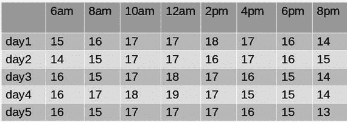

# 方法 3-11：使用 Python 的 `for` 和 `while` 循环

### 问题

你想要使用 Python 的 `for` 和 `while` 循环。

### 解决方案

销售主管 A 先生得知自己的应用程序是用 Python 编写的后，对学习 Python 产生了兴趣。他参加了一个 Python 课程。他的导师 X 先生给他布置了一道作业题。X 先生要求全班同学实现一个 Python 函数，该函数以 1 到 101 的整数列表作为输入，然后返回列表中所有偶数的和。A 先生发现，可以使用以下循环来实现所需函数：

* `for` 循环
* `while` 循环

循环最适合提高代码的复用性。我们使用循环来多次运行某段代码。可以通过 `for` 和 `while` 循环来运行特定的代码段。要计算列表中偶数的总和，需要两个步骤：首先找出所有偶数，然后进行求和。

### 工作原理

### 步骤 3-11-1：实现 `for` 循环

首先，我们将通过 Python 中的 `for` 循环来获取列表中偶数的总和：

```
>>> def sumUsingForLoop(numbers) :
...       sumOfEvenNumbers = 0
...       for i in numbers :
...           if i % 2 ==0 :
...               sumOfEvenNumbers = sumOfEvenNumbers +i
...           else :
...              pass
...       return   sumOfEvenNumbers
```

这里我们编写了一个名为 `sumUsingForLoop` 的 Python 函数。该函数将 `numbers` 作为输入。Python 中的 `for` 循环会遍历一个 Python 序列。如果我们传入一个整数列表，`for` 循环会逐个元素开始迭代。`if` 块将检查当前数字是否为偶数。如果是偶数，变量 `sumOfEvenNumbers` 将通过累加增加该数值。迭代完成后，返回最终的累加和。

让我们测试一下该函数的运行情况：

```
>>> numbers = range(1,102)
>>> numbers
```

输出如下：

```
[1, 2, 3, 4, 5, 6, 7,............,  98, 99, 100, 101]
```

我们使用 `range()` 函数创建了一个从 1 到 101 的整数列表。现在调用我们的函数 `sumUsingForLoop` 并查看结果：

```
>>> sumUsingForLoop(numbers)
```

输出如下：

```
```

### 步骤 3-11-2：实现 `while` 循环

在本节中，我们将实现一个使用 `while` 循环的解决方案：

```
>>> def sumUsingWhileLoop(numbers) :
...      i = 1
...      sumOfEvenNumbers = 0
...      while i <= 101 :
...           if i % 2 ==0 :
...                sumOfEvenNumbers = sumOfEvenNumbers +i
...           i = i + 1
...      return  sumOfEvenNumbers
```

这里我们定义了一个名为 `sumUsingWhileLoop` 的 Python 函数。该函数将 `numbers` 作为输入。Python 中的 `while` 循环有助于遍历 Python 序列。如果我们传入一个整数列表，可以像代码中所示那样逐个元素进行迭代。`if` 块将检查当前数字是否为偶数。如果是偶数，变量 `sumOfEvenNumbers` 将通过累加增加该数值。迭代完成后，返回最终的累加和。

让我们测试一下这个函数：

```
>>> sumUsingWhileLoop(numbers)
```

输出如下：

```
```

## 方法 3-12：使用 NumPy

### 问题

你想要使用 NumPy。

### 解决方案

XYZ 公司计划在 A 地点建设新工厂。公司需要选择一个温度满足特定标准的地点。环境科学家 Y 先生收集了 A 地点五天中不同时间段的温度读数。

表 3-2 展示了这些温度读数。



**表 3-2.** 摄氏温度

你需要完成以下操作：

* 安装 pip
* 安装 NumPy
* 使用 NumPy 的 `array()` 函数创建一个二维数组
* 通过垂直堆叠和列堆叠较小的数组来创建一个二维数组
* 了解并更改数组元素的数据类型
* 了解给定数组的形状


*   计算每一天的最低和最高温度
*   计算每一列的最低和最高温度
*   计算每一天和每一列的平均温度
*   计算每一天和每一列的温度标准差
*   计算每一天和每一列的温度方差
*   计算每一天和每一列的温度中位数
*   计算所有收集到的温度数据的整体平均值
*   计算全部五天温度数据的方差和标准差

这类简单的数学问题可以通过使用`NumPy`轻松解决。你可能会想，我们可以用嵌套列表来解决这些问题，那为什么要使用`NumPy`呢？因为使用`NumPy`的`ndarray`，循环会变得更快。`NumPy`是开源的，并且很容易获得。

`NumPy`的`ndarray`是对多维数组数据的一种更高级别的抽象。它还提供了许多用于处理这些多维数组的函数。为了使用`NumPy`，我们首先需要安装它。在创建了给定温度数据的二维数组之后，我们可以应用许多`NumPy`函数来解决给定问题。

### 工作原理

我们将使用以下步骤来解决我们的问题。

#### 步骤 3-12-1：安装 `pip`

`pip`是一个 Python 包管理系统，它本身是用 Python 编写的。我们可以使用`pip`来安装其他 Python 包。使用`yum`安装程序，我们可以按如下方式安装`pip`：

```
[pysparkbook@localhost ∼]$ sudo yum install python-pip
```

安装`pip`后，我们必须安装`pyparsing`。运行以下命令安装`pyparsing`：

```
[pysparkbook@localhost ∼]$ sudo  yum install ftp://mirror.switch.ch/pool/4/mirror/centos/7.3.1611/cloud/x86_64/openstack-kilo/common/pyparsing-2.0.3-1.el7.noarch.rpm
```

#### 步骤 3-12-2：安装 `NumPy`

安装`pip`后，可以使用它来安装`NumPy`。以下命令在我们的机器上安装`NumPy`：

```
[pysparkbook@localhost ∼]$ sudo pip install numpy
```

以下是输出：

```
Collecting numpy
Downloading numpy-1.12.0-cp27-cp27mu-manylinux1_x86_64.whl (16.5MB)
100% |████████████████████████████████| 16.5MB 64kB/s
Installing collected packages: numpy
Successfully installed numpy-1.12.0
```

#### 步骤 3-12-3：使用`array()`创建二维数组

可以通过多种方式创建多维数组。在这一步中，我们将使用一个嵌套的 Python 列表来创建一个二维数组。那么，让我们开始创建一个每日温度数据列表。在下面的代码块中，我们为五天的温度创建了五个列表：

```
>>> import numpy as NumPy
>>> temp1 = [15, 16, 17, 17, 18, 17, 16, 14]
>>> temp2 = [14, 15, 17, 17, 16, 17, 16, 15]
>>> temp3 = [16, 15, 17, 18, 17, 16, 15, 14]
>>> temp4 = [16, 17, 18, 19, 17, 15, 15, 14]
>>> temp5 = [16, 15, 17, 17, 17, 16, 15, 13]
```

变量`temp1`包含第一天的温度测量值。类似地，`temp2`、`temp3`、`temp4`和`temp5`分别包含第二天、第三天、第四天和第五天的温度测量值。

我们的二维温度数组可以通过使用`NumPy`的`array()`函数创建，如下所示：

```
>>> dayWiseTemp = NumPy.array([temp1,temp2,temp3,temp4,temp5])
>>> dayWiseTemp
```

以下是输出：

```
array([[15, 16, 17, 17, 18, 17, 16, 14],
[14, 15, 17, 17, 16, 17, 16, 15],
[16, 15, 17, 18, 17, 16, 15, 14],
[16, 17, 18, 19, 17, 15, 15, 14],
[16, 15, 17, 17, 17, 16, 15, 13]])
```

现在我们已经创建了一个二维数组。

#### 步骤 3-12-4：通过堆叠创建二维数组

我们可以通过数据的垂直堆叠和列堆叠来创建一个数组。首先，我们将使用垂直堆叠来创建相同的温度数组数据。垂直堆叠可以使用`NumPy`的`vstack()`函数创建：

```
>>> dayWiseTemp = NumPy.vstack((temp1,temp2,temp3,temp4,temp5))
>>> dayWiseTemp
```

以下是输出：

```
array([[15, 16, 17, 17, 18, 17, 16, 14],
[14, 15, 17, 17, 16, 17, 16, 15],
[16, 15, 17, 18, 17, 16, 15, 14],
[16, 17, 18, 19, 17, 15, 15, 14],
[16, 15, 17, 17, 17, 16, 15, 13]])
```

现在让我们看看如何进行水平堆叠。温度数据是在不同的时间和不同的日期收集的。现在让我们根据时间创建一个温度数据列表：

```
>>> d6am = NumPy.array([15, 14, 16, 16, 16])
>>> d8am = NumPy.array([16, 15, 15, 17, 15])
>>> d10am = NumPy.array([17, 17, 17, 18, 17])
>>> d12am = NumPy.array([17, 17, 18, 19, 17])
>>> d2pm = NumPy.array([18, 16, 17, 17, 17])
>>> d4pm = NumPy.array([17, 17, 16, 15, 16])
>>> d6pm = NumPy.array([16, 16, 15, 15, 15])
>>> d8pm = NumPy.array([14, 15, 14, 14, 13])
```

列堆叠可以使用`NumPy`的`column_stack()`函数完成，如下所示：

```
>>> dayWiseTemp = NumPy.column_stack((d6am,d8am,d10am,d12am,d2pm,d4pm,d6pm,d8pm))
>>> dayWiseTemp
```

以下是输出：

```
array([[15, 16, 17, 17, 18, 17, 16, 14],
[14, 15, 17, 17, 16, 17, 16, 15],
[16, 15, 17, 18, 17, 16, 15, 14],
[16, 17, 18, 19, 17, 15, 15, 14],
[16, 15, 17, 17, 17, 16, 15, 13]])
```

#### 步骤 3-12-5：了解并更改数组元素的数据类型

`NumPy`数组的`dtype`属性将返回`NumPy`数组的数据类型：

```
>>> dayWiseTemp.dtype
```

以下是输出：

```
dtype('int64')
```

我们可以观察到`NumPy`推断出的数据类型是`int64`。根据该地点过去的历史温度数据，我们知道温度通常在 0 到 100 之间变化。因此，使用 64 位整数并不高效。我们可以使用 32 位整数，它占用的内存比 64 位整数少。

为了创建一个数据类型为`int32`的数组，我们可以为`array()`函数提供`dtype`参数：

```
>>> dayWiseTemp = NumPy.array([temp1,temp2,temp3,temp4,temp5],dtype='int32')
>>> dayWiseTemp.dtype
```

以下是输出：

```
dtype('int32')
```

但如果数组是使用默认数据类型创建的，也不用担心。可以通过使用`NumPy`的`astype()`函数来更改数组元素的数据类型。我们可以使用`astype`函数更改现有数组的数据类型，如下所示：

```
>>> dayWiseTemp = dayWiseTemp.astype('int32')
>>> dayWiseTemp.dtype
```

以下是输出：

```
dtype('int32')
```

#### 步骤 3-12-6：了解数组的维度

可以使用`array`的`shape`属性计算数组的形状：

```
>>> dayWiseTemp.shape
```

以下是输出：

```
(5, 8)
```

输出清楚地表明我们的数组有五行八列。

#### 步骤 3-12-7：计算每天的最低和最高温度

对于`NumPy`数组，我们可以使用`min()`函数来计算最小值。我们可以按行或按列计算数组数据的最小值。为了计算一行的最低温度值，我们必须将`axis`参数的值设置为 1。

在我们的例子中，一行中的数据代表一天内的温度。以下代码行将计算一天内的最低温度值：

```
>>> dayWiseTemp.min(axis=1)
```

以下是输出：

```
array([14, 14, 14, 14, 13], dtype=int32)
```

类似地，每日最高温度可以使用`NumPy`数组的`max()`函数计算：

```
>>> dayWiseTemp.max(axis=1)
```

以下是输出：

```
array([18, 17, 18, 19, 17], dtype=int32)
```

#### 步骤 3-12-8：按列计算最低和最高温度

我们可以通过分别使用相同的`min()`和`max()`函数来获取一列的最低和最高温度。但现在我们必须将`axis`参数设置为 0，如下所示：

```
>>> dayWiseTemp.min(axis=0)
```

以下是输出：

```
array([14, 15, 17, 17, 16, 15, 15, 13], dtype=int32)
>>> dayWiseTemp.max(axis=0)
```

以下是输出：

```
array([16, 17, 18, 19, 18, 17, 16, 15], dtype=int32)
```

#### 步骤 3-12-9：计算每天和每列的平均温度


