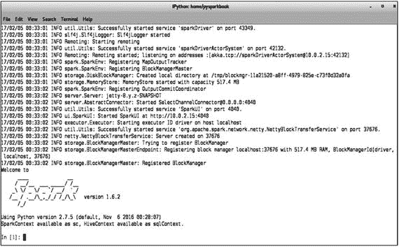
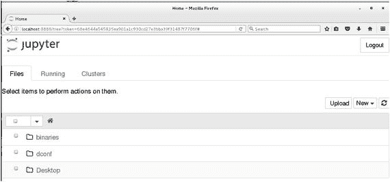
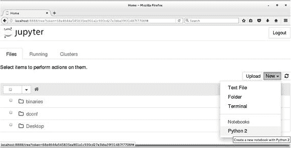
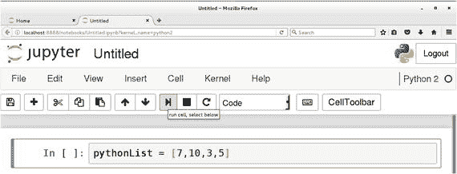
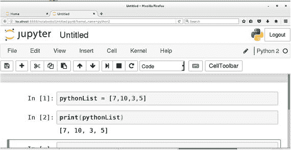

# 安装与集成 IPython 与 IPython Notebook

现在是安装 `IPython` 和 `IPython Notebook` 并将其与 `PySpark` 集成的时候了。可以使用 `pip` 安装 `IPython` 和 `IPython Notebook`。

### 工作原理

为了连接 `PySpark`，我们必须执行以下步骤。

### 步骤 3-13-1：安装 IPython

首先安装 `IPython`。我们已经安装了 `pip`。可以使用 `pip` 通过以下命令安装 `IPython`：

```
[pysparkbook@localhost ∼]$ sudo pip install ipython
```

以下是输出：

```
Collecting ipython
Successfully installed ipython-5.2.2 pathlib2-2.2.1 pexpect-4.2.1 pickleshare-0.7.4 prompt-toolkit-1.0.13 ptyprocess-0.5.1 scandir-1.4 simplegeneric-0.8.1 wcwidth-0.1.7
```

### 步骤 3-13-2：将 PySpark 与 IPython 集成

安装完成后，我们将使用 `IPython` 启动 `PySpark`。这很容易做到。首先，将环境变量 `IPYTHON` 设置为 1，如下所示：

```
[pysparkbook@localhost ∼]$ export IPYTHON=1
[pysparkbook@localhost ∼]$ pyspark
```

启动 `PySpark` 后，您将看到如图 3-1 所示的 shell。



图 3-1.`Shell`

在图 3-1 中，您可以看到现在 `In[1]` 已经替换了我们旧 `Python` 控制台中传统的 `>>>` 符号。

### 步骤 3-13-3：安装 IPython Notebook

现在我们将安装 `IPython Notebook`。再次使用 `pip` 安装 `IPython`：

```
[pysparkbook@localhost ∼]$ sudo pip install ipython[notebook]
```

### 步骤 3-13-4：将 PySpark 与 IPython Notebook 集成

安装完成后，我们必须设置一些环境变量：

```
[pysparkbook@localhost ∼]$ export IPYTHON_OPTS="notebook"
[pysparkbook@localhost ∼]$ export XDG_RUNTIME_DIR=""
```

现在是启动 `PySpark` 的时候了：

```
[pysparkbook@localhost ∼]$ pyspark
```

使用 `IPython Notebook` 启动 `PySpark` 后，我们将看到如图 3-2 所示的 `web` 浏览器。



图 3-2.`使用 Notebook 启动 PySpark 后，您将看到一个 web 浏览器`

您可能会惊讶地发现浏览器显示的是 `Jupyter`。但这并不奇怪；`Jupyter` 是 `IPython Notebook` 的新名称。您可以看到使用 `Notebook` 是多么容易；通过单击“上传”按钮，我们可以将文件上传到机器。

### 步骤 3-13-5：在 IPython Notebook 上运行 PySpark 命令

为了运行 `PySpark` 命令，让我们使用 `Python 2` 创建一个新的 `notebook`，如图 3-3 所示。



图 3-3.`使用 Python 2 创建新的 notebook`

创建 `notebook` 后，您将看到如图 3-4 所示的网页。



图 3-4.`创建 notebook 后，您将看到此网页`

现在我们可以运行 `Python` 命令来创建一个列表。编写命令后，我们必须运行它。您可以在图 3-4 中看到，我们可以使用 `notebook` 中的“运行”按钮来运行命令。

在图 3-5 中，我们正在打印 `pythonList`。



图 3-5.`打印 Python 列表`