# 4. Spark 架构与弹性分布式数据集

您在上一章学习了 Python。现在是学习 PySpark 并利用分布式系统的强大功能来解决与大数据相关的问题的时候了。我们通常将大量数据分布在集群上，并对其执行处理。

本章涵盖以下内容：

- 方案 4-1：创建 RDD
- 方案 4-2：转换温度数据
- 方案 4-3：执行基本数据操作
- 方案 4-4：运行集合操作
- 方案 4-5：计算汇总统计信息
- 方案 4-6：在独立集群管理器上启动 PySpark shell
- 方案 4-7：在 Mesos 上启动 PySpark shell
- 方案 4-8：在 YARN 上启动 PySpark shell

了解 Spark 的架构将非常有助于理解 Spark 的各种组件。在深入研究这些方案之前，让我们先探讨这个主题。

图 4-1 描述了 Spark 架构。

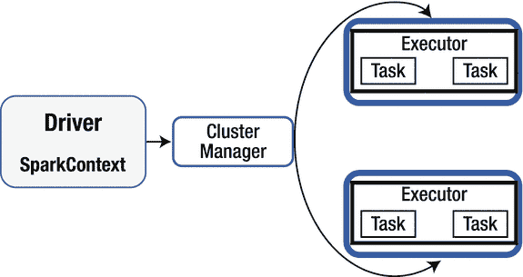

**图 4-1.** Spark 架构

Spark 架构的主要组件是 driver 和 executors。对于每个 PySpark 应用程序，将会有一个 driver 程序和一个或多个在集群从节点上运行的 executors。您可能想知道，在 PySpark 的上下文中，什么是应用程序？应用程序是用于解决一整套代码的问题。

**driver** 是协调在各个从节点机器上运行的许多 executors 的进程。Spark 遵循主从架构。`SparkContext` 对象由 driver 创建。`SparkContext` 是 PySpark 应用程序的主要入口点。您将在后续章节中了解更多关于 `SparkContext` 的信息。在本章中，我们将在 PySpark shell 中运行 PySpark 命令。启动 shell 后，我们会发现 `SparkContext` 对象是自动创建的。我们将在 PySpark shell 中以变量 `sc` 的形式遇到 `SparkContext` 对象。shell 本身充当我们的 driver。driver 将我们的应用程序分解为小任务；任务是我们应用程序的最小单元。任务在不同的 executors 上并行执行。driver 还负责将任务调度到不同的 executors。

**Executors** 是从进程。executor 运行任务。它还具有通过使用 `BlockManager` 进程在内存中缓存数据的能力。每个 executor 在自己的 Java 虚拟机（JVM）中运行。

**集群管理器** 管理集群资源。driver 与集群管理器协商资源。集群管理器还在各个从 executor 进程上代表 driver 调度任务。PySpark 随附了独立集群管理器。PySpark 也可以在 YARN 和 Apache Mesos 上配置。在我们的方案中，您将看到如何在独立集群管理器和 Apache Mesos 上配置 PySpark。在单机模式下，PySpark 也可以在本地模式下启动。

PySpark 中备受推崇的主要组件是**弹性分布式数据集（RDD）**。RDD 是对分布式集合的数据抽象。Python 集合（如列表、元组和集合）可以非常容易地被分布。RDD 会在节点故障时重新计算。根据需要，仅计算或重新计算部分数据。RDD 是使用 `SparkContext` 类中定义的各种函数创建的。创建 RDD 的一个重要函数是 `parallelize()`，您将在本章中反复遇到它。图 4-2 说明了 RDD 的创建。

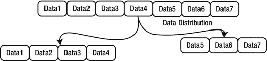

**图 4-2.** 创建 RDD

假设我们有一个 Python 集合，其元素为 `Data1`、`Data2`、`Data3`、`Data4`、`Data5`、`Data6` 和 `Data7`。该集合分布在集群上以创建 RDD。为简单起见，我们可以假设正在运行两个 executors。我们的集合被分成两部分。第一个 executor 获取集合的第一部分，其中包含元素 `Data1`、`Data2`、`Data3` 和 `Data4`。集合的第二部分被发送到第二个 executor。因此，第二个 executor 拥有数据元素 `Data5`、`Data6` 和 `Data7`。


我们可以对 RDD 执行两种操作：**转换**（transformation）和**行动**（action）。对 RDD 进行转换会返回另一个 RDD。我们知道 RDD 是不可变的；因此，不可能改变 RDD。所以转换总是返回另一个 RDD。转换是惰性的，而行动则会被立即执行。我说转换是惰性的，因为每当对 RDD 应用转换时，该操作并不会同时应用到数据上。相反，PySpark 会记录下这个操作请求，但所有转换都会在首次调用行动时才会被真正执行。

图 4-3 展示了一个转换操作。对 `RDD1` 进行转换创建了 `RDD2`。`RDD1` 有两个分区。`RDD1` 的第一个分区有四个数据元素：`Data1`、`Data2`、`Data3` 和 `Data4`。`RDD1` 的第二个数据分区有三个元素：`Data5`、`Data6` 和 `Data7`。对 `RDD1` 进行转换后，`RDD2` 被创建。`RDD2` 有六个元素。因此很明显，子 RDD 的数据元素数量可能与父 RDD 不同。`RDD2` 也有两个分区。`RDD2` 的第一个分区有三个数据点：`Data8`、`Data9` 和 `Data10`。`RDD2` 的第二个分区也有三个元素：`Data11`、`Data12` 和 `Data13`。不必困惑于子 RDD 的分区数量可能与父 RDD 不同。

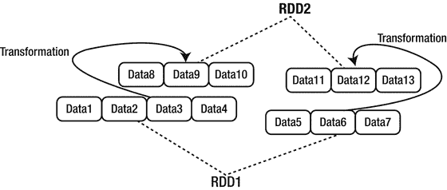

图 4-3. RDD 转换

图 4-4 展示了对 RDD 执行的一个行动。在这个例子中，我们应用了求和行动。求和后的数据被返回给驱动程序。在其他情况下，行动的结果可以保存到文件或其他目标。

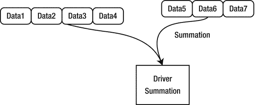

图 4-4. RDD 行动

你可能在想，既然 Spark 是用 Scala 编写的，那么 Python 是如何与 Scala 通信的呢？你可能会猜测 PySpark 的 Python 包装器是用 Jython 编写的，并且这些 Jython 代码被编译成 Java 字节码并在 JVM 上运行。这个猜测是不正确的。

一个正在运行的 Python 程序可以通过 Py4J 访问 JVM 中的 Java 对象。一个正在运行的 Java 程序也可以通过 Py4J 访问 Python 对象。Python 和 Java 之间的网关使得 Python 能够使用 Java 对象。

驱动程序使用 Py4J 在 Python 和 Java `SparkContext` 对象之间进行通信。PySpark 使用 Py4J，以便 PySpark 的 Python 代码能够与 Java `SparkContext` 交互。

在远程集群机器上，`PythonRDD` 对象会创建 Python 子进程，并通过管道与它们通信。`PythonRDD` 对象在 JVM 中运行，并通过管道与 Python 进程通信。

**注意**

您可以在以下位置了解更多关于 Py4J 的信息：

*   [`www.py4j.org`](https://www.py4j.org)
*   [`https://cwiki.apache.org/confluence/display/SPARK/PySpark+Internals`](https://cwiki.apache.org/confluence/display/SPARK/PySpark+Internals)

## 配方 4-1. 创建一个 RDD

### 问题

你想要创建一个 RDD。

### 解决方案

如同我们所知，RDD 是一个分布式集合。你有一个包含以下数据的列表：

```
pythonList = [2.3,3.4,4.3,2.4,2.3,4.0]
```

你想要执行以下操作：

*   创建该列表的 RDD
*   获取第一个元素
*   获取前两个元素
*   获取 RDD 中的分区数

在 PySpark 中，可以通过多种方式创建 RDD。从给定集合创建 RDD 的一种方法是使用 `parallelize()` 函数。`SparkContext` 对象用于调用 `parallelize()` 函数。你将在后续章节中了解更多关于 `SparkContext` 的信息。

对于大数据，即使是表格数据，一张表也可能有超过 1000 列。有时分析师希望查看这些数据列的外观。`first()` 函数定义在 RDD 上，它会返回 RDD 的第一个元素。

要从列表中获取多个元素，我们可以使用 `take()` 函数。可以通过 `getNumPartitions()` 获取集合的分区数。

### 工作原理


让我们按照本节中的步骤来解决问题。

#### 步骤 4-1-1. 创建一个列表的 RDD

首先，通过以下代码创建一个 Python 列表：

```
>>> pythonList = [2.3,3.4,4.3,2.4,2.3,4.0]
>>> pythonList
```

输出如下：

```
[2.3, 3.4, 4.3, 2.4, 2.3, 4.0]
```

数据的并行化或分布是通过 `parallelize()` 函数完成的。该函数接收两个参数。第一个参数是要并行化的集合，第二个参数表示你希望将数据分成的块数：

```
>>> parPythonData = sc.parallelize(pythonList,2)
```

使用 `parallelize()` 函数，我们将数据分布到了两个分区中。为了在驱动程序上获取所有数据，我们可以使用 `collect()` 函数，如下方代码行所示。在生产环境中不建议使用 `collect()` 函数，它仅应用于代码调试。

```
>>> parPythonData.collect()
```

输出如下：

```
[2.3, 3.4, 4.3, 2.4, 2.3, 4.0]
```

#### 步骤 4-1-2. 获取第一个元素

`first()` 函数可用于从 RDD 中获取第一条数据。你可能已经注意到，`collect()` 和 `first()` 函数执行的是动作操作：

```
>>> parPythonData.first()
```

输出如下：

```
2.3
```

#### 步骤 4-1-3. 获取前两个元素

有时数据分析师希望查看多行数据。`take()` 函数可用于从 RDD 中获取多行数据。你需要获取的行数作为参数传递给 `take()` 函数：

```
>>> parPythonData.take(2)
```

输出如下：

```
[2.3, 3.4]
```

#### 步骤 4-1-4. 获取 RDD 中的分区数

为了优化 PySpark 代码，需要合理分布数据。RDD 的分区数可以通过 `getNumPartitions()` 函数获取：

```
>>> parPythonData.getNumPartitions()
```

输出如下：

```
2
```

回顾一下，我们在使用 `parallelize()` 函数时将数据划分成了两个分区。

## 食谱 4-2. 转换温度数据

### 问题

你希望通过在 RDD 上编写温度单位转换程序来转换温度数据。

### 解决方案

你拥有华氏度的每日温度数据，并希望对数据进行一些分析。但你的新软件只接收摄氏度的输入。因此，你需要将温度数据从华氏度转换为摄氏度。表 4-1 显示了你拥有的数据。

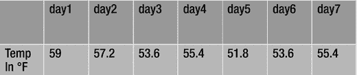

**表 4-1.** 每日华氏温度

你需要完成以下操作：

* 将温度从华氏度转换为摄氏度
* 获取所有大于 13°C 的温度数据点

我们可以通过以下数学公式将温度从华氏度转换为摄氏度：

```
oC = (oF – 32) × 5/9
```

在 PySpark 中，这属于一个转换问题。我们可以通过在 RDD 上使用 `map()` 函数来完成此任务。

获取所有大于 13°C 的温度则是一个过滤问题。数据的过滤可以通过在 RDD 上使用 `filter()` 函数来完成。

### 工作原理

我们将按照本节中的步骤完成转换和过滤练习。

#### 步骤 4-2-1. 并行化数据

我们将使用 `parallelize()` 函数来并行化数据。我们将数据分布到两个分区中，如下所示：

```
>>> tempData = [59,57.2,53.6,55.4,51.8,53.6,55.4]
>>> parTempData = sc.parallelize(tempData,2)
>>> parTempData.collect()
```

输出如下：

```
[59, 57.2, 53.6, 55.4, 51.8, 53.6, 55.4]
```

数据集合返回了我们已经并行化的数据。

#### 步骤 4-2-2. 将温度从华氏度转换为摄氏度

现在我们将把华氏度温度转换为摄氏度。我们将编写一个 `fahrenheitToCentigrade` 函数，该函数接收华氏度温度作为输入，并返回对应的摄氏度温度：

```
>>> def fahrenheitToCentigrade(temperature) :
...  centigrade = (temperature-32)*5/9
...  return centigrade
```


让我们测试一下 `fahrenheitToCentigrade` 函数：

```
>>> fahrenheitToCentigrade(59)
```

输出结果如下：

```

```

我们提供的输入华氏温度是 59。该函数返回了该华氏输入值对应的摄氏温度值；59°F 等于 15°C。

```
>>> parCentigradeData = parTempData.map(fahrenheitToCentigrade)
>>> parCentigradeData.collect()
```

输出结果如下：

```
[15, 14.000000000000002, 12.0, 13.0, 10.999999999999998, 12.0, 13.0]
```

我们已经将给定的温度转换成了摄氏度。现在，让我们筛选出所有大于或等于 13°C 的温度。

#### 步骤 4-2-3. 筛选大于 13°C 的温度

要筛选数据，我们可以对 RDD 使用 `filter()` 函数。我们需要向 `filter()` 函数提供一个谓词作为输入。谓词是一个测试条件并返回 `True` 或 `False` 的函数。

让我们定义谓词 `tempMoreThanThirteen`，它接收一个温度值，如果输入大于或等于 13，则返回 `True`：

```
>>> def tempMoreThanThirteen(temperature):
...  return temperature >=13
```

我们将把 `tempMoreThanThirteen` 函数作为输入传递给 `filter()` 函数。`filter()` 函数会遍历 `parCentigradeData` RDD 中的每一个值。对于每个值，都会应用 `tempMoreThanThirteen` 函数。如果该值大于或等于 13，则返回 `True`。`tempMoreThanThirteen` 返回 `True` 的那些值会被存入 `filteredTemprature`：

```
>>> filteredTemprature = parCentigradeData.filter(tempMoreThanThirteen)
>>> filteredTemprature.collect()
```

输出结果如下：

```
[15, 14.000000000000002, 13.0, 13.0]
```

我们可以使用 lambda 函数来替代我们的谓词（我们在第 3 章讨论过 lambda 函数）。使用 lambda 函数能让代码更具可读性。下面这行代码清晰地表明 `filter()` 函数接收一个谓词作为输入，并对所有大于或等于 13 的值返回 `True`：

```
>>> filteredTemprature = parCentigradeData.filter(lambda x : x>=13)
>>> filteredTemprature.collect()
```

输出结果如下：

```
[15, 14.000000000000002, 13.0, 13.0]
```

我们最终得到了四个元素，它们表示的温度都大于或等于 13。至此，你已经了解了如何使用 PySpark 对数据进行基本分析。

## 方案 4-3. 执行基本的数据操作

### 问题

你想要进行数据操作并执行聚合操作。

### 解决方案

在本方案中，你将获得一份数据，这些数据展示了学生在两年（四个学期）课程中的成绩。有七名学生选修了这门课程。表 4-2 展示了七名学生在两年内按学期划分的成绩数据。

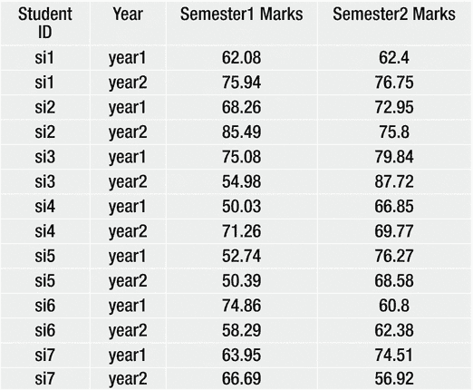

**表 4-2.** 学生成绩

你需要计算以下内容：

-   每个学生每年每学期的平均成绩
-   第二年平均成绩最高的前三名学生
-   第二年平均成绩最低的后三名学生
-   在第二年第二学期平均成绩超过 80% 的所有学生

使用 `map()` 函数通常很有帮助。在本例中，可以使用 `map()` 计算每年每学期的平均成绩。

获取前 k 个元素（例如表现最好的前 k 个债券）是一个常见的数据科学问题。PySpark 的 `takeOrdered()` 函数将用于从我们的 RDD 中获取前 k 个或后 k 个元素。

在第二年平均成绩超过 80% 的学生可以使用 `filter()` 函数来筛选。

### 实现原理

让我们分步解决这个问题。我们首先从创建数据集的 RDD 开始。

#### 步骤 4-3-1. 从给定表格创建列表

在这一步中，我们将创建一个嵌套列表。这意味着列表中的每个元素都是一条记录，而每条记录本身也是一个列表：


```python
>>> studentMarksData = [["si1","year1",62.08,62.4],
...  ["si1","year2",75.94,76.75],
...  ["si2","year1",68.26,72.95],
...  ["si2","year2",85.49,75.8],
...  ["si3","year1",75.08,79.84],
...  ["si3","year2",54.98,87.72],
...  ["si4","year1",50.03,66.85],
...  ["si4","year2",71.26,69.77],
...  ["si5","year1",52.74,76.27],
...  ["si5","year2",50.39,68.58],
...  ["si6","year1",74.86,60.8],
...  ["si6","year2",58.29,62.38],
...  ["si7","year1",63.95,74.51],
...  ["si7","year2",66.69,56.92]]
```

#### 步骤 4-3-2. 并行化数据

使用 `parallelize()` 函数并行化数据后，我们会得到一个 RDD，其中每个元素本身就是一个列表：

```python
>>> studentMarksDataRDD = sc.parallelize(studentMarksData,4)
```

正如我们所知，`collect()` 函数会将整个 RDD 拉取到驱动程序。如果 RDD 规模非常大，驱动程序可能会面临内存问题。为了获取 RDD 的前 k 个元素，我们可以使用 `take()` 函数，并将 n 作为 `take()` 的输入。例如，在下面的代码行中，我们正在获取 RDD 的两个元素。请记住，这里的 `take()` 是一个动作（action）：

```python
>>> studentMarksDataRDD.take(2)
```

输出如下：

```python
[['si1', 'year1', 62.08, 62.4],
['si1', 'year2', 75.94, 76.75]]
```

#### 步骤 4-3-3. 计算学期平均成绩

现在让我解释一下我想在下面的代码中做什么。以 RDD 的第一个元素为例。我们 RDD 的第一个元素是 `['si1', 'year1', 62.08, 62.4]`，这是一个包含四个元素的列表。我们的工作是计算两个学期成绩的平均值。在第一个元素中，平均值是 `0.5(62.08 + 62.4)`。我们将使用 `map()` 函数来得到我们的解决方案。

```python
>>> studentMarksMean = studentMarksDataRDD.map(lambda x : [x[0],x[1],(x[2]+x[3])/2])
```

再次，我们使用 `take()` 函数来可视化 `map()` 函数的输出：

```python
>>> studentMarksMean.take(2)
```

输出如下：

```python
[['si1', 'year1', 62.239999999999995],
['si1', 'year2', 76.345]]
```

#### 步骤 4-3-4. 筛选二年级学生平均成绩

下面的代码行将筛选出所有二年级的数据。我们使用一个 lambda 函数实现了我们的谓词。我们的谓词函数检查 `year2` 是否在列表中。如果谓词返回 `True`，则该列表包含二年级的成绩。

```python
>>> secondYearMarks = studentMarksMean.filter(lambda x : "year2" in x)
>>> secondYearMarks.take(2)
```

输出如下：

```python
[['si1', 'year2', 76.345],
['si2', 'year2', 80.645]]
```

我们可以清楚地看到 `secondYearMarks` 的 RDD 输出仅包含二年级的成绩。

#### 步骤 4-3-5. 查找前三名学生

我们可以通过两种方式获得前三名学生。第一种方法是根据成绩对全部数据进行排序。显然，我们将按降序对数据进行排序。排序通过 `sortBy()` 函数完成。让我们看看实现：

```python
>>> sortedMarksData = secondYearMarks.sortBy(keyfunc = lambda x : -x[2])
```

在我们的 `sortBy()` 函数中，我们提供了 `keyfunc` 参数。此参数指示按降序对成绩数据进行排序。现在收集输出并查看结果：

```python
>>> sortedMarksData.collect()
```

输出如下：

```python
[['si2', 'year2', 80.645],
['si1', 'year2', 76.345],
['si3', 'year2', 71.35],
['si4', 'year2', 70.515],
['si7', 'year2', 61.805],
['si6', 'year2', 60.335],
['si5', 'year2', 59.485]]
```

排序数据后，我们可以使用 `take()` 函数获取前三个元素：

```python
>>>  sortedMarksData.take(3)
```

输出如下：

```python
[['si2', 'year2', 80.645],
['si1', 'year2', 76.345],
['si3', 'year2', 71.35]]
```

我们得到了答案。但是我们可以进一步优化吗？为了获得前三的数据，我们对整个列表进行了排序。我们可以通过使用 `takeOrdered()` 函数来优化这一点。该函数接受两个参数：我们需要的元素数量，以及 `key`，它使用一个 lambda 函数来确定如何取出数据。

```python
>>> topThreeStudents = secondYearMarks.takeOrdered(num=3, key = lambda x :-x[2])
```

在前面的代码中，我们将 `num` 设置为 3 以获取前三个元素，并在 `key` 中设置 `lambda`，以便它能以降序提供前三名的数据。

```python
>>> topThreeStudents
```

输出如下：

```python
[['si2', 'year2', 80.645],
['si1', 'year2', 76.345],
['si3', 'year2', 71.35]]
```

为了打印结果，我们没有使用 `collect()` 函数来获取数据。请记住，转换会创建另一个 RDD，因此我们需要 `collect()` 函数来收集数据。但一个动作会直接将数据提取到驱动程序，因此不需要 `collect()`。所以你可以得出结论，`takeOrdered()` 函数是一个动作。

#### 步骤 4-3-6. 查找后三名学生

我们需要根据平均成绩找出后三名学生。一种方法是按升序对数据进行排序，然后取前三名。但这不是一种有效的方法，所以我们将再次使用 `takeOrdered()` 函数，但使用不同的 key 参数：

```python
>>> bottomThreeStudents = secondYearMarks.takeOrdered(num=3, key = lambda x :x[2])
>>> bottomThreeStudents
```

输出如下：

```python
[['si5', 'year2', 59.485],
['si6', 'year2', 60.335],
['si7', 'year2', 61.805]]
```

#### 步骤 4-3-7. 获取所有平均成绩达到 80% 的学生

既然你理解了 `filter()` 函数，就很容易猜到我们可以通过使用 `filter()` 来解决这个问题。我们需要提供一个谓词，如果成绩大于 80，则返回 `True`；否则，返回 `False`。

```python
>>> moreThan80Marks = secondYearMarks.filter(lambda x : x[2] > 80)
>>> moreThan80Marks.collect()
```

输出如下：

```python
[['si2', 'year2', 80.645]]
```

可以观察到，只有一名学生（学号为 `si2`）在二年级的平均成绩超过了 80%。

## 方案 4-4. 运行集合操作

### 问题

你想对一家研究公司的数据进行集合操作。

### 解决方案

XYZ Research 是一家从事多个多元化主题研究的公司。每个研究项目都有一个研究 ID。研究可能一年内完成，也可能需要超过一年的时间。提供了以下数据，显示了三年内进行的研究项目数量：

```
2001: RIN1, RIN2, RIN3, RIN4, RIN5, RIN6, RIN7
2002: RIN3, RIN4, RIN7, RIN8, RIN9
2003: RIN4, RIN8, RIN10, RIN11, RIN12
```

现在我们需要回答以下问题：

- 三年中启动了多少个研究项目？
- 第一年完成了多少个项目？
- 前两年完成了多少个项目？

集合是不同元素的集合。PySpark 执行伪集合操作。之所以称为伪集合操作，是因为某些函数不会移除重复元素。

请记住，第一个问题问的不是已完成的项目。三年中启动的研究项目总数就是三年数据的并集。你可以使用 `union()` 函数对两个 RDD 执行并集操作。

在第一年启动而未在第二年启动的项目就是在第一年完成的项目。每个启动的项目都会完成。我们可以使用 `subtract()` 函数来查找所有在第一年完成的项目。

如果我们对第一年和第二年的项目进行并集操作，然后减去第三年的项目，我们就能得到所有在前两年完成的项目。

### 工作原理

让我们一步步解决这个问题。

#### 步骤 4-4-1. 按年份创建研究数据列表

我们首先创建一个列表，列出公司每年从事的所有项目：

```python
>>> data2001 = ['RIN1', 'RIN2', 'RIN3', 'RIN4', 'RIN5', 'RIN6', 'RIN7']
>>> data2002 = ['RIN3', 'RIN4', 'RIN7', 'RIN8', 'RIN9']
>>> data2003 = ['RIN4', 'RIN8', 'RIN10', 'RIN11', 'RIN12']
```

好的，作为一名高级文档工程师和翻译员，我将严格按照您提供的注意事项和示例，将给定的英文文本翻译成中文。


`data2001` 是 2001 年启动的所有项目的列表。类似地，`data2002` 包含所有从 2001 年延续下来或在 2002 年启动的研究项目。`data2003` 数据列表包含公司在 2003 年处理的所有项目。

### 步骤 4-4-2：并行化数据（创建 RDD）

创建列表后，我们需要并行化数据：

```python
>>> parData2001 = sc.parallelize(data2001,2)
>>> parData2002 = sc.parallelize(data2002,2)
>>> parData2003 = sc.parallelize(data2003,2)
```

并行化后，我们得到三个 RDD。第一个 RDD 是 `parData2001`，第二个 RDD 是 `parData2002`，最后一个是 `parData2003`。

### 步骤 4-4-3：查找三年内启动的项目

三年内启动的项目总数可以通过获取这三年的所有数据的并集来确定。RDD 的 `union()` 方法接受另一个 RDD 作为输入，并返回合并这两个 RDD 的结果。让我们看看它是如何工作的：

```python
>>> unionOf20012002 = parData2001.union(parData2002)
>>> unionOf20012002.collect()
```

输出如下：

```
['RIN1', 'RIN2', 'RIN3', 'RIN4',
'RIN5', 'RIN6', 'RIN7', 'RIN3',
'RIN4', 'RIN7', 'RIN8', 'RIN9']
```

我们已经计算了第一年或第二年启动的不同研究项目的并集。我们可以观察到，合并后的数据 `unionOf20012002` 包含重复值。在集合中不允许有重复值。因此，对 RDD 的集合操作也称为伪集合操作。别担心，我们接下来会移除这些重复项。

为了获取三年内启动的所有研究项目，我们需要获取 `parData2003` 和 `unionOf20012002` 的并集：

```python
>>> allResearchs = unionOf20012002.union(parData2003)
>>> allResearchs.collect()
```

输出如下：

```
['RIN1', 'RIN2', 'RIN3', 'RIN4',
'RIN5', 'RIN6', 'RIN7', 'RIN3',
'RIN4', 'RIN7', 'RIN8', 'RIN9',
'RIN4', 'RIN8', 'RIN10', 'RIN11', 'RIN12']
```

现在我们有了所有三年数据的并集。接下来，我们需要去除重复项。

### 步骤 4-4-4：创建去重数据集

我们将对 RDD `allResearchs` 应用 `distinct()` 函数：

```python
>>> allUniqueResearchs = allResearchs.distinct()
>>> allUniqueResearchs.collect()
```

输出如下：

```
['RIN1', 'RIN12', 'RIN5', 'RIN3',
'RIN4', 'RIN2', 'RIN11', 'RIN7',
'RIN9', 'RIN6', 'RIN8', 'RIN10']
```

我们可以看到，我们拥有了前三年启动的所有研究项目。

### 步骤 4-4-5：计算去重元素数量

现在，通过对 RDD 使用 `count()` 函数来计算所有去重研究项目的数量：

```python
>>> allResearchs.distinct().count()
```

输出如下：

```

```

**注意**

我们也可以在 PySpark 中运行链式命令。

以下是以链式方式运行的命令：

```python
>>> parData2001.union(parData2002).union(parData2003).distinct().count()
```

输出如下：

```

```

### 步骤 4-4-6：查找第一年完成的项目

假设我们有两个集合 A 和 B。从 A 中减去 B 会得到所有属于 A 但不属于 B 的元素。所以，现在很清楚，为了知道第一年（2001 年）完成的所有项目，我们必须从 2001 年的所有项目中减去 2002 年的项目。

集合的减法可以使用 `subtract()` 函数完成：

```python
>>> firstYearCompletion = parData2001.subtract(parData2002)
>>> firstYearCompletion.collect()
```

输出如下：

```
['RIN5', 'RIN1', 'RIN6', 'RIN2']
```

我们得到了 2001 年完成的所有项目。2001 年完成了四个项目。

### 步骤 4-4-7：查找前两年完成的项目

RDD 的并集提供了前两年启动的所有项目。获取前两年启动的所有项目后，如果我们再减去第三年运行和启动的项目，我们将得到前两年完成的全部项目。实现如下：

```python
>>> unionTwoYears = parData2001.union(parData2002)
>>> unionTwoYears.subtract(parData2003).collect()
```

输出如下：

```
['RIN1', 'RIN5', 'RIN3', 'RIN3',
'RIN2', 'RIN7', 'RIN7', 'RIN9', 'RIN6']
```

现在进行减法：

```python
>>> unionTwoYears.subtract(parData2003).distinct().collect()
```

输出如下：

```
['RIN1', 'RIN5', 'RIN3',
'RIN2', 'RIN7', 'RIN9', 'RIN6']
```

### 步骤 4-4-8：查找 2001 年启动并持续到 2003 年的项目

此步骤需要对 RDD 使用 PySpark 中定义的 `intersection()` 方法：

```python
>>> projectsInTwoYear = parData2001.intersection(parData2002)
>>> projectsInTwoYear.collect()
```

输出如下：

```
['RIN4', 'RIN7', 'RIN3']
>>> projectsInTwoYear.subtract(parData2003).distinct().collect()
```

输出如下：

```
['RIN3', 'RIN7']
```

## 配方 4-5：计算汇总统计

### 问题

你想计算给定数据的汇总统计量。

### 解决方案

可再生能源在世界范围内越来越受欢迎。公司 FindEnergy 希望在一个特定位置安装风力发电机。为了风力发电机的高效运行，空气需要某些特性。

数据收集如下表[4-3]所示。

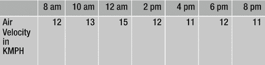

**表 4-3.** 风速数据

作为一名数据科学家，你想要计算以下量：

*   数据点数量
*   一天中风速的总和
*   一天中的平均风速
*   空气数据的方差
*   空气数据的样本方差
*   空气数据的标准差
*   空气数据的样本标准差

PySpark 提供了许多在 RDD 上汇总数据的函数。RDD 中元素的数量可以通过对 RDD 使用 `count()` 函数找到。有两种方法可以求给定 RDD 中所有数据的和。第一种是对 RDD 应用 `sum()` 方法。第二种是对 RDD 应用 `reduce()` 函数。

均值表示给定数据的中心点，它也可以用两种方式计算。我们将使用 `mean()` 方法和 `fold()` 方法来计算均值。

方差表示数据围绕均值的分散程度，可以使用 `variance()` 函数计算。类似地，样本方差可以通过在 RDD 上使用 `sampleVariance()` 方法计算。

标准差和样本标准差将分别使用 `stdev()` 和 `sampleStdev()` 方法计算。

PySpark 提供了 `stats()` 方法，它可以一次性地计算所有前述的量。

### 原理

我们将按照本节中的步骤来解决问题。

#### 步骤 4-5-1：并行化数据

让我们从一个列表中并行化风速数据：

```python
>>> airVelocityKMPH = [12,13,15,12,11,12,11]
>>> parVelocityKMPH = sc.parallelize(airVelocityKMPH,2)
```

`parVelocityKMPH` 变量是一个 RDD。

#### 步骤 4-5-2：获取数据点数量

数据点的数量让我们对数据大小有一个概念。我们应用 `count()` 函数来获取 RDD 中元素的数量：

```python
>>>countValue =  parVelocityKMPH.count()
```

输出如下：

```

```

总共有七个数据点。

#### 步骤 4-5-3：求和一天中的风速

让我们使用 `sum()` 方法来求和：

```python
>>>sumValue =  parVelocityKMPH.sum()
```

输出如下：

```

```

#### 步骤 4-5-4：计算平均风速

图[4-5]展示了计算均值的数学公式，其中 x1, x2, ... xn 是 n 个数据点。

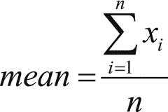

**图 4-5.** 计算均值

我们通过在 RDD 上定义的 `mean()` 函数来计算均值：

```python
>>>meanValue =  parVelocityKMPH.mean()
```

输出如下：

```
12.285714285714286
```

#### 步骤 4-5-5：计算空气数据的方差


#### 步骤 4-5-6. 计算样本方差

如果我们有数据点 `x1`、`x2`、……、`xn`，那么图 4-6 显示的是计算方差的数学公式。我们将使用定义在 `RDD` 上的 `variance()` 函数来计算给定空气数据的方差。

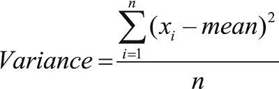
*图 4-6. 计算方差*

```
>>> varianceValue = parVelocityKMPH.variance()
```

输出如下：

```
1.63265306122449
```

`variance` 函数计算的是总体方差。为了计算样本方差，我们必须使用定义在 `RDD` 上的 `sampleVariance()` 函数。

对于数据点 `x1`、`x2`、……、`xn`，样本标准差在图 4-7 中定义。

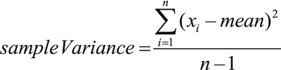
*图 4-7. 计算样本方差*

下面这行代码计算样本标准差：

```
>>> sampleVarianceValue =  parVelocityKMPH.sampleVariance()
```

输出如下：

```
1.904761904761905
```

#### 步骤 4-5-7. 计算标准差

标准差是方差值的平方根。让我们使用 `stdev()` 函数来计算标准差：

```
>>> stdevValue = parVelocityKMPH.stdev()
```

输出如下：

```
1.2777531299998799
```

给定空气速度数据的标准差是 `1.2777531299998799`。

#### 步骤 4-5-8. 计算样本标准差

```
>>> sampleStdevValue = parVelocityKMPH.sampleStdev()
```

输出如下：

```
1.3801311186847085
```

#### 步骤 4-5-9. 一步计算所有值

我们可以通过使用 `stats()` 函数一次性计算汇总统计的所有值。`stats()` 函数返回一个 `StatCounter` 对象。让我们使用 `stats()` 函数来计算空气速度数据的汇总统计：

```
>>> type(parVelocityKMPH.stats())
```

输出如下：

```
<class 'pyspark.rdd.StatCounter'>
```

```
>>> parVelocityKMPH.stats()
```

输出如下：

```
(count: 7, mean: 12.2857142857, stdev: 1.27775313, max: 15.0, min: 11.0)
```

我们可以看到 `stats()` 函数是一个动作。它一次性计算一个 `RDD` 的计数、均值、标准差、最大值和最小值。它返回的结果是一个元组，其中的元素是键/值对。使用 `asDict()` 函数可以将 `stats()` 函数的结果转换为字典：

```
>>> parVelocityKMPH.stats().asDict()
```

输出如下：

```
{'count': 7, 'min': 11.0, 'max': 15.0, 'sum': 86.0, 'stdev': 1.3801311186847085, 'variance': 1.904761904761905, 'mean': 12.285714285714286}
```

我们也可以通过使用 `StatCounter` 上定义的不同函数来获取单个元素。让我们从获取均值开始。可以使用定义在 `StatCounter` 对象上的 `mean()` 函数来找到均值：

```
>>> parVelocityKMPH.stats().mean()
```

输出如下：

```
12.285714285714286
```

类似地，我们可以通过分别使用 `count()`、`min()`、`max()` 和 `stdev()` 函数来获取 `RDD` 中的元素数量、最小值、最大值和标准差。让我们先从标准差开始：

```
>>> parVelocityKMPH.stats().stdev()
```

输出如下：

```
1.2777531299998799
```

这个命令提供元素的数量：

```
>>> parVelocityKMPH.stats().count()
```

输出如下：

```
7
```

接下来，我们找到最小值：

```
>>> parVelocityKMPH.stats().min()
```

输出如下：

```
11.0
```

然后找到最大值：

```
>>> parVelocityKMPH.stats().max()
```

输出如下：

```
15.0
```

### 方法 4-6. 在独立集群管理器上启动 PySpark Shell

### 问题

你想使用独立集群管理器启动 PySpark Shell。

### 解决方案

独立集群管理器提供了一个主/从结构。为了在单台机器上启动独立集群管理器，我们可以使用 `start-all.sh` 脚本。我们可以在 `$SPARK_HOME/sbin` 目录下找到这个脚本。在我们的案例中，`$SPARK_HOME` 是 `/allPySpark/spark`。在集群环境中，我们可以在一台机器上运行主脚本来启动主节点，并在另一台不同的从机器上运行从脚本来启动从节点。

我们可以通过使用独立主节点的主节点 URL 来启动 PySpark Shell。独立主节点的 URL 看起来像 `spark://<主节点主机名>:<主节点端口>`。这可以在主节点的日志文件中轻松找到。

### 工作原理

我们必须启动独立主节点和从节点进程。有两种方法可以做到这一点。在 `spark/sbin` 目录下，我们会找到 `start-all.sh` 脚本。它将在同一台机器上同时启动主节点和从节点。

另一种启动进程的方法如下：在主节点机器上，使用 `start-master.sh` 脚本来启动主节点；并使用 `start-slave.sh` 在不同的机器上启动从节点。

#### 步骤 4-6-1. 使用 start-all.sh 脚本启动独立集群管理器

在这一步中，我们将运行 `start-all.sh` 脚本：

```
[pysparkbook@localhost ∼]$ /allPySpark/spark/sbin/start-all.sh
```

输出如下：

```
starting org.apache.spark.deploy.master.Master, logging to /allPySpark/logSpark//spark-pysparkbook-org.apache.spark.deploy.master.Master-1-localhost.localdomain.out
localhost: starting org.apache.spark.deploy.worker.Worker, logging to /allPySpark/logSpark//spark-pysparkbook-org.apache.spark.deploy.worker.Worker-1-localhost.localdomain.out
```

通过使用 `start-all.sh` 脚本启动独立集群的日志被写入两个文件。文件 `spark-pysparkbook-org.apache.spark.deploy.master.Master-1-localhost.localdomain.out` 是启动主节点进程的日志。为了连接到主节点，我们需要主节点 URL。我们可以在日志文件中找到这个 URL。

让我们打开主节点日志文件：

```
[pysparkbook@localhost ∼]$ vim /allPySpark/logSpark//spark-pysparkbook-org.apache.spark.deploy.master.Master-1-localhost.localdomain.out
```

输出如下：

```
17/03/02 03:33:59 INFO util.Utils: Successfully started service 'sparkMaster' on port 7077.
17/03/02 03:33:59 INFO master.Master: Starting Spark master at spark://localhost.localdomain:7077
17/03/02 03:33:59 INFO master.Master: Running Spark version 1.6.2
17/03/02 03:34:10 INFO server.Server: jetty-8.y.z-SNAPSHOT
17/03/02 03:34:10 INFO server.AbstractConnector: Started SelectChannelConnector@0.0.0.0:8080
17/03/02 03:34:10 INFO util.Utils: Successfully started service 'MasterUI' on port 8080.
17/03/02 03:34:10 INFO ui.MasterWebUI: Started MasterWebUI at http://10.0.2.15:8080
```

主节点日志文件中的日志表明，主节点已在 `spark://localhost.localdomain:7077` 上启动，并且主节点 Web UI 在 `http://10.0.2.15:8080`。

让我们打开主节点 Web UI，如图 4-8 所示。在这个 UI 中，我们可以看到独立主节点的 URL。

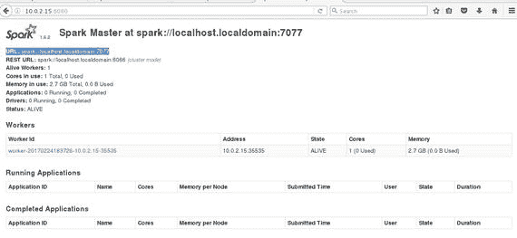
*图 4-8. Spark 主节点*

以下命令将在独立集群上启动 PySpark Shell：

```
[pysparkbook@localhost ∼]$/allPySpark/spark/bin/pyspark --master spark://localhost.localdomain:7077
```

运行 `jps` 后，我们可以看到主节点和从节点进程：

```
[pysparkbook@localhost ∼]$ jps
```

输出如下：

```
4246 Worker
3977 Master
4285 Jps
```

我们可以通过使用 `stop-all.sh` 脚本来停止独立集群管理器：

```
[pysparkbook@localhost ∼]$ /allPySpark/spark/sbin/stop-all.sh
```

输出如下：

```
localhost: stopping org.apache.spark.deploy.worker.Worker
stopping org.apache.spark.deploy.master.Master
```

我们可以看到 `stop-all.sh` 脚本首先停止从节点（工作节点），然后停止主节点。

#### 步骤 4-6-2. 使用单独脚本启动独立集群管理器


PySpark 框架提供了一个独立的脚本来在不同机器上启动 master 和 worker。我们首先使用`start-master.sh`脚本启动 master：

```
[pysparkbook@localhost ∼]$ /allPySpark/spark/sbin/start-master.sh
```

输出如下：

```
starting org.apache.spark.deploy.master.Master, logging to /allPySpark/logSpark//spark-pysparkbook-org.apache.spark.deploy.master.Master-1-localhost.localdomain.out
```

和之前一样，我们需要从日志文件中获取 master URL。使用该 master URL，我们可以通过`start-slave.sh`脚本在不同机器上启动 slave：

```
[pysparkbook@localhost ∼]$ /allPySpark/spark/sbin/start-slave.sh spark://localhost.localdomain:7077
```

输出如下：

```
starting org.apache.spark.deploy.worker.Worker, logging to /allPySpark/logSpark//spark-pysparkbook-org.apache.spark.deploy.worker.Worker-1-localhost.localdomain.out
```

使用`jps`命令，我们可以查看机器上运行的 worker 和 master 进程：

```
[pysparkbook@localhost ∼]$ jps
```

输出如下：

```
4246 Worker
3977 Master
4285 Jps
```

你可能还记得，当我们使用`stop-all.sh`时，脚本会先停止 worker 进程，再停止 master 进程。我们必须遵循此顺序：先停止 worker 进程，再停止 master 进程。

要停止 worker 进程，请使用`stop-slave.sh`脚本：

```
[pysparkbook@localhost ∼]$ /allPySpark/spark/sbin/stop-slave.sh
```

输出如下：

```
stopping org.apache.spark.deploy.worker.Worker
```

运行`jps`命令将只显示 master 进程：

```
[pysparkbook@localhost ∼]$ jps
```

输出如下：

```
4341 Jps
3977 Master
```

同样，我们可以使用`stop-master.sh`脚本停止 master 进程：

```
[pysparkbook@localhost ∼]$ /allPySpark/spark/sbin/stop-master.sh
```

输出如下：

```
stopping org.apache.spark.deploy.master.Master
```

## Recipe 4-7. 在 Mesos 上启动 PySpark Shell

### 问题

你想在 Mesos 集群管理器上启动 PySpark shell。

### 解决方案

Mesos 是另一种集群管理器。Mesos 也遵循类似于独立集群管理器的 master/slave 架构。为了启动 Mesos，我们首先必须启动 Mesos master，然后启动 Mesos slave。之后，可以通过 Mesos 上的 master URL 启动 PySpark shell。

### 工作原理

我们在第 3 章安装了 Mesos。现在我们必须逐个启动 master 和 slave 进程。启动 master 和 slave 后，我们需要启动 PySpark shell。以下命令启动 Mesos master 进程：

```
[pysparkbook@localhost ∼]$  mesos-master –work_dir=/allPySpark/mesos/workdir
```

输出如下：

```
I0224 09:50:57.575908  9839 main.cpp:263] Build: 2016-12-29 00:42:08 by pysparkbook
I0224 09:50:57.576501  9839 main.cpp:264] Version: 1.1.0
I0224 09:50:57.582787  9839 main.cpp:370] Using 'HierarchicalDRF' allocator
```

slave 进程将在 master 进程启动后启动：

```
[root@localhost binaries]#mesos-slave --master=127.0.0.1:5050 --work_dir=/allPySpark/mesos/workdir1 --systemd_runtime_directory=/allPySpark/mesos/systemd
```

输出如下：

```
I0224 18:22:25.002970  3797 gc.cpp:55] Scheduling '/allPySpark/mesos/workdirSlave/slaves/dd2c5f22-57f9-416e-a71a-0cc83de8558d-S1/frameworks/dd2c5f22-57f9-416e-a71a-0cc83de8558d-0000/executors/1/runs/a7c3d613-9696-4d42-afe2-a27c5c825e72' for gc 6.99998839417778days in the future
I0224 18:22:25.003083  3797 gc.cpp:55] Scheduling
I0224 18:22:25.003123  3797 gc.cpp:55] Scheduling '/allPySpark/mesos/workdirSlave/slaves/dd2c5f22-57f9-416e-a71a-0cc83de8558d-S1/frameworks/dd2c5f22-57f9-416e-a71a-0cc83de8558d-0000' for gc 6.99998839205926days in the future
```

master 和 slave 进程都已启动。现在我们可以使用以下命令启动 PySpark shell。我们提供 master URL 和一个参数`spark.executor.uri`。`spark.executor.uri`参数告诉 Mesos 获取 PySpark assembly 的位置。

```
[pysparkbook@localhost binaries]$ /allPySpark/spark/bin/pyspark --master mesos://127.0.0.1:5050 --conf spark.executor.uri=/home/pysparkbook/binaries/spark-2.0.0-bin-hadoop2.6.tgz
```

在 Mesos 上运行 PySpark 后，我们可以运行`jps`命令来查看 Java 进程：

```
[pysparkbook@localhost binaries]$jps
```

输出如下：

```
4174 SparkSubmit
4287 CoarseGrainedExecutorBackend
```

## 5. 键值对的威力：配对 RDD

键/值对对于以并行方式高效解决许多问题非常有用。Apache Mahout（一个最初基于 Apache Hadoop 开发的机器学习库）通过使用 MapReduce 键/值对架构，实现了分类、聚类和协同过滤等领域的许多机器学习算法。在本章中，你将通过实践菜谱来培养解决多学科中大数据问题的技能。

本章涵盖以下菜谱：

*   Recipe 5-1. 创建配对 RDD
*   Recipe 5-2. 执行数据聚合
*   Recipe 5-3. 连接数据
*   Recipe 5-4. 计算 PageRank

## Recipe 5-1. 创建配对 RDD

### 问题

你想创建一个配对 RDD。

### 解决方案

你有一个 RDD，`RDD1`。`RDD1`的元素有`b`、`d`、`m`、`t`、`e`和`u`。你想创建一个配对 RDD，其中键是单个 RDD 的元素，如果元素是辅音，则值为 0；如果是元音，则值为 1。图 5-1 清晰地描述了这些要求。

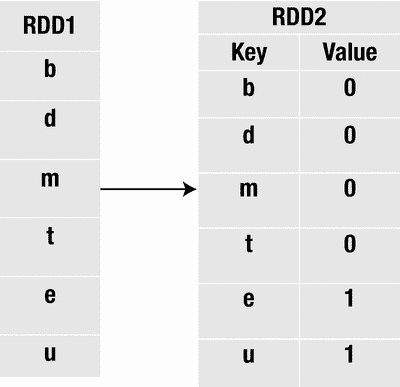

**图 5-1.** 创建配对 RDD

创建配对 RDD 的方法有很多种。一种方法是直接从文件读取数据。我们将在后续章节中探讨这种方法。另一种创建配对 RDD 的方法是使用`map()`方法，你将在本菜谱中学习到。

### 工作原理

在本节中，你将按照几个步骤来达到解决方案。

**步骤 5-1-1. 创建包含单个元素的 RDD**

让我们从给定数据创建一个 RDD 开始：

```
>>> pythonList  =  ['b', 'd', 'm', 't', 'e', 'u']
>>> RDD1 = sc.parallelize(pythonList,2)
>>>RDD1.collect()
```

输出如下：

```
['b', 'd', 'm', 't', 'e', 'u']
```

我们创建了一个名为`RDD1`的 RDD。`RDD1`的元素有`b`、`d`、`m`、`t`、`e`和`u`。这是一个字母的 RDD。可以看出，元素`b`、`d`、`m`和`t`是辅音。`RDD1`的其他元素，`e`和`u`，是元音。

**步骤 5-1-2. 编写一个 Python 方法来检查辅音**

我们将定义一个名为`vowelCheckFunction()`的 Python 函数。此函数将接收一个字母作为输入，如果输入是辅音则返回 1，否则返回 0。让我们实现这个函数：

```
>>> def vowelCheckFunction( data) :
...     if data in ['a','e','i','o','u']:
...        return 1
...     else :
...        return 0
```

可以看出，我们的 Python 函数`vowelCheckFunction`将接收一个输入数据。在本例中，我们将发送一个字母。在函数内部，我们检查数据是否是元音。如果我们的`if`块逻辑表达式结果为`True`，函数将返回 1；否则返回 0。

没有经过测试，我们不应该信任`vowelCheckFunction`。所以，让我们从元音输入开始：

```
>>> vowelCheckFunction('a')
```

输出如下：

```
1
```

对于元音输入，我们得到输出 1。我们的 Python 函数`vowelCheckFunction`符合我们对元音的预期。这很好，但我们也测试一下辅音。这次我们发送`b`，一个辅音，作为输入：

```
>>> vowelCheckFunction('b')
```

输出如下：

```
0
```

我们已经测试了我们的函数。对于辅音和元音，它都能按预期工作。我们可以信赖我们开发的这个函数。

**步骤 5-1-3. 创建配对 RDD**


我们可以通过使用 `map()` 函数来创建所需的 RDD。我们需要创建一个配对 RDD：键将是 `RDD1` 中的元素，值为 0（表示辅音）或 1（表示元音）：

```
>>> RDD2 = RDD1.map( lambda data : (data, vowelCheckFunction(data)))
>>> RDD2.collect()
```

输出结果如下：

```
[('b', 0),
('d', 0),
('m', 0),
('t', 0),
('e', 1),
('u', 1)]
```

## 步骤 5-1-4. 从配对 RDD 中提取键

`keys()` 函数可用于提取所有键：

```
>>> RDD2Keys = RDD2.keys()
>>> RDD2Keys.collect()
```

输出结果如下：

```
['b', 'd', 'm', 't', 'e', 'u']
```

我们可以看到 `keys()` 函数执行了一次转换。因此，`keys()` 返回一个 RDD，需要调用 `collect()` 函数才能将数据传递到驱动程序。

## 步骤 5-1-5. 从配对 RDD 中提取值

与 `keys()` 函数类似，`values()` 函数将从配对 RDD 中提取所有值。它同样执行一次转换：

```
>>> RDD2Values = RDD2.values()
>>> RDD2Values.collect()
```

输出结果如下：

```
[0, 0, 0, 0, 1, 1]
```

## 方案 5-2. 数据聚合

### 问题

你希望对数据进行聚合。

### 解决方案

你需要对某灯泡制造商的数据进行聚合，如下表 5-1 所示。

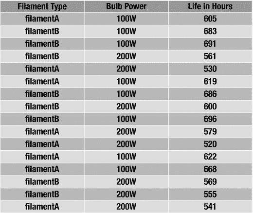

**表 5-1.** 灯丝数据

YP 公司生产两种类型的灯丝：filamentA 和 filamentB。这两种灯丝均可用于制造 100W 和 200W 的电灯泡。表 5-1 显示了每种灯泡的预期寿命。

你需要计算以下指标：

* 每种灯丝类型灯泡的平均寿命（小时）
* 每种功率等级灯泡的平均寿命（小时）
* 基于灯丝类型和功率两者的平均寿命（小时）

我们在数据科学问题中通常会遇到数据聚合的需求。为了获取聚合数据，我们可以使用许多 PySpark 函数。

在本方案中，我们将使用 `reduceByKey()` 函数通过键来计算平均值。计算复杂键的平均值需要先创建这些复杂键。复杂键可以通过使用 `map()` 函数来创建。

### 工作原理

我们从创建 RDD 开始。

#### 步骤 5-2-1. 创建包含单个元素的 RDD

```
>>> filDataSingle = [['filamentA','100W',605],
...                  ['filamentB','100W',683],
...                  ['filamentB','100W',691],
...                  ['filamentB','200W',561],
...                  ['filamentA','200W',530],
...                  ['filamentA','100W',619],
...                  ['filamentB','100W',686],
...                  ['filamentB','200W',600],
...                  ['filamentB','100W',696],
...                  ['filamentA','200W',579],
...                  ['filamentA','200W',520],
...                  ['filamentA','100W',622],
...                  ['filamentA','100W',668],
...                  ['filamentB','200W',569],
...                  ['filamentB','200W',555],
...                  ['filamentA','200W',541]]
>>> filDataSingleRDD = sc.parallelize(filDataSingle, 2)
>>> filDataSingleRDD.take(3)
```

输出结果如下：

```
[['filamentA', '100W', 605],
['filamentB', '100W', 683],
['filamentB', '100W', 691]]
```

这里我们首先创建了一个名为 `filDataSingle` 的嵌套 Python 列表，用于存储灯丝数据。然后我们创建了 RDD `filDataSingleRDD`，并将数据分为两部分。在 `filDataSingleRDD` 上调用 `take()` 函数的输出结果清晰地表明，该 RDD 的元素是一个列表。

#### 步骤 5-2-2. 创建配对 RDD

首先我们需要根据灯丝类型计算灯泡的平均寿命。更好的做法是创建一个配对 RDD，其中键为灯丝类型，值为寿命（小时）。那么让我们创建所需的配对 RDD 并进行查看：

```
>>> filDataPairedRDD1 = filDataSingleRDD.map(lambda x : (x[0], x[2]))
>>> filDataPairedRDD1.take(4)
```

输出结果如下：


```python
[('filamentA', 605),
('filamentB', 683),
('filamentB', 691),
('filamentB', 561)]
```

我们创建了一个配对 RDD `filDataPairedRDD1`，使用了定义在 RDD 上的 `map()` 函数。配对 RDD `filDataPairedRDD1` 以灯丝类型为键，以寿命（小时）为值。

**步骤 5-2-3：根据灯丝类型计算平均寿命**

现在我们有了所需的配对 RDD。但这足够了吗？不。要计算平均值，我们需要总和与计数。我们必须向配对 RDD 中添加一个额外的 1，这样我们才能得到总和与计数。现在让我们在每个 RDD 元素中添加一个额外的 1：

```python
>>> filDataPairedRDD11 = filDataPairedRDD1.map(lambda x : (x[0], [x[1], 1]))
>>> filDataPairedRDD11.take(4)
```

输出如下：

```python
[('filamentA', [605, 1]),
('filamentB', [683, 1]),
('filamentB', [691, 1]),
('filamentB', [561, 1])]
```

`filDataPairedRDD11` 是一个配对 RDD。`filDataPairedRDD11` 的值以列表形式呈现；第一个元素是灯泡的寿命（小时），第二个元素就是 1。

现在我们必须计算每种灯丝类型的寿命值的总和以及计数值，这样我们才能计算平均值。许多 PySpark 函数都可以完成这项工作，但这里我们将使用配对 RDD 的 `reduceByKey()` 函数。

`reduceByKey()` 函数按键应用聚合操作。它接受一个聚合函数作为输入，并在每个 RDD 键的值上应用该函数。

让我们根据灯丝类型计算灯泡总寿命小时数的总和，以及每种灯丝类型的元素计数：

```python
>>> filDataSumandCount = filDataPairedRDD11.reduceByKey(lambda l1,l2 : [l1[0] + l2[0], l1[1]+l2[1]])
>>> filDataSumandCount.collect()
```

输出如下：

```python
[('filamentA', [4684, 8]),
('filamentB', [5041, 8])]
```

我们正在将 `reduceByKey()` 函数应用于我们的配对 RDD `filDataPairedRDD11`。为了理解 `reduceByKey()` 的工作原理，让我们看看我们的配对 RDD 是如何分布的。从 RDD 中的元素数量开始：`filDataPairedRDD11` 的五个元素：

```python
>>> filDataPairedRDD11.count()
```

输出如下：

```python

```

我们的配对 RDD 有 16 个元素。现在让我们看看我们的数据有多少个分区：

```python
>>> filDataPairedRDD11.getNumPartitions()
```

输出如下：

```python

```

很明显数据已被分布到两个部分。PySpark 会尝试将数据均匀分布到执行器，因此它将八个数据点分配给每个执行器。现在让我们从 RDD 中取出五个数据点，看看这些数据是什么样的：

```python
>>> filDataPairedRDD11.take(5)
```

输出如下：

```python
[('filamentA', [605, 1]),
('filamentB', [683, 1]),
('filamentB', [691, 1]),
('filamentB', [561, 1]),
('filamentA', [530, 1])]
```

我们可以看到 `filDataPairedRDD11` RDD 的第一个和第五个元素的键是 `filamentA`。因此，对于灯丝类型 `filamentA`，`reduceByKey()` 函数中的第一个 `l1` 和 `l2` 将分别是 `[605, 1]` 和 `[530, 1]`。

```python
>>> filDataSumandCount.collect()
```

输出如下：

```python
[('filamentA', [4684, 8]),
('filamentB', [5041, 8])]
```

最后，我们得到了基于灯丝类型的灯泡寿命小时数的总和以及计数。下一步是将总和除以计数以得到平均值。让我们这样做：

```python
>>> filDataMeanandCount = filDataSumandCount.map( lambda l : [l[0],float(l[1][0])/l[1][1],l[1][1]])
>>> filDataMeanandCount.collect()
```

输出如下：

```python
[['filamentA', 585.5, 8],
['filamentB', 630.125, 8]]
```

最后，我们得到了基于灯丝类型所需的平均值。filamentA 的平均寿命是 585.5 小时，filamentB 的平均寿命是 630.125 小时。我们可以推断出 filamentB 的寿命比 filamentA 长。

**步骤 5-2-4：根据灯泡功率计算平均寿命**

首先，我们将从创建我们的配对 RDD 开始。键将是灯泡功率，值将是寿命（小时）：


```python
>>> filDataPairedRDD2 = filDataSingleRDD.map(lambda x : (x[1], x[2]))
>>> filDataPairedRDD2.take(4)
```

以下是输出结果：

```
[('100W', 605),
('100W', 683),
('100W', 691),
('200W', 561)]
```

我们已经创建了一个配对 RDD `filDataPairedRDD2`，其中每个元素都是一个键值对：灯泡功率及其对应的寿命小时数。

```python
>>> fillDataPairedRDD22 = filDataPairedRDD2.map( lambda x : (x[0],[x[1],1]))
>>> fillDataPairedRDD22.take(4)
```

以下是输出结果：

```
[('100W', [605, 1]),
('100W', [683, 1]),
('100W', [691, 1]),
('200W', [561, 1])]
```

现在我们在 RDD 的值部分中包含了`1`。因此，每个值都是一个包含寿命小时数和`1`的列表。

```python
>>> powerSumandCount = fillDataPairedRDD22.reduceByKey(lambda l1,l2 : [l1[0]+l2[0], l1[1]+l2[1]])
>>> powerSumandCount.collect()
```

以下是输出结果：

```
[('100W', [5270, 8]),
('200W', [4455, 8])]
```

我们计算了不同灯泡功率下的总寿命小时数之和以及计数，并以灯泡功率作为键。

```python
>>> meanandCountPowerWise =powerSumandCount.map(lambda val : [val[0],[float(val[1][0])/val[1][1],val[1][1]]])
>>> meanandCountPowerWise.collect()
```

以下是输出结果：

```
[['100W', [658.75, 8]], ['200W', [556.875, 8]]]
```

在最后一步，我们计算了平均值和计数。从结果可以推断，100W 灯泡的平均寿命长于 200W 灯泡。

## 步骤 5-2-5. 基于灯丝类型和功率计算平均寿命

要完成练习的这一部分，我们需要一个键是复合类型的配对 RDD。你可能想知道什么是复合键。复合键包含不止一种类型。在本例中，我们的复合键将同时包含灯丝类型和灯泡功率类型。让我们开始创建具有复合键类型的配对 RDD：

```python
>>> filDataSingleRDD.take(4)
```

以下是输出结果：

```
[['filamentA', '100W', 605],
['filamentB', '100W', 683],
['filamentB', '100W', 691],
['filamentB', '200W', 561]]
>>> filDataComplexKeyData = filDataSingleRDD.map( lambda val : [(val[0], val[1]),val[2]])
>>> filDataComplexKeyData.take(4)
```

以下是输出结果：

```
[[('filamentA', '100W'), 605],
[('filamentB', '100W'), 683],
[('filamentB', '100W'), 691],
[('filamentB', '200W'), 561]]
```

我们已经创建了一个名为 `filDataComplexKeyData` 的配对 RDD。可以很容易地观察到它使用了复合键。这些键是灯丝类型和灯泡功率的组合。练习的其余部分将按照上一步的方式进行。在下面的代码中，我们将在值中添加一个额外的 `1`：

```python
>>> filDataComplexKeyData1 = filDataComplexKeyData.map(lambda val : [val[0], [val[1],1]])
>>> filDataComplexKeyData1.take(4)
```

以下是输出结果：

```
[[('filamentA', '100W'), [605, 1]],
[('filamentB', '100W'), [683, 1]],
[('filamentB', '100W'), [691, 1]],
[('filamentB', '200W'), [561, 1]]]
```

我们已经创建了所需的配对 RDD `filDataComplexKeyData1`。现在我们可以应用 `reduceByKey()` 函数，基于复合键来获取总和与计数：

```python
>>> filDataComplexKeySumCount = filDataComplexKeyData1.reduceByKey(lambda l1,l2 : [l1[0]+l2[0], l1[1]+l2[1]])
>>> filDataComplexKeySumCount.collect()
```

以下是输出结果：

```
[(('filamentA', '100W'), [2514, 4]),
(('filamentB', '200W'), [2285, 4]),
(('filamentB', '100W'), [2756, 4]),
(('filamentA', '200W'), [2170, 4])]
```

得到总和后，可以按如下方式计算平均值：

```python
>>> filDataComplexKeyMeanCount = filDataComplexKeySumCount.map(lambda val : [val[0],[float(val[1][0])/val[1][1],val[1][1]]])
>>> filDataComplexKeyMeanCount.collect()
[[('filamentA', '100W'), [628.5, 4]],
[('filamentB', '200W'), [571.25, 4]],
[('filamentB', '100W'), [689.0, 4]],
[('filamentA', '200W'), [542.5, 4]]]
```

最后，我们计算了平均值和计数值。

> **注意**  
> 以下是一个关于使用 `reduceByKey()` 的优秀教程：  
> [`stackoverflow.com/questions/30145329/reducebykey-how-does-it-work-internally`](http://stackoverflow.com/questions/30145329/reducebykey-how-does-it-work-internally)。

## 配方 5-3. 数据连接


### 问题

你需要对数据进行连接。

### 解决方案

我们有两个表：一个 `Students` 表（表 5-2 ）和一个 `Subjects` 表（表 5-3 ）。

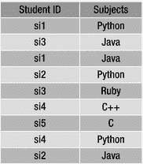

表 5-3. `Subjects`

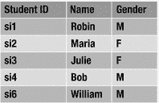

表 5-2. `Students`

你想在 `Students` 和 `Subjects` 表上执行以下操作：

- 内连接
- 左外连接
- 右外连接
- 全外连接

连接数据表是数据预处理中不可或缺的一部分。在本节中，我们将执行四种类型的数据连接。

内连接返回两个表中所有共同的键，并丢弃不共有的键元素。在 PySpark 中，内连接通过 RDD 上定义的 `join()` 方法完成。

左外连接包含左表中的所有键，并排除右表中的非共有键。在 PySpark 中，可以使用 RDD 上定义的 `leftOuterJoin()` 函数执行左外连接。

另一种重要的连接类型是右外连接。在右外连接中，第二个表的每个键都会被包含，但第一个表中只有那些两个表共有的键会被包含。我们可以通过 PySpark 中的 `rightOuterJoin()` 函数进行右外连接。

如果你想包含两个表中的所有键，请使用全外连接。它可以通过 `fullOuterJoin()` 执行。

### 工作原理

我们将按照本节的步骤处理连接操作。

#### 步骤 5-3-1. 创建嵌套列表

让我们从创建 `Students` 表数据的嵌套列表开始：

```
>>> studentData = [['si1','Robin','M'],
...                ['si2','Maria','F'],
...                ['si3','Julie','F'],
...                ['si4','Bob',  'M'],
...                ['si6','William','M']]
```

创建完 `Students` 表数据后，下一步是创建 `Subjects` 表数据的嵌套列表：

```
>>> subjectsData = [['si1','Python'],
...                 ['si3','Java'],
...                 ['si1','Java'],
...                 ['si2','Python'],
...                 ['si3','Ruby'],
...                 ['si4','C++'],
...                 ['si5','C'],
...                 ['si4','Python'],
...                 ['si2','Java']]
```

我们已经从 `Students` 表和 `Subjects` 表创建了嵌套列表。

#### 步骤 5-3-2. 创建 `Students` 和 `Subjects` 的配对 RDD

在创建配对 RDD 之前，我们首先必须创建一个单一的 RDD。让我们创建 `studentRDD`：

```
>>> studentRDD = sc.parallelize(studentData, 2)
>>> studentRDD.take(4)
```

输出如下：

```
[['si1', 'Robin', 'M'],
['si2', 'Maria', 'F'],
['si3', 'Julie', 'F'],
['si4', 'Bob', 'M']]
```

我们可以看到 `studentRDD` RDD 的每个元素都是一个列表，每个列表有三个元素。现在我们必须将其转换为配对 RDD：

```
>>> studentPairedRDD = studentRDD.map(lambda val : (val[0],[val[1],val[2]]))
>>> studentPairedRDD.take(4)
```

输出如下：

```
[('si1', ['Robin', 'M']),
('si2', ['Maria', 'F']),
('si3', ['Julie', 'F']),
('si4', ['Bob', 'M'])]
```

配对 RDD `studentPairedRDD` 以学生 ID 作为键。现在我们必须为科目数据创建一个配对 RDD：

```
>>> subjectsPairedRDD = sc.parallelize(subjectsData, 2)
>>> subjectsPairedRDD.take(4)
```

输出如下：

```
[['si1', 'Python'],
['si3', 'Java'],
['si1', 'Java'],
['si2', 'Python']]
```

我们不需要做任何额外的工作来创建科目数据的配对 RDD。

#### 步骤 5-3-3. 执行内连接

我们知道，在 PySpark 中内连接是通过使用 `join()` 函数完成的。我们需要将此函数应用于配对 RDD `studentPairedRDD`，并将 `subjectsPairedRDD` 作为参数提供给 `join()` 函数：

```
>>> studenSubjectsInnerJoin = studentPairedRDD.join(subjectsPairedRDD)
>>> studenSubjectsInnerJoin.collect()
```

输出如下：

```
[('si3', (['Julie', 'F'], 'Java')),
('si3', (['Julie', 'F'], 'Ruby')),
('si2', (['Maria', 'F'], 'Python')),
('si2', (['Maria', 'F'], 'Java')),
('si1', (['Robin', 'M'], 'Python')),
('si1', (['Robin', 'M'], 'Java')),
('si4', (['Bob', 'M'], 'C++')),
('si4', (['Bob', 'M'], 'Python'))]
```

分析此内连接的输出可以发现，键部分仅包含 `Students` 和 `Subjects` 表中共同的键；这些键出现在连接后的表中。两个表共有的键之外的其他键不会出现在连接后的表中。

#### 步骤 5-3-4. 执行左外连接

左外连接可以通过使用 `leftOuterJoin()` 函数执行：

```
>>> studentSubjectsleftOuterJoin = studentPairedRDD.leftOuterJoin(subjectsPairedRDD)
>>> studentSubjectsleftOuterJoin.collect()
```

输出如下：

```
[('si3', (['Julie', 'F'], 'Java')),
('si3', (['Julie', 'F'], 'Ruby')),
('si2', (['Maria', 'F'], 'Python')),
('si2', (['Maria', 'F'], 'Java')),
('si6', (['William', 'M'], None)),
('si1', (['Robin', 'M'], 'Python')),
('si1', (['Robin', 'M'], 'Java')),
('si4', (['Bob', 'M'], 'C++')),
('si4', (['Bob', 'M'], 'Python'))]
```

学生 ID `si6` 存在于 `Students` 表中，但不在 `Subjects` 表中。因此，左外连接将 `si6` 包含在连接后的表中。由于 `si6` 在 `Subjects` 表中没有对应项，其科目位置显示为 `None`。

#### 步骤 5-3-5. 执行右外连接

在 `Students` 和 `Subjects` 表上的右外连接可以通过使用 `rightOuterJoin()` 函数执行：

```
>>> studentSubjectsrightOuterJoin = studentPairedRDD.rightOuterJoin(subjectsPairedRDD)
>>> studentSubjectsrightOuterJoin.collect()
```

输出如下：

```
[('si3', (['Julie', 'F'], 'Java')),
('si3', (['Julie', 'F'], 'Ruby')),
('si2', (['Maria', 'F'], 'Python')),
('si2', (['Maria', 'F'], 'Java')),
('si1', (['Robin', 'M'], 'Python')),
('si1', (['Robin', 'M'], 'Java')),
('si5', (None, 'C')),
('si4', (['Bob', 'M'], 'C++')),
('si4', (['Bob', 'M'], 'Python'))]
```

学生 ID `si5` 仅存在于 `Subjects` 表中；它不属于 `Students` 表。因此，它出现在连接后的表中。

#### 步骤 5-3-6. 执行全外连接

现在让我们执行全外连接。在全外连接中，两个表的键都会被包含：

```
>>> studentSubjectsfullOuterJoin = studentPairedRDD.fullOuterJoin(subjectsPairedRDD)
>>> studentSubjectsfullOuterJoin.collect()
```

输出如下：

```
[('si3', (['Julie', 'F'], 'Java')),
('si3', (['Julie', 'F'], 'Ruby')),
('si2', (['Maria', 'F'], 'Python')),
('si2', (['Maria', 'F'], 'Java')),
('si6', (['William', 'M'], None)),
('si1', (['Robin', 'M'], 'Python')),
('si1', (['Robin', 'M'], 'Java')),
('si5', (None, 'C')),
('si4', (['Bob', 'M'], 'C++')),
('si4', (['Bob', 'M'], 'Python'))]
```

在连接后的表中，两个表的键都被包含。学生 ID `si6` 仅属于 `Students` 数据，但它出现在连接后的表中。同样，学生 ID `si5` 仅属于 `Subjects` 表，但它也出现在我们的连接后的表中。

