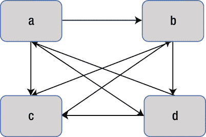

# 配方 5-4. 计算页面排名

### 问题

你想计算图 5-2 中所示网页系统的页面排名。

图 5-2. 一个网页系统

我们的系统中有四个网页（`a`、`b`、`c` 和 `d`）。网页 `a` 有指向页面 `b`、`c` 和 `d` 的出站链接。类似地，页面 `b` 有指向页面 `d` 和 `c` 的出站链接。网页 `c` 有指向页面 `b` 的出站链接，页面 `d` 有指向页面 `a` 和 `c` 的出站链接。

### 解决方案

页面排名算法由谢尔盖·布林和拉里·佩奇开发。在算法名称中，页面代表拉里·佩奇。页面排名算法的开发者后来创立了谷歌。这是一种迭代算法。

特定网页的页面排名表示其在网页群组中的相对重要程度。页面排名越高，它在搜索结果列表中的出现位置就越靠上。

