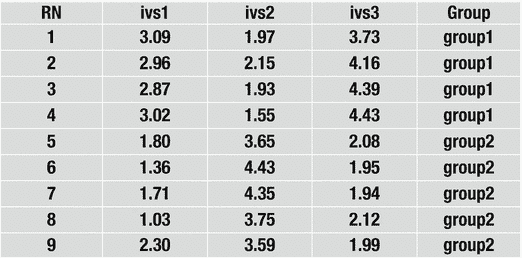
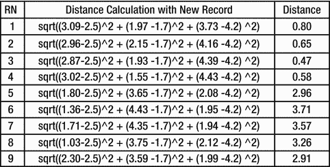
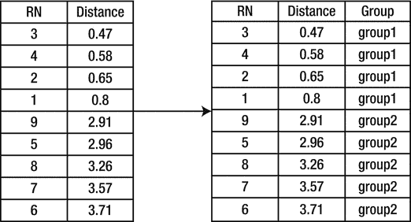
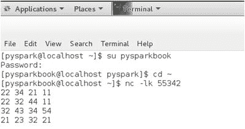

# PageRank 与 k-近邻算法实现

```python
>>> pageLinks =  [['a', ['b','c','d']],
...               ['b', ['d','c']],
...               ['c', ['b']],
...               ['d', ['a','c']]]
>>> pageRanks =  [['a',1],
...               ['b',1],
...               ['c',1],
...               ['d',1]]
>>> numIter = 20
>>> pageRanksRDD  = sc.parallelize(pageRanks, 2).partitionBy(2,hash).persist()
>>> pageLinksRDD  = sc.parallelize(pageLinks, 2).partitionBy(2,hash).persist()
```

在加粗的代码行中，我添加了 `partitionBy()` 方法。`partitionBy()` 的第一个参数是 2，表示数据被分成两个分区。我们还提供了另一个参数值 `hash`，该参数值是分区器名称。我们使用 `hash` 分区器将数据重新分区为两个分区。`hash` 分区器使用哈希技术对数据进行重新分区。我们在 `pageRanksRDD` 和 `pageLinksRDD` 上使用了相同的技术，因此相同的键会被分配到同一台机器上。这样一来，我们就解决了数据混洗的问题。代码的其他部分与第 5 章相同。

```python
>>> s = 0.85
>>> def rankContribution(uris, rank):
...     numberOfUris = len(uris)
...     rankContribution = float(rank) / numberOfUris
...     newrank =[]
...     for uri in uris:
...             newrank.append((uri, rankContribution))
...     return newrank
>>> for i in range(numIter):
...         linksRank = pageLinksRDD.join(pageRanksRDD)
...     contributedRDD = linksRank.flatMap(lambda x : rankContribution(x[1][0],x[1][1]))
...     sumRanks = contributedRDD.reduceByKey(lambda v1,v2 : v1+v2)
...     pageRanksRDD = sumRanks.map(lambda x : (x[0],(1-s)+s*x[1]))
...
>>> pageRanksRDD.collect()
```

输出结果如下：

```
[('b', 1.357243795127982),
('d', 0.8746512999550939),
('a', 0.5217268024809147),
('c', 1.2463781024360086)]
```

至此，我们得到了 PageRank 实现的最终结果。

## 配方 7-2. 使用 PySpark 实现 k-近邻算法

### 问题

你希望使用 PySpark 实现 k-近邻算法。

### 解决方案

k-近邻算法是最简单的数据分类算法之一。两个数据点之间的相似度是基于两点之间的距离来衡量的。

我们有一个包含九条记录的数据集。该数据集如表格 7-1 所示。在该表中，你可以看到一个名为 `RN` 的列，该列表示记录编号。它不属于数据本身，而是为了方便理解 KNN 算法而提供的。

**表 7-1.** 用于 KNN 分类的数据



假设我们有一条记录（`ivs1 = 2.5`, `ivs2 = 1.7`, `ivs3 = 4.2`）。我们将这条记录称为**新记录**。我们需要对该记录进行分类；它将被归类为 `group1` 或 `group2`。

我们将使用 KNN 算法对该记录进行分类。具体步骤如下：

1. **确定 `k` 的值。**
   `k` 是我们为决定新记录的类别而选择的最近邻数量。假设 `k` 为 5。

2. **计算新记录与数据中每条记录的距离。** 距离计算采用欧几里得距离法，如表格 7-2 所示。

**表 7-2.** 距离计算



在此表中，我们计算了新记录与其他记录之间的距离。第三列即为距离值。该表第一行的距离值是新记录与记录 1 之间的距离。

3. **对距离进行排序。**
   现在需要进行排序。我们必须按递增顺序对距离进行排序。同时，我们还需保持 `RN` 列与距离列之间的关联性。在表格 7-3 中，我们对距离列进行了排序，并且它仍然与 `RN` 和组列保持关联。

**表 7-3.** 距离计算




4. 找出 k 个最近邻。

现在我们已经对 `Distance` 列进行了排序，需要找出新记录的邻居。这里所说的邻居是什么意思呢？邻居就是表中距离新记录较近的那些记录。所谓“近”，指的是两个节点之间的距离较小。接下来，在表 7-3 中找出五个最近的邻居。对于新记录而言，记录 3、4、2、1 和 9 是邻居。其中记录 3、4、2、1 所属的组是 `group1`，记录 9 所属的组是 `group2`。大多数邻居都来自 `group1`。因此，我们可以将新记录归类到 `group1` 中。

我们已经详细讨论过 KNN 算法。接下来看看如何使用 PySpark 来实现它。我们先用一种朴素的方式实现 KNN，然后在“工作原理”部分对其进行优化。

首先，我们要计算两个元组之间的距离。我们将编写一个 Python 函数 `distanceBetweenTuples()`。这个函数接收两个元组，计算它们之间的距离，并返回该距离：

```
>>> def distanceBetweenTuples(data1, data2) :
...     squaredSum = 0.0
...     for i in range(len(data1)):
...         squaredSum = squaredSum + (data1[i] - data2[i])**2
...     return(squaredSum**0.5)
```

现在我们已经编写好了计算距离的函数，来测试一下：

```
>>> pythonTuple1 = (1.2, 3.4, 3.2)
>>> pythonTuple2 = (2.4, 2.2, 4.2)
>>> distanceBetweenTuples(pythonTuple1, pythonTuple2)
```

输出结果如下：

```
1.9697715603592207
```

我们的方法已经测试通过。这是一个通用函数，也可以用于长度为 4 或 5 的元组。在下面几行代码中，我们将创建一个列表。这个列表的元素是元组。每个元组包含两个元素：第一个元素本身是一个数据元组，第二个元素是与该数据元组关联的组别。

```
>>> knnDataList = [((3.09,1.97,3.73),'group1'),
...                              ((2.96,2.15,4.16),'group1'),
...                              ((2.87,1.93,4.39),'group1'),
...                              ((3.02,1.55,4.43),'group1'),
...                              ((1.80,3.65,2.08),'group2'),
...                              ((1.36,4.43,1.95),'group2'),
...                              ((1.71,4.35,1.94),'group2'),
...                              ((1.03,3.75,2.12),'group2'),
...                              ((2.30,3.59,1.99),'group2')]
>>> knnDataRDD = sc.parallelize(knnDataList, 4)
```

数据已经并行化了。我们将 `newRecord` 定义为 `[(2.5, 1.7, 4.2)]`：

```
>>> newRecord = [(2.5, 1.7, 4.2)]
>>> newRecordRDD = sc.parallelize(newRecord, 1)
>>> cartesianDataRDD = knnDataRDD.cartesian(newRecordRDD)
>>> cartesianDataRDD.take(5)
```

输出结果如下：

```
[(((3.09, 1.97, 3.73), 'group1'), (2.5, 1.7, 4.2)),
(((2.96, 2.15, 4.16), 'group1'), (2.5, 1.7, 4.2)),
(((2.87, 1.93, 4.39), 'group1'), (2.5, 1.7, 4.2)),
(((3.02, 1.55, 4.43), 'group1'), (2.5, 1.7, 4.2)),
(((1.8, 3.65, 2.08), 'group2'), (2.5, 1.7, 4.2))]
```

我们通过旧记录数据和新记录数据创建了一个笛卡尔积。你可能会疑惑，为什么在定义列表 `knnDataList` 时就创建了这个笛卡尔积。在实际情况下，你会有一个大型文件，该文件可能也是分布式的。因此，针对这种情况，我们需要先读取文件，然后再创建笛卡尔积。创建笛卡尔积后，旧数据和新记录数据就在同一行中了，这样我们就可以使用 `map()` 方法轻松计算距离：

```
>>> K = 5
>>> groupAndDistanceRDD = cartesianDataRDD.map(lambda data : (data[0][1], distanceBetweenTuples(data[0][0], data[1])))
>>> groupAndDistanceRDD.take(5)
```

输出结果如下：

```
[('group1', 0.8011866199581719),
('group1', 0.6447480127925947),
('group1', 0.47528938553264566),
('group1', 0.5880476171195661),
('group2', 2.9642705679475347)]
```


我们计算了 RDD`groupAndDistanceRDD`；它的第一个元素是组，第二个元素是新记录与旧记录之间的距离。现在需要按距离递增排序。你可能还记得第 4 章中描述的`takeOrdered()`函数。接下来，按距离递增获取五个组：

```
>>> ourClasses = groupAndDistanceRDD.takeOrdered(K, key = lambda data : data[1])
>>> ourClasses
```

输出如下：

```
[('group1', 0.47528938553264566),
('group1', 0.5880476171195661),
('group1', 0.6447480127925947),
('group1', 0.8011866199581719),
('group2', 2.9148241799463652)]
```

使用`takeOrdered()`方法，我们获取了 RDD 中的五个元素，距离按递增顺序排列。我们需要找出占多数的组，因此先提取组部分，再找出出现最频繁的组：

```
>>> ourClassesGroup = [data[0] for data in ourClasses]
>>> ourClassesGroup
```

输出如下：

```
['group1', 'group1', 'group1', 'group1', 'group2']
```

组部分已提取。可以使用 Python 的`max()`函数找出出现最频繁的组，如下所示：

```
>>> max(ourClassesGroup,key=ourClassesGroup.count)
```

输出如下：

```
'group1'
```

最终得到了新记录的组，即`group1`。

你可能会想，既然已经实现了 KNN，下一步该做什么？下一步是优化代码。我再重申一遍，我们可以优化这段代码的不同方面。对于此示例，我们将使用广播变量技术，这是一种非常好的代码优化技术。

之前使用笛卡尔积将旧记录与新记录连接。PySpark 提供了另一种实现类似结果的方法。我们可以事先将新记录发送到每个执行器。这样每个执行器都可以使用这条新记录数据进行距离计算。我们可以将新记录元组作为广播变量发送到所有执行器。

广播变量是共享且只读的变量。只读意味着执行器不能更改广播变量的值，只能读取它。在 PySpark 中，通过`broadcast()`函数创建广播变量。`broadcast()`函数定义在`SparkContext`上。我们知道在 PySpark 控制台中，`SparkContext`为`sc`。我们将使用广播技术重新实现 KNN。

工作原理

我们已经讨论了大部分代码，因此接下来的步骤中讨论将保持简短。

步骤 7-2-1\. 创建一个计算两个元组之间距离的函数

```
>>> def distanceBetweenTuples(data1, data2) :
...     squaredSum = 0.0
...     for i in range(len(data1)):
...         squaredSum = squaredSum + (data1[i] - data2[i])**2
...     return(squaredSum**0.5)
```

我们已经创建并测试了这个方法。

步骤 7-2-2\. 创建给定记录列表并转换为 RDD

```
>>> knnDataList = [((3.09,1.97,3.73),'group1'),
...                ((2.96,2.15,4.16),'group1'),
...                ((2.87,1.93,4.39),'group1'),
...                ((3.02,1.55,4.43),'group1'),
...                ((1.80,3.65,2.08),'group2'),
...                ((1.36,4.43,1.95),'group2'),
...                ((1.71,4.35,1.94),'group2'),
...                ((1.03,3.75,2.12),'group2'),
...                ((2.30,3.59,1.99),'group2')]
>>> K = 5
```

我们再次寻找五个邻居以确定新记录的组。同时将数据并行化并转换为包含四个分区的 RDD：

```
>>> knnDataRDD = sc.parallelize(knnDataList, 4)
>>> knnDataRDD.take(5)
```

输出如下：

```
[((3.09, 1.97, 3.73), 'group1'),
((2.96, 2.15, 4.16), 'group1'),
((2.87, 1.93, 4.39), 'group1'),
((3.02, 1.55, 4.43), 'group1'),
((1.8, 3.65, 2.08), 'group2')]
```

步骤 7-2-3\. 广播记录值

现在需要创建所需的新记录：


```text

```
>>> newRecord = [(2.5, 1.7, 4.2)]
```

对这条新记录进行广播，将由 `broadcast()` 方法完成，该方法定义在 `SparkContext` 对象上。我们可以通过 `value` 属性读取广播变量的值：

```
>>> broadCastedValue = sc.broadcast(newRecord)
>>> broadCastedValue.value
```

以下是输出结果：

```
[(2.5, 1.7, 4.2)]
```

可以看到，它返回了我们广播出去的数据。但我们需要的是元组，可以通过获取列表的第一个元素来得到：

```
>>> broadCastedValue.value[0]
```

以下是输出结果：

```
(2.5, 1.7, 4.2)
```

## 步骤 7-2-4. 广播记录值

广播之后，我们需要创建一个 RDD，这个 RDD 将由元组组成。每个元组的第一个元素是分组，第二个元素是距离：

```
>>> groupAndDistanceRDD = knnDataRDD.map(lambda data : (data[1], distanceBetweenTuples(data[0], tuple(broadCastedValue.value[0]))))
```

为了计算距离，我们使用 `distanceBetweenTuples()` 方法：

```
>>> groupAndDistanceRDD.take(5)
```

以下是输出结果：

```
[('group1', 0.8011866199581719),
('group1', 0.6447480127925947),
('group1', 0.47528938553264566),
('group1', 0.5880476171195661),
('group2', 2.9642705679475347)]
```

这样就达到了要求。

## 步骤 7-2-5. 寻找新记录的类别

我们将以与朴素部分相同的方式，找到新记录的类别：

```
>>> ourClasses = groupAndDistanceRDD.takeOrdered(K, key = lambda data : data[1])
>>> ourClasses
```

以下是输出结果：

```
[('group1', 0.47528938553264566),
('group1', 0.5880476171195661),
('group1', 0.6447480127925947),
('group1', 0.8011866199581719),
('group2', 2.9148241799463652)]
>>> ourClassesGroup = [data[0] for data in ourClasses]
>>> ourClassesGroup
```

以下是输出结果：

```
['group1', 'group1', 'group1', 'group1', 'group2']
>>> max(ourClassesGroup,key=ourClassesGroup.count)
```

以下是输出结果：

```
'group1'
```

我们可以看到，新记录的类别是 `group1`。

> **注意**  
> 你可以在以下博客中了解更多关于 PySpark 广播变量的信息：
> 
> - [`stackoverflow.com/questions/34499650/spark-broadcast-vs-join`](https://stackoverflow.com/questions/34499650/spark-broadcast-vs-join)
> - [`stackoverflow.com/questions/34864751/apache-spark-broadcast-variables-are-type-broadcast-not-a-rdd`](https://stackoverflow.com/questions/34864751/apache-spark-broadcast-variables-are-type-broadcast-not-a-rdd)
> - [`stackoverflow.com/questions/40685469/in-spark-how-does-broadcast-work/40694867`](https://stackoverflow.com/questions/40685469/in-spark-how-does-broadcast-work/40694867)
> 
> 你还可以在维基百科上找到更多关于 KNN 的信息，网址为 [`en.wikipedia.org/wiki/K-nearest_neighbors_algorithm`](https://en.wikipedia.org/wiki/K-nearest_neighbors_algorithm) 。

---

## 配方 7-3. 使用 PySpark Streaming 从控制台读取流数据

### 问题

你想通过 PySpark Streaming 从控制台读取流数据。

### 解决方案

Netcat 是一种网络实用软件。它可以使用 TCP 或 UDP 读取和写入数据。它既可以作为客户端，也可以作为服务器，或者两者兼具。你可以提供许多选项。我们可以使用 `-l` 选项启用监听模式。而 `s` 选项可用于保持入站套接字对多个连接保持打开状态。我们将使用 Netcat 服务器来创建数据的控制台源。

打开终端，使用命令 `nc -lk 55342` 启动 Netcat 服务器。图 7-1 展示了 Netcat 服务器的启动过程。



**图 7-1.** 控制台中的 Netcat 服务器

PySpark Streaming 可以从多个源读取数据。为了从控制台源读取数据，我们将使用 `socketTextStream()` 函数。该函数定义在 `StreamingContext` 对象上。正如 `SparkContext` 是进入 PySpark 的入口一样，`StreamingContext` 是进入 PySpark Streaming 库并使用该包中可用 API 的入口。

```


