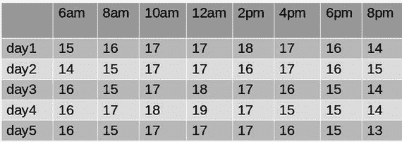
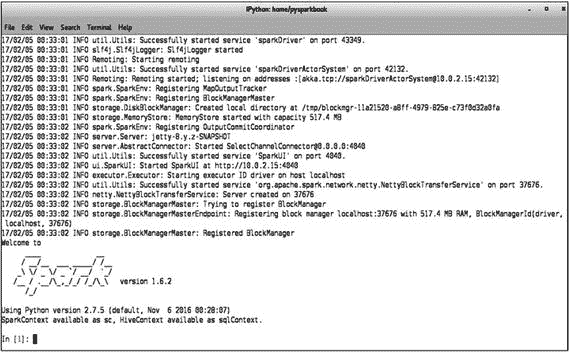
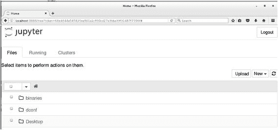
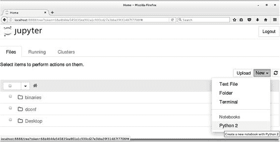
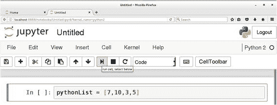
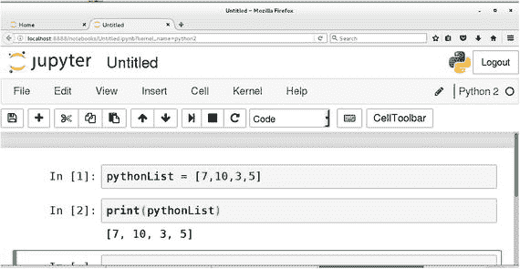

# 3. Python 与 NumPy 简介

Python 是一种通用的高级编程语言。它由 Guido van Rossum 开发，自诞生以来，其受欢迎程度呈指数级增长。大量用于数值和统计计算的高性能便捷包使 Python 深受数据科学家的欢迎。Python 是一种缩进式语言，这可能会困扰刚学习 Python 的程序员。但缩进代码能提高代码可读性，而且 Python 的普及性及其易用性使其非常适合为 Spark 编程。

本章介绍 Python 编程的基础知识。我们还将讨论 NumPy。此外，我还包含了一篇关于 IPython 以及如何将 IPython 与 PySpark 集成的教程。

如果你对 Python 很熟悉，可以跳过本章。但我建议无论如何都通读一遍本章内容，因为本章可能仍能提供良好的见解，进一步加深你的知识储备。

本章涵盖以下教程：

*   教程 3-1. 创建数据并验证数据类型

*   教程 3-2. 创建和索引 Python 字符串

*   教程 3-3. 在不同数据类型之间进行类型转换

*   教程 3-4. 操作 Python 列表

*   教程 3-5. 操作 Python 元组

*   教程 3-6. 操作 Python 集合

*   教程 3-7. 操作 Python 字典

*   教程 3-8. 使用 `Define` 和 `Call` 函数

*   教程 3-9. 使用 `Create` 和 `Call` lambda 函数

*   教程 3-10. 使用 Python 条件语句

*   教程 3-11. 使用 Python 的 `for` 和 `while` 循环

*   教程 3-12. 使用 NumPy

*   教程 3-13. 将 IPython 和 IPython Notebook 与 PySpark 集成

## 教程 3-1. 创建数据并验证数据类型

### 问题

你想创建数据并验证数据类型。

### 解决方案

Python 是一种动态类型语言。这意味着什么？动态类型意味着在定义变量时，程序员不需要像在 `C` 等其他编程语言中那样指明数据类型。为了学习 Python 的数据类型，你需要执行以下操作：

*   创建一个整数并验证其数据类型

*   创建一个长整数并验证其数据类型

*   创建一个小数并验证其数据类型

*   创建一个布尔值并验证其数据类型

每当在控制台或 Python 脚本中提到字面量时，Python 解释器就会解释其数据类型。当字面量被赋值给变量时，Python 解释器会解释该字面量的数据类型。为了验证字面量或变量的数据类型，你可以使用 Python 的 `type()` 函数。

### 工作原理

让我们按照本节的步骤来创建数据并验证数据类型。

#### 步骤 3-1-1. 创建整数并验证其数据类型

让我们在 Python 中创建一个整数。在下面这行代码中，我们将 Python 变量 `pythonInt` 与值 `15` 关联起来：

```
>>> pythonInt = 15
>>> pythonInt
```

输出如下：

```
15
```

我们可以使用 `type()` 函数来验证 Python 对象的类型：

```
>>> type(pythonInt)
```

输出如下：

```
<type 'int'>
```

#### 步骤 3-1-2. 创建长整数并验证其数据类型

长整型（`Long`）数据类型用于表示大整数。在创建时，数字后面会加上 `L` 后缀。下面是创建长整型数据类型的示例：

```
>>> pythonLongInt = 15L
>>> pythonLongInt
```

输出如下：

```
15L
```

使用 `type()` 函数，我们可以看到 `pythonLongInt` 的数据类型是 `long`。

```
>>> type(pythonLongInt)
```

输出如下：

```
<type 'long'>
```

#### 步骤 3-1-3. 创建小数并验证其数据类型

小数在任何数值计算中都经常使用。让我们创建一个浮点数：

```
>>> pythonFloat = 15.4
>>> pythonFloat
```

输出如下：

```
15.4
```

现在让我们检查它的类型：

```
>>> type(pythonFloat)
```

输出如下：

```
<type 'float'>
```

#### 步骤 3-1-4. 创建布尔值并验证其数据类型

程序员的生涯充满了对各种条件的关注，例如，一个给定的数字是否大于 `5`。示例如下：

```
>>> pythonBool = True
>>> pythonBool
```

输出如下：

```
True
>>> type(pythonBool)
```

输出如下：

```
<type 'bool'>
>>> pythonBool = False
>>> pythonBool
```

输出如下：

```
False
```

## 教程 3-2. 创建和索引 Python 字符串

### 问题

你想创建和索引 Python 字符串。

### 解决方案

处理自然语言处理以及其他与字符串相关的问题。你需要执行以下操作：

*   创建一个字符串并验证其数据类型

*   索引字符串

*   验证子字符串是否存在于给定字符串中

*   检查字符串是否以给定的子字符串开头

*   检查字符串是否以给定的子字符串结尾

你可以使用一组双引号（`" "`）或一组单引号（`' '`）来创建字符串。索引可以使用一组方括号来完成。你可以使用多种方法来验证子字符串是否在给定的字符串中。可以使用 `find()` 函数来查找子字符串是否存在于字符串内部。

`startswith()` 函数指示给定的字符串是否以给定的子字符串开头。类似地，`endswith()` 函数可以确认给定的字符串是否以给定的子字符串结尾。

### 工作原理

本节的步骤将解决我们的问题。

#### 步骤 3-2-1. 创建字符串并验证其数据类型

要创建字符串，必须将给定的字符串字面量放在双引号或单引号之间。始终记住不要混用引号，即，一边使用单引号，另一边使用双引号。以下几行代码使用双引号和单引号创建字符串。让我们从双引号开始：

```
>>> pythonString = "PySpark Recipes"
>>> pythonString
```

输出如下：

```
'PySpark Recipes'
```

你可以使用以下代码验证类型：

```
>>> type(pythonString)
```

输出如下：

```
<type 'str'>
```

现在让我们使用单引号创建一个字符串：

```
>>> pythonString = 'PySpark Recipes'
>>> pythonString
```

输出如下：

```
'PySpark Recipes'
```

#### 步骤 3-2-2. 索引字符串

字符串元素可以被索引。当你索引字符串时，是从零开始的：

```
>>> pythonStr = "Learning PySpark is fun"
>>> pythonStr
```

输出如下：

```
'Learning PySpark is fun'
```

让我们获取第十个位置的字符串。让我再次提醒，字符串索引从零开始：

```
>>> pythonStr[9]
```

输出如下：

```
'P'
```

#### 步骤 3-2-3. 验证子字符串是否存在于给定字符串中

如果在字符串中找到子字符串，Python 字符串的 `find()` 函数将返回字符串中匹配子字符串的最低索引。但是，如果在给定的字符串中未找到给定的子字符串，`find()` 方法会返回 `-1`。让我们索引第九个位置的元素：

```
>>> pythonStr[9]
```

输出结果如下：

```
'P'
```

我们要查找子字符串 `Py` 是否存在于字符串 `pythonStr` 中。我们将使用 `find()` 方法：

```
>>> pythonStr.find("Py")
```

输出结果如下：

```
9
```

```
>>> pythonStr.find("py")
```

输出结果如下：

```
-1
```

我们可以看到输出结果为 `9`。这是 `Py` 开始的索引位置。

#### 步骤 3-2-4. 检查字符串是否以指定子字符串开头

现在让我们关注另一个重要函数 `startswith()`。该函数用于判断一个给定字符串是否以某个特定子字符串开头。如果字符串以指定的子字符串开头，则返回 `True`；否则返回 `False`。示例如下：

```
>>> pythonStr.startswith("Learning")
```

输出结果如下：

```
True
```

#### 步骤 3-2-5. 检查字符串是否以指定子字符串结尾

类似地，`endswith()` 函数用于判断一个给定字符串是否以某个子字符串结尾。

```
>>> pythonStr.endswith("fun")
```

输出结果如下：

```
True
```

## 方案 3-3. 数据类型转换

### 问题描述

你希望将一种数据类型转换为另一种数据类型。

### 解决方案

在数据分析中，数据类型转换是一项常见操作。以下一组问题将帮助你理解 `Python` 中的类型转换。你需要完成以下任务：

* 将整数转换为浮点数
* 将字符串转换为整数
* 将字符串转换为浮点数

类型转换是指将一种数据类型更改为另一种数据类型——例如，将字符串更改为整数或浮点数。在 `PySpark` 中，我们经常需要进行数据类型转换。`Python` 中有四个重要的类型转换函数：`int()`、`float()`、`long()` 和 `str()`。

### 实现方法

我们将按照本节中的步骤来解决上述问题。

#### 步骤 3-3-1. 将整数转换为浮点数

首先创建一个整数：

```
>>> pythonInt = 17
```

我们创建了一个整数变量`pythonInt`。可以通过`type()`函数来查看 `Python` 对象的类型：

```
>>> type(pythonInt)
```

输出结果如下：

```
<type 'int'>
```

我们可以清楚地看到`type()`函数返回了`int`。

要将任何数据类型转换为`float`，我们使用`float()`函数：

```
>>> pythonFloat = float(pythonInt)
```

`pythonInt`的值已被转换为`float`类型。通过打印该变量可以看到变化：

```
>>> print pythonFloat
```

输出结果如下：

```
17.0
```

对`pythonFloat`执行`type()`函数，可以确认整数值已转换为浮点数：

```
>>> type(pythonFloat)
```

输出结果如下：

```
<type 'float'>
```

#### 步骤 3-3-2. 将字符串转换为整数

`int()`函数可以将字符串、浮点数或长整型转换为整数。在 `PySpark` 解决问题时，将字符串转换为整数会反复出现。我们先创建一个字符串：

```
>>> pythonString = "15"
>>> type(pythonString)
```

输出结果如下：

```
<type 'str'>
```

在上面的 `Python` 代码片段中，我们创建了一个字符串，并检查了变量`pythonString`的类型。

`Python` 内置的`int()`函数可以将变量转换为整数。以下代码使用`int()`函数将字符串更改为整数：

```
>>> pythonInteger = int(pythonString)
>>> pythonInteger
```

输出结果如下：

```
15
```

```
>>> type(pythonInteger)
```

输出结果如下：

```
<type 'int'>
```

#### 步骤 3-3-3. 将字符串转换为浮点数

让我们解决最后一个类型转换问题。创建一个值为`15.4`的字符串，并使用`float()`函数将其转换为浮点数：

```
>>> pythonString = "15.4"
>>> type(pythonString)
```

输出结果如下：

```
<type 'str'>
```

接下来，将我们的字符串转换为浮点数：

```
>>> pythonFloat = float(pythonString)
>>> pythonFloat
```

输出结果如下：

```
15.4
```

```
>>> type(pythonFloat)
```

输出结果如下：

```
<type 'float'>
```

`Python` 中有四种集合类型：列表、集合、字典和元组。在接下来的方案中，我们将逐一讨论这些集合。

# 菜谱 3-4：处理 Python 列表

### 问题
你想要处理一个 Python 列表。

### 解决方案
列表是一种有序的 Python 集合。列表被用于解决许多问题。我们将重点讨论以下操作：
- 创建列表
- 扩展列表
- 追加列表
- 统计列表元素数量
- 排序列表

Python 列表是可变的。通常，我们创建包含相似类型对象的列表，但列表也可以包含不同类型的对象。列表使用方括号 `[]` 创建。`List` 对象有许多内置函数可供使用。扩展列表可以使用 `extend()` 函数完成，追加列表则可以使用 `append()` 函数。你可能会疑惑：追加列表和扩展列表有什么区别？很快你就会得到答案。

统计列表元素数量可以使用 `len()` 函数完成，排序则可以使用 `sort()` 函数。

## 实现原理
按照以下步骤来解决我们的问题。

### 步骤 3-4-1：创建列表
让我们创建一个列表：

```
>>> pythonList = [2.3,3.4,4.3,2.4,2.3,4.0]
>>> pythonList
```

输出如下：

```
[2.3, 3.4, 4.3, 2.4, 2.3, 4.0]
```

列表可以通过方括号 `[]` 进行索引。列表的第一个元素索引为 `0`：

```
>>> pythonList[0]
```

输出如下：

```
2.3
>>> pythonList[1]
```

输出如下：

```
3.4
```

`pythonList[0]` 索引的是列表 `pythonList` 的第一个元素，`pythonList[1]` 索引第二个元素。因此，如果一个列表有 `n` 个元素，最后一个元素可以通过 `pythonList[n-1]` 索引。

列表中的元素可以是不同的数据类型。下面的例子将说明这一点：

```
>>> pythonList1 = ["a",1]
```

上面的代码创建了一个包含两个元素的列表。第一个元素是字符串，第二个元素是整数。

```
>>> pythonList1
```

输出如下：

```
['a', 1]
>>> type(pythonList1)
```

输出如下：

```
<class 'list'>
```

`type()` 函数输出 `pythonList1` 的类型为 `list`：

```
>>> type (pythonList1[0])
```

输出如下：

```
<class 'str'>
>>> type (pythonList1[1])
```

输出如下：

```
<class 'int'>
```

第一个元素的类型是字符串，第二个元素的类型是整数，这已由 `type()` 函数显示。

在 Python 中，列表是一种可变集合。可变集合意味着集合中的元素可以被更改。让我们来看一些例子：

```
>>> pythonList1 = ["a",1]
>>> pythonList1[0] = 5
>>> print pythonList1
```

输出如下：

```
[5, 1]
```

在这个例子中，我们使用了之前创建的同一个列表 `pythonList1`。然后将第一个元素更改为 `5`。通过打印 `pythonList1`，我们可以看到 `pythonList1` 的第一个元素现在是 `5`。

### 步骤 3-4-2：扩展列表
`extend()` 函数接受一个对象作为参数，并将调用列表对象与参数中的对象按元素逐个扩展：

```
>>> pythonList1 = [5,1]
>>> print pythonList1
```

输出如下：

```
[5, 1]
>>> pythonList1.extend([1,2,3])
>>> pythonList1
[5, 1, 1, 2, 3]
```

### 步骤 3-4-3：追加列表
对列表应用 `append()` 会将作为参数提供的 Python 对象追加到列表末尾。在这个例子中，`append()` 将另一个列表追加到了现有列表中：

```
>>> pythonList1 = [5,1]
>>> pythonList1.append([1,2,3])
>>> print pythonList1
```

输出如下：

```
[5, 1, [1, 2, 3]]
```

### 步骤 3-4-4：统计列表元素数量
列表的长度就是列表中元素的数量。`len()` 函数会返回列表的长度，如下所示：

```
>>> pythonList1 = [5,1]
>>> len(pythonList1)
```

输出：

```
2
```

### 步骤 3-4-5：排序列表
列表排序可以按升序或降序进行。我们的 `sort()` 函数可以通过以下方式对给定列表进行升序或降序排序。

让我们从以下代码开始，将列表 `pythonList` 按升序排序：

```
>>> pythonList = [2.3,3.4,4.3,2.4,2.3,4.0]
>>> pythonList
```

以下是输出结果：

```
[2.3, 3.4, 4.3, 2.4, 2.3, 4.0]
>>> pythonList.sort()
>>> pythonList
```

以下是输出结果：

```
[2.3, 2.3, 2.4, 3.4, 4.0, 4.3]
```

为了对数据进行降序排序，我们必须将 `reverse` 参数设为 `True`：

```
>>> pythonList.sort(reverse=True)
>>> pythonList
```

以下是输出结果：

```
[4.3, 4.0, 3.4, 2.4, 2.3, 2.3]
```

# 技巧 3-5：使用 Python 元组

### 问题
你想要使用 Python 元组。

### 解决方案
元组是一个不可变的有序集合。我们将解决以下一系列问题：
*   创建元组
*   获取元组中某个元素的索引
*   统计元组中某个元素的出现次数

元组是一个不可变的集合，通常用于创建记录数据。元组通过使用一对圆括号 `()` 来创建。元组是一个有序序列。我们可以在一个元组中存放不同的数据类型。元组对象上的 `index()` 函数会返回给定元素首次出现位置的索引。另一个定义在元组上的函数 `count()` 会返回给定元素的出现频率。

### 工作原理
让我们一步步地解决这个问题。

#### 步骤 3-5-1：创建元组
以下代码通过使用圆括号 `()` 创建了一个元组：

```
>>>pythonTuple = (2.0,9,"a",True,"a")
```

这里我们创建了一个名为 `pythonTuple` 的元组，它包含五个元素。我们元组的第一个元素是一个小数，第二个元素是一个整数，第三个是一个字符串，第四个是一个布尔值，最后一个是一个字符串。

现在让我们检查一下 `pythonTuple` 对象的类型：

```
>>> type(pythonTuple)
```

以下是输出结果：

```
<class 'tuple'>
```

对元组进行索引的方式与我们对列表进行索引的方式类似，但这次我们使用的是方括号 `[]`：

```
>>> pythonTuple[2]
```

以下是输出结果：

```
'a'
```

下面这行代码将展示元组是不可变的：

```
>>> pythonTuple[1] = 5
```

以下是输出结果：

```
Traceback (most recent call last):
  File "<stdin>", line 1, in <module>
TypeError: 'tuple' object does not support item assignment
```

我们可以看到，我们无法修改元组中的元素。

#### 步骤 3-5-2：获取元组元素的索引
`index()` 函数需要一个元素作为参数，并返回该值在给定元组中首次出现位置的索引。在我们的 `pythonTuple` 元组中，`'a'` 位于索引 2 处。我们可以通过以下方式获取这个索引：

```
>>> pythonTuple.index('a')
```

以下是输出结果：

```
2
```

如果在给定的元组中找不到某个值，`index()` 函数会抛出一个异常。

#### 步骤 3-5-3：统计元组元素的出现次数
将某个元素作为输入提供给 `count()` 函数，会返回该元素在给定元组中的出现频率。我们可以像下面这样使用 `count()` 函数：

```
>>> pythonTuple.count("a")
```

以下是输出结果：

```
2
```

在我们的 `pythonTuple` 元组中，字符 `a` 出现了两次。因此，`count()` 函数返回了 2。

你可以尝试做一个简单的练习：对那个元组使用 `count()` 函数，并传入 `1` 作为参数。你会得到 `1` 作为答案。

# 技巧 3-6：使用 Python 集合

### 问题
你想要使用 Python 集合。

### 解决方案

处理不重复元素的集合需要使用集合。我们将处理以下任务：

*   创建集合
*   向集合中添加新元素
*   对集合执行并集操作
*   对集合执行交集操作

一个集合不能包含重复元素。Python 集合使用一对花括号 `{}` 来创建。最重要的一点是，在创建时，我们可以向集合中放入重复项。但集合随后会移除其中所有重复的项。与其他集合一样，集合对象上也定义了许多函数。如果你想向集合中添加一个新元素，可以使用 `add()` 函数。

求两个集合的并集是我们日常任务中常见的一个操作。定义在我们集合对象上的 `union()` 函数会为我们计算两个集合的并集。`intersect()` 函数用于对两个给定的 Python 集合执行交集运算。

## 工作原理

在本节中，我们将逐步解决给定的问题。

### 步骤 3-6-1：创建一个集合

让我们创建一个包含文具的集合，然后验证不同元素是否存在。以下代码行创建了一个文具集合：

```python
>>> pythonSet = {'Book','Pen','NoteBook','Pencil','Book'}
>>> pythonSet
```

输出如下：

```
set(['Pencil', 'Pen', 'Book', 'NoteBook'])
```

我们已经创建了一个集合。可以观察到，放入重复元素不会引发错误，但集合在创建时不会考虑该重复元素。

### 步骤 3-6-2：向集合添加新元素

使用 `add()` 函数可以向集合添加新元素。我们已经创建了集合 `pythonSet`。现在我们将向集合中添加一个新元素 `Eraser`，如下所示：

```python
>>> pythonSet.add("Eraser")
>>> pythonSet
```

输出如下：

```
set(['Pencil', 'Pen', 'Book', 'Eraser', 'NoteBook'])
```

在这个例子中可以看到，我们已经向集合中添加了新元素 `Eraser`。

### 步骤 3-6-3：对集合执行并集运算

Python 集合的并集运算将以数学方式执行。让我们为此示例创建另一个集合：

```python
>>> pythonSet1 = {'NoteBook','Pencil','Diary','Marker'}
>>> pythonSet1
```

输出如下：

```
set(['Marker', 'Pencil', 'NoteBook', 'Diary'])
```

两个集合的并集将返回另一个包含两个集合中所有元素（包括任一集合中的元素或两者共有的元素）的集合。在以下示例中，可以看到 `pythonSet` 和 `pythonSet1` 的并集返回了两者在 `pythonSet` 和 `pythonSet1` 中所有合并的元素：

```python
>>> pythonSet.union(pythonSet1)
```

输出如下：

```
set(['Pencil', 'Pen', 'NoteBook', 'Book', 'Eraser',  'Diary', 'Marker'])
```

### 步骤 3-6-4：对集合执行交集运算

`intersection()` 函数将返回一个包含两个给定集合中共同元素的新集合。我们已经创建了两个集合 `pythonSet` 和 `pythonSet1`。可以观察到 `Pencil` 和 `NoteBook` 是这两个集合中的共同元素。在以下代码行中，我们对集合使用了 `intersection()`：

```python
>>> pythonSet.intersection(pythonSet1)
```

输出如下：

```
set(['Pencil', 'NoteBook'])
```

运行代码后，可以清楚地看到交集将返回两个集合中共同的元素。

## 食谱 3-7：使用 Python 字典

### 问题

你想使用 Python 字典。

### 解决方案

你已经看到列表和元组是通过它们的索引编号进行索引。当索引使用单词时，这种情况变得更加清晰。Python 字典是一种存储键/值对的数据结构。Python 字典的每个元素都是一个键/值对。在此练习中，你希望对 Python 字典执行以下操作：

*   创建一个文具字典，以商品 ID 作为键，商品名称作为值
*   使用键索引元素
*   获取所有键
*   获取所有值

创建字典可以通过使用一对花括号 `{ }` 来实现。你可能会有些困惑，因为我们之前使用花括号创建了 Python 集合，而现在又要以同样的方式创建字典。但让我告诉你，为了创建字典，我们必须在花括号内提供键/值对——例如 `{key:value}`。可以观察到，在键/值对中，键与值通过冒号（`:`）分隔。两个不同的键/值对通过逗号（`,`）分隔。

你可以使用方括号 `[ ]` 对字典进行索引。Python 字典对象有一个 `get()` 函数，该函数返回给定键对应的值。

你可以使用 `keys()` 函数获取所有键；`values()` 函数返回所有值。

### 工作原理

我们将使用本节的步骤来解决我们的问题。

#### 步骤 3-7-1：创建一个文具字典

我们将使用以下 Python 代码行创建一个字典：

```python
>>> pythonDict = {'item1':'Pencil','item2':'Pen', 'item3':'NoteBook'}
>>> pythonDict
```

输出如下：

```python
{'item2': 'Pen', 'item3': 'NoteBook', 'item1': 'Pencil'}
```

### 步骤 3-7-2：通过键索引元素

让我们获取 `'item1'` 的值：

```python
>>> pythonDict['item1']
```

输出如下：

```python
'Pencil'
```

但如果字典中找不到该键，则会抛出 `KeyError` 异常：

```python
>>> pythonDict['item4']
```

输出如下：

```python
Traceback (most recent call last):
File "", line 1, in 
KeyError: 'item4'
```

为了防止 `KeyError` 异常，我们可以对字典使用 `get()` 函数。这样，如果给定键未找到值，它将返回空值（否则返回与该键关联的值）。让我们在以下 Python 代码片段中探索 `get()`：

```python
>>> pythonDict.get('item1')
```

输出如下：

```python
'Pencil'
```

我们知道键 `item4` 不在我们的字典中。因此，在这种情况下，Python 的 `get()` 函数将返回空值：

```python
>>> pythonDict.get('item4')
```

### 步骤 3-7-3：获取所有键

在解决问题时，经常需要一次性获取所有键。让我们通过使用 `keys()` 函数来获取所有键：

```python
>>> pythonDict.keys()
```

输出如下：

```python
['item2', 'item3', 'item1']
```

`keys()` 以列表形式返回所有键。

### 步骤 3-7-4：获取所有值

应用 `values()` 函数将返回字典中的所有值：

```python
>>> pythonDict.values()
```

输出如下：

```python
['Pen', 'NoteBook', 'Pencil']
```

与 `keys()` 函数类似，`values()` 也以列表形式返回所有值。

## 食谱 3-8：使用定义和调用函数

### 问题

你想编写一个 Python 函数，该函数接受一个整数作为输入，如果输入是偶数则返回 `True`，否则返回 `False`。

### 解决方案

函数可以提高代码的可读性和可重用性。在 Python 中，函数定义以 `def` 关键字开头。用户定义的函数名紧随 `def` 关键字之后。如果函数接受参数，则将其写在括号内；否则，我们只写一对括号。括号后面是冒号（`:`）。然后我们开始编写语句作为函数体。函数体相对于包含 `def` 关键字的行进行缩进。如果用户定义的函数返回一个值，则通过使用 Python 的 `return` 关键字来实现。

### 工作原理

我们将创建一个名为 `isEvenInteger` 的函数。以下几行定义了我们函数：

```python
>>> def isEvenInteger(ourNum) :
return ourNum %2 == 0
```

在这个代码示例中，我们可以看到我们的函数名是 `isEvenInteger`。函数名位于 `def` 关键字之后。函数的参数（本例中是 `ourNum`）位于括号内。冒号之后，我们定义了函数体。在这个函数体中，只有一个语句。函数体语句返回一个逻辑表达式的输出。我们通过使用 `return` 关键字从函数中返回一个值。如果函数不返回任何值，则省略 `return` 关键字。函数体的逻辑表达式用来检查输入数字模 2 是否等于零。

定义完函数`isEvenInteger`后，我们需要调用它才能观察其工作效果。为了测试函数的运行，我们将先使用一个偶数参数调用它，然后再用一个奇数整数参数调用它。我们从偶数整数输入开始。这里我们提供输入 4，它是一个偶数整数：

```python
>>> isEvenInteger(4)
```

输出如下：

```python
True
```

正如我们所见，输出是`True`。这意味着我们提供的输入是一个偶数。

现在让我们提供一个奇数作为输入：

```python
>>> isEvenInteger(5)
```

输出如下：

```python
False
```

当输入为奇数时，我们的函数`isEvenInteger`返回了`False`。

### 方案 3-9：使用创建和调用 Lambda 函数

### 问题

# 创建 Lambda 函数

你想要创建一个 `lambda` 函数，它接受一个整数作为输入，如果输入是偶数则返回 `True`，否则返回 `False`。

## 解决方案

一个 `lambda` 函数也被称为匿名函数。`lambda` 函数是一个没有名字的函数。Python 中的 `lambda` 函数使用 `lambda` 关键字定义。

## 工作原理

让我们创建一个 `lambda` 函数，检查一个给定的数字是否为偶数：

```python
>>> isEvenInteger = lambda ourNum : ourNum%2 == 0
```

我们的 `lambda` 函数是 `lambda ourNum : ourNum%2 == 0`。你可以看到我们使用了关键字 `lambda` 来定义它。在关键字 `lambda` 之后，我们写入了函数的参数。然后在冒号之后，我们有一个逻辑表达式。我们的逻辑表达式将检查输入的数字是否能被 2 整除。在 Python 中，函数是对象，所以我们的 `lambda` 函数也是一个对象。因此，我们可以将我们的对象放入一个变量中。这就是我们如何将 `lambda` 函数放入变量 `isEvenInteger` 的方法：

```python
>>> isEvenInteger(4)
```

输出如下：

```
True
```

```python
>>> isEvenInteger(5)
```

输出如下：

```
False
```

`lambda` 函数的缺点是只能编写一个表达式。该特定表达式的结果将被返回。Python 关键字 `return` 不需要用于返回表达式的值。`lambda` 函数不能扩展到超过一行。

# 食谱 3-10：使用 Python 条件语句

## 问题

你想使用 Python 条件语句。

## 解决方案

一家汽车制造公司生产三种类型的汽车。这三种汽车通过其气缸数进行区分。显而易见，不同的气缸数会导致不同的油耗。汽车 A 有四个气缸，汽车 B 有六个气缸，汽车 C 有八个气缸。表 3-1 显示了汽车的气缸数和相应的油耗。

**表 3-1.** 气缸数与相应油耗

| 气缸数 | 油耗（英里/加仑） |
| --- | --- |
| 4 | 22 |
| 6 | 18 |
| 8 | 16 |

销售主管 A 先生总是忘记气缸数和油耗之间的关系。所以你想创建一个小的 Python 应用程序，在给定气缸数的情况下返回油耗。这将是对 A 先生极大的帮助。

条件语句对于解决任何编程问题都是必不可少的。Python 也不例外。在 Python 中，条件语句通过使用 `if`、`elif` 和 `else` 关键字来实现。

## 工作原理

为了创建所需的 Python 应用程序，我们将编写一个 Python 函数，该函数将气缸数作为输入并返回相应的油耗。

以下是我们将用来创建应用程序的函数：

```
>>> def mpgFind(numOfCylinders) :
...       if(numOfCylinders == 4 ):
...             mpg = 22
...       elif(numOfCylinders == 6 ):
...            mpg = 18
...       else :
...            mpg = 16
...       return mpg
```

这里我们定义了一个名为 `mpgFind` 的函数。我们的函数将接受变量 `numOfCylinders`。进入函数后，我们的变量将面临一个逻辑表达式 `numOfCylinders == 4`。如果 `numOfCylinders` 的值为 4，逻辑表达式将返回 `True`，并且 `if` 块将被执行。我们的 `if` 块只有一个语句 `mpg=22`。如果需要，可以提供多个语句。

如果 `numOfCylinders == 4` 的结果是 `False`，则 `elif` 逻辑表达式将被测试。如果 `numOfCylinders` 的值是 6，`elif` 的逻辑表达式将返回 `True`，并且 18 将被赋值给 `mpg`。

如果 `if` 和 `elif` 的逻辑表达式都返回 `False` 会怎样？在这种情况下，`else` 块将被执行。变量 `mpg` 将被赋值为 16。

让我们用输入 4 调用我们的函数并查看结果：

```
>>> mpgFind(4)
```

输出如下：

```
22
```

你可以清楚地看到，我们的函数可以帮助我们的销售主管 A 先生。

# 方法 3-11：使用 Python 的 `for` 和 `while` 循环

## 问题
你想要使用 Python 的 `for` 和 `while` 循环。

## 解决方案
销售主管 A 先生得知自己的应用程序是用 Python 编写的后，对学习 Python 产生了兴趣。他参加了一个 Python 课程。他的导师 X 先生给他布置了一道作业题。X 先生要求全班同学实现一个 Python 函数，该函数以 1 到 101 的整数列表作为输入，然后返回列表中所有偶数的和。A 先生发现，可以使用以下循环来实现所需函数：

* `for` 循环
* `while` 循环

循环最适合提高代码的复用性。我们使用循环来多次运行某段代码。可以通过 `for` 和 `while` 循环来运行特定的代码段。要计算列表中偶数的总和，需要两个步骤：首先找出所有偶数，然后进行求和。

## 工作原理

### 步骤 3-11-1：实现 `for` 循环
首先，我们将通过 Python 中的 `for` 循环来获取列表中偶数的总和：
```python
>>> def sumUsingForLoop(numbers) :
...       sumOfEvenNumbers = 0
...       for i in numbers :
...           if i % 2 ==0 :
...               sumOfEvenNumbers = sumOfEvenNumbers +i
...           else :
...              pass
...       return   sumOfEvenNumbers
```

这里我们编写了一个名为 `sumUsingForLoop` 的 Python 函数。该函数将 `numbers` 作为输入。Python 中的 `for` 循环会遍历一个 Python 序列。如果我们传入一个整数列表，`for` 循环会逐个元素开始迭代。`if` 块将检查当前数字是否为偶数。如果是偶数，变量 `sumOfEvenNumbers` 将通过累加增加该数值。迭代完成后，返回最终的累加和。

让我们测试一下该函数的运行情况：
```python
>>> numbers = range(1,102)
>>> numbers
```

输出如下：
```
[1, 2, 3, 4, 5, 6, 7,............,  98, 99, 100, 101]
```

我们使用 `range()` 函数创建了一个从 1 到 101 的整数列表。现在调用我们的函数 `sumUsingForLoop` 并查看结果：
```python
>>> sumUsingForLoop(numbers)
```

输出如下：
```
2550
```

### 步骤 3-11-2：实现 `while` 循环
在本节中，我们将实现一个使用 `while` 循环的解决方案：
```python
>>> def sumUsingWhileLoop(numbers) :
...      i = 1
...      sumOfEvenNumbers = 0
...      while i <= 101 :
...           if i % 2 ==0 :
...                sumOfEvenNumbers = sumOfEvenNumbers +i
...           i = i + 1
...      return  sumOfEvenNumbers
```

这里我们定义了一个名为 `sumUsingWhileLoop` 的 Python 函数。该函数将 `numbers` 作为输入。Python 中的 `while` 循环有助于遍历 Python 序列。如果我们传入一个整数列表，可以像代码中所示那样逐个元素进行迭代。`if` 块将检查当前数字是否为偶数。如果是偶数，变量 `sumOfEvenNumbers` 将通过累加增加该数值。迭代完成后，返回最终的累加和。

让我们测试一下这个函数：
```python
>>> sumUsingWhileLoop(numbers)
```

输出如下：
```
2550
```

# 方法 3-12：使用 NumPy

## 问题
你想要使用 NumPy。

## 解决方案
XYZ 公司计划在 A 地点建设新工厂。公司需要选择一个温度满足特定标准的地点。环境科学家 Y 先生收集了 A 地点五天中不同时间段的温度读数。

表 3-2 展示了这些温度读数。



**表 3-2.** 摄氏温度

你需要完成以下操作：
* 安装 `pip`
* 安装 `NumPy`
* 使用 `NumPy` 的 `array()` 函数创建一个二维数组
* 通过垂直堆叠和列堆叠较小的数组来创建一个二维数组
* 了解并更改数组元素的数据类型
* 了解给定数组的形状
* 计算每一天的最低和最高温度
* 计算每一列的最低和最高温度
* 计算每一天和每一列的平均温度
* 计算每一天和每一列的温度标准差
* 计算每一天和每一列的温度方差
* 计算每一天和每一列的温度中位数
* 计算所有收集到的温度数据的整体平均值
* 计算全部五天温度数据的方差和标准差

这类简单的数学问题可以通过使用 `NumPy` 轻松解决。你可能会想，我们可以用嵌套列表来解决这些问题，那为什么要使用 `NumPy` 呢？因为使用 `NumPy` 的 `ndarray`，循环会变得更快。`NumPy` 是开源的，并且很容易获得。

`NumPy` 的 `ndarray` 是对多维数组数据的一种更高级别的抽象。它还提供了许多用于处理这些多维数组的函数。为了使用 `NumPy`，我们首先需要安装它。在创建了给定温度数据的二维数组之后，我们可以应用许多 `NumPy` 函数来解决给定问题。

## 工作原理
我们将使用以下步骤来解决我们的问题。

### 步骤 3-12-1：安装 `pip`
`pip` 是一个 Python 包管理系统，它本身是用 Python 编写的。我们可以使用 `pip` 来安装其他 Python 包。使用 `yum` 安装程序，我们可以按如下方式安装 `pip`：
```bash
[pysparkbook@localhost ∼]$ sudo yum install python-pip
```

安装 `pip` 后，我们必须安装 `pyparsing`。运行以下命令安装 `pyparsing`：
```bash
[pysparkbook@localhost ∼]$ sudo yum install ftp://mirror.switch.ch/pool/4/mirror/centos/7.3.1611/cloud/x86_64/openstack-kilo/common/pyparsing-2.0.3-1.el7.noarch.rpm
```

### 步骤 3-12-2：安装 `NumPy`
安装 `pip` 后，可以使用它来安装 `NumPy`。以下命令在我们的机器上安装 `NumPy`：
```bash
[pysparkbook@localhost ∼]$ sudo pip install numpy
```

以下是输出：
```
Collecting numpy
Downloading numpy-1.12.0-cp27-cp27mu-manylinux1_x86_64.whl (16.5MB)
100% |████████████████████████████████| 16.5MB 64kB/s
Installing collected packages: numpy
Successfully installed numpy-1.12.0
```

### 步骤 3-12-3：使用 `array()` 创建二维数组
可以通过多种方式创建多维数组。在这一步中，我们将使用一个嵌套的 Python 列表来创建一个二维数组。那么，让我们开始创建一个每日温度数据列表。在下面的代码块中，我们为五天的温度创建了五个列表：
```python
>>> import numpy as NumPy
>>> temp1 = [15, 16, 17, 17, 18, 17, 16, 14]
>>> temp2 = [14, 15, 17, 17, 16, 17, 16, 15]
>>> temp3 = [16, 15, 17, 18, 17, 16, 15, 14]
>>> temp4 = [16, 17, 18, 19, 17, 15, 15, 14]
>>> temp5 = [16, 15, 17, 17, 17, 16, 15, 13]
```

变量 `temp1` 包含第一天的温度测量值。类似地，`temp2`、`temp3`、`temp4` 和 `temp5` 分别包含第二天、第三天、第四天和第五天的温度测量值。

我们的二维温度数组可以通过使用 `NumPy` 的 `array()` 函数创建，如下所示：
```python
>>> dayWiseTemp = NumPy.array([temp1,temp2,temp3,temp4,temp5])
>>> dayWiseTemp
```

以下是输出：
```
[[15 16 17 17 18 17 16 14]
 [14 15 17 17 16 17 16 15]
 [16 15 17 18 17 16 15 14]
 [16 17 18 19 17 15 15 14]
 [16 15 17 17 17 16 15 13]]
```

```
## 通过堆叠创建二维数组

我们可以通过数据的垂直堆叠和列堆叠来创建一个数组。首先，我们将使用垂直堆叠来创建相同的温度数组数据。垂直堆叠可以使用`NumPy`的`vstack()`函数创建：

```
>>> dayWiseTemp = NumPy.vstack((temp1,temp2,temp3,temp4,temp5))
>>> dayWiseTemp
```

以下是输出：

```
array([[15, 16, 17, 17, 18, 17, 16, 14],
       [14, 15, 17, 17, 16, 17, 16, 15],
       [16, 15, 17, 18, 17, 16, 15, 14],
       [16, 17, 18, 19, 17, 15, 15, 14],
       [16, 15, 17, 17, 17, 16, 15, 13]])
```

现在让我们看看如何进行水平堆叠。温度数据是在不同的时间和不同的日期收集的。现在让我们根据时间创建一个温度数据列表：

```
>>> d6am = NumPy.array([15, 14, 16, 16, 16])
>>> d8am = NumPy.array([16, 15, 15, 17, 15])
>>> d10am = NumPy.array([17, 17, 17, 18, 17])
>>> d12am = NumPy.array([17, 17, 18, 19, 17])
>>> d2pm = NumPy.array([18, 16, 17, 17, 17])
>>> d4pm = NumPy.array([17, 17, 16, 15, 16])
>>> d6pm = NumPy.array([16, 16, 15, 15, 15])
>>> d8pm = NumPy.array([14, 15, 14, 14, 13])
```

列堆叠可以使用`NumPy`的`column_stack()`函数完成，如下所示：

```
>>> dayWiseTemp = NumPy.column_stack((d6am,d8am,d10am,d12am,d2pm,d4pm,d6pm,d8pm))
>>> dayWiseTemp
```

以下是输出：

```
array([[15, 16, 17, 17, 18, 17, 16, 14],
       [14, 15, 17, 17, 16, 17, 16, 15],
       [16, 15, 17, 18, 17, 16, 15, 14],
       [16, 17, 18, 19, 17, 15, 15, 14],
       [16, 15, 17, 17, 17, 16, 15, 13]])
```

## 了解并更改数组元素的数据类型

`NumPy`数组的`dtype`属性将返回`NumPy`数组的数据类型：

```
>>> dayWiseTemp.dtype
```

以下是输出：

```
dtype('int64')
```

我们可以观察到`NumPy`推断出的数据类型是`int64`。根据该地点过去的历史温度数据，我们知道温度通常在 0 到 100 之间变化。因此，使用 64 位整数并不高效。我们可以使用 32 位整数，它占用的内存比 64 位整数少。

为了创建一个数据类型为`int32`的数组，我们可以为`array()`函数提供`dtype`参数：

```
>>> dayWiseTemp = NumPy.array([temp1,temp2,temp3,temp4,temp5],dtype='int32')
>>> dayWiseTemp.dtype
```

以下是输出：

```
dtype('int32')
```

但如果数组是使用默认数据类型创建的，也不用担心。可以通过使用`NumPy`的`astype()`函数来更改数组元素的数据类型。我们可以使用`astype`函数更改现有数组的数据类型，如下所示：

```
>>> dayWiseTemp = dayWiseTemp.astype('int32')
>>> dayWiseTemp.dtype
```

以下是输出：

```
dtype('int32')
```

## 了解数组的维度

可以使用`array`的`shape`属性计算数组的形状：

```
>>> dayWiseTemp.shape
```

以下是输出：

```
(5, 8)
```

输出清楚地表明我们的数组有五行八列。

## 计算每天的最低和最高温度

对于`NumPy`数组，我们可以使用`min()`函数来计算最小值。我们可以按行或按列计算数组数据的最小值。为了计算一行的最低温度值，我们必须将`axis`参数的值设置为 1。

在我们的例子中，一行中的数据代表一天内的温度。以下代码行将计算一天内的最低温度值：

```
>>> dayWiseTemp.min(axis=1)
```

以下是输出：

```
array([14, 14, 14, 14, 13], dtype=int32)
```

类似地，每日最高温度可以使用`NumPy`数组的`max()`函数计算：

```
>>> dayWiseTemp.max(axis=1)
```

以下是输出：

```
array([18, 17, 18, 19, 17], dtype=int32)
```

## 按列计算最低和最高温度

我们可以通过分别使用相同的`min()`和`max()`函数来获取一列的最低和最高温度。但现在我们必须将`axis`参数设置为 0，如下所示：

```
>>> dayWiseTemp.min(axis=0)
```

以下是输出：

```
array([14, 15, 17, 17, 16, 15, 15, 13], dtype=int32)
>>> dayWiseTemp.max(axis=0)
```

以下是输出：

```
array([16, 17, 18, 19, 18, 17, 16, 15], dtype=int32)
```

## 计算每天和每列的平均温度
```

# 计算每日温度的平均值、标准差、方差及中位数

现在我们来计算每日温度的平均值。首先计算一天的平均温度：
```python
>>> dayWiseTemp.mean(axis=1)
```
输出结果：
```
array([ 16.25,  15.875,  16.,  16.375,  15.75 ])
```

要按列计算平均温度，需要将`axis`参数设置为 0：
```python
>>> dayWiseTemp.mean(axis=0)
```
输出结果：
```
array([ 15.4,  15.6,  17.2,  17.6,  17.,  16.2,  15.4,  14. ])
```

## 步骤 3-12-10：计算每日温度标准差

首先计算每日温度的标准差。我们将使用`ndarray`类的`std()`函数：
```python
>>> dayWiseTemp.std(axis=1)
```
输出结果：
```
array([ 1.19895788,  1.05326872,  1.22474487,  1.57619003,  1.29903811])
```

通过将`axis`设置为 0，可以计算列的标准差：
```python
>>> dayWiseTemp.std(axis=0)
```
输出结果：
```
array([ 0.8,  0.8,  0.4,  0.8,  0.63245553,
       0.74833148,  0.48989795,  0.63245553])
```

## 步骤 3-12-11：计算每日温度方差

`NumPy`数组的`var()`函数可用于计算每行的方差。首先计算每日温度方差：
```python
>>> dayWiseTemp.var(axis=1)
```
输出结果：
```
array([ 1.4375,  1.109375,  1.5,  2.484375,  1.6875  ])
```

列的温度方差可按如下方式计算：
```python
>>> dayWiseTemp.var(axis=0)
```
输出结果：
```
array([ 0.64,  0.64,  0.16,  0.64,  0.4 ,  0.56,  0.24,  0.4 ])
```

## 步骤 3-12-12：计算每日和每小时中位数

可通过`NumPy`的`median()`函数计算中位数：
```python
>>> NumPy.median(dayWiseTemp, axis=1)
```
输出结果：
```
array([ 16.5,  16. ,  16. ,  16.5,  16. ])
```
```python
>>> NumPy.median(dayWiseTemp, axis=0)
```
输出结果：
```
array([ 16.,  15.,  17.,  17.,  17.,  16.,  15.,  14.])
```

## 步骤 3-12-13：计算所有温度数据的总体平均值

`NumPy`的`mean()`函数可用于计算所有数据的总体平均值：
```python
>>> NumPy.mean(dayWiseTemp)
```
输出结果：
```
16.050000000000001
```

## 步骤 3-12-14：计算五天温度数据的方差和标准差

`NumPy`的`var()`函数可用于计算所有收集数据的方差：
```python
>>> NumPy.var(dayWiseTemp)
```
输出结果：
```
1.6974999999999993
```

`std()`函数可用于计算标准差：
```python
>>> NumPy.std(dayWiseTemp)
```
输出结果：
```
1.3028814220795379
```

> **注意**：您可以在 [`www.numpy.org`](http://www.numpy.org) 上了解更多关于 `NumPy` 的信息。

# 菜谱 3-13：将 IPython 和 IPython Notebook 与 PySpark 集成

## 问题
您希望将 IPython 和 IPython Notebook 与 PySpark 集成。

## 解决方案
将 IPython 与 PySpark 集成可提高程序员的工作效率。为实现这一集成，我们将执行以下步骤：
* 安装 IPython
* 将 PySpark 与 IPython 集成
* 安装 IPython Notebook
* 将 PySpark 与 IPython Notebook 集成
* 在 IPython Notebook 上运行 PySpark 命令

您已经熟悉了 Python 交互式 shell。这种交互式 shell 使我们能够更快地学习 Python，因为我们可以逐行查看每条命令的结果。Python 自带的 shell 非常基础，不具备 Tab 补全和其他功能。更高级的 Python 交互式 shell 是 IPython，它具有许多有助于编码的高级功能。

IPython Notebook 启动一个基于 Web 浏览器的工具来编写 Python 代码。通常，读者可能会误以为使用基于 Web 浏览器的笔记本需要互联网连接。事实并非如此；我们可以在没有互联网连接的情况下运行 IPython Notebook。

我们可以使用 IPython 和 IPython Notebook 启动 PySpark。

# 安装与集成 IPython 与 IPython Notebook

现在是安装 `IPython` 和 `IPython Notebook` 并将其与 `PySpark` 集成的时候了。可以使用 `pip` 安装 `IPython` 和 `IPython Notebook`。

### 工作原理

为了连接 `PySpark`，我们必须执行以下步骤。

### 步骤 3-13-1：安装 IPython

首先安装 `IPython`。我们已经安装了 `pip`。可以使用 `pip` 通过以下命令安装 `IPython`：

```
[pysparkbook@localhost ∼]$ sudo pip install ipython
```

以下是输出：

```
Collecting ipython
Successfully installed ipython-5.2.2 pathlib2-2.2.1 pexpect-4.2.1 pickleshare-0.7.4 prompt-toolkit-1.0.13 ptyprocess-0.5.1 scandir-1.4 simplegeneric-0.8.1 wcwidth-0.1.7
```

### 步骤 3-13-2：将 PySpark 与 IPython 集成

安装完成后，我们将使用 `IPython` 启动 `PySpark`。这很容易做到。首先，将环境变量 `IPYTHON` 设置为 1，如下所示：

```
[pysparkbook@localhost ∼]$ export IPYTHON=1
[pysparkbook@localhost ∼]$ pyspark
```

启动 `PySpark` 后，您将看到如图 3-1 所示的 shell。



图 3-1.`Shell`

在图 3-1 中，您可以看到现在 `In[1]` 已经替换了我们旧 `Python` 控制台中传统的 `>>>` 符号。

### 步骤 3-13-3：安装 IPython Notebook

现在我们将安装 `IPython Notebook`。再次使用 `pip` 安装 `IPython`：

```
[pysparkbook@localhost ∼]$ sudo pip install ipython[notebook]
```

### 步骤 3-13-4：将 PySpark 与 IPython Notebook 集成

安装完成后，我们必须设置一些环境变量：

```
[pysparkbook@localhost ∼]$ export IPYTHON_OPTS="notebook"
[pysparkbook@localhost ∼]$ export XDG_RUNTIME_DIR=""
```

现在是启动 `PySpark` 的时候了：

```
[pysparkbook@localhost ∼]$ pyspark
```

使用 `IPython Notebook` 启动 `PySpark` 后，我们将看到如图 3-2 所示的 `web` 浏览器。



图 3-2.`使用 Notebook 启动 PySpark 后，您将看到一个 web 浏览器`

您可能会惊讶地发现浏览器显示的是 `Jupyter`。但这并不奇怪；`Jupyter` 是 `IPython Notebook` 的新名称。您可以看到使用 `Notebook` 是多么容易；通过单击“上传”按钮，我们可以将文件上传到机器。

### 步骤 3-13-5：在 IPython Notebook 上运行 PySpark 命令

为了运行 `PySpark` 命令，让我们使用 `Python 2` 创建一个新的 `notebook`，如图 3-3 所示。



图 3-3.`使用 Python 2 创建新的 notebook`

创建 `notebook` 后，您将看到如图 3-4 所示的网页。



图 3-4.`创建 notebook 后，您将看到此网页`

现在我们可以运行 `Python` 命令来创建一个列表。编写命令后，我们必须运行它。您可以在图 3-4 中看到，我们可以使用 `notebook` 中的“运行”按钮来运行命令。

在图 3-5 中，我们正在打印 `pythonList`。



图 3-5.`打印 Python 列表`

