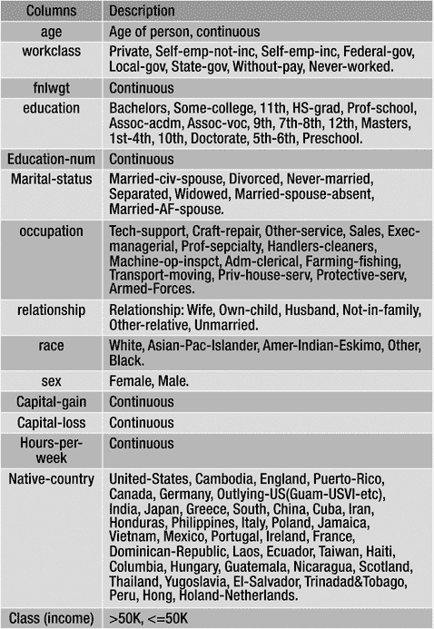
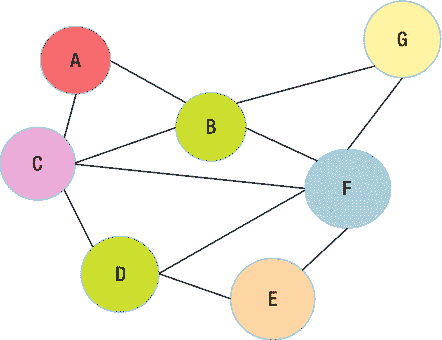
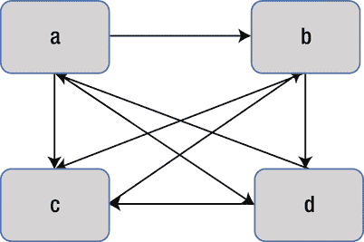

# 方法 8-2. 对 DataFrame 执行探索性数据分析

## 问题

你希望对 DataFrame 执行探索性数据分析。

## 解决方案

在探索性数据分析中，我们探索给定的数据。探索数据意味着统计记录数量，然后寻找有意义的模式。对于数值列的数据，我们计算数据的集中趋势和离散程度。数据的离散程度实际上就是数据的变异性。你可能知道，集中趋势的度量包括均值、中位数和众数。但变异性或数据离散程度是如何度量的呢？我们可以通过方差或标准差来度量它。

给定的数据集可能包含类别列。对于类别列，我们统计该变量每个值的频数。记录计数让我们了解拥有的数据点数量。我们根据给定的数值列计算最小和最大数据点。了解最小值和最大值可以展示数据的范围。

PySparkSQL 在 DataFrame 上定义了一个 `summary()` 函数。该函数将返回 DataFrame 中数值列记录数(`count`)、均值、标准差(`stdev`)、最小值(`min`)和最大值(`max`)。

你有一个文件 `filamentData.csv`。这次我们需要从 CSV 文件读取数据并创建一个 DataFrame。创建 DataFrame 后，我们需要对 DataFrame 的数值列进行汇总分析。除了数值列的汇总统计外，我们还需要了解每个类别字段中不同值的频数。

你需要对灯丝数据的 DataFrame 执行以下操作：

- 从 CSV 文件 `filamentData.csv` 读取数据

- 创建一个 DataFrame

- 计算数值列的汇总统计量

- 统计 `FilamentType` 类别列中不同值的频数

- 统计 `BulbPower` 类别列中不同值的频数

## 工作原理

首先，我们必须读取给定的文件并将数据转换为 DataFrame。在前面一个方法中，我们从嵌套列表开始，并执行了几个步骤来创建 DataFrame。在第 6 章中，我们发现从 CSV 文件获取嵌套列表需要多个步骤。如果能有一些更简便的方法就好了。

PySpark 包可以读取 CSV 文件并将数据直接转换为 DataFrame。我们应该感到高兴，因为有一个 PySpark 包可以帮助我们。该包名称是 `com.databricks.spark.csv`。这个包由 Databricks 开发。在 PySpark 2.x.x 之前，用户需要单独使用这个包。但在 PySpark 版本 2.x.x.x 中，该包已合并到 PySpark 中，因此你不需要单独引入 JAR 包。感谢 Databricks 提供了这个漂亮且非常有用的包。

### 步骤 8-2-1. 定义 DataFrame 模式

这里我们将定义 DataFrame 的模式。在我们的模式中，有三个列。第一列是 `FilamentType`，数据类型为 `string`。第二列是 `BulbPower`，数据类型也为 `string`。最后一列是 `LifeInHours`，数据类型为 `double`。

我们需要 PySparkSQL 中定义的不同数据类型。我们可以在 `pyspark.sql.types` 子模块中找到所有数据类型：

```python
>>> from pyspark.sql.types import * 
>>> FilamentTypeColumn = StructField("FilamentType",StringType(),True) 
>>> BulbPowerColumn = StructField("BulbPower",StringType(),True) 
>>> LifeInHoursColumn = StructField("LifeInHours",DoubleType(),True) 
```

我们创建了三个 `StructFields`：

```python
>>> FilamentDataFrameSchema = StructType([FilamentTypeColumn, BulbPowerColumn, LifeInHoursColumn]) 
```

使用这些 `StructFields`，我们为 DataFrame 创建了一个模式。我们的 DataFrame 模式的名称为 `FilamentDataFrameSchema`。

### 步骤 8-2-2. 读取 CSV 文件并创建 DataFrame

让我们创建一个 DataFrame。我们将使用 `spark.read.csv` 函数来读取文件数据并将其转换为 DataFrame：

```python
>>> filamentDataFrame = spark.read.csv('file:///home/pysparkbook/pysparkBookData/filamentData.csv',header=True, schema = FilamentDataFrameSchema, mode="DROPMALFORMED") 
```

我们来讨论一下 `spark.read.csv` 函数的参数。第一个参数是文件路径。第二个参数表示我们的文件有一个标题行。第三个参数提供了 DataFrame 的模式。`mode` 参数是什么？这第四个参数 `mode` 提供了一种在解析期间处理损坏记录的方法。`mode` 参数的值是 `DROPMALFORMED`。这个值表示丢弃所有损坏的数据。

我们已经读取了`filamentData.csv`数据文件，并且`spark.read.csv()`函数已经将 CSV 数据转换成了 DataFrame。现在让我们检查是否成功创建了 DataFrame。还记得 DataFrame 上哪些函数可以帮助你可视化数据吗？`show()`函数就能满足我们的需求。我们来获取 DataFrame 的前五行。`show()`函数会在控制台上以表格形式打印 DataFrame 的记录，这种格式更易于阅读和理解。让我们应用`show()`函数打印五条记录：

```python
>>> filamentDataFrame.show(5)
```

输出显示前五行：

```
+------------+---------+-----------+
|FilamentType|BulbPower|LifeInHours|
+------------+---------+-----------+
|   filamentA|     100W|      605.0|
|   filamentB|     100W|      683.0|
|   filamentB|     100W|      691.0|
|   filamentB|     200W|      561.0|
|   filamentA|     200W|      530.0|
+------------+---------+-----------+
```

我们现在有了 DataFrame。接下来检查它的模式（schema）：

```python
>>> filamentDataFrame.printSchema()
```

输出如下：

```
root
|-- FilamentType: string (nullable = true)
|-- BulbPower: string (nullable = true)
|-- LifeInHours: double (nullable = true)
```

模式也是正确的。

> **注意**：要了解更多关于将 CSV 文件读入 Spark DataFrame 的信息，请阅读 Stack Overflow 上的讨论：[`stackoverflow.com/questions/29936156/get-csv-to-spark-dataframe`](https://stackoverflow.com/questions/29936156/get-csv-to-spark-dataframe)

### 步骤 8-2-3. 计算汇总统计量

DataFrame 上定义的`describe()`函数会给出以下结果：

```python
>>> dataSummary = filamentDataFrame.describe()
>>> dataSummary.show()
```

输出如下：

```
+---------+------------------------------+
|summary  |       LifeInHours            |
+---------+------------------------------+
|  count  |                16            |
|   mean  |          607.8125            |
| stddev  | 61.11652122517009            |
|    min  |             520.0            |
|    max  |             696.0            |
+---------+------------------------------+
```

我们得到了结果：`count`、`mean`、`stddev`、`min`和`max`。接下来，我们需要找出两个分类列`FilamentType`和`BulbPower`及其组合的频率分布。

### 步骤 8-2-4. 统计 `FilamentType` 分类列中不同值的频率

统计频率最简单的方法是对记录使用`filter()`函数进行过滤，然后进行计数。我们逐步执行这些操作：

```
>>> filamentDataFrame.filter(filamentDataFrame.FilamentType == 'filamentA').count()
```

输出为空（未显示具体数字）。

在上述代码中，我们过滤出了所有`FilamentType`等于`filamentA`的记录。有 8 行包含`filamentA`。现在看看第一列中有多少行包含`filamentB`：

```
>>> filamentDataFrame.filter(filamentDataFrame.FilamentType == 'filamentB').count()
```

输出为空（未显示具体数字）。

我们已经过滤出了所有`FilamentType`等于`filamentB`的记录。对过滤后的数据应用`count()`函数会返回第一列中包含`filamentB`的总行数。有 8 行在第一列中包含`filamentB`。

### 步骤 8-2-5. 统计 `BulbPower` 分类列中不同值的频率

现在过滤`BulbPower`等于`100W`的数据。过滤出所需行后，进行计数：

```
>>> filamentDataFrame.filter(filamentDataFrame.BulbPower == '100W').count()
```

输出为空（未显示具体数字）。

有 8 行的`BulbPower`值为`100W`。同样地，我们可以统计其他值及其组合的频率。让我们计算 200W 灯泡的频率：

```
>>> filamentDataFrame.filter(filamentDataFrame.BulbPower == '200W').count()
```

输出为空（未显示具体数字）。

我们的`BulbPower`列中有 8 个 100W 灯泡和 8 个 200W 灯泡。

### 步骤 8-2-6. 统计 `FilamentType` 和 `BulbPower` 列组合中不同值的频率

在下面的代码中，我们将基于复合逻辑表达式进行计数：

```
>>> filamentDataFrame.filter((filamentDataFrame.FilamentType == 'filamentB') & (filamentDataFrame.BulbPower == '100W')).count()
```

输出为空（未显示具体数字）。

```
>>> filamentDataFrame.filter((filamentDataFrame.FilamentType == 'filamentB') & (filamentDataFrame.BulbPower == '200W')).count()
```

输出为空（未显示具体数字）。

```
>>> filamentDataFrame.filter((filamentDataFrame.FilamentType == 'filamentA') & (filamentDataFrame.BulbPower == '200W')).count()
```

输出为空（未显示具体数字）。

```
>>> filamentDataFrame.filter((filamentDataFrame.FilamentType == 'filamentA') & (filamentDataFrame.BulbPower == '100W')).count()
```

输出为空（未显示具体数字）。

## 食谱 8-3. 在 DataFrame 上执行聚合操作

### 问题

你希望对 `DataFrame` 执行数据聚合。

### 解决方案

为了获得数据的汇总模式，数据科学家会对给定的数据集执行聚合。汇总模式易于理解。有时汇总会基于某个键进行。要基于键执行聚合，我们首先需要按键对数据进行分组。

在 PySparkSQL 中，可以使用`groupBy()`函数按键进行分组。该函数返回`pyspark.sql.group.GroupedData`对象。创建此 `GroupedData` 对象后，我们可以对其应用许多聚合函数，例如`avg()`、`sum()`、`count()`、`min()`、`max()`和`sum()`。

我们有一个名为`adult.data`的数据文件。我从加州大学尔湾分校（UCI）信息与计算机科学学院网站获取了这些数据。这是一个包含 15 列的简单 CSV 文件。表 8-1 描述了所有 15 列。

你需要完成以下任务：

- 从`adult.data`文件创建一个 `DataFrame`

- 统计 `DataFrame` 中的记录总数

- 统计薪资大于$50,000 和小于$50,000 的次数

- 对数值列`age`、`capital-gain`、`capital-loss`和`hours-per-week`执行汇总统计

- 从数据中找出男性和女性工人的平均年龄

- 找出薪资大于$50,000 的情况在男性还是女性中更常见

- 找出薪资最高的职业

**表 8-1. `adult.data` 文件的列描述**



### 工作原理

首先下载所需数据，然后逐步执行所有所需操作。

#### 步骤 8-3-1. 从 `adult.data` 文件创建 `DataFrame`

让我们从 UCI 机器学习仓库网站下载`adult.data`文件。我们可以使用`wget` Linux 命令获取数据文件：

```
$ wget https://archive.ics.uci.edu/ml/machine-learning-databases/adult/adult.data
```

我们已下载数据文件。现在使用`spark.read.csv()`函数读取数据：

```
>>> censusDataFrame = spark.read.csv('file:///home/pysparkbook/pysparkBookData/adult.data', header=True, inferSchema=True)
```

在上述代码中，`spark.read.csv()`函数的第二个参数是`header = True`。这表示`adult.data`文件包含列标题。`inferSchema = True`参数表示从数据本身推断模式。我们没有为 `DataFrame` 提供显式模式。

```
>>> censusDataFrame.printSchema()
```

输出如下（未显示具体输出内容）。

```
root
 |-- age: integer (nullable = true)
 |-- workclass: string (nullable = true)
 |-- fnlwgt: double (nullable = true)
 |-- education: string (nullable = true)
 |-- education-num: double (nullable = true)
 |-- marital-status: string (nullable = true)
 |-- occupation: string (nullable = true)
 |-- relationship: string (nullable = true)
 |-- race: string (nullable = true)
 |-- sex: string (nullable = true)
 |-- capital-gain: double (nullable = true)
 |-- capital-loss: double (nullable = true)
 |-- hours-per-week: double (nullable = true)
 |-- native-country: string (nullable = true)
 |-- income: string (nullable = true)
```

从 `DataFrame` 的 schema 可以清晰看出，共有 15 列。其中一些列是数值型，其余是字符串型。我们的数据集混合了分类字段和数值字段。

#### 步骤 8-3-2. 统计 `DataFrame` 中的总记录数

让我们统计一下 `DataFrame` 中有多少条记录。最简单的`count()`方法就能满足这个需求：

```
>>> censusDataFrame.count()
```

以下是输出结果：

```
32561
```

我们的数据帧共有 32,561 条记录。这是一个相当大的数据量。

#### 步骤 8-3-3. 统计工资高于和低于 50K 的频率

我们可以先按`income`列对数据进行分组，然后使用`count()`函数进行计数，从而实现统计特定工资频率的目标：

```python
>>> groupedByIncome = censusDataFrame.groupBy('income').count()
>>> groupedByIncome.show()
```

以下是输出结果：

```
+----------+---------+
|income    |count    |
+----------+---------+
|  >50K    | 7841    |
| <=50K    |24720    |
+----------+---------+
```

从这张表中可以明显看出，工资高于 50,000 美元的频率低于工资小于或等于该金额的频率。

#### 步骤 8-3-4. 对数值列执行汇总统计

如下所示的`describe()`函数非常有用：

```python
>>> censusDataFrame.describe('age').show()
```

以下是输出结果：

```
+-------+------------------+
|summary|               age|
+-------+------------------+
|  count|             32561|
|   mean| 38.58164675532078|
| stddev|13.640432553581356|
|    min|                17|
|    max|                90|
+-------+------------------+
```

在职人员的最大年龄为 90 岁，最小年龄为 17 岁。在职人员的平均年龄为 38.58 岁。从这个平均值可以推断，大多数在职人员年龄在 30 多岁。

类似地，我们可以找出`capital-gain`和`capital-loss`数据的汇总统计信息：

```python
>>> censusDataFrame.describe('capital-gain').show()
+-------+------------------+
|summary|      capital-gain|
+-------+------------------+
|  count|             32561|
|   mean|1077.6488437087312|
| stddev| 7385.292084840354|
|    min|               0.0|
|    max|           99999.0|
+-------+------------------+
>>> censusDataFrame.describe('capital-loss').show()
```

以下是输出结果：

```
+-------+----------------+
|summary|    capital-loss|
+-------+----------------+
|  count|           32561|
|   mean| 87.303829734959|
| stddev|402.960218649002|
|    min|             0.0|
|    max|          4356.0|
+-------+----------------+
```

我们来看看劳动者每周工作小时数的分布情况：

```python
>>> censusDataFrame.describe('hours-per-week').show()
```

以下是输出结果：

```
+-------+------------------+
|summary|    hours-per-week|
+-------+------------------+
|  count|             32561|
|   mean|40.437455852092995|
| stddev|12.347428681731838|
|    min|               1.0|
|    max|              99.0|
```

很明显，每周最长工作小时数为 99.0。

#### 步骤 8-3-5. 从数据中查找男性和女性劳动者的平均年龄

男性和女性劳动者的平均年龄可以通过以下方式找到：

```python
>>> groupedByGender = censusDataFrame.groupBy('sex')
>>> type(groupedByGender)
```

以下是输出结果：

```python
>>> groupedByGender.mean('age').show()
```

以下是输出结果：

```text
+----------+------------------------+
|   性别   |    平均年龄            |
+----------+------------------------+
|   男性   |  39.43354749885268     |
|   女性   |  36.85823043357163     |
+----------+------------------------+
```

平均来看，男性员工比女性员工年龄更大。

```python
>>> groupedByGender.mean('hours-per-week').show()
```

输出结果如下：

```
+-----------+-------------------------+
|    性别   |  平均每周工作小时数     |
+-----------+-------------------------+
|    男性   |  42.42808627810923      |
|    女性   |  36.410361154953115     |
+-----------+-------------------------+
```

根据我们的数据，女性员工平均每周工作小时数少于男性员工。

#### 步骤 8-3-6. 探究高薪在男性和女性中出现的频率差异

由于我们的结果依赖于两个字段：`sex`和`income`，因此需要同时按这两个字段对数据进行分组：

```python
>>> groupedByGenderIncome = censusDataFrame.groupBy(['income', 'sex'])
```

现在，我们可以对分组后的数据应用`count()`函数，从而获得所需结果：

```python
>>> groupedByGenderIncome.count().show()
```

输出结果如下：

```
+------+-------+-----+
|收入  |  性别 | 人数 |
+------+-------+-----+
|  >50K|   男性| 6662|
|  >50K|   女性| 1179|
| <=50K|   女性| 9592|
| <=50K|   男性|15128|
+------+-------+-----+
```

可以看出，收入超过 50,000 美元的情况在男性中更为常见。

#### 步骤 8-3-7. 寻找最高薪职业

要找到收入最高的职业，我们需要按`occupation`和`income`字段对 DataFrame 进行分组：

```python
>>> groupedByOccupationIncome = censusDataFrame.groupBy(['occupation', 'income'])
```

然后对分组后的数据应用`count()`函数。我们需要找到薪酬最高的职业，因此还要对数据进行排序：

```python
>>> groupedByOccupationIncome.count().sort(['income','count'], ascending=0).show(5)
```

输出结果如下（仅显示前五行）：

```
+----------------+------+-----+
|        职业    | 收入 | 人数|
+----------------+------+-----+
|  执行/管理类   |  >50K| 1968|
|  专业/技术类   |  >50K| 1859|
|        销售类   |  >50K|  983|
|   手工艺/维修类|  >50K|  929|
|   行政管理/文员|  >50K|  507|
+----------------+------+-----+
```

可以看出，在收入超过 50,000 美元的群体中，执行/管理类人员占据了很高的比例。

## 方案 8-4. 在 DataFrame 上执行 SQL 和 HiveQL 查询

### 问题

你希望在 DataFrame 上运行 SQL 和 HiveQL 查询。

### 解决方案

# 方法 8-4. 在 DataFrame 上执行 SQL 查询

### 问题

你希望使用 SQL 查询在 DataFrame 上执行数据操作。

### 解决方案

我们可以使用 `createOrReplaceTempView()` 方法创建一个临时视图。`DataFrame` 类提供了此函数。该视图的生命周期与创建该 DataFrame 的 `SparkSession` 保持一致。

还有一个名为 `registerTempTable()` 的函数，它会在内存中创建一个临时表。使用 `SQLContext` 可以运行 SQL 命令，而使用 `HiveContext` 则可以在这些临时表上运行 HiveQL 查询。在 PySpark 的新版本中，此方法已被弃用。但如果你正在处理较旧的 PySpark 代码，仍可能会遇到 `registerTempTable()`。

在前面的方案中，我们创建了一个名为 `censusDataFrame` 的 DataFrame。现在，你希望对该 DataFrame 执行以下操作：

- 创建一个临时视图
- 使用 SQL 命令选择 `age` 和 `income` 列
- 根据教育水平计算每周平均工作时长

## 工作原理

我们将从为 DataFrame 创建一个临时视图开始。创建该临时视图后，我们将应用 SQL 命令来执行我们的任务。

### 步骤 8-4-1. 在内存中创建临时视图

首先创建一个临时表，然后我们就可以在该表上运行 SQL 或 HiveQL 命令。

```
>>> censusDataFrame.createOrReplaceTempView("censusDataTable")
```

这会创建一个名为 `censusDataTable` 的临时表。

### 步骤 8-4-2. 使用 SQL 命令选择年龄和收入列

`select` 命令是 SQL 中非常常用且广受欢迎的命令。我们需要选择 `age` 和 `income` 这两列：

```
>>> censusDataAgeIncome = spark.sql('select age, income from censusDataTable limit 5')
```

上述代码中的 SQL 命令是一个通用的 SQL `select` 指令，用于获取 `age`（年龄）和 `income`（收入）这两列数据。`spark.sql()` 函数可用于执行 SQL 命令。

在 `spark.sql()` 函数中，Spark 代表一个 `SparkSession` 对象。每当我们启动 PySpark Shell 时，都会发现 `SparkSession` 以 `spark` 的形式可用。在上述 SQL 命令中，`limit 5` 将仅返回五条记录。

通过 `spark.sql()` 函数运行 SQL 命令会返回一个 DataFrame。在我们的例子中，DataFrame `censusDataAgeIncome` 只包含 `age` 和 `income` 两列。因此，我们知道可以使用 `show()` 函数来打印 DataFrame 的列。让我们看看结果：

```
>>> censusDataAgeIncome.show()
```

输出如下：

```
+---+------+
|age|income|
+---+------+
| 39| <=50K|
| 50| <=50K|
| 38| <=50K|
| 53| <=50K|
| 28| <=50K|
+---+------+
```

`spark.sql()` 函数返回一个 DataFrame。我们可以通过 `type()` 函数来验证这一点。下面这行代码用于测试 `censusDataAgeIncome` 的数据类型：

```
>>> type(censusDataAgeIncome)
```

输出如下：`censusDataAgeIncome` 的类型是 `DataFrame`。

### 步骤 8-4-3. 根据教育水平计算平均每周工作小时数

要根据工人的教育水平计算其平均每周工作小时数，首先需要按教育水平对数据进行分组。在 SQL 和 HiveQL 中，我们可以使用 `group by` 子句来获取分组后的数据：

```
>>> avgHoursPerWeekByEducation = spark.sql("select education, round(avg(`hours-per-week`),2) as averageHoursPerWeek from censusDataTable group by education")
```

SQL 的 `avg()` 函数将计算平均值。`round()` 函数用于以良好的格式呈现数据。我们将平均每周工作小时数取别名为 `averageHoursPerWeek`。计算结束后，我们得到 DataFrame `avgHoursPerWeekByEducation`，它包含两列：第一列是 `education`，第二列是 `averageHoursPerWeek`。让我们应用 `show()` 函数来查看 DataFrame 的内容：

```
>>> avgHoursPerWeekByEducation.show()
```

输出如下：

```
+---------------+-----------------------------------+
|    education  |  averageHoursPerWeek              |
+---------------+-----------------------------------+
|  Prof-school  |              47.43                |
|         10th   |              37.05                |
|      7th-8th   |              39.37                |
|      5th-6th   |              38.90                |
|   Assoc-acdm  |              40.50                |
|    Assoc-voc  |              41.61                |
|      Masters  |              43.84                |
|         12th   |              35.78                |
|    Preschool  |              36.65                |
|          9th   |              38.04                |
|    Bachelors  |              42.61                |
|    Doctorate  |              46.97                |
|      HS-grad  |              40.58                |
|         11th   |              33.93                |
| Some-college  |              38.85                |
|      1st-4th  |              38.26                |
+---------------+-----------------------------------+
```

# 方法 8-5. 在 DataFrame 上执行数据连接

## 问题

你希望对两个 DataFrame 执行连接操作。

## 解决方案

我们经常需要合并两个或多个 DataFrame 或表中的信息。为此，我们需要执行 DataFrame 连接。基本上，表连接是一个 SQL 术语，其中我们连接两个或多个表以获取非规范化表。对两个表执行连接操作在数据科学中非常常见。

在 PySparkSQL 中，我们可以执行以下类型的连接：

* 内连接
* 左外连接
* 右外连接
* 全外连接

在第 5 章中，我们讨论了配对 RDD 连接。在本方法中，我们将讨论连接 DataFrame。你希望执行以下操作：

* 从 PostgreSQL 数据库中读取学生数据表
* 从 JSON 文件中读取科目数据
* 对 DataFrame 执行内连接
* 将内连接后的 DataFrame 保存为 JSON 文件
* 执行右外连接
* 将右外连接后的 DataFrame 保存到 PostgreSQL
* 执行左外连接
* 执行全外连接

为了连接两个 DataFrame，PySparkSQL 提供了 `join()` 函数，该函数作用于 DataFrame。

## 工作原理

让我们开始探索 PostgreSQL 数据库及其内部的表。我们必须从 PostgreSQL 数据库中读取数据。让我们在 PostgreSQL 数据库中创建一个表，并向表中插入记录。

让我们进入数据库服务器：

```
$ sudo -u postgres psql
```

# PostgreSQL 数据库操作与 PySpark 连接教程

## 创建数据库

对于本方法，我们将创建数据库 `pysparkbookdb`：

```sql
postgres=# create database pysparkbookdb;
```

输出如下：

```
CREATE DATABASE
```

我们可以检查数据库是否已成功创建。以下 SQL `select` 命令获取数据库服务器上所有存在的数据库：

```sql
postgres=# SELECT datname FROM pg_database;
```

```
datname
-----------
template1
template0
postgres
metastore
pymetastore
pysparkbookdb
(6 rows)
```

我们可以看到 `pysparkbookdb` 数据库已成功创建。

## 连接数据库并创建表

创建 `pysparkbookdb` 数据库后，我们必须连接到该数据库。我们可以使用 `\c` 命令连接到数据库，该命令代表连接。连接到数据库后，我们将创建一个表 `studentTable`。然后将学生数据插入到该表中。

```sql
postgres=# \c pysparkbookdb
```

你现在已作为用户 `postgres` 连接到 `pysparkbookdb` 数据库。让我们也创建所需的表：

```sql
pysparkbookdb=# create table studentTable(
pysparkbookdb(# studentID char(50) not null,
pysparkbookdb(# name char(50) not  null,
pysparkbookdb(# gender char(5) not null
pysparkbookdb(# );
```

```
CREATE TABLE
```

我们已经在 RDBMS 中创建了 `studentTable` 表。`\d` 命令如果与表名一起使用，会提供该表的模式；但如果该命令不带任何参数使用，则会打印该特定数据库中的所有表。在以下几行中，我们打印 `studentTable` 表的模式：

```sql
pysparkbookdb=# \d  studentTable
```

输出如下：

```
              Table "public.studenttable"
   Column   |     Type      | Modifiers
------------+---------------+-----------
 studentid  | character(50) | not null
 name       | character(50) | not null
 gender     | character(5)  | not null
```

## 插入与查询数据

让我们向表中插入一些数据。我们将插入五条学生记录：

```sql
insert into studentTable values ('si1', 'Robin', 'M');
insert into studentTable values ('si2', 'Maria', 'F');
insert into studentTable values ('si3', 'Julie',   'F');
insert into studentTable values ('si4', 'Bob',   'M');
insert into studentTable values ('si6','William','M');
```

记录已插入表中。我们可以使用 SQL `select` 命令查看表数据。

```sql
pysparkbookdb=# select * from studentTable;
```

输出如下：

```
 studentid |               name                |  gender
-----------+------------------------------------+--------
 si1       |               Robin                |    M
 si2       |               Maria                |    F
 si3       |               Julie                |    F
 si4       |               Bob                  |    M
 si6       |               William              |    M
(5 rows)
```

我们已经创建了一个表并插入了记录。

## 从 PostgreSQL 数据库读取学生数据表

我们知道学生数据存在于 PostgreSQL 服务器的 `studentTable` 表中。我们需要从 `pysparkbookdb` 数据库中的 `studentTable` 读取数据。为了将 PySpark 连接到 PostgreSQL 服务器，我们需要一个数据库 JDBC 连接器。我们将使用以下命令启动 PySpark Shell：

```bash
pyspark --driver-class-path .ivy2/jars/org.postgresql_postgresql-9.4.1212.jar --packages org.postgresql:postgresql:9.4.1212
```

启动包含连接器 JAR 包的 PySpark shell 后，我们可以使用 `spark.read` 函数读取表数据：

```python
>>> dbURL="jdbc:postgresql://localhost/pysparkbookdb?user=postgres&password=''"
```

我们已经创建了数据库 URL。我们使用 `postgres` 用户连接到 `pysparkbookdb` 数据库。`postgres` 用户没有密码。PostgreSQL 服务器运行在 `localhost` 机器上。我们将使用 `spark.read` 函数从 PostgreSQL 服务器读取数据。

```python
>>> studentsDataFrame = spark.read.format('jdbc').options(
        url = dbURL,
        database='pysparkbookdb',
        dbtable='studenttable'
    ).load()
```

在 `options` 部分，我们提供了数据库的 URL、`database` 参数的数据库名称以及 `dbtable` 参数的表名。我们读取了表数据，这些数据被转换成了 DataFrame `studentsDataFrame`。让我们检查一下 `studentsDataFrame`：

```python
>>> studentsDataFrame.show()
```

输出如下：

```
+----------+--------------------+------+
| studentid|                name|gender|
+----------+--------------------+------+
|       si1|               Robin|     M|
|       si2|               Maria|     F|
|       si3|               Julie|     F|
|       si4|                 Bob|     M|
|       si6|             William|     M|
+----------+--------------------+------+
```

## 清理 DataFrame

我们得到了所需的学生 DataFrame。但是，你看到我们的 DataFrame 有什么问题吗？再看一眼。你看到 DataFrame 中的省略号 (`. . .`) 了吗？我们必须删除它们。我们可以通过对列应用 `trim()` 函数来做到这一点。

要修剪字符串，我们必须导入 `trim()` 函数。该函数位于子模块 `pyspark.sql.functions` 中。导入 `trim()` 函数后，我们可以使用它从列中删除点，如下所示：

```python
>>> from pyspark.sql.functions import trim
>>> studentsDataFrame = studentsDataFrame.select(trim(studentsDataFrame.studentid),trim(studentsDataFrame.name),studentsDataFrame.gender)
```

让我们打印一下，看看是否解决了问题：

```python
>>> studentsDataFrame.show()
```

输出如下：

```
+----------+------+------+
| studentid|  name|gender|
+----------+------+------+
|       si1| Robin|     M|
|       si2| Maria|     F|
|       si3| Julie|     F|
|       si4|   Bob|     M|
|       si6|William|     M|
+----------+------+------+
```

### 使用PySpark处理DataFrame

```
+---------------+----------+------+
|trim(studentid)|trim(name)|gender|
+---------------+----------+------+
|            si1|     Robin| M    |
|            si2|     Maria| F    |
|            si3|     Julie| F    |
|            si4|       Bob| M    |
|            si6|   William| M    |
+---------------+----------+------+
```

我们解决了问题。但你确定所有问题都解决了吗？DataFrame 列的名称怎么办？现在我们必须更改列名，使其更清晰：

```python
>>> studentsDataFrame = studentsDataFrame.withColumnRenamed('trim(studentid)', 'studentID').withColumnRenamed('trim(name)','Name').withColumnRenamed('gender', 'Gender')
```

你可以通过打印 schema 来查看更改后的列名：

```python
>>> studentsDataFrame.printSchema()
```

输出如下：

```
root
|-- studentID: string (nullable = false)
|-- Name: string (nullable = false)
|-- Gender: string (nullable = false)
```

我们的列名现在是可读格式。我们应该通过打印 DataFrame 来检查一切是否合适：

```python
>>> studentsDataFrame.show()
```

输出如下：

```
+---------+-------+------+
|studentID|   Name|Gender|
+---------+-------+------+
|      si1|  Robin| M    |
|      si2|  Maria| F    |
|      si3|  Julie| F    |
|      si4|    Bob| M    |
|      si6|William| M    |
+---------+-------+------+
```

现在我们可以继续学习 DataFrame 连接了。

## 步骤 8-5-2. 从 JSON 文件读取科目数据

让我们从`subjects.json`文件中读取科目数据：

```python
>>> subjectsDataFrame = sqlContext.read.format("json").load('/home/pysparkbook/pysparkBookData/subjects.json')
```

我们有了另一个 DataFrame `subjectsDataFrame`。让我们使用`show()`函数来调查一下`subjectsDataFrame`：

```python
>>> subjectsDataFrame.show()
```

输出如下：

```
+---------+-------+
|studentID|subject|
+---------+-------+
|      si1| Python|
|      si3|   Java|
|      si1|   Java|
|      si2| Python|
|      si3|   Ruby|
|      si4|    C++|
|      si5|      C|
|      si4| Python|
|      si2|   Java|
+---------+-------+
>>> subjectsDataFrame.printSchema()
```

输出如下：

```
root
|-- studentID: string (nullable = true)
|-- subject: string (nullable = true)
```

## 步骤 8-5-3. 对 DataFrame 执行内连接

我们有两个 DataFrame，`subjectsDataFrame`和`studentsDataFrame`。在两个 DataFrame 中，我们必须在`studentID`列上执行连接。该列是两个 DataFrame 共有的。内连接返回具有匹配键值的记录。如果我们查看两个 DataFrame 中`studentID`列的值，会发现值`si1`、`si2`、`si3`和`si4`是两个 DataFrame 共有的。因此，内连接将仅返回这些值的记录。

```python
>>> joinedDataInner = subjectsDataFrame.join(studentsDataFrame, subjectsDataFrame.studentID==studentsDataFrame.studentID, how='inner')
>>> joinedDataInner.show()
```

输出如下：

```
+---------+-------+---------+-----+------+
|studentID|subject|studentID| Name|Gender|
+---------+-------+---------+-----+------+
|      si1|   Java|      si1|Robin| M    |
|      si1| Python|      si1|Robin| M    |
|      si2|   Java|      si2|Maria| F    |
|      si2| Python|      si2|Maria| F    |
|      si3|   Ruby|      si3|Julie| F    |
|      si3|   Java|      si3|Julie| F    |
|      si4| Python|      si4|  Bob| M    |
|      si4|    C++|      si4|  Bob| M    |
+---------+-------+---------+-----+------+
```

在生成的 DataFrame `joinedDataInner`中，可以很容易地观察到我们有学生 ID `si1`、`si2`、`si3`和`si4`。

## 步骤 8-5-4. 将内连接后的 DataFrame 保存为 JSON 文件

完成分析后，我们通常会将结果保存在某个地方。这里我们将把 DataFrame `joinedDataInner`保存为一个 JSON 文件。让我们看看`joinedDataInner`中的列；可以看到`studentID`列出现了两次。如果我们以相同格式保存数据，它会抛出`pyspark.sql.utils.AnalysisException`异常。因此，我们必须首先删除重复的列。为此，`select()`函数将非常有用。以下代码删除了重复的`studentID`列：

```python
>>> joinedDataInner = joinedDataInner.select(subjectsDataFrame.studentID,'subject', 'Name', 'Gender')
```

DataFrame 的列如下所示：

```python
>>> joinedDataInner.columns
['studentID', 'subject', 'Name', 'Gender']
```

重复的`studentID`列已被删除。以下代码将 DataFrame 保存为`innerJoinedTable`目录内的 JSON 文件：

```python
>>> joinedDataInner.write.format('json').save('/home/muser/innerJoinedTable')
```

我们应该看看`innerJoinedTable`目录下保存了什么内容：

```bash
innerJoinedTable$ ls
```

输出如下：

```
part-r-00000-77838a67-4a1f-441a-bb42-4cd03be525a9.json  _SUCCESS
```

`ls`命令显示目录内有两个文件。JSON 文件包含我们的数据，第二个文件告诉我们数据已成功写入。现在你想知道 JSON 文件里面是什么。`cat`命令最适合做这个工作：

```bash
innerJoinedTable$ cat part-r-00000-77838a67-4a1f-441a-bb42-4cd03be525a9.json
```

输出如下：

```json
```


我们又成功完成了一项工作。

### 步骤 8-5-5. 执行左外连接

接下来，我们将执行左外连接。在左外连接中，`subjectsDataFrame` 数据框的 `studentID` 列中的每个值都会被考虑，即使在 `studentsDataFrame` 数据框的 `studentID` 列中没有匹配项。对于左外连接，我们需要将 `left_outer` 作为 `join()` 函数中 `how` 参数的值。

```python
>>> joinedDataLeftOuter = subjectsDataFrame.join(studentsDataFrame, subjectsDataFrame.studentID==studentsDataFrame.studentID, how='left_outer')
>>> joinedDataLeftOuter.show()
```

以下是输出结果：

```
+---------+-------+---------+-----+------+
|studentID|subject|studentID| Name|Gender|
+---------+-------+---------+-----+------+
|      si5|      C|     null| null|  null|
|      si2| Python|      si2|Maria| F    |
|      si2|   Java|      si2|Maria| F    |
|      si4|    C++|      si4|  Bob| M    |
|      si4| Python|      si4|  Bob| M    |
|      si3|   Java|      si3|Julie| F    |
|      si3|   Ruby|      si3|Julie| F    |
|      si1| Python|      si1|Robin| M    |
|      si1|   Java|      si1|Robin| M    |
+---------+-------+---------+-----+------+
```

左外连接生成的表显示，属于 `subjectsDataFrame` 中 `studentID` 列的 `si5` 也出现在了连接后的表中。

### 步骤 8-5-6. 将左外连接后的 DataFrame 保存到 PostgreSQL

将结果数据保存到 PostgreSQL 数据库有助于数据分析师将数据妥善保管。其他用户可以将这些结果数据用于多种用途。现在让我们将结果保存到 PostgreSQL 数据库中。

同样，在将数据保存到 PostgreSQL 数据库之前，我们需要删除重复的列：

```python
>>> joinedDataLeftOuter = joinedDataLeftOuter.select(subjectsDataFrame.studentID,'subject', 'Name', 'Gender')
```

最好检查一下数据是否已正确保存到数据库中。`\d` 命令将打印 PostgreSQL 数据库中所有现有的表。我们已经创建了数据库 `pysparkbookdb`，现在我们要将 DataFrame 保存到同一个数据库中：

```
pysparkbookdb=# \d
```

以下是输出结果：

```
关联列表
 架构  |      名称      |  类型  |  拥有者
--------+---------------+-------+----------
 public | studenttable  | table | postgres
(1 行)
```

`\d` 命令显示，在 `pysparkbookdb` 数据库中，我们只有一个表 `studenttable`。现在让我们保存 DataFrame：

```python
>>> props = { 'user' : 'postgres', 'password' : '' }
>>> joinedDataLeftOuter.write.jdbc(
...                                 url   = dbURL,
...                                 table = 'joineddataleftoutertable',
...                                 mode  = 'overwrite',
...                                 properties = props
...                                )
```

上述代码将 DataFrame 保存到 `joineddataleftoutertable` 表中。它还定义了变量 `dbURL`。`mode` 参数的值为 `overwrite`，这意味着如果之前存在数据，它将会覆盖。

将数据保存到 PostgreSQL 后，我们应该再次检查一下。我们再次使用 `\d` 命令查看 `pysparkbookdb` 数据库中的所有表：

```
pysparkbookdb=# \d
```

以下是输出结果：

```
关联列表
 架构  |          名称           |  类型  |  拥有者
--------+--------------------------+-------+----------
 public | joineddataleftoutertable | table | postgres
 public | studenttable             | table | postgres
(2 行)
```

现在，我们的 DataFrame 已作为 `joineddataleftoutertable` 表保存在 `pysparkbookdb` 数据库中。让我们使用 `select` 命令检查表中的值：

```
pysparkbookdb=# select * from joineddataleftoutertable;
```

以下是输出结果：

```
studentID | subject | Name  | Gender
-----------+---------+-------+--------
si5       | C       |       |
si2       | Python  | Maria | F
si2       | Java    | Maria | F
si4       | C++     | Bob   | M
si4       | Python  | Bob   | M
si3       | Java    | Julie | F
si3       | Ruby    | Julie | F
si1       | Python  | Robin | M
si1       | Java    | Robin | M
(9 行)
```

为了后续使用结果数据，我们已将其保存到 PostgreSQL 数据库中。完成左外连接后，我们将对 DataFrame 执行右外连接。

### 步骤 8-5-7. 执行右外连接

在右外连接中，会考虑 `studentsDataFrame` 的 `studentID` 列中的每个值。

```python
>>> joinedDataRightOuter = subjectsDataFrame.join(studentsDataFrame, subjectsDataFrame.studentID==studentsDataFrame.studentID, how='right_outer')
```

```json
{"studentID":"si1","subject":"Java","Name":"Robin","Gender":"M    "}
{"studentID":"si1","subject":"Python","Name":"Robin","Gender":"M    "}
{"studentID":"si2","subject":"Java","Name":"Maria","Gender":"F    "}
{"studentID":"si2","subject":"Python","Name":"Maria","Gender":"F    "}
{"studentID":"si3","subject":"Ruby","Name":"Julie","Gender":"F    "}
{"studentID":"si3","subject":"Java","Name":"Julie","Gender":"F    "}
{"studentID":"si4","subject":"Python","Name":"Bob","Gender":"M    "}
{"studentID":"si4","subject":"C++","Name":"Bob","Gender":"M    "}
```


# 方案 8-6. 使用 GraphFrames 执行广度优先搜索

### 问题

您希望使用 `GraphFrames` 执行广度优先搜索。

### 解决方案

广度优先搜索是一种非常流行的算法，可用于查找两个给定节点之间的最短距离。图 8-1 展示了一个给定的图。它有七个节点：A、B、C、D、E、F 和 G。



**图 8-1.** 一个图

如果我们查看节点之间的连接，会发现以下信息：

```
A – C – B
B – A – C – G – F
C – A – B – F – D
D – C – F – E
E – D – F
F – B – C – D -- E – G
G – B – F
```

让我解释一下这个结构。请看第一行。这一行 `A – C – B` 告诉我们节点 A 与 B 和 C 相连。

您希望执行广度优先搜索并找到节点之间的最短距离。为此，我们将使用一个外部库 `GraphFrames`。我们可以非常轻松地将 `PySpark` 与 `GraphFrames` 结合使用。`GraphFrames` 提供了基于 `DataFrame` 的图。

### 工作原理

要使用 `GraphFrames`，首先需要像引入 `PostgreSQL` 连接器 `JAR` 文件那样引入它。我们将通过使用 `GraphFrames JAR` 来启动 `PySpark shell`。这里使用 `GraphFrames` 版本 `0.4.0`。

```bash
$ pyspark --packages graphframes:graphframes:0.4.0-spark2.0-s_2.11
```

`GraphFrames` 包已添加。现在我们将使用 `GraphFrames` 运行广度优先搜索。

### 第 8-6-1 步：创建给定图的顶点 DataFrame

我们知道 `GraphFrames` 运行在 `PySparkSQL DataFrame` 上。让我们创建一个顶点 `DataFrame`。我们已经知道如何创建 `DataFrame`。我们将执行与第 8-1 节中相同的步骤：

```python
>>> from pyspark.sql.types import *
>>> from pyspark.sql import Row
>>> verticesDataList = ['A', 'B', 'C', 'D', 'E', 'F', 'G']
>>> verticesSchema = StructType([StructField('id',StringType(),True)])
>>> verticesRDD = sc.parallelize(verticesDataList, 4)
>>> verticesRDDRows = verticesRDD.map(lambda data : Row(data[0]))
>>> verticesDataFrame = sqlContext.createDataFrame(verticesRDDRows, verticesSchema)
>>> verticesDataFrame.show(4)
```

以下是输出结果，仅显示前四行：

```plaintext
+---+
| id|
+---+
|  A|
|  B|
|  C|
|  D|
+---+
```

我们已经创建了顶点 `DataFrame`。相信您已经注意到，顶点 `DataFrame` 的列名是 `id`。可以为顶点 `DataFrame` 的列使用其他名称吗？答案是否定的。将列命名为 `id` 是强制性的。接下来让我们创建一个边 `DataFrame`。

### 第 8-6-2 步：创建给定图的边 DataFrame

我们必须创建一个边 `DataFrame`。首先创建一个元组列表；每个元组将包含一条边的源节点和目标节点：

```python
>>> edgeDataList = [('A','C'),('A','B'),('B','A'),('B','C'),('B','G'),('B','F'),('C','A'),
('C','B'),('C','F'),('C','D'),('D','C'),('D','F'),('D','E'),('E','D'),
('E','F'),('F','B'),('F','C'),('F','D'),('F','E'),('F','G'),('G','B'),
('G','F')]
```

创建边列表后，需要使用 `parallelize()` 函数将此列表并行化。我们将这些数据并行化到四个分区中：

```python
>>> edgeRDD = sc.parallelize(edgeDataList, 4)
```

我们已经创建了边列表的 `RDD`。

```python
>>> edgeRDD.take(4)
```

以下是输出结果：

```plaintext
[('A', 'C'),
('A', 'B'),
('B', 'A'),
('B', 'C')]
```

创建边 `RDD` 后，需要创建行的 `RDD` 以创建 `DataFrame`。以下代码行创建了 `Row` 对象的 `RDD`：

```python
>>> edgeRDDRows = edgeRDD.map( lambda data : Row(data[0], data[1]))
>>> edgeRDDRows.take(4)
```

以下是输出结果：

```
>>> joinedDataRightOuter.show()
```

以下是输出结果：

```
+---------+-------+---------+-------+------+
|studentID|subject|studentID|   Name|Gender|
+---------+-------+---------+-------+------+
|      si1|   Java|      si1|  Robin| M    |
|      si1| Python|      si1|  Robin| M    |
|      si2|   Java|      si2|  Maria| F    |
|      si2| Python|      si2|  Maria| F    |
|      si3|   Ruby|      si3|  Julie| F    |
|      si3|   Java|      si3|  Julie| F    |
|      si4| Python|      si4|    Bob| M    |
|      si4|    C++|      si4|    Bob| M    |
|     null|   null|      si6|William| M    |
+---------+-------+---------+-------+------+
```

#### 步骤 8-5-8. 执行全外连接

全外连接会合并键列中的所有值：

```python
>>> joinedDataOuter = subjectsDataFrame.join(studentsDataFrame, subjectsDataFrame.studentID==studentsDataFrame.studentID, how='outer')
>>> joinedDataOuter.show()
```

以下是输出结果：

```
+---------+-------+---------+-------+------+
|studentID|subject|studentID|   Name|Gender|
+---------+-------+---------+-------+------+
|      si5|      C|     null|   null|  null|
|      si2| Python|      si2|  Maria| F    |
|      si2|   Java|      si2|  Maria| F    |
|      si4|    C++|      si4|    Bob| M    |
|      si4| Python|      si4|    Bob| M    |
|      si3|   Java|      si3|  Julie| F    |
|      si3|   Ruby|      si3|  Julie| F    |
|     null|   null|      si6|William| M    |
|      si1| Python|      si1|  Robin| M    |
|      si1|   Java|      si1|  Robin| M    |
+---------+-------+---------+-------+------+
```

# 第 8-6-3 步：创建 GraphFrames 对象

我们的边`DataFrame`需要一个模式。我们必须为源节点列和目标节点列创建列模式。然后，使用`StructType()`函数，我们将为边`DataFrame`创建一个模式。

```python
>>> sourceColumn = StructField('src', StringType(),True)
>>> destinationColumn = StructField('dst', StringType(), True)
>>> edgeSchema = StructType([sourceColumn, destinationColumn])
```

您是否注意到，对于`sourceColumn`，我们将其命名为`src`；对于`destinationColumn`，我们将其命名为`dst`？这也是强制性的；这是`GraphFrames`的语法要求。`DataFrame`的模式已创建。下一步，显而易见，是创建`DataFrame`：

```python
>>> edgeDataFrame = sqlContext.createDataFrame(edgeRDDRows, edgeSchema)
>>> edgeDataFrame.show(5)
```

以下是输出结果，仅显示前五行：

```plaintext
+---+---+
|src|dst|
+---+---+
|  A|  C|
|  A|  B|
|  B|  A|
|  B|  C|
|  B|  G|
+---+---+
```

此时，我们有`verticesDataFrame`（一个顶点`DataFrame`）和`edgeDataFrame`（一个边`DataFrame`）。使用这两个`DataFrame`，我们可以创建图。在`GraphFrames`中，我们可以使用以下代码行创建图：

```python
>>> import graphframes.graphframe  as gfm
>>> ourGraph = gfm.GraphFrame(verticesDataFrame, edgeDataFrame)
```

`GraphFrame` Python 类定义在 `graphframes.graphframe` 子模块下。`GraphFrame()` 接收顶点和边的 DataFrame，并返回一个 GraphFrames 对象。我们得到了 GraphFrames 对象 `ourGraph`。可以按如下方式获取所有顶点：

```python
>>> ourGraph.vertices.show(5)
```

以下是输出结果，仅显示前五行：

```plaintext
+---+
| id|
+---+
|  A|
|  B|
|  C|
|  D|
|  E|
+---+
```

我们也可以获取边，以下是前五行：

```python
>>> ourGraph.edges.show(5)
+---+---+
|src|dst|
+---+---+
|  A|  C|
|  A|  B|
|  B|  A|
|  B|  C|
|  B|  G|
+---+---+
```

## 步骤 8-6-4. 运行广度优先搜索算法

我们已经从所需数据创建了一个图。现在可以在 `ourGraph` 图上运行广度优先算法。`bfs()` 函数是 GraphFrames 中广度优先搜索（BFS）的实现。该函数定义在 GraphFrames 对象上，因此我们可以在 GraphFrames 对象 `ourGraph` 上运行此 BFS。我们想要获取节点 D 和节点 G 之间的最短路径。第一个参数 `fromExpr` 是一个表达式，指明我们应从节点 D 开始 BFS。第二个参数是 `toExpr`，`toExpr` 的值表明搜索的目标节点是 G。

```python
>>> bfsPath = ourGraph.bfs(fromExpr="id='D'", toExpr = "id='G'")
>>> bfsPath.show()
```

以下是输出结果：

```plaintext
+----+-----+---+-----+---+
|from|   e0| v1|   e1| to|
+----+-----+---+-----+---+
| [D]|[D,F]|[F]|[F,G]|[G]|
+----+-----+---+-----+---+
```

BFS 的输出非常清晰。`from` 列中的 `[D]` 表示 BFS 的起始节点是 D。`to` 列中的 `[G]` 表示 BFS 的目标节点是 G。D 和 G 之间的最短路径是 D 到 F，再到 G。

> **注意**
>
> 您可以通过以下网页了解更多关于 GraphFrames 的信息：
>
> - [`https://graphframes.github.io/user-guide.html`](https://graphframes.github.io/user-guide.html)
> - [`https://graphframes.github.io/quick-start.html`](https://graphframes.github.io/quick-start.html)
> - [`https://graphframes.github.io/api/python/index.html`](https://graphframes.github.io/api/python/index.html)

# 配方 8-7. 使用 GraphFrames 计算 PageRank

## 问题

您想使用 GraphFrames 执行 PageRank 算法。

## 解决方案

我们已在第 [5] 章讨论了 PageRank。我们使用了与上一章相同的网页图。您想使用 DataFrame 运行 PageRank 算法。图 [8-2] 展示了网页的网络结构。



**图 8-2. 网页图**

## 工作原理

首先，我们必须为给定的图创建一个 GraphFrames 对象。然后需要创建一个顶点 DataFrame 和一个边 DataFrame。

### 步骤 8-7-1. 创建顶点 DataFrame

我们有一个包含四个节点的图。这四个节点分别是 `a`、`b`、`c` 和 `d`。首先，创建这四个节点的列表：

```python
>>> verticesList  = ['a', 'b', 'c', 'd']
>>> verticesListRDD = sc.parallelize(verticesList, 4)
>>> verticesListRowsRDD = verticesListRDD.map( lambda data : Row(data))
>>> verticesListRowsRDD.collect()
```

以下是输出结果：

```python
[Row(data='a'), Row(data='b'), Row(data='c'), Row(data='d')]
>>> verticesSchema = StructType([StructField('id', StringType(), True)])
>>> verticesDataFrame = sqlContext.createDataFrame(verticesListRowsRDD, verticesSchema)
>>> verticesDataFrame.show()
+---+
| id|
+---+
|  a|
|  b|
|  c|
|  d|
+---+
```

我们已经创建了顶点 DataFrame。现在需要创建边 DataFrame。

### 步骤 8-7-2. 创建边 DataFrame

创建边 DataFrame 的步骤与许多之前的配方类似。首先，创建一个边的列表，列表中的每条边由一个元组定义。然后，创建一个边的 RDD。接着，将 RDD 转换为行对象的 RDD。最后，创建边 DataFrame 的 schema 和 DataFrame。让我们执行这些步骤：

```python
>>> edgeDataList = [('a','b'), ('a','c'), ('a','d'), ('b', 'c'),
    ('b', 'd'),('c', 'b'), ('d', 'a'), ('d', 'c')]
>>> sourceColumn = StructField('src', StringType(),True)
>>> destinationColumn = StructField('dst', StringType(), True)
>>> edgeSchema = StructType([sourceColumn, destinationColumn])
```

# 使用 GraphFrames 进行图计算和 PageRank 分析

本文档介绍了如何使用 PySpark 创建图并运行 PageRank 算法，以及如何从 Apache Hive 读取数据。

## 创建图

首先，我们创建表示边的 RDD 和 DataFrame。

```python
>>> edgeRDD = sc.parallelize(edgeDataList, 4)
>>> edgeRDD.take(4)
```

输出结果：

```
[('a', 'b'), ('a', 'c'), ('a', 'd'), ('b', 'c')]
```

接着，我们将 RDD 转换为 `Row` 对象：

```python
>>> edgeRDDRows = edgeRDD.map( lambda data : Row(data[0], data[1]))
>>> edgeRDDRows.take(4)
```

输出结果：

```
[Row(_1='a', _2='b'), Row(_1='a', _2='c'), Row(_1='a', _2='d'), Row(_1='b', _2='c')]
```

然后，我们使用 `sqlContext` 从 `Row` 对象创建 DataFrame：

```python
>>> edgeDataFrame = sqlContext.createDataFrame(edgeRDDRows, edgeSchema)
>>> edgeDataFrame.show(5)
```

输出结果（仅显示前五行）：

```
+---+---+
|src|dst|
+---+---+
|  a|  b|
|  a|  c|
|  a|  d|
|  b|  c|
|  b|  d|
+---+---+
```

我们已经创建了一个边构成的 `DataFrame`。现在来创建一个图。

### 步骤 8-7-3\. 创建图

创建图的过程与之前食谱中的方法相同：

```python
>>> import graphframes.graphframe  as gfm
>>> ourGraph = gfm.GraphFrame(verticesDataFrame, edgeDataFrame)
>>> ourGraph.vertices.show(5)
```

输出结果：

```
+---+
| id|
+---+
|  a|
|  b|
|  c|
|  d|
+---+
```

```python
>>> ourGraph.edges.show(5)
```

输出结果（仅显示前五行）：

```
+---+---+
|src|dst|
+---+---+
|  a|  b|
|  a|  c|
|  a|  d|
|  b|  c|
|  b|  d|
+---+---+
```

### 步骤 8-7-4\. 运行 PageRank 算法

通过使用定义在 `GraphFrames` 对象上的 `pageRank()` 函数，可以计算页面的 PageRank 值：

```python
>>> pageRanks = ourGraph.pageRank(resetProbability=0.15, tol=0.01)
```

你可能想知道 `pageRank()` 函数的返回类型。我们通过打印来查看：

```python
>>> pageRanks
```

输出结果：

```
GraphFrame(v:[id: string, pagerank: double], e:[src: string, dst: string ... 1 more field])
```

`pageRank()` 函数返回一个 `GraphFrame` 对象。返回的 `GraphFrame` 对象包含顶点和边。该对象中的顶点部分包含网页及其对应的 PageRank 值。让我们探索一下 `pageRanks` 的边部分包含什么：

```python
>>> pageRanks.edges.show()
```

输出结果：

```
+---+---+------------------+
|src|dst|            weight|
+---+---+------------------+
|  d|  a|               0.5|
|  b|  d|               0.5|
|  a|  b|0.3333333333333333|
|  a|  d|0.3333333333333333|
|  d|  c|               0.5|
|  a|  c|0.3333333333333333|
|  b|  c|               0.5|
|  c|  b|               1.0|
+---+---+------------------+
```

可以观察到，`pageRanks` 对象的边部分由边及其对应的权重组成：

```python
>>> pageRanks.vertices.select('id','pagerank')
```

输出结果：

```
DataFrame[id: string, pagerank: double]
```

```python
>>> pageRanks.vertices.select('id','pagerank').show()
```

输出结果：

```
+---+------------------+
| id|          pagerank|
+---+------------------+
|  a|0.4831888601952005|
|  b| 1.238562817904233|
|  d| 0.806940642367432|
|  c|1.1401295025626326|
+---+------------------+
```

最终，我们得到了给定页面的 PageRank 值。

## 食谱 8-8\. 从 Apache Hive 读取数据

### 问题

你想从 Apache Hive 中读取表数据。

### 解决方案

我们在 Hive 中有一个名为 `filamentdata` 的表。这与我们在许多食谱中使用的灯丝数据相同。我们需要使用 PySparkSQL 从 Apache Hive 中读取这些数据。让我们看一下整个过程。

首先，我们将在 Hive 中创建一个表并将数据上传到其中。我们从创建 `filamenttable` 表开始。我们将在 Hive 的 `apress` 数据库中创建表。我们在第 2 章安装时创建了这个数据库。但让我们检查一下它是否仍然存在。我们可以使用 `show` 命令显示 Hive 中的所有数据库：

```sql
hive> show databases;
```

输出结果：

```
OK
apress
default
Time taken: 3.275 seconds, Fetched: 2 row(s)
```

我们有一个名为 `apress` 的数据库。因此，我们需要使用 `use` 命令来使用这个数据库：

```sql
hive> use apress;
```

输出结果：

```
OK
Time taken: 0.125 seconds
```

使用数据库后，我们使用以下命令创建一个名为 `filamenttable` 的表：

```sql
hive> create table filamenttable (
>  filamenttype string,
>  bulbpower string,
>   lifeinhours float
>)
> row format delimited
> fields terminated by ',';
```

我们创建了一个包含三列的 Hive 表。第一列是 `filamenttype`，类型为 `string`。第二列是 `bulbpower`，数据类型为 `string`。第三列是 `lifeinhours`，类型为 `float`。

现在我们可以使用 `show` 命令来显示我们的表：

```sql
hive> show tables;
```

输出结果：

```
OK
filamenttable
Time taken: 0.118 seconds, Fetched: 1 row(s)
```

所需的表已成功创建。让我们将数据加载到我们创建的表中。我们将使用 `load` 命令从本地目录将数据加载到 Hive 中。以下命令中的 `local` 子句告诉 Hive 数据是从本地目录中的文件加载的，而不是从 HDFS 加载的。

```sql
hive> load data local inpath '/home/pysparkbook/pysparkBookData/filamentData.csv' overwrite into table filamenttable;
```

输出结果：

```
Loading data to table apress.filamenttable
OK
Time taken: 5.39 seconds
```

数据加载完成后，我们可以查询该表。我们可以使用带 `limit` 的 `select` 命令来显示行，以限制行数：

```sql
hive> select * from filamenttable limit 5;
```

输出结果：

```
filamentA       100W    605.0
filamentB       100W    683.0
filamentB       100W    691.0
filamentB       200W    561.0
filamentA       200W    530.0
```

# PySpark SQL 数据处理示例

```
taken: 0.532 seconds, Fetched: 5 row(s)
```

我们已经显示了`filamenttable`表的部分行。我们需要使用 PySparkSQL 读取这个表的数据。

## 工作原理

### 步骤 8-8-1. 创建`HiveContext`对象

`HiveContext`类定义在`pyspark.sql`子模块中。我们可以使用这个类，并将`sc`作为输入传递给`HiveContext`构造函数来创建`HiveContext`对象：

```python
>>> from pyspark.sql import HiveContext
>>> ourHiveContext = HiveContext(sc)
```

我们已经创建了`HiveContext`对象。

### 步骤 8-8-2. 从 Hive 读取表数据

我们可以使用定义在`HiveContext`对象上的`table()`函数来读取表。在`table()`函数中，我们需要以`<databaseName>.<tableName>`格式提供表名。在我们的例子中，数据库名称是`apress`，表名称是`filamenttable`。因此，`table()`函数的参数值将是`apress.filamenttable`。

```python
>>> FilamentDataFrame = ourHiveContext.table('apress.filamenttable')
>>> FilamentDataFrame.show(5)
+------------+---------+-----------+
|filamenttype|bulbpower|lifeinhours|
+------------+---------+-----------+
|   filamentA|     100W|      605.0|
|   filamentB|     100W|      683.0|
|   filamentB|     100W|      691.0|
|   filamentB|     200W|      561.0|
|   filamentA|     200W|      530.0|
+------------+---------+-----------+
only showing top 5 rows
```

最后，我们从 Apache Hive 中的表创建了一个 DataFrame。

## 9. PySpark MLlib 与线性回归

机器学习经历了最近许多发展，并且日益普及。来自各个领域的人们，包括计算机科学、数学和管理学，都在各种项目中使用机器学习来发现数据中的隐藏信息。当我们开始将机器学习算法应用于大数据时，大数据变得更加有趣。