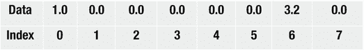
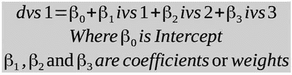
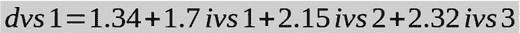
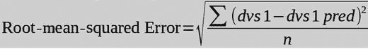
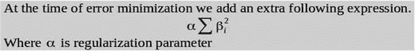
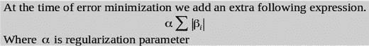

# 排版后的内容

## PySpark MLlib 简介

`PySpark MLlib` 是一个机器学习库。它是基于 `PySpark Core` 的封装，用于使用机器学习算法进行数据分析。它运行在分布式系统上，并且是可扩展的。我们可以在 `PySpark MLlib` 中找到分类、聚类、线性回归以及其他机器学习算法的实现。我们知道 `PySpark` 擅长迭代算法。许多机器学习算法已利用迭代算法在 `PySpark MLlib` 中实现。除了 `PySpark` 的高效性和可扩展性之外，`PySpark MLlib` 的 API 也非常用户友好。

软件库是为解决各种问题而定义的，它们自带数据结构。这些数据结构旨在通过高效的方式解决特定类型的问题。`PySpark MLlib` 提供了多种数据结构，包括稠密向量、稀疏向量以及局部和分布式矩阵。

线性回归是最流行的机器学习算法之一。我们会在一个或多个自变量与一个因变量之间建立线性数学模型。

在本章中，我们将首先了解 `PySpark MLlib` 中定义的各种数据结构。然后，我们将探索 MLlib 中的线性回归。我们还将使用岭回归（ridge）和套索回归（lasso）方法实现线性回归。

本章涵盖以下操作指南：

- 操作指南 9-1：创建稠密向量

- 操作指南 9-2：创建稀疏向量

- 操作指南 9-3：创建局部矩阵

- 操作指南 9-4：创建 `RowMatrix`

- 操作指南 9-5：创建标记点

- 操作指南 9-6：应用线性回归

- 操作指南 9-7：应用岭回归

- 操作指南 9-8：应用套索回归

## 操作指南 9-1：创建稠密向量

### 问题

你想创建一个稠密向量。

### 解决方案

`DenseVector` 是一个局部向量。在 `PySpark` 中，我们可以使用 `DenseVector` 构造函数来创建稠密向量。

### 实现原理

创建稠密向量需要我们从 `pyspark.mllib.linalg` 子模块中导入 `DenseVector` 类：

```python
>>> from pyspark.mllib.linalg import DenseVector
>>> denseDataList = [1.0,3.4,4.5,3.2]
```

我们创建了一个包含四个元素的列表。这个列表 `denseDataList` 包含浮点类型的数据元素。我们已经导入了 `DenseVector`，现在我们将创建一个稠密向量：

```python
>>> denseDataVector = DenseVector(denseDataList)
>>> print denseDataVector
```

以下是输出结果：

```
[1.0,3.4,4.5,3.2]
```

我们创建了一个名为 `denseDataVector` 的稠密向量。我们可以索引 `DenseVector` 的元素。`DenseVector` 的元素是零索引的。在接下来的代码行中，我们将首先获取 `DenseVector` 的第二个元素，然后获取索引为 0 的第一个元素。最后，我们将通过索引 2 获取 `denseDataVector` 的第三个元素。

```python
>>> denseDataVector[1]
```

以下是输出结果：

```
3.3999999999999999
>>> denseDataVector[0]
```

以下是输出结果：

```
1.0
>>> denseDataVector[2]
```

以下是输出结果：

```
4.5
```

> **注意：** 我们之前已经讨论过 `NumPy`。为了提高效率，建议使用 `NumPy` 数组而不是 Python 列表来创建稠密向量。你可以通过 [`spark.apache.org/docs/2.0.0-preview/mllib-data-types.html`](https://spark.apache.org/docs/2.0.0-preview/mllib-data-types.html) 了解更多关于 `DenseVector` 和 `SparseVector` 的信息。

## 操作指南 9-2：创建稀疏向量

### 问题

你想创建一个稀疏向量。

### 解决方案

有时我们得到的数据集中，数据元素的最大值为 0。我们能省略存储零吗？是的，我们可以这样做。在 `PySpark MLlib` 中，我们可以将稀疏向量保存为 `SparseVector` 对象。

你已获得一个向量。该向量的许多元素值为 0，如表 9-1 所示。索引 1、2、3、4、5 和 7 处的值为 0.0。

**表 9-1：一个稀疏数据集**



因此，八个值中有六个是 0。我们将据此创建一个 `SparseVector`。

### 实现原理

在本节中，我们将创建一个`SparseVector`。首先，我们需要从子模块`pyspark.mllib.linalg`中导入`SparseVector`类：

```python
>>> from pyspark.mllib.linalg import SparseVector
>>> sparseDataList = [1.0,3.2]
>>> sparseDataVector = SparseVector(8,[0,7],sparseDataList)
```

我们创建了一个名为`sparseDataVector`的稀疏向量。让我解释一下`SparseVector`的参数。第一个参数`8`表示我们的`SparseVector`中有八个元素。第二个参数是一个列表，包含非零元素的索引列表。我们在索引 0 处有`1.0`，在索引 7 处有`3.2`。

打印`sparseDataVector`并查看结果：

```python
>>> sparseDataVector
```

输出如下：

```
SparseVector(8, {0: 1.0, 7: 3.2})
```

可以看到，索引 0 和索引 7 处有我们的数值。我们也可以通过`[]`对`SparseVector`进行索引：

```python
>>> sparseDataVector[1]
```

输出如下：

```
0.0
>>> sparseDataVector[7]
```

输出如下：

```
3.2000000000000002
```

因此，我们发现索引 1 处的值为`0.0`，索引 7 处的值为`3.2`。非零元素的总数可以通过`numNonzeros()`函数获取。在以下代码行中，我们发现`SparseVector`中只有两个非零元素：

```python
>>> sparseDataVector.numNonzeros()
```

输出如下：`2`

我们可以对`SparseVector`执行许多操作。以下代码行展示了如何计算两个给定`SparseVector`之间的平方距离。我们使用`squared_distance()`函数计算平方距离：

```python
>>> sparseDataList1 = [3.0,1.4,2.5,1.2]
>>> sparseDataVector1 = SparseVector(8,[0,3,4,6],sparseDataList1)
>>> squaredDistance = sparseDataVector.squared_distance(sparseDataVector1)
>>> squaredDistance
```

输出如下：

```
23.890000000000001
```

我们得到了平方距离。

## 配方 9-3：创建局部矩阵

### 问题

您想创建局部矩阵。

### 解决方案

局部矩阵存储在单台机器上，并且显然对该机器来说是本地的。局部矩阵的索引是整数类型，其值是双精度类型。局部矩阵有两种形式：稠密矩阵和稀疏矩阵。稠密矩阵的元素以列主序存储在单个数组中。在稀疏矩阵中，非零值以压缩稀疏列格式存储。我们可以通过`Matrices`类中定义的`dense()`方法创建稠密矩阵。`dense()`方法是一个静态方法，因此无需创建`Matrices`类的对象。类似地，我们可以通过`Matrices`类中定义的`sparse()`方法创建稀疏局部矩阵。该方法也是静态方法。

### 工作原理

首先，我们将创建一个局部稠密矩阵。然后，创建一个局部稀疏矩阵。让我们先创建一个 Python 列表：

```python
>>> denseDataList = [1.0,3.4,4.5,3.2]
>>> ourDenseMatrix = Matrices.dense(numRows = 2, numCols = 2, values= denseDataList)
```

我们创建了一个局部稠密矩阵`ourDenseMatrix`。我们应该讨论一下`dense()`方法的参数。我们向它提供了三个参数。第一个参数定义矩阵的行数。第二个参数是列数。第三个参数是矩阵元素的列表。现在打印我们创建的矩阵，看看它的样子：

```python
>>> ourDenseMatrix
```

输出如下：

# DenseMatrix 与稀疏矩阵

`DenseMatrix(2, 2, [1.0, 3.4, 4.5, 3.2], False)`

结果中出现了一个新东西——`False`。这是什么？这告诉我们矩阵是否被转置。

您可能想知道如何可视化我们创建的稠密矩阵的结构。帮助我们的是`toArray()`函数。这会将我们的稠密矩阵转换为一个 NumPy 数组：

```
>>> ourDenseMatrix.toArray()
```

输出如下：

```
array([[ 1\. ,  4.5],
       [ 3.4,  3.2]])
```

我们可以看到，数据点按列填充到了稠密矩阵中。让我解释一下：`denseDataList`列表的前两个值首先填充到稠密矩阵的第一列，然后剩余的两个元素放置在第二列。

我们使用以下代码行创建一个稀疏矩阵：

```
>>> sparseDataList = [1.0,3.2]
```

我们的稀疏矩阵只有两个非零元素。我们想要创建一个 2×2 的矩阵。因此，很明显我们的矩阵也将有两个零元素。我们知道 PySpark 以压缩稀疏列格式保存 Spark 局部矩阵。因此，我们必须提供列指针作为参数。我们想要使用数值`1.0`和`3.2`创建一个对角矩阵：

```
>>> ourSparseMatrix = Matrices.sparse(numRows = 2,  numCols = 2, colPtrs = [0,1,2],  rowIndices = [0,1], values = sparseDataList)
>>> ourSparseMatrix.toArray()
```

输出如下：

```
array([[ 1\. ,  0\. ],
       [ 0\. ,  3.2]])
```

注意

您可以在维基百科上阅读更多关于压缩稀疏列格式的信息：`https://en.wikipedia.org/wiki/Sparse_matrix`。

## 配方 9-4：创建行矩阵

### 问题

您想创建一个行矩阵。

### 解决方案

`RowMatrix`是一个分布式矩阵。`RowMatrix`的行索引是无意义的。它是一个面向行的分布式矩阵。

### 工作原理

`RowMatrix`类位于 PySpark 子模块`pyspark.mllib.linalg.distributed`中。让我们首先导入这个类。然后，我们将创建一个`RowMatrix`。

```
>>> from pyspark.mllib.linalg.distributed import RowMatrix as rm
```

要创建`RowMatrix`，我们首先需要一个向量的 RDD。但即使您有一个列表的 RDD，那也是可以的。我们的数据在一个嵌套列表`dataList`中：

```
>>> dataList  = [[ 94.88,  82.04,  52.57],
...                         [ 35.85,  26.9 ,   3.63],
...                         [ 41.76,  69.67,  50.62],
...                         [ 90.45,  54.66,  64.07]]
```

嵌套列表`dataList`有四行三列。现在我们必须从`dataList`创建一个 RDD：

```
>>> dataListRDD = sc.parallelize(dataList,4)
>>> ourRowMatrix = rm(rows = dataListRDD, numRows = 4 , numCols = 3)
```

我们已经创建了`RowMatrix`。`RowMatrix`的第一个参数是列表的 RDD。第二个和第三个参数分别是行数和列数。

```
>>> ourRowMatrix.numRows()
```

输出如下：

```
4L
>>> ourRowMatrix.numCols()
```

输出如下：

```
3L
```

## 配方 9-5：创建标注点

### 问题

您想创建一个标注点。

### 解决方案

标注点是线性回归和分类算法的一种基本数据结构。它由一个与标签关联的稀疏或稠密向量组成。标签是双精度数据类型；因此，标注点可用于回归和分类。`LabeledPoint`类位于`pyspark.mllib.regression`子模块中。让我们创建`LabeledPoint`数据。

### 工作原理

首先定义一个嵌套列表：

```
>>> from pyspark.mllib.regression import LabeledPoint
>>> labeledPointData = [[3.09,1.97,3.73,1],
...                     [2.96,2.15,4.16,1],
...                     [2.87,1.93,4.39,1],
...                     [3.02,1.55,4.43,1],
...                     [1.8,3.65,2.08,2],
...                     [1.36,4.43,1.95,2],
...                     [1.71,4.35,1.94,2],
...                     [1.03,3.75,2.12,2],
...                     [2.3,3.59,1.99,2]]
```

嵌套列表`labeledPointData`中每个列表的最后一个数据点就是我们的标签。让我们对数据进行并行化：

```
>>> labeledPointDataRDD = sc.parallelize(labeledPointData, 4)
>>> labeledPointDataRDD.take(4)
```

输出如下：

```
[[3.09, 1.97, 3.73, 1],
[2.96, 2.15, 4.16, 1],
[2.87, 1.93, 4.39, 1],
[3.02, 1.55, 4.43, 1]]
>>> labeledPointRDD = labeledPointDataRDD.map(lambda data : LabeledPoint(data[3],data[0:3]))
>>> labeledPointRDD.take(4)
```

输出如下：

```
[LabeledPoint(1.0, [3.09,1.97,3.73]),
LabeledPoint(1.0, [2.96,2.15,4.16]),
LabeledPoint(1.0, [2.87,1.93,4.39]),
LabeledPoint(1.0, [3.02,1.55,4.43])]
```

我们已经创建了 `labeledPointRDD`。可以看到，这些标记点已被转换为双精度浮点类型数据。

`https://spark.apache.org/docs/2.0.0/mllib-data-types.html`

## 方法 9-6. 应用线性回归

### 问题

你需要应用线性回归。

### 解决方案

线性回归是一种监督式机器学习算法。在此算法中，我们会拟合一条直线（或曲线），用以生成因变量与自变量之间的线性关系。

我们已获得一个名为 `linearRegressionData.csv` 的文件。该文件包含四列数据。将文件数据可视化后，结果如下所示：

```
+-----+----+----+----+
| dvs1|ivs1|ivs2|ivs3|
+-----+----+----+----+
|34.63|5.53|5.58|5.41|
|40.89|3.89|6.48|6.97|
|37.25|5.07| 4.5| 6.5|
|45.09|5.81|5.71|8.59|
| 39.4|5.61|5.79|6.77|
+-----+----+----+----+
```

`dvs1` 列是因变量，它依赖于 `ivs1`、`ivs2` 和 `ivs3` 这三个自变量。我们需要创建一个数学模型，用以展示因变量与自变量之间的线性关系。线性回归模型的数学公式如图 9-1 所示。



**图 9-1.** 线性回归模型的数学公式

我们需要估算截距和权重的值。

### 工作原理

接下来，我们逐步创建该模型。

#### 步骤 9-6-1. 读取 CSV 文件数据

# 使用PySpark进行线性回归分析

我们的回归数据位于 `linearRegressionData.csv` 文件中。为了对其执行线性回归分析，我们需要读取该数据并将其转换为标记点。我认为更好的策略是将数据转换为标记点的RDD，这可以通过首先使用 `spark.read.csv()` 函数读取文件来实现。我们知道 `spark.read.csv()` 函数会返回一个 `DataFrame`。我们需要以某种方式将该 `DataFrame` 转换为标记点的RDD。因此，首先让我们读取文件。

```
>>> regressionDataFrame = spark.read.csv('file:///home/pysparkbook/bData/linearRegressionData.csv',header=True, inferSchema = True)
>>> regressionDataFrame.show(5)
```

以下输出仅显示前五行：

```
+-----+----+----+----+
| dvs1|ivs1|ivs2|ivs3|
+-----+----+----+----+
|34.63|5.53|5.58|5.41|
|40.89|3.89|6.48|6.97|
|37.25|5.07| 4.5| 6.5|
|45.09|5.81|5.71|8.59|
| 39.4|5.61|5.79|6.77|
+-----+----+----+----+
```

读取文件后，我们得到了 `DataFrame`。下面这行代码将我们的 `DataFrame` 转换为RDD：

```
>>> regressionDataRDDDict = regressionDataFrame.rdd
>>> regressionDataRDDDict.take(5)
```

以下是输出结果：

```
[Row(dvs1=34.63, ivs1=5.53, ivs2=5.58, ivs3=5.41),
Row(dvs1=40.89, ivs1=3.89, ivs2=6.48, ivs3=6.97),
Row(dvs1=37.25, ivs1=5.07, ivs2=4.5, ivs3=6.5),
Row(dvs1=45.09, ivs1=5.81, ivs2=5.71, ivs3=8.59),
Row(dvs1=39.4, ivs1=5.61, ivs2=5.79, ivs3=6.77)]
```

我们看到了 `regressionDataRDDDict` 转换为RDD后的输出。这是一个由 `Row` 对象构成的RDD。你可能在想，自己了解 `Row` 对象。我们在创建 `DataFrame` 时会用到它们。但这并非我们的需求。你可以看到 `Row` 对象中的数据是以键/值格式存在的。因此，我们需要进一步转换，以便在RDD中只获取值：

```
>>> regressionDataRDD = regressionDataFrame.rdd.map(list)
>>> regressionDataRDD.take(5)
```

以下是输出结果：

```
[[34.63, 5.53, 5.58, 5.41],
[40.89, 3.89, 6.48, 6.97],
[37.25, 5.07, 4.5, 6.5],
[45.09, 5.81, 5.71, 8.59],
[39.4, 5.61, 5.79, 6.77]]
```

将 `list` 作为参数传递给RDD的 `map()` 函数后，我们的数据已被转换为一种便于创建标记点RDD的格式。在下一步中，我们将创建一个 `LabeledPoint` RDD。

## 步骤 9-6-2. 创建标记点的RDD

为了运行线性回归，我们已将数据转换为标记点。如前所述，RDD的第一列是因变量，它依赖于其余变量。因此，每个RDD元素的第一个值就是我们的标签，其余值则是特征。现在我们可以创建 `LabeledPoint` RDD。我们知道，要使用 `LabeledPoint`，必须先导入该类：

```
>>> from pyspark.mllib.regression import LabeledPoint
>>> regressionDataLabelPoint = regressionDataRDD.map(lambda data : LabeledPoint(data[0],data[1:4]))
```

`map()` 函数可用于将我们的RDD转换为 `LabeledPoint` RDD。`LabeledPoint` 的第一个参数是标签，在上述代码中我们将其设置为 `data[0]`。接下来，我们将通过 `regressionDataLabelPoint` 从 `LabeledPoint` RDD中取出五个元素。当然，我们将使用 `take()` 函数，并将参数 `5` 传入其中：

```
>>> regressionDataLabelPoint.take(5)
```

以下是输出结果：

```
[LabeledPoint(34.63, [5.53,5.58,5.41]),
LabeledPoint(40.89, [3.89,6.48,6.97]),
LabeledPoint(37.25, [5.07,4.5,6.5]),
LabeledPoint(45.09, [5.81,5.71,8.59]),
LabeledPoint(39.4, [5.61,5.79,6.77])]
```

我们已经创建了所需的 `LabeledPoint` RDD。如前所述，线性回归是一种监督式机器学习算法。因此，我们首先将给定的数据集划分为训练数据集和测试数据集。训练数据集将用于创建模型，然后我们应用测试数据来检查所创建的线性回归模型的准确性。在下一步中，我们将把数据集划分为训练数据集和测试数据集。

## 步骤 9-6-3. 划分训练数据和测试数据

PySpark提供了 `randomSplit()` 函数，我们可以用它来将数据集划分为训练数据集和测试数据集：

```
>>> regressionLabelPointSplit = regressionDataLabelPoint.randomSplit([0.7,0.3])
```

我们提供了列表 `[0.7 , 0.3]` 作为参数。这个列表表示我们需要70%的数据点作为训练数据集，其余30%作为测试数据集。在我们的数据集中，总共有30条记录。因此，训练数据集将包含22条记录，测试数据集将包含8条记录。

```
>>> regressionLabelPointTrainData = regressionLabelPointSplit[0]
>>> regressionLabelPointTrainData.take(5)
```

以下是输出结果：

```
[LabeledPoint(34.63, [5.53,5.58,5.41]),
LabeledPoint(45.09, [5.81,5.71,8.59]),
LabeledPoint(39.4, [5.61,5.79,6.77]),
LabeledPoint(33.25, [5.33,5.78,4.94]),
LabeledPoint(44.17, [6.11,6.18,8.2])]
```

训练数据集已准备就绪：

```
>>> regressionLabelPointTrainData.count()
```

以下是输出结果：

```
22
```

如我们所述，训练数据集中有22个数据点：

```
>>> regressionLabelPointTestData = regressionLabelPointSplit[1]
>>> regressionLabelPointTestData.take(5)
```

以下是输出结果：

```
[LabeledPoint(40.89, [3.89,6.48,6.97]),
LabeledPoint(37.25, [5.07,4.5,6.5]),
LabeledPoint(42.92, [5.39,6.59,7.56]),
LabeledPoint(38.23, [4.19,6.47,6.52]),
LabeledPoint(36.33, [5.65,5.78,5.47])]
>>> regressionLabelPointTestData.count()
```

以下是输出结果：

```
8
```

测试数据集已创建为 `regressionLabelPointTestData`。对测试数据调用 `count()` 函数可确保测试数据集中有8个数据点。

现在我们已经拥有了训练数据集和测试数据集，接下来就可以将回归模型拟合到我们的训练数据集上了。在下一步中，我们将创建线性回归模型。

## 步骤 9-6-4. 创建线性回归模型

PySpark使用随机梯度下降（SGD）算法来计算线性回归模型的系数。这是一种优化算法。PySpark中的 `LinearRegressionWithSGD` 类用于执行与线性回归相关的操作。

现在，让我们导入 `LinearRegressionWithSGD`；我们将其导入并重命名为 `lrSGD`：

```markdown
## 步骤 9-6-4. 创建并训练模型

```python
>>> from pyspark.mllib.regression import LinearRegressionWithSGD as lrSGD
>>> ourModelWithLinearRegression  = lrSGD.train(
data = regressionLabelPointTrainData,
...                                             iterations = 200,
...                                             step = 0.02,
...                                             intercept = True)
```

在 `LinearRegressionWithSGD` 类中定义了一个静态方法 `train()`，该方法用于创建线性回归模型。`train()` 方法的第一个参数是训练数据。SGD 是一种迭代算法，因此我们将迭代次数作为第二个参数传入 `train()` 方法。第三个参数 `step` 定义了 SGD 算法中的移动步长。如果线性模型包含截距，则需将 `intercept` 参数设为 `True`。最后，这会创建名为 `ourModelWithLinearRegression` 的线性回归模型。

```
>>> ourModelWithLinearRegression.intercept
```

输出如下：

```
1.3475409224629387
>>> ourModelWithLinearRegression.weights
```

输出如下：

```
DenseVector([1.7083, 2.1529, 2.3226])
```

我们可以通过截距和权重来创建回归模型。创建的模型如图 9-2 所示。



**图 9-2.** 回归模型

**注意**

你可以在维基百科上阅读更多关于随机梯度下降的内容：[`en.wikipedia.org/wiki/Stochastic_gradient_descent`](https://en.wikipedia.org/wiki/Stochastic_gradient_descent).

## 步骤 9-6-5. 保存创建的模型

有时我们需要保存创建的模型以备将来使用。我们可以通过 `save()` 方法保存模型：

```
>>> ourModelWithLinearRegression.save(sc, '/home/pysparkbook/ourModelWithLinearRegression')
```

`save()` 方法的第一个参数是 `SparkContext`，第二个参数是保存模型的目录路径。模型已保存，但如何读取它呢？读取保存的模型需要 `load()` 方法，该方法位于 `LinearRegressionModel` 类中。

```
>>> from pyspark.mllib.regression import LinearRegressionModel as linearRegressModel
>>> ourModelWithLinearRegressionReloaded = linearRegressModel.load(sc, '/home/pysparkbook/ourModelWithLinearRegression')
```

保存的模型已重新加载，现在我们可以使用它了。既然已重新加载模型，让我们检查一下能否从重新加载的模型中获取截距和权重值：

```
>>> ourModelWithLinearRegressionReloaded.intercept
```

输出如下：

```
1.34754092246
>>> ourModelWithLinearRegressionReloaded.weights
```

输出如下：

```
DenseVector([1.7083, 2.1529, 2.3226])
```

很明显，我们已经成功重新加载了模型。

## 步骤 9-6-6. 使用模型预测数据

创建数学模型后，我们可以检验模型的可信度。为了检验模型的可信度，我们将测试数据的实际值和预测值组成一个 RDD：

```
>>> actualDataandLinearRegressionPredictedData = regressionLabelPointTestData.map(lambda data : (float(data.label) , float(ourModelWithLinearRegression.predict(data.features))))
```

`predict()` 方法会接受特征数据（即自变量），并返回因变量的预测值。现在我们将得到一个包含实际值和预测值的 RDD。

```
>>> actualDataandLinearRegressionPredictedData.take(5)
```

输出如下：

```
[(40.89, 38.1322613341641),
(37.25, 34.79375295252528),
(42.92, 42.30191258048799),
(38.23, 37.57804867136557),
(36.33, 36.14796052442989)]
```

## 步骤 9-6-7. 评估创建的模型

获得实际值和预测值的 RDD 后，我们将计算评估指标。首先计算均方根误差（RMSE）。均方根误差的数学公式如图 9-3 所示。



**图 9-3.** 均方根误差的数学公式

其中 `dvs1` 是因变量的实际值，`dvs1pred` 是因变量的预测值，共有 n 个数据点。

我们需要导入 `RegressionMetrics` 类来评估模型：

```
>>> from pyspark.mllib.evaluation import RegressionMetrics as rmtrcs
>>> ourLinearRegressionModelMetrics = rmtrcs(actualDataandLinearRegressionPredictedData)
>>> ourLinearRegressionModelMetrics.rootMeanSquaredError
```

输出如下：

```
1.8446573587605941
```

我们的均方根误差值为 `1.844657`。类似地，我们计算 R² 的值：

```
>>> ourLinearRegressionModelMetrics.r2
```

输出如下：

```
0.47423120771913974
```

R² 的值较小，甚至低于 0.5。那么这是一个好的模型吗？我认为不是。另一个问题是，我们能否提高模型的效率？答案是肯定的；我只是通过调整学习步长和迭代次数就实现了这一点：

```
>>> ourModelWithLinearRegression  = lrSGD.train(data = regressionLabelPointTrainData,
...                                             iterations = 100,
...                                             step = 0.05,
...                                             intercept = True)
>>> actualDataandLinearRegressionPredictedData = regressionLabelPointTestData.map(lambda data : (float(data.label) , float(ourModelWithLinearRegression.predict(data.features))))
>>> from pyspark.mllib.evaluation import RegressionMetrics as rmtrcs
>>> ourLinearRegressionModelMetrics = rmtrcs(actualDataandLinearRegressionPredictedData)
>>> ourLinearRegressionModelMetrics.rootMeanSquaredError
```

输出如下：

```
1.7856232547826518
>>> ourLinearRegressionModelMetrics.r2
```

输出如下：

```
0.6377723547885376
```

最终，我们成功提高了 R² 的值。

**注意**
```

你可以通过以下链接了解更多关于 R² 的内容：[`en.wikipedia.org/wiki/Coefficient_of_determination`](https://en.wikipedia.org/wiki/Coefficient_of_determination)。

## 配方 9-7. 应用岭回归

### 问题

你想要应用岭回归。

### 解决方案

你已获得 CSV 文件 `autoMPGDataModified.csv` 中的数据集。该数据集包含五列。我们需要使用岭正则化对该数据拟合一个线性回归模型。第一列是每加仑英里数（`mpg`），这是本例中的因变量。

```
+----+------------+----------+------+------------+
| mpg|displacement|horsepower|weight|acceleration|
+----+------------+----------+------+------------+
|18.0|       307.0|        18|  3504|        12.0|
|15.0|       350.0|        36|  3693|        11.5|
|18.0|       318.0|        30|  3436|        11.0|
|16.0|       304.0|        30|  3433|        12.0|
|17.0|       302.0|        25|  3449|        10.5|
+----+------------+----------+------+------------+
```

我从 UCI 机器学习库 ([`archive.ics.uci.edu/ml/datasets/auto+mpg`](https://archive.ics.uci.edu/ml/datasets/auto+mpg)) 中获取了该数据集，并移除了一些列。根据网页说明，该数据集取自卡内基梅隆大学维护的 StatLib 库，并在 1983 年美国统计协会博览会上使用过。

你可能想知道线性回归与带岭参数的线性回归有何区别。我们知道使用 `SGD` 进行误差部分的优化。因此，在误差部分中，会添加一个额外的项，如图 9-4 所示。



**图 9-4.** 岭回归中的额外误差项

让我们在给定的数据集上执行岭回归。

**注意**

你可以在以下网站阅读更多关于 `auto-mpg` 数据的内容：

[`archive.ics.uci.edu/ml/datasets/auto+mpg`](https://archive.ics.uci.edu/ml/datasets/auto+mpg)

[`https://archive.ics.uci.edu/ml/machine-learning-databases/auto-mpg/`](https://archive.ics.uci.edu/ml/machine-learning-databases/auto-mpg/)

你可以在以下网站了解更多关于岭回归的内容：

[`www.quora.com/Why-is-it-that-the-lasso-unlike-ridge-regression-results-in-coefficient-estimates-that-are-exactly-equal-to-zero`](https://www.quora.com/Why-is-it-that-the-lasso-unlike-ridge-regression-results-in-coefficient-estimates-that-are-exactly-equal-to-zero)

[`https://en.wikipedia.org/wiki/Tikhonov_regularization`](https://en.wikipedia.org/wiki/Tikhonov_regularization)

[`https://en.wikipedia.org/wiki/Regularization_(mathematics)`](https://en.wikipedia.org/wiki/Regularization_(mathematics))

### 工作原理

#### 步骤 9-7-1. 读取 CSV 文件数据

我们需要读取数据并将其转换为 `RDD`，这与我们在之前的方法中所做的一样：

```python
>>> autoDataFrame = spark.read.csv('file:///home/pysparkbook/bData/autoMPGDataModified.csv',header=True, inferSchema = True)

>>> autoDataFrame.show(5)
```

以下是输出，仅显示前五行：

```
+----+------------+----------+------+------------+
| mpg|displacement|horsepower|weight|acceleration|
+----+------------+----------+------+------------+
|18.0|       307.0|        18|  3504|        12.0|
|15.0|       350.0|        36|  3693|        11.5|
|18.0|       318.0|        30|  3436|        11.0|
|16.0|       304.0|        30|  3433|        12.0|
|17.0|       302.0|        25|  3449|        10.5|
+----+------------+----------+------+------------+
```

```python
>>> autoDataFrame.printSchema()
```

以下是输出：

```
root
|-- mpg: double (nullable = true)
|-- displacement: double (nullable = true)
|-- horsepower: integer (nullable = true)
|-- weight: integer (nullable = true)
|-- acceleration: double (nullable = true)
```

```python
>>> autoDataRDDDict = autoDataFrame.rdd

>>> autoDataRDDDict.take(5)
```

以下是输出：

```
[Row(mpg=18.0, displacement=307.0, horsepower=18, weight=3504, acceleration=12.0),
Row(mpg=15.0, displacement=350.0, horsepower=36, weight=3693, acceleration=11.5),
Row(mpg=18.0, displacement=318.0, horsepower=30, weight=3436, acceleration=11.0),
Row(mpg=16.0, displacement=304.0, horsepower=30, weight=3433, acceleration=12.0),
Row(mpg=17.0, displacement=302.0, horsepower=25, weight=3449, acceleration=10.5)]
```

我们将 `DataFrame` 转换为 `RDD`，以便进一步将其转换为 `LabeledPoint` 类型的 `RDD`：

```python
>>> autoDataRDD = autoDataFrame.rdd.map(list)

>>> autoDataRDD.take(5)
```

以下是输出：

```
[[18.0, 307.0, 18, 3504, 12.0],
[15.0, 350.0, 36, 3693, 11.5],
[18.0, 318.0, 30, 3436, 11.0],
[16.0, 304.0, 30, 3433, 12.0],
[17.0, 302.0, 25, 3449, 10.5]]
```

#### 步骤 9-7-2. 创建包含标签点的 RDD

获取 `RDD` 后，我们需要将其转换为 `LabeledPoint` 类型的 `RDD`：

```python
>>> from pyspark.mllib.regression import LabeledPoint
```

### 步骤 9-7-2. 创建用于线性回归的 RDD

```python
>>> autoDataLabelPoint = autoDataRDD.map(lambda data : LabeledPoint(data[0],[data[1]/10,data[2],float(data[3])/100,data[4]]))
```

在数据集中，我们可以看到最好对数据进行归一化处理。因此，我们将排量除以 10，将重量除以 100：

```python
>>> autoDataLabelPoint.take(5)
```

以下是输出：

```
[LabeledPoint(18.0, [30.7,18.0,35.04,12.0]),
LabeledPoint(15.0, [35.0,36.0,36.93,11.5]),
LabeledPoint(18.0, [31.8,30.0,34.36,11.0]),
LabeledPoint(16.0, [30.4,30.0,34.33,12.0]),
LabeledPoint(17.0, [30.2,25.0,34.49,10.5])]
```

### 步骤 9-7-3: 划分训练集和测试集

现在，我们将数据集划分为训练集和测试集：

```python
>>> autoDataLabelPointSplit = autoDataLabelPoint.randomSplit([0.7,0.3])
>>> autoDataLabelPointTrain = autoDataLabelPointSplit[0]
>>> autoDataLabelPointTest = autoDataLabelPointSplit[1]
>>> autoDataLabelPointTrain.take(5)
```

以下是输出：

```
[LabeledPoint(18.0, [30.7,18.0,35.04,12.0]),
LabeledPoint(15.0, [35.0,36.0,36.93,11.5]),
LabeledPoint(18.0, [31.8,30.0,34.36,11.0]),
LabeledPoint(16.0, [30.4,30.0,34.33,12.0]),
LabeledPoint(17.0, [30.2,25.0,34.49,10.5])]
>>> autoDataLabelPointTest.take(5)
```

以下是输出：

```
[LabeledPoint(14.0, [45.5,48.0,44.25,10.0]),
LabeledPoint(15.0, [39.0,41.0,38.5,8.5]),
LabeledPoint(15.0, [40.0,30.0,37.61,9.5]),
LabeledPoint(24.0, [11.3,92.0,23.72,15.0]),
LabeledPoint(26.0, [9.7,51.0,18.35,20.5])]
>>> autoDataLabelPointTest.count()
```

以下是输出：

```
>>> autoDataLabelPointTrain.count()
```

以下是输出：

```
```

### 步骤 9-7-4: 创建线性回归模型

我们可以使用 `RidgeRegressionWithSGD` 类的 `train()` 方法来创建模型。因此，首先需要导入 `RidgeRegressionWithSGD` 类，然后运行 `train()` 方法：

```python
>>> from pyspark.mllib.regression import RidgeRegressionWithSGD as ridgeSGD
>>> ourModelWithRidge = ridgeSGD.train(
data = autoDataLabelPointTrain,
iterations = 400,
step = 0.0005,
regParam = 0.05,
intercept = True
)
```

在我们的 `train()` 方法中，比之前的方法多了一个参数 `regParam`。`regParam` 参数是正则化参数 alpha，如前面图 9-4 所示。

```python
>>> ourModelWithRidge.intercept
```

以下是输出：

```
1.0192595005891258
>>> ourModelWithRidge.weights
```

以下是输出：

```
DenseVector([-0.0575, 0.2025, 0.1961, 0.3503])
```

我们已经创建了模型，并得到了截距和系数。

### 步骤 9-7-5: 保存已创建的模型

我们可以像在之前的方法中那样保存模型并重新加载。以下代码首先保存模型，然后重新加载。重新加载模型后，我们将检查其是否正常工作。

```python
>>> ourModelWithRidge.save(sc, '/home/pysparkbook/ourModelWithRidge')
>>> from pyspark.mllib.regression import RidgeRegressionModel as ridgeRegModel
>>> ourModelWithRidgeReloaded = ridgeRegModel.load(sc, '/home/pysparkbook/ourModelWithRidge')
>>> ourModelWithRidgeReloaded.intercept
```

以下是输出：

```
1.01925950059
>>> ourModelWithRidgeReloaded.weights
```

以下是输出：

```
DenseVector([-0.0575, 0.2025, 0.1961, 0.3503])
```

保存的模型运行正常。

### 步骤 9-7-6: 使用模型预测数据

在此步骤中，我们将创建一个包含实际值和预测值的 `RDD`。预测值将使用 `predict()` 函数计算得出。

```python
>>> actualDataandRidgePredictedData = autoDataLabelPointTest.map(lambda data : [float(data.label) , float(ourModelWithRidge.predict(data.features))])
>>> actualDataandRidgePredictedData.take(5)
```

以下是输出：

```
[[18.0, 15.857286660271024],
[16.0, 16.28216643081738],
[17.0, 14.787196092732607],
[15.0, 17.60672713589945],
[14.0, 17.67800889949583]]
```

### 步骤 9-7-7: 评估已创建的模型

我们需要再次计算均方根误差：

```python
>>> ourRidgeModelMetrics = rmtrcs(actualDataandRidgePredictedData)
>>> ourRidgeModelMetrics.rootMeanSquaredError
```

以下是输出：

```
8.149263319131556
```

这就是误差值。误差值越高，模型精度越低。我们已经计算了均方根误差，并检验了模型的可靠性。

## 方法 9-8: 应用套索回归

### 问题

您想要应用套索回归。

### 解决方案

带有套索正则化的线性回归用于拟合不佳的模型。在套索回归中，在误差最小化时，我们会添加图 9-5 中所示的项。



`图 9-5.` 套索回归中的额外误差项

### 工作原理

#### 步骤 9-8-1: 使用套索回归创建线性回归模型

我们已经创建了包含汽车数据的 `LabeledPoint`。现在可以应用 `LassoWithSGD` 类中定义的 `train()` 方法：

```python
>>> from pyspark.mllib.regression import LassoWithSGD as lassoSGD
>>> ourModelWithLasso = lassoSGD.train(data = autoDataLabelPointTrain, iterations = 400, step = 0.0005,regParam = 0.05, intercept = True)
```

我们已经创建了模型。

```python
>>> ourModelWithLasso.intercept
```

输出如下：

```
1.020329086499831
>>> ourModelWithLasso.weights
```

输出如下：

```
```

DenseVector([-0.063, 0.2046, 0.198, 0.3719])

我们得到了模型的截距和权重。

## 步骤 9-8-2: 使用 Lasso 模型预测数据

为了获取实际数据和预测数据的`RDD`，我们将使用与之前配方相同的策略：

```python
>>> actualDataandLassoPredictedData = autoDataLabelPointTest.map(lambda data : (float(data.label) , float(ourModelWithLasso.predict(data.features))))

>>> actualDataandLassoPredictedData.take(5)
```

输出如下：

```
[(15.0, 17.768596038896607),
 (16.0, 16.5021818747879),
 (17.0, 14.965800201626084),
 (15.0, 17.734571412337576),
 (15.0, 17.154509770352835)]
```

## 步骤 9-8-3: 评估创建的模型

现在我们必须测试模型——虽然无需多言，我们将使用与之前相同的策略：

```python
>>> from pyspark.mllib.evaluation import RegressionMetrics as rmtrcs

>>> ourLassoModelMetrics = rmtrcs(actualDataandLassoPredictedData)

>>> ourLassoModelMetrics.rootMeanSquaredError
```

输出如下：

```
7.030519540791776
```

# 索引

## A

- 匿名函数（Anonymous function）
- Apache Hadoop
- Apache HBase
- Apache Hive
- Apache Kafka
- Apache License
- Apache Mahout
- Apache Mesos
- Apache Pig
- Apache Spark
- Apache Storm
- Apache Tez
- 原子性、一致性、隔离性、持久性（ACID）
- `avg()`函数

## B

- `bfs()`函数
- 大数据（Big data）
  - 特性
  - 多样性
  - 速度
  - 真实性
  - 体量
- 广度优先搜索算法（Breadth-first search algorithm）

## C

- CentOS 操作系统
- 集群管理器（Cluster managers）
- `count()`函数
- 记录计数（Count of records）
- `createCSV()`函数
- `createDataFrame()`函数
- `createJSON()`函数
- `createOrReplaceTempView()`函数
- `createStream()`函数
- CSV 文件
  - 读取
  - 配对的`RDD`
  - `parseCSV()`函数
  - 将`RDD`写入

## D

- 数据聚合（Data aggregation）
  - 灯丝数据
  - 均值
  - 配对的`RDD`
  - `RDD`
- `DataFrame`
  - 更改列的数据类型
  - 复合逻辑表达式
  - 创建
  - 数据聚合
  - 数据连接
    - 全外连接
    - 内连接
    - 左外连接
    - 从 PostgreSQL 数据库读取学生数据表
    - 从 JSON 文件读取科目数据
    - 右外连接
  - 探索性数据分析
  - 创建灯丝数据嵌套列表
  - `filter()`和`count()`函数
  - 创建行对象的`RDD`
  - 创建模式
  - 模式定义
  - 打印模式
  - 执行 SQL 和 HiveQL 查询
  - 汇总统计
- `DataFrame`抽象
- 数据连接（Data joining）
  - 全外连接
  - 内连接
  - 左外连接
  - 从 PostgreSQL 数据库读取学生数据表
  - 从 JSON 文件读取科目数据
  - 右外连接
- `DataNodes`
- `Dataset`接口
- 数据结构，标记点（Data structure, labeled point）
- 创建稠密向量（Dense vector creation）
- `describe()`函数
- 分布式系统（Distributed systems）

## E

- 电子商务公司（E-commerce companies）
- 提取、转换、加载（ETL）

## F

- `filter()`函数
- 全外连接（Full outer join）

## G

- 谷歌文件系统（GFS）
- `GraphFrames`库
- 创建`GraphFrames`对象
- `groupBy()`函数

## H

- Hadoop 分布式文件系统（HDFS）
  - 从中读取数据
  - 将`RDD`数据保存到
- Hadoop 安装
  - `.bashrc`文件
  - CentOS 用户
  - 下载
  - 环境文件
  - 安装目录
  - Java
  - `jps`命令
  - 格式化`NameNode`
  - 免密码登录
  - 问题
  - 属性文件
  - 解决方案
  - 启动脚本
- HBase
- Hive 安装
- Hive 属性
- 执行 HiveQL 和 SQL 查询
- HiveQL 命令
- Hive 查询语言（HQL）

## I

- 内连接（Inner join）
- I/O 操作
  - 参见 PySpark，输入/输出（I/O）操作
- IPython
  - 集成
  - Notebook
  - `pip`
  - PySpark

## J

- Java 数据库连接（JDBC）
- JavaScript 对象表示法（JSON）
  - 读取文件
  - 从 JSON 文件读取科目数据
  - 将`RDD`写入文件
- `jsonParse()`函数

## K

- K 近邻（KNN）算法，PySpark

## L

- 标记点（Labeled point）
- Lasso 回归（Lasso regression）
- 左外连接（Left outer join）
- `len()`函数
- 线性回归（Linear regression）
- 创建本地矩阵（Local matrix creation）

## M

- 机器学习（Machine learning）
- `map()`函数
- Map-Reduce 模型
- 矩阵（Matrices）
  - 创建本地矩阵
  - 创建行矩阵
- MLlib
- 可变集合（Mutable collection）

## N, O

- `NameNode`
- `nc`命令
- Netcat
- `newAPIHadoopRDD()`函数
- NoSQL 数据库
- NumPy
  - `array()`
  - `dtype`
  - 均值
  - 平均温度
  - 中位数
  - `min()`和`max()`
  - `ndarray`
  - `pip`
  - `shape`
  - 标准差
  - 温度读数
  - 方差
  - `vstack()`

## P, Q

- PageRank 算法
  - 阻尼因子
  - 函数
  - 循环
  - 嵌套列表
  - 优化
  - 配对的`RDD`
  - 网页系统
- 配对的`RDD`
  - 聚合数据
    - 参见数据聚合
    - 创建
    - 辅音
    - 元素
    - `keys()`
    - `map()`
    - `values`
  - 连接数据
    - 创建
    - 全外
    - 内
    - 左外
    - 嵌套列表
    - 右外
  - 键/值对架构
  - PageRank
    - 参见 PageRank 算法
  - `playDataLineLength` RDD
- PostgreSQL 数据库
- `predict()`函数
- `printSchema()`函数
- 过程语言/PostgreSQL（PL/pgSQL）
- PySpark
  - K 近邻（KNN）算法
  - PageRank 算法优化
  - 脚本执行
    - 本地模式
    - Standalone 和 Mesos 集群管理器
- PySpark，输入/输出（I/O）操作
  - 读取 CSV 文件
    - 配对的`RDD`
    - `parseCSV()`函数
  - 读取数据
    - HDFS
    - 顺序文件
  - 读取目录
    - `textFile()`函数
    - `wholeTextFiles()`函数
  - 读取 JSON 文件
  - 从 HBase 读取表数据
  - 读取文本文件
    - `count()`函数
    - `len()`函数
    - `textFile()`函数
    - `wholeTextFiles()`函数
  - 将`RDD`数据保存到 HDFS
  - 将数据写入顺序文件
  - 写入`RDD`
    - CSV 文件
    - JSON 文件
    - 文本文件
- PySpark MLlib
  - 创建稠密向量
  - 创建标记点
  - 创建本地矩阵
  - 创建行矩阵
  - 创建稀疏向量
- PySparkSQL
  - 广度优先搜索算法
  - `DataFrame`
    - 更改列的数据类型
    - 复合逻辑表达式
    - 创建
    - 数据聚合
    - 数据连接
    - 探索性数据分析
    - 创建灯丝数据嵌套列表
    - `filter()`和`count()`函数
    - 创建模式
    - 模式定义
    - 打印模式
    - 执行 SQL 和 HiveQL 查询
    - 汇总统计
    - 创建行对象的`RDD`
  - 创建`GraphFrames`对象
  - PageRank 算法
  - 从 Apache Hive 读取表数据
- PySpark shell
  - 问题
  - Python 程序员
  - 解决方案
- PySpark 流处理
  - 与 Apache Kafka 集成
  - 从控制台读取数据
- Python
  - 条件语句
  - 数据及数据类型
  - 字典
  - `for`和`while`循环
  - 函数
  - Lambda 函数
  - 列表
  - NumPy
    - 参见 NumPy
  - 集合
  - 字符串
  - 元组
  - 类型转换

## R

- `randomSplit()`函数
- `registerTempTable()`函数
- 回归（Regression）
  - Lasso
  - 线性
  - Ridge
- 关系数据库管理系统（RDBMS）
- 弹性分布式数据集（RDD）
  - 行动操作
  - 创建
  - `first()`
  - `getNumPartitions()`
  - 列表
  - `parallelized()`
  - `take()`
  - 数据操作
    - `collect()`
    - `filter()`
    - 列表
    - `map()`
    - `sortBy()`
    - `take()`
  - Mesos 集群管理器
  - 运行集合操作
  - `SparkContext`
  - Standalone 集群管理器
  - 汇总统计
  - 温度数据
  - 转换操作
- Ridge 回归（Ridge regression）
- 右外连接（Right outer join）
- `round()`函数
- 创建行矩阵（Row matrix creation）

## S

- `save()`方法
- `saveAsTextFile()`函数
- `select`命令
- `sequenceFile()`函数
- `sequenceFile()`方法
- 顺序文件（Sequential file）
  - 从中读取数据
  - 将数据写入
- `show()`函数
- 洗牌（Shuffling）
- `socketTextStream()`函数
- 软件库（Software libraries）
- Spark
- Spark 架构
  - 驱动程序（Driver）
  - 执行器（Executors）
- Spark 安装
  - `allPySpark`位置
  - `.bashrc`文件
  - 下载
  - 环境文件
  - 问题
  - PySpark
  - 解决方案
  - `.tgz`文件
- `spark.read.csv()`函数
- `spark.sql()`函数
- 创建稀疏向量（Sparse vector creation）
- `split()`函数
- 执行 SQL 和 HiveQL 查询
- 随机梯度下降（SGD）
- `stringToNumberSum()`函数
- `strip()`函数
- `StructField()`
- `StructType()`函数
- 结构化查询语言（SQL）
- `summary()`函数
- 监督式机器学习算法（Supervised machine-learning algorithm）

## T

- 表连接（Table joining）
- `take()`函数
- `textFile()`函数
- `train()`方法
- `type()`函数

## U

- Unix
- 用户自定义函数（UDFs）

## V

- 向量（Vectors）
  - 稠密向量
  - 稀疏向量

## W, X, Y, Z

- `wholeTextFiles()`函数