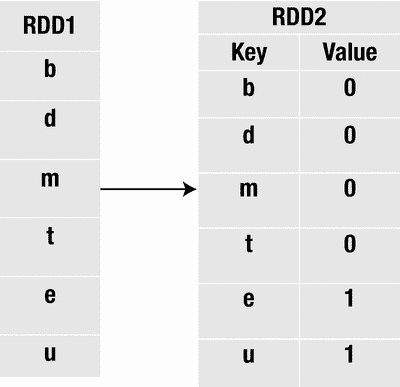
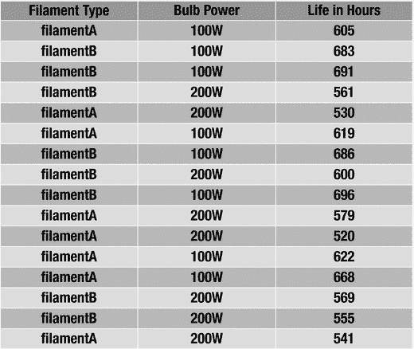
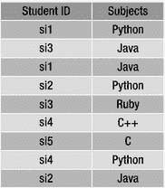
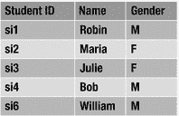
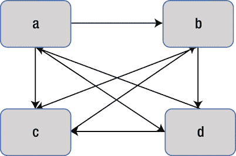

# 5. 键值对的威力：配对 RDD

键/值对对于以并行方式高效解决许多问题非常有用。Apache Mahout（一个最初基于 Apache Hadoop 开发的机器学习库）通过使用 MapReduce 键/值对架构，实现了分类、聚类和协同过滤等领域的许多机器学习算法。在本章中，你将通过实践菜谱来培养解决多学科中大数据问题的技能。

本章涵盖以下菜谱：

*   Recipe 5-1. 创建配对 RDD
*   Recipe 5-2. 执行数据聚合
*   Recipe 5-3. 连接数据
*   Recipe 5-4. 计算 PageRank

## Recipe 5-1. 创建配对 RDD

### 问题

你想创建一个配对 RDD。

### 解决方案

你有一个 RDD，`RDD1`。`RDD1`的元素有`b`、`d`、`m`、`t`、`e`和`u`。你想创建一个配对 RDD，其中键是单个 RDD 的元素，如果元素是辅音，则值为 0；如果是元音，则值为 1。图 5-1 清晰地描述了这些要求。



**图 5-1.** 创建配对 RDD

创建配对 RDD 的方法有很多种。一种方法是直接从文件读取数据。我们将在后续章节中探讨这种方法。另一种创建配对 RDD 的方法是使用`map()`方法，你将在本菜谱中学习到。

### 工作原理

在本节中，你将按照几个步骤来达到解决方案。

#### 步骤 5-1-1. 创建包含单个元素的 RDD

让我们从给定数据创建一个 RDD 开始：

```
>>> pythonList  =  ['b', 'd', 'm', 't', 'e', 'u']
>>> RDD1 = sc.parallelize(pythonList,2)
>>>RDD1.collect()
```

输出如下：

```
['b', 'd', 'm', 't', 'e', 'u']
```

我们创建了一个名为`RDD1`的 RDD。`RDD1`的元素有`b`、`d`、`m`、`t`、`e`和`u`。这是一个字母的 RDD。可以看出，元素`b`、`d`、`m`和`t`是辅音。`RDD1`的其他元素，`e`和`u`，是元音。

#### 步骤 5-1-2. 编写一个 Python 方法来检查辅音

我们将定义一个名为`vowelCheckFunction()`的 Python 函数。此函数将接收一个字母作为输入，如果输入是辅音则返回 1，否则返回 0。让我们实现这个函数：

```
>>> def vowelCheckFunction( data) :
...     if data in ['a','e','i','o','u']:
...        return 1
...     else :
...        return 0
```

可以看出，我们的 Python 函数`vowelCheckFunction`将接收一个输入数据。在本例中，我们将发送一个字母。在函数内部，我们检查数据是否是元音。如果我们的`if`块逻辑表达式结果为`True`，函数将返回 1；否则返回 0。

没有经过测试，我们不应该信任`vowelCheckFunction`。所以，让我们从元音输入开始：

```
>>> vowelCheckFunction('a')
```

输出如下：

```
1
```

对于元音输入，我们得到输出 1。我们的 Python 函数`vowelCheckFunction`符合我们对元音的预期。这很好，但我们也测试一下辅音。这次我们发送`b`，一个辅音，作为输入：

```
>>> vowelCheckFunction('b')
```

输出如下：

```
0
```

我们已经测试了我们的函数。对于辅音和元音，它都能按预期工作。我们可以信赖我们开发的这个函数。

#### 步骤 5-1-3. 创建配对 RDD

我们可以通过使用 `map()` 函数来创建所需的 RDD。我们需要创建一个配对 RDD：键将是 `RDD1` 中的元素，值为 0（表示辅音）或 1（表示元音）：

```
>>> RDD2 = RDD1.map( lambda data : (data, vowelCheckFunction(data)))
>>> RDD2.collect()
```

输出结果如下：

```
[('b', 0),
('d', 0),
('m', 0),
('t', 0),
('e', 1),
('u', 1)]
```

#### 步骤 5-1-4. 从配对 RDD 中提取键

`keys()` 函数可用于提取所有键：

```
>>> RDD2Keys = RDD2.keys()
>>> RDD2Keys.collect()
```

输出结果如下：

```
['b', 'd', 'm', 't', 'e', 'u']
```

我们可以看到`keys()`函数执行了一次转换。因此，`keys()`返回一个RDD，需要调用`collect()`函数才能将数据传递到驱动程序。

## 步骤 5-1-5. 从配对 RDD 中提取值

与`keys()`函数类似，`values()`函数将从配对RDD中提取所有值。它同样执行一次转换：

```
>>> RDD2Values = RDD2.values()
>>> RDD2Values.collect()
```

输出结果如下：

```
[0, 0, 0, 0, 1, 1]
```

## 方案 5-2. 数据聚合

### 问题

你希望对数据进行聚合。

### 解决方案

你需要对某灯泡制造商的数据进行聚合，如下表 5-1 所示。



**表 5-1.** 灯丝数据

YP 公司生产两种类型的灯丝：`filamentA`和`filamentB`。这两种灯丝均可用于制造 100W 和 200W 的电灯泡。表 5-1 显示了每种灯泡的预期寿命。

你需要计算以下指标：
* 每种灯丝类型灯泡的平均寿命（小时）
* 每种功率等级灯泡的平均寿命（小时）
* 基于灯丝类型和功率两者的平均寿命（小时）

我们在数据科学问题中通常会遇到数据聚合的需求。为了获取聚合数据，我们可以使用许多PySpark函数。

在本方案中，我们将使用`reduceByKey()`函数通过键来计算平均值。计算复杂键的平均值需要先创建这些复杂键。复杂键可以通过使用`map()`函数来创建。

### 工作原理

我们从创建RDD开始。

#### 步骤 5-2-1. 创建包含单个元素的 RDD

```
>>> filDataSingle = [['filamentA','100W',605],
...                  ['filamentB','100W',683],
...                  ['filamentB','100W',691],
...                  ['filamentB','200W',561],
...                  ['filamentA','200W',530],
...                  ['filamentA','100W',619],
...                  ['filamentB','100W',686],
...                  ['filamentB','200W',600],
...                  ['filamentB','100W',696],
...                  ['filamentA','200W',579],
...                  ['filamentA','200W',520],
...                  ['filamentA','100W',622],
...                  ['filamentA','100W',668],
...                  ['filamentB','200W',569],
...                  ['filamentB','200W',555],
...                  ['filamentA','200W',541]]
>>> filDataSingleRDD = sc.parallelize(filDataSingle, 2)
>>> filDataSingleRDD.take(3)
```

输出结果如下：

```
[['filamentA', '100W', 605],
['filamentB', '100W', 683],
['filamentB', '100W', 691]]
```

这里我们首先创建了一个名为`filDataSingle`的嵌套Python列表，用于存储灯丝数据。然后我们创建了RDD`filDataSingleRDD`，并将数据分为两部分。在`filDataSingleRDD`上调用`take()`函数的输出结果清晰地表明，该RDD的元素是一个列表。

#### 步骤 5-2-2. 创建配对 RDD

首先我们需要根据灯丝类型计算灯泡的平均寿命。更好的做法是创建一个配对RDD，其中键为灯丝类型，值为寿命（小时）。那么让我们创建所需的配对RDD并进行查看：

```
>>> filDataPairedRDD1 = filDataSingleRDD.map(lambda x : (x[0], x[2]))
>>> filDataPairedRDD1.take(4)
```

输出结果如下：

```python
[('filamentA', 605),
('filamentB', 683),
('filamentB', 691),
('filamentB', 561)]
```

我们创建了一个配对RDD`filDataPairedRDD1`，使用了定义在RDD上的`map()`函数。配对RDD`filDataPairedRDD1`以灯丝类型为键，以寿命（小时）为值。

#### 步骤 5-2-3：根据灯丝类型计算平均寿命

现在我们有了所需的配对RDD。但这足够了吗？不。要计算平均值，我们需要总和与计数。我们必须向配对RDD中添加一个额外的 1，这样我们才能得到总和与计数。现在让我们在每个RDD元素中添加一个额外的 1：

```python
>>> filDataPairedRDD11 = filDataPairedRDD1.map(lambda x : (x[0], [x[1], 1]))
>>> filDataPairedRDD11.take(4)
```

输出如下：

```python
[('filamentA', [605, 1]),
('filamentB', [683, 1]),
('filamentB', [691, 1]),
('filamentB', [561, 1])]
```

`filDataPairedRDD11`是一个配对RDD。`filDataPairedRDD11`的值以列表形式呈现；第一个元素是灯泡的寿命（小时），第二个元素就是1。

现在我们必须计算每种灯丝类型的寿命值的总和以及计数值，这样我们才能计算平均值。许多PySpark函数都可以完成这项工作，但这里我们将使用配对RDD的`reduceByKey()`函数。

`reduceByKey()`函数按键应用聚合操作。它接受一个聚合函数作为输入，并在每个RDD键的值上应用该函数。

让我们根据灯丝类型计算灯泡总寿命小时数的总和，以及每种灯丝类型的元素计数：

```python
>>> filDataSumandCount = filDataPairedRDD11.reduceByKey(lambda l1,l2 : [l1[0] + l2[0], l1[1]+l2[1]])
>>> filDataSumandCount.collect()
```

输出如下：

```python
[('filamentA', [4684, 8]),
('filamentB', [5041, 8])]
```

我们正在将`reduceByKey()`函数应用于我们的配对RDD`filDataPairedRDD11`。为了理解`reduceByKey()`的工作原理，让我们看看我们的配对RDD是如何分布的。从RDD中的元素数量开始：`filDataPairedRDD11`的五个元素：

```python
>>> filDataPairedRDD11.count()
```

输出如下：

```python
16
```

我们的配对RDD有16个元素。现在让我们看看我们的数据有多少个分区：

```python
>>> filDataPairedRDD11.getNumPartitions()
```

输出如下：

```python
2
```

很明显数据已被分布到两个部分。PySpark会尝试将数据均匀分布到执行器，因此它将八个数据点分配给每个执行器。现在让我们从RDD中取出五个数据点，看看这些数据是什么样的：

```python
>>> filDataPairedRDD11.take(5)
```

输出如下：

```python
[('filamentA', [605, 1]),
('filamentB', [683, 1]),
('filamentB', [691, 1]),
('filamentB', [561, 1]),
('filamentA', [530, 1])]
```

我们可以看到`filDataPairedRDD11`RDD的第一个和第五个元素的键是`filamentA`。因此，对于灯丝类型`filamentA`，`reduceByKey()`函数中的第一个`l1`和`l2`将分别是`[605, 1]`和`[530, 1]`。

## 根据灯丝类型计算平均寿命（续）

```python
>>> filDataSumandCount.collect()
```

输出如下：

```python
[('filamentA', [4684, 8]),
('filamentB', [5041, 8])]
```

最后，我们得到了基于灯丝类型的灯泡寿命小时数的总和以及计数。下一步是将总和除以计数以得到平均值。让我们这样做：

```python
>>> filDataMeanandCount = filDataSumandCount.map( lambda l : [l[0],float(l[1][0])/l[1][1],l[1][1]])
>>> filDataMeanandCount.collect()
```

输出如下：

```python
[['filamentA', 585.5, 8],
['filamentB', 630.125, 8]]
```

最后，我们得到了基于灯丝类型所需的平均值。`filamentA` 的平均寿命是 585.5 小时，`filamentB` 的平均寿命是 630.125 小时。我们可以推断出 `filamentB` 的寿命比 `filamentA` 长。

## 根据灯泡功率计算平均寿命

首先，我们将从创建我们的配对 RDD 开始。键将是灯泡功率，值将是寿命（小时）：

```python
>>> filDataPairedRDD2 = filDataSingleRDD.map(lambda x : (x[1], x[2]))
>>> filDataPairedRDD2.take(4)
```

以下是输出结果：

```
[('100W', 605),
('100W', 683),
('100W', 691),
('200W', 561)]
```

我们已经创建了一个配对 RDD `filDataPairedRDD2`，其中每个元素都是一个键值对：灯泡功率及其对应的寿命小时数。

```python
>>> fillDataPairedRDD22 = filDataPairedRDD2.map( lambda x : (x[0],[x[1],1]))
>>> fillDataPairedRDD22.take(4)
```

以下是输出结果：

```
[('100W', [605, 1]),
('100W', [683, 1]),
('100W', [691, 1]),
('200W', [561, 1])]
```

现在我们在 RDD 的值部分中包含了 `1`。因此，每个值都是一个包含寿命小时数和 `1` 的列表。

```python
>>> powerSumandCount = fillDataPairedRDD22.reduceByKey(lambda l1,l2 : [l1[0]+l2[0], l1[1]+l2[1]])
>>> powerSumandCount.collect()
```

以下是输出结果：

```
[('100W', [5270, 8]),
('200W', [4455, 8])]
```

我们计算了不同灯泡功率下的总寿命小时数之和以及计数，并以灯泡功率作为键。

```python
>>> meanandCountPowerWise =powerSumandCount.map(lambda val : [val[0],[float(val[1][0])/val[1][1],val[1][1]]])
>>> meanandCountPowerWise.collect()
```

以下是输出结果：

```
[['100W', [658.75, 8]], ['200W', [556.875, 8]]]
```

在最后一步，我们计算了平均值和计数。从结果可以推断，`100W` 灯泡的平均寿命长于 `200W` 灯泡。

## 基于灯丝类型和功率计算平均寿命

要完成练习的这一部分，我们需要一个键是复合类型的配对 RDD。你可能想知道什么是复合键。复合键包含不止一种类型。在本例中，我们的复合键将同时包含灯丝类型和灯泡功率类型。让我们开始创建具有复合键类型的配对 RDD：

```python
>>> filDataSingleRDD.take(4)
```

以下是输出结果：

```
[['filamentA', '100W', 605],
['filamentB', '100W', 683],
['filamentB', '100W', 691],
['filamentB', '200W', 561]]
>>> filDataComplexKeyData = filDataSingleRDD.map( lambda val : [(val[0], val[1]),val[2]])
>>> filDataComplexKeyData.take(4)
```

以下是输出结果：

```
[[('filamentA', '100W'), 605],
[('filamentB', '100W'), 683],
[('filamentB', '100W'), 691],
[('filamentB', '200W'), 561]]
```

我们已经创建了一个名为 `filDataComplexKeyData` 的配对 RDD。可以很容易地观察到它使用了复合键。这些键是灯丝类型和灯泡功率的组合。练习的其余部分将按照上一步的方式进行。在下面的代码中，我们将在值中添加一个额外的 `1`：

```python
>>> filDataComplexKeyData1 = filDataComplexKeyData.map(lambda val : [val[0], [val[1],1]])
>>> filDataComplexKeyData1.take(4)
```

以下是输出结果：

```
[[('filamentA', '100W'), [605, 1]],
[('filamentB', '100W'), [683, 1]],
[('filamentB', '100W'), [691, 1]],
[('filamentB', '200W'), [561, 1]]]
```

我们已经创建了所需的配对 RDD `filDataComplexKeyData1`。现在我们可以应用 `reduceByKey()` 函数，基于复合键来获取总和与计数：

```python
>>> filDataComplexKeySumCount = filDataComplexKeyData1.reduceByKey(lambda l1,l2 : [l1[0]+l2[0], l1[1]+l2[1]])
>>> filDataComplexKeySumCount.collect()
```

以下是输出结果：

```
[(('filamentA', '100W'), [2514, 4]),
(('filamentB', '200W'), [2285, 4]),
(('filamentB', '100W'), [2756, 4]),
(('filamentA', '200W'), [2170, 4])]
```

得到总和后，可以按如下方式计算平均值：

```python
>>> filDataComplexKeyMeanCount = filDataComplexKeySumCount.map(lambda val : [val[0],[float(val[1][0])/val[1][1],val[1][1]]])
>>> filDataComplexKeyMeanCount.collect()
[[('filamentA', '100W'), [628.5, 4]],
[('filamentB', '200W'), [571.25, 4]],
[('filamentB', '100W'), [689.0, 4]],
[('filamentA', '200W'), [542.5, 4]]]
```

最后，我们计算了平均值和计数值。

> **注意**
>
> 以下是一个关于使用 `reduceByKey()` 的优秀教程：
>
> [`http://stackoverflow.com/questions/30145329/reducebykey-how-does-it-work-internally`](http://stackoverflow.com/questions/30145329/reducebykey-how-does-it-work-internally)。

## 数据连接

### 问题

你需要对数据进行连接。

### 解决方案

我们有两个表：一个 `Students` 表（表 5-2 ）和一个 `Subjects` 表（表 5-3 ）。



表 5-3. `Subjects`



表 5-2. `Students`

你想在 `Students` 和 `Subjects` 表上执行以下操作：

- 内连接
- 左外连接
- 右外连接
- 全外连接

## 数据连接概述

连接数据表是数据预处理中不可或缺的一部分。在本节中，我们将执行四种类型的数据连接。

内连接返回两个表中所有共同的键，并丢弃不共有的键元素。在 PySpark 中，内连接通过 RDD 上定义的 `join()` 方法完成。

左外连接包含左表中的所有键，并排除右表中的非共有键。在 PySpark 中，可以使用 RDD 上定义的 `leftOuterJoin()` 函数执行左外连接。

另一种重要的连接类型是右外连接。在右外连接中，第二个表的每个键都会被包含，但第一个表中只有那些两个表共有的键会被包含。我们可以通过 PySpark 中的 `rightOuterJoin()` 函数进行右外连接。

如果你想包含两个表中的所有键，请使用全外连接。它可以通过 `fullOuterJoin()` 执行。

## 工作原理

我们将按照本节的步骤处理连接操作。

### 步骤 5-3-1. 创建嵌套列表

让我们从创建 `Students` 表数据的嵌套列表开始：

```
>>> studentData = [['si1','Robin','M'],
...                ['si2','Maria','F'],
...                ['si3','Julie','F'],
...                ['si4','Bob',  'M'],
...                ['si6','William','M']]
```

创建完 `Students` 表数据后，下一步是创建 `Subjects` 表数据的嵌套列表：

```
>>> subjectsData = [['si1','Python'],
...                 ['si3','Java'],
...                 ['si1','Java'],
...                 ['si2','Python'],
...                 ['si3','Ruby'],
...                 ['si4','C++'],
...                 ['si5','C'],
...                 ['si4','Python'],
...                 ['si2','Java']]
```

我们已经从 `Students` 表和 `Subjects` 表创建了嵌套列表。

### 步骤 5-3-2. 创建 `Students` 和 `Subjects` 的配对 RDD

在创建配对 RDD 之前，我们首先必须创建一个单一的 RDD。让我们创建 `studentRDD`：

```
>>> studentRDD = sc.parallelize(studentData, 2)
>>> studentRDD.take(4)
```

输出如下：

```
[['si1', 'Robin', 'M'],
['si2', 'Maria', 'F'],
['si3', 'Julie', 'F'],
['si4', 'Bob', 'M']]
```

我们可以看到 `studentRDD` RDD 的每个元素都是一个列表，每个列表有三个元素。现在我们必须将其转换为配对 RDD：

```
>>> studentPairedRDD = studentRDD.map(lambda val : (val[0],[val[1],val[2]]))
>>> studentPairedRDD.take(4)
```

输出如下：

```
[('si1', ['Robin', 'M']),
('si2', ['Maria', 'F']),
('si3', ['Julie', 'F']),
('si4', ['Bob', 'M'])]
```

配对 RDD `studentPairedRDD` 以学生 ID 作为键。现在我们必须为科目数据创建一个配对 RDD：

```
>>> subjectsPairedRDD = sc.parallelize(subjectsData, 2)
>>> subjectsPairedRDD.take(4)
```

输出如下：

```
[['si1', 'Python'],
['si3', 'Java'],
['si1', 'Java'],
['si2', 'Python']]
```

我们不需要做任何额外的工作来创建科目数据的配对 RDD。

### 步骤 5-3-3. 执行内连接

我们知道，在 PySpark 中内连接是通过使用 `join()` 函数完成的。我们需要将此函数应用于配对 RDD `studentPairedRDD`，并将 `subjectsPairedRDD` 作为参数提供给 `join()` 函数：

```
>>> studenSubjectsInnerJoin = studentPairedRDD.join(subjectsPairedRDD)
>>> studenSubjectsInnerJoin.collect()
```

输出如下：

```
[('si3', (['Julie', 'F'], 'Java')),
('si3', (['Julie', 'F'], 'Ruby')),
('si2', (['Maria', 'F'], 'Python')),
('si2', (['Maria', 'F'], 'Java')),
('si1', (['Robin', 'M'], 'Python')),
('si1', (['Robin', 'M'], 'Java')),
('si4', (['Bob', 'M'], 'C++')),
('si4', (['Bob', 'M'], 'Python'))]
```

分析此内连接的输出可以发现，键部分仅包含 `Students` 和 `Subjects` 表中共同的键；这些键出现在连接后的表中。两个表共有的键之外的其他键不会出现在连接后的表中。

### 步骤 5-3-4. 执行左外连接

左外连接可以通过使用 `leftOuterJoin()` 函数执行：

```
>>> studentSubjectsleftOuterJoin = studentPairedRDD.leftOuterJoin(subjectsPairedRDD)
>>> studentSubjectsleftOuterJoin.collect()
```

输出如下：

```
[('si3', (['Julie', 'F'], 'Java')),
('si3', (['Julie', 'F'], 'Ruby')),
('si2', (['Maria', 'F'], 'Python')),
('si2', (['Maria', 'F'], 'Java')),
('si6', (['William', 'M'], None)),
('si1', (['Robin', 'M'], 'Python')),
('si1', (['Robin', 'M'], 'Java')),
('si4', (['Bob', 'M'], 'C++')),
('si4', (['Bob', 'M'], 'Python'))]
```

学生 ID `si6` 存在于 `Students` 表中，但不在 `Subjects` 表中。因此，左外连接将 `si6` 包含在连接后的表中。由于 `si6` 在 `Subjects` 表中没有对应项，其科目位置显示为 `None`。

### 步骤 5-3-5. 执行右外连接

在 `Students` 和 `Subjects` 表上的右外连接可以通过使用 `rightOuterJoin()` 函数执行：

```
>>> studentSubjectsrightOuterJoin = studentPairedRDD.rightOuterJoin(subjectsPairedRDD)
>>> studentSubjectsrightOuterJoin.collect()
```

输出如下：

```
[('si3', (['Julie', 'F'], 'Java')),
('si3', (['Julie', 'F'], 'Ruby')),
('si2', (['Maria', 'F'], 'Python')),
('si2', (['Maria', 'F'], 'Java')),
('si1', (['Robin', 'M'], 'Python')),
('si1', (['Robin', 'M'], 'Java')),
('si5', (None, 'C')),
('si4', (['Bob', 'M'], 'C++')),
('si4', (['Bob', 'M'], 'Python'))]
```

学生 ID `si5` 仅存在于 `Subjects` 表中；它不属于 `Students` 表。因此，它出现在连接后的表中。

### 步骤 5-3-6. 执行全外连接

现在让我们执行全外连接。在全外连接中，两个表的键都会被包含。

>>> studentSubjectsfullOuterJoin = studentPairedRDD.fullOuterJoin(subjectsPairedRDD)
>>> studentSubjectsfullOuterJoin.collect()
```

输出如下：

```
[('si3', (['Julie', 'F'], 'Java')),
('si3', (['Julie', 'F'], 'Ruby')),
('si2', (['Maria', 'F'], 'Python')),
('si2', (['Maria', 'F'], 'Java')),
('si6', (['William', 'M'], None)),
('si1', (['Robin', 'M'], 'Python')),
('si1', (['Robin', 'M'], 'Java')),
('si5', (None, 'C')),
('si4', (['Bob', 'M'], 'C++')),
('si4', (['Bob', 'M'], 'Python'))]
```

在连接后的表中，两个表的键都被包含。学生 ID `si6` 仅属于 `Students` 数据，但它出现在连接后的表中。同样，学生 ID `si5` 仅属于 `Subjects` 表，但它也出现在我们的连接后的表中。

# 配方 5-4. 计算页面排名

## 问题
你想计算图 5-2 中所示网页系统的页面排名。



图 5-2. 一个网页系统

我们的系统中有四个网页（`a`、`b`、`c` 和 `d`）。网页 `a` 有指向页面 `b`、`c` 和 `d` 的出站链接。类似地，页面 `b` 有指向页面 `d` 和 `c` 的出站链接。网页 `c` 有指向页面 `b` 的出站链接，页面 `d` 有指向页面 `a` 和 `c` 的出站链接。

## 解决方案
页面排名算法由谢尔盖·布林和拉里·佩奇开发。在算法名称中，页面代表拉里·佩奇。页面排名算法的开发者后来创立了谷歌。这是一种迭代算法。

特定网页的页面排名表示其在网页群组中的相对重要程度。页面排名越高，它在搜索结果列表中的出现位置就越靠上。

# 页面排名

一个页面的重要性，由所有指向该页面的出站链接所在网页的重要性共同决定。例如，假设网页 `X` 的相对重要性非常高。网页 `X` 有一个指向网页 `Y` 的出站链接；因此，网页 `Y` 也会具有较高的重要性。

## 页面排名算法总结

我们来总结一下页面排名算法：

1.  将每个页面的排名初始化为 1 或某个任意数值。

2.  对于 `someSequence` 中的 `i`，执行以下操作：
    1.  计算每个入站页面贡献的分数。
    2.  计算所有贡献分数之和。
    3.  按如下公式计算更新后的页面排名：

```
更新后的页面排名 = 1 – s + s × 贡献分数之和
```

## 示例

让我给你展示一个例子。假设 `PR(a)`、`PR(b)`、`PR(c)` 和 `PR(d)` 分别是页面 `a`、`b`、`c` 和 `d` 的页面排名。页面 `d` 有两个入站链接：第一个来自页面 `a`，第二个来自页面 `b`。

现在我们需要知道一个网页对页面排名的贡献是如何计算的。其对页面排名的贡献由以下公式给出：

```
对某页面的贡献 = 贡献页面的页面排名 / 贡献页面的总出站链接数
```

在我们的例子中，网页 `a` 有三个出站链接：第一个指向页面 `b`，第二个指向页面 `c`，最后一个指向页面 `d`。因此，页面 `a` 对页面 `d` 页面排名的贡献是 `PR(a) / 3`。现在我们需要计算页面 `b` 对页面 `d` 的贡献。页面 `b` 有两个出站链接：第一个指向页面 `c`，第二个指向页面 `d`。因此，页面 `b` 的贡献是 `PR(b) / 2`。

所以，页面 `d` 的页面排名将按如下方式更新，其中 `s` 称为阻尼系数：

```
PR(d) = 1 – s + s × (PR(a)/3 + PR(b)/2)
```

**注意：** 如需了解更多关于页面排名的信息，请访问维基百科 [`https://en.wikipedia.org/wiki/PageRank`](https://en.wikipedia.org/wiki/PageRank)。

### 工作原理

请按照本节中的步骤来使用页面排名。

### 第 5-4-1 步：创建包含出站链接的网页嵌套列表并初始化排名

我们已经创建了一个网页及其出站链接的嵌套列表。现在我们需要初始化所有页面的页面排名。我们将它们初始化为 1：

```python
>>> pageLinks =  [['a', ['b','c','d']],
['c', ['b']],
...                             ['b', ['d','c']],
...                             ['d', ['a','c']]]
```

```python
>>> pageRanks =  [['a',1],
...               ['c',1],
...               ['b',1],
...               ['d',1]]
```

为嵌套列表创建排名后，我们需要定义运行页面排名的迭代次数。

### 第 5-4-2 步：编写一个计算贡献的函数

我们将编写一个函数，它接收两个参数。函数的第一个参数是网页 URI 列表，这些 URI 提供了指向其他网页的出站链接。第二个参数是通过第一个参数中的出站链接访问到的网页的排名。该函数将返回对第一个参数中所有网页的贡献：

```python
>>> def rankContribution(uris, rank):
...     numberOfUris = len(uris)
...     rankContribution = float(rank) / numberOfUris
...     newrank =[]
...     for uri in uris:
...       newrank.append((uri, rankContribution))
...     return newrank
```

这段代码非常清晰。我们的函数 `rankContribution()` 将返回 URI 列表（第一个变量）对页面排名的贡献。该函数首先计算列表 `URIs` 中元素的数量；然后计算对给定 URIs 的排名贡献。最后，对于每个 URI，返回其贡献的排名。

### 第 5-4-3 步：创建配对 RDD

首先，让我们创建链接数据的配对 RDD：

```python
>>> pageLinksRDD  = sc.parallelize(pageLinks, 2)
>>> pageLinksRDD.collect()
```

输出如下：

```python
[['a', ['b', 'c', 'd']],
['c', ['b']],
['b', ['d', 'c']],
['d', ['a', 'c']]]
```

然后，我们创建排名数据的配对 RDD：

```python
>>> pageRanksRDD  = sc.parallelize(pageRanks, 2)
>>> pageRanksRDD.collect()
```

输出如下：

```python
[['a', 1],
['c', 1],
['b', 1],
['d', 1]]
```

### 第 5-4-4 步：创建更新页面排名的循环

现在是时候编写最终循环来更新每个页面的页面排名了：

```python
>>>numIter = 20
>>>s = 0.85
```

我们定义了迭代次数和阻尼系数 `s`。

```python
>>> for i in range(numIter):
...     linksRank = pageLinksRDD.join(pageRanksRDD)
...     contributedRDD = linksRank.flatMap(lambda x : rankContribution(x[1][0],x[1][1]))
...     sumRanks = contributedRDD.reduceByKey(lambda v1,v2 : v1+v2)
...     pageRanksRDD = sumRanks.map(lambda x : (x[0],(1-s)+s*x[1]))
...
```

让我们分析一下我们的 `for` 循环。首先，我们通过内连接将 `pageLinksRDD` 与 `pageRanksRDD` 连接起来。然后，`for` 块的第二行使用我们之前定义的 `rankContribution()` 函数计算页面排名的贡献。

在下一行中，我们汇总所有获得的贡献。在最后一行中，我们使用 `map()` 函数更新每个网页的排名。现在是时候查看结果了：

```python
>>> pageRanksRDD.collect()
```

输出如下：

```python
[('b', 1.3572437951279825),
('c', 1.2463781024360086),
('d', 0.8746512999550939),
('a', 0.521726802480915)]
```

最终，我们得到了每个页面的估计页面排名。


