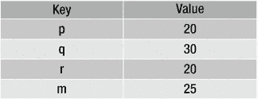
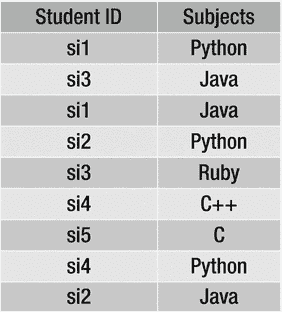
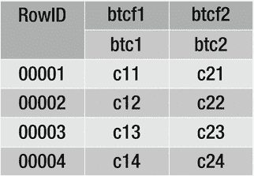
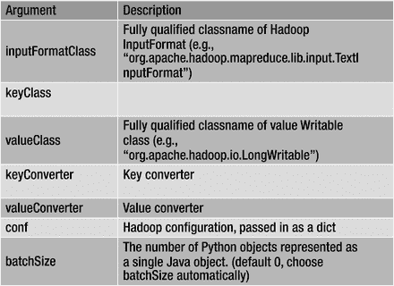

# 6. PySpark 中的 I/O

文件输入/输出（I/O）操作是许多软件活动和处理数据的重要组成部分。数据科学家需要处理多种类型的文件，包括文本文件、逗号分隔值（CSV）文件、JavaScript 对象表示法（JSON）文件等等。Hadoop 分布式文件系统（HDFS）是一个非常优秀的分布式文件系统。

本章涵盖以下实践：
- 实践 6-1. 读取简单的文本文件
- 实践 6-2. 将 RDD 写入简单的文本文件
- 实践 6-3. 读取目录
- 实践 6-4. 从 HDFS 读取数据
- 实践 6-5. 将 RDD 保存到 HDFS
- 实践 6-6. 从顺序文件读取数据
- 实践 6-7. 将数据写入顺序文件
- 实践 6-8. 读取 CSV 文件
- 实践 6-9. 将 RDD 写入 CSV 文件
- 实践 6-10. 读取 JSON 文件
- 实践 6-11. 将 RDD 写入 JSON 文件
- 实践 6-12. 使用 PySpark 从 HBase 读取表数据

## 实践 6-1. 读取简单的文本文件

### 问题
你想要读取一个简单的文本文件。

### 解决方案
你有一个名为 `shakespearePlays.txt` 的简单文本文件。文件内容如下：
- Love’s Labour’s Lost
- A Midsummer Night’s Dream
- Much Ado About Nothing
- As You Like It

`shakespearePlays.txt` 文件包含四行。你想使用 PySpark 读取这个文件。读取文件后，你想要计算以下内容：
- 文件中的总行数
- 文件中的总字符数

要读取一个简单的文件，你可以使用两个函数：`textFile()` 和 `wholeTextFiles()`。这两个函数定义在我们的 `SparkContext` 对象上。

`textFile()` 方法读取一个文本文件并生成一个行的 RDD。`textFile()` 方法是一个转换操作，因此 `textFile()` 在第一个动作被调用之前不会读取数据。由于在运行 `textFile()` 时文件可能不可用，它不会抛出错误。它将在第一个动作被调用时抛出错误。这是为什么？与其他转换操作一样，`textFile()` 函数会在第一个动作被调用时执行。

另一个方法 `wholeTextFiles()` 的工作方式与 `textFile()` 类似，但它将文件作为键/值对读取。文件名被读取为键，文件数据被读取为与该键关联的值。

### 工作原理
让我们看看这些内置方法是如何工作的。

#### 第 6-1-1 步：使用 `textFile()` 函数读取文本文件
`textFile()` 函数接受三个输入。第一个输入是 `textFile()` 的文件路径，第二个参数是 `minPartitions`，用于定义 RDD 中的最小数据分区数，第三个参数是 `use_unicode`。如果 `use_unicode` 为 `False`，文件将作为字符串读取。以下是 `textFile()` 函数：

```
>>> playData = sc.textFile('/home/pysparkbook/pysparkBookData/shakespearePlays.txt',2)
```

输出如下：
```
17/03/18 07:10:17 INFO MemoryStore: Block broadcast_8 stored as values in memory (estimated size 61.8 KB, free 208.0 KB)
17/03/18 07:10:17 INFO MemoryStore: Block broadcast_8_piece0 stored as bytes in memory (estimated size 19.3 KB, free 227.3 KB)
```

在之前的代码中，我们提供了文件路径，并将 `minPartitions` 设置为 2。

```
>>> playDataList = playData.collect()
>>> type(playDataList)
```

输出如下：
```
<class 'list'>
```

我们可以看到，`textFile()` 函数已读取文件并创建了 RDD。RDD 的元素是行：

```
>>> playDataList[0:4]
```

输出如下：
```
[u"Love's Labour's Lost",
u"A Midsummer Night's Dream",
u'Much Ado About Nothing',
u'As You Like It']
```

**步骤 6-1-2. 使用 `wholeTextFiles()` 读取文本文件**
`wholeTextFiles()` 函数也接受三个输入。第一个输入是 `wholeTextFiles()` 的文件路径，第二个参数是 `minPartitions`，用于定义 RDD 中的最小数据分区数，第三个参数是 `use_unicode`。如果 `use_unicode` 为 `False`，文件将作为字符串读取。这次我们使用 `wholeTextFiles()` 函数读取相同的文本文件：

```
>>> playData = sc.wholeTextFiles('/home/pysparkbook/pysparkBookData/shakespearePlays.txt',2)
```

输出如下：
```
17/03/18 07:19:06 INFO MemoryStore: Block broadcast_11 stored as values in memory (estimated size 209.0 KB, free 446.0 KB)
17/03/18 07:19:06 INFO MemoryStore: Block broadcast_11_piece0 stored as bytes in memory (estimated size 19.4 KB, free 465.4 KB)
```

如我们所知，`wholeTextFiles()` 函数将文件作为键/值对读取，其中文件名为键，内容为值。让我们获取文件名：

```
>>> playData.keys().collect()
```

输出如下：
```
[u'file:/home/pysparkbook/pysparkBookData/shakespearePlays.txt']
```

现在让我们获取文件的内容：

```
>>> playData.values().collect()
```

输出如下：
```
[u"Love's Labour's Lost",
u"A Midsummer Night's Dream",
u'Much Ado About Nothing',
u'As You Like It']
```

**步骤 6-1-3. 计算文件中的行数**
我们可以使用 `count()` 函数计算文件中的行数：

```
>>> playData.count()
```

输出如下：
```
4
```

**步骤 6-1-4. 计算每行的字符数**
要计算文件中的总字符数，我们可以计算每行的字符数，然后将它们相加。要计算每行的总字符数，我们可以使用 `len()` 函数。`len()` 函数在 Python 中定义，用于计算序列中的元素数量。对于 Python 字符串，`len()` 函数将返回该字符串的总字符数。让我们通过以下示例观察 `len()` 函数的工作方式：

```
>>> pythonString = "My python"
>>> len(pythonString)
```

输出如下：
```
9
```

我们创建了一个名为 `pythonString` 的字符串，然后为 `pythonString` 赋值 `My python`。字符串 `My python` 有九个字符（包括空格）。因此，在 `pythonString` 变量上调用 `len()` 函数返回了 9 作为输出。现在让我们在 RDD `map()` 函数中使用 `len()` 函数：

```
>>> playDataLineLength = playData.map(lambda x : len(x))
>>> playDataLineLength.collect()
```

输出如下：
```
[21, 25, 22, 14]
```

最终，我们计算了每一行的字符数。如果对 `playDataLineLength` 这个 RDD 应用 `sum()` 方法，就能得到文件的总字符数：

```
>>> totalNumberOfCharacters = playDataLineLength.sum()
>>> totalNumberOfCharacters
```

输出如下：
```
82
```

最后，我们计算出文件的总字符数为 82。请注意，这个计数不包括换行符。

## 配方 6-2. 将 RDD 写入简单文本文件

### 问题
你想将一个 RDD 写入一个简单文本文件。

# 配方 6-2. 将 RDD 数据保存到文件系统

## 解决方案

在配方 6-1 中，你计算出每一行的字符数并存入 RDD `playDataLineLength`。现在你想将其保存到一个文本文件中。

我们可以使用 `saveAsTextFile()` 函数将 RDD 保存为文本文件。该方法是定义在 RDD 上的——而不是像 `textFile()` 和 `wholeTextFiles()` 函数那样定义在 `SparkContext` 上。你需要提供输出目录，但不需要文件名。你提供的目录名必须尚不存在，否则写入操作会失败。RDD 是分区存在的，因此 PySpark 会启动多个并行进程来写入文件。

`saveAsTextFile()` 函数接受两个参数。第一个参数是 `path`，即保存 RDD 的目录路径。第二个参数是 `compressionCodecClass`，这是一个可选参数，默认值为 `None`。我们可以使用诸如 Gzip 等压缩编解码器来压缩文件，从而实现更高效的计算。

## 工作原理

首先，我们从统计每行字符数的代码开始。虽然我们已经做过，但为了清晰起见，我再次提供了计算每行字符数的代码。

### 步骤 6-2-1. 统计每行字符数

让我们读取文件并统计每行的字符数：

```
>>> playData = sc.textFile('/home/pysparkbook/pysparkBookData/shakespearePlays.txt', 4)
>>> playDataLineLength = playData.map(lambda x: len(x))
>>> playDataLineLength.collect()
```

输出如下：

```
[21, 25, 22, 14]
```

我们的 `playDataLineLength` RDD 中的每个元素就是每行的字符数。

### 步骤 6-2-2. 将 RDD 保存到文件

现在我们有了统计好的 RDD，想将其保存到一个名为 `savedData` 的目录中：

```
>>> playDataLineLength.saveAsTextFile('/home/pysparkbook/savedData')
```

让我们检查一下 `savedData` 目录。我们会发现该目录下共有五个文件。其中四个文件——`part-00000`、`part-00001`、`part-00002` 和 `part-00003`——包含实际数据，而 `_SUCCESS` 文件表示数据已成功写入。你有没有想过为什么数据会分布在四个文件中？答案是 `playDataLineLength` RDD 被分成了四个部分，并由四个并行进程来写入文件。

让我们看看这些文件的内容。我们会发现每个数据点都位于单独的文件中：

```
savedData$ cat part-00000
```

输出如下：

```

savedData$ cat part-00001
```

输出如下：

```

savedData$ cat part-00002
```

输出如下：

```

savedData$ cat part-00003
```

输出如下：

```

```

# 配方 6-3. 读取目录

## 问题

你想读取一个目录。

## 解决方案

一个目录里有很多文件。你想一次性读取该目录（中的所有文件）。

如今，从目录中一次性读取多个文件是非常常见的任务。要读取目录，我们使用 `textFile()` 函数或 `wholeTextFiles()` 函数。`textFile()` 函数会读取目录中的小文件并将它们合并。相比之下，`wholeTextFiles()` 函数会将文件读取为键/值对，其中文件名作为键，文件内容作为值。

你已有一个名为 `manyFiles` 的目录。该目录包含两个文件：`playData1.txt` 和 `playData2.txt`。让我们逐一查看这些文件的内容：

```
manyFiles$ cat playData1.txt
```

输出如下：

```
爱的徒劳
仲夏夜之梦
manyFiles$ cat playData2.txt
```

输出如下：

```
无事生非
皆大欢喜
```

你的任务是一次性从这个目录中读取所有文件。

## 工作原理

我们将依次使用 `textFile()` 和 `wholeTextFiles()` 两个函数来读取前面提到的目录。先从 `textFile()` 开始。

### 步骤 6-3-1. 使用 `textFile()` 读取目录

在之前的示例中，我们通过提供绝对文件路径作为 `textFile()` 函数的输入来读取文件。`textFile()` 函数最棒的一点是，只需更改路径输入，就能改变该函数读取数据的方式。为了读取一个目录中的所有文件，我们需要将目录的绝对路径作为 `textFile()` 的输入。以下代码行通过 `textFile()` 函数读取了 `manyFiles` 目录中的所有文件：

```
>>> manyFilePlayData = sc.textFile('/home/pysparkbook/pysparkBookData/manyFiles', 4)
>>> manyFilePlayData.collect()
```

输出如下：

```
[u'无事生非',
u'皆大欢喜',
u"爱的徒劳",
u"仲夏夜之梦"]
```

结果非常清晰。`textFile()` 函数读取了目录中的所有文件，并将文件内容合并，创建了一个包含合并数据的 RDD。

### 步骤 6-3-2. 使用 `wholeTextFiles()` 读取目录

现在，我们使用 `wholeTextFiles()` 函数来读取相同的文件集。和 `textFile()` 一样，这里我们也提供目录路径作为 `wholeTextFiles()` 函数的输入之一。以下代码演示了使用 `wholeTextFiles()` 函数读取目录的方法：

```
>>> manyFilePlayDataKeyValue = sc.wholeTextFiles('/home/pysparkbook/pysparkBookData/manyFiles', 4)
>>> manyFilePlayDataKeyValue.collect()
```

输出如下：

```
[(u'file:/home/pysparkbook/pysparkBookData/manyFiles/playData2.txt', u'无事生非\n 皆大欢喜\n'),
(u'file:/home/pysparkbook/pysparkBookData/manyFiles/playData1.txt', u"爱的徒劳\n 仲夏夜之梦\n")]
```

输出结果由文件名和内容的键值对组成。之后，我们需要根据问题要求进行进一步处理。

# 配方 6-4. 从 HDFS 读取数据

## 问题

你想使用 PySpark 从 HDFS 读取一个文件。

## 解决方案

HDFS 非常适合存储大量文件。假设在 HDFS 中有一个名为 `filamentData.csv` 的文件，该文件位于 `bookData` 目录下，而 `bookData` 位于 HDFS 的根目录下。你想使用 PySpark 读取这个文件。

要从 HDFS 读取文件，我们首先需要了解 `core-site.xml` 属性文件中的 `fs.default.name` 属性。我们将从 Hadoop 配置目录中获取 `core-site.xml` 文件。对我们来说，`fs.default.name` 的值是 `hdfs://localhost:9746`。因此，文件在 HDFS 中的完整路径是 `hdfs://localhost:9746/bookData/filamentData.csv`。

我们可以使用 `textFile()` 函数，通过提供文件的完整路径来从 HDFS 读取文件。

## 工作原理

从 HDFS 读取文件就像从本地机器读取数据一样简单。在以下代码行中，我们使用 `textFile()` 函数来读取所需的文件：

```
>>> filamentdata = sc.textFile('hdfs://localhost:9746/bookData/filamentData.csv', 4)
>>> filamentdata.take(4)
```

输出如下：

```
[u'filamentA,100W,605',
u'filamentB,100W,683',
u'filamentB,100W,691',
u'filamentB,200W,561']
```

结果证实我们能够从 HDFS 读取文件。

# 配方 6-5. 将 RDD 数据保存到 HDFS

## 问题

你想将 RDD 数据保存到 HDFS。

## 解决方案

可以使用 `saveAsTextFile()` 函数将 RDD 数据保存到 HDFS。在配方 6-2 中，我们将 RDD 保存到了本地文件系统的文件中。现在，我们将把同一个 RDD（即 `playDataLineLength`）保存到 HDFS。

与使用 `textFile()` 函数的方式类似，我们需要向 `saveAsTextFile()` 提供包含 NameNode URI 在内的完整文件路径，以将 RDD 写入 HDFS。

### 工作原理

鉴于您是一位专注的读者，可能不希望被打扰，我们将从编写统计每行字符总数的代码开始。

#### 步骤 6-5-1. 统计每行的字符数

```python
>>> playData = sc.textFile('/home/muser/bData/shakespearePlays.txt',4)
>>> playDataLineLength = playData.map(lambda x : len(x))
>>> playDataLineLength.collect()
```

以下是输出结果：

```
[21, 25, 22, 14]
```

#### 步骤 6-5-2. 将 RDD 保存到 HDFS

使用以下代码行写入`playDataLineLength` RDD：

```python
>>> playDataLineLength.saveAsTextFile('hdfs://localhost:9746/savedData/')
```

我们已将 RDD 保存在 HDFS 根目录下的`savedData`目录中。请记住，在我们保存数据之前，`savedData`目录并不存在；否则，`saveAsTextFile()`函数会抛出错误。我们已经保存了 RDD，接下来要检查已保存的数据。我们将在`savedData`目录中找到五个文件：`part-00000`、`part-00001`、`part-0002`、`part-00003`以及我们的`_SUCCESS`文件。让我们使用 HDFS 的`cat`命令逐一查看每个文件的内容。此命令将文件数据显示到控制台：

```bash
$ hadoop fs -cat /savedData/part-00000
```

以下是输出结果：

```

$ hadoop fs -cat /savedData/part-00001
```

以下是输出结果：

```

$ hadoop fs -cat /savedData/part-00002
```

以下是输出结果：

```

$ hadoop fs -cat /savedData/part-00003
```

以下是输出结果：

```

```

每个文件都包含一个单独的数据点，因为我们的 RDD 有四个分区。

## 配方 6-6. 从顺序文件中读取数据

### 问题

您希望从顺序文件中读取数据。

### 解决方案

顺序文件使用键/值文件格式。此处的键值采用二进制格式。这是 Hadoop 常用的文件格式。键和值都是 Hadoop `Writable`类的子类型。

我们在 HDFS 根目录下的`sequenceFileToRead`目录中存储了一个顺序文件。该目录下的文件包含了表`6-1`中的数据。

表`6-1`. 顺序文件数据



我们可以使用`SparkContext`类中定义的`sequenceFile()`方法来读取顺序文件。

### 工作原理

`sequenceFile()`函数接受多个参数。下面讨论其中一些。第一个参数是`path`，即顺序文件的路径。第二个参数是`keyClass`，用于指明顺序文件中数据的键类。`valueClass`参数表示值的数据类型。请记住，键和值类都是 Hadoop `Writable`类的子类。

```python
>>> simpleRDD = sc.sequenceFile('hdfs://localhost:9746/sequenceFileToRead')
>>> simpleRDD.collect()
```

以下是输出结果：

```
[(u'p', 20),
(u'q', 30),
(u'r', 20),
(u'm', 25)]
```

最终，我们成功读取了顺序文件。

## 配方 6-7. 将数据写入顺序文件

### 问题

您希望将数据写入顺序文件。

### 解决方案

很多时候，我们希望将 PySpark 处理的结果保存到顺序文件中。我们有一个科目数据的 RDD，如表`6-2`所示，您希望将其写入一个顺序文件。

表`6-2`. 学生科目数据



### 工作原理

在本配方中，我们将首先创建一个 RDD，然后将其保存到顺序文件中。

#### 步骤 6-7-1. 创建配对 RDD

首先，创建一个元组列表：

```python
>>> subjectsData = [('si1','Python'),
...                 ('si3','Java'),
...                 ('si1','Java'),
...                 ('si2','Python'),
...                 ('si3','Ruby'),
...                 ('si4','C++'),
...                 ('si5','C'),
...                 ('si4','Python'),
...                 ('si2','Java')]
```

接下来，将数据并行化：

```python
>>> subjectsPairedRDD = sc.parallelize(subjectsData, 4)
>>> subjectsPairedRDD.take(4)
[('si1', 'Python'),
('si3', 'Java'),
('si1', 'Java'),
('si2', 'Python'),
]
```

#### 步骤 6-7-2. 将 RDD 保存为顺序文件

最后，将我们的配对 RDD 写入一个顺序文件：

```python
>>>subjectsPairedRDD.saveAsSequenceFile('hdfs://localhost:9746/sequenceFiles')
```

我们的顺序文件位于 HDFS 中的`sequenceFiles`目录下。现在让我们检查已保存的文件：

```bash
$ hadoop fs -ls /sequenceFiles
```

我们找到了五个项目：

```
-rw-r--r--  3 pysparkbook  supergroup 0 2017-05-22 00:18 /sequenceFiles /_SUCCESS
-rw-r--r--   3 pysparkbook supergroup        114 2017-05-22 00:18 /sequenceFiles/part-00000
-rw-r--r--   3 pysparkbook supergroup        114 2017-05-22 00:18 /sequenceFiles/part-00001
-rw-r--r--   3 pysparkbook supergroup        111 2017-05-22 00:18 /sequenceFiles/part-00002
-rw-r--r--   3 pysparkbook supergroup        128 2017-05-22 00:18 /sequenceFiles/part-00003
```

这里我们可以看到文件已保存为四个部分。

## 配方 6-8. 读取 CSV 文件

### 问题

您希望读取一个 CSV 文件。

### 解决方案

正如我们所提到的，CSV 代表逗号分隔值。在 CSV 文件中，每一行都包含由分隔符分隔的字段。通常，逗号（`,`）被用作分隔符，但分隔符也可能是其他字符。

我们已经知道，如果 PySpark 读取一个文件，它会创建一个由行组成的 RDD。因此，读取 CSV 文件的最佳方法是使用`textFile()`函数读取它，然后使用 Python 的 CSV 解析器解析每一行。

在 Python 中，我们可以使用`csv`模块来解析 CSV 行。该模块提供了处理 CSV 数据的所有功能。我们还使用`reader()`函数，它会返回一个 reader 对象。reader 对象可以迭代行。

您会得到一个灯丝数据的 CSV 文件，这与我们在第 5 章中使用的灯丝数据相同。灯丝数据文件的行内容如下：

```
filamentA,100W,605
filamentB,100W,683
filamentB,100W,691
filamentB,200W,561
filamentA,200W,530
```

我们可以看到文件中的每一行都由逗号分隔。因此，通过 CSV 解析器解析每一行就完成了我们的任务。

注

您可以在[`https://stackoverflow.com/questions/28782940/load-csv-file-with-spark`](https://stackoverflow.com/questions/28782940/load-csv-file-with-spark)阅读更多关于使用 PySpark 读取 CSV 文件的内容。

### 工作原理

我们将从编写一个 Python 函数开始，该函数将解析每一行。

## 步骤 6-8-1. 编写一个 Python 函数来解析 CSV 行

我们将编写一个名为 `parseCSV()` 的函数。此函数将接收每一行并解析它以返回一个列表：

```
>>> import csv
>>> import  StringIO
>>> def parseCSV(csvRow) :
...      data = StringIO.StringIO(csvRow)
...      dataReader =  csv.reader(data)
...      return(dataReader.next())
```

我们的函数一次处理一行。每行由 `StringIO` 模块中定义的 `StringIO` 函数接收。使用 `StringIO` 模块，我们可以创建一个类似文件的对象。我们将 `data` 对象传递给 `csv` 模块的 `reader()` 函数。它将返回一个 reader 对象。`next()` 函数将返回一个由逗号分隔的字段列表。让我们检查一下函数是否正常工作：

```
>>> csvRow = "p,s,r,p"
>>> parseCSV(csvRow)
```

以下是输出结果：

```
['p', 's', 'r', 'p']
```

我们创建了一个字符串 `csvRow`。可以看到，字符串中的字段由逗号分隔。现在我们使用函数解析该行，并得到一个列表作为结果。这证实了我们的函数符合预期。

## 步骤 6-8-2. 创建配对 RDD

我们将读取文件并解析其行。以下代码将读取文件、解析行并返回所需的数据：

```
>>> filamentRDD =sc.textFile('/home/pysparkbook/pysparkBookData filamentData.csv',4)
>>> filamentRDDCSV = filamentRDD.map(parseCSV)
>>> filamentRDDCSV.take(4)
```

输出如下：

```
[['filamentA', '100W', '605'],
['filamentB', '100W', '683'],
['filamentB', '100W', '691'],
['filamentB', '200W', '561']]
```

最终输出是一个嵌套列表。每个内部列表由解析后的行组成。

# 配方 6-9：将 RDD 写入 CSV 文件

### 问题

你想将一个 RDD 写入 CSV 文件。

### 解决方案

将数据写入 CSV 文件需要我们把字段列表转换成逗号分隔的字符串。当元素被连接时，可以将列表转换为字符串。

### 实现原理

## 步骤 6-9-1：创建将列表转换为字符串的函数

我们创建一个名为 `createCSV` 的函数，该函数接收一个列表，并通过连接列表中被逗号分隔的元素来返回一个字符串。

```
>>> import csv
>>> import StringIO
>>> def createCSV(dataList):
...       data = StringIO.StringIO()
...       dataWriter = csv.writer(data,lineterminator='')
...       dataWriter.writerow(dataList)
...       return (data.getvalue())
```

`StringIO()` 函数返回一个类文件对象。然后，`csv` 模块的 `writerow()` 函数将其转换为字符串。让我们观察一下 `createCSV()` 函数的作用：

```
>>> listData = ['p','q','r','s']
>>> createCSV(listData)
```

输出如下：

```
'p,q,r,s'
```

`listData` 列表有四个元素。我们将 `listData` 作为输入提供给 `createCSV()` 函数。最后，我们得到一个字符串，该字符串是通过连接列表中被逗号分隔的元素而创建的。

## 步骤 6-9-2：将数据保存到文件

我们的问题要求将数据保存到文件。不过我们先创建一个 RDD，然后再保存数据。我们将从 `simpleData` 嵌套列表中创建一个 RDD：

```
>>> simpleData = [['p',20],
...               ['q',30],
...               ['r',20],
...               ['m',25]]
>>> simpleRDD = sc.parallelize(simpleData,4)
>>> simpleRDD.take(4)
```

输出如下：

```
[['p', 20],
['q', 30],
['r', 20],
['m', 25]]
```

我们已经创建了所需的 RDD。现在，使用 `map()` 函数，我们将数据转换为适合保存的格式：

```
simpleRDDLines = simpleRDD.map( createCSV)
simpleRDDLines.take(4)
simpleRDDLines.saveAsTextFile('/home/pysparkbook/csvData/')
```

我们已经将数据作为 CSV 文件保存到了 `csvData` 目录中。

# 配方 6-10：读取 JSON 文件

### 问题

你想通过使用 PySpark 读取一个 JSON 文件。

### 解决方案

如前文所述，JSON 代表 JavaScript 对象表示法（JavaScript Object Notation）。几十年来，JSON 数据文件的流行度不断增长。它是一种数据交换格式。几乎所有编程语言都支持读取和写入 JSON。JSON 格式具有类似字段名和值的配对。两个字段名/值对用逗号（`,`）分隔，每个字段名与其关联的值用冒号（`:`）分隔。数据科学家经常从客户那里获取 JSON 格式的数据。

给你一个 JSON 文件 `tempData.json`。JSON 文件具有 `.json` 扩展名。该文件包含以下格式的数据：

```
$ cat tempData.json
```

输出如下：

```
{"Time":"6AM",  "Temperature":15}
{"Time":"8AM",  "Temperature":16}
{"Time":"10AM", "Temperature":17}
{"Time":"12AM", "Temperature":17}
{"Time":"2PM",  "Temperature":18}
{"Time":"4PM",  "Temperature":17}
{"Time":"6PM",  "Temperature":16}
{"Time":"8PM",  "Temperature":14}
```

我们的 JSON 文件由两个键 `Time` 和 `Temperature` 及其关联的值组成。我们可以看到，对于特定字段，字段名和值通过冒号关联。两个字段的名称/值对由逗号分隔。

在 PySpark 中读取 JSON 文件有何特别之处？现在你明白了，每当我们读取一个 JSON 文件时，它会创建一个由行组成的 RDD，然后逐行解析数据。因此，我们需要一个解析器来解析这些行，更准确地说，我们需要一个 JSON 数据解析器。

### 实现原理

有许多 Python 模块可用于 JSON 解析，但我们将使用 `json` 这个 Python 模块。该模块提供了许多用于处理 JSON 格式的工具。

## 步骤 6-10-1. 创建解析 JSON 数据的函数

让我们创建一个函数，用于解析 JSON 数据，并为每一行返回一个 Python 列表：

```python
>>> import json
>>> def jsonParse(dataLine):
...      parsedDict = json.loads(dataLine)
...      valueData = parsedDict.values()
...      return(valueData)
```

`jsonParse()` 函数将接收一个 JSON 格式的字符串，并返回一个列表。输入到 `jsonParse()` 函数的数据会传递给 `json.loads()` 函数。`json.loads()` 函数接收一个 JSON 字符串作为参数，并返回一个字典。然后我们在下一行获取字典的值，最后将其返回。我们必须测试一下这个函数：

```python
>>> jsonData = '{"Time":"6AM",  "Temperature":15}'
```

我们创建了一个 JSON 字符串 `jsonData`：

```python
>>> jsonParsedData = jsonParse(jsonData)
>>> print jsonParsedData
```

以下是输出结果：

```
[15, '6AM']
```

为了解析我们的 JSON 字符串，我们使用了 `jsonParse()` 函数，并得到了 Python 列表 `jsonParsedData`。

### 步骤 6-10-2. 读取文件

我们将使用 `textFile()` 函数来读取文件：

```python
>>> tempData = sc.textFile("/home/pysparkbook//pysparkBookData/tempData.json",4)
>>> tempData.take(4)
```

以下是输出结果：

```
[u'{"Time":"6AM",  "Temperature":15}',
u'{"Time":"8AM",  "Temperature":16}',
u'{"Time":"10AM", "Temperature":17}',
u'{"Time":"12AM", "Temperature":17}']
```

我们已经读取了文件，输出结果显示 RDD 是一行行 JSON 字符串。

### 步骤 6-10-3. 创建配对 RDD

现在我们需要解析每一行。这可以通过将 `jsonParse()` 函数作为参数传递给 RDD `tempData` 的 `map()` 函数来实现：

```python
>>> tempDataParsed = tempData.map(jsonParse)
>>> tempDataParsed.take(4)
```

以下是输出结果：

```
[[15, u'6AM'],
[16, u'8AM'],
[17, u'10AM'],
[17, u'12AM']]
```

最终，我们得到了所需的结果。

### 方法 6-11. 将 RDD 写入 JSON 文件

#### 问题

你想要将一个 RDD 写入到一个 JSON 文件中。

#### 解决方案

可以通过使用 `json` 模块从 Python 字典创建 JSON 字符串对象。

##### 步骤 6-11-1. 创建接收列表并返回 JSON 字符串的函数

我们将创建一个名为 `createJSON()` 的函数，它接收一个 Python 列表并返回一个 JSON 字符串：

```python
>>> def createJSON(data):
...     dataDict = {}
...     dataDict['Name'] = data[0]
...     dataDict['Age'] = data[1]
...     return(json.dumps(dataDict))
```

在 `createJSON()` 函数内部，我们首先创建了一个 `dataDict` 字典。然后，我们将该字典传递给 `json` 模块的 `dumps()` 函数。这个函数会返回一个 JSON 字符串对象。下面这行代码将测试我们的函数：

```python
>>> nameAgeList = ['Arun',22]
>>> createJSON(nameAgeList)
```

以下是输出结果：

```
'{"Age": 22, "Name": "Arun"}'
```

我们的函数返回了一个 JSON 字符串对象。

##### 步骤 6-11-2. 以 JSON 格式保存数据

我们将遵循与之前相同的流程。首先，创建一个 RDD。然后，将该 RDD 以 JSON 格式写入一个文件。

```python
>>> nameAgeData = [['Arun',22],
...                                  ['Bony',35],
...                                  ['Juna',29]]
>>> nameAgeRDD = sc.parallelize(nameAgeData,3)
>>> nameAgeRDD.collect()
```

以下是输出结果：

```
[['Arun', 22],
['Bony', 35],
['Juna', 29]]
```

我们已经创建了一个 RDD；现在需要将这些数据转换为 JSON 字符串。`createJSON()` 函数作为参数传递给了 `map()` 函数。`map()` 函数作用于我们的 `nameAgeRDD` RDD。

```python
>>> nameAgeJSON = nameAgeRDD.map(createJSON)
>>> nameAgeJSON.collect()
```

以下是输出结果：

```
['{"Age": 22, "Name": "Arun"}',
'{"Age": 35, "Name": "Bony"}',
'{"Age": 29, "Name": "Juna"}']
```

`nameAgeJSON` RDD 的元素是 JSON 字符串。现在，使用 `saveAsTextFile()` 函数，我们将 `nameAgeJSON` RDD 保存到 `jsonDir` 目录中。

```python
>>> nameAgeJSON.saveAsTextFile('/home/pysparkbook/jsonDir/')
```

我们将查看 `jsonDir` 目录。使用 `ls` 命令，发现其中有四个文件：

```
jsonDir$ ls
```

以下是输出结果：

```
part-00000
part-00001
part-00002
_SUCCESS
jsonDir$ cat part-00000
```

这是输出：

```
{"Age": 22, "Name": "Arun"}
```

`part-00000`文件包含 RDD 的第一个元素。

### Recipe 6-12. 使用 PySpark 从 HBase 读取表数据

#### 问题

您希望从 HBase 读取表数据。

#### 解决方案

我们有一个名为`pysparkTable`的数据表位于 HBase 中。您希望使用 PySpark 读取该表。`pysparkTable`中的数据如表 6-3 所示。

**表 6-3.** `pysparkTable`数据



我们来解释一下这个表数据。`pysparkTable`表包含四行和两个列族：`btcf1`和`btcf2`。列`btc1`属于列族`btcf1`，列`btc2`属于列族`btcf2`。请记住，本节后面提供的代码仅适用于 spark-1.6 及更早的 PySpark 版本。请尝试调整代码以在 PySpark 2.x 上运行。

我们将使用定义在`SparkContext sc`上的`newAPIHadoopRDD()`函数。该函数返回一个配对 RDD。表 6-4 列出了`newAPIHadoopRDD()`函数的参数。

**表 6-4.** `newAPIHadoopRDD()`函数的参数



#### 工作原理

首先定义所有需要传递给`newAPIHadoopRDD()`函数的参数：

```python
>>> hostName = 'localhost'
>>> tableName = 'pysparkBookTable'
>>> ourInputFormatClass='org.apache.hadoop.hbase.mapreduce.TableInputFormat'
>>> ourKeyClass='org.apache.hadoop.hbase.io.ImmutableBytesWritable'
>>> ourValueClass='org.apache.hadoop.hbase.client.Result'
>>> ourKeyConverter='org.apache.spark.examples.pythonconverters.ImmutableBytesWritableToStringConverter'
>>> ourValueConverter='org.apache.spark.examples.pythonconverters.HBaseResultToStringConverter'
>>> configuration = {}
>>> configuration['hbase.mapreduce.inputtable'] = tableName
>>> configuration['hbase.zookeeper.quorum'] = hostName
```

现在，是时候使用参数调用`newAPIHadoopRDD()`函数了：


