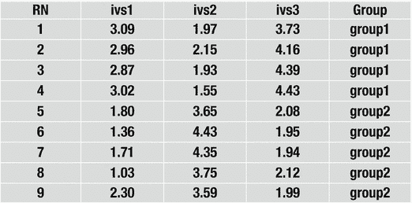
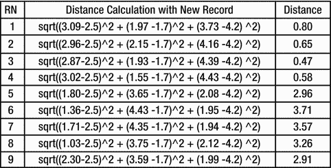
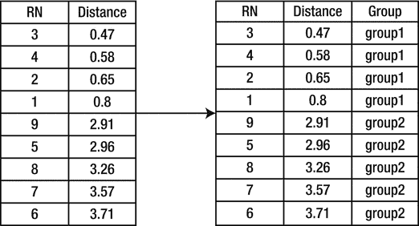
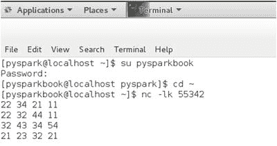

# 7. 优化 PySpark 与 PySpark Streaming

Spark 是一个用于实现并行处理的分布式框架。并行算法需要在机器之间进行计算和通信。在通信过程中，机器会发送或交换数据，这通常被称为`数据混洗（shuffling）`。

编写代码很容易，但要编写一个既高效又易于他人理解的程序，则需要付出更多努力。本章将介绍一些让 PySpark 程序更清晰、更高效的技巧。

做决策是日常活动的一部分。我们这群重视数据的人希望在决策时引入数据分析和结果推断。我们可以收集数据并进行分析，在之前的章节中已经完成了这些工作。但如今人们越来越倾向于对实时流入的数据进行分析，这意味着人们对流数据的分析兴趣日益浓厚。

处理流数据需要更健壮的系统以及合适的算法。批处理系统的容错性有时比流处理系统的容错性更简单。这是因为在流数据处理过程中，我们同时从外部源读取数据、执行计算并保存结果，更多活动意味着更高的失败概率。

在 PySpark 中，流数据由其库 PySpark Streaming 处理。PySpark Streaming 是一组 API，为 PySpark Core 提供封装。这些 API 不仅高效，还能很好地处理容错的诸多方面。我们将使用 PySpark 从控制台读取流数据并进行数据分析，还将使用 PySpark Streaming 从 Apache Kafka 读取数据并进行分析。

本章涵盖以下内容：

- 配方 7-1 使用 PySpark 代码优化网页排名算法
- 配方 7-2 使用 PySpark 实现 K 近邻算法
- 配方 7-3 使用 PySpark Streaming 从控制台读取流数据
- 配方 7-4 将 Apache Kafka 与 PySpark Streaming 集成，读取并分析数据
- 配方 7-5 在本地模式下执行 PySpark 脚本
- 配方 7-6 使用独立集群管理器和 Mesos 集群管理器执行 PySpark 脚本

## 配方 7-1：使用 PySpark 代码优化网页排名算法

### 问题

你希望使用你在第 5 章编写的 PySpark 代码来优化网页排名算法。

### 解决方案

我们已经在第 5 章实现了网页排名算法。那么是否可以对代码进行优化呢？每当我们审视每一行代码时，都可以尝试进行优化。在本配方中，我们将优化 RDD 的关联操作。不过，你也可以查看代码的其他部分，尝试优化程序中的不同代码行。

在 PySpark 或任何分布式框架中，配对 RDD 的关联操作是最昂贵的操作之一。为什么？因为对于第一个 RDD 中的每个键，系统都需要在其他 RDD 的不同数据分区中查找所有键。查找完成后，数据会被混洗。如果我们重新分区数据，使相似的键位于同一台机器上，那么数据混洗量就会减少。PySpark 提供了专门用于此目的的分区器。我们可以使用 `partitionBy()` 函数并选择合适的分区器，这样相似键就会出现在同一台机器上，减少数据混洗，从而提升代码执行速度。

### 工作原理

我们在第 5 章已经详细讨论了网页排名算法；如果需要回顾，请查阅该章节的详细讨论。在本配方中，我仅讨论被修改的代码行。修改后的代码行以粗体显示。让我们来看看这些代码行：

```python
>>> tableRDDfromHBase = sc.newAPIHadoopRDD(
...                        inputFormatClass = ourInputFormatClass,
...                        keyClass = ourKeyClass,
...                        valueClass = ourValueClass,
...                        keyConverter = ourKeyConverter,
...                        valueConverter = ourValueConverter,
...                        conf = configuration
...                     )
```

让我们看看我们的配对 RDD `tableRDDfromHBase` 是什么样的：

```python
>>> tableRDDfromHBase.take(2)
```

输出如下：

```
[(u'00001', u'{"qualifier" : "btc1", "timestamp" : "1496715394968", "columnFamily" : "btcf1", "row" : "00001", "type" : "Put", "value" : "c11"}\n{"qualifier" : "btc2", "timestamp" : "1496715408865", "columnFamily" : "btcf2", "row" : "00001", "type" : "Put", "value" : "c21"}'), (u'00002', u'{"qualifier" : "btc1", "timestamp" : "1496715423206", "columnFamily" : "btcf1", "row" : "00002", "type" : "Put", "value" : "c12"}\n{"qualifier" : "btc2", "timestamp" : "1496715436087", "columnFamily" : "btcf2", "row" : "00002", "type" : "Put", "value" : "c22"}')]
```

配对 RDD `tableRDDfromHBase` 以`RowID`作为键。列和列分类器是 JSON 字符串，这是值部分。在之前的配方中，我们解决了读取 JSON 文件的问题。

**注意：** 请记住，Recipe 6-12 的代码仅适用于 spark-1.6 及更早版本。您可以在 GitHub 上获取代码：`https://github.com/apache/spark/blob/ed9d80385486cd39a84a689ef467795262af919a/examples/src/main/python/hbase_inputformat.py`

还有一个问题。我们使用了多个类，因此在启动 PySpark shell 时必须添加一些 JAR 包。以下是所需的 JAR 文件：

- `spark-examples-1.6.0-hadoop2.6.0.jar`
- `hbase-client-1.2.4.jar`
- `hbase-common-1.2.4.jar`

以下为启动 PySpark shell 的命令：

```
pyspark --jars 'spark-examples-1.6.0-hadoop2.6.0.jar','/hbase-client-1.2.4.jar','hbase-common-1.2.4.jar'
```

# PageRank 与 k-近邻算法实现

```python
>>> pageLinks =  [['a', ['b','c','d']],
...               ['b', ['d','c']],
...               ['c', ['b']],
...               ['d', ['a','c']]]
>>> pageRanks =  [['a',1],
...               ['b',1],
...               ['c',1],
...               ['d',1]]
>>> numIter = 20
>>> pageRanksRDD  = sc.parallelize(pageRanks, 2).partitionBy(2,hash).persist()
>>> pageLinksRDD  = sc.parallelize(pageLinks, 2).partitionBy(2,hash).persist()
```

在加粗的代码行中，我添加了 `partitionBy()` 方法。`partitionBy()` 的第一个参数是 `2`，表示数据被分成两个分区。我们还提供了另一个参数值 `hash`，该参数值是分区器名称。我们使用 `hash` 分区器将数据重新分区为两个分区。`hash` 分区器使用哈希技术对数据进行重新分区。我们在 `pageRanksRDD` 和 `pageLinksRDD` 上使用了相同的技术，因此相同的键会被分配到同一台机器上。这样一来，我们就解决了数据混洗的问题。代码的其他部分与第 5 章相同。

```python
>>> s = 0.85
>>> def rankContribution(uris, rank):
...     numberOfUris = len(uris)
...     rankContribution = float(rank) / numberOfUris
...     newrank =[]
...     for uri in uris:
...             newrank.append((uri, rankContribution))
...     return newrank
>>> for i in range(numIter):
...         linksRank = pageLinksRDD.join(pageRanksRDD)
...     contributedRDD = linksRank.flatMap(lambda x : rankContribution(x[1][0],x[1][1]))
...     sumRanks = contributedRDD.reduceByKey(lambda v1,v2 : v1+v2)
...     pageRanksRDD = sumRanks.map(lambda x : (x[0],(1-s)+s*x[1]))
...
>>> pageRanksRDD.collect()
```

输出结果如下：

```
[('b', 1.357243795127982),
('d', 0.8746512999550939),
('a', 0.5217268024809147),
('c', 1.2463781024360086)]
```

至此，我们得到了 PageRank 实现的最终结果。

## 配方 7-2. 使用 PySpark 实现 k-近邻算法

### 问题

你希望使用 PySpark 实现 k-近邻算法。

### 解决方案

k-近邻算法是最简单的数据分类算法之一。两个数据点之间的相似度是基于两点之间的距离来衡量的。

我们有一个包含九条记录的数据集。该数据集如表格 7-1 所示。在该表中，你可以看到一个名为 `RN` 的列，该列表示记录编号。它不属于数据本身，而是为了方便理解 KNN 算法而提供的。

**表 7-1.** 用于 KNN 分类的数据



假设我们有一条记录（`ivs1 = 2.5`, `ivs2 = 1.7`, `ivs3 = 4.2`）。我们将这条记录称为**新记录**。我们需要对该记录进行分类；它将被归类为 `group1` 或 `group2`。

我们将使用 KNN 算法对该记录进行分类。具体步骤如下：

1. **确定 `k` 的值。**

   `k` 是我们为决定新记录的类别而选择的最近邻数量。假设 `k` 为 5。

2. **计算新记录与数据中每条记录的距离。** 距离计算采用欧几里得距离法，如表格 7-2 所示。

**表 7-2.** 距离计算



在此表中，我们计算了新记录与其他记录之间的距离。第三列即为距离值。该表第一行的距离值是新记录与记录 1 之间的距离。

3. **对距离进行排序。**

   现在需要进行排序。我们必须按递增顺序对距离进行排序。同时，我们还需保持 `RN` 列与距离列之间的关联性。在表格 7-3 中，我们对距离列进行了排序，并且它仍然与 `RN` 和组列保持关联。

**表 7-3.** 距离计算



4. 找出 `k` 个最近邻。

现在我们已经对 `Distance` 列进行了排序，需要找出新记录的邻居。这里所说的邻居是什么意思呢？邻居就是表中距离新记录较近的那些记录。所谓“近”，指的是两个节点之间的距离较小。接下来，在表 7-3 中找出五个最近的邻居。对于新记录而言，记录 3、4、2、1 和 9 是邻居。其中记录 3、4、2、1 所属的组是 `group1`，记录 9 所属的组是 `group2`。大多数邻居都来自 `group1`。因此，我们可以将新记录归类到 `group1` 中。

我们已经详细讨论过 KNN 算法。接下来看看如何使用 PySpark 来实现它。我们先用一种朴素的方式实现 KNN，然后在“工作原理”部分对其进行优化。

首先，我们要计算两个元组之间的距离。我们将编写一个 Python 函数 `distanceBetweenTuples()`。这个函数接收两个元组，计算它们之间的距离，并返回该距离：

```
>>> def distanceBetweenTuples(data1, data2) :
...     squaredSum = 0.0
...     for i in range(len(data1)):
...         squaredSum = squaredSum + (data1[i] - data2[i])**2
...     return(squaredSum**0.5)
```

现在我们已经编写好了计算距离的函数，来测试一下：

```
>>> pythonTuple1 = (1.2, 3.4, 3.2)
>>> pythonTuple2 = (2.4, 2.2, 4.2)
>>> distanceBetweenTuples(pythonTuple1, pythonTuple2)
```

输出结果如下：

```
1.9697715603592207
```

我们的方法已经测试通过。这是一个通用函数，也可以用于长度为 4 或 5 的元组。在下面几行代码中，我们将创建一个列表。这个列表的元素是元组。每个元组包含两个元素：第一个元素本身是一个数据元组，第二个元素是与该数据元组关联的组别。

```
>>> knnDataList = [((3.09,1.97,3.73),'group1'),
...                              ((2.96,2.15,4.16),'group1'),
...                              ((2.87,1.93,4.39),'group1'),
...                              ((3.02,1.55,4.43),'group1'),
...                              ((1.80,3.65,2.08),'group2'),
...                              ((1.36,4.43,1.95),'group2'),
...                              ((1.71,4.35,1.94),'group2'),
...                              ((1.03,3.75,2.12),'group2'),
...                              ((2.30,3.59,1.99),'group2')]
>>> knnDataRDD = sc.parallelize(knnDataList, 4)
```

数据已经并行化了。我们将 `newRecord` 定义为 `[(2.5, 1.7, 4.2)]`：

### 步骤 7-2-1. 创建一个计算两个元组之间距离的函数

```python
>>> def distanceBetweenTuples(data1, data2) :
...     squaredSum = 0.0
...     for i in range(len(data1)):
...         squaredSum = squaredSum + (data1[i] - data2[i])**2
...     return(squaredSum**0.5)
```

我们已经创建并测试了这个方法。

### 步骤 7-2-2. 创建给定记录列表并转换为 RDD

```python
>>> knnDataList = [((3.09,1.97,3.73),'group1'),
...                ((2.96,2.15,4.16),'group1'),
...                ((2.87,1.93,4.39),'group1'),
...                ((3.02,1.55,4.43),'group1'),
...                ((1.80,3.65,2.08),'group2'),
...                ((1.36,4.43,1.95),'group2'),
...                ((1.71,4.35,1.94),'group2'),
...                ((1.03,3.75,2.12),'group2'),
...                ((2.30,3.59,1.99),'group2')]
>>> K = 5
```

我们再次寻找五个邻居以确定新记录的组。同时将数据并行化并转换为包含四个分区的 RDD：

```python
>>> knnDataRDD = sc.parallelize(knnDataList, 4)
>>> knnDataRDD.take(5)
```

输出如下：

```
[((3.09, 1.97, 3.73), 'group1'),
((2.96, 2.15, 4.16), 'group1'),
((2.87, 1.93, 4.39), 'group1'),
((3.02, 1.55, 4.43), 'group1'),
((1.8, 3.65, 2.08), 'group2')]
```

### 步骤 7-2-3. 广播记录值

现在需要创建所需的新记录：

```python
>>> newRecord = [(2.5, 1.7, 4.2)]
```

对这条新记录进行广播，将由`broadcast()`方法完成，该方法定义在`SparkContext`对象上。我们可以通过`value`属性读取广播变量的值：

```python
>>> broadCastedValue = sc.broadcast(newRecord)
>>> broadCastedValue.value
```

以下是输出结果：

```
[(2.5, 1.7, 4.2)]
```

可以看到，它返回了我们广播出去的数据。但我们需要的是元组，可以通过获取列表的第一个元素来得到：

```python
>>> broadCastedValue.value[0]
```

以下是输出结果：

```
(2.5, 1.7, 4.2)
```

### 步骤 7-2-4. 广播记录值

广播之后，我们需要创建一个 RDD，这个 RDD 将由元组组成。每个元组的第一个元素是分组，第二个元素是距离：

```python
>>> groupAndDistanceRDD = knnDataRDD.map(lambda data : (data[1], distanceBetweenTuples(data[0], tuple(broadCastedValue.value[0]))))
```

为了计算距离，我们使用`distanceBetweenTuples()`方法：

```python
>>> groupAndDistanceRDD.take(5)
```

以下是输出结果：

```
[('group1', 0.8011866199581719),
('group1', 0.6447480127925947),
('group1', 0.47528938553264566),
('group1', 0.5880476171195661),
('group2', 2.9642705679475347)]
```

我们计算了 RDD`groupAndDistanceRDD`；它的第一个元素是组，第二个元素是新记录与旧记录之间的距离。现在需要按距离递增排序。你可能还记得第 4 章中描述的`takeOrdered()`函数。接下来，按距离递增获取五个组：

```python
>>> ourClasses = groupAndDistanceRDD.takeOrdered(K, key = lambda data : data[1])
>>> ourClasses
```

输出如下：

```
[('group1', 0.47528938553264566),
('group1', 0.5880476171195661),
('group1', 0.6447480127925947),
('group1', 0.8011866199581719),
('group2', 2.9148241799463652)]
```

使用`takeOrdered()`方法，我们获取了 RDD 中的五个元素，距离按递增顺序排列。我们需要找出占多数的组，因此先提取组部分，再找出出现最频繁的组：

```python
>>> ourClassesGroup = [data[0] for data in ourClasses]
>>> ourClassesGroup
```

输出如下：

```
['group1', 'group1', 'group1', 'group1', 'group2']
```

组部分已提取。可以使用 Python 的`max()`函数找出出现最频繁的组，如下所示：

```python
>>> max(ourClassesGroup,key=ourClassesGroup.count)
```

输出如下：

```
'group1'
```

最终得到了新记录的组，即`group1`。

你可能会想，既然已经实现了 KNN，下一步该做什么？下一步是优化代码。我再重申一遍，我们可以优化这段代码的不同方面。对于此示例，我们将使用广播变量技术，这是一种非常好的代码优化技术。

之前使用笛卡尔积将旧记录与新记录连接。PySpark 提供了另一种实现类似结果的方法。我们可以事先将新记录发送到每个执行器。这样每个执行器都可以使用这条新记录数据进行距离计算。我们可以将新记录元组作为广播变量发送到所有执行器。

广播变量是共享且只读的变量。只读意味着执行器不能更改广播变量的值，只能读取它。在 PySpark 中，通过`broadcast()`函数创建广播变量。`broadcast()`函数定义在`SparkContext`上。我们知道在 PySpark 控制台中，`SparkContext`为`sc`。我们将使用广播技术重新实现 KNN。

工作原理

我们已经讨论了大部分代码，因此接下来的步骤中讨论将保持简短。

[('group1', 0.8011866199581719),

('group1', 0.6447480127925947),

('group1', 0.47528938553264566),

('group1', 0.5880476171195661),

('group2', 2.9642705679475347)]

```

这样就达到了要求。

## 步骤 7-2-5. 寻找新记录的类别

我们将以与朴素部分相同的方式，找到新记录的类别：

```python
>>> ourClasses = groupAndDistanceRDD.takeOrdered(K, key = lambda data : data[1])

>>> ourClasses
```

以下是输出结果：

```
[('group1', 0.47528938553264566),

('group1', 0.5880476171195661),

('group1', 0.6447480127925947),

('group1', 0.8011866199581719),

('group2', 2.9148241799463652)]

>>> ourClassesGroup = [data[0] for data in ourClasses]

>>> ourClassesGroup
```

以下是输出结果：

```
['group1', 'group1', 'group1', 'group1', 'group2']

>>> max(ourClassesGroup,key=ourClassesGroup.count)
```

以下是输出结果：

```
'group1'
```

我们可以看到，新记录的类别是 `group1`。

> **注意**  
> 你可以在以下博客中了解更多关于 PySpark 广播变量的信息：
> 
> - [`stackoverflow.com/questions/34499650/spark-broadcast-vs-join`](https://stackoverflow.com/questions/34499650/spark-broadcast-vs-join)
> - [`stackoverflow.com/questions/34864751/apache-spark-broadcast-variables-are-type-broadcast-not-a-rdd`](https://stackoverflow.com/questions/34864751/apache-spark-broadcast-variables-are-type-broadcast-not-a-rdd)
> - [`stackoverflow.com/questions/40685469/in-spark-how-does-broadcast-work/40694867`](https://stackoverflow.com/questions/40685469/in-spark-how-does-broadcast-work/40694867)
> 
> 你还可以在维基百科上找到更多关于 KNN 的信息，网址为 [`en.wikipedia.org/wiki/K-nearest_neighbors_algorithm`](https://en.wikipedia.org/wiki/K-nearest_neighbors_algorithm) 。

---

## 配方 7-3. 使用 PySpark Streaming 从控制台读取流数据

### 问题

你想通过 PySpark Streaming 从控制台读取流数据。

### 解决方案

Netcat 是一种网络实用软件。它可以使用 TCP 或 UDP 读取和写入数据。它既可以作为客户端，也可以作为服务器，或者两者兼具。你可以提供许多选项。我们可以使用 `-l` 选项启用监听模式。而 `s` 选项可用于保持入站套接字对多个连接保持打开状态。我们将使用 Netcat 服务器来创建数据的控制台源。

打开终端，使用命令 `nc -lk 55342` 启动 Netcat 服务器。图 7-1 展示了 Netcat 服务器的启动过程。



**图 7-1.** 控制台中的 Netcat 服务器

PySpark Streaming 可以从多个源读取数据。为了从控制台源读取数据，我们将使用 `socketTextStream()` 函数。该函数定义在 `StreamingContext` 对象上。正如 `SparkContext` 是进入 PySpark 的入口一样，`StreamingContext` 是进入 PySpark Streaming 库并使用该包中可用 API 的入口。

# 使用 PySpark Streaming 处理控制台数据

假设有一个数据源生成数字数据。该数据源将数据输出到控制台。随着时间推移，会生成一行行数字数据。我们需要使用 PySpark Streaming 读取控制台数据，对每一行进行求和，并将结果打印到控制台。数据如下所示：

```
22 34 21 11
22 32 44 11
32 43 34 54
21 23 32 21
```

结果如下所示：

```
88.0
109.0
163.0
97.0
```

## 工作原理

### 步骤 7-3-1. 启动 Netcat 服务器

可以使用 `nc` 命令启动 Netcat 服务器。启动服务器后，可以在其上输入一些数据。或者在将 PySpark Streaming 连接到该服务器后输入数据。以下是数据：

```
$ nc -lk 55342
22 34 21 11
22 32 44 11
32 43 34 54
21 23 32 21
22 32 21 32
21 23 32 21
22 32 21 32
22 32 21 32
32 44 54 32
```

### 步骤 7-3-2. 定义求和函数

在这一步中，我们将定义一个名为 `stringToNumberSum()` 的函数。PySpark 会从 Netcat 服务器读取字符串形式的数据。有时字符串可能包含前导和尾随空格。因此，我们首先必须移除空格，这可以通过使用 `String` 数据类型上定义的 `strip()` 函数来完成。有时我们可能会得到空字符串；我们可以用 `if` 块来处理这种情况。如果得到空字符串，我们就返回 `None` 数据类型。但如果字符串不为空，我们就使用 Python 字符串上定义的 `split()` 函数来分割数据点。但请记住，即使分割了数据点，它们仍然是 `String` 类型。我们可以使用 `float()` 函数将其转换为 `float` 类型，或使用 `int()` 函数转换为整数。通过列表推导式将字符串转换为浮点数。最后，使用 `sum()` 函数计算元素列表的总和，并返回最终结果。

```
>>> def stringToNumberSum(data):
...       removedSpaceData = data.strip()
...       if removedSpaceData == '':
...            return(None)
...       splittedData = removedSpaceData.split(' ')
...       numData = [float(x) for x in splittedData]
...       sumOfData = sum(numData)
...       return(sumOfData)
```

### 步骤 7-3-3. 从 Netcat 服务器读取数据并计算总和

我们应该开始通过 PySpark Streaming 库从 Netcat 服务器读取数据。为了使用 Streaming 库中定义的 API，我们首先必须导入 `StreamingContext` 并创建其对象：

```
>>> from pyspark.streaming import StreamingContext
>>> pysparkBookStreamingContext = StreamingContext(sc, 10)
```

让我解释一下上面的代码。首先，我们导入 `StreamingContext`。然后，我们创建一个 `StreamingContext` 对象。在 `StreamingContext()` 中，第一个参数是 `SparkContext` 对象 `sc`，第二个参数是以秒为单位的时间。我们将使用这个 `StreamingContext` 对象 `pysparkBookStreamingContext`，通过 `socketTextStream()` 函数从 Netcat 服务器读取数据：

```
>>> consoleStreamingData = pysparkBookStreamingContext.socketTextStream(
...                                         hostname = 'localhost',
...                                         port = 55342
...                                        )
```

`socketTextStream()` 方法的第一个参数是运行 Netcat 服务器的主机名。第二个参数是服务器的端口。

```
>>> sumedData = consoleStreamingData.map(stringToNumberSum)
>>> sumedData.pprint()
```

我们使用 `map()` 进行求和，然后通过 `pprint()` 函数将其打印到控制台：

```
>>> pysparkBookStreamingContext.start(); pysparkBookStreamingContext.awaitTerminationOrTimeout(30)
```

流处理程序只有在调用 `start()` 方法后才会开始工作。然后，你还需要提供一个函数来终止执行。我们在 30 秒后使用 `awaitTerminationOrTimeout()` 来终止执行。`start()` 和 `awaitTerminationOrTimeout()` 这两个方法都定义在 `StreamingContext` 上。我们代码的输出如下：

```
时间：2017-08-27 12:58:20

88.0
109.0
163.0
97.0
107.0

时间：2017-08-27 12:58:30

时间：2017-08-27 12:58:40

97.0
107.0

时间：2017-08-27 12:58:50

107.0
162.0

时间：2017-08-27 12:59:00

```

对于 10 秒的时间间隔，无论获取到哪一行，它都会返回每一行中数字的总和。

## 公式 7-4. 将 PySpark Streaming 与 Apache Kafka 集成，并读取和分析数据

### 问题

您希望将 PySpark Streaming 与 Apache Kafka 集成，并读取和分析数据。

### 解决方案

我们在第 1 章中已经讨论过 Apache Kafka，并且您已经了解了主题、生产者、消费者和代理的含义。您知道 Kafka 使用 ZooKeeper。让我们看看 Apache Kafka 的工作流程。我们将启动一个 ZooKeeper 服务器。然后创建一个 Kafka 主题。首先启动 ZooKeeper 服务器：

```
启动 zookeeper
kafka$ bin/zookeeper-server-start.sh config/zookeeper.properties
```

ZooKeeper 服务器通过使用`zookeeper-server-start.sh`脚本启动。该脚本位于 Kafka 安装目录的`bin`目录下。启动 ZooKeeper 后，我们将创建一个 Kafka 主题。这可以通过使用位于`bin`目录下的`kafka-topics.sh`脚本来完成：

```
启动一个 Kafka 主题
kafka$ bin/kafka-topics.sh --create --zookeeper localhost:2185 --replication-factor 1 --partitions 1 --topic  pysparkBookTopic
```

以下是输出结果：

```
已创建主题 "pysparkBookTopic"。
```

我们为 Kafka 提供了许多选项。ZooKeeper 选项提供了关于 ZooKeeper 的数据；我们提供复制因子为 1，因为我们没有复制数据。在实时服务器上，为了容错，你应该复制数据。

我们创建了一个名为`pysparkBookTopic`的主题。

让我们启动代理：

```
启动 Kafka 服务器
kafka$ bin/kafka-server-start.sh config/server.properties
```

我们将启动一个控制台生产者。Apache Kafka 控制台生产者将从控制台读取数据并将其生产到代理：

```
kafka$ bin/kafka-console-producer.sh --broker-list localhost:9092 --topic pysparkBookTopic
```

我们可以通过使用`kafka-console-producer.sh`脚本启动 Kafka 控制台生产者。你可以在 Kafka 主目录的`bin`目录下找到这个脚本。控制台生产者从控制台生产消息。

让我们在启动控制台生产者的控制台中输入一些数据：

```
20 25 25 23
21 24 21 20
20 25 25 23
21 23 21 23
```

现在是时候启动一个控制台消费者了。控制台消费者最终会将数据打印到控制台上：

```
kafka$ bin/kafka-console-consumer.sh --from-beginning --zookeeper localhost:2185 --topic pysparkBookTopic
20 25 25 23
21 24 21 20
20 25 25 23
21 23 21 23
```

启动控制台消费者后，你会立即在控制台消费者的控制台上看到由控制台生产者生产的数据。

现在你已经了解了 Kafka 的工作原理，我们需要对公式 7-3 进行一些修改。这次，我们将使用 Apache Kafka 从控制台读取数据，然后使用 PySpark Streaming 从 Kafka 读取数据。读取数据后，我们必须对其进行分析。我们将读取多行数字，并计算每一行数字的总和。

### 工作原理

#### 步骤 7-4-1. 启动 ZooKeeper，创建主题，启动 Apache Kafka 代理和控制台生产者

```
kafka$ bin/zookeeper-server-start.sh config/zookeeper.properties
kafka$ bin/kafka-server-start.sh config/server.properties
kafka$ bin/kafka-console-producer.sh --broker-list localhost:9092 --topic pysparkBookTopic
kafka$ bin/kafka-console-producer.sh --broker-list localhost:9092 --topic pysparkBookTopic
32 43 45
43 54 57
32 21 32
34 54 65
```

#### 步骤 7-4-2. 使用 `spark-streaming-kafka` 包启动 PySpark

```
$ pyspark --packages org.apache.spark:spark-streaming-kafka-0-8_2.11:2.0.0
```

#### 步骤 7-4-3. 创建每一行数字的总和

我们在上一个公式中已经创建了这个函数并对其进行了说明：

```
>>> def stringToNumberSum(data):
...       removedSpaceData = data.strip()
...       if   removedSpaceData == '' :
...            return(None)
...       splittedData =  removedSpaceData.split(' ')
...       numData =  [float(x) for x in splittedData]
...       sumOfData = sum(numData)
...       return (sumOfData)
>>> dataInString = '10 10 20 '
>>> stringToNumberSum(dataInString)
40.0
```

我们也测试了这个函数。

#### 步骤 7-4-4. 从 Kafka 读取数据并获取每一行的总和

用于处理 Kafka 的函数已经在 `KafKaUtils` 类中定义。因此，我们必须首先导入它。然后我们必须创建 `StreamingContext` 对象：

```
>>> from pyspark.streaming.kafka import KafkaUtils
>>> from pyspark.streaming import StreamingContext
>>> bookStreamContext = StreamingContext(sc, 10)
```

接下来，我们将使用 `KafkaUtils` 中定义的 `createStream()` 方法从 Kafka 读取数据：

```
>>> bookKafkaStream = KafkaUtils.createStream(
ssc = bookStreamContext,
zkQuorum = 'localhost:2185',
groupId = 'pysparkBookGroup',
topics = {'pysparkBookTopic':1}
)
```

`createStream()` 函数的第一个参数是 `StreamingContext` 对象。第二个参数是 `zkQuorum`，我们在此提供 ZooKeeper 的主机和端口。主题是我们已经创建的 `pysparkBookTopic`，字典中的 `1` 是数据的复制因子。

```
>>> sumedData = bookKafkaStream.map( lambda data : stringToNumberSum(data[1]))
```

获取数据后，我们对其执行求和操作：

```
>>> sumedData.pprint()
>>> bookStreamContext.start() ;bookStreamContext.awaitTerminationOrTimeout(30)
```

以下是输出结果：

```
时间：2017-08-26 20:21:40
120.0
154.0
17/08/26 20:21:44 WARN BlockManager: Block input-0-1503759104200 replicated to only 0 peer(s) instead of 1 peers
----------------------------------- --------
时间：2017-08-26 20:21:50
------------------------------- ------------
85.0
17/08/26 20:21:51 WARN BlockManager: Block input-0-1503759110800 replicated to only 0 peer(s) instead of 1 peers
---------------------------------- ---------
时间：2017-08-26 20:22:00
------------------------------------ -------
153.0
-------------------------------- -----------
时间：2017-08-26 20:22:10
------------------------------------ -------
-------------------------------- -----------
时间：2017-08-26 20:22:20
------------------------------------ -------
-------------------------------- -----------
```

**注意**

你可以在以下博客中阅读更多关于 Apache Kafka 的内容：

[`https://stackoverflow.com/questions/17205561/data-modeling-with-kafka-topics-and-partitions`](https://stackoverflow.com/questions/17205561/data-modeling-with-kafka-topics-and-partitions)

[`https://stackoverflow.com/questions/23751708/kafka-is-zookeeper-a-must`](https://stackoverflow.com/questions/23751708/kafka-is-zookeeper-a-must)

[`https://stackoverflow.com/documentation/apache-kafka/1986/getting-started-with-apache-kafka#t=201709171739464528411`](https://stackoverflow.com/documentation/apache-kafka/1986/getting-started-with-apache-kafka#t=201709171739464528411)

[`http://kafka.apache.org/quickstart`](http://kafka.apache.org/quickstart)

## 公式 7-5. 在本地模式下执行 PySpark 脚本

### 问题

您希望在本地模式下执行 PySpark 脚本。

### 解决方案

我们已经编写了 PySpark 脚本 `innerJoinInPySpark.py`。此代码文件的内容如下：

这是我们在第5章中用于内连接的示例程序。但现在增加了两行额外的代码。新增的代码如下：

```python
from pyspark import SparkContext
```

和

```python
ourSparkContext = SparkContext(appName = 'innerDataJoining')
```

我们发现，在 PySpark 控制台中，PySpark 会自动创建 `SparkContext` 对象（命名为 `sc`）供我们使用。但在 PySpark 脚本中，我们必须自行创建 `SparkContext`。`SparkContext` 是使用 PySpark 提供的 API 的途径。因此，这里多了两行代码：第一行导入 `SparkContext`，第二行创建一个以 `innerDataJoining` 为应用名称（`appName`）的 `SparkContext` 对象。接下来，让我们在 PySpark 本地模式下运行这个 PySpark 脚本。

```python
from pyspark import SparkContext
studentData = [['si1','Robin','M'],
['si2','Maria','F'],
['si3','Julie','F'],
['si4','Bob',  'M'],
['si6','William','M']]
subjectsData = [['si1','Python'],
['si3','Java'],
['si1','Java'],
['si2','Python'],
['si3','Ruby'],
['si4','C++'],
['si5','C'],
['si4','Python'],
['si2','Java']]
ourSparkContext = SparkContext(appName = 'innerDataJoining')
ourSparkContext.setLogLevel('ERROR')
studentRDD = ourSparkContext.parallelize(studentData, 2)
studentPairedRDD = studentRDD.map(lambda val : (val[0],[val[1],val[2]]))
subjectsPairedRDD = ourSparkContext.parallelize(subjectsData, 2)
studenSubjectsInnerJoin = studentPairedRDD.join(subjectsPairedRDD)
innerJoinedData = studenSubjectsInnerJoin.collect()
print innerJoinedData
```

## 工作原理

要运行 PySpark 脚本，我们使用 `spark-submit` 命令。在下面的命令中，`local[2]` 表示我们使用两个线程来执行。`spark-submit` 的 `master` 选项用于指定我们即将使用的集群管理器。这里我们使用的是 `local` 管理器。

```bash
[pysparkbook@localhost bookCode]$ spark-submit - -master local[2] innerJoinInPySpark.py
```

以下是输出结果：

```
17/08/29 12:52:09 INFO executor.Executor: Starting executor ID driver on host localhost
17/08/29 12:52:09 INFO util.Utils: Successfully started service 'org.apache.spark.network.netty.NettyBlockTransferService' on port 42886.
17/08/29 12:52:09 INFO netty.NettyBlockTransferService: Server created on 42886
17/08/29 12:52:09 INFO storage.BlockManagerMaster: Trying to register BlockManager
17/08/29 12:52:09 INFO storage.BlockManagerMasterEndpoint: Registering block manager localhost:42886 with 517.4 MB RAM, BlockManagerId(driver, localhost, 42886)
17/08/29 12:52:09 INFO storage.BlockManagerMaster: Registered BlockManager
[('si3', (['Julie', 'F'], 'Java')), ('si3', (['Julie', 'F'], 'Ruby')), ('si2', (['Maria', 'F'], 'Python')), ('si2', (['Maria', 'F'], 'Java')), ('si1', (['Robin', 'M'], 'Python')), ('si1', (['Robin', 'M'], 'Java')), ('si4', (['Bob', 'M'], 'C++')), ('si4', (['Bob', 'M'], 'Python'))]
```

我们得到了内连接的数据作为输出。在下一个技巧中，我们将使用 Standalone 和 Mesos 集群管理器来运行同样的脚本。

# 技巧 7-6. 使用 Standalone 集群管理器和 Mesos 集群管理器执行 PySpark 脚本

## 问题

你希望使用 Standalone 集群管理器和 Mesos 集群管理器来执行 PySpark 脚本。

## 解决方案

我们可以使用`spark-submit`来执行脚本。但首先需要启动 Standalone 集群管理器。它可以通过 SparkHome 目录下`sbin`中的`start-all.sh`脚本来启动：

```bash
[pysparkbook@localhost sbin]$ /allPySpark/spark/sbin/start-all.sh
```

以下是输出结果：

```
starting org.apache.spark.deploy.master.Master, logging to /allPySpark/logSpark//spark-pysparkbook-org.apache.spark.deploy.master.Master-1-localhost.localdomain.out
localhost: starting org.apache.spark.deploy.worker.Worker, logging to /allPySpark/logSpark//spark-pysparkbook-org.apache.spark.deploy.worker.Worker-1-localhost.localdomain.out
```

类似地，要在 Mesos 上运行，我们需要启动 Mesos 的 master 和 slave：

```bash
[pysparkbook@localhost bookCode]$ mesos-master --work_dir=/allPySpark/mesos/workdir &
[root@localhost bookCode]# mesos-slave --master=127.0.0.1:5050 --work_dir=/allPySpark/mesos/workdir --systemd_runtime_directory=/allPySpark/mesos/systemd &
```

## 工作原理

首先，我们使用 Standalone 集群管理器来运行脚本：

```bash
[pysparkbook@localhost bookCode]$ spark-submit --master spark://localhost.localdomain:7077 --num-executors 2 innerJoinInPySpark.py
```

以下是输出结果：

```
[('si3', (['Julie', 'F'], 'Java')), ('si3', (['Julie', 'F'], 'Ruby')), ('si2', (['Maria', 'F'], 'Python')), ('si2', (['Maria', 'F'], 'Java')), ('si1', (['Robin', 'M'], 'Python')), ('si1', (['Robin', 'M'], 'Java')), ('si4', (['Bob', 'M'], 'C++')), ('si4', (['Bob', 'M'], 'Python'))]
```

在命令中，`master`选项的值是 Standalone 管理器的 URL。类似地，我们可以使用 Mesos 管理器的 URL 在 Mesos 上执行：

```bash
spark-submit --master mesos://127.0.0.1:5050 --conf spark.executor.uri=/home/pysparkbook/binaries/spark-1.6.2-bin-hadoop2.6.tgz innerJoinInPySpark.py
```

