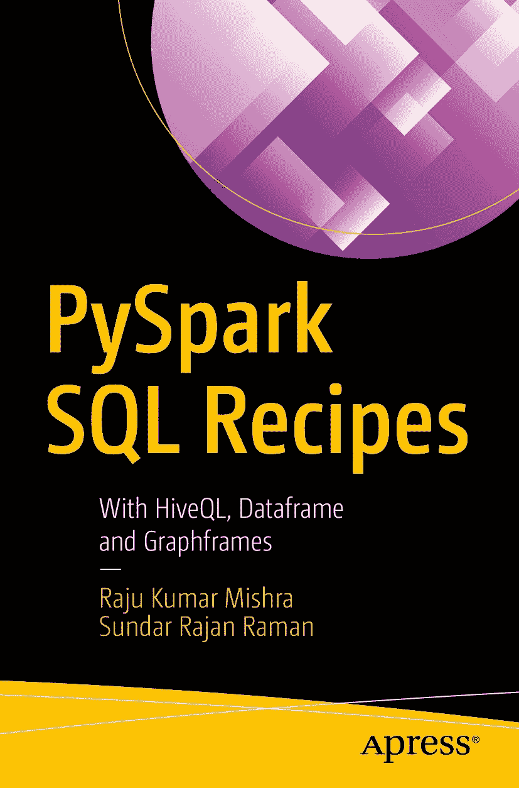

ISBN 978-1-4842-4334-3

e-ISBN 978-1-4842-4335-0

[`doi.org/10.1007/978-1-4842-4335-0`](https://doi.org/10.1007/978-1-4842-4335-0)

Library of Congress Control Number: 2019934769

© Raju Kumar Mishra and Sundar Rajan Raman 2019

Apress

本书中可能出现标准商标名、标识和图像。我们不在每个商标名、标识或图像出现时都使用商标符号，而是仅以编辑方式使用这些名称、标识和图像，并为了商标所有者的利益，无意侵犯商标。本出版物中使用的商品名、商标、服务标志及类似术语，即使未标明为商标，也不应视为对其是否受专有权利保护的立场表达。尽管本书中的建议和信息在出版时被认为是真实准确的，但作者、编辑和出版商均不对可能出现的任何错误或遗漏承担法律责任。出版商对本书所包含的内容不作任何明示或暗示的担保。

本书在全球图书贸易中由 Springer Science+Business Media New York 发行，地址：233 Spring Street, 6th Floor, New York, NY 10013。电话：`1-800-SPRINGER`，传真：`(201) 348-4505`，电子邮件：`orders-ny@springer-sbm.com`，或访问 `www.springeronline.com`。Apress Media, LLC 是一家加利福尼亚有限责任公司，其唯一成员（所有者）是 Springer Science + Business Media Finance Inc (SSBM Finance Inc)。SSBM Finance Inc 是一家特拉华州公司。

*谨以此书献给我的全能之神，他指引着我生活的方方面面。也献给我的母亲 Smt. Savitri Mishra，以及我亲爱的妻子 Smt. Smita Rani Pathak。*

## 引言

本书将带您踏上一段有趣的旅程，通过问题解决方案的方式来学习 PySparkSQL 和大数据。每个问题都附有详细、逐步的解答，这将提升您使用 PySparkSQL 解决大数据问题的思维能力。以下是各章的简要介绍：

*   第 1 章“PySparkSQL 简介”介绍了许多大数据处理工具，如 Apache Hadoop、Apache Pig、Apache Hive 和 Apache Spark。讨论了 Hadoop 的缺点和 Spark 的演进。它还讨论了 PySparkSQL，包括 DataFrame 的介绍，并涵盖了结构化流处理。本章还包含了关于 Apache Kafka 的讨论，并阐明了 MongoDB 和 Cassandra 等 NoSQL 数据库。

*   第 2 章“安装”将带您进入实战演练场。您将学习如何安装许多大数据处理工具，如 Hadoop、Hive、Spark、MongoDB 和 Apache Cassandra。

*   第 3 章“PySparkSQL 中的输入输出”将带您了解许多使用 PySparkSQL 从多种数据源读取数据的方案。您将从 CSV、JSON、ORC 和 Parquet 等多种文件格式读取数据，然后从 MySQL 和 PostgreSQL 等多种关系型数据库管理系统读取数据。本章还讨论了如何使用 PySparkSQL 从 MongoDB 和 Cassandra 等 NoSQL 数据库读取数据。最后，您将看到如何将数据保存到多种目标，如文件、关系型数据库或 NoSQL 数据库。

*   第 4 章“PySparkSQL DataFrame 上的操作”解释了在 DataFrame 上进行的不同操作，如数据过滤、数据转换和数据排序。

*   第 5 章“使用 PySparkSQL 进行数据合并与数据聚合”展示了如何在 DataFrame 上执行数据聚合和数据合并。

*   第 6 章“SQL、NoSQL 与 PySparkSQL”展示了如何在 DataFrame 上执行 SQL 操作。它包含多个方案，帮助您将 DataFrame 转换为类似表的结构，然后对其应用 SQL 查询。

*   第 7 章“优化 PySparkSQL”将向您展示如何执行更快的优化连接。您将了解 Spark 在后台运行的基本原理，并基于此看到多个帮助您优化 DataFrame 上 SQL 查询的方案。

*   第 8 章“结构化流处理”展示了如何将 Spark 流处理应用于流式数据。本章提供了多个方案，帮助您将 Spark 的结构化流处理 API 和 SQL 应用于流式数据。

*   第 9 章“GraphFrames”展示了如何在 DataFrame 上执行图操作。包括 PageRank 在内的多个 GraphFrame 方案将帮助您理解并应用使用 Spark GraphFrame 的复杂图操作。

## 致谢

我衷心感谢全能之神。我还要感谢我的母亲 Smt. Savitri Mishra；我的姐妹 Mitan 和 Priya；我的堂姐妹 Suchitra 和 Chandni；以及我的舅舅 Shyam Bihari Pandey，感谢他们的支持和鼓励。我非常感谢我甜美美丽的妻子 Smt. Smita Rani Pathak，在我写作本书期间给予我持续不断的鼓励和爱。我感谢我的姐夫 Mr. Prafull Chandra Pandey 对我写作本书的鼓励。我也非常感谢我的嫂子们/弟媳们，Rinky、Reena、Kshama、Charu 和 Dhriti，感谢她们的鼓励。我感谢 Anurag Pal Sehgal、Saurabh Gupta、Devendra Mani Tripathi、Avinash Dash、Rajesh Thakur 以及我所有的朋友们。还有我的侄子们，Rashu 和 Rishu。最后但同样重要的是，感谢 Apress 的协调编辑 Aditee Mirashi 和采编编辑 Celestin Suresh John；没有他们，这本书就不可能问世。

### 关于作者与技术审稿人

#### 关于作者

#### 关于技术审稿人

