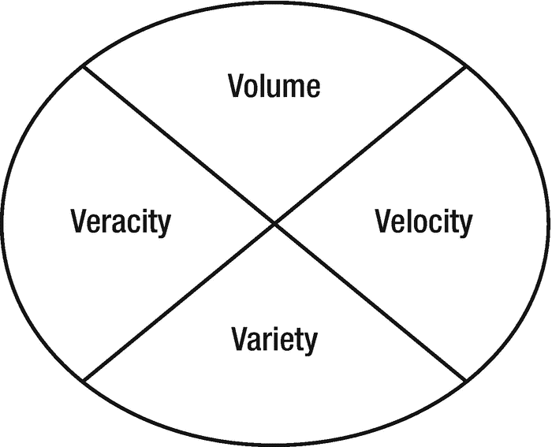
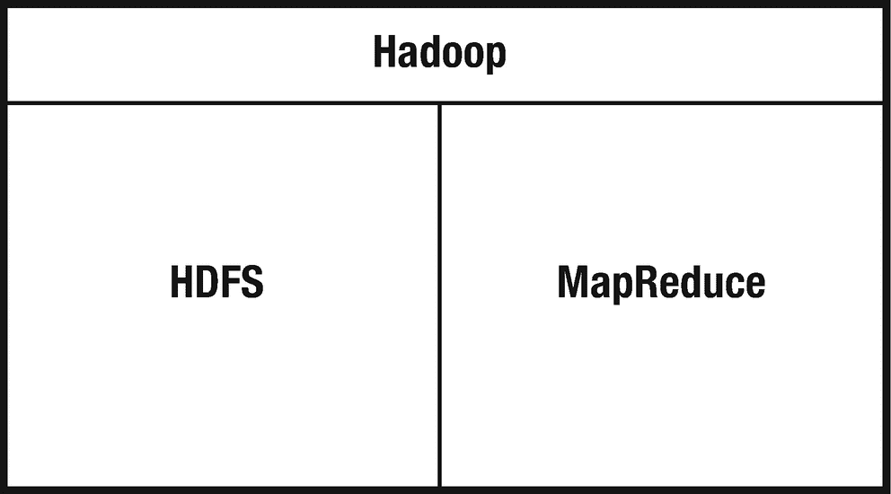
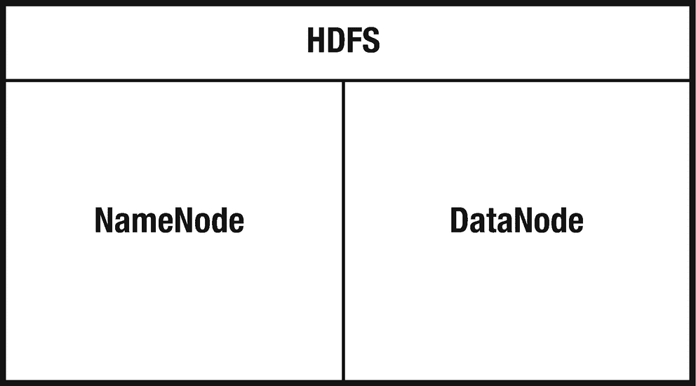
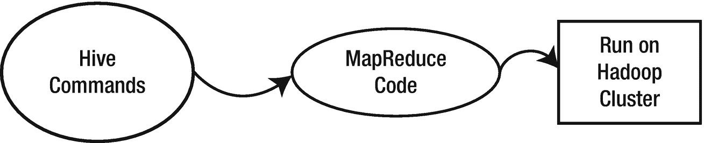
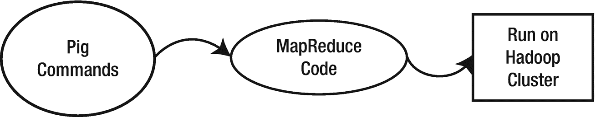
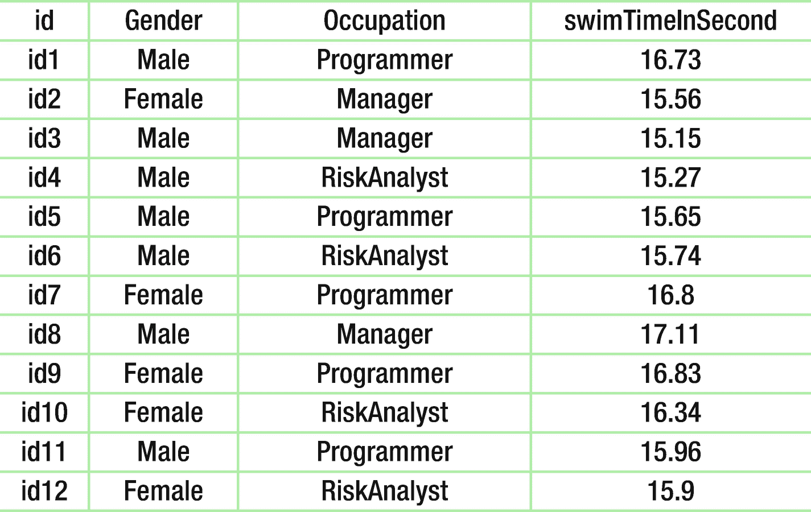

# 1. PySpark SQL 简介

每天产生的数据量都在增加。技术的进步促进了海量数据的存储。这种数据洪流迫使人们采用分布式系统。分布式系统需要分布式编程，而这需要格外关注容错性和高效算法。分布式系统总是追求两件事——系统的可靠性和所有组件的可用性。

Apache Hadoop 确保了分布式系统的高效计算和容错性。它主要专注于可靠性和可用性。Apache Hadoop 易于编程，因此许多人对大数据产生了兴趣。电商公司想更多地了解客户；医疗保健行业想从数据中获取洞见；其他行业则希望更深入地了解他们正在捕获的数据。更多的数据指标被定义，更多的数据点被收集。

许多开源大数据工具应运而生，包括 Apache Tez 和 Apache Storm。许多 NoSQL 数据库也涌现出来以处理海量数据流入。Apache Spark 也作为一种分布式系统得以发展，并随着时间的推移变得非常流行。

本章将讨论大数据和 Hadoop 作为处理大数据的分布式系统。我们还将介绍 Hadoop 生态系统框架，如 Apache Hive 和 Apache Pig。我们也会阐述 Hadoop 的缺点，并讨论 Apache Spark 的发展。然后，我们将介绍 Apache Spark。我们还将讨论与 Apache Spark 配合使用的不同集群管理器。我们重点讨论 PySpark SQL，这是本书的核心及其用途。如果不讨论 NoSQL，本章的内容是不完整的。因此，本章包含了关于 NoSQL 数据库 MongoDB 和 Cassandra 的讨论。有时我们也会从关系型数据库管理系统读取数据，因此本章也会讨论 PostgreSQL。


## 大数据简介

大数据是当今时代最热门的话题之一。那么，什么是大数据呢？它描述的是一个规模庞大且以惊人速度增长的数据集。除了数据量和增长速度，大数据还以数据多样性和数据真实性为特征。下面我们来详细讨论数据量、增长速度、多样性和真实性。这些也被称为大数据的 4V 特征。

### 数据量

数据*量*指定了需要处理的数据量。对于海量数据，我们需要大型机器或分布式系统。计算时间会随着数据量的增加而增加。因此，如果我们能并行化计算，最好使用分布式系统。数据量可能包括结构化数据、非结构化数据，或介于两者之间的数据。如果我们处理的是非结构化数据，情况会变得更为复杂且计算密集。你可能会好奇，大数据到底有多大？这是一个有争议的问题。但一般来说，我们可以说，那些无法使用传统系统处理的数据量就被定义为大数据。接下来，我们讨论数据的增长速度。

### 增长速度

组织正变得越来越有数据意识。每时每刻都有大量数据被收集。这意味着数据的*增长速度*在加快。单个系统如何应对这种增长速度？当你需要实时分析大量数据流入时，问题就变得复杂了。许多系统正在被开发出来以应对这种海量数据流入。另一个区分传统数据与大数据的要素是数据的多样性，下面进行讨论。

### 多样性

数据的多样性可能使其变得非常复杂，以至于传统的数据分析系统无法正确分析。我们谈论的是哪种多样性？数据不就是数据吗？图像数据与表格数据不同，因为它们的组织和存储方式不同。有无数的文件系统可用。每个文件系统都需要不同的处理方式。读取和写入一个`JSON`文件与处理一个`CSV`文件的方式不同。如今，数据科学家必须处理多种数据类型的组合。你将要处理的数据可能是图片、视频、文本等的组合。大数据的多样性使得分析变得更加复杂。

### 真实性

你能想象一个逻辑上不正确的计算机程序产生正确的输出吗？同样，不准确的数据将导致误导性的结果。真实性，或者说数据的正确性，是一个重要的考量。对于大数据，我们必须考虑数据的异常性。见图 1-1。



图 1-1

大数据

## Hadoop 简介

Hadoop 是一个解决大数据问题的分布式可扩展框架。Hadoop 由 Doug Cutting 和 Mark Cafarella 开发。Hadoop 是用 Java 编写的。它可以安装在商用硬件集群上，并在分布式系统上水平扩展。Hadoop 的开发灵感来自谷歌的两篇研究论文：

*   Jeffrey Dean 和 Sanjay Ghemawat 的《MapReduce：大规模集群上的简化数据处理》
*   Sanjay Ghemawat、Howard Gobioff 和 Shun-Tak Leung 的《谷歌文件系统》

在商用硬件上工作使其非常具有成本效益。如果我们在商用硬件上工作，故障是不可避免的问题。但 Hadoop 为数据存储和计算提供了一个容错系统。这种容错能力使得 Hadoop 非常受欢迎。

Hadoop 有两个组件（见图 1-2）。第一个组件，Hadoop 分布式文件系统（HDFS），是一个分布式文件系统。第二个组件是 MapReduce。HDFS 用于分布式数据存储，而 MapReduce 用于对存储在 HDFS 中的数据进行计算。



图 1-2

Hadoop 组件

## HDFS 简介

HDFS 用于以分布式和容错的方式存储大量数据。HDFS 是用 Java 编写的，运行在商用硬件上。其灵感来自谷歌关于谷歌文件系统（GFS）的研究论文。它是一种一次写入、多次读取的系统，对处理大量数据非常有效。

HDFS 有两个组件——NameNode 和 DataNode。这两个组件是 Java 守护进程。NameNode 维护分布在集群上的文件的元数据，作为许多 DataNode 的主节点。HDFS 将一个大文件分割成小数据块，并将这些数据块保存在不同的 DataNode 上。实际的文件数据块驻留在 DataNode 上。

HDFS 提供了一组类似于 UNIX shell 的命令。但我们也可以使用 HDFS 提供的 Java 文件系统 API 来更精细地处理大型文件。容错是通过数据块的复制来实现的。

我们可以使用并行单线程进程访问 HDFS 文件。HDFS 提供了一个非常有用的工具，称为 `distcp`，它通常用于以并行方式将数据从一个 HDFS 系统传输到另一个系统。它使用并行的 map 任务来复制数据。我们可以在图 1-3 的简单示意图中看到 HDFS 的组件。



图 1-3

HDFS 的组件

## MapReduce 简介

MapReduce 计算模型首次出现在谷歌的一篇研究论文中。该研究论文在 Hadoop 中被实现为 Hadoop 的 MapReduce。Hadoop 的 MapReduce 是 Hadoop 框架的计算引擎，它对 HDFS 中的分布式数据进行计算。MapReduce 已被发现在商用硬件的分布式系统上具有水平可扩展性。它也能向上扩展以解决大型问题。在 MapReduce 中，问题解决方案被分成两个阶段——Map 阶段和 Reduce 阶段。在 Map 阶段，处理数据块；在 Reduce 阶段，对 Map 阶段的结果进行聚合或归约操作。Hadoop 的 MapReduce 框架是用 Java 编写的。

MapReduce 是一种主从模型。在 Hadoop 1 中，这种 MapReduce 计算由两个守护进程管理——Jobtracker 和 Tasktracker。Jobtracker 是处理众多 Tasktracker 的主进程。Tasktracker 是 Jobtracker 的从属进程。但在 Hadoop 2 中，Jobtracker 和 Tasktracker 被 YARN 取代。

Hadoop 的 MapReduce 框架是用 Java 编写的。我们可以使用该框架提供的 API 并用 Java 编写我们的 MapReduce 代码。Hadoop streaming 模块使掌握 Python 和 Ruby 的程序员也能编写 MapReduce 程序。

MapReduce 算法有很多用途。许多机器学习算法被实现为 Apache Mahout，它作为 Pig 和 Hive 在 Hadoop 上运行。

但是 MapReduce 对于迭代算法并不非常适用。在每个 Hadoop 作业结束时，MapReduce 会将数据保存到 HDFS，并在下一个作业时再次读取。我们知道，读写文件是代价高昂的操作。Apache Spark 通过提供内存数据持久化和计算，缓解了 MapReduce 的缺点。

### 备注

你可以在以下网页上了解更多关于 MapReduce 和 Mahout 的信息：

[`https://www.usenix.org/legacy/publications/library/proceedings/osdi04/tech/full_papers/dean/dean_html/index.html`](https://www.usenix.org/legacy/publications/library/proceedings/osdi04/tech/full_papers/dean/dean_html/index.html)

[`https://mahout.apache.org/users/basics/quickstart.html`](https://mahout.apache.org/users/basics/quickstart.html)


好的，作为一名高级文档工程师和翻译员，我将严格遵循您给出的注意事项和示例，将以下英文文本翻译成中文。


## Apache Hive 简介

计算机科学是一个抽象的世界。众所周知，数据是以比特为形式的信息。像 `C` 这样的编程语言提供了对机器和汇编语言的抽象。其他高级语言则提供了更多的抽象。结构化查询语言（`SQL`）就是这些抽象之一。`SQL` 被世界上许多数据建模专家所使用。`Hadoop` 擅长处理大数据分析。那么，如何让众多了解 `SQL` 的人能利用 `Hadoop` 对大数据的计算能力呢？为了编写 `Hadoop` 的 `MapReduce` 程序，用户必须掌握一种可用于编写 `Hadoop` 的 `MapReduce` 程序的语言。

现实世界中的日常问题遵循着某些模式。有些问题在日常生活中很常见，例如数据操作、处理缺失值、数据转换和数据汇总。对于非程序员来说，为这些日常问题编写 `MapReduce` 代码是一件非常令人头疼的工作。编写代码来解决问题并非总是明智之举。但编写具有性能可扩展性且易于扩展的高效代码则很有价值。带着这个问题的思考，`Apache Hive` 在 `Facebook` 被开发出来，这样就不必为通用问题编写 `MapReduce` 代码，从而解决日常问题。

根据 `Hive` 维基文档的语言描述，“`Hive` 是一个基于 `Apache Hadoop` 的数据仓库基础设施”。`Hive` 有自己的 `SQL` 方言，称为 `Hive 查询语言`。它被称为 `HiveQL`，有时也称为 `HQL`。`Hive` 使用 `HiveQL` 查询 `HDFS` 中的数据。`Hive` 不仅可以在 `HDFS` 上运行，还可以在 `Spark` 以及其他大数据框架如 `Apache Tez` 上运行。

`Hive` 为用户在 `HDFS` 中处理结构化数据提供了类似`关系数据库管理系统`的抽象。您可以创建表并对它们运行类似 `SQL` 的查询。`Hive` 将表模式保存在某个 `RDBMS` 中。`Apache Derby` 是 `Apache Hive` 发行版自带的默认 `RDBMS`。`Apache Derby` 完全用 `Java` 编写，是一个基于 `Apache 许可证 2.0 版` 的开源 `RDBMS`。

`HiveQL` 命令会被转换为 `Hadoop` 的 `MapReduce` 代码，然后在 `Hadoop` 集群上运行。您可以在**图 1-4** 中看到 `Hive` 命令的执行流程。



**图 1-4** — Apache Hive 中的代码执行流程

了解 `SQL` 的人可以轻松学习 `Apache Hive` 和 `HiveQL`，并在其日常大数据数据分析工作中利用 `Hadoop` 的存储和计算能力。`PySpark SQL` 也支持 `HiveQL`。您可以在 `PySpark SQL` 中运行 `HiveQL` 命令。除了执行 `HiveQL` 查询之外，您还可以直接从 `Hive` 读取数据到 `PySpark SQL`，并将结果写回 `Hive`。请参见**图 1-4**。

### 注意

您可以从以下网页阅读更多关于 `Hive` 和 `Apache Derby` `RDBMS` 的信息：

- [`cwiki.apache.org/confluence/display/Hive/Tutorial`](https://cwiki.apache.org/confluence/display/Hive/Tutorial)
- [`db.apache.org/derby/`](https://db.apache.org/derby/)

## Apache Pig 简介

`Apache Pig` 是一个用于对海量数据执行数据分析的数据流框架。它由 `Yahoo!` 开发，并开源给了 `Apache 软件基金会`。现在它基于 `Apache 许可证 2.0 版` 提供。`Pig` 编程语言是一种 `Pig Latin` 脚本语言。`Pig` 与 `Hadoop` 是松耦合关系，这意味着我们可以将它连接到 `Hadoop` 并执行许多分析任务。但 `Pig` 也可以与 `Apache Tez` 和 `Apache Spark` 等其他工具一起使用。

`Apache Hive` 被用作报表工具，而 `Apache Pig` 则用于数据提取、转换和加载（`ETL`）。我们可以通过用户自定义函数（`UDF`）来扩展 `Pig` 的功能。用户自定义函数可以用多种语言编写，包括 `Java`、`Python`、`Ruby`、`JavaScript`、`Groovy` 和 `Jython`。

`Apache Pig` 使用 `HDFS` 来读取和存储数据，并使用 `Hadoop` 的 `MapReduce` 来执行算法。在使用 `Hadoop` 集群方面，`Apache Pig` 与 `Apache Hive` 类似。如**图 1-5** 所示，在 `Hadoop` 上，`Pig Latin` 命令首先被转换为 `Hadoop` 的 `MapReduce` 代码。然后它们被转换为 `MapReduce` 代码，并在 `Hadoop` 集群上运行。



**图 1-5** — Apache Pig 中的代码执行流程

`Pig` 最棒的地方在于其代码经过优化和测试，可以处理日常问题。因此，用户可以直接安装 `Pig` 并开始使用它。`Pig` 提供了 `Grunt` shell 来运行交互式的 `Pig` 命令。所以，任何了解 `Pig Latin` 的人都可以享受 `HDFS` 和 `MapReduce` 带来的好处，而无需了解 `Java` 或 `Python` 等高级编程语言。

### 注意

您可以从以下网址阅读更多关于 Apache Pig 的信息：

- [`pig.apache.org/docs/`](http://pig.apache.org/docs/)
- [`en.wikipedia.org/wiki/Pig_(programming_tool)`](https://en.wikipedia.org/wiki/Pig_%28programming_tool%29)
- [`cwiki.apache.org/confluence/display/PIG/Index`](https://cwiki.apache.org/confluence/display/PIG/Index)

## Apache Kafka 简介

`Apache Kafka` 是一个发布-订阅式的分布式消息平台。它由 `LinkedIn` 开发，并进一步开源给了 `Apache` 基金会。它具有容错性、可扩展性和快速性。在 `Kafka` 术语中，消息是数据的最小单元，它从生产者流向消费者，经过 `Kafka 服务器`，并且可以被持久化以备后续使用。您可能对*生产者*和*消费者*这些术语感到困惑。我们很快就会讨论这些术语。在 `Kafka` 的上下文中，我们将使用的另一个关键术语是*主题*。主题是一类相似的连续消息流。`Kafka` 自带一套内置的 `API`，开发人员可以使用它来构建自己的应用程序。主题是由我们来定义的。接下来，我们将讨论 `Apache Kafka` 的三个主要组件。

### 生产者

`Kafka` 生产者将消息生成到某个 `Kafka` 主题。它可以将数据发布到多个主题。

### 代理

这是运行在专用机器上的主要 `Kafka` 服务器。生产者将消息推送到代理。代理将主题持久化到不同的分区中，并且这些分区会被复制到不同的代理以应对故障。代理本质上是无状态的，因此消费者必须跟踪它所消费的消息。

### 消费者

消费者从 `Kafka 代理`获取消息。请记住，是它去获取消息。`Kafka 代理`不会将消息推送给消费者；而是消费者从 `Kafka 代理`拉取数据。消费者订阅了 `Kafka 代理`上的一个或多个主题，并读取其中的消息。代理还会跟踪所有已经被消费的消息。数据在代理中会持久化一段指定的时间。如果消费者发生故障，它可以在重启后获取数据。

**图 1-6** 展示了 `Apache Kafka` 的消息流。生产者将消息发布到主题。然后，消费者从代理拉取数据。在发布和拉取之间，消息由 `Kafka 代理`进行持久化。


**图 1-6** — Apache Kafka 消息流

我们将在**第 7 章**中将 `Apache Kafka` 与 `PySpark` 集成，并更详细地讨论 `Kafka`。

### 注意

您可以从以下网址阅读更多关于 Apache Kafka 的信息：

- [`kafka.apache.org/documentation/`](https://kafka.apache.org/documentation/)
- [`kafka.apache.org/quickstart`](https://kafka.apache.org/quickstart)


## Apache Spark 简介

Apache Spark 是一个通用的分布式编程框架。它被认为非常适合迭代数据处理和批处理数据。它由 AMP 实验室开发。它提供了一个内存计算框架。它是一个开源软件。一方面，它最适合批处理；另一方面，它在处理实时或近实时数据方面也表现非常出色。机器学习和图算法本质上是迭代的，这正是 Spark 展现其魔力之处。根据其研究论文，它比其同类 Hadoop 快得多。数据可以缓存在内存中。在迭代算法中缓存中间数据可提供惊人的快速处理能力。Spark 可以使用 Java、Scala 和 R 进行编程。

您可以在以下研究论文中了解更多关于 Apache Spark 运行时效率的信息：

*   “弹性分布式数据集：一种面向内存集群计算的容错抽象”，作者：Matei Zaharia、Mosharaf Chowdhury、Tathagata Das、Ankur Dave、Justin Ma、Murphy McCauley、Michael J. Franklin、Scott Shenker 和 Ion Stoica。
*   “Spark：使用工作集进行集群计算”，作者：Matei Zaharia、Mosharaf Chowdhury、Michael J. Franklin、Scott Shenker 和 Ion Stoica。
*   “MLlib：Apache Spark 中的机器学习”，作者：Xiangrui Meng、Joseph Bradley、Burak Yavuz、Evan Sparks、Shivaram Venkataraman、Davies Liu、Jeremy Freeman、DB Tsai、Manish Amde、Sean Owen、Doris Xin、Reynold Xin、Michael J. Franklin、Reza Zadeh、Matei Zaharia 和 Ameet Talwalkar。

如果你认为 Spark 是改进版的 Hadoop，在某种程度上，我认为这也没问题。因为我们可以在 Spark 中实现 MapReduce 算法，Spark 利用了 HDFS 的优势。这意味着它可以从 HDFS 读取数据并将数据存储到 HDFS，并且它能够高效地处理迭代计算，因为数据可以持久化在内存中。除了内存计算之外，它也非常适合交互式数据分析。

还有许多其他的库也依附于 PySpark，使得使用 PySpark 更加容易。我们将在下面讨论一些这样的库。

*   `MLlib`：MLlib 是 PySpark 核心之上的一个封装库，它处理机器学习算法。MLlib 库提供的机器学习 API 非常易于使用。MLlib 支持许多机器学习算法，包括分类、聚类、文本分析等等。
*   `ML`：ML 也是一个机器学习库，位于 PySpark 核心之上。ML 的机器学习 API 可以作用于 DataFrames 上。
*   `GraphFrames`：GraphFrames 库提供了一组 API，用于使用 PySpark 核心和 PySpark SQL 高效地进行图分析。在编写本书时，DataFrames 是一个外部库。您需要单独下载并安装它。

## PySpark SQL 简介

数据科学家处理的大部分数据本质上是结构化或半结构化的。PySpark SQL 模块是在 PySpark 核心之上的一个更高级抽象，用于处理结构化和半结构化数据集。我们将在整本书中学习 PySpark SQL。它是 PySpark 的内置模块，这意味着它不需要任何额外的安装。

PySpark SQL 可以使用领域特定语言进行编程。就我们而言，我们将使用 Python 来编写 PySpark SQL 程序。除了领域特定语言外，我们还可以运行结构化查询语言 (SQL) 和 HiveQL 查询。使用 SQL 和 HiveQL 使 PySpark SQL 在数据库程序员和 Apache Hive 用户中备受欢迎。

使用 PySpark SQL，您可以从多种来源读取数据。PySpark SQL 支持从多种文件格式系统读取数据，包括文本文件、CSV、ORC、Parquet、JSON 等。您可以从关系数据库管理系统 (RDBMS) 读取数据，例如 MySQL 和 PostgreSQL。您也可以将分析报告保存到多种系统和文件格式中。

PySpark SQL 引入了 DataFrames，它创建结构化数据的表格表示，并在 RDBMS 中提供表。另一种数据抽象数据集是在 Spark 1.6 中引入的，但它不适用于 PySpark SQL。

### DataFrames 简介

DataFrames 是一种类似于关系数据库系统中表的抽象。它们由命名列组成。DataFrames 是行对象的集合，在 PySpark SQL 中定义。DataFrames 也包含命名列对象。用户知道表格形式的模式，因此操作 DataFrames 变得很容易。

DataFrame 列中的元素将具有相同的数据类型。DataFrame 中的行可能包含不同数据类型的元素。基本的数据结构称为弹性分布式数据集 (RDD)。DataFrames 是 RDD 上的封装。它们是 RDD 或行对象。我们将在接下来的章节中了解更多关于 `Row` 类的信息。参见图 1-7。



图 1-7

DataFrames

图 1-7 展示了一个包含四列的 DataFrame。列的名称分别是 `id`、`Gender`、`Occupation` 和 `swimTimeInSecond`。前三列的数据类型是 `String`，而最后一列包含浮点数据。DataFrame 有两个组成部分——数据和它的模式。应该清楚的是，这与 RDBMS 表或 R 语言的 DataFrames 类似。

### 注意

数据集合在 PySpark 中不被使用。感兴趣的读者可以在以下链接中了解数据集及其 API：

[`https://spark.apache.org/docs/latest/sql-programming-guide.html`](https://spark.apache.org/docs/latest/sql-programming-guide.html)

### SparkSession

`SparkSession` 对象是入口点，它取代了 `SQLContext` 和 `HiveContext`。为了使 PySpark SQL 代码与早期版本兼容，`SQLContext` 和 `HiveContext` 在 PySpark 中继续存在。在 PySpark 控制台中，我们可以获取 `SparkSession` 对象。我们可以使用以下代码创建一个 `SparkSession` 对象。

为了创建 `SparkSession` 对象，我们必须按如下方式导入 SparkSession：

```
from pyspark.sql import SparkSession
```

导入 SparkSession 后，我们可以使用 `SparkSession.builder` 如下所示创建它的对象：

```
spark = SparkSession.builder.appName("PythonSQLAPP") .getOrCreate()
```

`appName` 函数将设置应用程序的名称。`getOrCreate()` 函数将返回一个现有的 `SparkSession` 对象。如果不存在 `SparkSession` 对象，`getOrCreate()` 函数将创建一个新对象并返回它。

### 结构化流

我们可以使用结构化流框架进行流数据分析，该框架是 PySpark SQL 之上的一个封装。我们可以使用结构化流对流数据进行分析，就像使用 PySpark SQL 对静态数据进行批处理分析一样。

就像 Spark 流式处理模块对微批次执行流式处理操作一样，结构化流引擎也对微批次执行流式处理操作。

结构化流的最佳之处在于它使用与 PySpark SQL 类似的 API。因此，学习曲线较高。对 DataFrames 的操作已经过优化，类似地，结构化流 API 也在性能方面进行了优化。


## Catalyst 优化器

SQL 是一种声明式语言。使用 SQL 时，我们告诉 SQL 引擎**要做什么**，而不告诉它**如何**执行任务。类似地，PySpark SQL 命令也不会告诉系统如何执行任务，这些命令仅指明要执行的内容。因此，PySpark SQL 查询在执行任务时需要进行优化。`catalyst optimizer`（催化剂优化器）在 PySpark SQL 中执行查询优化。PySpark SQL 查询会被转换为低层级的弹性分布式数据集（`RDD`）操作。`catalyst optimizer`首先将 PySpark SQL 查询转换为逻辑计划，然后将此逻辑计划转换为优化后的逻辑计划。根据此优化后的逻辑计划，会生成一个物理计划。实际上会生成多个物理计划。通过使用代价分析器，会选择出最优化的物理计划。最后，生成低层级的`RDD`操作代码。

## 集群管理器简介

在分布式系统中，一个作业或应用程序会被分解为不同的任务，这些任务可以在集群中的不同机器上并行运行。如果机器出现故障，你必须在另一台机器上重新调度该任务。

由于资源管理不善，分布式系统通常会面临可扩展性问题。设想一个已经在集群上运行的作业。另一个人想要运行另一个作业。第二个作业必须等待第一个作业完成。但这样，我们并没有最优地利用资源。资源管理说起来容易，但在分布式系统上实现起来却很困难。为了最优地管理集群资源，集群管理器应运而生。Spark 有三种可用的集群管理器——独立模式（Standalone）、Apache Mesos 和 YARN。这些集群管理器最大的优点在于，它们在用户和集群之间提供了一个抽象层。由于集群管理器提供的这种抽象，用户的使用体验就像在单机上工作一样，尽管他们实际上是在集群上工作。集群管理器负责将集群资源调度给正在运行的应用程序。

### Standalone 集群管理器

Apache Spark 自带一个 Standalone 集群管理器。它为 Spark 集群提供了主从架构。这是一个仅适用于 Spark 的集群管理器。你只能使用此 Standalone 集群管理器运行 Spark 应用程序。其组件包括主节点（master）和工作节点（workers）。工作节点是主进程的从节点。这是最简单的集群管理器。Spark Standalone 集群管理器可以通过 Spark 的 `sbin` 目录中的脚本进行配置。我们将在后续章节中配置 Spark Standalone 集群管理器，并使用 Standalone 集群管理器部署 PySpark 应用程序。

### Apache Mesos 集群管理器

Apache Mesos 是一个通用的集群管理器。它由加州大学伯克利分校 AMP 实验室开发。Apache Mesos 帮助分布式解决方案高效扩展。使用 Mesos，你可以在同一集群上通过不同的框架运行不同的应用程序。来自不同框架的不同应用程序是什么意思？这意味着你可以在 Mesos 上同时运行一个 Hadoop 应用程序和一个 Spark 应用程序。当多个应用程序在 Mesos 上运行时，它们共享集群资源。Apache Mesos 有两个重要的组件——主节点（master）和从节点（slaves）。这种主从架构类似于 Spark Standalone 集群管理器。在 Mesos 上运行的应用程序被称为框架（frameworks）。从节点会以资源邀约（resource offer）的形式，将其可用的资源告知主节点。从节点机器会周期性地提供资源邀约。主节点的分配模块（allocation module）决定哪个框架获得这些资源。

### YARN 集群管理器

YARN 代表“另一种资源协调器”（Yet Another Resource Negotiator）。YARN 是在 Hadoop 2 中引入的，用于扩展 Hadoop。它将资源管理和作业管理分离开来。分离这两个组件使 Hadoop 具有更好的可扩展性。YARN 的主要组件是 `ResourceManager`、`ApplicationMaster` 和 `NodeManager`。每个集群有一个全局的 `ResourceManager` 和多个 `NodeManager` 在运行。`NodeManager` 是 `ResourceManager` 的从节点。`Scheduler`（调度器）是 `ResourceManager` 的一个组件，它为集群上运行的不同应用程序分配资源。最棒的一点是，你可以在 YARN 管理的集群上同时运行 Spark 应用程序和任何其他应用程序（如 Hadoop 或 MPI）。每个应用程序有一个 `ApplicationMaster`，它负责处理在分布式系统上并行运行的任务。请记住，Hadoop 和 Spark 有各自的 `ApplicationMaster`。

### 注意

你可以通过以下网页了解更多关于 Standalone、Apache Mesos 和 YARN 集群管理器的信息。

[`https://spark.apache.org/docs/2.0.0/spark-standalone.html`](https://spark.apache.org/docs/2.0.0/spark-standalone.html)

[`https://spark.apache.org/docs/2.0.0/running-on-mesos.html`](https://spark.apache.org/docs/2.0.0/running-on-mesos.html)

[`https://spark.apache.org/docs/2.0.0/running-on-yarn.html`](https://spark.apache.org/docs/2.0.0/running-on-yarn.html)

## PostgreSQL 简介

关系型数据库管理系统在许多组织中仍然非常普遍。这里的*关系*是什么意思？关系指的是表。PostgreSQL 是一个关系型数据库管理系统。它运行在所有主流操作系统上，如 Microsoft Windows、基于 UNIX 的操作系统、MacOS X 等。它是一个开源程序，其代码在 PostgreSQL 许可下可用。因此，你可以自由地使用它，并根据你的需求进行修改。

PostgreSQL 数据库可以通过其他编程语言连接，如 Java、Perl、Python、C 和 C++，以及通过不同的编程接口连接许多其他语言。它还可以使用一种称为 `PL/pgSQL`（过程化语言/PostgreSQL）的过程化编程语言进行编程，该语言类似于 `PL/SQL`。你可以向此数据库添加自定义函数。你可以用 C/C++ 和其他编程语言编写自定义函数。你还可以使用 JDBC 连接器从 PySpark SQL 读取 PostgreSQL 中的数据。在后续章节中，我们将使用 PySpark SQL 从 PostgreSQL 读取数据表。我们还将进一步探讨 PostgreSQL 的其他一些方面。

PostgreSQL 遵循 ACID（原子性、一致性、隔离性和持久性）原则。它附带了许多特性，其中一些是 PostgreSQL 独有的。它支持可更新视图、事务完整性、复杂查询、触发器等功能。PostgreSQL 使用多版本并发控制模型进行并发管理。

PostgreSQL 拥有广泛的社区支持。PostgreSQL 被设计和开发为可扩展的数据库。

### 注意

如果你想深入了解 PostgreSQL，以下链接会非常有用。

[`https://wiki.postgresql.org/wiki/Main_Page`](https://wiki.postgresql.org/wiki/Main_Page)

[`https://en.wikipedia.org/wiki/PostgreSQL`](https://en.wikipedia.org/wiki/PostgreSQL)

[`https://en.wikipedia.org/wiki/Multiversion_concurrency_control`](https://en.wikipedia.org/wiki/Multiversion_concurrency_control)

[`http://postgresguide.com/`](http://postgresguide.com/)

## MongoDB 简介

MongoDB 是一个基于文档的 NoSQL 数据库。它是一个由 MongoDB 公司开发的开源分布式数据库。MongoDB 使用 C++ 编写，并且能够水平扩展。许多组织将其用作后端数据库以及其他多种用途。

MongoDB 附带了一个 `mongo` shell，它是 MongoDB 服务器的 JavaScript 接口。`mongo` shell 既可用来运行查询，也可执行管理任务。在 `mongo` shell 上，我们也可以运行 JavaScript 代码。

使用 PySpark SQL，我们可以从 MongoDB 读取数据并进行分析。我们也可以写入结果。

### 注意

你可以通过以下链接阅读更多关于 MongoDB 的信息

[`https://docs.mongodb.com/`](https://docs.mongodb.com/)


## Cassandra 简介

Cassandra 是一款开源、分布式数据库，采用 Apache 许可证。它是在 Facebook 开发的 NoSQL 数据库。它具有水平可扩展性，最适合处理结构化数据。它提供高一致性级别，并且具有可调一致性。它没有单点故障。它通过点对点分布式架构在不同节点上复制数据。节点之间使用**八卦协议**交换信息。

### 注意

你可以通过以下链接了解更多关于 Apache Cassandra 的信息。

[`https://www.datastax.com/resources/tutorials`](https://www.datastax.com/resources/tutorials)

[`http://cassandra.apache.org/doc/latest/`](http://cassandra.apache.org/doc/latest/)

