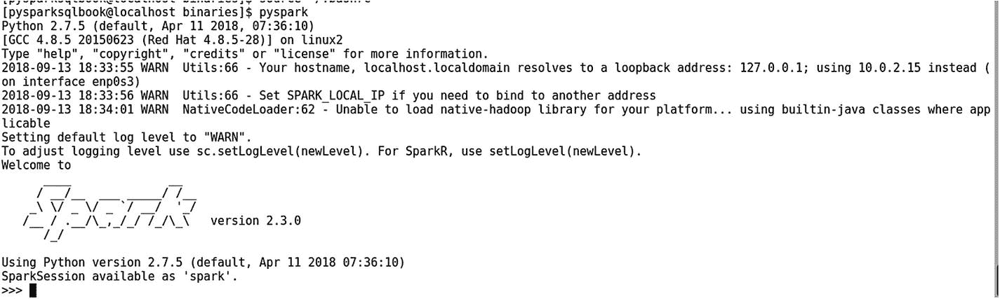

# 2. 安装

在接下来的章节中，我们将使用 PySpark 解决许多问题。PySpark 还与许多其他大数据框架交互以提供端到端解决方案。PySpark 可以从 HDFS、NoSQL 数据库或关系数据库管理系统中读取数据。数据分析后，我们可以将结果保存到 HDFS 或数据库中。

本章介绍阅读本书所需的所有软件安装。我们将在 CentOS 操作系统上安装所有必需的大数据框架。CentOS 是一款企业级操作系统。它免费使用且易于获取。我们可以从 [https://www.centos.org/download/](https://www.centos.org/download/) 链接下载 CentOS 并安装在虚拟机上。

在本章中，我们将讨论以下内容：

*   配方 2-1. 在单机上安装 Hadoop

*   配方 2-2. 在单机上安装 Spark

*   配方 2-3. 使用 PySpark Shell

*   配方 2-4. 在单机上安装 Hive

*   配方 2-5. 安装 PostgreSQL

*   配方 2-6. 在 PostgreSQL 上配置 Hive 元存储

*   配方 2-7. 连接 PySpark 与 Hive

*   配方 2-8. 安装 MySQL

*   配方 2-9. 安装 MongoDB

*   配方 2-10. 安装 Cassandra

我建议你自行安装每一个软件。这是一个很好的练习，能让你更深入地理解每个软件包的组成部分。

## 配方 2-1. 在单机上安装 Hadoop

### 问题

你希望在一台机器上安装 Hadoop。

### 解决方案

你可能想知道，我们在学习 PySpark 的同时为什么还要安装 Hadoop？我们是否要使用 Hadoop MapReduce 作为解决问题的分布式框架？答案是，完全不是。我们将使用 Hadoop 的两个组件：HDFS 和 YARN。HDFS 用于数据存储，YARN 作为集群管理器。为了安装 Hadoop，我们需要下载并配置它。

### 工作原理

请按照以下步骤完成 Hadoop 安装。

#### 步骤 2-1-1. 创建新的 CentOS 用户

将创建一个新用户。你可能在想，为什么需要一个新用户？为什么我们不能在现有用户中安装 Hadoop？其背后的原因是，我们希望为所有大数据框架提供一个专用用户。在下面的代码行中，我们创建一个名为 `pysparksqlbook` 的用户。

```
[root@localhost book]# adduser pysparksqlbook
[root@localhost book]# passwd pysparksqlbook
```

输出如下：

```
Changing password for user pysparksqlbook.
New password:
passwd: all authentication tokens updated successfully.
```

在上述代码片段中，我们可以看到 `adduser` 命令已用于创建或添加用户。Linux 的 `passwd` 命令已用于为新用户 `pysparksqlbook` 设置密码。

创建用户后，我们必须将其添加到 `sudo`。`sudo` 代表“超级用户执行”。使用 `sudo`，我们可以以超级用户身份运行任何代码。`sudo` 将用于安装软件。

#### 步骤 2-1-2. 将 CentOS 用户添加到 sudo

然后，我们必须将新用户 `pysparksqlbook` 添加到 `sudo`。以下命令将完成此操作。

```
[root@localhost book]# usermod -aG wheel pysparksqlbook
[root@localhost book]# exit
```

然后我们登录我们的用户 `pysparksqlbook`。

```
[book@localhost ~]$ su pysparksqlbook
```

我们将创建两个目录——`binaries` 目录（位于主目录下）用于下载软件，以及 `allBigData` 目录（位于根目录 `/` 下）用于安装大数据框架。

```
[pysparksqlbook@localhost ~]$ mkdir binaries
[pysparksqlbook@localhost ~]$ sudo mkdir /allBigData
```

#### 步骤 2-1-3. 安装 Java

Hadoop、Hive、Spark 以及许多大数据框架都使用 JVM。这就是我们首先要安装 Java 的原因。我们将使用 OpenJDK 来满足我们的需求。我们正在安装 OpenJDK 的第 8 版。我们可以使用 `yum` 安装程序在 CentOS 上安装 Java。以下命令使用 `yum` 安装程序安装 Java。

```
[pysparksqlbook@localhost binaries]$ sudo yum install java-1.8.0-openjdk
```

输出如下：

```
Loaded plugins: fastestmirror, langpacks
Loading mirror speeds from cached hostfile
* base: centos.excellmedia.net
* extras: centos.excellmedia.net
.
.
.
.
Updated:
java-1.8.0-openjdk.x86_64 1:1.8.0.181-3.b13.el7_5
Dependency Updated:
java-1.8.0-openjdk-headless.x86_64 1:1.8.0.181-3.b13.el7_5
Complete!
```

Java 已安装。安装任何软件后，最好检查一下安装情况。检查安装会向你显示一切正常。

为了检查 Java 安装，我倾向于使用 `java -version` 命令，该命令将返回已安装 JVM 的版本。

```
[pysparksqlbook@localhost binaries]$ java -version
```

输出如下：

```
openjdk version "1.8.0_181"
OpenJDK Runtime Environment (build 1.8.0_181-b13)
OpenJDK 64-Bit Server VM (build 25.181-b13, mixed mode)
```

Java 已安装。我们必须查找环境变量 `JAVA_HOME`，它将被所有分布式框架使用。安装 Java 后，我们可以通过使用 `jrunscript` 来查找 Java 主目录变量，如下所示。

```
[pysparksqlbook@localhost binaries]$ jrunscript -e 'java.lang.System.out.println(java.lang.System.getProperty("java.home"));'
```

输出如下：

```
/usr/lib/jvm/java-1.8.0-openjdk-1.8.0.181-3.b13.el7_5.x86_64/jre
```

我们已经找到了 `JAVA_HOME` 的绝对路径。

#### 步骤 2-1-4. 从 `pysparksqlbook` 创建免密码登录

以下是创建免密码登录的步骤。

```
[pysparksqlbook@localhost binaries]$ ssh-keygen -t rsa
```

输出如下：

# 2.1.4 配置 SSH

生成公钥/私钥对：
```
Generating public/private rsa key pair.
Enter file in which to save the key (/home/pysparksqlbook/.ssh/id_rsa):
Created directory '/home/pysparksqlbook/.ssh'.
Enter passphrase (empty for no passphrase):
Enter same passphrase again:
Your identification has been saved in /home/pysparksqlbook/.ssh/id_rsa.
Your public key has been saved in /home/pysparksqlbook/.ssh/id_rsa.pub.
The key fingerprint is:
SHA256:DANT7QBm9fDHi1/VRPcytb8/d4PemcOnn0Sm9hzl93A pysparksqlbook@localhost.localdomain
The key's randomart image is:
+---[RSA 2048]----+
|    *++.       .=|
|   o o.+..     ++|
|      ooo o   +.o|
|       +.o . . o.|
|        S . .  oo|
|         . .  +.o|
|          .  o++E|
|            ..=B%|
|            ...X@|
+----[SHA256]-----+
```

下一个命令：
```
[pysparksqlbook@localhost binaries]$ cat ~/.ssh/id_rsa.pub >> ~/.ssh/authorized_keys
[pysparksqlbook@localhost binaries]$ chmod 755 ~/.ssh/authorized_keys
[pysparksqlbook@localhost binaries]$ ssh localhost
```

输出如下：
```
The authenticity of host 'localhost (::1)' can't be established.
ECDSA key fingerprint is SHA256:md4M1J6VEYQm3gSynB0gqIYFpesp6I2cRvlEvJOIFFE.
ECDSA key fingerprint is MD5:78:cf:a7:71:2e:38:c2:62:01:65:c2:4c:71:7e:3c:90.
Are you sure you want to continue connecting (yes/no)? yes
Warning: Permanently added 'localhost' (ECDSA) to the list of known hosts.
Last login: Thu July 13 17:02:56 2018
```

最后：
```
[pysparksqlbook@localhost ~]$ exit
```

输出如下：
```
logout
Connection to localhost closed.
```

## 2.1.5 下载 Hadoop

现在我们将从 Apache 网站下载 Hadoop。如前所述，我们会将所有必要的包下载到`binaries`目录中。我们将使用`wget`命令下载 Hadoop。

```
[pysparksqlbook@localhost ~]$ cd  binaries
[pysparksqlbook@localhost binaries]$ wget http://mirrors.fibergrid.in/apache/hadoop/common/hadoop-2.7.7/hadoop--.7.7.tar.gz
```

以下是输出结果：
```
--2018-06-26 12:56:36--  http://mirrors.fibergrid.in/apache/hadoop/common/hadoop-2.7.7/hadoop-2.7.7.tar.gz
Resolving mirrors.fibergrid.in (mirrors.fibergrid.in)... 103.116.36.9, 2402:f4c0::9
Connecting to mirrors.fibergrid.in (mirrors.fibergrid.in)|103.116.36.9|:80... connected.
HTTP request sent, awaiting response... 200 OK
Length: 218720521 (209M) [application/x-gzip]
Saving to: 'hadoop-2.7.7.tar.gz'
100%[======================================>] 218,720,521 38.8KB/s   in 63m 45s
2018-06-26 14:00:22 (55.8 KB/s) - 'hadoop-2.7.7.tar.gz' saved [218720521/218720521]
```

## 2.1.6 将 Hadoop 二进制文件移动到安装目录

我们的安装目录名为`allBigData`。下载的软件位于`hadoop-2.7.7.tar.gz`中，这是一个压缩目录。因此，我们首先需要解压它。我们可以使用`tar`命令进行解压，如下所示：
```
[pysparksqlbook@localhost binaries]$ tar xvzf hadoop-2.7.7.tar.gz
```

现在，我们将 Hadoop 移动到`allBigData`目录下。
```
pysparksqlbook@localhost binaries]$ sudo  mv  hadoop-2.7.7   /allBigData/hadoop
```

## 2.1.7 修改 Hadoop 环境文件

我们需要对 Hadoop 环境文件做一些修改。Hadoop 环境文件位于 Hadoop 配置目录中。在我们的案例中，Hadoop 配置目录是`/allBigData/hadoop/etc/hadoop/`。在以下代码行中，我们将`JAVA_HOME`添加到`hadoop-env.sh`文件中。
```
[pysparksqlbook@localhost binaries]$ vim /allBigData/hadoop/etc/hadoop/hadoop-env.sh
```

打开 Hadoop 环境文件后，添加以下行。
```
##### The java implementation to use.
export JAVA_HOME=/usr/lib/jvm/java-1.8.0-openjdk-1.8.0.181-3.b13.el7_5.x86_64/jre
```

## 2.1.8 修改 Hadoop 属性文件

我们将重点关注三个属性文件：
* `hdfs-site.xml`：HDFS 属性
* `core-site.xml`：与集群相关的核心属性
* `mapred-site.xml`：MapReduce 框架的属性

这些属性文件位于 Hadoop 配置目录中。在上一章中，我们讨论了 HDFS。我们发现 HDFS 有两个组件——`NameNode`和`DataNode`。我们还讨论了 HDFS 会进行数据复制以实现容错。在我们的`hdfs-site.xml`文件中，我们将使用`dfs.name.dir`参数设置`namenode`目录，使用`dfs.data.dir`参数设置`datanode`目录，并使用`dfs.replication`参数设置复制因子。

让我们修改`hdfs-site.xml`。
```
[pysparksqlbook@localhost binaries]$ vim /allBigData/hadoop/etc/hadoop/hdfs-site.xml
```

打开`hdfs-site.xml`后，我们必须在该文件中添加以下行。
```
dfs.name.dir
file:/allBigData/hdfs/namenode
NameNode location

dfs.data.dir
file:/allBigData/hdfs/datanode
DataNode location

dfs.replication
Number of block replication
```

### 更新 Hadoop 配置文件

更新 `hdfs-site.xml` 后，我们将更新 `core-site.xml`。在 `core-site.xml` 中，我们将更新两个属性——`fs.default.name` 和 `hadoop.tmp.dir`。`fs.default.name` 属性用于确定文件系统的主机、端口等。`hadoop.tmp.dir` 属性确定 Hadoop 的临时目录。我们必须将以下行添加到 `core-site.xml` 中。

```
fs.default.name
hdfs://localhost:9745
Host port of file system

hadoop.tmp.dir
/application/hadoop/tmp
Temp directory for other working and tmp directories
```

最后，我们将修改 `mapred-site.xml`。我们将修改 `mapreduce.framework.name`，它将决定使用哪个运行时框架。可能的值有 `local`、`classic` 或 `yarn`。我们必须将以下代码添加到 `mapred-site.xml` 文件中。

```
[pysparksqlbook@localhost binaries]$ cp /allBigData/hadoop/etc/hadoop/mapred-site.xml.template /allBigData/hadoop/etc/hadoop/mapred-site.xml
[pysparksqlbook@localhost binaries]$vim /allBigData/hadoop/etc/hadoop/mapred-site.xml
```

以下是 XML 内容：

```
mapreduce.framework.name
yarn
```

让我们创建临时目录：

```
[pysparksqlbook@localhost binaries]$ sudo mkdir -p  /application/hadoop/tmp
[pysparksqlbook@localhost binaries]$ sudo chown pysparksqlbook:pysparksqlbook -R /application/hadoop
```

### 步骤 2-1-9：更新 `.bashrc` 文件

以下行必须添加到 `.bashrc` 文件中。打开 `.bashrc` 并通过添加以下行来追加内容。

```
[pysparksqlbook@localhost binaries]$ vim  ~/.bashrc
```

在 `.bashrc` 文件中，在末尾添加以下行。

```
export HADOOP_HOME=/allBigData/hadoop
export PATH=$PATH:$HADOOP_HOME/sbin
export PATH=$PATH:$HADOOP_HOME/bin
export JAVA_HOME=/usr/lib/jvm/java-1.8.0-openjdk-1.8.0.181-3.b13.el7_5.x86_64/jre
export PATH=$PATH:$JAVA_HOME/bin
```

然后，我们必须执行 `.bashrc` 文件。执行该文件后，新的更新值将在控制台中生效。

```
[pysparksqlbook@localhost binaries]$ source ~/.bashrc
```

### 步骤 2-1-10：运行 Namenode 格式化

我们已经更新了一些属性文件。我们需要运行 `namenode` 格式化，以便所有更改都能在我们的框架中生效。以下命令将格式化 `namenode`。

```
[pysparksqlbook@localhost binaries]$ hdfs namenode -format
```

以下是输出结果：

```
18/06/13 18:14:49 INFO namenode.FSImageFormatProtobuf: Image file /allBigData/hdfs/namenode/current/fsimage.ckpt_0000000000000000000 of size 331 bytes saved in 0 seconds.
18/06/13 18:14:50 INFO namenode.NNStorageRetentionManager: Going to retain 1 images with txid >= 0
18/06/13 18:14:50 INFO util.ExitUtil: Exiting with status 0
18/06/13 18:14:50 INFO namenode.NameNode: SHUTDOWN_MSG:
/************************************************************
SHUTDOWN_MSG: Shutting down NameNode at localhost/127.0.0.1
************************************************************
```

### 步骤 2-1-11：启动 Hadoop

Hadoop 已安装完成。现在我们需要启动 Hadoop。我们可以在 `/allBigData/hadoop/sbin/` 中找到 Hadoop 的启动脚本。我们需要依次运行 `start-dfs.sh` 和 `start-yarn.sh` 脚本。

```
[pysparksqlbook@localhost binaries]$ /allBigData/hadoop/sbin/start-dfs.sh
```

以下是输出结果：

```
Starting namenodes on [localhost]
localhost: starting namenode, logging to /allBigData/hadoop/logs/hadoop-pysparksqlbook-namenode-localhost.localdomain.out
localhost: starting datanode, logging to /allBigData/hadoop/logs/hadoop-pysparksqlbook-datanode-localhost.localdomain.out
Starting secondary namenodes [0.0.0.0]
The authenticity of host '0.0.0.0 (0.0.0.0)' can't be established.
ECDSA key fingerprint is SHA256:md4M1J6VEYQm3gSynB0gqIYFpesp6I2cRvlEvJOIFFE.
ECDSA key fingerprint is MD5:78:cf:a7:71:2e:38:c2:62:01:65:c2:4c:71:7e:3c:90.
Are you sure you want to continue connecting (yes/no)? yes
0.0.0.0: Warning: Permanently added '0.0.0.0' (ECDSA) to the list of known hosts.
0.0.0.0: starting secondarynamenode, logging to /allBigData/hadoop/logs/hadoop-pysparksqlbook-secondarynamenode-localhost.localdomain.out
[pysparksqlbook@localhost binaries]$ /allBigData/hadoop/sbin/start-yarn.sh
```

以下是输出结果：

```
starting yarn daemons
starting resourcemanager, logging to /allBigData/hadoop/logs/yarn-pysparksqlbook-resourcemanager-localhost.localdomain.out
localhost: starting nodemanager, logging to /allBigData/hadoop/logs/yarn-pysparksqlbook-nodemanager-localhost.localdomain.out
```

### 步骤 2-1-12：检查 Hadoop 安装

我们知道 `jps` 命令会显示机器上运行的所有 Java 进程。如果一切正常，它将显示所有正在运行的进程，如下所示：

```
[pysparksqlbook@localhost binaries]$ jps
```

输出如下：

```
13441 NodeManager
13250 ResourceManager
12054 DataNode
14054 Jps
12423 SecondaryNameNode
11898 NameNode
```

恭喜我们，终于成功在系统上安装了 Hadoop。

## 方法 2-1\. 停止 Hadoop 进程

由于我们依次使用 `start-dfs.sh` 和 `start-yarn.sh` 两个脚本启动了 Hadoop，类似地，我们可以依次使用 `stop-dfs.sh` 和 `stop-yarn.sh` 这两个 shell 脚本来停止 Hadoop 进程。

```bash
[pysparksqlbook@localhost binaries]$/allBigData/hadoop/sbin/stop-dfs.sh
```

输出如下：

```
Stopping namenodes on [localhost]
localhost: stopping namenode
localhost: stopping datanode
Stopping secondary namenodes [0.0.0.0]
0.0.0.0: stopping secondarynamenode
[pysparksqlbook@localhost binaries]$/allBigData/hadoop/sbin/stop-yarn.sh
```

输出如下：

```
stopping yarn daemons
stopping resourcemanager
localhost: stopping nodemanager
```

## 方法 2-2\. 在单机上安装 Spark

### 问题

你想要在单机上安装 Spark。

### 解决方案

我们将为 Hadoop 2.7 版本安装预构建的 `spark-2.3.0`。我们也可以从源代码构建 Spark，但这里将使用预构建的 Apache Spark。

### 实现原理

按照以下步骤完成安装。

#### 步骤 2-2-1\. 下载 Apache Spark

我们将从其镜像站点下载 Spark。为此，我们将使用 `wget` 命令，如下所示。

```bash
[pysparksqlbook@localhost binaries]$ wget https://archive.apache.org/dist/spark/spark-2.3.0/spark-2.3.0-bin-hadoop2.7.tgz
```

输出如下：

```
--2018-06-26 12:48:38--  https://archive.apache.org/dist/spark/spark-2.3.0/spark-2.3.0-bin-hadoop2.7.tgz
Resolving archive.apache.org (archive.apache.org)... 163.172.17.199
Connecting to archive.apache.org (archive.apache.org)|163.172.17.199|:443... connected.
HTTP request sent, awaiting response... 200 OK
Length: 226128401 (216M) [application/x-gzip]
Saving to: 'spark-2.3.0-bin-hadoop2.7.tgz'

100%[======================================>] 226,128,401  392KB/s   in 5m 34s

2018-06-26 12:54:13 (662 KB/s) - 'spark-2.3.0-bin-hadoop2.7.tgz' saved [226128401/226128401]
```

#### 步骤 2-2-2\. 解压 Spark 的 `.tgz` 文件

以下命令将解压 `.tgz` 文件。

```bash
[pysparksqlbook@localhost binaries]$ tar xvzf spark-2.3.0-bin-hadoop2.7.tgz
```

#### 步骤 2-2-3\. 将解压后的 Spark 目录移动到 `/allBigData`

现在，我们必须将解压后的 Spark 目录移动到 `/allBigData` 位置。以下命令将完成此操作。

```bash
[pysparksqlbook@localhost binaries]$ sudo mv  spark-2.3.0-bin-hadoop2.7   /allBigData/spark
```

#### 步骤 2-2-4\. 修改 Spark 环境文件

Spark 环境文件包含运行 Spark 所需的所有环境变量。我们将在环境文件中设置以下环境变量。

*   `HADOOP_CONF_DIR`: Hadoop 的配置目录。
*   `SPARK_CONF_DIR`: 备用的 `conf` 目录（默认值：`${SPARK_HOME}/conf`）
*   `SPARK_LOG_DIR`: 日志文件的存储位置（默认值：`${SPARK_HOME}/log`）
*   `SPARK_WORKER_DIR`: 用于设置任何工作进程的工作目录
*   `HIVE_CONF_DIR`: 用于从 Hive 读取数据

首先，我们必须将 `spark-env.sh.template` 文件复制为 `spark-env.sh`。名为 `spark-env.sh` 的 Spark 环境文件位于 `spark/conf` 文件中（配置目录位置）：

```bash
[pysparksqlbook@localhost binaries]$ cp /allBigData/spark/conf/spark-env.sh.template /allBigData/spark/conf/spark-env.sh
```

现在，让我们打开 `spark-env.sh` 文件。

```bash
[pysparksqlbook@localhost binaries]$ vim /allBigData/spark/conf/spark-env.sh
```

现在，我们将以下行追加到 `spark-env.sh` 的末尾：

```bash
export HADOOP_CONF_DIR=/allBigData/hadoop/etc/hadoop/
export SPARK_LOG_DIR=/allBigData/logSpark/
export SPARK_WORKER_DIR=/tmp/spark
export HIVE_CONF_DIR=/allBigData/hive/conf
```

#### 步骤 2-2-5\. 修改 `.bashrc` 文件

在 `.bashrc` 文件中，我们必须添加 Spark 的 `bin` 目录。我们可以使用以下命令来添加。

```bash
[pysparksqlbook@localhost binaries]$ vim  ~/.bashrc
```

将以下行添加到 `.bashrc` 文件中。

```bash
export SPARK_HOME=/allBigData/spark
export PATH=$PATH:$SPARK_HOME/bin
```

之后，执行 `.bashrc` 文件使其生效。

```bash
[pysparksqlbook@localhost binaries]$ source  ~/.bashrc
```

#### 步骤 2-2-6\. 启动 PySpark Shell

我们可以使用 `pyspark` 脚本启动 PySpark Shell。关于 `pyspark` 脚本的讨论将在下一个方法中继续。

```bash
[pysparksqlbook@localhost binaries]$ pyspark
```

我们又成功完成了一次安装。但我们必须继续深入。要阅读本书，还需要进行更多安装。不过在这一切之前，最好先集中了解 PySpark Shell。

## 方法 2-3\. 使用 PySpark Shell

### 问题

你想要使用 PySpark Shell。

### 解决方案

PySpark Shell 是一个交互式 Shell，用于通过 Python 与 PySpark 交互。可以使用 `pyspark` 脚本启动 PySpark Shell。`pyspark` 脚本位于 `spark/bin`。

### 实现原理

PySpark Shell 可以如下启动。

```bash
[pysparksqlbook@localhost binaries]$ pyspark
```

启动后，它将显示图 2-1 所示的屏幕。



图 2-1

PySpark 启动控制台屏幕

我们可以观察到，启动 PySpark 后，它会显示大量信息。它会显示其正在使用的 Python 和 PySpark 版本。

`>>>` 符号是 Python 的命令提示符。每当我们启动 Python Shell 时，都会看到这个符号。它告诉我们，现在可以编写 Python 命令了。类似地，在 PySpark 中，它告诉我们，现在可以编写 Python 或 PySpark 命令并查看结果。

PySpark Shell 在单机安装和集群安装环境下的工作方式类似。

## 方法 2-4. 在单机上安装 Hive

### 问题

你想要在单机上安装 Hive。

### 解决方案

我们在第一章中讨论过 Hive。现在是时候在我们的机器上安装 Hive 了。在接下来的章节中，我们将从 Hive 读取数据到 PySparkSQL。

### 实现原理

按照以下步骤完成 Hive 的安装。

#### 步骤 2-4-1. 下载 Hive

我们可以从 Apache Hive 网站下载 Hive。我们可以使用 `wget` 命令下载 Hive 的 `tar.gz` 文件，如下所示。

```
[pysparksqlbook@localhost binaries]$   wget http://mirrors.fibergrid.in/apache/hive/stable-2/apache-hive-2.3.3-bin.tar.gz
```

输出如下：

```
--2018-06-26 18:24:09--  http://mirrors.fibergrid.in/apache/hive/stable-2/apache-hive-2.3.3-bin.tar.gz
Resolving mirrors.fibergrid.in (mirrors.fibergrid.in)... 103.116.36.9, 2402:f4c0::9
Connecting to mirrors.fibergrid.in (mirrors.fibergrid.in)|103.116.36.9|:80... connected.
HTTP request sent, awaiting response... 200 OK
Length: 232229830 (221M) [application/x-gzip]
Saving to: 'apache-hive-2.3.3-bin.tar.gz'
100%[======================================>] 232,229,830 1.04MB/s   in 4m 29s
2018-06-26 18:28:39 (842 KB/s) - 'apache-hive-2.3.3-bin.tar.gz' saved [232229830/232229830]
```

#### 步骤 2-4-2. 解压 Hive

我们已经下载了 `apache-hive-2.3.3-bin.tar.gz` 文件。它是一个 `.tar.gz` 文件，因此我们必须解压它。我们可以使用 `tar` 命令进行解压，如下所示。

```
[pysparksqlbook@localhost binaries]$ tar xvzf   apache-hive-2.3.3-bin.tar.gz
```

#### 步骤 2-4-3. 移动已解压的 Hive 目录

```
[pysparksqlbook@localhost binaries]$ sudo mv apache-hive-2.3.3-bin /allBigData/hive
```

#### 步骤 2-4-4. 更新 `hive-site.xml`

Hive 附带了一个内嵌的 Derby 数据库作为元存储。Derby 数据库是无状态的。因此，最好为其提供一个明确的位置。我们在 `hive-site.xml` 中提供该位置。为此，我们需要将 `hive-default.xml.template` 移动到 `hive-site.xml`。

```
[pysparksqlbook@localhost binaries]$ mv /allBigData/hive/conf/hive-default.xml.template /allBigData/hive/conf/hive-default.xml.templatehive-site.xml
```

然后打开 `hive-site.xml` 并更新以下内容：

```
[pysparksqlbook@localhost binaries]$ vim /allBigData/hive/conf/hive-site.xml
```

将以下行添加到 `hive-site.xml` 末尾，或更改 `hive-site.xml` 文件中的 `javax.jdo.option.ConnectionURL`。

```
javax.jdo.option.ConnectionURL
jdbc:derby:;databaseName=/allBigData/hive/metastore/metastore_db;create=true
```

之后，我们需要向 `hive_env.sh` 文件提供 `HADOOP_HOME`。以下代码展示了如何实现此操作的命令。

```
[pysparksqlbook@localhost binaries]$ mv /allBigData/hive/conf/hive-env.sh.template /allBigData/hive/conf/hive-env.sh
[pysparksqlbook@localhost binaries]$ vim  /allBigData/hive/conf/hive-env.sh
```

并在 `hive-env.sh` 中添加以下行。

```
##### Set HADOOP_HOME to point to a specific hadoop install directory
HADOOP_HOME=/allBigData/hadoop
```

#### 步骤 2-4-5. 更新 `.bashrc` 文件

打开 `.bashrc` 文件。该文件位于主目录中。

```
[pysparksqlbook@localhost binaries]$ vim  ~/.bashrc
```

将以下行添加到 `.bashrc` 文件中：

```
####################Hive Parameters ######################
export HIVE_HOME=/allBigData/hive
export PATH=$PATH:$HIVE_HOME/bin
```

现在，使用以下命令生效 `.bashrc` 文件。

```
[pysparksqlbook@localhost binaries]$ source ~/.bashrc
```

#### 步骤 2-4-6. 创建 Hive 的数据仓库目录

现在我们需要创建数据仓库目录。Hive 使用此数据仓库目录来存放数据文件：

```
[pysparksqlbook@localhost binaries]$hadoop fs -mkdir -p /user/hive/warehouse
[pysparksqlbook@localhost binaries]$hadoop fs -mkdir -p /tmp
[pysparksqlbook@localhost binaries]$hadoop fs -chmod g+w /user/hive/warehouse
[pysparksqlbook@localhost binaries]$hadoop fs -chmod g+w /tmp
```

`/user/hive/warehouse` 目录是 Hive 的数据仓库目录。

#### 步骤 2-4-7. 初始化元存储数据库

有时需要初始化模式。你可能会想，什么模式？我们知道 Hive 将表的元数据存储在一个关系数据库中。目前，我们将使用 Derby 数据库作为 Hive 的元存储数据库。然后，在接下来的方案中，我们将把 Hive 连接到一个外部的 PostgreSQL。在 Ubuntu 中，Hive 安装无需此命令即可工作。但在 CentOS 中，我发现运行此命令是必不可少的。如果没有以下命令，Hive 会抛出错误。

```
[pysparksqlbook@localhost  binaries]$ schematool -initSchema -dbType derby
```

#### 步骤 2-4-8. 检查 Hive 安装

现在 Hive 已安装完毕。我们应该检查我们的工作是否成功。我们可以使用以下命令启动 Hive 终端。

```
[pysparksqlbook@localhost binaries]$ hive
```

执行此命令后，我们会发现 Hive 终端已按如下方式打开：

```
hive>
```

## 配方 2-5. 安装 PostgreSQL

### 问题

你想要安装 PostgreSQL。

### 解决方案

PostgreSQL 是一个关系数据库管理系统。它由加利福尼亚大学开发，遵循 PostgreSQL 许可证。该许可证允许用户在 PostgreSQL 许可证下使用、修改和分发。PostgreSQL 可以运行在 MacOS X 以及类似 Red Hat、Ubuntu 等 UNIX-like 系统上。我们将在 CentOS 上安装它。

我们将以两种方式使用 PostgreSQL。我们将使用 PostgreSQL 作为 Hive 的元存储数据库。在拥有外部数据库作为元存储后，我们将能够轻松地从现有的 Hive 中读取数据。安装此 RDBMS 的第二个用途是从 PostgreSQL 读取数据，并在分析后将结果保存回 PostgreSQL。

安装 PostgreSQL 可以通过源码进行，但我们打算使用命令行 `yum` 安装程序来进行安装。

### 工作原理

按照以下步骤完成 PostgreSQL 的安装。

#### 步骤 2-5-1. 安装 PostgreSQL

可以使用 `yum` 安装程序来安装 PostgreSQL。以下代码将安装 PostgreSQL。

```
[pysparksqlbook@localhost binaries]$ sudo yum install postgresql-server postgresql-contrib
[sudo] password for pysparksqlbook:
```

#### 步骤 2-5-2. 初始化数据库

可以使用名为 `initdb` 的实用程序来初始化 PostgreSQL。如果不初始化数据库，我们就无法使用它。

在初始化数据库时，我们还可以指定数据库的数据文件。

安装 PostgreSQL 后，我们必须对其进行初始化。可以使用以下命令初始化数据库。

```
[pysparksqlbook@localhost binaries]$ sudo postgresql-setup initdb
```

以下是输出结果：

```
[sudo] password for pysparksqlbook:
Initializing database ... OK
```

#### 步骤 2-5-3. 启用并启动数据库

```
[pysparksqlbook@localhost binaries]$ sudo systemctl enable postgresql
[pysparksqlbook@localhost binaries]$ sudo systemctl start postgresql
[pysparksqlbook@localhost binaries]$ sudo -i -u postgres
```

以下是输出结果：

```
[sudo] password for pysparksqlbook:
-bash-4.2$ psql
psql (9.2.24)
Type "help" for help.
postgres=#
```

### 注意

我们可以在以下网站获取安装步骤：[`https://wiki.postgresql.org/wiki/YUM_Installation`](https://wiki.postgresql.org/wiki/YUM_Installation)。

## 配方 2-6. 在 PostgreSQL 上配置 Hive 元存储

### 问题

你想要在 PostgreSQL 上配置 Hive 元存储。

### 解决方案

正如我们所知，Hive 将表的元数据存放在一个关系数据库中。我们已经安装了 Hive，它自带一个内嵌的元存储。Hive 默认使用 Derby 关系数据库系统作为元存储。在接下来的章节中，我们需要从 PySpark 读取现有的 Hive 表。

在 PostgreSQL 上配置 Hive 元存储需要我们在 PostgreSQL 数据库中填充表。这些表将保存 Hive 表的元数据。之后，我们需要配置 Hive 的属性文件。

### 工作原理

在以下步骤中，我们将在 PostgreSQL 数据库上配置 Hive 元存储。之后，我们的 Hive 的元数据将存放在 PostgreSQL 中。

#### 步骤 2-6-1. 下载 PostgreSQL JDBC 连接器

我们需要 JDBC 连接器，以便 Hive 进程可以连接到外部的 PostgreSQL。我们可以使用以下命令获取 JDBC 连接器。

```
[pysparksqlbook@localhost binaries]$ wget https://jdbc.postgresql.org/download/postgresql-42.2.5.jre6.jar
```

#### 步骤 2-6-2. 将 JDBC 连接器复制到 Hive 的 `lib` 目录

获取 JDBC 连接器后，我们需要将其放入 Hive 的 `lib` 目录。

```
[pysparksqlbook@localhost binaries]$ cp postgresql-42.2.5.jre6.jar  /allBigData/hive/lib/
```

#### 步骤 2-6-3. 连接到 PostgreSQL

```
[pysparksqlbook@localhost binaries]$ sudo -u postgres psql
```

#### 步骤 2-6-4. 创建所需用户和数据库

在本步骤的以下内容中，我们将创建一个名为 `pysparksqlbookUser` 的 PostgreSQL 用户。然后，我们将创建一个名为 `pymetastore` 的数据库。该数据库将用于保存与 Hive 元存储相关的所有表。

```
postgres=# CREATE USER pysparksqlbookUser WITH PASSWORD 'pbook';
```

输出如下：

```
CREATE ROLE
```

介绍。

```
postgres=# CREATE DATABASE pymetastore;
```

输出如下：

```
CREATE DATABASE
```

`\c` PostgreSQL 命令表示连接。我们创建了名为 `pymetastore` 的数据库。现在，我们将使用 `\c` 命令连接到该数据库。

```
postgres=# \c pymetastore;
```

我们现在已连接到 `pymetastore` 数据库。我们可以通过以下链接查看更多 PostgreSQL 命令。

[`https://www.postgresql.org/docs/9.2/static/app-psql.html`](https://www.postgresql.org/docs/9.2/static/app-psql.html)

#### 步骤 2-6-5. 在 pymetastore 数据库中填充数据

Hive 自带用于填充元存储表所需数据的 PostgreSQL 脚本。`\i` 命令从 PostgreSQL 脚本中读取命令并执行这些命令。在以下命令中，我们将运行 `hive-txn-schema-2.3.0.postgres.sql` 脚本，该脚本将创建 Hive 元存储所需的所有表。

```
pymetastore=#  \i /allBigData/hive/scripts/metastore/upgrade/postgres/hive-txn-schema-2.3.0.postgres.sql
```

输出如下：

```
psql:/allBigData/hive/scripts/metastore/upgrade/postgres/hive-txn-schema-2.3.0.postgres.sql:30: NOTICE:  CREATE TABLE / PRIMARY KEY will create implicit index "txns_pkey" for table "txns"
CREATE TABLE
CREATE TABLE
INSERT 0 1
psql:/allBigData/hive/scripts/metastore/upgrade/postgres/hive-txn-schema-2.3.0.postgres.sql:69: NOTICE:  CREATE TABLE / PRIMARY KEY will create implicit index "hive_locks_pkey" for table "hive_locks"
CREATE TABLE
```

#### 步骤 2-6-6. 授予权限

以下命令将授予一些权限。

```
pymetastore=# grant select, insert,update,delete on public.txns to pysparksqlbookUser;
```

输出如下：

```
GRANT
pymetastore=# grant select, insert,update,delete on public.txn_components to pysparksqlbookUser;
```

输出如下：

### 步骤 2-6-6. 授予用户表级权限

需要授予 `pysparksqlbookUser` 用户对 `pymetastore` 数据库中多个表的查询（`SELECT`）、插入（`INSERT`）、更新（`UPDATE`）和删除（`DELETE`）权限。

```sql
GRANT
pymetastore=# grant select, insert,update,delete on public.completed_txn_components   to pysparksqlbookUser;
```

输出如下：

```
GRANT
```

```sql
GRANT
pymetastore=# grant select, insert,update,delete on public.next_txn_id to pysparksqlbookUser;
```

输出如下：

```
GRANT
```

```sql
GRANT
pymetastore=# grant select, insert,update,delete on public.hive_locks to pysparksqlbookUser;
```

输出如下：

```
GRANT
```

```sql
GRANT
pymetastore=# grant select, insert,update,delete on public.next_lock_id to pysparksqlbookUser;
```

输出如下：

```
GRANT
```

```sql
GRANT
pymetastore=# grant select, insert,update,delete on public.compaction_queue to pysparksqlbookUser;
```

输出如下：

```
GRANT
```

```sql
GRANT
pymetastore=# grant select, insert,update,delete on public.next_compaction_queue_id to pysparksqlbookUser;
```

输出如下：

```
GRANT
```

```sql
GRANT
pymetastore=# grant select, insert,update,delete on public.completed_compactions to pysparksqlbookUser;
```

输出如下：

```
GRANT
```

```sql
GRANT
pymetastore=# grant select, insert,update,delete on public.aux_table to pysparksqlbookUser;
```

输出如下：

```
GRANT
```

### 步骤 2-6-7. 修改 `pg_hba.conf` 文件

请记住，要更新 `pg_hba.conf`，您需要是 `root` 用户。所以，首先切换到 `root` 用户。然后打开 `pg_hba.conf` 文件。

```bash
[root@localhost binaries]# vim /var/lib/pgsql/data/pg_hba.conf
```

然后将所有 `peer` 和 `ident` 设置更改为 `trust`。

```
#local   all            all             v                  peer
local   all            all                               trust
##### IPv4 local connections:
#host    all            all       127.0.0.1/32            ident
host   all            all       127.0.0.1/32            trust
##### IPv6 local connections:
#host    all            all       ::1/128                 ident
host   all            all       ::1/128                 trust
```

有关此更改的更多信息，请访问 [http://stackoverflow.com/questions/2942485/psql-fatal-ident-authentication-failed-for-user-postgres](http://stackoverflow.com/questions/2942485/psql-fatal-ident-authentication-failed-for-user-postgres)。

退出 `root` 用户。

### 步骤 2-6-8. 测试我们的用户

在测试时，最好确保我们能够使用创建的用户轻松进入数据库。

```bash
[pysparksqlbook@localhost binaries]$ psql -h localhost -U pysparksqlbookuser -d pymetastore
```

输出如下：

```
psql (9.2.24)
Type "help" for help.
pymetastore=>
```

### 步骤 2-6-9. 修改 `hive-site.xml` 文件

我们可以在 Hive 的配置文件 `hive-site.xml` 中修改与 Hive 相关的配置。我们必须修改以下属性。

- `javax.jdo.option.ConnectionURL`：连接数据库的 URL
- `javax.jdo.option.ConnectionDriverName`：连接 JDBC 驱动程序名称
- `javax.jdo.option.ConnectionUserName`：数据库连接用户
- `javax.jdo.option.ConnectionPassword`：连接密码

我们可以修改这些属性，也可以在 Hive 属性文件的末尾添加以下行以获得所需结果。

```
javax.jdo.option.ConnectionURL
jdbc:postgresql://localhost/pymetastore
postgreSQL server metadata store

javax.jdo.option.ConnectionDriverName
org.postgresql.Driver
Driver class of postgreSQL

javax.jdo.option.ConnectionUserName
pysparksqlbookuser
User name to connect to postgreSQL

javax.jdo.option.ConnectionPassword
pbook
password for connecting to PostgreSQL server
```

### 步骤 2-6-10. 启动 Hive

我们已将 Hive 连接到外部关系数据库管理系统。现在是时候启动 Hive 并确保一切正常了。

```bash
[pysparksqlbook@localhost binaries]$ hive
```

我们的操作将反映在 PostgreSQL 中。让我们在该数据库中创建一个数据库和一个表。以下命令创建一个名为 `apress` 的数据库，并在该数据库中创建一个名为 `apressBooks` 的表。

```sql
hive> create database apress;
```

输出如下：

```
OK
Time taken: 1.397 seconds
hive> use apress;
```

输出如下：

```
OK
Time taken: 0.07 seconds
hive> create table apressBooks (
>      bookName String,
>      bookWriter String
>      )
>      row format delimited
>      fields terminated by ',';
```

输出如下：

```
OK
Time taken: 0.581 seconds
```

### 步骤 2-6-11. 测试元数据是否已在 PostgreSQL 中创建

我们创建的数据库和表将反映在 PostgreSQL 中。我们可以在 `TBLS` 表中看到更新后的数据，如下所示。

```sql
pymetastore=> SELECT * from "TBLS";
| TBL_ID | CREATE_TIME | DB_ID | LAST_ACCESS_TIME | OWNER          | RETENTION | SD_ID |TBL_NAME     | TBL_TYPE      | VIEW_EXPANDED_TEXT | VIEW_ORIGINAL_TEXT
---------+-------------+-------+------------------+--------------+-----------+-------+-------------+---------------+
-----+-------------------
1 |  1482892229 |     6 |                0 | pysparksqlbook|         0 |     1 | apressbooks | MANAGED_TABLE |      |
(1 row)
```

将 Hive 连接到外部数据库这一值得称道的工作已完成。在接下来的技巧中，我们将安装 Apache Mesos。

## 技巧 2-7. 将 PySpark 连接到 Hive

### 问题

您想要将 PySpark 连接到 Hive。

### 解决方案

PySpark 需要一个 Hive 属性文件来了解 Hive 的配置参数。名为 `hive-site.xml` 的 Hive 属性文件位于 Hive 的 `conf` 目录中。我们只需将 Hive 属性文件复制到 Spark 的 `conf` 目录即可。完成。现在我们可以启动 PySpark 了。

### 工作原理

要连接 PySpark 与 Hive，需要完成两个步骤。

#### 步骤 2-7-1：将 Hive 属性文件复制到 Spark 的 conf 目录

```
[pysparksqlbook@localhost binaries]$cp /allBigData/hive/conf/hive-site.xml /allBigData/spark/conf/
```

#### 步骤 2-7-2：启动 PySpark

```
[pysparksqlbook@localhost binaries]$pyspark
```