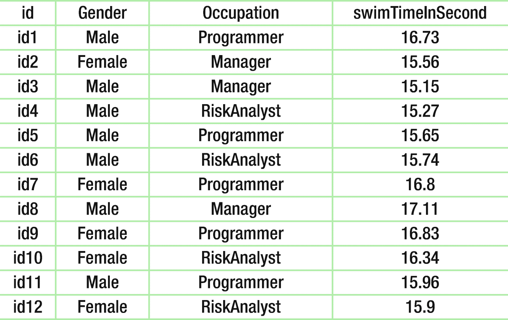
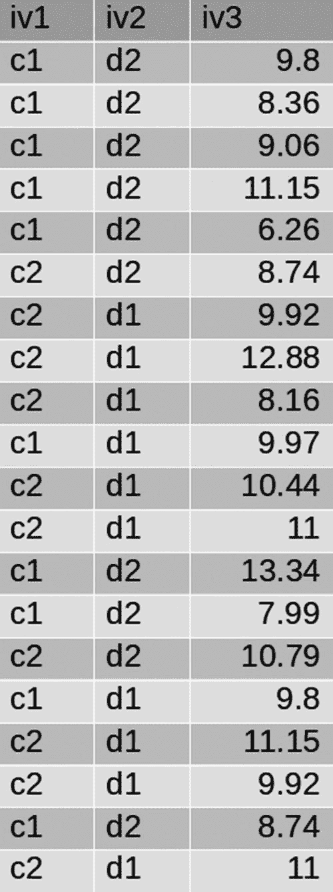
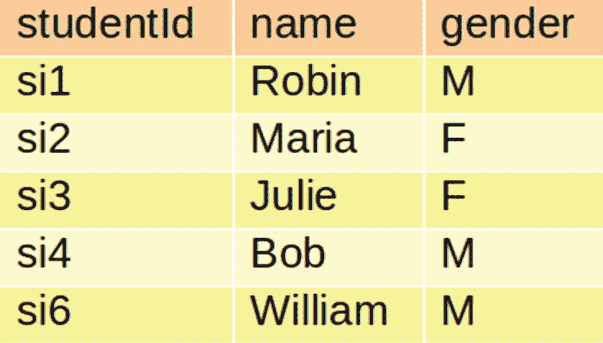

# 3. PySpark SQL 中的 IO

从不同类型的文件格式读取数据并将结果保存到多种数据目标，是数据科学家工作中不可或缺的一部分。在本章中，我们将学习以下方案。通过这些方案，我们将学习如何从不同类型的数据源读取数据，以及如何将分析结果保存到不同的数据目标。

-   方案 3-1：读取 CSV 文件
-   方案 3-2：读取 JSON 文件
-   方案 3-3：将 DataFrame 保存为 CSV 文件
-   方案 3-4：将 DataFrame 保存为 JSON 文件
-   方案 3-5：读取 ORC 文件
-   方案 3-6：读取 Parquet 文件
-   方案 3-7：将 DataFrame 保存为 ORC 文件
-   方案 3-8：将 DataFrame 保存为 Parquet 文件
-   方案 3-9：从 MySQL 读取数据
-   方案 3-10：从 PostgreSQL 读取数据
-   方案 3-11：从 Cassandra 读取数据
-   方案 3-12：从 MongoDB 读取数据
-   方案 3-13：将 DataFrame 保存到 MySQL
-   方案 3-14：将 DataFrame 保存到 PostgreSQL
-   方案 3-15：将 DataFrame 保存到 MongoDB
-   方案 3-16：从 Apache Hive 读取数据

## 方案 3-1：读取 CSV 文件

### 问题

你想要读取一个 CSV（逗号分隔值）文件。

### 解决方案

CSV 文件（参见图 3-1）是最常用、最流行的文件类型之一。数据科学家或数据工程师在日常工作中经常会遇到 CSV 文件。



图 3-1：一个 CSV 文件示例

图 3-1 中显示的 CSV 文件名为 `swimmerData.csv`。这个表格形式有四列——`id`、`Gender`、`Occupation` 和 `swimTimeInSecond`。前三列的数据类型为 `String`，最后一列的数据类型为 `float` 或 `double`。

我们可以使用 `spark.read.csv()` 函数来读取 CSV 文件。这里，`spark` 是 `SparkSession` 类的一个对象。该函数有许多参数，但我们只讨论其中比较重要的几个。我们通过 `path` 参数指定 CSV 文件的路径（即待读取文件的路径）。PySpark SQL DataFrame 具有类似于关系型数据库管理系统的表格结构。因此，我们必须指定 DataFrame 的 schema。我们通过 `csv()` 函数的第二个参数（即 `schema`）来指定 DataFrame 的 schema。

CSV 这个名字可能会引起误解，因为这些文件可以使用任何字符作为数据字段分隔符。我们使用 `sep` 参数来指定数据字段分隔符。如果文件包含标题行，我们可以使用 `header` 参数来指定。如果 `header` 参数的值为 `None`，则表示文件中没有标题行。但如果存在标题行，我们必须将 `header` 参数的值设置为 `True`。该函数足够智能，如果 `inferSchema` 参数被设置为 `True`，它可以推断出 schema。

### 工作原理

让我们从创建 DataFrame 的 schema 开始。

#### 步骤 3-1-1：创建 DataFrame 的 Schema

在我们的 DataFrame 中，有四列。首先，我们来定义这些列。我们使用 `StructField()` 函数来定义列。PySpark SQL 拥有自己的数据类型。PySpark SQL 的所有数据类型都定义在名为 `pyspark.sql.types` 的子模块中。我们需要按如下方式从 `pyspark.sql.types` 导入所有内容。

```
In [1]: from pyspark.sql.types import *
```

导入所需的子模块后，我们接下来定义 DataFrame 的第一列。

```
In [2]: idColumn = StructField("id",StringType(),True)
```

让我们看看 `StructField()` 的参数。第一个参数是列名，我们将其设置为 `id`。第二个参数是该列元素的数据类型，第一列的数据类型是 `StringType()`。如果某些 ID 缺失，则列中的某些元素可能为 null。最后一个参数的值是 `True`，表示该列可能包含空值或缺失数据。

```
In [3]: genderColumn = StructField("Gender",StringType(),True)
In [4]: OccupationColumn = StructField("Occupation",StringType(),True)
In [5]: swimTimeInSecondColumn = StructField("swimTimeInSecond",DoubleType(),True)
```

我们已经为每一列创建了一个 `StructField`。现在，我们需要为整个 DataFrame 创建一个 schema。我们可以使用 `StructType` 对象来创建，如下代码所示。

```
In [6]: columnList = [idColumn, genderColumn, OccupationColumn, swimTimeInSecondColumn]
In [7]: swimmerDfSchema = StructType(columnList)
```

`swimmerDfSchema` 就是我们 DataFrame 的完整 schema。

```
In [8]: swimmerDfSchema
```

输出如下：

```
Out[8]: StructType(List(StructField(id,StringType,true),
StructField(Gender,StringType,true),
StructField(Occupation,StringType,true),
StructField(swimTimeInSecond,DoubleType,true)))
)
```

可以使用 `swimmerDfSchema` 变量来观察 DataFrame 的四列 schema。

#### 步骤 3-1-2：读取 CSV 文件

我们已经创建好了 schema。现在我们来读取 CSV 文件。

```
In [9]: swimmerDf = spark.read.csv('data/swimmerData.csv',
...:                           header=True, schema=swimmerDfSchema
...: )
In [10]: swimmerDf.show(4)
```

输出如下：

```
+---+------+-----------+----------------+
| id|Gender| Occupation|swimTimeInSecond|
+---+------+-----------+----------------+
|id1|  Male| Programmer|           16.73|
|id2|Female|    Manager|           15.56|
|id3|  Male|    Manager|           15.15|
|id4|  Male|RiskAnalyst|           15.27|
+---+------+-----------+----------------+
only showing top 4 rows
In [13]: swimmerDf.printSchema()
```

输出如下：

```
root
|-- id: string (nullable = true)
|-- Gender: string (nullable = true)
|-- Occupation: string (nullable = true)
|-- swimTimeInSecond: double (nullable = true)
```

我们已经读取了文件并创建了 DataFrame。

#### 步骤 3-1-3：使用参数 inferSchema 值为 True 读取 CSV 文件

现在我们要读取同一个文件 `swimmerData.csv`。这次我们不提供 schema，而是让 PySpark SQL 自动推断 DataFrame 的 schema。如果在 `csv()` 函数中将 `inferSchema` 参数的值设置为 `True`，PySpark SQL 会尝试推断 schema。

# PySpark 操作

### 读取 CSV 文件

```
In [14]: swimmerDf = spark.read.csv('swimmerData.csv',
header=True, inferSchema=True)
In [15]: swimmerDf.show(4)
+---+------+-----------+----------------+
| id|Gender| Occupation|swimTimeInSecond|
+---+------+-----------+----------------+
|id1|  Male| Programmer|           16.73|
|id2|Female|    Manager|           15.56|
|id3|  Male|    Manager|           15.15|
|id4|  Male|RiskAnalyst|           15.27|
+---+------+-----------+----------------+
only showing top 4 rows
```

DataFrame `swimmerDf` 已经创建。我们设置 `inferSchema` 参数为 `True`。最好检查一下创建 DataFrame 的 schema。因此，我们使用 `printSchema()` 函数打印它。

```
In [16]:  swimmerDf.printSchema()
```

输出如下：

```
root
|-- id: string (nullable = true)
|-- Gender: string (nullable = true)
|-- Occupation: string (nullable = true)
|-- swimTimeInSecond: double (nullable = true)
```

PySpark SQL 已正确推断出 schema。

## 方法 3-2. 读取 JSON 文件

### 问题

你想要读取一个 JSON（JavaScript Object Notation）文件。

### 解决方案

我们有一个名为 `corrData.json` 的 JSON 数据文件。文件内容如下：

```
{"iv1":5.5,"iv2":8.5,"iv3":9.5}
{"iv1":6.13,"iv2":9.13,"iv3":10.13}
{"iv1":5.92,"iv2":8.92,"iv3":9.92}
{"iv1":6.89,"iv2":9.89,"iv3":10.89}
{"iv1":6.12,"iv2":9.12,"iv3":10.12}
```

想象这些数据以表格形式呈现。可以发现数据有三列，分别名为 `iv1`、`iv2` 和 `iv3`。每列都包含小数或浮点数值。

`spark.read.json()` 函数将用于读取 JSON 文件。和 `csv()` 函数类似，`json()` 函数也有许多参数。第一个参数是 `path`，用于确定待读取文件的位置。第二个参数是 `schema`，用于确定要创建的 DataFrame 的 schema。

### 工作原理

让我们读取 `corrData.json` 文件。

```
In [1]: corrData = spark.read.json(path='corrData.json')
In [2]: corrData.show(6)
```

输出如下：

```
+---+-----+-----+
|iv1|  iv2|  iv3|
+----+----+-----+
| 5.5| 8.5|  9.5|
|6.13|9.13|10.13|
|5.92|8.92| 9.92|
|6.89|9.89|10.89|
|6.12|9.12|10.12|
|6.32|9.32|10.32|
+----+----+-----+
仅显示前 6 行
```

我们已成功创建了 DataFrame。只要没有显式提供 DataFrame 的 schema，最好检查一下新创建的 DataFrame 的 schema，以确保一切符合预期。

```
In [3]: corrData.printSchema()
```

输出如下：

```
root
|-- iv1: double (nullable = true)
|-- iv2: double (nullable = true)
|-- iv3: double (nullable = true)
```

一切符合预期，每个列的数据类型都是 `double` 或 `DoubleType()`。因此，在读取 JSON 文件时，如果我们没有提供 schema，PySpark SQL 会自动推断它。

## 配方 3-3. 将 DataFrame 保存为 CSV 文件

### 问题

你想将 DataFrame 的内容保存为 CSV 文件。

### 解决方案

每当我们需要将 DataFrame 写入或保存到外部存储系统时，可以使用 `DataFrameWriter` 类及其定义的方法。我们可以通过 `DataFrame.write` 访问 `DataFrameWriter`。因此，如果要将 DataFrame 保存为 CSV 文件，就必须使用 `DataFrame.write.csv()` 函数。

与 `spark.read.csv()` 函数类似，`DataFrame.write.csv()` 函数也有许多参数。我们来讨论它的三个参数：`path`、`sep` 和 `header`。`path` 参数定义了 DataFrame 将要写入的目录。我们可以使用 `sep` 参数指定数据字段分隔符。如果 `header` 参数的值为 `True`，DataFrame 的标题行将作为 CSV 文件的第一行写入。

我们将把 `corrData` DataFrame 写入 `csvFileDir` 目录。我们在配方 3-2 中创建了 `corrData` DataFrame。

### 注意

你可以通过以下链接了解更多关于 `DataFrameWriter` 类的信息：

[`https://spark.apache.org/docs/2.3.0/api/python/_modules/pyspark/sql/readwriter.html#DataFrameWriter`](https://spark.apache.org/docs/2.3.0/api/python/_modules/pyspark/sql/readwriter.html%2523DataFrameWriter)

### 工作原理

以下代码行会将 DataFrame 写入 CSV 文件。

```
corrData.write.csv(path='csvFileDir', header=True,sep=',')
```

让我们看看 `csvFileDir` 目录里有什么。我们可以使用 `bash ls` 命令检查，如下所示：

```
csvFileDir$ ls
```

输出如下：

```
part-00000-eb3df2e6-8098-488d-be22-5e9db4a5cb08-c000.csv
_SUCCESS
```

我们可以看到目录中有两个文件。先来说第二个文件，名为 `_SUCCESS`。这个文件仅表示我们的写入操作成功。DataFrame 的实际内容在 `part-00000-eb3df2e6-8098-488d-be22-5e9db4a5cb08-c000.csv` 文件中。现在我们来查看该文件的内容。

```
$ head -5 part-00000-eb3df2e6-8098-488d-be22-5e9db4a5cb08-c000.csv
```

输出如下：

```
iv1,iv2,iv3
5.5,8.5,9.5
6.13,9.13,10.13
5.92,8.92,9.92
6.89,9.89,10.89
```

现在已确认内容已成功写入 CSV 文件。

## 配方 3-4. 将 DataFrame 保存为 JSON 文件

### 问题

你想将 DataFrame 的内容保存为 JSON 文件。

### 解决方案

为了将 DataFrame 保存为 JSON 文件，我们将使用 `DataFrameWriter` 类中名为 `json()` 的函数。我们将把 `swimmerDf` DataFrame 保存为 JSON 文件。

### 工作原理

以下代码行可以轻松地将 DataFrame 保存为 `jsonData` 目录下的 JSON 文件。

```
In [1]: swimmerDf.write.json(path='jsonData')
```

现在让我们查看 `jsonData` 目录的内容。

```
$ ls
```

输出如下：

```
part-00000-51e76de8-127f-4549-84a8-7ea972632a4d-c000.json
_SUCCESS
```

# 配方 3-5. 读取 ORC 文件

## 问题
你想读取一个 ORC（Optimized Row Columnar，优化行列式）文件。

## 解决方案
ORC 文件格式主要是为 Apache Hive 开发的，目的是使 Hive 对 ORC 格式数据集的查询更快。请参见图 3-2。



图 3-2 展示的表数据位于 `duplicateData` 目录下的一个 ORC 文件中。我们需要读取它。我们将使用 `spark.read.orc()` 函数来读取该 ORC 文件。请记住，`spark` 是 `SparkSession` 类的对象。

## 注意
更多关于 ORC 文件的信息可通过以下链接获取：
*   [Apache Hive ORC 文件格式](https://cwiki.apache.org/confluence/display/Hive/LanguageManual+ORC)

## 工作原理
我们将从 `duplicateData` 目录下的 ORC 文件中读取数据。

```
In [1]: duplicateDataDf = spark.read.orc(path='duplicateData')
In [2]: duplicateDataDf.show(6)
```

输出如下：
```
+---+---+-----+
|iv1|iv2|  iv3|
+---+---+-----+
| c1| d2|  9.8|
| c1| d2| 8.36|
| c1| d2| 9.06|
| c1| d2|11.15|
| c1| d2| 6.26|
| c2| d2| 8.74|
+---+---+-----+
仅显示前 6 行
```

# 配方 3-6. 读取 Parquet 文件

## 问题
你想读取一个 Parquet 文件。

## 解决方案
Apache Parquet 是为 Apache Hadoop 开发的一种开源文件格式。它采用列式数据存储格式，为数据提供编码和高效的数据压缩。

我们在一个名为 `temperatureData` 的目录下有一个 Parquet 文件。我们可以使用 PySpark SQL 的 `spark.read.parquet()` 函数读取该 Parquet 文件。

## 注意
你可以通过以下链接了解更多关于 Parquet 文件的信息：
*   [Apache Parquet 官方文档](https://parquet.apache.org/documentation/latest/)
*   [Apache Parquet 维基百科](https://en.wikipedia.org/wiki/Apache_Parquet)

## 工作原理
我们得到的数据位于一个 Parquet 文件中，数据目录的名称为 `temperatureData`。

```
In [2]: tempDf = spark.read.parquet('temperatureData')
In [3]: tempDf.show(6)
```

输出如下：
```
+----+-------------+
| day|tempInCelsius|
+----+-------------+
|day1|         12.2|
|day2|         13.1|
|day3|         12.9|
|day4|         11.9|
|day5|         14.0|
|day6|         13.9|
+----+-------------+
仅显示前 6 行
```
我们可以看到已经得到了 DataFrame。

# 配方 3-7. 将 DataFrame 保存为 ORC 文件

## 问题
你想将 DataFrame 保存为 ORC 文件。

## 解决方案
我们将把 `swimmerDf` DataFrame 保存为 ORC 文件。我们将把它保存到一个名为 `orcData` 的目录中。我们将使用 `DataFrameWriter` 类的 `orc()` 函数将 DataFrame 保存为 ORC 文件。

## 工作原理
以下代码行会将 `swimmerDf` DataFrame 的内容保存到 `orcData` 目录下的一个 ORC 文件中。

```
In [1]: swimmerDf.write.orc(path='orcData')
```

让我们查看 `orcData` 目录的内容。

```
$ ls
```

输出如下：
```
part-00000-4252c3c8-5f7d-48b2-8bc0-48426cb8d2e4-c000.snappy.orc  _SUCCESS
```

# 配方 3-8. 将 DataFrame 保存为 Parquet 文件

## 问题
您希望将 DataFrame 保存为 Parquet 文件。

## 解决方案
我们在配方 3-5 中创建了 `duplicateDataDf` DataFrame。我们将使用 `DataFrameWrite` 类的 `parquet()` 函数。

## 工作原理
使用以下代码行，我们可以将 DataFrame 的内容写入 `parqData` 目录下的一个 Parquet 文件中。

```
In [1]: duplicateDataDf.write.parquet(path='parqData')
```

为了查看 `parqData` 目录的内容，我们将使用 `ls` 命令。

```
$ ls
```

输出如下：
```
part-00000-d44eb594-46da-495a-88e9-934ca1eff270-c000.snappy.parquet _SUCCESS
```
数据已写入名为 `part-00000-d44eb594-46da-495a-88e9-934ca1eff270-c000.snappy.parquet` 的文件中。

# 配方 3-9. 从 MySQL 读取数据

## 问题
您希望从 MySQL 读取一个数据表。

## 解决方案
MySQL 是目前最流行的关系型数据库管理系统之一。很多时候，我们可能需要从 MySQL 获取数据，以便通过 PySpark SQL 进行分析。为了连接到 MySQL，我们需要一个 MySQL JDBC 连接器。以下命令行将启动带有 MySQL JDBC 连接器的 PySpark Shell。

```
pyspark --driver-class-path ~/.ivy2/jars/mysql_mysql-connector-java-8.0.12.jar --packages mysql:mysql-connector-java:8.0.12
```

## 工作原理
招生数据包含在 MySQL 的 `pysparksqlbook` 数据库的 `ucbdata` 表中。我们可以使用以下代码行读取这些数据。

```
In [1]: dbURL = "jdbc:mysql://localhost/pysparksqlbook"
```
`ucbdata` 表是由 `root` 用户创建的。

名为 `part-00000-51e76de8-127f-4549-84a8-7ea972632a4d-c000.json` 的文件包含了 `swimmerDf` DataFrame 的数据。我们可以看到数据已正确写入 JSON 格式。我们使用 `head shell` 命令来打印前四个记录。

```
$ head -4 part-00000-51e76de8-127f-4549-84a8-7ea972632a4d-c000.json
```

输出如下：
```
{"id":"id1","Gender":"Male","Occupation":"Programmer","swimTimeInSecond":16.73}
{"id":"id2","Gender":"Female","Occupation":"Manager","swimTimeInSecond":15.56}
{"id":"id3","Gender":"Male","Occupation":"Manager","swimTimeInSecond":15.15}
{"id":"id4","Gender":"Male","Occupation":"RiskAnalyst","swimTimeInSecond":15.27}
```

PySpark SQL 已正确地将 DataFrame 的内容保存到 JSON 文件中。

# 从各类数据库读取数据

## 配方 3-10：从 PostgreSQL 读取数据

### 问题
您希望从 PostgreSQL 数据库读取一个数据表。

### 解决方案
我们在 PostgreSQL 中有一个 `firstverticaltable` 表。我们可以使用如下 `select` 命令查看数据。

```
pysparksqldb=#  select * from firstverticaltable;
```

输出如下：

```
iv1|  iv2|  iv3
-----+-----+-----
9|11.43|10.25
10.26| 8.35| 9.94
9.84| 9.28| 9.22
11.77|10.18|11.02
(4 rows)
```

我们必须使用 PySpark SQL 读取 `firstverticaltable` 表。我们知道，要从 PostgreSQL 读取数据，需要一个 PostgreSQL JDBC 连接器。以下命令将满足此需求。

```
$pyspark --driver-class-path  ~/.ivy2/jars/org.postgresql_postgresql-42.2.4.jar  --packages org.postgresql:postgresql:42.2.4
```

现在，在 PySpark Shell 中，我们可以编写命令从 PostgreSQL 数据库读取数据。

### 工作原理
让我们从 PostgreSQL 读取数据表并创建 DataFrame。

首先，我们定义 `dbURL`。

```
In [1]: dbURL = "jdbc:postgresql://localhost/pysparksqldb?user=postgres&password=""
In [2]: verticalDfOne = spark.read.format("jdbc").options(url = dbURL, database ='pysparksqldb', dbtable ='firstverticaltable').load();
```

同样，我们在这里的 `options()` 函数中设置不同的选项，与上一个配方相同。

```
In [3]: verticalDfOne.show()
```

输出如下：

```
+-----+-----+-----+
|  iv1|  iv2|  iv3|
+-----+-----+-----+
|  9.0|11.43|10.25|
|10.26| 8.35| 9.94|
| 9.84| 9.28| 9.22|
|11.77|10.18|11.02|
+-----+-----+-----+
```

我们已经读取了 `firstverticaltable` 表并创建了 `verticalDfOne` DataFrame。

## 配方 3-11：从 Cassandra 读取数据

### 问题
您希望从 Cassandra 数据库读取一个数据表。

### 解决方案
Cassandra 是一个流行的 NoSQL 数据库。图 3-3 展示了 Cassandra 中的一个数据表。`students` 表位于 `pysparksqlbook` 键空间（keyspace）中。



我们必须使用 PySpark SQL 读取 `students` 表。但我们需要一个 Cassandra 连接器。因此，我们必须使用以下命令启动 PySpark Shell。

```
$ pyspark  --packages com.datastax.spark:spark-cassandra-connector_2.11:2.3.0
```

### 注意
您可以在以下网页上阅读更多关于将 PySpark SQL 连接到 Cassandra 的信息：

[`https://github.com/datastax/spark-cassandra-connector/blob/master/doc/15_python.md`](https://github.com/datastax/spark-cassandra-connector/blob/master/doc/15_python.md)

### 工作原理
以下代码行将从 Cassandra 数据库读取数据表。

```
In [1]: studentsDf = spark.read.format("org.apache.spark.sql.cassandra").options( keyspace="pysparksqlbook", table="students").load()
```

从 Cassandra 读取数据后，让我们打印出来以验证我们已经创建了 DataFrame。

```
In [2]: studentsDf.show()
```

输出如下：

```
+---------+------+-------+
|studentid|gender|   name|
+---------+------+-------+
|      si3|     F|  Julie|
|      si2|     F|  Maria|
|      si1|     M|  Robin|
|      si6|     M|William|
|      si4|     M|    Bob|
+---------+------+-------+
```

## 配方 3-12：从 MongoDB 读取数据

### 问题
您希望从 MongoDB 读取一个数据集合。

### 解决方案
在 MongoDB 的语境中，集合（collection）对应着关系型数据库中的表（table）。在本例中，我们在 MongoDB 的 `pysparksqlbook` 数据库中有一个名为 `restaurantSurvey` 的集合。对一个集合使用 `find()` 方法将返回该集合中的所有文档（document）。在 MongoDB 中，文档即记录（record）。

```
> db.restaurantSurvey.find().pretty().limit(5)
```

以下是输出结果：

```json
{
"_id" : ObjectId("5ba7e6a259acc01fedb4d78a"),
"Gender" : "Male",
"Vote" : "Yes"
}
{
"_id" : ObjectId("5ba7e6a259acc01fedb4d78b"),
"Gender" : "Male",
"Vote" : "Yes"
}
{
"_id" : ObjectId("5ba7e6a259acc01fedb4d78c"),
"Gender" : "Male",
"Vote" : "No"
}
{
"_id" : ObjectId("5ba7e6a259acc01fedb4d78d"),
"Gender" : "Male",
"Vote" : "DoNotKnow"
}
{
"_id" : ObjectId("5ba7e6a259acc01fedb4d78e"),
"Gender" : "Male",
"Vote" : "Yes"
}
```

我们已经打印了 `restaurantSurvey` 集合中的前五条记录。我们需要使用 PySpark SQL 读取这个集合的数据，并创建一个 DataFrame。

使用 PySpark SQL 从 MongoDB 读取数据需要一些额外的包。这个额外的包其实就是 MongoDB 连接器（connector）。我们可以使用以下命令启动 `pyspark` shell，以包含该额外包，从而读取 MongoDB 的数据。

```
$pyspark --conf "spark.mongodb.input.uri=mongodb://127.0.0.1/pysparksqlbook. restaurantSurvey?readPreference=primaryPreferred" --packages org.mongodb.spark:mongo-spark-connector_2.11:2.3.0
```

### 注意

你可以通过以下链接了解关于从 MongoDB 读取数据的更多信息：

[`https://docs.mongodb.com/spark-connector/master/python-api/`](https://docs.mongodb.com/spark-connector/master/python-api/)

[`https://docs.mongodb.com/spark-connector/master/python/read-from-mongodb/`](https://docs.mongodb.com/spark-connector/master/python/read-from-mongodb/)

### 实现原理

餐厅调查数据存放在 MongoDB 中 `pysparksqlbook` 数据库的 `restaurantSurvey` 集合里。以下代码将从 MongoDB 读取我们的数据。

```
In [1]: surveyDf = spark.read.format("com.mongodb.spark.sql.DefaultSource").option("uri","mongodb://127.0.0.1/pysparksqlbook.restaurantSurvey").load()
```

我们设置了一个选项，即 MongoDB 中该集合的 URI。

```
In [2]: surveyDf.show(5)
```

以下是输出结果：

```
+------+---------+--------------------+
|Gender|     Vote|                 _id|
+------+---------+--------------------+
|  Male|      Yes|[5ba7e6a259acc01f...|
|  Male|      Yes|[5ba7e6a259acc01f...|
|  Male|       No|[5ba7e6a259acc01f...|
|  Male|DoNotKnow|[5ba7e6a259acc01f...|
|  Male|      Yes|[5ba7e6a259acc01f...|
+------+---------+--------------------+
only showing top 5 rows
```

至此，我们已经成功读取了数据。

## 配方 3-13. 将 DataFrame 保存到 MySQL

### 问题描述

你想要将一个 DataFrame 的内容保存到 MySQL。

### 解决方案

为了将 DataFrame 保存到 MySQL，我们将使用 `DataFrameWriter` 类的 `write()` 方法。

请记住，我们需要使用包含了 MySQL 连接器的 `pyspark` shell 启动。

```
$pyspark --driver-class-path  ~/.ivy2/jars/mysql_mysql-connector-java-8.0.12.jar --packages mysql:mysql-connector-java:8.0.12
```

### 实现原理

#### 步骤 3-13-1. 创建一个 DataFrame

让我们创建一个 DataFrame。要创建 DataFrame，我们需要 `Row` 类。`Row` 类位于 `pyspark.sql` 子模块中。现在让我们导入 `Row` 类。

```
In [1]: from pyspark.sql import Row
```

我们将使用以下命令动态创建一个 DataFrame。

```
In [2]: ourDf = spark.createDataFrame([
...:              Row(id=1, value=10.0),
...:              Row(id=2, value=42.0),
...:              Row(id=3, value=32.0)
...:              ])
In [3]: ourDf.show()
```

以下是输出结果：

```
+--+-----+
|id|value|
+--+-----+
| 1| 10.0|
| 2| 42.0|
| 3| 32.0|
+--+-----+
```

现在，`ourDf` DataFrame 已经准备好保存了。

#### 步骤 3-13-2. 将 DataFrame 保存到 MySQL 数据库

我们将先定义 `dbURL`，然后将其保存到 MySQL 数据库中。

```
In [4]: dbURL = "jdbc:mysql://localhost/pysparksqlbook"
In [5]: ourDf.write.format("jdbc").options(url = dbURL, database ='pysparksqlbook', dbtable ='mytab', user="root", password="").save()
```

保存 DataFrame 后，让我们检查一下它是否已正确保存。我们已将 DataFrame 保存到了 `mytab` 表中，该表位于 `pysparksqlbook` 数据库内。

```
mysql> use pysparksqlbook;
```

以下是输出结果：

```
Database changed
```

使用 `select` 命令，我们可以查看 `mytab` 表的内容。

```
mysql> select * from mytab;
```

以下是输出结果：

```
+--+-----+
|id|value|
+--+-----+
| 1|   10|
| 3|   32|
| 2|   42|
+--+-----+
3 rows in set (0.00 sec)
```

## 配方 3-14. 将 DataFrame 保存到 PostgreSQL

### 问题描述

你想要将一个 DataFrame 保存到 PostgreSQL。

### 解决方案

将 DataFrame 内容保存到 PostgreSQL 需要一个 PostgreSQL JDBC 连接器。

我们可以使用 `DataFrameWriter` 类的 `write()` 方法。为了使用 PostgreSQL JDBC 连接器，我们必须使用以下命令启动 `pyspark` shell。

```
$pyspark --driver-class-path  ~/.ivy2/jars/org.postgresql_postgresql-42.2.4.jar  --packages org.postgresql:postgresql:42.2.4
```

### 实现原理

#### 步骤 3-14-1. 创建一个 DataFrame

我们将创建一个虚拟的 DataFrame。

# 创建与操作 DataFrame

```
In [1]: from pyspark.sql import Row
In [2]: ourDf = spark.createDataFrame([
...:                   Row(iv1=1.2, iv2=10.0),
...:                   Row(iv1=1.3, iv2=42.0),
...:                   Row(iv1=1.5, iv2=32.0)
...:                   ])
In [3]: ourDf.show()
```

以下是输出结果：

```
+---+----+
|iv1| iv2|
+---+----+
|1.2|10.0|
|1.3|42.0|
|1.5|32.0|
+---+----+
```

# 步骤 3-14-2. 将 DataFrame 保存到 PostgreSQL 数据库

我们将先定义 `url` 数据库，然后将其保存到 PostgreSQL 数据库中。

```
In [4]: dbURL = "jdbc:postgresql://localhost/pysparksqldb?user=postgres&password=""
```

我们将把 `ourDf` DataFrame 的内容保存到 `mytab` 表中。

```
In [5]: ourDf.write.format("jdbc").options(url = dbURL, database ='pysparksqlbook', dbtable ='mytab').save()
```

让我们检查一下它是否已保存到 PostgreSQL 数据库中。

```
postgres=#  \c pysparksqldb;
pysparksqldb=# select * from mytab;
```

以下是输出结果：

```
iv1|iv2
---+---
1.3| 42
1.2| 10
1.5| 32
(3 rows)
```

# 配方 3-15. 将 DataFrame 内容保存到 MongoDB

## 问题描述

你想要将 `ourDf` DataFrame 的内容作为集合保存到 MongoDB。

## 解决方案

为了将 DataFrame 保存到 MongoDB，我们必须使用与其关联的连接器。

我们将使用以下命令行启动包含 MongoDB 连接器的 PySpark。

```
$ pyspark --conf "spark.mongodb.input.uri=mongodb://127.0.0.1/pysparksqlbook?readPreference=primaryPreferred" --packages org.mongodb.spark:mongo-spark-connector_2.11:2.3.0
```

## 注意

你可以通过以下链接了解更多关于使用 PySpark 将数据写入 MongoDB 的信息。

[`https://docs.mongodb.com/spark-connector/master/python/write-to-mongodb/`](https://docs.mongodb.com/spark-connector/master/python/write-to-mongodb/)

## 工作原理

在 Recipe 3-14 中，我们使用了一个名为 `ourDf` 的 DataFrame。让我们打印其内容。

```
In [1]: ourDf.show()
```

输出如下：

```
+---+----+
|iv1| iv2|
+---+----+
|1.2|10.0|
|1.3|42.0|
|1.5|32.0|
+---+----+
```

我们将把 `ourDf` DataFrame 的内容写入 MongoDB。我们将把这个 DataFrame 写入 `pysparksqlbook` 数据库中的 `mytab` 集合。以下命令将执行此任务。

```
In [2]: ourDf.write.format("com.mongodb.spark.sql.DefaultSource").option("database",
...: "pysparksqlbook").option("collection", "mytab").option("uri",dbUrl).save()
```

我们已经将 `ourDf` DataFrame 写入 MongoDB。现在让我们检查 `pysparksqlbook` 数据库中 `mytab` 集合内的数据。

```
> use pysparksqlbook;
```

输出如下：

```
switched to db pysparksqlbook
> db.mytab.find().pretty()
```

输出如下：

```
{ "_id" : ObjectId("5bb51e00f17eb43aee74cb8f"), "iv1" : 1.2, "iv2" : 10 }
{ "_id" : ObjectId("5bb51e00f17eb43aee74cb91"), "iv1" : 1.3, "iv2" : 42 }
{ "_id" : ObjectId("5bb51e00f17eb43aee74cb90"), "iv1" : 1.5, "iv2" : 32 }
```

最终，我们的 `ourDf` DataFrame 内容已存储在 MongoDB 中。

# Recipe 3-16. 从 Apache Hive 读取数据

## 问题

你想要从 Apache Hive 读取一张数据表。

## 解决方案

我们在 Hive 中有一个名为 `filamentdata` 的表。我们需要使用 PySpark SQL 从 Apache Hive 读取这些数据。让我们了解整个过程。首先，我们将在 Hive 中创建一个表并将数据上传到其中。我们先创建一个名为 `filamentdata` 的表。我们将在 Hive 的 `apress` 数据库中创建该表。我们可以使用 `show` 命令显示 Hive 中的所有数据库。

```
hive> show databases;
```

输出如下：

```
OK
apress
default
Time taken: 3.275 seconds, Fetched: 2 row(s)
```

数据库名为 `apress`，因此我们必须使用 `use` 命令指定此数据库。

```
hive> use apress;
```

输出如下：

```
OK
Time taken: 0.125 seconds
```

使用数据库后，我们将使用以下命令创建一个名为 `filamenttable` 的表。

```
hive> create table filamenttable (
>  filamenttype string,
>  bulbpower string,
>   lifeinhours float
>)
> row format delimited
> fields terminated by ',';
```

我们已经创建了一个包含三列的 Hive 表。第一列是 `filamenttype`，其值为 `string` 类型。表的第二列是 `bulbpower`，数据类型为 `string`。第三列是 `lifeinhours`，为 `float` 类型。现在我们可以使用 `show` 命令显示我们创建的表。

```
hive> show tables;
```

输出如下：

```
OK
filamenttable
Time taken: 0.118 seconds, Fetched: 1 row(s)
```

所需的表已成功创建。现在，让我们将数据加载到我们创建的表中。我们正在从本地目录加载数据到 Hive。数据加载使用了带有 `local` 的 `load` 子句。这告诉 Hive 数据是从本地目录加载的，而不是从 HDFS 加载的。

```
hive> load data local inpath 'filamentData.csv' overwrite into table filamenttable;
```

输出如下：

```
Loading data to table apress.filamenttable
OK
Time taken: 5.39 seconds
```

数据加载完成后，我们可以对表进行查询。我们可以使用 `select` 和 `limit` 来显示特定行以限制行数。

```
hive> select * from filamenttable limit 5;
```

输出如下：

```
OK
filamentA    100W    605.0
filamentB    100W    683.0
filamentB    100W    691.0
filamentB    200W    561.0
filamentA    200W    530.0
Time
taken: 0.532 seconds, Fetched: 5 row(s)
```

我们已经显示了 `filamenttable` 表中的一些行。现在我们需要使用 PySpark SQL 读取此表数据。

我们可以使用 PySpark SQL 和 `spark.table()` 函数从 Hive 读取表。

### 工作原理

在 `table` 函数中，我们需要提供表的名称。表名以 `<databaseName>.<tableName>` 的格式提供。在我们的例子中，数据库名为 `apress`，表名为 `filamenttable`。因此，传递给 `table` 函数的参数值将是 `apress.filamenttable`。

```
In [1]: FilamentDataFrame = spark.table('apress.filamenttable')
In [2]: FilamentDataFrame.show(5)
```

输出如下：

```
+------------+---------+-----------+
|filamenttype|bulbpower|lifeinhours|
+------------+---------+-----------+
|   filamentA|     100W|      605.0|
|   filamentB|     100W|      683.0|
|   filamentB|     100W|      691.0|
|   filamentB|     200W|      561.0|
|   filamentA|     200W|      530.0|
+------------+---------+-----------+
only showing top 5 rows
```

最后，我们从 Apache Hive 中的表创建了一个 DataFrame。


