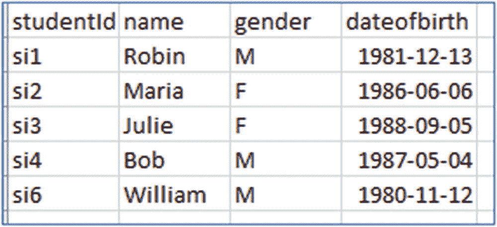
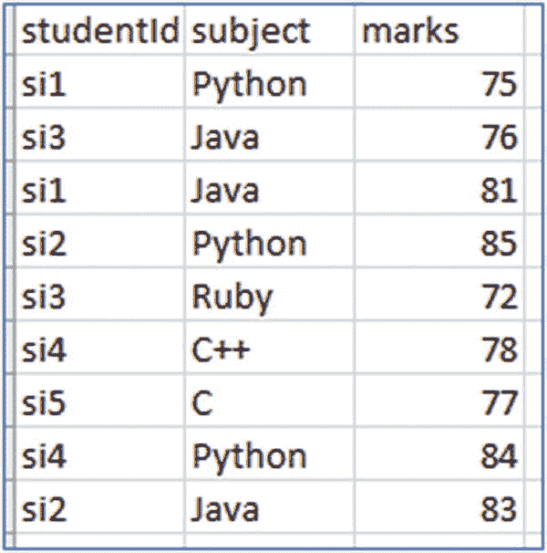
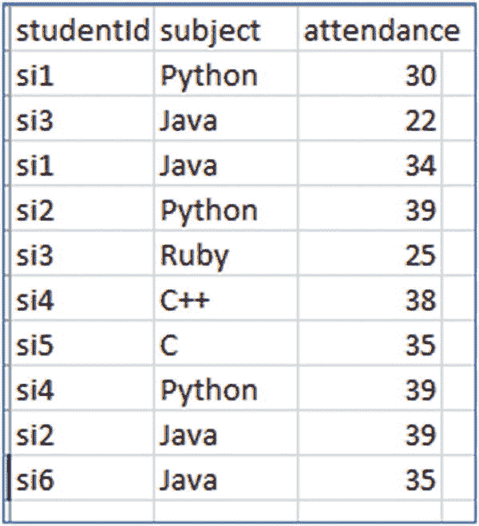
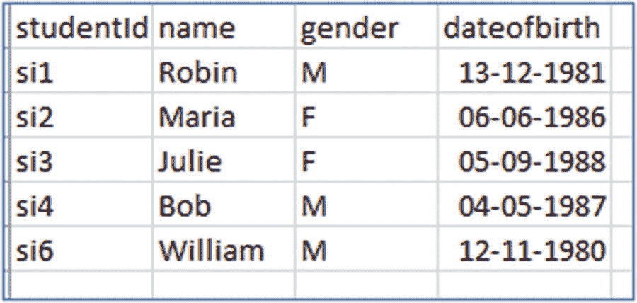
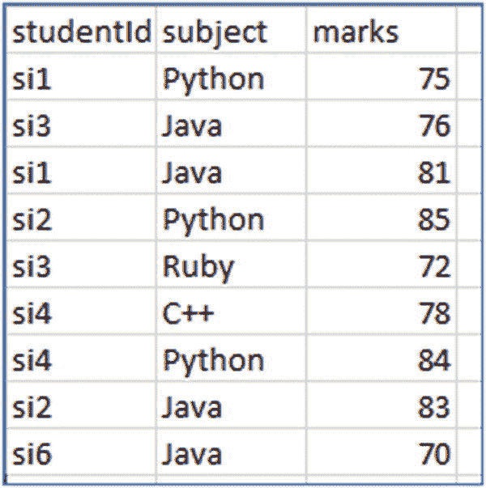

# 6. SQL、NoSQL 与 PySparkSQL

在本章中，我们将探讨各种 Spark SQL 方法，当你需要对数据应用类似 SQL 的查询时，这些方法会非常有用。Apache Spark 的特色之一，就是它能让用户以编程方式和类似 ANSI SQL 的方法来应用数据整理技术。对于仅有纯 SQL 背景、对编程式数据操作接触不多的读者来说，这些 SQL 方法堪称一站式解决方案。几乎所有的 Spark 编程 API 都可以通过 Spark SQL 应用于数据。此外，这些 SQL 符合 ANSI 标准，这使得任何目前使用 SQL 技术的人都能立即开始处理基于 Apache Spark 的大数据项目。

一旦我们创建好 DataFrame，就可以直接开始对 DataFrame 对象应用 SQL，并根据需要操作数据。在本章中，我们将从简单的 SQL 入手，探讨 Apache Spark 中的各种 SQL 应用。

我们将学习以下方法，它们会循序渐进地引导你从初学者成长为高级 Spark SQL 用户。我们建议你逐一练习这些方法，以获得最佳学习效果。

-   方法 6-1. 从 CSV 文件创建 DataFrame
-   方法 6-2. 从 DataFrame 创建临时表
-   方法 6-3. 从 DataFrame 创建简单 SQL
-   方法 6-4. 在 Spark SQL 上应用 Spark UDF 方法
-   方法 6-5. 创建新的 PySpark UDF
-   方法 6-6. 使用 SQL 连接两个 DataFrame
-   方法 6-7. 使用 SQL 连接多个 DataFrame

## 方法 6-1. 从 CSV 文件创建 DataFrame

### 问题描述

你想从一个 CSV 文件创建 DataFrame。

### 解决方案

为简单起见，我们将使用非常简单的数据，以便我们能专注于逻辑和 Spark API，而不被数据本身的问题或干扰所困扰。我们将使用表 6-1 中众所周知的**学生数据**。该数据包含三列：`studentId`、`name` 和 `gender`。

**表 6-1 示例数据**

| studentId | name   | gender |
| --------- | ------ | ------ |
| si1       | Robin  | M      |
| si2       | Maria  | F      |
| si3       | Julie  | F      |
| si4       | Bob    | M      |
| si6       | William| M      |

任务是根据这些数据创建一个 DataFrame。

尽管你在之前的章节中可能已经执行过从 CSV 创建 DataFrame 的步骤，但为了保持连续性，我们还是从这里开始。此外，对于直接从本章开始学习的纯 SQL 背景读者来说，没有这个步骤会感到困惑。那么，让我们开始吧：

```
>>> studentDf = spark.read.csv('studentData.csv',
...                           header=True, inferSchema=True)
>>> studentDf.show()
+---------+-------+-------+
|studentId|   name| gender|
+---------+-------+-------+
|      si1|  Robin|      M|
|      si2|  Maria|      F|
|      si3|  Julie|      F|
|      si4|    Bob|      M|
|      si6|William|      M|
+---------+-------+-------+
```

我们已经成功地将数据转换成了 Spark DataFrame。你可能会注意到这非常简单。是的，Spark 的抽象 API 使得用户能够非常轻易地将数据加载到 DataFrame 中。

### 工作原理

让我们深入探讨一下创建 DataFrame 的代码。`spark.read.csv` 是 Spark 提供的用于读取 CSV 文件的 API。它返回一个 DataFrame 作为输出。你还可以看到在文件名之外还提供了两个参数：`inferSchema` 和 `header`。这些参数告诉 Spark，需要绑定到 DataFrame 的模式（schema）应从表头行中获取。

为了确保我们按照预期创建了正确的模式，我们可以使用 DataFrame 的 `printSchema()` 方法，如下所示。

```
>>> studentDf.printSchema()
root
|-- studentId: string (nullable = true)
|-- name: string (nullable = true)
|-- gender: string (nullable = true)
```

执行 `studentDf.printSchema()` 将为我们提供 DataFrame 的列名。

#### 步骤 6-1-1. 从 JSON 创建 DataFrame

在实时项目中，我们经常会收到 JSON 格式的数据文件。JSON 是一种高度使用的数据格式。那么，我们就从一个 JSON 文件来创建 DataFrame。为简单起见，我们使用相同的学生数据（JSON 格式）来创建 DataFrame。JSON 格式的数据如下所示。JSON 数据文件中的属性将被放置到 DataFrame 的各个列中。DataFrame 中的每个文档都将表示为 DataFrame 中的一行。手动创建 JSON 数据时很容易出现错误。如果存在任何错误，并且不会给出精确的错误信息，那么调试此类数据问题就会变得非常困难。为了避免所有此类情况，最好的办法始终是以编程方式创建 JSON 数据。

图 6-1 展示了 JSON 格式的学生数据。其中有五个文档，每个文档都包含相同的属性集合。

**图 6-1 JSON 格式的学生数据**

让我们完成从 JSON 文件创建 DataFrame 的过程：

```
>>> studentDf_json = spark.read.csv('students.json')
>>> studentDf.printSchema()
```

以下是输出结果，展示了 DataFrame 的模式。请注意，这与我们从 CSV 文件创建 DataFrame 时得到的模式完全相同。

```
root
|-- studentId: string (nullable = true)
|-- name: string (nullable = true)
|-- gender: string (nullable = true)
```

让我们使用 `show` 方法查看 DataFrame 的内容。

```
>>> studentDf.show()
```

以下是输出：

```
+---------+-------+--------+
|studentId|   name|  gender|
+---------+-------+--------+
|      si1|  Robin|       M|
|      si2|  Maria|       F|
|      si3|  Julie|       F|
|      si4|    Bob|       M|
|      si6|William|       M|
+---------+-------+--------+
```

#### 步骤 6-1-2. 从 Parquet 创建 DataFrame

到目前为止，我们已经了解了 CSV 和 JSON 文件。在处理海量数据的大数据领域，Parquet 格式因其对列式存储的支持而备受赞誉。Parquet 具有高效的压缩机制以及编码方案。Parquet 以其对查询性能的提升而闻名。

虽然我们展示了 CSV 和 JSON 文件，但我们将不展示 Parquet 文件，因为它不易于人类阅读。那么，让我们直接开始从 Parquet 文件创建 DataFrame。

这里我们有一个名为 `studentsData.parquet` 的 Parquet 文件，其中包含与加载到 CSV 和 JSON 格式中相同的**学生数据**。

```
>>> studentdf_parquet = spark.read.parquet('studentsData.parquet')
```

让我们查看 DataFrame 的模式。

```
>>> studentdf_parquet.printSchema()
```

以下是输出。你可以看到，这与我们为 CSV 和 JSON 格式看到的模式完全相同。

```
root
|-- studentId: string (nullable = true)
|-- name: string (nullable = true)
|-- gender: string (nullable = true)
```

让我们使用 `show` 方法查看 DataFrame 的内容。

```
>>> studentdf_parquet.show()
```

以下是输出：

```
+---------+-------+------+
|studentId|   name|gender|
+---------+-------+------+
|      si1|  Robin|     M|
|      si2|  Maria|     F|
|      si3|  Julie|     F|
|      si4|    Bob|     M|
|      si6|William|     M|
+---------+-------+------+
```

至此，我们拥有了应用 SQL 查询所必需的 DataFrame。Spark 的美妙之处在于，它如何能够将来自各种格式的数据抽象到其统一的 DataFrame 抽象中。这也意味着应用于 DataFrame 的数据处理操作是与文件格式无关的。例如，假设你已经完成了针对 JSON 格式数据的编程，现在想将其改为 Parquet 格式。除了在读取时更改数据格式的 API 之外，你无需修改任何代码。除此之外，为 JSON 编写的程序同样适用于 Parquet。

# 配方 6-2：从 DataFrame 创建临时视图

## 问题

创建 DataFrame 是开始使用 Spark SQL 的第一步，而第二步则是将创建的 DataFrame 注册为 Spark 的 `SparkSession` 中的一个临时表。对于那些好奇 `SparkSession` 是什么的人，它是处理结构化数据（如行和列）的入口点。Spark 提供了一个名为 `createOrReplaceTempView` 的 API，它允许你将 DataFrame 注册为可查询的实体。

## 解决方案

此临时视图将作为一个内存中的实体，可用于对同一数据进行分析和其他重复性操作。

## 工作原理

我们来创建这个临时视图。

```python
>>> studentDf.createOrReplaceTempView("Students")
```

执行这条语句将创建一个名为 `Students` 的临时视图。我们继续验证一下。

```python
>>> spark.tableNames()
```

这是输出结果：

```text
['students']
```

这里你可以验证 `students` 视图已经注册到了 `SparkSession` 中，现在已经可以随时在 SQL 查询中使用了。你可能想知道这个视图的有效期是多久。例如，如果我们退出 Spark Session 并重新登录，这个视图是否仍然可用？答案是否定的，因为这些视图仅在创建它们的会话范围内有效。当我们退出 Spark 会话并重新登录时，我们创建的 `students` 视图将不可用。

我们在这里验证一下：

```python
>>> quit()
```

我们退出当前会话并重新登录。

```python
>>> from pyspark import SQLContext
>>> sqlContext = SQLContext(sc)
```

通过这两条语句，我们导入了 `SQLContext`，然后使用默认可用的 `SparkContext`（通过变量名 `sc`）实例化了 `SQLContext`。

```python
>>> sqlContext.tableNames()
```

以下是输出结果，显示当前会话中没有已存在的视图。

```text
[]
```

# 配方 6-3：从 DataFrame 创建简单 SQL

## 问题

到目前为止，我们一直在为使用 Spark SQL 打好基础。我们从数据文件创建了 DataFrame，并将该 DataFrame 注册为临时视图。现在，我们使用这个临时视图来应用我们的第一个简单 SQL 查询。

## 解决方案

我们需要创建一个简单的查询。对任何人来说，一个简单的查询就是 `select * from table`。我们在这里执行这个操作。

```python
>>> outputDf = spark.sql("select * from students")
>>> outputDf.show()
```

这是输出结果：

```text
+---------+-------+------+
|studentId|   name|gender|
+---------+-------+------+
|      si1|  Robin|     M|
|      si2|  Maria|     F|
|      si3|  Julie|     F|
|      si4|    Bob|     M|
|      si6|William|     M|
+---------+-------+------+
```

注意，我们能够使用 SQL 查询对数据进行查询。输出结果与我们之前看到的相同。

## 工作原理

### 步骤 6-3-1：在 Spark SQL 中使用列名

既然我们已经应用了一个简单的 SQL 查询，现在让我们在查询中使用列名。

让我们看看 `students` 视图中有哪些可用的列名。回想一下，DataFrame 的 `printSchema` 方法可以用来显示模式。对于 SQL 爱好者来说，还有另一种查看和分析细节的方法。

Spark 提供了 `Describe`，它可用于查看表/视图的列、数据类型以及任何注释（通常指示该列是否允许空值）。

让我们在 `students` 视图上应用 `Describe` 关键字。

```python
>>> spark.sql("Describe students").show()
```

这是输出结果：

```text
+---------+---------+-------+
| col_name|data_type|comment|
+---------+---------+-------+
|studentId|   string|   null|
|     name|   string|   null|
|   gender|   string|   null|
+---------+---------+-------+
```

从输出结果可以看出，列名与我们通过 `printSchema` 方法看到的名称相同。`Describe` 选项提供了一种获取表模式的 SQL 风格方式。

接下来，我们使用这些列来应用一个查询。让我们获取一份只包含姓名和性别的学生报告，因为通常做报告时我们不需要 ID。

我们将要运行的查询是“获取所有学生的姓名和性别报告”。

```python
>>> spark.sql("select name,gender from students").show()
```

这是输出结果：

```text
+-------+------+
|   name|gender|
+-------+------+
|  Robin|     M|
|  Maria|     F|
|  Julie|     F|
|    Bob|     M|
|William|     M|
+-------+------+
```

根据输出结果，我们可以看到只显示了 `name` 和 `gender` 两列。

### 步骤 6-3-2：为列名创建别名

从报告的角度来看，我们希望报告能提供格式化的列名和易于理解的列名。假设我们的报告需要以下格式：

- `"name"` 应显示为 `"Name"`（N 大写）。

- `gender` 应显示为 `"Sex"`

为此，Spark 允许我们创建别名，以便按照我们需要的格式显示列名。

```python
>>> spark.sql("select name as Name,gender as Sex from students").show()
```

这是输出结果：

```text
+-------+----+
|   Name| Sex|
+-------+----+
|  Robin|   M|
|  Maria|   F|
|  Julie|   F|
|    Bob|   M|
|William|   M|
+-------+----+
```

分析输出结果，我们发现列名按预期显示。要创建别名，我们需要将别名放在原始列名旁边。关键字 `as` 是可选的。这种别名概念在复杂查询中将非常有用，我们将在本章后面看到。

### 步骤 6-3-3：使用 Where 子句过滤数据

在本配方中，我们将对数据应用过滤器，只选择女性学生，即性别设置为 `F` 的学生。`where` 子句用于对列值应用过滤。

```python
>>> spark.sql("select name ,gender from students where gender = 'F'").show()
```

让我们看看这里的输出：

```text
+-------+-------+
|   name| gender|
+-------+-------+
|  Maria|      F|
|  Julie|      F|
+-------+-------+
```

正如你可以从输出中观察到的，我们只得到了女性学生。此时需要注意，Spark 在处理过滤条件时非常高效。如果在程序执行过程中，在多个时间点对同一个 DataFrame 应用了多个过滤条件，Spark 知道如何合并这些过滤条件，以便一次性全部应用。原因是 Spark 在内部会扫描每一行，根据过滤条件识别匹配的行。当某些条件对同一数据集多次应用时，代价会非常高。Spark 使用一种名为 Catalyst 的特殊查询优化器，以便在此过程中理解此类过滤条件。

虽然我们看到了一些工作良好的示例，但对于来自 RDBMS SQL 背景的读者来说，也存在一些陷阱。接下来我们来看看这些陷阱。

### 第 6-3-4 步：对大小写敏感的列值进行筛选

在上一步中，查询筛选出了女性学生。女性性别由列值 `F` 表示，请注意是大写。如果碰巧我们根据 `f` 进行筛选，那么查询将不会输出任何结果，因为性别列中没有值为 `f` 的记录。接下来，让我们根据 `f` 条件进行筛选。

```python
>>> spark.sql("select name ,gender from Students where Gender = 'f'").show()
```

以下是输出，我们可以看到没有打印任何记录：

```text
+----+------+
|name|gender|
+----+------+
+----+------+
```

有些情况下，我们不知道列值的大小写（值是大写还是小写）。在这些情况下，我们需要对列应用函数，如下所示。

让我们继续使用 `lower` 函数，该函数会在比较之前将值转换为小写。在 Spark SQL 中，这被称为 UDF，即用户自定义函数。Spark 提供了多种预定义的 UDF。`lower` 就是这样一个 UDF，用于将值从大写转换为小写。我们来使用 `lower` 函数并查看结果。

```python
>>> spark.sql("select name ,gender from Students where lower(gender) = 'f'").show()
```

以下是输出，你可以看到筛选出女性学生的结果：

```text
+-----+------+
| name|gender|
+-----+------+
|Maria|     F|
|Julie|     F|
+-----+------+
```

### 第 6-3-5 步：尝试在 Where 子句中使用别名列

通常，许多 RDBMS 数据库允许我们在 `where` 子句、`group by` 子句以及其他类似子句中使用别名。但如果我们尝试在 Spark SQL 中做同样的事情，将会看到一个奇怪的错误。输出提示无法解析列名。这是因为 Spark SQL 不允许在同一 SQL 语句中使用别名列名。

让我们在 SQL 中使用别名并查看输出：

```python
>>> spark.sql("select name ,gender Sex from Students where Lower(Sex) = 'f'").show()
```

以下是输出：

虽然我们可能会看到一长串异常堆栈，但不要被吓到。在最末尾处，请注意那条友好的消息，它提到给定的列无法解析。也就是说，Spark SQL 无法识别 SQL 中的别名列。

## 食谱 6-4. 在 Spark SQL 中应用 Spark UDF 方法

### 问题

你想在 Spark SQL 中使用 Spark UDF 函数。

### 解决方案

用户自定义函数（UDF）是特殊的函数，有助于将数据从一种表示形式转换为另一种表示形式。在上一节中，我们使用了 `lower` UDF 将字符转换为小写。其他类似的例子包括将日期字符串从一种格式转换为另一种格式，以及将字符转换为其详细值，例如将 `M` 转换为 Male，将 `F` 转换为 Female。

### 工作原理

让我们应用一个 UDF 来将日期从一种格式转换为另一种格式。

本问题中使用的数据包含一个额外的列，用于记录每个学生的出生日期。让我们加载数据并查看其内容。

```python
>>> studentDf = spark.read.csv('studentData_dateofbirth.csv',header=True, inferSchema=True)
>>> studentDf.printSchema()
```

让我们打印新数据 `studentData_dateofbirth.csv` 的架构。

```
root
|-- studentId: string (nullable = true)
|-- name: string (nullable = true)
|-- gender: string (nullable = true)
|-- dateofbirth: string (nullable = true)
```

新数据已加载，打印架构后，我们得到如图 6-2 所示的输出。请注意，现在多了一个名为 `dateofbirth` 的列。



图 6-2

添加了出生日期列的学生数据

我们引入了一个名为 `dateofbirth` 的新列，以便在该列上应用 UDF。Spark 默认提供了许多日期函数，可以应用于日期值，例如将字符串值转换为日期、显示两个日期之间的差异、增加和减少日期等。所有这些功能在 Spark 中都作为用户自定义函数提供。

#### 步骤 6-4-1：将字符串值表示为日期值

我们需要查看视图中 `dateofbirth` 列的默认数据类型。在此之前，需要先为更新后的数据创建一个临时视图。

让我们继续操作：

```python
>>> studentDf.createOrReplaceTempView("Students")
```

这样，我们在 Spark 中创建了一个名为 `Students` 的视图。

接下来，查看新创建表中的列及其各自的数据类型。

```python
>>> spark.sql("Describe students").show()
```

输出如下：

```
+-----------+---------+-------+
|   col_name|data_type|comment|
+-----------+---------+-------+
|  studentId|   string|   null|
|       name|   string|   null|
|     gender|   string|   null|
|dateofbirth|   string|   null|
+-----------+---------+-------+
```

这里我们可以注意到 `dateofbirth` 列的数据类型是 `string`。这是因为 Spark 会将 CSV 文件的内容视为 `string` 数据类型。让我们使用 Spark 的 `Date` UDF 将此列转换为 `Date` 数据类型。

```python
>>> spark.sql("select studentid, name, gender, to_date(dateofbirth) from students").show()
```

输出如下：

```
+----------+-------+-------+--------------------------------+
| studentid|   name| gender| to_date(students.`dateofbirth`)|
+----------+-------+-------+--------------------------------+
|       si1|  Robin|      M|                      1981-12-13|
|       si2|  Maria|      F|                      1986-06-06|
|       si3|  Julie|      F|                      1988-09-05|
|       si4|    Bob|      M|                      1987-05-04|
|       si6|William|      M|                      1980-11-12|
+----------+-------+-------+--------------------------------+
```

从输出中注意到，`dateofbirth` 列被作为 `to_date` UDF 的输入，该函数返回数据类型为 `Date` 的值。让我们验证一下该列的数据类型。

```python
>>> studentDf_dob = spark.sql("select studentid, name, gender, to_date(dateofbirth) from students")
>>> studentDf_dob.createOrReplaceTempView("StudentsDob")
```

这里我们创建了另一个表，其中包含了转换后的 `dateofbirth` 列。

让我们使用 `describe` 关键字查看新创建的表及其模式。

```python
>>> spark.sql("Describe studentsDob").show()
```

输出如下：

```
+--------------------+---------+-------+
|            col_name|data_type|comment|
+--------------------+---------+-------+
|           studentid|   string|   null|
|                name|   string|   null|
|              gender|   string|   null|
|to_date(students....|     date|   null|
+--------------------+---------+-------+
```

你可以清楚地注意到有一列的数据类型是 `date`。但列名仍然不够清晰易懂。让我们使用别名来创建一个更好的列名。

这里我们执行相同的步骤，只是对 `dateofbirth` 列应用了别名。

```python
>>> studentDf_dob = spark.sql("select studentid, name, gender, to_date(dateofbirth) dateOfBirth from students")
>>> studentDf_dob.createOrReplaceTempView("StudentsDob")
>>> spark.sql("Describe studentsDob").show()
```

输出如下：


## 新创建表的模式说明

新创建表的模式现在便于使用，因为它有清晰的列名 `dateOfBirth`。

### 步骤 6-4-2：使用日期函数进行多种日期处理

在这一步中，我们将使用各种 `Date` 用户定义函数来分离日、月和年的值。为了便于理解，我们选取了一些所有读者都能理解的示例。

让我们先定义 SQL 来分离 `Date` 列的各个值。

```python
>>> spark.sql("select dateofbirth,dayofmonth(dateofbirth) day, month(dateofbirth) month, year(dateofbirth) year from  studentsdob").show()
```

上述查询提取了各个值，如下所示：

- `日` 使用 `dayofmonth`

- `月` 使用 `month`

- `年` 使用 `year`

输出如下：

```
+-----------+---+-----+----+
|dateofbirth|day|month|year|
+-----------+---+-----+----+
| 1981-12-13| 13|   12|1981|
| 1986-06-06|  6|    6|1986|
| 1988-09-05|  5|    9|1988|
| 1987-05-04|  4|    5|1987|
| 1980-11-12| 12|   11|1980|
+-----------+---+-----+----+
```

可以清楚地看到，这些用户定义函数非常有价值，因为它们使我们能够对单个列进行操作并处理其值。

用户定义函数本质上是使用 Java、Scala 或 Python 语言在 Spark 内部定义的程序。这些函数将给定的列作为输入值，并对表中的每一行应用其功能。例如，`year` UDF 获取 `dateofbirth` 列的值，提取日期中的年份部分，并返回日期的 `year` 值。这将对表中的每一行应用。同样地，`month` 和 `dayofmonth` 是 Spark SQL 内部定义的 UDF，它们分别返回 `month` 和 `date` 值。

在本节中，我们看到了许多与日期相关的 UDF。与此类似，还有多个字符串相关函数以及统计函数。所有这些 UDF 都可以在 Spark SQL 查询中使用。

你可能会想，如果需要对列值进行聚合的函数该怎么办。

## 配方 6-5：创建一个新的 PySpark UDF

### 问题

你需要创建一个新的自定义 UDF。`Students` 数据中的 `gender` 列包含 `M` 或 `F`，分别代表男性或女性。你需要创建一个 UDF，能够返回 `Male` 或 `Female` 作为值，而不是 `M` 或 `F`。

### 解决方案

让我们开始创建 UDF。添加可在 SQL 查询中使用的功能是非常有趣的。

### 工作原理

#### 步骤 6-5-1：创建一个接受值并返回所需值的常规 Python 函数

创建 Python 函数需要一点点 Python 知识，但并不是很复杂。所以让我们创建一个。为函数提供一个有意义的名称非常重要。

```python
>>> def genderCodeToValue(code):
...     return('FEMALE' if code == 'F' else 'MALE' if code == 'M' else 'NA')
```

这里我们创建了一个简单的函数，它接受一个代码并返回相应的值。如果代码不是 `M` 或 `F`，则返回 `NA` 作为值。我将其保持得非常简单，以便你理解这个概念。

让我们通过提供一些值来测试这个函数。

以下是测试结果。

```
>>> print(genderCodeToValue('M'))
```

输出如下：

```
MALE
```

```
>>> print(genderCodeToValue('F'))
```

输出如下：

```
FEMALE
```

```
>>> print(genderCodeToValue('K'))
```

输出如下：

```
NA
```

因此，我们成功测试了这个简单的函数。在将函数应用于数据集之前，先进行测试总是一个好做法。这被称为*单元测试*，它有助于你在编写代码后立即发现并修复错误。想象一下，如果你直接将代码用于大量数据，你可能无法看到错误或其根本原因。特别是由于 Spark 通常用于处理海量数据，UDF 中的错误非常难以发现。在将 Python 函数应用于数据之前，用所有可能的输入对其进行测试是非常重要的。

#### 步骤 6-5-2：在 Spark SQL 会话中注册 Python 函数

创建 Python 函数后，下一步是将该函数作为 UDF 注册到 Spark SQL 中。具体操作如下。

```python
>>> from pyspark.sql.functions import udf
>>> from pyspark.sql.types import StringType
```

在将 `genderCodeToValue` 注册为 UDF 之前，需要将这些类型导入到 Python 中。首先，需要从 `pyspark.sql.functions` 包中导入 `udf` 函数，然后需要从 `pyspark.sql.types` 包中导入 `StringType`。Spark 需要使用 `StringType` 来验证 SQL 与用户定义函数的返回类型是否一致。

现在让我们注册这个 UDF。

```python
>>> spark.udf.register("genderCodeToValue", genderCodeToValue, StringType())
```

这是注册 UDF 最简单的方法。这种注册方式使用了 `spark.udf.register` 函数。让我们看看传入该函数的各个参数。

第一个参数是 `genderCodeToValue`。这是 UDF 的名称。此名称将用于在 Spark SQL 中调用此函数。

第二个参数是 `genderCodeToValue`。这是我们刚刚创建的、实现了所需功能的方法。请注意，这是一个对方法的引用。在这种情况下，该方法是作为引用传递的。这里非常重要的一点是，调用此 UDF 时遇到的任何问题都只会在函数被应用时才会暴露，也就是当 Spark 对 DataFrame 执行操作时。因此，务必确保该函数已经过将要操作的所有数据类型的测试。

同时，一个好的做法是在 UDF 内部妥善处理错误。很多时候，UDF 是在较小的数据集上进行测试的，开发者很高兴发现函数运行完美。但在典型的大数据世界中，数据容易出现错误，很难确定流程在何处失败以及是什么数据导致了错误。当使用 UDF 处理数百万行数据时，仅仅因为一个未妥善处理的错误而导致处理停止，这在生产环境中将是一场噩梦。

第三个参数是 `StringType()`。这表示 UDF 将返回一个 `string` 类型的值。Spark SQL 使用此返回类型来正确验证和应用 UDF。

#### 步骤 6-5-3：从 PySpark SQL 调用已注册的 UDF

现在，我们将使用我们刚刚在 Spark SQL 中创建的 UDF `genderCodeToValue`。让我们开始吧。

假设我们需要获取一份包含学生姓名及其性别全称的学生报告。查询如下：

```python
>>> spark.sql("select name,  genderCodeToValue(gender) from  studentsdob").show()
```

以下是输出结果：

```
+-------+-------------------------+
|   name|genderCodeToValue(gender)|
+-------+-------------------------+
|  Robin|                     MALE|
|  Maria|                   FEMALE|
|  Julie|                   FEMALE|
|    Bob|                     MALE|
|William|                     MALE|
+-------+-------------------------+
```


可以清楚地看到，性别已通过`UDF`的输出显示出来。列标题不太清晰，因此我们使用以下别名来修正它：

```python
>>> spark.sql("select name as Name,  genderCodeToValue(gender) as Gender from  studentsdob").show()
```

以下是输出结果：

```
+-------+------+
|   Name|Gender|
+-------+------+
|  Robin|  MALE|
|  Maria|FEMALE|
|  Julie|FEMALE|
|    Bob|  MALE|
|William|  MALE|
+-------+------+
```

请注意，我们现在得到了更清晰的输出，并带有正确的列别名。至此，我们已成功完成了创建自定义`UDF`的任务。

## 配方 6-6：使用 SQL 连接两个 DataFrame

### 问题

您希望使用 Spark SQL 连接两个`DataFrame`。在任何数据转换过程中，连接两个或多个数据集都是一个非常重要的步骤。作为`ETL`开发者，我们经常需要连接多个表来获得所需的输出报告。在典型的数据仓库中，通常采用星型模式或雪花模式的数据建模技术。无论是哪种数据建模技术，都涉及大量的连接操作。对于大数据，由于连接庞大的数据集会降低查询性能，因此首选非规范化数据模型。尽管如此，我们必须清楚地了解如何连接数据集并生成报告。

### 解决方案

让我们从连接两个数据集开始。为此，我们将向您介绍另一个基于学生的数据集，称为 `Subjects`（科目）。



我们将获取学生在各个科目中取得的分数。为此，我们首先需要将此数据作为`DataFrame`加载。由于我们已经多次执行此操作，所以如果您能尝试不参考以下代码来完成，将是一个很好的练习。

### 工作原理

让我们进入代码部分。我们将从 `subjects` 数据中创建一个临时视图。

```python
>>> subjectsDf = spark.read.csv('subjects.csv',header=True, inferSchema=True)
>>> subjectsDf.createOrReplaceTempView("subjects")
>>> spark.sql("select * from subjects").show()
```

是的，仅需这三行 Spark 代码，就能从 CSV 加载数据并使用 SQL 进行查询。正是 Spark 的这一特性使其如此强大。如果使用任何其他语言或工具，则需要编写大量样板代码才能开始基于 SQL 查询此数据。

以下是输出结果：

```
+---------+-------+-----+
|studentId|subject|marks|
+---------+-------+-----+
|      si1| Python|   75|
|      si3|   Java|   76|
|      si1|   Java|   81|
|      si2| Python|   85|
|      si3|   Ruby|   72|
|      si4|    C++|   78|
|      si5|      C|   77|
|      si4| Python|   84|
|      si2|   Java|   83|
+---------+-------+-----+
```

让我们再看看学生数据：

```python
>>> spark.sql("select studentId,name,gender  from studentsdob").show()
```

```
+---------+-------+------+
|studentId|   name|gender|
+---------+-------+------+
|      si1|  Robin|     M|
|      si2|  Maria|     F|
|      si3|  Julie|     F|
|      si4|    Bob|     M|
|      si6|William|     M|
+---------+-------+------+
```

通过观察这两个数据集，请注意 `studentId` 是可用于连接这两个数据集的列。让我们编写连接这些数据集的查询。

```python
>>> spark.sql("select * from studentsdob st join subjects sb on (st.studentId = sb.studentId)").show()
```

运行此查询会产生以下结果：

```
+---------+-----+------+-------------------+----------+-------+------+
|studentId| name|gender|        dateofbirth| studentId|subject| marks|
+---------+-----+------+-------------------+----------+-------+------+
|      si1|Robin|     M|1981-12-13 00:00:00|       si1|   Java|    81|
|      si1|Robin|     M|1981-12-13 00:00:00|       si1| Python|    75|
|      si2|Maria|     F|1986-06-06 00:00:00|       si2|   Java|    83|
|      si2|Maria|     F|1986-06-06 00:00:00|       si2| Python|    85|
|      si3|Julie|     F|1988-09-05 00:00:00|       si3|   Ruby|    72|
|      si3|Julie|     F|1988-09-05 00:00:00|       si3|   Java|    76|
|      si4|  Bob|     M|1987-05-04 00:00:00|       si4| Python|    84|
|      si4|  Bob|     M|1987-05-04 00:00:00|       si4|    C++|    78|
+---------+-----+------+-------------------+----------+-------+------+
```

在进行分析之前，让我们先尝试理解这个查询。从查询中可以看出：

```sql
select * from studentsdob st join subjects sb on (st.studentId = sb.studentId)
```

在 `studentsdob` 和 `subjects` 表之间使用了一个新的关键字 `join`。我们为表起了别名。最后还有一个 `on` 子句，用于比较公共列。我们将详细探讨这些 `join` 查询的具体细节。

-   **连接（Joins）：** 通过在表之间使用 `join` 关键字来连接表。Spark SQL 支持多种连接类型。最传统和最常用的是内连接、左外连接和右外连接。默认情况下，当提供 `join` 关键字时，Spark 执行内连接。对于内连接，Spark 会比较查询中指定列两侧表中每一行的列值。只有满足条件的行才会被选中。左外连接选择左表中的所有行，右表中不匹配的行将被标记为 null。右外连接选择右表中的所有行，左表中不匹配的行将被标记为 null。

-   **表别名：** 在本章前面，我们探讨过列别名。同样，也可以为表提供别名。当连接列名在两个表中相同时，这将非常有用。以下没有使用别名的查询会因列名不明确而报错：

```python
>>> spark.sql("select * from studentsdob  join subjects on (studentId = studentId)").show()
pyspark.sql.utils.AnalysisException: "Reference 'studentId' is ambiguous, could be: studentsdob.studentId, subjects.studentId.
```

在此错误之前，您可能会看到一长串堆栈跟踪信息。但最终，错误指出 `studentId` 在 `studentsdob` 和 `subjects` 表之间是模糊不清的。

# 连接查询结果分析

现在我们对查询有了更好的理解，让我们也分析一下结果以便更好地理解。结果看起来不错，我们得到了想要的内容，但我们可以从这些数据中观察到一些现象。

-   `On` 子句：熟悉关系型数据库 `SQL` 的读者可能更倾向于在 `where` 子句中而非 `on` 子句中应用 `join` 条件。虽然在 `where` 子句中比较列在语法上是正确的，但我们不会得到正确的结果。这是因为 `Spark` 实现连接的方式。因此，始终将 `join` 条件应用于 `on` 子句。

-   `观察点1`：此报告中缺少一些学生。例如，名为 William 的学生没有出现在此输出中。

-   `观察点2`：`subjects` 数据集中有一个标记为 `studentId si5` 的记录，在此输出中丢失了。

让我们更详细地探讨这些问题。

### 观察点1

我们无法在输出中看到 William 的原因是因为 `studentId` 为 `si6` 的 William 不在 `subjects` 数据集中。因此，当 `Spark` 应用内连接时，它找不到 `studentId si6`，于是将其从输出中移除。如果报告需要列出所有学生，无论他们是否出现在 `subjects` 数据集中，我们都需要使用 `left` 连接或 `left outer` 连接。

让我们使用 `left` 连接来列出输出。以下是使用 `left` 连接的查询：

```python
>>> spark.sql("select * from studentsdob st left join subjects sb on (st.studentId = sb.studentId)").show()
```

以下是输出结果：

```
+---------+-------+------+-------------------+---------+-------+-----+
|studentId|   name|gender|        dateofbirth|studentId|subject|marks|
+---------+-------+------+-------------------+---------+-------+-----+
|      si1|  Robin|     M|1981-12-13 00:00:00|      si1|   Java|   81|
|      si1|  Robin|     M|1981-12-13 00:00:00|      si1| Python|   75|
|      si2|  Maria|     F|1986-06-06 00:00:00|      si2|   Java|   83|
|      si2|  Maria|     F|1986-06-06 00:00:00|      si2| Python|   85|
|      si3|  Julie|     F|1988-09-05 00:00:00|      si3|   Ruby|   72|
|      si3|  Julie|     F|1988-09-05 00:00:00|      si3|   Java|   76|
|      si4|    Bob|     M|1987-05-04 00:00:00|      si4| Python|   84|
|      si4|    Bob|     M|1987-05-04 00:00:00|      si4|    C++|   78|
|      si6|William|     M|1980-11-12 00:00:00|     null|   null| null|
+---------+-------+------+-------------------+---------+-------+-----+
```

在输出的最后，请注意 `William` 的行是存在的，但其 `subject` 字段为 `null`。这对于显示学生缺席且未参加考试的场景非常有用且必要。

输出中常常包含一些不需要的列。因此，我们只显示需要的列。例如，为了生成报告，我们将仅选择 `studentId`、`name`、`subject` 和 `marks` 列。

运行此查询：

```python
>>> spark.sql("select studentid,name,subject,marks from studentsdob st left join subjects sb on (st.studentId = sb.studentId)").show()
```

我们得到以下输出并伴有错误：

```
pyspark.sql.utils.AnalysisException: "Reference 'studentid' is ambiguous, could be: st.studentid, sb.studentid.
```

您现在应该已经明白，这是因为 `studentId` 没有使用别名进行限定。因此，让我们使用别名来限定这些列：

```python
>>> spark.sql("select st.studentid,name,subject,marks from studentsdob st left join subjects sb on (st.studentId = sb.studentId)").show()
```

以下是减少列数后的输出：

```
+---------+-------+-------+-----+
|studentid|   name|subject|marks|
+---------+-------+-------+-----+
|      si1|  Robin|   Java|   81|
|      si1|  Robin| Python|   75|
|      si2|  Maria|   Java|   83|
|      si2|  Maria| Python|   85|
|      si3|  Julie|   Ruby|   72|
|      si3|  Julie|   Java|   76|
|      si4|    Bob| Python|   84|
|      si4|    Bob|    C++|   78|
|      si6|William|   null| null|
+---------+-------+-------+-----+
```

### 观察点2

现在让我们看第二个观察点，`subjects` 数据集中有一条记录未出现在输出中。这可能是由多种原因造成的，例如学生数据维护不当、输入 `studentId` 值时出现数据录入错误等。所有这些类型的错误在大数据量中都非常常见。这些错误不容忽视，因为它们会引入数据错误并导致不正确的数据报告。因此，让我们尝试使用 `right outer` 连接将该值包含在报告中。

以下查询使用了 `right outer` 连接：

```python
>>> spark.sql("select st.studentid,name,sb.studentid,subject,marks from studentsdob st right join subjects sb on (st.studentId = sb.studentId)").show()
```

请注意，`left outer` 连接和 `right outer` 连接之间的唯一区别是将单词 `left` 替换为 `right`。

以下是输出结果：

```
+---------+-----+---------+-------+-----+
|studentid| name|studentid|subject|marks|
+---------+-----+---------+-------+-----+
|      si1|Robin|      si1| Python|   75|
|      si3|Julie|      si3|   Java|   76|
|      si1|Robin|      si1|   Java|   81|
|      si2|Maria|      si2| Python|   85|
|      si3|Julie|      si3|   Ruby|   72|
|      si4|  Bob|      si4|    C++|   78|
|     null| null|      si5|      C|   77|
|      si4|  Bob|      si4| Python|   84|
|      si2|Maria|      si2|   Java|   83|
+---------+-----+---------+-------+-----+
```

请注意，科目 `C` 在输出中是可用的。但 `name` 和 `studentid` 字段为 `null`。这是因为 `studentId si5` 不在 `students` 数据集中。

现在，我们可以使用 `left outer` 连接或 `right outer` 连接来显示缺失的科目。但仅输出一个科目用途不大。我们需要能够在一个输出中列出所有缺失的实体。在这种情况下，我们需要使用 `full outer` 连接，它将基于 `join` 条件进行匹配，并从两个表中选择行。

让我们使用 `full outer` 连接应用相同的查询。

# Spark SQL 多表连接操作

```python
>>> spark.sql("select st.studentid,name,sb.studentid,subject,marks from studentsdob st FULL OUTER JOIN subjects sb on (st.studentId = sb.studentId)").show()
```
请注意，全外连接是一个非常昂贵的操作。对大数据量应用全外连接将消耗大量资源和时间。因此，在基于 SLA 的时间关键型应用中，最好避免使用全外连接。

以下是输出结果：
```
+---------+-------+---------+-------+-----+
|studentid|   name|studentid|subject|marks|
+---------+-------+---------+-------+-----+
|     null|   null|      si5|      C|   77|
|      si2|  Maria|      si2| Python|   85|
|      si2|  Maria|      si2|   Java|   83|
|      si4|    Bob|      si4|    C++|   78|
|      si4|    Bob|      si4| Python|   84|
|      si3|  Julie|      si3|   Java|   76|
|      si3|  Julie|      si3|   Ruby|   72|
|      si6|William|     null|   null| null|
|      si1|  Robin|      si1| Python|   75|
|      si1|  Robin|      si1|   Java|   81|
+---------+-------+---------+-------+-----+
```
请注意，William 和科目 C 现在都出现了。既然我们能够看到这些不一致之处，我们就可以与数据源合作来修复它们。

在应用连接时，我们需要确定可以用于连接的列。如果能够使用数值列，那会更好，因为比较速度更快，且不易出现数据问题。通常，当处理大数据量时，您会发现字符串列不太干净。例如，可能存在尾随空格或前导空格、大小写敏感问题等，这些都会导致连接失败。因此，您需要首先清理这些数据差异，然后再应用连接。

至此，我们已成功完成了连接两个 DataFrame 的任务。

## 配方 6-7：使用 SQL 连接多个 DataFrame

### 问题
您希望连接两个以上的 DataFrame 并查看输出。

### 解决方案
为简单起见，我们使用与学生们相关的简单数据集。到目前为止，我们已经了解了学生和科目。现在我们添加一个新的数据集，称为 `attendance`（出勤率）。让我们一起来看这三个数据集，如图 6-4 所示。



该数据集有一个 `attendance` 列，记录了每个学生在每门课程 40 节课中的出勤天数。

既然您现在知道如何使用左连接、右连接和全外连接来处理数据中的错误，我已经清理了数据并进行了简化。

图 6-5 和 6-6 显示了清理后的学生和科目数据。





### 工作原理
为了能够开始应用查询，我们首先需要加载出勤率数据。让我们继续加载 `attendance` 数据集。

以下是加载 `attendance` 数据集的步骤：
```python
>>> attendanceDf = spark.read.csv('attendance.csv', header=True, inferSchema=True)
>>> attendanceDf.createOrReplaceTempView("attendance")
>>> spark.sql("select * from attendance").show()
```
以下是输出结果：
```
+---------+-------+----------+
|studentId|subject|attendance|
+---------+-------+----------+
|      si1| Python|        30|
|      si3|   Java|        22|
|      si1|   Java|        34|
|      si2| Python|        39|
|      si3|   Ruby|        25|
|      si4|    C++|        38|
|      si5|      C|        35|
|      si4| Python|        39|
|      si2|   Java|        39|
|      si6|   Java|        35|
+---------+-------+----------+
```

在生成最终报告之前，让我们先合并所有三个表以验证连接。以下是连接多个 DataFrame 的查询：
```python
>>> spark.sql("select * from studentsdob st Join subjects sb on (st.studentId = sb.studentId) Join attendance at on (at.studentId = st.studentId)").show()
```
此查询将第三个数据集作为现有连接的延续进行连接。类似地，您可以用相同的方式连接任意数量的表。

以下是输出结果：

由于这个输出包含了来自所有三个表的所有列，所以很难阅读。

现在的任务是通过合并所有数据集——`student`、`subject`、`attendance`——来获得一个只包含所需列的更清晰的报告，该报告将提供以下信息：

**姓名    性别    科目    分数    出勤率**

以下是构建报告所需的所有代码：

```python
#加载并注册学生数据
studentDf = spark.read.csv('studentData_dateofbirth.csv', header=True, inferSchema=True)
studentDf.createOrReplaceTempView("StudentsDob")
#加载并注册科目
subjectsDf = spark.read.csv('subjects.csv',header=True, inferSchema=True)
subjectsDf.createOrReplaceTempView("subjects")
#加载并注册出勤率
attendanceDf = spark.read.csv('attendance.csv',header=True, inferSchema=True)
attendanceDf.createOrReplaceTempView("attendance")
#创建性别用户自定义函数
from pyspark.sql.functions import udf
from pyspark.sql.types import StringType
def genderCodeToValue(code):
    return('FEMALE' if code == 'F' else 'MALE' if code == 'M' else 'NA')
spark.udf.register("genderCodeToValue", genderCodeToValue, StringType())
```

## 应用查询生成最终报告

```
spark.sql("select name as Name,  genderCodeToValue(gender) as Gender, marks as Marks, attendance Attendance  from studentsdob st Join subjects sb on (st.studentId = sb.studentId) Join attendance at on (at.studentId = st.studentId)").show()
```

上述代码的输出如下：

```
+-------+------+-----+----------+
|   Name|Gender|Marks|Attendance|
+-------+------+-----+----------+
|  Robin|  MALE|   81|        34|
|  Robin|  MALE|   81|        30|
|  Robin|  MALE|   75|        34|
|  Robin|  MALE|   75|        30|
|  Maria|FEMALE|   83|        39|
|  Maria|FEMALE|   83|        39|
|  Maria|FEMALE|   85|        39|
|  Maria|FEMALE|   85|        39|
|  Julie|FEMALE|   72|        25|
|  Julie|FEMALE|   72|        22|
|  Julie|FEMALE|   76|        25|
|  Julie|FEMALE|   76|        22|
|    Bob|  MALE|   84|        39|
|    Bob|  MALE|   84|        38|
|    Bob|  MALE|   78|        39|
|    Bob|  MALE|   78|        38|
|William|  MALE|   70|        35|
+-------+------+-----+----------+
```


